# 1 引入Framebuffer

裸机 LCD 驱动编写流程如下：
1. 初始化 I.MX6U 的 eLCDIF 控制器，屏幕宽(width)、高(height)、`hspw、 hbp、hfp、vspw、vbp 和 vfp` 等信息。
2. 初始化 LCD 像素时钟。
3. 设置 RGBLCD 显存属性。
4. 应用程序直接通过操作显存来操作 LCD，实现在 LCD 上显示字符、图片等信息。

同理linux系统下也是希望应用程序来直接操作一块内存来实现实现在 LCD 上显示字符、图片等信息，Framebuffer就是用来干这件事的。`Framebuffer` 翻译过来就是帧缓冲，简称 `fb`。

作用：把显示设备描述成一个缓冲区，允许应用程序通过帧缓冲定义好的接口访问这些图形设备，从而不用关心具体的硬件细节。

因此需要在底层`framebuffer框架`去对接具体的显示设备，显示设备控制器。

# 2 Framebuffer驱动介绍

## 2.1 Framebuffer设备节点

当我们编写好 LCD 驱动以后会生成一个名为`/dev/fbX(X=0~n)`的设备，应用程序通 过访问`/dev/fbX` 这个设备就可以访问 LCD。

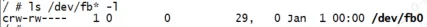
## 2.2 Framebuffer框架

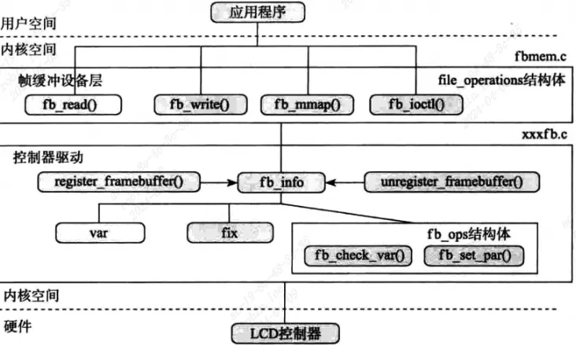
- `drivers/video/fbmem.c`：主要任务是创建`graphics类`、注册FB的字符设备驱动（主设备号是29）、提供`register_framebuffer`接口给具体framebuffer驱动编写着来注册fb设备的。
```c
#define FB_MAJOR		29   /* /dev/fb* framebuffers */
```

- `drivers/video/fbsys.c`：是`fbmem.c`引出来的，处理fb在`/sys/class/graphics/fb0`目录下的一些属性文件的。
    
- `xxx_fb.c`: 具体的显示设备控制器驱动代码，dts描述对应的显示设备，控制器去驱动显示设备。
    

## 2.3 Framebuffer数据结构

### 2.3.1 fb_info

fb_info结构体记录了帧缓冲设备的全部信息，包括设备的设置参数、状态以及操作函数指针，对于每一个帧缓冲设备都必须对应一个fb_info结构体实例。
```c
struct fb_info {  
	atomic_t count;  
	int node;  
	int flags;  
	struct mutex lock; /* 互斥锁 */  
	struct mutex mm_lock; /* 互斥锁，用于 fb_mmap 和 smem_*域*/  
	struct fb_var_screeninfo var; /* 当前可变参数 */  
	struct fb_fix_screeninfo fix; /* 当前固定参数 */  
	struct fb_monspecs monspecs; /* 当前显示器特性 */  
	struct work_struct queue; /* 帧缓冲事件队列 */  
	struct fb_pixmap pixmap; /* 图像硬件映射 */  
	struct fb_pixmap sprite; /* 光标硬件映射 */  
	struct fb_cmap cmap; /* 当前调色板 */  
	struct list_head modelist; /* 当前模式列表 */  
	struct fb_videomode *mode; /* 当前视频模式 */  
	#ifdef CONFIG_FB_BACKLIGHT /* 如果 LCD 支持背光的话 */  
	/* assigned backlight device */  
	/* set before framebuffer registration,  
	remove after unregister */  
	struct backlight_device *bl_dev; /* 背光设备 */  
	/* Backlight level curve */  
	struct mutex bl_curve_mutex;  
	u8 bl_curve[FB_BACKLIGHT_LEVELS];  
	#endif  
	...  
	struct fb_ops *fbops; /* 帧缓冲操作函数集 */  
	struct device *device; /* 父设备 */  
	struct device *dev; /* 当前 fb 设备 */  
	int class_flag; /* 私有 sysfs 标志 */  
	...  
	char __iomem *screen_base; /* 虚拟内存基地址(屏幕显存) */  
	unsigned long screen_size; /* 虚拟内存大小(屏幕显存大小) */  
	void *pseudo_palette; /* 伪 16 位调色板 */  
};
```

#### 2.3.1.1 fb_ops

帧缓冲操作函数集,包含open,release,read,write等操作函数。
```c
/*  
 * Frame buffer operations  
 *  
 * LOCKING NOTE: those functions must _ALL_ be called with the console  
 * semaphore held, this is the only suitable locking mechanism we have  
 * in 2.6. Some may be called at interrupt time at this point though.  
 *  
 * The exception to this is the debug related hooks.  Putting the fb  
 * into a debug state (e.g. flipping to the kernel console) and restoring  
 * it must be done in a lock-free manner, so low level drivers should  
 * keep track of the initial console (if applicable) and may need to  
 * perform direct, unlocked hardware writes in these hooks.  
 */  
struct fb_ops {  
	/* open/release and usage marking */  
	struct module *owner;  
	int (*fb_open)(struct fb_info *info, int user);  
	int (*fb_release)(struct fb_info *info, int user);  
	/* For framebuffers with strange non linear layouts or that do not  
	 * work with normal memory mapped access  
	 */  
	ssize_t (*fb_read)(struct fb_info *info, char __user *buf,  
			   size_t count, loff_t *ppos);  
	ssize_t (*fb_write)(struct fb_info *info, const char __user *buf,  
			    size_t count, loff_t *ppos);  
	/* checks var and eventually tweaks it to something supported,  
	 * DO NOT MODIFY PAR */  
	int (*fb_check_var)(struct fb_var_screeninfo *var, struct fb_info *info);  
	/* set the video mode according to info->var */  
	int (*fb_set_par)(struct fb_info *info);  
	/* set color register */  
	int (*fb_setcolreg)(unsigned regno, unsigned red, unsigned green,  
			    unsigned blue, unsigned transp, struct fb_info *info);  
	/* set color registers in batch */  
	int (*fb_setcmap)(struct fb_cmap *cmap, struct fb_info *info);  
	/* blank display */  
	int (*fb_blank)(int blank, struct fb_info *info);  
	/* pan display */  
	int (*fb_pan_display)(struct fb_var_screeninfo *var, struct fb_info *info);  
	/* Draws a rectangle */  
	void (*fb_fillrect) (struct fb_info *info, const struct fb_fillrect *rect);  
	/* Copy data from area to another */  
	void (*fb_copyarea) (struct fb_info *info, const struct fb_copyarea *region);  
	/* Draws a image to the display */  
	void (*fb_imageblit) (struct fb_info *info, const struct fb_image *image);  
	/* Draws cursor */  
	int (*fb_cursor) (struct fb_info *info, struct fb_cursor *cursor);  
	/* wait for blit idle, optional */  
	int (*fb_sync)(struct fb_info *info);  
	/* perform fb specific ioctl (optional) */  
	int (*fb_ioctl)(struct fb_info *info, unsigned int cmd,  
			unsigned long arg);  
	/* Handle 32bit compat ioctl (optional) */  
	int (*fb_compat_ioctl)(struct fb_info *info, unsigned cmd,  
			unsigned long arg);  
	/* perform fb specific mmap */  
	int (*fb_mmap)(struct fb_info *info, struct vm_area_struct *vma);  
	/* get capability given var */  
	void (*fb_get_caps)(struct fb_info *info, struct fb_blit_caps *caps,  
			    struct fb_var_screeninfo *var);  
	/* teardown any resources to do with this framebuffer */  
	void (*fb_destroy)(struct fb_info *info);  
	/* called at KDB enter and leave time to prepare the console */  
	int (*fb_debug_enter)(struct fb_info *info);  
	int (*fb_debug_leave)(struct fb_info *info);  
};
```

#### 2.3.1.2 fb_var_screeninfo

记录用户**可修改的显示控制器参数**，包括了屏幕的分辨率和每个像素点的比特数bpp,pixclock等。

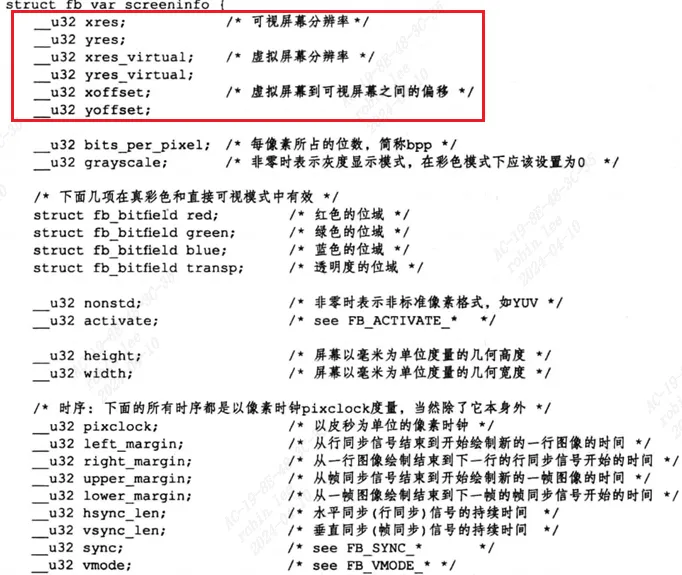
```c
struct fb_var_screeninfo {  
	__u32 xres;			/* visible resolution		*/  
	__u32 yres;  
	__u32 xres_virtual;		/* virtual resolution		*/  
	__u32 yres_virtual;  
	__u32 xoffset;			/* offset from virtual to visible */  
	__u32 yoffset;			/* resolution			*/  
  
	__u32 bits_per_pixel;		/* guess what			*/  
	__u32 grayscale;		/* 0 = color, 1 = grayscale,	*/  
					/* >1 = FOURCC			*/  
	struct fb_bitfield red;		/* bitfield in fb mem if true color, */  
	struct fb_bitfield green;	/* else only length is significant */  
	struct fb_bitfield blue;  
	struct fb_bitfield transp;	/* transparency			*/	  
  
	__u32 nonstd;			/* != 0 Non standard pixel format */  
  
	__u32 activate;			/* see FB_ACTIVATE_*		*/  
  
	__u32 height;			/* height of picture in mm    */  
	__u32 width;			/* width of picture in mm     */  
  
	__u32 accel_flags;		/* (OBSOLETE) see fb_info.flags */  
  
	/* Timing: All values in pixclocks, except pixclock (of course) */  
	__u32 pixclock;			/* pixel clock in ps (pico seconds) */  
	__u32 left_margin;		/* time from sync to picture	*/  
	__u32 right_margin;		/* time from picture to sync	*/  
	__u32 upper_margin;		/* time from sync to picture	*/  
	__u32 lower_margin;  
	__u32 hsync_len;		/* length of horizontal sync	*/  
	__u32 vsync_len;		/* length of vertical sync	*/  
	__u32 sync;			/* see FB_SYNC_*		*/  
	__u32 vmode;			/* see FB_VMODE_*		*/  
	__u32 rotate;			/* angle we rotate counter clockwise */  
	__u32 colorspace;		/* colorspace for FOURCC-based modes */  
	__u32 reserved[4];		/* Reserved for future compatibility */  
};
```

##### 2.3.1.2.1 引入可视屏幕和虚拟屏幕

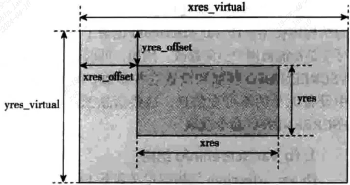
```c
(1)可视屏幕：LCD分辨率，这是硬件相关的。比如：LCD屏幕的分辨率是800x480，那可视屏幕的最大分辨率就是800x480；  
(2)虚拟屏幕：我们在内核中开辟的帧缓冲区的大小。比如：屏幕分辨率是800x480，但是我们可以将帧缓冲区开辟成1920x1080，  
    在刷新屏幕时可以直接将1080p的图像一次性刷新到帧缓冲区中；  
(3)虚拟屏到可视屏的偏移量：虚拟屏大小是超过可视屏幕的大小，偏移量决定了可视屏显示虚拟屏的哪一个部分；  
(4)总结：通过改变虚拟屏到可视屏的偏移量，可以将虚拟屏的不同部分图像显示到可视屏中，而不需要每次都刷新帧缓冲区；
```

#### 2.3.1.3 fb_fix_screeninfo

记录了用户**不能修改的显示控制器的参数**，比如说屏幕缓冲区的物理地址、长度。

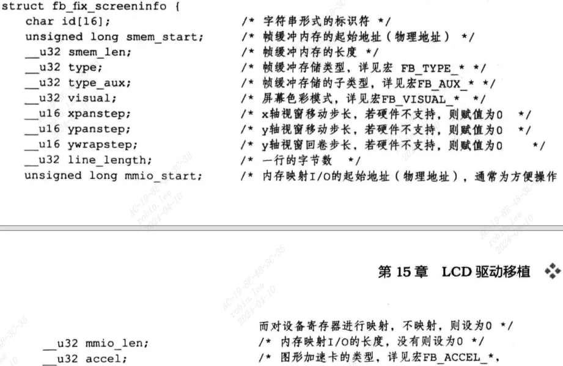
```c
struct fb_fix_screeninfo {  
    char id[16];            /* identification string eg "TT Builtin" */  
    unsigned long smem_start;    /* Start of frame buffer mem */  
                    /* (physical address) */  
    __u32 smem_len;            /* Length of frame buffer mem */  
    __u32 type;            /* see FB_TYPE_*        */  
    __u32 type_aux;            /* Interleave for interleaved Planes */  
    __u32 visual;            /* see FB_VISUAL_*        */   
    __u16 xpanstep;            /* zero if no hardware panning  */  
    __u16 ypanstep;            /* zero if no hardware panning  */  
    __u16 ywrapstep;        /* zero if no hardware ywrap    */  
    __u32 line_length;        /* length of a line in bytes    */  
    unsigned long mmio_start;    /* Start of Memory Mapped I/O   */  
                    /* (physical address) */  
    __u32 mmio_len;            /* Length of Memory Mapped I/O  */  
    __u32 accel;            /* Indicate to driver which    */  
                    /*  specific chip/card we have    */  
    __u16 capabilities;        /* see FB_CAP_*            */  
    __u16 reserved[2];        /* Reserved for future compatibility */  
};
```

#### 2.3.1.4 fb_bitfield

描述每一像素缓冲区的组织方式，包括域偏移、位域长度和MSB指示。
```c
struct fb_bitfield {  
    __u32 offset;            /* beginning of bitfield    */  
    __u32 length;            /* length of bitfield        */  
    __u32 msb_right;        /* != 0 : Most significant bit is */   
                    /* right */   
};
```

## 2.4 Framebuffer源码分析

### 2.4.1 编写fb驱动大致流程

1. 构建fb_info结构体
2. `register_framebuffer`注册`fb_info`到`fb框架`中，驱动框架会自动创建`/dev/fbx`设备节点
3. app通过open、ioctl等函数接口去操作设备节点`/dev/fb0`，驱动框架就会调用fb_info实例化中对应的open、ioctl接口去完成具体的硬件操作。

### 2.4.2 fb子系统注册卸载

如果定义了`MODULE`宏就表示要fb子系统单独编译成ko文件，否则用`subsys_initcall`编译进内核。入口在`drivers\video\fbdev\core\fbmem.c`

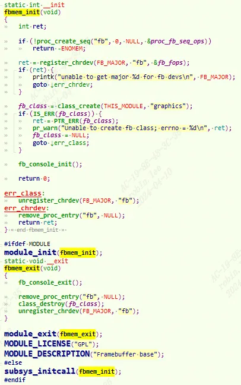
1. 创建proc条目`/proc/fb`
    
2. 注册成字符设备，fb主设备号定义在`include\uapi\linux\major.h`
    
    `#define FB_MAJOR 29 /* /dev/fb* framebuffers */`
    
3. 建立`graphics`类。
    

#### 2.4.2.1 fb注册卸载相关函数

##### 2.4.2.1.1 framebuffer_alloc
```c
struct fb_info *framebuffer_alloc(size_t size, struct device *dev)  
{  
//计算私有数据起始地址需要补齐的字节数  
#define BYTES_PER_LONG (BITS_PER_LONG/8)  
#define PADDING (BYTES_PER_LONG - (sizeof(struct fb_info) % BYTES_PER_LONG))  
	  
	int fb_info_size = sizeof(struct fb_info);  
	struct fb_info *info;  
	char *p;  
	if (size)  
		fb_info_size += PADDING;  
  
	//申请内存  
	p = kzalloc(fb_info_size + size, GFP_KERNEL);  
	if (!p)  
		return NULL;  
	info = (struct fb_info *) p;  
  
	//将申请的私有数据的地址赋值给info->par  
	if (size)  
		info->par = p + fb_info_size;  
  
	//设备的父节点  
	info->device = dev;  
#ifdef CONFIG_FB_BACKLIGHT  
	mutex_init(&info->bl_curve_mutex);  
#endif  
	return info;  
#undef PADDING  
#undef BYTES_PER_LONG  
}
```

```c
(1)famebuffer_alloc函数是用来申请一个struct fb_info结构体的，传参的size是设备私有数据的大小；  
(2)申请sizeof(struct fb_info) + PADDING + size大小的空间分配给fb_info结构体类型的指针info，  
	加上PADDING 字节是为了后面的设备私有数据保持BYTES_PER_LONG字节对齐；  
(3)将fb_info结构体后面size大小且BYTES_PER_LONG 字节的设备私有数据地址赋值info->par;  
(4)将传入的参数dev赋值给info->device，作为父设备；  
(5)返回创建好的struct fb_into结构体指针info；
```

##### 2.4.2.1.2 register_framebuffer
```c
int register_framebuffer(struct fb_info *fb_info) {  
	int i;  
	struct fb_event event;  
	struct fb_videomode mode;  
  
	//检查已经注册的帧缓冲设备是否已经达到上限  
	if (num_registered_fb == FB_MAX)  
		return -ENXIO;  
  
	//判断 fb_ info->flags 标志中关于控制器大小端的设置是否正确  
	if (fb_check_foreignness(fb_info))  
		return -ENOSYS;  
  
	//在registered_fb数组中找一个空闲的变量  
	num_registered_fb++;  
	for (i = 0 ; i < FB_MAX; i++)  
		if (!registered_fb[i])  
			break;  
  
	//将申请到的变量在数组中的下标赋值给fb_info->node  
	fb_info->node = i;  
		  
	mutex_init(&fb_info->lock);  
	mutex_init(&fb_info->mm_lock);  
  
	//创建帧缓冲设备  
	fb_info->dev = device_create(fb_class, fb_info->device,  
				     MKDEV(FB_MAJOR, i), NULL, "fb%d", i);  
	  
	if (IS_ERR(fb_info->dev)) {  
		printk(KERN_WARNING "Unable to create device for framebuffer %d; errno = %ld\n",   
               i, PTR_ERR(fb_info->dev));  
		fb_info->dev = NULL;  
	} else  
		//初始化帧缓冲设备，创建更多设备属性文件  
		fb_init_device(fb_info);  
  
	//初始化fb_info->pixmap，该变量的作用是将用于显示的硬件无关数据转换为设备需要的格式  
	if (fb_info->pixmap.addr == NULL) {  
		fb_info->pixmap.addr = kmalloc(FBPIXMAPSIZE, GFP_KERNEL);  
		if (fb_info->pixmap.addr) {  
			fb_info->pixmap.size = FBPIXMAPSIZE;  
			fb_info->pixmap.buf_align = 1;  
			fb_info->pixmap.scan_align = 1;  
			fb_info->pixmap.access_align = 32;  
			fb_info->pixmap.flags = FB_PIXMAP_DEFAULT;  
		}  
	}	  
	fb_info->pixmap.offset = 0;  
  
	if (!fb_info->pixmap.blit_x)  
		fb_info->pixmap.blit_x = ~(u32)0;  
  
	if (!fb_info->pixmap.blit_y)  
		fb_info->pixmap.blit_y = ~(u32)0;  
  
	//初始化显示模式链表 fb_ info->modelist  
	if (!fb_info->modelist.prev | !fb_info->modelist.next)  
		INIT_LIST_HEAD(&fb_info->modelist);  
  
	//根据fb_info->var设置一个 mode  
	fb_var_to_videomode(&mode, &fb_info->var);  
  
	//将该mode添加到fb_info->modelist中  
	fb_add_videomode(&mode, &fb_info->modelist);  
  
	//将fb_info注册到registered_fb结构体中  
	registered_fb[i] = fb_info;  
  
	event.info = fb_info;  
	if (!lock_fb_info(fb_info))  
		return -ENODEV;  
  
	//〕通知发生了FB_EVENT_FB_REGISTERED事件(帧缓冲设备注册事件)  
	fb_notifier_call_chain(FB_EVENT_FB_REGISTERED, &event);  
	unlock_fb_info(fb_info);  
	return 0;  
}
```

##### 2.4.2.1.3 unregister_framebuffer
```c
int unregister_framebuffer(struct fb_info *fb_info) {  
	struct fb_event event;  
	int i, ret = 0;  
	//检查传入的fb_info是否已经注册过  
	i = fb_info->node;  
	if (!registered_fb[i]) {  
		ret = -EINVAL;  
		goto done;  
	}  
  
	if (!lock_fb_info(fb_info))  
		return -ENODEV;  
	event.info = fb_info;  
  
	//通知发生FB_EVENT_FB_UNBIND事件，绑定了该帧缓冲设备的都解绑  
	ret = fb_notifier_call_chain(FB_EVENT_FB_UNBIND, &event);  
	unlock_fb_info(fb_info);  
  
	if (ret) {  
		ret = -EINVAL;  
		goto done;  
	}  
  
	//释放掉申请的fb_info->pixmap.addr  
	if (fb_info->pixmap.addr &&  
	    (fb_info->pixmap.flags & FB_PIXMAP_DEFAULT))  
		kfree(fb_info->pixmap.addr);  
  
	//销毁fb_info->modelist模式链表  
	fb_destroy_modelist(&fb_info->modelist);  
  
	//将占用的registered_fb数组中的变量置为NULL，表示空闲  
	registered_fb[i]=NULL;  
  
	//内核中注册的帧缓冲设备数量减一  
	num_registered_fb--;  
  
	//销毁点帧缓冲设备的属性文件  
	fb_cleanup_device(fb_info);  
  
	//销毁掉帧缓冲设备  
	device_destroy(fb_class, MKDEV(FB_MAJOR, i));  
	event.info = fb_info;  
  
	//通知发生了FB_EVENT_FB_UNREGISTERED事件，表示该帧缓冲设备已经被注销掉  
	fb_notifier_call_chain(FB_EVENT_FB_UNREGISTERED, &event);  
  
	//如果fb_info结构体中有销毁函数就调用销毁函数  
	/* this may free fb info */  
	if (fb_info->fbops->fb_destroy)  
		fb_info->fbops->fb_destroy(fb_info);  
done:  
	return ret;  
}
```

### 2.4.3 fb_ops分析

`fb_ops`中的操作函数属于框架部分，并不和具体的硬件相关，在进行一些处理后最后都是调用`struct fb_info`结构体中`fb_ops`定义的操作方法；

!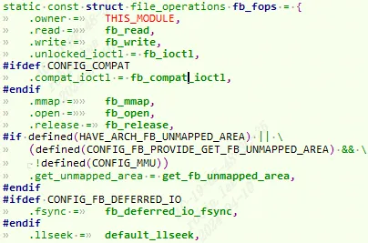
#### 2.4.3.1 fb_open
```c
static int fb_open(struct inode *inode, struct file *file)  
__acquires(&info->lock)  
__releases(&info->lock)  
{  
	//获取次设备号  
	int fbidx = iminor(inode);  
	  
	struct fb_info *info;  
	int res = 0;  
  
	//判断次设备号是否在合法范围  
	if (fbidx >= FB_MAX)  
		return -ENODEV;  
  
	//根据次设备号找到对应的struct fb_info结构体指针  
	info = registered_fb[fbidx];  
	if (!info)  
		//如果数组下标fbidx的变量是NULL，手动加载帧缓冲设备  
		request_module("fb%d", fbidx);  
  
	//再次从registered_fb数组中获取对应的struct fb_info结构体指针  
	info = registered_fb[fbidx];  
	if (!info)  
		return -ENODEV;  
	mutex_lock(&info->lock);  
	if (!try_module_get(info->fbops->owner)) {  
		res = -ENODEV;  
		goto out;  
	}  
  
	//将struct fb_info结构体指针保存到struct file结构体的私有数据指针中，后续的接口会用到  
	file->private_data = info;  
  
	//调用帧缓冲设备驱动的fb_open函数  
	if (info->fbops->fb_open) {  
		res = info->fbops->fb_open(info,1);  
		if (res)  
			module_put(info->fbops->owner);  
	}  
out:  
	mutex_unlock(&info->lock);  
	return res;  
}
```

#### 2.4.3.2 fb_write
```c
static ssize_t fb_write(struct file *file, const char __user *buf, size_t count, loff_t *ppos){  
	//显示的偏移量  
	unsigned long p = *ppos;  
  
	//获取到设备节点的struct inode结构体  
	struct inode *inode = file->f_path.dentry->d_inode;  
  
	//从inode节点中获取次设备号  
	int fbidx = iminor(inode);  
  
	//以次设备号为下标在registered_fb数组中获取到对应的struct fb_info结构体指针  
	struct fb_info *info = registered_fb[fbidx];  
	  
	u32 *buffer, *src;  
	u32 __iomem *dst;  
	int c, i, cnt = 0, err = 0;  
	unsigned long total_size;  
  
	if (!info | !info->screen_base)  
		return -ENODEV;  
  
	if (info->state != FBINFO_STATE_RUNNING)  
		return -EPERM;  
  
	//如果帧缓冲设备驱动中的struct fb_ops中有定义写帧缓冲的方法就执行  
	if (info->fbops->fb_write)  
		return info->fbops->fb_write(info, buf, count, ppos);  
  
	/*************执行通用的写帧缓冲的方法*************/  
	//虚拟内存的大小  
	total_size = info->screen_size;  
  
	if (total_size == 0)  
		total_size = info->fix.smem_len;  
  
	if (p > total_size)  
		return -EFBIG;  
  
	if (count > total_size) {  
		err = -EFBIG;  
		count = total_size;  
	}  
  
	//检查偏移量加上写入数据的大小是否超过虚拟内存的大小  
	if (count + p > total_size) {  
		if (!err)  
			err = -ENOSPC;  
  
		count = total_size - p;  
	}  
  
	buffer = kmalloc((count > PAGE_SIZE) ? PAGE_SIZE : count,  
			 GFP_KERNEL);  
	if (!buffer)  
		return -ENOMEM;  
  
	//得到要写入帧缓冲区的起始地址:帧缓冲虚拟起始地址加上偏移量  
	dst = (u32 __iomem *) (info->screen_base + p);  
  
	//对于某些帧缓冲设备来说，必须等待它完成之前的显示处理操作，  
	//才能继续向帧缓冲中送入显示数据，该方t法用于该过程的同步  
	if (info->fbops->fb_sync)  
		info->fbops->fb_sync(info);  
  
	//向帧缓冲写入count个字节数据，如果写入的数据超过一个页的大小，则分多次写入  
	while (count) {  
		//将预写数据依次读到buffer中，每次写数据不超过PAGE_SIZE大小  
		c = (count > PAGE_SIZE) ? PAGE_SIZE : count;  
		src = buffer;  
  
		//把数据从用户空间拷贝到内核空间  
		if (copy_from_user(src, buf, c)) {  
			err = -EFAULT;  
			break;  
		}  
		//将数据写入到目标帧缓冲区地址  
		for (i = c >> 2; i--; )  
			fb_writel(*src++, dst++);  
		if (c & 3) {  
			u8 *src8 = (u8 *) src;  
			u8 __iomem *dst8 = (u8 __iomem *) dst;  
			for (i = c & 3; i--; )  
				fb_writeb(*src8++, dst8++);  
			dst = (u32 __iomem *) dst8;  
		}  
		*ppos += c;  
		buf += c;  
		cnt += c;  
		count -= c;  
	}  
	kfree(buffer);  
	return (cnt) ? cnt : err;  
}
```

#### 2.4.3.3 fb_mmap
```c
static int fb_mmap(struct file *file, struct vm_area_struct * vma){  
	//获取次设备号  
	int fbidx = iminor(file->f_path.dentry->d_inode);  
	//根据次设备号获取到struct fb_info 结构体  
	struct fb_info *info = registered_fb[fbidx];  
	//得到驱动的fbops操作方法  
	struct fb_ops *fb = info->fbops;  
	unsigned long off;  
	unsigned long start;  
	u32 len;  
	if (vma->vm_pgoff > (~0UL >> PAGE_SHIFT))  
		return -EINVAL;  
	off = vma->vm_pgoff << PAGE_SHIFT;  
	if (!fb)  
		return -ENODEV;  
	mutex_lock(&info->mm_lock);  
	//如果fb_ops中实现了mmap方法，则调用之  
	if (fb->fb_mmap) {  
		int res;  
		res = fb->fb_mmap(info, vma);  
		mutex_unlock(&info->mm_lock);  
		return res;  
	}  
  
	/*******下面是通用的mmap方法********/  
	/* 获取映射帧缓冲的物理起始地址和长度 */  
	start = info->fix.smem_start;  
	len = PAGE_ALIGN((start & ~PAGE_MASK) + info->fix.smem_len);  
	if (off >= len) {  
		/* 如果off大于帧缓冲长度．则认为映射的是内存映射IO */  
		off -= len;  
		if (info->var.accel_flags) {  
			mutex_unlock(&info->mm_lock);  
			return -EINVAL;  
		}  
		//获取内存映射IO的物理起始地址和长度  
		start = info->fix.mmio_start;  
		len = PAGE_ALIGN((start & ~PAGE_MASK) + info->fix.mmio_len);  
	}  
	mutex_unlock(&info->mm_lock);  
	//保证页对齐  
	start &= PAGE_MASK;  
	if ((vma->vm_end - vma->vm_start + off) > len)  
		return -EINVAL;  
	//现在off表示映射设备内存实际的物理地址  
	off += start;  
	vma->vm_pgoff = off >> PAGE_SHIFT;  
	/* This is an IO map - tell maydump to skip this VMA */  
	vma->vm_flags |= VM_IO | VM_RESERVED;  
	//置页保护标识  
	fb_pgprotect(file, vma, off);  
	//建立从物理页帧号为 off》PAGE SH 工FT的物理内存，到虚拟地址为 vma->vm start 、  
	//大小为 vma->vm_end - vma->vm_start 、页保护标志为 vma->vm_page_prot的映射  
	if (io_remap_pfn_range(vma, vma->vm_start, off >> PAGE_SHIFT,  
			     vma->vm_end - vma->vm_start, vma->vm_page_prot))  
		return -EAGAIN;  
	return 0;  
}
```

#### 2.4.3.4 fb_ioctl

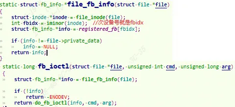

| 宏定义                 | 功能说明               |
| ------------------- | ------------------ |
| FBIOGET_VSCREENINFO | 获取屏幕可变参数           |
| FBIOPUT_VSCREENINFO | 设置屏幕可变参数           |
| FBIOGET_FSCREENINFO | 获取屏幕固定参数           |
| FBIOPUTCMAP         | 设置颜色表              |
| FBIOGETCMAP         | 获取颜色表              |
| FBIOPAN_DISPLAY     | 动视窗显示              |
| FBIO_CURSOR         | 光标设置，目前不支持         |
| FBIOGET_CON2FBMAP   | 获取指定帧缓冲控制台对应的帧缓冲设备 |
| FBIOPUT_CON2FBMAP   | 置指定的帧缓冲控制台对应的帧缓冲设备 |
| FBIOBLANK           | 显示空白               |

# 3 Framebuffer驱动实例

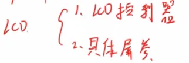
## 3.1定义fb_info实例

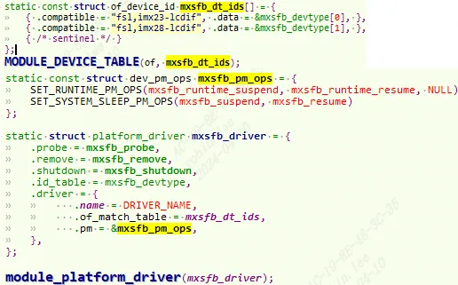
以飞思卡尔nxp的LCD控制器来说，叫做`lcdif`。位于`drivers/video/fbdev/mxsfb.c`,以像素时钟模式为例：

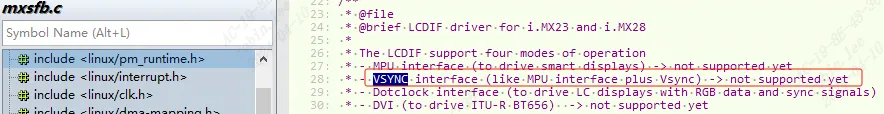
### 3.1.0 控制器dts配置

打开`imx6ull.dtsi`：
```c
lcdif: lcdif@021c8000 {  
        compatible = "fsl,imx6u  l-lcdif", "fsl,imx28-lcdif";  
        reg = <0x021c8000 0x4000>;  
        interrupts = <GIC_SPI 5 IRQ_TYPE_LEVEL_HIGH>;  
        clocks = <&clks IMX6UL_CLK_LCDIF_PIX>,  
                 <&clks IMX6UL_CLK_LCDIF_APB>,  
                 <&clks IMX6UL_CLK_DUMMY>;  
        clock-names = "pix", "axi", "disp_axi";  
        status = "disabled";  
};
```

`compatible`匹配，`probe`执行。

### 3.1.1 mxsfb_probe过程分析
```c
static int mxsfb_probe(struct platform_device *pdev){  
	const struct of_device_id *of_id =  
			of_match_device(mxsfb_dt_ids, &pdev->dev);  
	struct resource *res;  
	struct mxsfb_info *host;  
	struct fb_info *fb_info;  
	struct pinctrl *pinctrl;  
	int irq = platform_get_irq(pdev, 0);  
	int gpio, ret;  
	if (of_id)  
		pdev->id_entry = of_id->data;  
	gpio = of_get_named_gpio(pdev->dev.of_node, "enable-gpio", 0);  
	if (gpio == -EPROBE_DEFER)  
		return -EPROBE_DEFER;  
	if (gpio_is_valid(gpio)) {  
		ret = devm_gpio_request_one(&pdev->dev, gpio, GPIOF_OUT_INIT_LOW, "lcd_pwr_en");  
		if (ret) {  
			dev_err(&pdev->dev, "faild to request gpio %d, ret = %d\n", gpio, ret);  
			return ret;  
		}  
	}  
	res = platform_get_resource(pdev, IORESOURCE_MEM, 0);  
	if (!res) {  
		dev_err(&pdev->dev, "Cannot get memory IO resource\n");  
		return -ENODEV;  
	}  
	host = devm_kzalloc(&pdev->dev, sizeof(struct mxsfb_info), GFP_KERNEL);  
	if (!host) {  
		dev_err(&pdev->dev, "Failed to allocate IO resource\n");  
		return -ENOMEM;  
	}  
	fb_info = framebuffer_alloc(sizeof(struct fb_info), &pdev->dev);  
	if (!fb_info) {  
		dev_err(&pdev->dev, "Failed to allocate fbdev\n");  
		devm_kfree(&pdev->dev, host);  
		return -ENOMEM;  
	}  
	host->fb_info = fb_info;  
	fb_info->par = host;  
	ret = devm_request_irq(&pdev->dev, irq, mxsfb_irq_handler, 0,  
			  dev_name(&pdev->dev), host);  
	if (ret) {  
		dev_err(&pdev->dev, "request_irq (%d) failed with error %d\n",  
				irq, ret);  
		ret = -ENODEV;  
		goto fb_release;  
	}  
  
	host->base = devm_ioremap_resource(&pdev->dev, res);  
	if (IS_ERR(host->base)) {  
		dev_err(&pdev->dev, "ioremap failed\n");  
		ret = PTR_ERR(host->base);  
		goto fb_release;  
	}  
	host->pdev = pdev;  
	platform_set_drvdata(pdev, host);  
  
	host->devdata = &mxsfb_devdata[pdev->id_entry->driver_data];  
	host->clk_pix = devm_clk_get(&host->pdev->dev, "pix");  
	if (IS_ERR(host->clk_pix)) {  
		host->clk_pix = NULL;  
		ret = PTR_ERR(host->clk_pix);  
		goto fb_release;  
	}  
  
	host->clk_axi = devm_clk_get(&host->pdev->dev, "axi");  
	if (IS_ERR(host->clk_axi)) {  
		host->clk_axi = NULL;  
		ret = PTR_ERR(host->clk_axi);  
		goto fb_release;  
	}  
  
	host->clk_disp_axi = devm_clk_get(&host->pdev->dev, "disp_axi");  
	if (IS_ERR(host->clk_disp_axi)) {  
		host->clk_disp_axi = NULL;  
		ret = PTR_ERR(host->clk_disp_axi);  
		goto fb_release;  
	}  
  
	host->reg_lcd = devm_regulator_get(&pdev->dev, "lcd");//电流整流:和电源管理有关，实现低功耗  
	if (IS_ERR(host->reg_lcd))  
		host->reg_lcd = NULL;  
  
	fb_info->pseudo_palette = devm_kzalloc(&pdev->dev, sizeof(u32) * 16,  
					       GFP_KERNEL);  
	if (!fb_info->pseudo_palette) {  
		ret = -ENOMEM;  
		goto fb_release;  
	}  
  
	INIT_LIST_HEAD(&fb_info->modelist);  
  
	pm_runtime_enable(&host->pdev->dev);  
  
	ret = mxsfb_init_fbinfo(host);  
	if (ret != 0)  
		goto fb_pm_runtime_disable;  
  
	mxsfb_dispdrv_init(pdev, fb_info);  
	if (!host->dispdrv) {  
		pinctrl = devm_pinctrl_get_select_default(&pdev->dev);  
		if (IS_ERR(pinctrl)) {  
			ret = PTR_ERR(pinctrl);  
			goto fb_pm_runtime_disable;  
		}  
	}  
  
	if (!host->enabled) {  
		writel(0, host->base + LCDC_CTRL);  
		mxsfb_set_par(fb_info);  
		mxsfb_enable_controller(fb_info);  
		pm_runtime_get_sync(&host->pdev->dev);  
	}  
  
	ret = register_framebuffer(fb_info);  
	if (ret != 0) {  
		dev_err(&pdev->dev, "Failed to register framebuffer\n");  
		goto fb_destroy;  
	}  
	console_lock();  
	ret = fb_blank(fb_info, FB_BLANK_UNBLANK);  
	console_unlock();  
	if (ret < 0) {  
		dev_err(&pdev->dev, "Failed to unblank framebuffer\n");  
		goto fb_unregister;  
	}  
	dev_info(&pdev->dev, "initialized\n");  
	return 0;  
fb_unregister:  
	unregister_framebuffer(fb_info);  
fb_destroy:  
	if (host->enabled)  
		clk_disable_unprepare(host->clk_pix);  
	fb_destroy_modelist(&fb_info->modelist);  
fb_pm_runtime_disable:  
	pm_runtime_disable(&host->pdev->dev);  
	devm_kfree(&pdev->dev, fb_info->pseudo_palette);  
fb_release:  
	framebuffer_release(fb_info);  
	devm_kfree(&pdev->dev, host);  
	return ret;  
}
```

1. `host` 结构体指针变量，表示`LDCIF`控制器，包含Framebuffer设备详细信息，比如`时钟`、`eLCDIF` 控制器`寄存器基地址`、`fb_info` 等。
    
2. 从dts中提取`gpio, irq, res,时钟`等信息。初始化`host, fb_info`等结构体。
    
3. `host->base = devm_ioremap_resource(&pdev->dev, res);`对io内存进行`ioremap`, 把`eLCDIF` 控制器地址映射成虚拟地址。
    
4. `mxsfb_init_fbinfo`:
    
    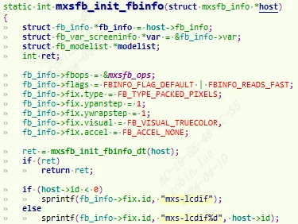
    1. 设置`eLCDIF`控制器具体的`fb_ops`
```c
static struct fb_ops mxsfb_ops = {  
	.owner = THIS_MODULE,  
	.fb_check_var = mxsfb_check_var,  
	.fb_set_par = mxsfb_set_par,  
	.fb_setcolreg = mxsfb_setcolreg,  
	.fb_ioctl = mxsfb_ioctl,  
	.fb_blank = mxsfb_blank,  
	.fb_pan_display = mxsfb_pan_display,  
	.fb_mmap = mxsfb_mmap,  
	.fb_fillrect = cfb_fillrect,  
	.fb_copyarea = cfb_copyarea,  
	.fb_imageblit = cfb_imageblit,  
};
```
        
    2. 从dts获取LCD 的各个参数信息，然后调用`mxsfb_map_videomem`申请framebuffer空间，也就是显存。
        
5. `fb_videomode_to_var`设置ldc的可变属性
    
6. 设置控制器寄存器信息
```c
writel(0, host->base + LCDC_CTRL);  
mxsfb_set_par(fb_info);  
mxsfb_enable_controller(fb_info);
```
    
7. 调用 `register_framebuffer` 函数向 Linux 内核注册 `fb_info`。
    

在`mxsfb.c`中已经定义了 `eLCDIF` 控制器各个寄存器相比于基地址的偏移值：
```c
#define LCDC_CTRL			0x00  
#define LCDC_CTRL1			0x10  
#define LCDC_V4_CTRL2			0x20  
#define LCDC_V3_TRANSFER_COUNT		0x20  
#define LCDC_V4_TRANSFER_COUNT		0x30  
#define LCDC_V4_CUR_BUF			0x40  
#define LCDC_V4_NEXT_BUF		0x50  
#define LCDC_V3_CUR_BUF			0x30  
#define LCDC_V3_NEXT_BUF		0x40  
#define LCDC_TIMING			0x60  
#define LCDC_VDCTRL0			0x70  
#define LCDC_VDCTRL1			0x80  
#define LCDC_VDCTRL2			0x90  
#define LCDC_VDCTRL3			0xa0  
#define LCDC_VDCTRL4			0xb0  
#define LCDC_DVICTRL0			0xc0  
#define LCDC_DVICTRL1			0xd0  
#define LCDC_DVICTRL2			0xe0  
#define LCDC_DVICTRL3			0xf0  
#define LCDC_DVICTRL4			0x100  
#define LCDC_V4_DATA			0x180  
#define LCDC_V3_DATA			0x1b0  
#define LCDC_V4_DEBUG0			0x1d0  
#define LCDC_V3_DEBUG0			0x1f0
```

## 3.2 LCD屏幕dts描述

### 3.2.1 屏幕 IO 配置

除了`eLCDIF` 控制器，对LCD设备也需要进行描述，主要是引脚pinmux。比如`imx6ull-alientek-emmc.dts`这块板子对应的LCD屏幕使用引脚如下，`iomuxc` 节点下有如下节点：
```c
pinctrl_lcdif_dat: lcdifdatgrp {//数据引脚，24根，rgb888  
        fsl,pins = <  
                MX6UL_PAD_LCD_DATA00__LCDIF_DATA00  0x79  
                MX6UL_PAD_LCD_DATA01__LCDIF_DATA01  0x79  
                MX6UL_PAD_LCD_DATA02__LCDIF_DATA02  0x79  
                MX6UL_PAD_LCD_DATA03__LCDIF_DATA03  0x79  
                MX6UL_PAD_LCD_DATA04__LCDIF_DATA04  0x79  
                MX6UL_PAD_LCD_DATA05__LCDIF_DATA05  0x79  
                MX6UL_PAD_LCD_DATA06__LCDIF_DATA06  0x79  
                MX6UL_PAD_LCD_DATA07__LCDIF_DATA07  0x79  
                MX6UL_PAD_LCD_DATA08__LCDIF_DATA08  0x79  
                MX6UL_PAD_LCD_DATA09__LCDIF_DATA09  0x79  
                MX6UL_PAD_LCD_DATA10__LCDIF_DATA10  0x79  
                MX6UL_PAD_LCD_DATA11__LCDIF_DATA11  0x79  
                MX6UL_PAD_LCD_DATA12__LCDIF_DATA12  0x79  
                MX6UL_PAD_LCD_DATA13__LCDIF_DATA13  0x79  
                MX6UL_PAD_LCD_DATA14__LCDIF_DATA14  0x79  
                MX6UL_PAD_LCD_DATA15__LCDIF_DATA15  0x79  
                MX6UL_PAD_LCD_DATA16__LCDIF_DATA16  0x79  
                MX6UL_PAD_LCD_DATA17__LCDIF_DATA17  0x79  
                MX6UL_PAD_LCD_DATA18__LCDIF_DATA18  0x79  
                MX6UL_PAD_LCD_DATA19__LCDIF_DATA19  0x79  
                MX6UL_PAD_LCD_DATA20__LCDIF_DATA20  0x79  
                MX6UL_PAD_LCD_DATA21__LCDIF_DATA21  0x79  
                MX6UL_PAD_LCD_DATA22__LCDIF_DATA22  0x79  
                MX6UL_PAD_LCD_DATA23__LCDIF_DATA23  0x79  
        >;  
};  
pinctrl_lcdif_ctrl: lcdifctrlgrp {//控制引脚，hsync vsync pixclk en等...  
        fsl,pins = <  
                MX6UL_PAD_LCD_CLK__LCDIF_CLK        0x79  
                MX6UL_PAD_LCD_ENABLE__LCDIF_ENABLE  0x79  
                MX6UL_PAD_LCD_HSYNC__LCDIF_HSYNC    0x79  
                MX6UL_PAD_LCD_VSYNC__LCDIF_VSYNC    0x79  
        >;  
};  
pinctrl_pwm1: pwm1grp {//背光亮度  
        fsl,pins = <  
                MX6UL_PAD_GPIO1_IO08__PWM1_OUT   0x110b0  
        >;  
};
```

以及iomixc_snvs下有一个reset节点：

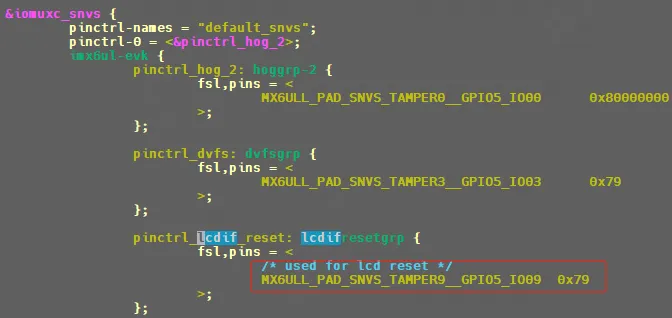
```c
pinctrl_lcdif_dat，为 RGB LCD 的 24 根数据线配置项  
pinctrl_lcdif_ctrl，RGB LCD 的 4 根控制线配置项，包括 CLK、 ENABLE、VSYNC 和 HSYNC  
pinctrl_pwm1，LCD 背光 PWM 引脚配置项
```

可以看到控制和数据引脚的电器属性默认nxp都帮我们设置成了0x79。

### 3.2.2 屏幕节点
```c
&lcdif {  
	pinctrl-names = "default";  
	pinctrl-0 = <&pinctrl_lcdif_dat /* 使用到的 IO */  
            &pinctrl_lcdif_ctrl  
            &pinctrl_lcdif_reset>;  
	display = <&display0>;  
	status = "okay";  
	display0: display { /* LCD 属性信息 */  
		bits-per-pixel = <16>; /* 一个像素占用几个 bit */  
		bus-width = <24>; /* 总线宽度 */  
		display-timings {  
			native-mode = <&timing0>; /* 时序信息 */  
			timing0: timing0 {  
				clock-frequency = <9200000>; /* LCD 像素时钟，单位 Hz */  
				hactive = <480>; /* LCD X 轴像素个数 */  
				vactive = <272>; /* LCD Y 轴像素个数 */  
				hfront-porch = <8>; /* LCD hfp 参数 */  
				hback-porch = <4>; /* LCD hbp 参数 */  
				hsync-len = <41>; /* LCD hspw 参数 */  
				vback-porch = <2>; /* LCD vbp 参数 */  
				vfront-porch = <4>; /* LCD vfp 参数 */  
				vsync-len = <10>; /* LCD vspw 参数 */  
				hsync-active = <0>; /* hsync 数据线极性 */  
				vsync-active = <0>; /* vsync 数据线极性 */  
				de-active = <1>; /* de 数据线极性 */  
				pixelclk-active = <0>; /* clk 数据线先极性 */  
			};  
		};  
	};  
};
```

`display0` 子节点，描述 LCD 的参数信息，包括`bpp, bus-width`,时序特性，这些参数跟随具体的屏厂屏幕规格走。例如另一款屏幕`ATK7016(7 寸 1024*600)`屏幕：可以看到这款屏幕是`RGB888`的，`bpp是3byte`。

### 3.2.3 背光节点

LCD 背光要用到 `PWM1`，因此也要设置 `PWM1` 节点，如果背光只用简单的`gpio`，那么只能控制亮灭。无法控制亮度, 在`imx6ull.dtsi`文件中找到`pwm1`描述：
```c
pwm1: pwm@02080000 {  
	compatible = "fsl,imx6ul-pwm", "fsl,imx27-pwm";  
	reg = <0x02080000 0x4000>;  
	interrupts = <GIC_SPI 83 IRQ_TYPE_LEVEL_HIGH>;  
	clocks = <&clks IMX6UL_CLK_PWM1>,  
			<&clks IMX6UL_CLK_PWM1>;  
	clock-names = "ipg", "per";  
	#pwm-cells = <2>;  
};
```

imx6ull 的 PWM 驱动文件为 `drivers/pwm/pwm-imx.c`。只要会使用pwm1即可，打开`imx6ull-alientek-emmc.dts`这块板子：

往pwm1添加如下内容,设置好pwm1对应的引脚：
```c
&pwm1 {  
	pinctrl-names = "default";  
	pinctrl-0 = <&pinctrl_pwm1>;  
	status = "okay";  
};
```

也就是`MX6UL_PAD_GPIO1_IO08__PWM1_OUT`，将`gpio1_8`设成pwm输出。

#### 3.2.3.1 backlight设置

我们还需要一个节点来将 `LCD 背光`和 `PWM1_OUT` 连接起来。这个节点就是 `backlight` ， `backlight` 节点描述可以参考 `Documentation/devicetree/indings/video/backlight/pwm-backlight.txt`。
```c
backlight {  
	compatible = "pwm-backlight";  
	pwms = <&pwm1 0 5000000>;  
	brightness-levels = <0 4 8 16 32 64 128 255>;  
	default-brightness-level = <6>;  
	status = "okay";  
};
```

1. 设置背 `8 级背光(0~7)`，分别为 `0、4、8、16、32、64、128、255`，对应占空比为 `0%、1.57%、3.13%、6.27%、12.55%、25.1%、50.19%、100%`，如果嫌少的话可以自行添加一 些其他的背光等级值。
    
2. 设置默认背光等级为 6，也就是 `50.19%`的亮度
    

backlight 节点说明：
```c
1. 节点名称要为“backlight”  
2. compatible 属性值要为“pwm-backlight”，因此可以通过在 Linux 内核中搜索 “ pwm-backlight ”   
	来查找PWM背光控制驱动程序 ， 文件为 drivers/video/backlight/pwm_bl.c  
3. pwms属性用于描述背光所使用的PWM以及PWM频率，比如本章我们要使用的pwm1， pwm 频率设置为 200Hz  
4. brightness-levels 属性描述亮度级别，范围为 0~255，0 表示 PWM 占空比为 0%，也就 是亮度最低，  
	255 表示 100%占空比，也就是亮度最高  
5. default-brightness-level 属性为默认亮度级别
```

# 4 LCD测试

## 4.1 使能 Linux logo

Linux 内核启动的时候可以选择显示小企鹅 logo，一般默认关闭。
```c
-> Device Drivers  
	-> Graphics support  
		-> Bootup logo (LOGO [=y])  
                -> Standard black and white Linux logo  
                -> Standard 16-color Linux logo  
                -> Standard 224-color Linux logo
```

三个选项分别对应黑白、16 位、24 位色彩格式的 logo，我们把这三个都选 中，都编译进 Linux 内核里面。

## 4.2 LCD 作为终端控制台console

1. u-boot中bootargs设置
    
    `setenv bootargs 'console=tty1 console=ttymxc0,115200 root=/dev/nfs rw nfsroot=192.168.1.250: /home/zuozhongkai/linux/nfs/rootfs ip=192.168.1.251:192.168.1.250:192.168.1.1:255.255.255.0::eth0: off'`
    
    第一次设置 `console=tty1`， 也就是设置 LCD 屏幕为控制台，第二遍又设置 `console=ttymxc0,115200`，也就是设置串口也作为控制台。大家重启开发板就会发 现 LCD 和串口都会显示 Linux 启动 log 信息。
    
2. 修改`/etc/inittab`
    
    添加下面这行，
    
    `tty1::askfirst:-/bin/sh`
    

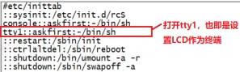
修改完成以后保存`/etc/inittab` 并退出，然后重启开发板，重启以后开发板 LCD 屏幕最后一 行会显示下面一行语句:

`Please press Enter to activate this console`

大家也可以接上一个 USB 键盘，Linux 内核默认已经使能了 USB 键盘驱动 了，因此可以直接使用 USB 键盘Enter键。

当然也可以利用input子系统来用一个gpio按键做成Enter键。
## 4.3 LCD 背光调节命令

前面背光设备树节点设置了 8 个等级的背光调节，可以设置为 `0~7`，我 们可以通过设置背光等级来实现 LCD 背光亮度的调节：

`/sys/devices/platform/backlight/backlight/backlight`

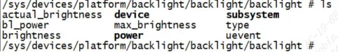
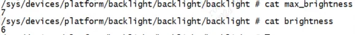
`echo 7 > brightness`设置亮度为`100%`， `echo 0 >brightness`设置成熄灭背光。

## 4.4 LCD屏幕自动熄灭

### 4.1.1 按键盘唤醒

默认情况下 10 分钟以后 LCD 就会熄屏，这个并不是代码有问题，而是 Linux 内核设置的。按下回车键就会唤醒屏幕。

### 4.1.2 关闭10分钟自动熄屏

1. `drivers/tty/vt/vt.c`中, `blankinterval` 变量控制着 LCD 关闭时间，默认是 `10*60`，也就是 10 分钟。将 `blankinterval` 的值改为 0 即可关闭 10 分钟熄屏的功能。
```c
181 static int blankinterval = 10*60;  
182 core_param(consoleblank, blankinterval, int, 0444);
```

2. `echo -e '\033[9;0]' > /dev/tty0`

## 4.5 测试代码
```c
#include <unistd.h>    
#include <stdio.h>    
#include <fcntl.h>    
#include <linux/fb.h>    
#include <sys/mman.h>    
#include <stdlib.h>    
#include <string.h>  
#include <stdint.h>  
#include <sys/ioctl.h>  
  
#define PAUSE()                                                                    \  
    do {    \  
        printf("---------------press Enter key to continue!---------------\n");    \  
        getchar();                                                                 \  
    } while (0)  
  
#if 1	// 32bits  
#define RED      0xFFFF0000  
#define GREEN    0xFF00FF00  
#define BLUE     0xFF0000FF  
#define YELLOW   0xFFFFFF00  
#define WHITE    0xFFFFFFFF   
#define BLACK    0xFF000000  
void fill_color(uint32_t *fb_addr, uint32_t bit_map, int psize)  
{  
    int i;  
    for(i=0; i<psize; i++) {  
        *fb_addr = bit_map;  
        fb_addr++;  
    }  
}  
#else	// 16bits  
#define RED      0xFC00  
#define GREEN    0x83E0  
#define BLUE     0x801F  
#define YELLOW   0xFFE0  
#define WHITE    0xFFFF   
#define BLACK    0x8000  
void fill_color(short *fb_addr, short bit_map, int psize)  
{  
    int i;  
    for(i=0; i<psize; i++) {  
        *fb_addr = bit_map;  
        fb_addr++;  
    }  
}  
#endif  
  
void _fb_get_info(int fp, struct fb_fix_screeninfo *finfo, struct fb_var_screeninfo *vinfo)  
{  
    long screensize=0;    
  
    if(ioctl(fp, FBIOGET_FSCREENINFO, finfo)){    
        printf("Error reading fixed information/n");    
        exit(2);    
    }    
  
    if(ioctl(fp, FBIOGET_VSCREENINFO, vinfo)){    
        printf("Error reading variable information/n");    
        exit(3);    
    }    
  
    screensize = finfo->line_length * vinfo->yres;  
  
    printf("The ID=%s\n", finfo->id);  
    printf("The phy mem = 0x%x, total size = %d(byte)\n", finfo->smem_start, finfo->smem_len);    
    printf("line length = %d(byte)\n", finfo->line_length);    
    printf("xres = %d, yres = %d, bits_per_pixel = %d\n", vinfo->xres, vinfo->yres, vinfo->bits_per_pixel);    
    printf("xresv = %d, yresv = %d\n", vinfo->xres_virtual, vinfo->yres_virtual);    
    printf("vinfo.xoffset = %d, vinfo.yoffset = %d\n", vinfo->xoffset, vinfo->yoffset);    
    printf("vinfo.vmode is :%d\n", vinfo->vmode);    
    printf("finfo.ypanstep is :%d\n", finfo->ypanstep);    
    printf("vinfo.red.offset=0x%x\n", vinfo->red.offset);  
    printf("vinfo.red.length=0x%x\n", vinfo->red.length);  
    printf("vinfo.green.offset=0x%x\n", vinfo->green.offset);  
    printf("vinfo.green.length=0x%x\n", vinfo->green.length);  
    printf("vinfo.blue.offset=0x%x\n", vinfo->blue.offset);  
    printf("vinfo.blue.length=0x%x\n", vinfo->blue.length);  
    printf("vinfo.transp.offset=0x%x\n", vinfo->transp.offset);  
    printf("vinfo.transp.length=0x%x\n", vinfo->transp.length);  
    printf("Expected screensize = %d(byte), using %d frame\n", screensize, finfo->smem_len/screensize);  
}  
  
int main ()   {    
    int fp=0;    
    struct fb_var_screeninfo vinfo;    
    struct fb_fix_screeninfo finfo;    
    void *fbp = NULL;      
    char *test_fbp = NULL;  
    int x = 0, y = 0;    
    long location = 0;  
    int i;  
    int num = 2;  
    int pix_size=0;  
  
    fp = open("/dev/fb0", O_RDWR);    
  
    if(fp < 0) {    
        printf("Error : Can not open framebuffer device/n");    
        exit(1);    
    }    
  
    printf("-- Default fb info --\n");  
    _fb_get_info(fp, &finfo, &vinfo);  
  
#if 1  
    vinfo.xres = 720;  
    vinfo.yres = 1280;  
    if(ioctl(fp, FBIOPUT_VSCREENINFO, &vinfo)){    
        printf("Error putting variable information/n");    
        exit(3);    
    }    
  
    printf("-- Updated fb info --\n");  
    _fb_get_info(fp, &finfo, &vinfo);  
#endif  
  
    fbp = mmap(0, finfo.smem_len, PROT_READ | PROT_WRITE, MAP_SHARED, fp, 0);  
    if (fbp == MAP_FAILED){  
        printf ("Error: failed to map framebuffer device to memory.\n");  
        exit (4);    
    }  
    printf("Get virt mem = %p\n", fbp);    
  
    pix_size = vinfo.xres * vinfo.yres;  
    /* using first frame, for FBIOPAN_DISPLAY  
     * 当刷新需要调用FBIOPAN_DISPLAY， 要告知驱动刷哪块帧， 用到下面两个参数  
     * 如果使用第二帧buffer -> vinfo.xoffset = 0; vinfo.yoffset = vinfo.yres;  
     */  
    vinfo.xoffset = 0;  
    vinfo.yoffset = 0;  
  
    /* show color loop */  
    while(num--) {  
        printf("\ndrawing YELLOW......\n");  
        fill_color(fbp, YELLOW, pix_size);  
        //ioctl(fp, FBIOPAN_DISPLAY, &vinfo);  
        sleep(3);  
  
        printf("\ndrawing BLUE......\n");  
        fill_color(fbp, BLUE, pix_size);  
        //ioctl(fp, FBIOPAN_DISPLAY, &vinfo);  
        sleep(3);  
          
        printf("\ndrawing RED......\n");  
        fill_color(fbp, RED, pix_size);  
        //ioctl(fp, FBIOPAN_DISPLAY, &vinfo);  
        sleep(3);  
	PAUSE();  
    }  
#if 1  
    /*这是你想画的点的位置坐标,(0，0)点在屏幕左上角*/  
    x = 10;  
    y = 10;  
    location = x * (vinfo.bits_per_pixel / 8) + y  *  finfo.line_length;  
    test_fbp = fbp + location;  
    printf("draw line.......\n");  
    for(i = 0; i < (vinfo.xres - x); i++)  
        *test_fbp++ = i+30;  
  
    //ioctl(fp, FBIOPAN_DISPLAY, &vinfo);  
    PAUSE();  
#endif  
  
    munmap(fbp, finfo.smem_len); /*解除映射*/  
  
    close (fp);  
    return 0;  
}
```

# 5 fb_videomod 系统概述

fb_videomode 是 Linux 帧缓冲（framebuffer）子系统中用于描述**视频显示时序**的数据结构体系。它负责在不同的表示方式之间转换显示时序参数，是连接设备树（Device Tree）、驱动代码和用户空间的关键桥梁。

---

## 一、三层数据结构

整个子系统有三个核心数据结构，形成从"设备树原始数据"到"驱动使用"的转换链：

```
设备树 display-timings
        │
        ▼
  struct display_timing     ← include/video/display_timing.h
        │  videomode_from_timing()
        ▼
  struct videomode          ← include/video/videomode.h
        │  fb_videomode_from_videomode()
        ▼
  struct fb_videomode       ← include/linux/fb.h
        │  fb_videomode_to_var()
        ▼
  struct fb_var_screeninfo  ← 用户空间可见
```

### 1. `struct display_timing` — 设备树原始格式

```c
// include/video/display_timing.h
struct display_timing {
    struct timing_entry pixelclock;
    struct timing_entry hactive, hfront_porch, hback_porch, hsync_len;
    struct timing_entry vactive, vfront_porch, vback_porch, vsync_len;
    enum display_flags flags;  // 如 DISPLAY_FLAGS_HSYNC_HIGH 等
};
```

- 每个字段都是 `{min, typ, max}` 三元组
- `flags` 使用 `enum display_flags`（HSYNC_HIGH/LOW, VSYNC_HIGH/LOW, DE_HIGH/LOW 等）
- 直接从设备树 `display-timings` 节点解析得到

### 2. `struct videomode` — 内核通用格式

```c
// include/video/videomode.h
struct videomode {
    unsigned long pixelclock;  // Hz（而非 ps）
    u32 hactive;     // 水平有效像素
    u32 hfront_porch; u32 hback_porch; u32 hsync_len;
    u32 vactive;     // 垂直有效行数
    u32 vfront_porch; u32 vback_porch; u32 vsync_len;
    enum display_flags flags;  // 保留 display_flags 格式
};
```

- 提取了 `display_timing` 的 `.typ` 值，不再有 min/max
- `pixelclock` 以 **Hz** 为单位
- 命名方式用 `hfront_porch` / `hback_porch`（前廊/后廊）

### 3. `struct fb_videomode` — 帧缓冲专用格式

```c
// include/linux/fb.h:L847-862
struct fb_videomode {
    const char *name;    /* 可选 */
    u32 refresh;         /* 可选 */
    u32 xres;
    u32 yres;
    u32 pixclock;        /* ps（皮秒）*/
    u32 left_margin;     /* = hback_porch（注意：命名不同！）*/
    u32 right_margin;    /* = hfront_porch */
    u32 upper_margin;    /* = vback_porch */
    u32 lower_margin;    /* = vfront_porch */
    u32 hsync_len;
    u32 vsync_len;
    u32 sync;            /* FB_SYNC_* 标志（不是 display_flags！）*/
    u32 vmode;           /* FB_VMODE_* 标志 */
    u32 flag;            /* 保留字段 */
};
```

**关键区别**：

| 项目 | `videomode` | `fb_videomode` |
|------|------------|----------------|
| 像素时钟单位 | Hz | **ps**（皮秒） |
| 命名风格 | `hfront_porch`/`hback_porch` | `left_margin`/`right_margin` |
| 信号极性标志 | `enum display_flags` | `FB_SYNC_*` 宏 |
| 额外字段 | 无 | `name`, `refresh`, `vmode`, `flag` |

---

## 二、关键 API 函数

### 格式转换函数

| 函数 | 路径 | 作用 |
|------|------|------|
| `videomode_from_timing()` | [videomode.h](file:///home/john/linux/IMX6/linux/work/linux-lf-6.12.49-2.2.0/include/video/videomode.h#L42-L43) | display_timing → videomode |
| `fb_videomode_from_videomode()` | [fb.h](file:///home/john/linux/IMX6/linux/work/linux-lf-6.12.49-2.2.0/include/linux/fb.h#L807-L808) | videomode → fb_videomode |
| `fb_videomode_to_var()` | [modedb.c](file:///home/john/linux/IMX6/linux/work/linux-lf-6.12.49-2.2.0/drivers/video/fbdev/core/modedb.c#L902-L920) | fb_videomode → fb_var_screeninfo |
| `fb_var_to_videomode()` | [modedb.c](file:///home/john/linux/IMX6/linux/work/linux-lf-6.12.49-2.2.0/drivers/video/fbdev/core/modedb.c#L855-L895) | fb_var_screeninfo → fb_videomode |
| `of_get_fb_videomode()` | [fbmon.c](file:///home/john/linux/IMX6/linux/work/linux-lf-6.12.49-2.2.0/drivers/video/fbdev/core/fbmon.c#L1380) | 从设备树直接获取 fb_videomode |

### 模式管理函数

| 函数 | 作用 |
|------|------|
| `fb_find_mode()` | 根据名称/分辨率查找最佳匹配模式 |
| `fb_add_videomode()` | 将模式添加到链表 |
| `fb_delete_videomode()` | 从链表删除模式 |
| `fb_match_mode()` | 查找时序完全匹配的模式 |
| `fb_find_best_mode()` | 查找 >= 指定分辨率的最小模式 |
| `fb_find_nearest_mode()` | 查找最接近分辨率的模式 |
| `fb_videomode_to_modelist()` | 批量将模式数组转为链表 |
| `fb_destroy_modelist()` | 销毁模式链表 |
| `fb_mode_is_equal()` | 比较两个模式是否相等 |

---

## 三、信号极性标志体系

这里有一个**容易出错的重要区别**：

### `FB_SYNC_*`（fb_videomode.sync 使用）
```c
#define FB_SYNC_HOR_HIGH_ACT    1    /* HSYNC 高有效 */
#define FB_SYNC_VERT_HIGH_ACT   2    /* VSYNC 高有效 */
#define FB_SYNC_EXT             4    /* 外部同步 */
#define FB_SYNC_COMP_HIGH_ACT   8    /* 复合同步高有效 */
```

### `DISPLAY_FLAGS_*`（videomode.flags 使用）
```c
enum display_flags {
    DISPLAY_FLAGS_HSYNC_LOW   = BIT(0),
    DISPLAY_FLAGS_HSYNC_HIGH  = BIT(1),
    DISPLAY_FLAGS_VSYNC_LOW   = BIT(2),
    DISPLAY_FLAGS_VSYNC_HIGH  = BIT(3),
    DISPLAY_FLAGS_DE_LOW      = BIT(4),
    DISPLAY_FLAGS_DE_HIGH     = BIT(5),
    DISPLAY_FLAGS_PIXDATA_POSEDGE = BIT(6),
    DISPLAY_FLAGS_PIXDATA_NEGEDGE = BIT(7),
    // ... 还有 DOUBLESCAN, INTERLACED 等
};
```

注意：
- `FB_SYNC_*` 只定义了 HSYNC 和 VSYNC 极性，**没有 DE 和 Pixel Clock 极性**
- `DISPLAY_FLAGS_*` 定义了更全面的极性信息，包括 DE 和 PIXDATA 边沿
- `fb_videomode_from_videomode()` 只转换 HSYNC/VSYNC 到 `FB_SYNC_*`，DE 和 Pixel clock 的 `DISPLAY_FLAGS_*` 信息会丢失！

这也是为什么我们之前的驱动中需要额外使用 `mode->flag` 来保存 DE 和 pixel clock 极性的原因。

---

## 四、margin 命名对照表

这是最容易混淆的地方，`fb_videomode` 和 `videomode` 使用不同的命名：

```
  同步信号位置
  │           有效像素区域
  │           │
  ▼           ▼
  ┌──────────┬──────┬──────────┐
  │ HSYNC    │左边界│  有效像素  │
  │ hsync_len│left  │  xres    │
  │          │margin│          │
  └──────────┴──────┴──────────┘
            ▲
            │ 这是 left_margin（fb_videomode）= hback_porch（videomode）

  时序顺序：HSYNC → back_porch(left_margin) → 有效像素 → front_porch(right_margin) → HSYNC
```

| fb_videomode | videomode | 含义 |
|-------------|-----------|------|
| `left_margin` | `hback_porch` | 水平后廊（HSYNC结束后到有效像素） |
| `right_margin` | `hfront_porch` | 水平前廊（有效像素结束后到HSYNC） |
| `upper_margin` | `vback_porch` | 垂直后廊 |
| `lower_margin` | `vfront_porch` | 垂直前廊 |

**`left_margin` = `hback_porch`**，不是 front porch！这是历史遗留的命名，需要在编码时特别注意。

---

## 五、在驱动中的典型用法

推荐的设备树时序解析流程：

```c
// 方法1: 使用 of_get_display_timings + 手动转换（精确，推荐）
struct display_timings *disp_timings;
disp_timings = of_get_display_timings(np);
struct display_timing *dt = display_timings_get(disp_timings, "native-mode");
struct videomode vm;
videomode_from_timing(dt, &vm);
struct fb_videomode fbmode;
fb_videomode_from_videomode(&vm, &fbmode);

// 方法2: 直接用 of_get_fb_videomode（简单，但可能丢失DE极性等）
struct fb_videomode fbmode;
of_get_fb_videomode(np, &fbmode, OF_USE_NATIVE_MODE);
```
