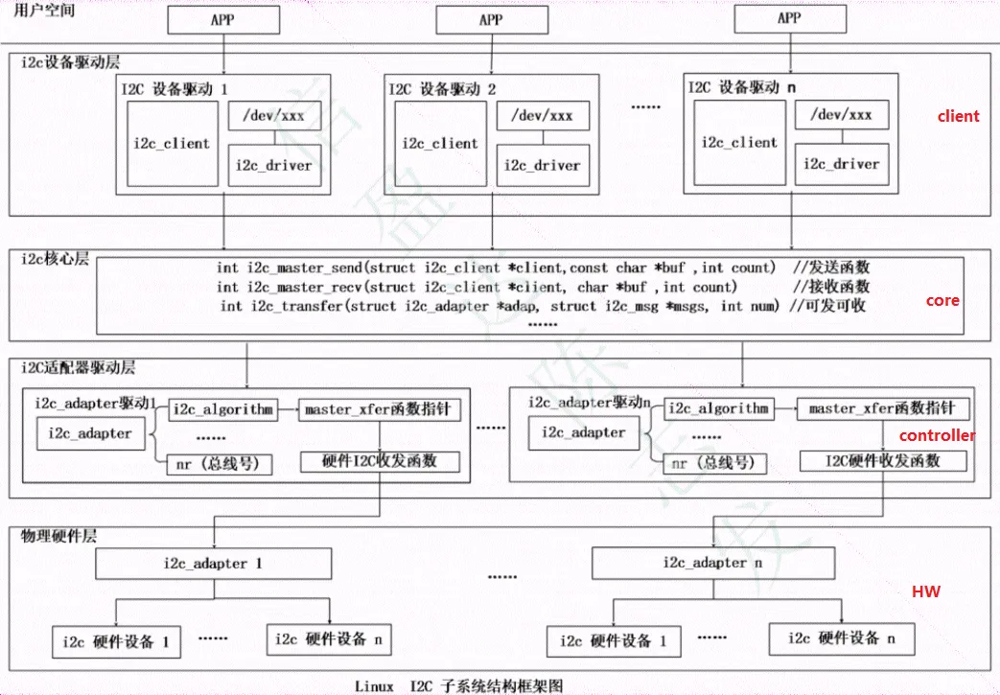
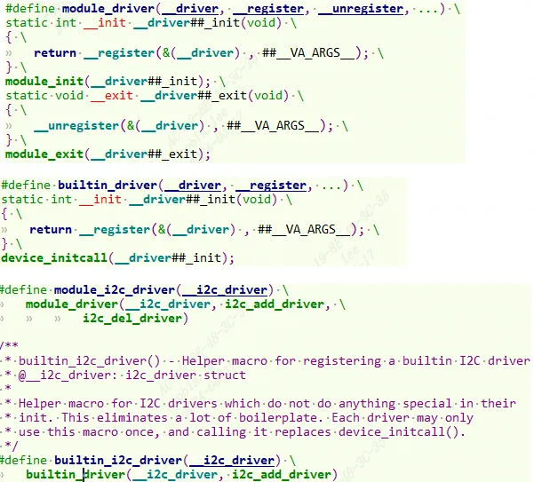
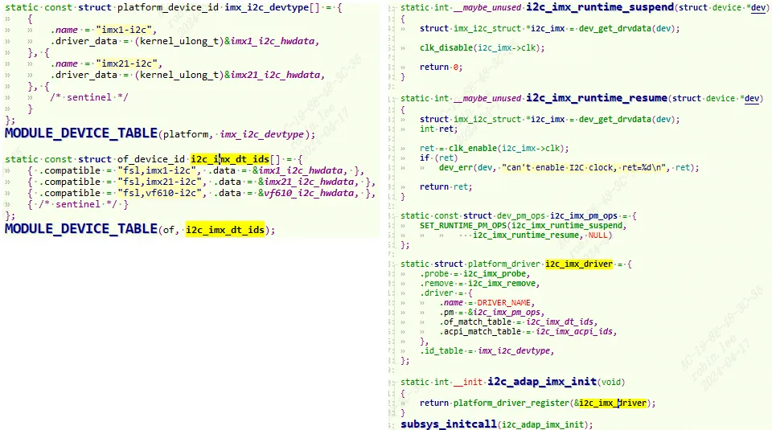
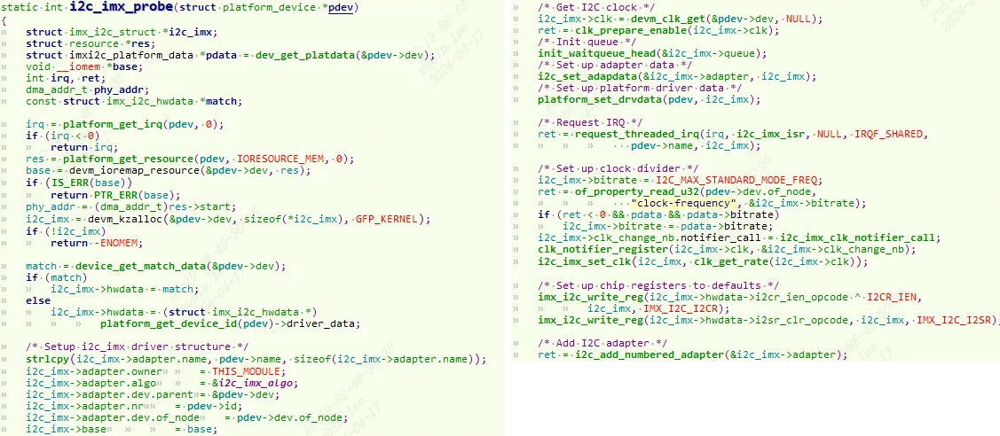
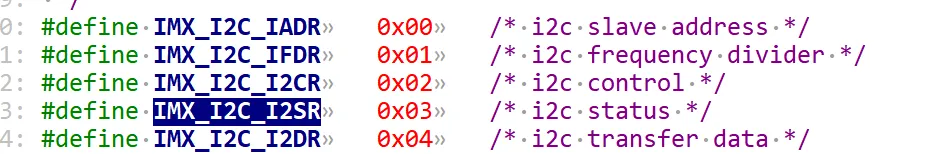
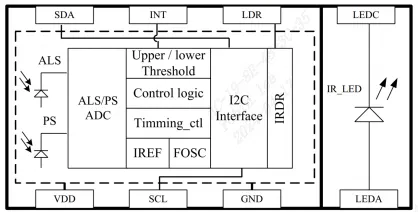
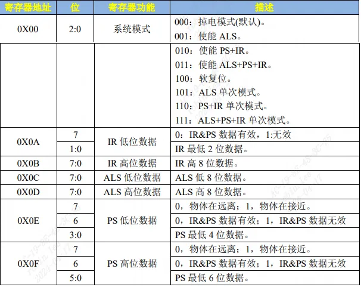
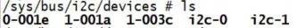
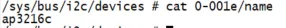
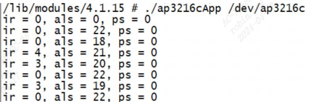

# 1 Linux I2C 驱动框架


由上到下分为3层结构：
```c
i2c设备驱动层: 作为client使用者使用i2c子系统。提供操作接口给应用层，与应用层交互数据。  
  
I2C核心层：提供transfer send recv函数。把client设备挂载到I2C总线上；  
    维护i2c driver和i2c client 链表 ，实现i2c_client和i2c_driver匹配。  
  
I2C适配器层：底层SOC I2C控制器驱动，实现i2c时序，实现i2c总线发送和接收数据的方法。
```

目录结构位于drivers/i2c：
```c
robin.lee@WORKSTATION5:/media/robin.lee/zip/A2/linux_5.10/drivers/i2c$ ls  
algos            i2c-core-acpi.c  i2c-core-of.c     i2c-dev.c           i2c-slave-testunit.c  Kconfig  
busses           i2c-core-base.c  i2c-core-slave.c  i2c-mux.c           i2c-smbus.c           Makefile  
i2c-boardinfo.c  i2c-core.h       i2c-core-smbus.c  i2c-slave-eeprom.c  i2c-stub.c            muxes
```

# 2 数据结构

## 2.1 控制器相关

### 2.1.1 i2c_adapter-控制器

I2C 适配器，也就是 SOC 的 I2C 控制器。`i2c_adapter` 结构体定义在 `include/linux/i2c.h`
```c
/*  
 * i2c_adapter is the structure used to identify a physical i2c bus along  
 * with the access algorithms necessary to access it.  
 */  
struct i2c_adapter {  
	struct module *owner;  
	unsigned int class;		  /* classes to allow probing for */  
	const struct i2c_algorithm *algo; /* the algorithm to access the bus */  
	void *algo_data;  
   
	/* data fields that are valid for all devices	*/  
	struct rt_mutex bus_lock;  
	int timeout;			/* in jiffies */  
	int retries;  
	struct device dev;		/* the adapter device */  
	int nr;   //总线的编号  
	char name[48];  
	struct completion dev_released;  
	struct mutex userspace_clients_lock;  
	struct list_head userspace_clients;  
	struct i2c_bus_recovery_info *bus_recovery_info;  
	const struct i2c_adapter_quirks *quirks;  
};
```

| 变量名       | 解释                                                            |
| --------- | ------------------------------------------------------------- |
| class     | 适配器的类类型，在一些口I2C设备驱动中会检查该成员，以判断设备能否被该适配器操作                     |
| algo      | 指向该适配器通信方法描述结构的指针，就是该适配器具体操作I2C控制器的函数                         |
| algo_data | 指向通信方法数据的指针，该成员不会被I2C核心层修改，仅供具体的 i2c_algorithm使用              |
| timeout   | 传输超时时间                                                        |
| retries   | 传输超时的重试次数                                                     |
| name      | 适配器名称，该名称可以通过`sys/bus/i2c/devices/i2c-x/name` (x=0,1,2 … ）来访问 |
| nr        | 总线编号（也是适配器编号），同时对应设备节点`／dev/i2c-x` (x=0,1,2 …）中的 x            |

### 2.1.2 i2c_algorithm-通信方法

对于一个 I2C 适配器，肯定要对外提供读 写 API 函数，设备驱动程序可以使用这些 API 函数来完成读写操作。`i2c_algorithm` 就是 I2C 适 配器与 IIC 设备进行通信的方法。包括`transfer send recv`等函数`。i2c_algorithm` 结构体定义在 `include/linux/i2c.h`
```c
struct i2c_algorithm {  
	/*  
	 * If an adapter algorithm can't do I2C-level access, set master_xfer  
	 * to NULL. If an adapter algorithm can do SMBus access, set  
	 * smbus_xfer. If set to NULL, the SMBus protocol is simulated  
	 * using common I2C messages.  
	 *  
	 * master_xfer should return the number of messages successfully  
	 * processed, or a negative value on error  
	 */  
	int (*master_xfer)(struct i2c_adapter *adap, struct i2c_msg *msgs,  
			   int num);  
	int (*master_xfer_atomic)(struct i2c_adapter *adap,  
				   struct i2c_msg *msgs, int num);  
	int (*smbus_xfer)(struct i2c_adapter *adap, u16 addr,  
			  unsigned short flags, char read_write,  
			  u8 command, int size, union i2c_smbus_data *data);  
	int (*smbus_xfer_atomic)(struct i2c_adapter *adap, u16 addr,  
				 unsigned short flags, char read_write,  
				 u8 command, int size, union i2c_smbus_data *data);  
	/* To determine what the adapter supports */  
	u32 (*functionality)(struct i2c_adapter *adap);  
#if IS_ENABLED(CONFIG_I2C_SLAVE)  
	int (*reg_slave)(struct i2c_client *client);  
	int (*unreg_slave)(struct i2c_client *client);  
#endif  
};
```

`master_xfer` 就是 I2C 适配器的传输函数，可以通过此函数来完成与 IIC 设备之 间的通信。 用于产生I2C访问周期需要的信号， 以`i2c_msg`为单位（i2c_msg中的成员表明了I2C的传输地址、 方向、 缓冲区、 缓冲区长度等信息） 。

`smbus_xfer` 是 SMBUS 总线协议的传输函数。

`functionality`：查看适配的能力。这些功能都是以宏定义的方式表示，定义在`include/linux/i2c.h`中，以`I2C_FUNC`开头：
```c
/* To determine what functionality is present */  
#define I2C_FUNC_I2C			0x00000001  
#define I2C_FUNC_10BIT_ADDR		0x00000002  
#define I2C_FUNC_PROTOCOL_MANGLING	0x00000004 /* I2C_M_IGNORE_NAK etc. */  
#define I2C_FUNC_SMBUS_PEC		0x00000008  
#define I2C_FUNC_NOSTART		0x00000010 /* I2C_M_NOSTART */  
#define I2C_FUNC_SLAVE			0x00000020  
#define I2C_FUNC_SMBUS_BLOCK_PROC_CALL	0x00008000 /* SMBus 2.0 */  
#define I2C_FUNC_SMBUS_QUICK		0x00010000  
#define I2C_FUNC_SMBUS_READ_BYTE	0x00020000  
#define I2C_FUNC_SMBUS_WRITE_BYTE	0x00040000  
#define I2C_FUNC_SMBUS_READ_BYTE_DATA	0x00080000  
#define I2C_FUNC_SMBUS_WRITE_BYTE_DATA	0x00100000  
#define I2C_FUNC_SMBUS_READ_WORD_DATA	0x00200000  
#define I2C_FUNC_SMBUS_WRITE_WORD_DATA	0x00400000  
#define I2C_FUNC_SMBUS_PROC_CALL	0x00800000  
#define I2C_FUNC_SMBUS_READ_BLOCK_DATA	0x01000000  
#define I2C_FUNC_SMBUS_WRITE_BLOCK_DATA 0x02000000  
#define I2C_FUNC_SMBUS_READ_I2C_BLOCK	0x04000000 /* I2C-like block xfer  */  
#define I2C_FUNC_SMBUS_WRITE_I2C_BLOCK	0x08000000 /* w/ 1-byte reg. addr. */  
#define I2C_FUNC_SMBUS_HOST_NOTIFY	0x10000000  
#define I2C_FUNC_SMBUS_BYTE		(I2C_FUNC_SMBUS_READ_BYTE | \  
					 I2C_FUNC_SMBUS_WRITE_BYTE)  
#define I2C_FUNC_SMBUS_BYTE_DATA	(I2C_FUNC_SMBUS_READ_BYTE_DATA | \  
					 I2C_FUNC_SMBUS_WRITE_BYTE_DATA)  
#define I2C_FUNC_SMBUS_WORD_DATA	(I2C_FUNC_SMBUS_READ_WORD_DATA | \  
					 I2C_FUNC_SMBUS_WRITE_WORD_DATA)  
#define I2C_FUNC_SMBUS_BLOCK_DATA	(I2C_FUNC_SMBUS_READ_BLOCK_DATA | \  
					 I2C_FUNC_SMBUS_WRITE_BLOCK_DATA)  
#define I2C_FUNC_SMBUS_I2C_BLOCK	(I2C_FUNC_SMBUS_READ_I2C_BLOCK | \  
					 I2C_FUNC_SMBUS_WRITE_I2C_BLOCK)
```

## 2.2 客户端相关

i2c 设备(client使用者)驱动要使用`i2c_driver` 和`i2c_client`数据结构并填充i2c_driver中的成员函数。

### 2.2.1 i2c_driver-I从设备驱动

代表一个i2c使用者设备驱动。结构体定义在 include/linux/i2c.h
```c
struct i2c_driver {  
	unsigned int class;  
	/* Notifies the driver that a new bus has appeared. You should avoid  
	 * using this, it will be removed in a near future.  
	 */  
	int (*attach_adapter)(struct i2c_adapter *) __deprecated;  
  
	/* Standard driver model interfaces */  
	int (*probe)(struct i2c_client *, const struct i2c_device_id *);  
	int (*remove)(struct i2c_client *);  
  
	/* New driver model interface to aid the seamless removal of the  
	 * current probe()'s, more commonly unused than used second parameter.  
	 */  
	int (*probe_new)(struct i2c_client *);  
  
	/* driver model interfaces that don't relate to enumeration  */  
	void (*shutdown)(struct i2c_client *);  
  
	/* Alert callback, for example for the SMBus alert protocol.  
	 * The format and meaning of the data value depends on the protocol.  
	 * For the SMBus alert protocol, there is a single bit of data passed  
	 * as the alert response's low bit ("event flag").  
	 * For the SMBus Host Notify protocol, the data corresponds to the  
	 * 16-bit payload data reported by the slave device acting as master.  
	 */  
	void (*alert)(struct i2c_client *, enum i2c_alert_protocol protocol,  
		      unsigned int data); // 警告回调函数（例如SMBus警报协议）  
  
	/* a ioctl like command that can be used to perform specific functions  
	 * with the device.  
	 */  
	int (*command)(struct i2c_client *client, unsigned int cmd, void *arg);//类似于ioctl 的命令控制函数  
	struct device_driver driver;  
	const struct i2c_device_id *id_table; // 这个i2c驱动支持的设备链表  
  
	/* Device detection callback for automatic device creation */  
	int (*detect)(struct i2c_client *, struct i2c_board_info *); // 检测设备的回调函数；  
	const unsigned short *address_list; // 要探测的I2C地址（用于检测）  
	struct list_head clients;   
	bool disable_i2c_core_irq_mapping;  
};
```

|变量名|含义|
|---|---|
|attach_adapter|依附i2c_adapter的函数指针|
|detach_adapter|脱离i2c_adapter的函数指针|
|probe|设备和驱动匹配时调用|
|driver|在注册i2c_driver对象时，i2c_driver->driver的总线类型被指定为`i2c_bus_type`|
|id_table|匹配列表，驱动和设备匹配时会用到|
|detect|基于设备探测机制实现的 12C 设备驱动：设备探测的回调函数|
|address_list|设备探测的地址范围|
|clients|探测到的设备列表|

i2c_driver对应于一套驱动方法， 其主要成员函数是`probe()`、`remove()`、`suspend()` 、`resume()`等。例如：
```c
/* drivers/rtc/rtc-ds1307.c */  
static struct i2c_driver ds1307_driver = {  
    .driver = {  
        .name   = "rtc-ds1307",  
        .of_match_table = of_match_ptr(ds1307_of_match),  
        .acpi_match_table = ACPI_PTR(ds1307_acpi_ids),  
    },  
    .probe      = ds1307_probe,  
    .id_table   = ds1307_id,  
};
```

### 2.2.2 i2c_client-从设备

代表一个连接到`i2c_bus`总线上的从设备，结构体定义在 `include/linux/i2c.h`。描述i2c从设备的i2c相关硬件信息。 一个i2c_driver可以支持多个同类型的i2c_client。i2c_client一般描述再设备树中。
```c
struct i2c_client{  
 	unsigned short flags;   //描述从设备的一些特性，如I2C_CLIENT_TEN---使用的10位地址  
 	unsigned short addr;   //设备的i2c地址，7位地址用低7位，10位地址用低10位。  
 	char name[I2C_NAME_SIZE]; // 设备的名字；  
  
 	struct i2c_adapter *adapter;   //所属的适配器i2c_adapter,挂载在哪条i2c物理总线上  
	struct i2c_driver  *driver;    //匹配成功的i2c_driver  
    int irq;  
}；
```

#### 2.2.2.1 i2c_board_info

也是描述从设备i2c硬件属性。通常情况下先填充i2c_board_info对象的成员，然后去初始化i2c_client对象。
```c
struct i2c_board_info {  
    char type[I2C_NAME_SIZE];//名字，驱动层和设备层匹配参数  
    unsigned short flags;//设备地址位数，一般不填或填0表示7位地址  
    unsigned short addr;//IIC设备地址  
    void *platform_data;//私有数据  
    struct dev_archdata *archdata;  
    struct device_node *of_node;  
    int irq;//中断号  
};
```

## 2.3 i2c_msg-消息
```c
struct i2c_msg {  
	__u16 addr;	/* 从机在I2C总线上的地址*/  
	__u16 flags;	/* 消息特征的标志 */  
  
//下面的宏定义就是消息特征的标志  
#define I2C_M_TEN		0x0010	/* this is a ten bit chip address */  
#define I2C_M_RD		0x0001	/* read data, from slave to master */  
#define I2C_M_NOSTART		0x4000	/* if I2C_FUNC_PROTOCOL_MANGLING */  
#define I2C_M_REV_DIR_ADDR	0x2000	/* if I2C_FUNC_PROTOCOL_MANGLING */  
#define I2C_M_IGNORE_NAK	0x1000	/* if I2C_FUNC_PROTOCOL_MANGLING */  
#define I2C_M_NO_RD_ACK		0x0800	/* if I2C_FUNC_PROTOCOL_MANGLING */  
#define I2C_M_RECV_LEN		0x0400	/* length will be first received byte */  
  
	__u16 len;		/* 消息数据长度，单位是字节 */  
	__u8 *buf;		/* 指向存放消息数据的缓冲区 */  
};
```

I2C的传输地址、 方向、 缓冲区、 缓冲区长度等信息。

# 3 I2C子系统API

## 3.1 控制器相关

### 3.1.1 注册控制器

通过`i2c_add_numbered_adapter`或 `i2c_add_adapter` 这两个函数向系统注册设置好的 i2c_adapter。
```c
int i2c_add_adapter(struct i2c_adapter *adapter);//include/linux/i2c.h  
int i2c_add_numbered_adapter(struct i2c_adapter *adap);
```

这两个函数的区别在于 i2c_add_adapter 使用动态的总线号，而 i2c_add_numbered_adapter 使用静态总线号。

### 3.1.2 卸载控制器
```c
void i2c_del_adapter(struct i2c_adapter * adap);
```

## 3.2 客户端设备相关

### 3.2.1 添加i2c设备驱动
```c
int i2c_register_driver(struct module *owner, struct i2c_driver *driver);//include/linux/i2c.h  
/* use a define to avoid include chaining to get THIS_MODULE */  
#define i2c_add_driver(driver) \  
	i2c_register_driver(THIS_MODULE, driver);
```

### 3.2.2 删除i2c设备驱动
```c
void i2c_del_driver(struct i2c_driver *driver);
```

### 3.2.3 module_driver和builtin_driver使用

在编写从设备驱动时为了方便也可以直接调用`module_i2c_driver`完成i2c驱动的`module_init`。或者使用`builtin_i2c_driver`完成i2c驱动的`device_initcall`。两者区别一个是编译成内核模块，一个是编译进内核镜像。


```c
#define module_driver(__driver, __register, __unregister, ...) \  
static int __init __driver##_init(void) \  
{ \  
	return __register(&(__driver) , ##__VA_ARGS__); \  
} \  
module_init(__driver##_init); \  
static void __exit __driver##_exit(void) \  
{ \  
	__unregister(&(__driver) , ##__VA_ARGS__); \  
} \  
module_exit(__driver##_exit);  
  
/**  
 * builtin_driver() - Helper macro for drivers that don't do anything  
 * special in init and have no exit. This eliminates some boilerplate.  
 * Each driver may only use this macro once, and calling it replaces  
 * device_initcall (or in some cases, the legacy __initcall).  This is  
 * meant to be a direct parallel of module_driver() above but without  
 * the __exit stuff that is not used for builtin cases.  
 *  
 * @__driver: driver name  
 * @__register: register function for this driver type  
 * @...: Additional arguments to be passed to __register  
 *  
 * Use this macro to construct bus specific macros for registering  
 * drivers, and do not use it on its own.  
 */  
#define builtin_driver(__driver, __register, ...) \  
static int __init __driver##_init(void) \  
{ \  
	return __register(&(__driver) , ##__VA_ARGS__); \  
} \  
device_initcall(__driver##_init);
```

### 3.2.4 数据传输

#### 3.2.4.1 i2c_transfer

发送或接收指定字节数的数据。
```c
Int i2c_transfer(struct i2c_adapter *adap,struct i2c_msg *msgs, int num);
```

#### 3.2.4.2 i2c_master_recv

接收指定字节的数据。
```c
Int i2c_master_recv(const struct i2c_client *client,const char *buf,int count);
```

#### 3.2.4.3 i2c_master_send

发送指定字节的数据。
```c
int i2c_master_send(const struct i2c_client *client, const char *buf, int count);
```

# 4 i2c子系统驱动流程举例

## 4.1 核心core层注册
```c
//i2c-core.c  
struct bus_type i2c_bus_type = {  
	.name		= "i2c",  
	.match		= i2c_device_match,	//总线上驱动和设备的匹配函数  
	.probe		= i2c_device_probe,	//总线上设备和驱动匹配时调用  
	.remove		= i2c_device_remove,  
	.shutdown	= i2c_device_shutdown,  
	.pm		= &i2c_device_pm_ops,  
};  
EXPORT_SYMBOL_GPL(i2c_bus_type);  
static const struct i2c_device_id dummy_id[] = {  
	{ "dummy", 0 },  
	{ },  
};  
static struct i2c_driver dummy_driver = {  
	.driver.name	= "dummy",  
	.probe		= dummy_probe,  
	.remove		= dummy_remove,  
	.id_table	= dummy_id,  
};  
static int __init i2c_init(void) {  
	int retval;  
	//注册I2C总线  
	retval = bus_register(&i2c_bus_type);  
	if (retval)  
		return retval;	  
	//向I2C总线注册一个名字为dummy的驱动，这个驱动没什么实际的功能，空实现的驱动  
	retval = i2c_add_driver(&dummy_driver);  
	if (retval)  
		goto class_err;  
	return 0;  
class_err:  
	bus_unregister(&i2c_bus_type);  
	return retval;  
}  
static void __exit i2c_exit(void) {  
	//删除dummy驱动  
	i2c_del_driver(&dummy_driver);  
	//卸载I2C总线  
	bus_unregister(&i2c_bus_type);  
}  
  
/* We must initialize early, because some subsystems register i2c drivers  
 * in subsys_initcall() code, but are linked (and initialized) before i2c.  
 */  
postcore_initcall(i2c_init);  
module_exit(i2c_exit);
```

可以看到内核启动阶段就调用i2c_init 注册了I2C总线和注册了I2C设备驱动`dummy_driver`；

### 4.1.1 I2C总线的匹配函数
```c
static const struct i2c_device_id *i2c_match_id(const struct i2c_device_id *id,  
  const struct i2c_client *client) {  
	while (id->name[0]) {  
		if (strcmp(client->name, id->name) == 0)  
			return id;  
		id++;  
	}  
	return NULL;  
}  
  
static int i2c_device_match(struct device *dev, struct device_driver *drv) {  
	struct i2c_client *client = i2c_verify_client(dev);  
	struct i2c_driver *driver;  
	if (!client)  
		return 0;  
	/* Attempt an OF style match */  
	if (of_driver_match_device(dev, drv))  
		return 1;  
	/* Then ACPI style match */  
	if (acpi_driver_match_device(dev, drv))  
		return 1;  
	driver = to_i2c_driver(drv);  
	/* match on an id table if there is one */  
	if (driver->id_table)  
		return i2c_match_id(driver->id_table, client) != NULL;  
	return 0;  
}
```

向I2C总线注册I2C驱动或者I2C设备时，会逐一将I2C驱动的名字和I2C设备的名字进行匹配，如果匹配上则调用I2C总线的probe方法；

I2C总线的probe方法就是进一步调用i2c_driver的probe方法。
```c
static int i2c_device_probe(struct device *dev) {  
	//利用container_of宏获取到I2C设备结构体  
	struct i2c_client	*client = i2c_verify_client(dev);  
	struct i2c_driver	*driver;  
	int status;  
  
	if (!client)  
		return 0;  
  
	//利用container_of宏获取到I2C驱动结构体  
	driver = to_i2c_driver(dev->driver);  
	if (!driver->probe | !driver->id_table)  
		return -ENODEV;  
		  
	// 把I2C设备驱动和I2C设备绑定，将来可以互相查找到对方  
	client->driver = driver;  
	if (!device_can_wakeup(&client->dev))  
		device_init_wakeup(&client->dev,  
					client->flags & I2C_CLIENT_WAKE);  
	dev_dbg(dev, "probe\n");  
  
	//调用I2C驱动的probe函数  
	status = driver->probe(client, i2c_match_id(driver->id_table, client));  
	if (status) {  
		client->driver = NULL;  
		i2c_set_clientdata(client, NULL);  
	}  
	return status;  
}
```

## 4.2 适配器驱动示例流程

### 4.2.1 适配器注册

#### 4.2.1.1 i2c控制器描述

以nxp的imx6ull芯片为例，在`imx6ull.dtsi`文件中找到 I2C1 控制器节点：
```c
i2c1: i2c@021a0000 {  
	#address-cells = <1>;  
	#size-cells = <0>;  
	compatible = "fsl,imx6ul-i2c", "fsl,imx21-i2c";  
	reg = <0x021a0000 0x4000>;  
	interrupts = <GIC_SPI 36 IRQ_TYPE_LEVEL_HIGH>;  
	clocks = <&clks IMX6UL_CLK_I2C1>;  
	status = "disabled";  
};
```

i2c1节点的compatible属性值有两个：`fsl,imx6ul-i2c`和`fsl,imx21-i2c`，在 Linux 源码中搜索这两个字符串即可找到对应的驱动文件为`drivers/i2c/busses/i2c-imx.c`。

#### 4.2.1.2 i2c控制器驱动probe示例


I2C 适配器驱动也是使用标准的 platform 驱动框架。`compatible` 属性匹配成功后就会调用probe函数如下：


点击展开代码
```c
static int i2c_imx_probe(struct platform_device *pdev) {  
	struct imx_i2c_struct *i2c_imx;  
	struct resource *res;  
	struct imxi2c_platform_data *pdata = dev_get_platdata(&pdev->dev);  
	void __iomem *base;  
	int irq, ret;  
	dma_addr_t phy_addr;  
	const struct imx_i2c_hwdata *match;  
  
	dev_dbg(&pdev->dev, "<%s>\n", __func__);  
  
	irq = platform_get_irq(pdev, 0);  
	if (irq < 0)  
		return irq;  
  
	res = platform_get_resource(pdev, IORESOURCE_MEM, 0);  
	base = devm_ioremap_resource(&pdev->dev, res);  
	if (IS_ERR(base))  
		return PTR_ERR(base);  
  
	phy_addr = (dma_addr_t)res->start;  
	i2c_imx = devm_kzalloc(&pdev->dev, sizeof(*i2c_imx), GFP_KERNEL);  
	if (!i2c_imx)  
		return -ENOMEM;  
  
	match = device_get_match_data(&pdev->dev);  
	if (match)  
		i2c_imx->hwdata = match;  
	else  
		i2c_imx->hwdata = (struct imx_i2c_hwdata *)  
				platform_get_device_id(pdev)->driver_data;  
  
	/* Setup i2c_imx driver structure */  
	strlcpy(i2c_imx->adapter.name, pdev->name, sizeof(i2c_imx->adapter.name));  
	i2c_imx->adapter.owner		= THIS_MODULE;  
	i2c_imx->adapter.algo		= &i2c_imx_algo;  
	i2c_imx->adapter.dev.parent	= &pdev->dev;  
	i2c_imx->adapter.nr		= pdev->id;  
	i2c_imx->adapter.dev.of_node	= pdev->dev.of_node;  
	i2c_imx->base			= base;  
	ACPI_COMPANION_SET(&i2c_imx->adapter.dev, ACPI_COMPANION(&pdev->dev));  
  
	/* Get I2C clock */  
	i2c_imx->clk = devm_clk_get(&pdev->dev, NULL);  
	if (IS_ERR(i2c_imx->clk))  
		return dev_err_probe(&pdev->dev, PTR_ERR(i2c_imx->clk),  
				     "can't get I2C clock\n");  
  
	ret = clk_prepare_enable(i2c_imx->clk);  
	if (ret) {  
		dev_err(&pdev->dev, "can't enable I2C clock, ret=%d\n", ret);  
		return ret;  
	}  
  
	/* Init queue */  
	init_waitqueue_head(&i2c_imx->queue);  
  
	/* Set up adapter data */  
	i2c_set_adapdata(&i2c_imx->adapter, i2c_imx);  
  
	/* Set up platform driver data */  
	platform_set_drvdata(pdev, i2c_imx);  
  
	pm_runtime_set_autosuspend_delay(&pdev->dev, I2C_PM_TIMEOUT);  
	pm_runtime_use_autosuspend(&pdev->dev);  
	pm_runtime_set_active(&pdev->dev);  
	pm_runtime_enable(&pdev->dev);  
  
	ret = pm_runtime_get_sync(&pdev->dev);  
	if (ret < 0)  
		goto rpm_disable;  
  
	/* Request IRQ */  
	ret = request_threaded_irq(irq, i2c_imx_isr, NULL, IRQF_SHARED,  
				   pdev->name, i2c_imx);  
	if (ret) {  
		dev_err(&pdev->dev, "can't claim irq %d\n", irq);  
		goto rpm_disable;  
	}  
  
	/* Set up clock divider */  
	i2c_imx->bitrate = I2C_MAX_STANDARD_MODE_FREQ;  
	ret = of_property_read_u32(pdev->dev.of_node,  
				   "clock-frequency", &i2c_imx->bitrate);  
	if (ret < 0 && pdata && pdata->bitrate)  
		i2c_imx->bitrate = pdata->bitrate;  
	i2c_imx->clk_change_nb.notifier_call = i2c_imx_clk_notifier_call;  
	clk_notifier_register(i2c_imx->clk, &i2c_imx->clk_change_nb);  
	i2c_imx_set_clk(i2c_imx, clk_get_rate(i2c_imx->clk));  
  
	/* Set up chip registers to defaults */  
	imx_i2c_write_reg(i2c_imx->hwdata->i2cr_ien_opcode ^ I2CR_IEN,  
			i2c_imx, IMX_I2C_I2CR);  
	imx_i2c_write_reg(i2c_imx->hwdata->i2sr_clr_opcode, i2c_imx, IMX_I2C_I2SR);  
  
	/* Init optional bus recovery function */  
	ret = i2c_imx_init_recovery_info(i2c_imx, pdev);  
	/* Give it another chance if pinctrl used is not ready yet */  
	if (ret == -EPROBE_DEFER)  
		goto clk_notifier_unregister;  
  
	/* Add I2C adapter */  
	ret = i2c_add_numbered_adapter(&i2c_imx->adapter);  
	if (ret < 0)  
		goto clk_notifier_unregister;  
  
	pm_runtime_mark_last_busy(&pdev->dev);  
	pm_runtime_put_autosuspend(&pdev->dev);  
  
	dev_dbg(&i2c_imx->adapter.dev, "claimed irq %d\n", irq);  
	dev_dbg(&i2c_imx->adapter.dev, "device resources: %pR\n", res);  
	dev_dbg(&i2c_imx->adapter.dev, "adapter name: \"%s\"\n",  
		i2c_imx->adapter.name);  
	dev_info(&i2c_imx->adapter.dev, "IMX I2C adapter registered\n");  
  
	/* Init DMA config if supported */  
	i2c_imx_dma_request(i2c_imx, phy_addr);  
  
	return 0;   /* Return OK */  
  
clk_notifier_unregister:  
	clk_notifier_unregister(i2c_imx->clk, &i2c_imx->clk_change_nb);  
	free_irq(irq, i2c_imx);  
rpm_disable:  
	pm_runtime_put_noidle(&pdev->dev);  
	pm_runtime_disable(&pdev->dev);  
	pm_runtime_set_suspended(&pdev->dev);  
	pm_runtime_dont_use_autosuspend(&pdev->dev);  
	clk_disable_unprepare(i2c_imx->clk);  
	return ret;  
}
```

1. `platform_get_irq` 函数获取中断号。
    
2. `platform_get_resource` 函数从设备树中获取 I2C1 控制器寄存器物理基 地址，也就是 `0X021A0000`。使用 `devm_ioremap_resource` 函数对其进 行内存映射，得到可以在 Linux 内核中使用的虚拟地址。
    
3. 使用 `imx_i2c_struct` 结构体来表示 I.MX 系列 SOC 的 I2C 控制器，这里使 用 `devm_kzalloc` 函数来申请内存。
    
4. 初始化`i2c_adapter`。设置i2c_adapter 的algo成员变量为`i2c_imx_algo`， 也就是设置 `i2c_algorithm`。
    
5. 开启i2c时钟。
    
6. 注册 I2C 控制器中断，中断服务函数为 `i2c_imx_isr`。
    
7. 设置 I2C 频率默认为 `IMX_I2C_BIT_RATE=100KHz`，如果设备树节点设 置了`“clock-frequency”`属性的话 I2C 频率就使用 `clock-frequency` 属性值。
    
8. 设置 I2C1 控制的 I2CR 和 I2SR 寄存器。
    
    
9. 调用 **i2c_add_numbered_adapter** 函数向 Linux 内核注册 i2c_adapter。
    

### 4.2.2 适配器操作-i2c_algorithm
```c
static struct i2c_algorithm i2c_imx_algo = {  
    .master_xfer = i2c_imx_xfer,  
    .functionality = i2c_imx_func,  
};
```

#### 4.2.2.1 i2c_imx_func

`functionality`用于返回此I2C适配器支持什么样的通信协议， 在这里 `functionality`如下：
```c
static u32 i2c_imx_func(struct i2c_adapter *adapter) {  
	return I2C_FUNC_I2C | I2C_FUNC_SMBUS_EMUL | I2C_FUNC_SMBUS_READ_BLOCK_DATA;  
}
```

#### 4.2.2.2 i2c_imx_xfer
```c
static int i2c_imx_xfer(struct i2c_adapter *adapter,  
			struct i2c_msg *msgs, int num) {  
	struct imx_i2c_struct *i2c_imx = i2c_get_adapdata(adapter);  
	int result;  
	result = pm_runtime_get_sync(i2c_imx->adapter.dev.parent);  
	if (result < 0)  
		return result;  
  
	result = i2c_imx_xfer_common(adapter, msgs, num, false);  
	pm_runtime_mark_last_busy(i2c_imx->adapter.dev.parent);  
	pm_runtime_put_autosuspend(i2c_imx->adapter.dev.parent);  
	return result;  
}  
  
static int i2c_imx_xfer_atomic(struct i2c_adapter *adapter,  
			       struct i2c_msg *msgs, int num) {  
	struct imx_i2c_struct *i2c_imx = i2c_get_adapdata(adapter);  
	int result;  
	result = clk_enable(i2c_imx->clk);  
	if (result)  
		return result;  
  
	result = i2c_imx_xfer_common(adapter, msgs, num, true);  
	clk_disable(i2c_imx->clk);  
	return result;  
}
```

##### 4.2.2.2.1 i2c_imx_xfer_common
```c
static int i2c_imx_xfer_common(struct i2c_adapter *adapter, struct i2c_msg *msgs,  
  int num, bool atomic) {  
	unsigned int i, temp;  
	int result;  
	bool is_lastmsg = false;  
	struct imx_i2c_struct *i2c_imx = i2c_get_adapdata(adapter);  
  
	dev_dbg(&i2c_imx->adapter.dev, "<%s>\n", __func__);  
  
	/* Start I2C transfer */  
	result = i2c_imx_start(i2c_imx, atomic);  
	if (result) {  
		/*  
		 * Bus recovery uses gpiod_get_value_cansleep() which is not  
		 * allowed within atomic context.  
		 */  
		if (!atomic && i2c_imx->adapter.bus_recovery_info) {  
			i2c_recover_bus(&i2c_imx->adapter);  
			result = i2c_imx_start(i2c_imx, atomic);  
		}  
	}  
  
	if (result)  
		goto fail0;  
	/* read/write data */  
	for (i = 0; i < num; i++) {  
		if (i == num - 1)  
			is_lastmsg = true;  
  
		if (i) {  
			dev_dbg(&i2c_imx->adapter.dev,  
				"<%s> repeated start\n", __func__);  
			temp = imx_i2c_read_reg(i2c_imx, IMX_I2C_I2CR);  
			temp |= I2CR_RSTA;  
			imx_i2c_write_reg(temp, i2c_imx, IMX_I2C_I2CR);  
			result = i2c_imx_bus_busy(i2c_imx, 1, atomic);  
			if (result)  
				goto fail0;  
		}  
		dev_dbg(&i2c_imx->adapter.dev,  
			"<%s> transfer message: %d\n", __func__, i);  
		/* write/read data */  
#ifdef CONFIG_I2C_DEBUG_BUS  
		temp = imx_i2c_read_reg(i2c_imx, IMX_I2C_I2CR);  
		dev_dbg(&i2c_imx->adapter.dev,  
			"<%s> CONTROL: IEN=%d, IIEN=%d, MSTA=%d, MTX=%d, TXAK=%d, RSTA=%d\n",  
			__func__,  
			(temp & I2CR_IEN ? 1 : 0), (temp & I2CR_IIEN ? 1 : 0),  
			(temp & I2CR_MSTA ? 1 : 0), (temp & I2CR_MTX ? 1 : 0),  
			(temp & I2CR_TXAK ? 1 : 0), (temp & I2CR_RSTA ? 1 : 0));  
		temp = imx_i2c_read_reg(i2c_imx, IMX_I2C_I2SR);  
		dev_dbg(&i2c_imx->adapter.dev,  
			"<%s> STATUS: ICF=%d, IAAS=%d, IBB=%d, IAL=%d, SRW=%d, IIF=%d, RXAK=%d\n",  
			__func__,  
			(temp & I2SR_ICF ? 1 : 0), (temp & I2SR_IAAS ? 1 : 0),  
			(temp & I2SR_IBB ? 1 : 0), (temp & I2SR_IAL ? 1 : 0),  
			(temp & I2SR_SRW ? 1 : 0), (temp & I2SR_IIF ? 1 : 0),  
			(temp & I2SR_RXAK ? 1 : 0));  
#endif  
		if (msgs[i].flags & I2C_M_RD) {  
			result = i2c_imx_read(i2c_imx, &msgs[i], is_lastmsg, atomic);  
		} else {  
			if (!atomic &&  
			    i2c_imx->dma && msgs[i].len >= DMA_THRESHOLD)  
				result = i2c_imx_dma_write(i2c_imx, &msgs[i]);  
			else  
				result = i2c_imx_write(i2c_imx, &msgs[i], atomic);  
		}  
		if (result)  
			goto fail0;  
	}  
fail0:  
	/* Stop I2C transfer */  
	i2c_imx_stop(i2c_imx, atomic);  
  
	dev_dbg(&i2c_imx->adapter.dev, "<%s> exit with: %s: %d\n", __func__,  
		(result < 0) ? "error" : "success msg",  
			(result < 0) ? result : num);  
	return (result < 0) ? result : num;  
}
```

1. 调用`i2c_imx_start`函数开启 I2C 通信。
2. 读数据的话就调用 `i2c_imx_read` 函数。
3. 向 I2C 设备写数据，如果要用 DMA 的话就使用 `i2c_imx_dma_write` 函数来 完成写数据。如果不使用 DMA 的话就使用 `i2c_imx_write` 函数完成写数据。
4. I2C 通信完成以后调用`i2c_imx_stop`函数停止 I2C 通信。

`i2c_imx_start`、`i2c_imx_read`、`i2c_imx_write` 和 `i2c_imx_stop` 这些函数就是 I2C 寄存器的具体操作函数。

## 4.3 从设备驱动示例流程

### 4.3.1 i2c从设备描述

#### 4.3.1.1 不使用dts时描述

在未使用设备树的时候需要在 BSP 里面使用`i2c_board_info`结构体来描 述一个具体的 I2C 设备。

举个例子，`arch/arm/mach-imx/mach-mx27_3ds.c`， `OV2640 摄像头`使用的 I2C 设备信息描述如下：
```c
static struct i2c_board_info mx27_3ds_i2c_camera = {  
	I2C_BOARD_INFO("ov2640", 0x30),  
};//从设备OV2640 的名字和i2c地址
```

#### 4.3.1.2 使用dts描述

比如NXP 官方的 EVK 开发 板在 `I2C1` 上接了 `mag3110` 这个磁力计芯片，因此必须在 i2c1 节点下创建 mag3110 子节点，然 后在这个子节点内描述 mag3110 这个i2c外设的相关信息。打开 `imx6ull-14x14-evk.dts`：
```c
&i2c1 {  
	clock-frequency = <100000>;  
	pinctrl-names = "default";  
	pinctrl-0 = <&pinctrl_i2c1>;  
	status = "okay";  
  
	mag3110@0e {  
		compatible = "fsl,mag3110";  
		reg = <0x0e>;  
		position = <2>;  
	};  
	....  
};
```

重点 是 `compatible` 属性和 reg 属性的设置，一个用于匹配驱动，一个用于设置器件地址。

### 4.3.2 从设备驱动代码示例

#### 4.3.2.1 AP3216C环境传感器

AP3216C是一个三合一环境传感器，包含`环境光强度(ALS)、接近距离(PS)和红外线强度(IR)`这 三个环境参数检测。接开发板子的`i2c1`。因此用这个外设作为i2c从设备来举例。

AP3216C 的特点 如下：
```c
1. I2C 接口，快速模式下波特率可以到 400Kbit/S  
2. 多种工作模式选择：ALS、PS+IR、ALS+PS+IR、PD 等等。  
3. 内建温度补偿电路。  
4. 宽工作温度范围(-30°C ~ +80°C)。  
5. 超小封装，4.1mm x 2.4mm x 1.35mm  
6. 环境光传感器具有 16 位分辨率。  
7. 接近传感器和红外传感器具有 10 位分辨率
```

AP3216C 常被用于手机、平板、导航设备等，其内置的接近传感器可以用于检测是否有物体接近，比如手机上用来检测耳朵是否接触听筒，如果检测到的话就表示正在打电话，手机就 会关闭手机屏幕以省电。也可以使用环境光传感器检测光照强度，可以实现自动背光亮度调节。



#### 4.3.2.2 dts设置

打开 `imx6ull-alientek-emmc.dts`：
```c
pinctrl_i2c1: i2c1grp {  
	fsl,pins = <  
		MX6UL_PAD_UART4_TX_DATA__I2C1_SCL 0x4001b8b0  
		MX6UL_PAD_UART4_RX_DATA__I2C1_SDA 0x4001b8b0  
	>;  
};  
&i2c1 {  
	clock-frequency = <100000>;  
	pinctrl-names = "default";  
	pinctrl-0 = <&pinctrl_i2c1>;  
	status = "okay";  
  
	mag3110@0e {  
		compatible = "fsl,mag3110";  
		reg = <0x0e>;  
		position = <2>;  
	};  
};
```

i2c1使用`pinctrl子系统`配置了iomux属性。`pinctrl_i2c1` 就是 I2C1 的 IO 节点，这里将 `UART4_TXD` 和 `UART4_RXD` 这两个 IO 分别 复用为 `I2C1_SCL` 和 `I2C1_SDA`，电气属性都设置为 `0x4001b8b0`。

默认i2c1 节点下并不是对应 `ap3216c` 从设备，而是`mag3110`。修改dts如下：
```c
&i2c1 {  
	clock-frequency = <100000>;  
	pinctrl-names = "default";  
	pinctrl-0 = <&pinctrl_i2c1>;  
	status = "okay";  
      
	ap3216c@1e {  
		compatible = "alientek,ap3216c";  
		reg = <0x1e>;  
	};  
};
```

`ap3216c` 子节点，@后面的`“1e”`是 ap3216c 的`器件地址`。

reg 属性也是设置 ap3216c 器件地址的，因此 reg 设置为 `0x1e`。

修改编译启动linux，可以看到`/sys/bus/i2c/devices` 目录下存放着所有 I2C 设备，如果设备树修改正确的话，会在 `/sys/bus/i2c/devices` 目录下看到一个名为`“0-001e”`的子目录：


`“0-001e”`就是 ap3216c 的设备目录，`“1e”`就是 ap3216c 器件地址。进入 `0-001e` 目录，可以看到`“name”`文件，name 问价就保存着此设备名字，在这里就是`“ap3216c”`。


#### 4.3.2.3 AP3216C 驱动示例

`ap3216creg.h`定义`AP3216C 的寄存器`：
```c
#ifndef AP3216C_H  
#define AP3216C_H  
    #define AP3216C_ADDR    	0X1E	/* AP3216C器件地址  */  
    #define AP3216C_SYSTEMCONG	0x00	/* 配置寄存器       */  
    #define AP3216C_INTSTATUS	0X01	/* 中断状态寄存器   */  
    #define AP3216C_INTCLEAR	0X02	/* 中断清除寄存器   */  
    #define AP3216C_IRDATALOW	0x0A	/* IR数据低字节     */  
    #define AP3216C_IRDATAHIGH	0x0B	/* IR数据高字节     */  
    #define AP3216C_ALSDATALOW	0x0C	/* ALS数据低字节    */  
    #define AP3216C_ALSDATAHIGH	0X0D	/* ALS数据高字节    */  
    #define AP3216C_PSDATALOW	0X0E	/* PS数据低字节     */  
    #define AP3216C_PSDATAHIGH	0X0F	/* PS数据高字节     */  
#endif
```

ap3216c.c:

点击展开代码
```c
#include <linux/types.h>  
#include <linux/kernel.h>  
#include <linux/delay.h>  
#include <linux/ide.h>  
#include <linux/init.h>  
#include <linux/module.h>  
#include <linux/errno.h>  
#include <linux/gpio.h>  
#include <linux/cdev.h>  
#include <linux/device.h>  
#include <linux/of_gpio.h>  
#include <linux/semaphore.h>  
#include <linux/timer.h>  
#include <linux/i2c.h>  
#include <asm/mach/map.h>  
#include <asm/uaccess.h>  
#include <asm/io.h>  
#include "ap3216creg.h"  
  
#define AP3216C_CNT	1  
#define AP3216C_NAME	"ap3216c"  
  
struct ap3216c_dev {  
	dev_t devid;			/* 设备号 	 */  
	struct cdev cdev;		/* cdev*/  
	struct class *class;	/* 类 		*/  
	struct device *device;	/* 设备 	 */  
	struct device_node	*nd; /* 设备节点 */  
	int major;			/* 主设备号 */  
	void *private_data;	/* 私有数据 */  
	unsigned short ir, als, ps;		/* 三个光传感器数据 */  
};  
  
static struct ap3216c_dev ap3216cdev;  
  
static int ap3216c_read_regs(struct ap3216c_dev *dev, u8 reg, void *val, int len) {  
	int ret;  
	struct i2c_msg msg[2];  
	struct i2c_client *client = (struct i2c_client *)dev->private_data;  
  
	/* msg[0]为发送要读取的首地址 */  
	msg[0].addr = client->addr;			/* ap3216c地址 */  
	msg[0].flags = 0;			/* 标记为发送数据 */  
	msg[0].buf = &reg;			/* 读取的首地址 */  
	msg[0].len = 1;				/* reg长度*/  
  
	/* msg[1]读取数据 */  
	msg[1].addr = client->addr;		/* ap3216c地址 */  
	msg[1].flags = I2C_M_RD;		/* 标记为读取数据*/  
	msg[1].buf = val;				/* 读取数据缓冲区 */  
	msg[1].len = len;			/* 要读取的数据长度*/  
  
	ret = i2c_transfer(client->adapter, msg, 2);  
	if(ret == 2) {  
		ret = 0;  
	} else {  
		printk("i2c rd failed=%d reg=%06x len=%d\n",ret, reg, len);  
		ret = -EREMOTEIO;  
	}  
	return ret;  
}  
  
static s32 ap3216c_write_regs(struct ap3216c_dev *dev, u8 reg, u8 *buf, u8 len) {  
	u8 b[256];  
	struct i2c_msg msg;  
	struct i2c_client *client = (struct i2c_client *)dev->private_data;  
	  
	b[0] = reg;					/* 寄存器首地址 */  
	memcpy(&b[1],buf,len);		/* 将要写入的数据拷贝到数组b里面 */  
		  
	msg.addr = client->addr;	/* ap3216c地址 */  
	msg.flags = 0;				/* 标记为写数据 */  
  
	msg.buf = b;				/* 要写入的数据缓冲区 */  
	msg.len = len + 1;			/* 要写入的数据长度 */  
  
	return i2c_transfer(client->adapter, &msg, 1);  
}  
  
static unsigned char ap3216c_read_reg(struct ap3216c_dev *dev, u8 reg) {  
	u8 data = 0;  
  
	ap3216c_read_regs(dev, reg, &data, 1);  
	return data;  
  
#if 0  
	struct i2c_client *client = (struct i2c_client *)dev->private_data;  
	return i2c_smbus_read_byte_data(client, reg);  
#endif  
}  
  
  
static void ap3216c_write_reg(struct ap3216c_dev *dev, u8 reg, u8 data) {  
	u8 buf = 0;  
	buf = data;  
	ap3216c_write_regs(dev, reg, &buf, 1);  
}  
  
void ap3216c_readdata(struct ap3216c_dev *dev) {  
	unsigned char i =0;  
    unsigned char buf[6];  
	  
	/* 循环读取所有传感器数据 */  
    for(i = 0; i < 6; i++)	  
        buf[i] = ap3216c_read_reg(dev, AP3216C_IRDATALOW + i);	  
  
    if(buf[0] & 0X80) 	/* IR_OF位为1,则数据无效 */  
		dev->ir = 0;					  
	else 				/* 读取IR传感器的数据*/  
		dev->ir = ((unsigned short)buf[1] << 2) | (buf[0] & 0X03); 			  
	  
	dev->als = ((unsigned short)buf[3] << 8) | buf[2];/* 读取ALS传感器的数据*/    
	  
    if(buf[4] & 0x40)	/* IR_OF位为1,则数据无效 */  
		dev->ps = 0;    													  
	else 				/* 读取PS传感器的数据    */  
		dev->ps = ((unsigned short)(buf[5] & 0X3F) << 4) | (buf[4] & 0X0F);   
}  
  
static int ap3216c_open(struct inode *inode, struct file *filp) {  
	filp->private_data = &ap3216cdev;  
	/* 初始化AP3216C */  
	ap3216c_write_reg(&ap3216cdev, AP3216C_SYSTEMCONG, 0x04);/* 复位AP3216C */  
	mdelay(50);	/* AP3216C复位最少10ms 	*/  
	ap3216c_write_reg(&ap3216cdev, AP3216C_SYSTEMCONG, 0X03);/* 开启ALS、PS+IR */  
	return 0;  
}  
  
static ssize_t ap3216c_read(struct file *filp, char __user *buf, size_t cnt, loff_t *off) {  
	short data[3];  
	long err = 0;  
  
	struct ap3216c_dev *dev = (struct ap3216c_dev *)filp->private_data;  
	ap3216c_readdata(dev);  
  
	data[0] = dev->ir;  
	data[1] = dev->als;  
	data[2] = dev->ps;  
	err = copy_to_user(buf, data, sizeof(data));  
	return 0;  
}  
  
static int ap3216c_release(struct inode *inode, struct file *filp) {  
	return 0;  
}  
  
static const struct file_operations ap3216c_ops = {  
	.owner = THIS_MODULE,  
	.open = ap3216c_open,  
	.read = ap3216c_read,  
	.release = ap3216c_release,  
};  
  
static int ap3216c_probe(struct i2c_client *client, const struct i2c_device_id *id) {  
	if (ap3216cdev.major) {  
		ap3216cdev.devid = MKDEV(ap3216cdev.major, 0);  
		register_chrdev_region(ap3216cdev.devid, AP3216C_CNT, AP3216C_NAME);  
	} else {  
		alloc_chrdev_region(&ap3216cdev.devid, 0, AP3216C_CNT, AP3216C_NAME);  
		ap3216cdev.major = MAJOR(ap3216cdev.devid);  
	}  
  
	cdev_init(&ap3216cdev.cdev, &ap3216c_ops);  
	cdev_add(&ap3216cdev.cdev, ap3216cdev.devid, AP3216C_CNT);  
  
	ap3216cdev.class = class_create(THIS_MODULE, AP3216C_NAME);  
	if (IS_ERR(ap3216cdev.class)) {  
		return PTR_ERR(ap3216cdev.class);  
	}  
  
	ap3216cdev.device = device_create(ap3216cdev.class, NULL, ap3216cdev.devid,  
                                      NULL, AP3216C_NAME);  
	if (IS_ERR(ap3216cdev.device)) {  
		return PTR_ERR(ap3216cdev.device);  
	}  
  
	ap3216cdev.private_data = client;  
  
	return 0;  
}  
  
static int ap3216c_remove(struct i2c_client *client) {  
	cdev_del(&ap3216cdev.cdev);  
	unregister_chrdev_region(ap3216cdev.devid, AP3216C_CNT);  
	device_destroy(ap3216cdev.class, ap3216cdev.devid);  
	class_destroy(ap3216cdev.class);  
	return 0;  
}  
  
static const struct i2c_device_id ap3216c_id[] = {  
	{"alientek,ap3216c", 0},    
	{}  
};  
  
static const struct of_device_id ap3216c_of_match[] = {  
	{ .compatible = "alientek,ap3216c" },  
	{ /* Sentinel */ }  
};  
  
static struct i2c_driver ap3216c_driver = {  
	.probe = ap3216c_probe,  
	.remove = ap3216c_remove,  
	.driver = {  
			.owner = THIS_MODULE,  
		   	.name = "ap3216c",  
		   	.of_match_table = ap3216c_of_match,   
		   },  
	.id_table = ap3216c_id,  
};  
  
#if 0  
static int __init ap3216c_init(void) {  
	int ret = 0;  
  
	ret = i2c_add_driver(&ap3216c_driver);  
	return ret;  
}  
static void __exit ap3216c_exit(void) {  
	i2c_del_driver(&ap3216c_driver);  
}  
module_init(ap3216c_init);  
module_exit(ap3216c_exit);  
#else  
module_i2c_driver(ap3216c_driver);  
#endif
```

1. 典型的i2c驱动框架编写的从设备驱动示例，`i2c_add_driver/i2c_del_driver`添加和删除从设备驱动。
2. `ap3216c_of_match`中`compatible`匹配上，执行`ap3216c_probe`，把从设备ap3216c按照字符设备框架构造驱动。
3. `ap3216cdev.private_data = client`， `private_data` 成员变量用于存放 `ap3216c` 对 应的 `i2c_client`。
4. `ap3216c_open`初始化`ap3216c`。
5. 传感器数据获取
```c
ap3216c_read  
   	ap3216c_readdata//读取数据6字节  
   		ap3216c_read_reg//读取一个字节  
   			ap3216c_read_regs//构造i2c_msg[2]调用i2c_transfer获取1个字节传感器数据
```

6. `ap3216c_write_reg`调用`ap3216c_write_regs`再调用`i2c_transfer`写入数据到指定地址寄存器。

#### 4.3.2.4 AP3216C应用测试
```c
#include "stdio.h"  
#include "unistd.h"  
#include "sys/types.h"  
#include "sys/stat.h"  
#include "sys/ioctl.h"  
#include "fcntl.h"  
#include "stdlib.h"  
#include "string.h"  
#include <poll.h>  
#include <sys/select.h>  
#include <sys/time.h>  
#include <signal.h>  
#include <fcntl.h>  
int main(int argc, char *argv[]) {  
	int fd;  
	char *filename;  
	unsigned short databuf[3];  
	unsigned short ir, als, ps;  
	int ret = 0;  
  
	if (argc != 2) {  
		printf("Error Usage!\r\n");  
		return -1;  
	}  
  
	filename = argv[1];  
	fd = open(filename, O_RDWR);  
	if(fd < 0) {  
		printf("can't open file %s\r\n", filename);  
		return -1;  
	}  
  
	while (1) {  
		ret = read(fd, databuf, sizeof(databuf));  
		if(ret == 0) { 			/* 数据读取成功 */  
			ir =  databuf[0]; 	/* ir传感器数据 */  
			als = databuf[1]; 	/* als传感器数据 */  
			ps =  databuf[2]; 	/* ps传感器数据 */  
			printf("ir = %d, als = %d, ps = %d\r\n", ir, als, ps);  
		}  
		usleep(200000); /*100ms */  
	}  
	close(fd);	/* 关闭文件 */	  
	return 0;  
}
```

```c
执行程序如下：  
./a.out /dev/ap3216c
```

测试 APP 会不断的从 AP3216C 中读取数据，然后输出到终端上:


