# 1 引入IIO 子系统

随着手机、物联网、工业物联网和可穿戴设备的爆发，传感器的需求越来越多。比如手机或者手环里面的加速度计、光传感器、陀螺仪、气压计、磁力计等，这些传感器本质上都是 ADC。这些传感器对外通过 IIC 或者 SPI 接口来发送ADC转换后的原始数据。

Linux 内核为了管理这些日益增多的 ADC 类传感器，特地推出了 IIO 子系统。

`IIO` 全称是 `Industrial I/O`，翻译过来就是工业 I/O，常用的陀螺仪、加速度计、电压/电流测量芯片、光照传感器、压力传感器等内部都是有个 ADC，内部 ADC 将原始的 模拟数据转换为数字量，然后通过其他的通信接口，比如 IIC、SPI 等传输给 SOC。

因此，当使用的传感器本质是 ADC器件的时候，可以优先考虑使用 IIO 驱动框架。

# 2 IIO 子系统驱动框架

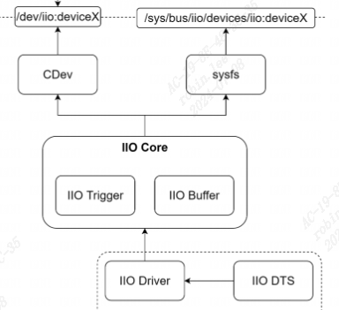
- **IIO sysfs**对用户空间提供IIO设备访问和配置。
- **IIO Core**提供IIO设备、`IIO Trigger、IIO Buffer`分配、初始化、注册等工作。
    - `industrialio-core.c`
    - `industrialio-buffer.c`
    - `industrialio-event.c`
- **IIO Driver**不同IIO设备的驱动程序。

# 3 数据结构

## 3.1 iio_dev-iio设备
```c
struct iio_dev {  
      int id;  
      struct module                   *driver_module;  
      int modes;//设备支持的模式  
      int currentmode;//表示设备当前模式  
      struct device                   dev;  
      struct iio_event_interface      *event_interface;  
      struct iio_buffer               *buffer;//缓冲区  
      struct list_head                buffer_list;//当前匹配的缓冲区列表  
      int scan_bytes; //捕获到，并且提供给缓冲区的字节数  
      struct mutex                    mlock;  
      const unsigned long             *available_scan_masks;//扫描位掩码，使用触发缓冲区的时候可以通过  
//设置掩码来确定使能哪些通道，使能以后的通道会将捕获到的数据发送到 IIO 缓冲区  
      unsigned masklength;  
      const unsigned long             *active_scan_mask;//缓冲区已经开启的通道掩码  
      bool scan_timestamp;   
      unsigned scan_index_timestamp;//扫描时间戳，如果使能以后会将捕获时间戳放到缓冲区里面  
      struct iio_trigger              *trig;// IIO 设备当前触发器  
      bool trig_readonly;  
      struct iio_poll_func            *pollfunc;  
      struct iio_poll_func            *pollfunc_event;  
      struct iio_chan_spec const      *channels;//IIO设备通道列表  
      int num_channels;//IIO设备通道数  
      struct list_head                channel_attr_list;  
      struct attribute_group          chan_attr_group;  
      const char                      *name;  
      const struct iio_info           *info;  
      clockid_t clock_id;  
      struct mutex                    info_exist_lock;  
      const struct iio_buffer_setup_ops       *setup_ops;  
      struct cdev                     chrdev;  
};//iio_dev用于描述一个具体IIO设备, include/linux/iio/iio.h
```

```c
/* Device operating modes */  
#define INDIO_DIRECT_MODE		0x01  
#define INDIO_BUFFER_TRIGGERED		0x02  
#define INDIO_BUFFER_SOFTWARE		0x04  
#define INDIO_BUFFER_HARDWARE		0x08  
  
#define INDIO_ALL_BUFFER_MODES					\  
	(INDIO_BUFFER_TRIGGERED | INDIO_BUFFER_HARDWARE | INDIO_BUFFER_SOFTWARE)
```

|模式|描述|
|---|---|
|INDIO_DIRECT_MODE|提供 sysfs 接口|
|INDIO_BUFFER_TRIGGERED|支持硬件缓冲触发|
|INDIO_BUFFER_SOFTWARE|支持软件缓冲触发|
|INDIO_BUFFER_HARDWARE|支持硬件缓冲区|

### 3.1.1 iio_buffer_setup_ops
```c
struct iio_buffer_setup_ops {  
	int (*preenable)(struct iio_dev *); /* 缓冲区使能之前调用 */  
	int (*postenable)(struct iio_dev *); /* 缓冲区使能之后调用 */  
	int (*predisable)(struct iio_dev *); /* 缓冲区禁用之前调用 */  
	int (*postdisable)(struct iio_dev *); /* 缓冲区禁用之后调用 */  
	bool (*validate_scan_mask)(struct iio_dev *indio_dev, const unsigned long *scan_mask); /* 检查扫描掩码是否有效 */  
};
```

在使能或禁用缓冲区的时候会调用这些函数。

## 3.2 iio_info-属性和函数实现

`iio_info`包含每个iio设备的属性和具体实现函数。
```c
struct iio_info {  
	struct module			*driver_module;  
	struct attribute_group		*event_attrs;  
	const struct attribute_group	*attrs;  
  
	int (*read_raw)(struct iio_dev *indio_dev,  
			struct iio_chan_spec const *chan,  
			int *val,  
			int *val2,  
			long mask);//最终读写传感器设备内部数据的操作函数  
  
	int (*read_raw_multi)(struct iio_dev *indio_dev,  
			struct iio_chan_spec const *chan,  
			int max_len,  
			int *vals,  
			int *val_len,  
			long mask);  
  
	int (*write_raw)(struct iio_dev *indio_dev,  
			 struct iio_chan_spec const *chan,  
			 int val,  
			 int val2,  
			 long mask);  
  
	int (*write_raw_get_fmt)(struct iio_dev *indio_dev,  
			 struct iio_chan_spec const *chan,  
			 long mask);  
  
	int (*read_event_config)(struct iio_dev *indio_dev,  
				 const struct iio_chan_spec *chan,  
				 enum iio_event_type type,  
				 enum iio_event_direction dir);  
  
	int (*write_event_config)(struct iio_dev *indio_dev,  
				  const struct iio_chan_spec *chan,  
				  enum iio_event_type type,  
				  enum iio_event_direction dir,  
				  int state);  
  
	int (*read_event_value)(struct iio_dev *indio_dev,  
				const struct iio_chan_spec *chan,  
				enum iio_event_type type,  
				enum iio_event_direction dir,  
				enum iio_event_info info, int *val, int *val2);  
  
	int (*write_event_value)(struct iio_dev *indio_dev,  
				 const struct iio_chan_spec *chan,  
				 enum iio_event_type type,  
				 enum iio_event_direction dir,  
				 enum iio_event_info info, int val, int val2);  
  
	int (*validate_trigger)(struct iio_dev *indio_dev,  
				struct iio_trigger *trig);  
	int (*update_scan_mode)(struct iio_dev *indio_dev,  
				const unsigned long *scan_mask);  
	int (*debugfs_reg_access)(struct iio_dev *indio_dev,  
				  unsigned reg, unsigned writeval,  
				  unsigned *readval);  
	int (*of_xlate)(struct iio_dev *indio_dev,  
			const struct of_phandle_args *iiospec);  
	int (*hwfifo_set_watermark)(struct iio_dev *indio_dev, unsigned val);  
	int (*hwfifo_flush_to_buffer)(struct iio_dev *indio_dev,  
				      unsigned count);  
};
```

**indio_dev**：需要读写的 IIO 设备。

**chan**：需要读取的通道。

**val，val2**：对于 `read_raw` 来说 val 和 val2 这两个就是应用程序从内核空间读取到数据，一般就是传感器指定通道值，或者传感器的量程、分辨率等。对于 `write_raw` 来说就是应用程序向设备写入的数据。val 和 val2 共同组成具体值，val 是整数部分，val2 是小数部分。Linux内核无法支持浮点运算，因此val2是放大后的值。扩大的倍数我们不能随便设置，而是要使用 Linux 定义的倍数，Linux 内核里面定义的数据扩大倍数：

|组合宏|描述|
|---|---|
|`IIO_VAL_INT`|整数值，没有小数。比如 5000，那么就是 val=5000，不 需要设置 val2|
|`IIO_VAL_INT_PLUS_MICRO`|小数部分扩大 1000000 倍，比如 `1.00236`，此时 val=1， val2=2360|
|`IIO_VAL_INT_PLUS_NANO`|小数部分扩大 1000000000 倍，同样是 `1.00236`，此时 val=1，val2=2360000|
|`IIO_VAL_INT_PLUS_MICRO_DB`|dB 数据，和`IIO_VAL_INT_PLUS_MICRO`数据形式一 样，只是在后面添加 db|
|`IIO_VAL_INT_MULTIPLE`|多个整数值，比如一次要传回 6 个整数值，那么 val 和 val2就不够用了。此宏主要用于`iio_info`的`read_raw_multi` 函数|
|`IIO_VAL_FRACTIONAL`|分数值，也就是 `val/val2`。比如 val=1，val2=4，那么实际 值就是 `1/4`|
|`IIO_VAL_FRACTIONAL_LOG2`|值为 `val>>val2`，也就是 val 右移 val2 位。比如 val=25600， val2=4 ， 那 么 真 正 的 值 就 是 25600 右 移 4 位 ， `25600>>4=1600`|

**mask**：掩码，用于指定我们读取的是什么数据，比如 `ICM20608` 这样的传感器，他既有原 始的测量数据，比如 `X,Y,Z` 轴的陀螺仪、加速度计等，也有测量范围值，或者分辨率。比如加 速度计测量范围设置为`±16g`，那么分辨率就是 `32/65536≈0.000488`，我们只有读出原始值以及 对应的分辨率(量程)，才能计算出真实的重力加速度。此时就有两种数据值：传感器原始值、分辨率。Linux 内核使用 `IIO_CHAN_INFO_RAW` 和 `IIO_CHAN_INFO_SCALE` 这两个宏来表示原 始值以及分辨率，这两个宏就是掩码。

`write_raw_get_fmt` 用于设置用户空间向内核空间写入的数据格式，`write_raw_get_fmt`函数决定了 `wtite_raw` 函数中 val 和 val2 的意义，也就是表中的组合 形式。比如我们需要在应用程序中设置 `ICM20608` 加速度计的量程为`±8g`，那么分辨率就是`16/65536≈0.000244`，我们在 `write_raw_get_fmt` 函数里面设置加速度计的数据格式为 `IIO_VAL_INT_PLUS_MICRO`。那么我们在应用程序里面向指定的文件写入 `0.000244` 以后，最 终传递给内核驱动的就是 `0.000244*1000000=244`。也就是 `write_raw` 函数的 val 参数为 0，val2 参数为 244。

## 3.3 iio_chan_spec-通道属性

一个IIO设备可能有多个通道，每个通道由`struct iio_chan_spec`表示。比如一个 ADC 芯片支持 8 路采集，那 么这个 ADC 就有 8 个通道。的 `ICM20608`六轴传感器，可以输出三轴陀螺仪`(X、Y、Z)`、三轴加速度计`(X、Y、Z)`和一路温度，共7路数据。
```c
struct iio_chan_spec {  
    enum iio_chan_type    type;//表示channel类型，电压、电流、加速度、电磁等等。  
    int            channel;  
    int            channel2;  
    unsigned long        address;//该通道对应的芯片数据寄存器地址  
    int            scan_index;//当使用触发缓冲区的时候，scan_index 是扫描索引  
    struct {  
        char    sign;  
        u8    realbits;  
        u8    storagebits;  
        u8    shift;  
        u8    repeat;  
        enum iio_endian endianness;  
    } scan_type;//扫描数据的存储格式  
    long            info_mask_separate;  
    long            info_mask_separate_available;  
    long            info_mask_shared_by_type;//标记导出的信息由相同类型的通道共享
    long            info_mask_shared_by_type_available;  
    long            info_mask_shared_by_dir;  
    long            info_mask_shared_by_dir_available;  
    long            info_mask_shared_by_all;  
    long            info_mask_shared_by_all_available;  
    const struct iio_event_spec *event_spec;  
    unsigned int        num_event_specs;  
    const struct iio_chan_spec_ext_info *ext_info;  
    const char        *extend_name;  
    const char        *datasheet_name;  
    unsigned        modified:1;//modified 为 1 的时候，channel2 为通道修饰符  
    unsigned        indexed:1;// indexed 为 1时候，channel 为通道索引  
    unsigned        output:1;  
    unsigned        differential:1;  
};  
  
enum iio_chan_type {  
	IIO_VOLTAGE, /* 电压类型 */  
	IIO_CURRENT, /* 电流类型 */  
	IIO_POWER, /* 功率类型 */  
	IIO_ACCEL, /* 加速度类型 */  
	IIO_ANGL_VEL, /* 角度类型(陀螺仪) */  
	IIO_MAGN, /* 电磁类型(磁力计) */  
	IIO_LIGHT, /* 灯光类型 */  
	IIO_INTENSITY, /* 强度类型(光强传感器) */  
	IIO_PROXIMITY, /* 接近类型(接近传感器) */  
	IIO_TEMP, /* 温度类型 */  
	IIO_INCLI, /* 倾角类型(倾角测量传感器) */  
	IIO_ROT, /* 旋转角度类型 */  
	IIO_ANGL, /* 转动角度类型(电机旋转角度测量传感器) */  
	IIO_TIMESTAMP, /* 时间戳类型 */  
	IIO_CAPACITANCE, /* 电容类型 */  
	IIO_ALTVOLTAGE, /* 频率类型 */  
	IIO_CCT, /* 笔者暂时未知的类型 */  
	IIO_PRESSURE, /* 压力类型 */  
	IIO_HUMIDITYRELATIVE, /* 湿度类型 */  
	IIO_ACTIVITY, /* 活动类型(计步传感器) */  
	IIO_STEPS, /* 步数类型 */  
	IIO_ENERGY, /* 能量类型(卡路里) */  
	IIO_DISTANCE, /* 距离类型 */  
	IIO_VELOCITY, /* 速度类型 */  
};
```

如果是 ICM20608 这样的多轴传感器，那么就是复合类型了，陀螺仪部分是 `IIO_ANGL_VEL` 类型，加速度计部分是`IIO_ACCEL`，温度部分就是 `IIO_TEMP`。

当成员变量 `modified 为 1` 的时候，`channel2 为通道修饰符`。Linux 内核给出了 可用的`通道修饰符`:
```c
enum iio_modifier {  
	IIO_NO_MOD,  
	IIO_MOD_X, /* X 轴 */  
	IIO_MOD_Y, /* Y 轴 */  
	IIO_MOD_Z, /* Z 轴 */  
......  
};
```

比如 `ICM20608` 的加速度计部分，类型设置为 `IIO_ACCEL`，`X、Y、Z` 这三个轴就用 `channel2` 的`通道修饰符`来区分.

`scan_type` 各个成员变量:
```c
scan_type.sign：如果为‘u’表示数据为无符号类型，为‘s’的话为有符号类型。  
  
scan_type.realbits：数据真实的有效位数，比如很多传感器说的 10 位 ADC，其真实有效数  
据就是 10 位。  
  
scan_type.storagebits：存储位数，有效位数+填充位。比如有些传感器 ADC 是 12 位的，  
那么我们存储的话肯定要用到 2 个字节，也就是 16 位，这 16 位就是存储位数。  
  
scan_type.shift:右移位数，也就是存储位数和有效位数不一致的时候，需要右移的位数，这  
个参数不总是需要，一切以实际芯片的数据手册位数。  
  
scan_type.repeat：实际或存储位的重复数量。  
scan_type.endianness:数据的大小端模式，可设置为 IIO_CPU、IIO_BE(大端)或 IIO_LE(小  
端)。
```

`info_mask_separate` 将属性标记为特定于此通道。

`info_mask_shared_by_type` 标记导出的信息由相同类型的通道共享。`X、Y、Z` 轴他们的 type 都 是 `IIO_ACCEL`，也就是类型相同。而这三个轴的分辨率(量程)是一样的，那么这3个通道`info_mask_shared_by_type` 中使能`IO_CHAN_INFO_SCALE` 这个属性，表示 这三个通道的分辨率是共用的，这样在`sysfs`下就会只生成一个描述分辨率的文件，这三个通道 都可以使用这一个分辨率文件。

`info_mask_shared_by_dir` 标记某些导出的信息由相同方向的通道共享。

`info_mask_shared_by_all` 标记某些信息所有的通道共享，无论这些通道的类 型、方向如何，全部共享。

`output` 表示为输出通道。

`differential` 表示为差分通道。

## 3.4 iio_buffer-保存采集到的数据
```c
struct iio_buffer {  
	int					length;  
	int					bytes_per_datum;  
	struct attribute_group			*scan_el_attrs;  
	long					*scan_mask;  
	bool					scan_timestamp;  
	const struct iio_buffer_access_funcs	*access;  
	struct list_head			scan_el_dev_attr_list;  
	struct attribute_group			buffer_group;  
	struct attribute_group			scan_el_group;  
	wait_queue_head_t			pollq;  
	bool					stufftoread;  
	const struct attribute			**attrs;  
	struct list_head			demux_list;  
	void					*demux_bounce;  
	struct list_head			buffer_list;  
	struct kref				ref;  
	unsigned int				watermark;  
};
```
通常与iio_trigger配合使用，iio_triggered_buffer_setup 函数中会根据buffer类型自动分配和绑定buffer，并为iio_dev->iio_buffer_setup_ops赋值。
## 3.5 iio_trigger-触发数据采集

触发器是基于某种信号来触发数据采集，比如：数据就绪中断；周期性中断；用户空间sysfs读写。内部使用虚拟中断控制器实现。
```c
struct iio_trigger {  
    const struct iio_trigger_ops    *ops;  
    struct module            *owner;  
    int                id;  
    const char            *name;  
    struct device            dev;  
    struct list_head        list;  
    struct list_head        alloc_list;  
    atomic_t            use_count;  
    struct irq_chip            subirq_chip;  
    int                subirq_base;  
    struct iio_subirq subirqs[CONFIG_IIO_CONSUMERS_PER_TRIGGER];  
    unsigned long pool[BITS_TO_LONGS(CONFIG_IIO_CONSUMERS_PER_TRIGGER)];  
    struct mutex            pool_lock;  
    bool                attached_own_device;  
};

struct iio_trigger_ops {  
    int (*set_trigger_state)(struct iio_trigger *trig, bool state);--设置触发器状态，打开或关闭。  
    int (*try_reenable)(struct iio_trigger *trig);--当用户计数为0时，重新使能接口。  
    int (*validate_device)(struct iio_trigger *trig,  
                   struct iio_dev *indio_dev);  
};
```
### 3.5.2 iio-trigger类型
内核里已经实现了多种"iio-trigger"，比如：

* iio-trig-loop：本质就是使用一个内核线程，不断读硬件、写buffer
* iio-trig-sysfs：用户写一下某个sysfs文件，就读一次硬件、写buffer
* iio-trig-interrupt：可以使用其他中断来读硬件、写buffer
* iio-trig-hrtimer：使用定时器，周期性地读硬件、写buffer
```
# 注册trigger驱动
insmod /root/iio-trig-hrtimer.ko
mkdir  /sys/kernel/config/iio/triggers/hrtimer/timer_abc  # 创建trigger
cat /sys/bus/iio/devices/trigger1/name             # 可以看到这个trigger

# 注册IIO设备
insmod /root/dht11.ko
cd /sys/bus/iio/devices/iio\:device2/
echo timer_abc > trigger/current_trigger               # 在设备上使用trigger

echo 1 > scan_elements/in_humidityrelative_en
echo 1 > scan_elements/in_temp_en
echo 1 > buffer/enable

# 修改频率
cd /sys/bus/iio/devices/trigger1
echo 1000000000 > sampling_frequency  # 单位ns

hexdump /dev/iio\:device2
```

### 3.5.3 驱动使用iio-trigger API
```
xxx_irq_handler(int irq, void *p){
	return IRQ_WAKE_THREAD;
}

xxx_read_datas(int irq, void *p){
	//读取硬件数据
	...
	//写入buffer
	iio_push_to_buffers(iio_dev, vals);
	// 触发器处理完成
	iio_trigger_notify_done(iio_dev->trig);
	return IRQ_HANDLED;

}
xxx_probe(){
	iio_triggered_buffer_setup(indio_dev,
							xxx_irq_handler,
							xxx_read_datas,
							NULL);   // 提供虚拟中断处理函数读取数据存入buffer，函数保存在pollfunc_event中。
}

```

## 3.6 iio_event-上报阈值事件
使用结构体"iio_event_data"表示事件：
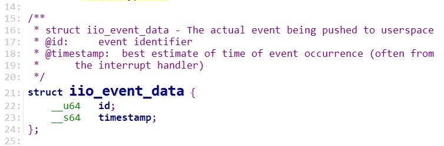
使用 IIO_EVENT_CODE宏构造事件ID：
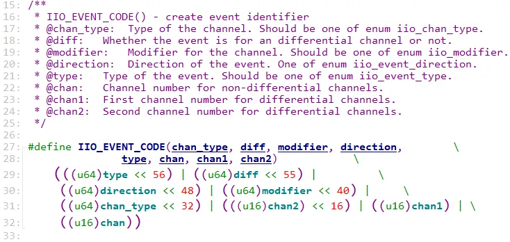
驱动内使用IIO_EVENT API：
```
// 事件定义
static const struct iio_event_spec dht11_temp_events[] = {
	{
		.type = IIO_EV_TYPE_THRESH,
		.dir = IIO_EV_DIR_RISING,
		.mask_separate = BIT(IIO_EV_INFO_VALUE),
	}, {
		.type = IIO_EV_TYPE_THRESH,
		.dir = IIO_EV_DIR_FALLING,
		.mask_separate = BIT(IIO_EV_INFO_VALUE),
	}, {
		.type = IIO_EV_TYPE_THRESH,
		.dir = IIO_EV_DIR_EITHER,
		.mask_separate = BIT(IIO_EV_INFO_ENABLE),
	},
};

static const struct iio_chan_spec dht11_chan_spec[] = {
	{ .type = IIO_TEMP,
		.info_mask_separate = BIT(IIO_CHAN_INFO_PROCESSED), 
		.scan_index = 0,
		.scan_type = {
			.sign = 's',
			.realbits = 8,
			.storagebits = 8,
		},
		.event_spec = dht11_temp_events,          // 为此通道设置阈值事件
		.num_event_specs = ARRAY_SIZE(dht11_temp_events),
	},
	{ .type = IIO_HUMIDITYRELATIVE,
		.info_mask_separate = BIT(IIO_CHAN_INFO_PROCESSED), 
		.scan_index = 1,
		.scan_type = {
			.sign = 's',
			.realbits = 8,
			.storagebits = 8,
		},
	}
};

xxx_event_handler(int irq, void *p){
	iio_push_event(idev,
		   IIO_UNMOD_EVENT_CODE(IIO_TEMP, 0,
				IIO_EV_TYPE_THRESH, IIO_EV_DIR_RISING),
		   iio_get_time_ns(idev));

	iio_trigger_notify_done(idev->trig);
	return IRQ_HANDLED;
}

xxx_porbe(){
	iio_triggered_event_setup(indio_dev, NULL, xxx_event_handler); // 提供虚拟中断处理函数处理event，函数保存在pollfunc_event中。
}

```

APP读取事件值：
```c
int event_fd;
struct iio_event_data event;

int fd = open("/dev/iio:device2", O_RDWR);

ioctl(fd, IIO_GET_EVENT_FD_IOCTL, &event_fd); // 获取事件FD
read(event_fd, &event, sizeof(event));
```

# 4 IIO子系统驱动分析

## 4.1 iio_dev 注册与注销
```c
struct iio_dev *iio_device_alloc(int sizeof_priv)//申请 iio_dev  
struct iio_dev *devm_iio_device_alloc(struct device *dev, int sizeof_priv)//申请 iio_dev  
void iio_device_free(struct iio_dev *indio_dev);  
void devm_iio_device_free(struct device *dev, struct iio_dev *indio_dev);  
  
int iio_device_register(struct iio_dev *indio_dev)//注册iio设备  
void iio_device_unregister(struct iio_dev *indio_dev)//注销iio设备  
        
#define iio_device_register(indio_dev) \  
    __iio_device_register((indio_dev), THIS_MODULE)  
int __iio_device_register(struct iio_dev *indio_dev, struct module *this_mod);  
void iio_device_unregister(struct iio_dev *indio_dev);  
#define devm_iio_device_register(dev, indio_dev) \  
    __devm_iio_device_register((dev), (indio_dev), THIS_MODULE);  
int __devm_iio_device_register(struct device *dev, struct iio_dev *indio_dev,  
                   struct module *this_mod);  
void devm_iio_device_unregister(struct device *dev, struct iio_dev *indio_dev);
```

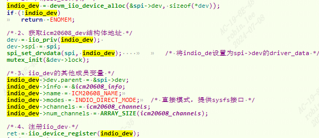
```c
devm_iio_device_register/iio_device_register  
　　->__iio_device_register  
　　　　->iio_check_unique_scan_index  
　　　　->iio_device_register_debugfs  
　　　　　　->debugfs_create_file//创建direct_reg_access调试节点，通过此节点可以直接读写寄存器。  
    		//iio_debugfs_reg_fops调用IIO设备struct iio_dev->info->debugfs_reg_access()函数。
```

### 4.1.1 `iio_device_register_sysfs`过程

`devm_iio_device_register`过程中会调用`iio_device_register_sysfs`:
```c
->iio_buffer_alloc_sysfs_and_mask  
　　　　->iio_device_register_sysfs//创建adc属性和每个channel属性。  
　　　　->cdev_init//初始化cdev设备，操作函数集为iio_buffer_fileops。  
　　　　->cdev_device_add//创建cdev设备/dev/iio:deviceX。
```

展开`iio_device_register_sysfs`如下：
```c
iio_device_register_sysfs  
        --->  iio_device_add_channel_sysfs  
                --->  iio_device_add_info_mask_type  
                        --->  __iio_add_chan_devattr  
                                --->  __iio_device_attr_init
```

其中在`iio_device_add_info_mask_type`中设置了读写回调函数，比如`cat in_voltage0_input`就会调用回调函数`iio_read_channel_info`.
```c
int __iio_device_attr_init()  
{...  
		case IIO_SEPARATE:  
			if (chan->indexed)  
				name = kasprintf(GFP_KERNEL, "%s_%s%d_%s",  
						    iio_direction[chan->output],  
						    iio_chan_type_name_spec[chan->type],  
						    chan->channel,  
						    full_postfix);  
    //in_voltage0_input  
    //  
      ..........  
}
```

格式为`%s_%s%d_%s"`， 对应了`in_voltage0_input`，其中`iio_direction、iio_chan_type_name_spec、iio_chan_info_postfix`对应的值为 `"in" 、"voltage" 、"input"`

如下代码片段：
```c
static const char * const iio_direction[] = {  
	[0] = "in",  
	[1] = "out",  
};  
   
static const char * const iio_chan_type_name_spec[] = {  
	[IIO_VOLTAGE] = "voltage",  
	[IIO_CURRENT] = "current",  
	[IIO_POWER] = "power",  
	[IIO_ACCEL] = "accel",  
	// 以下省略  
};  
   
   
/* relies on pairs of these shared then separate */  
static const char * const iio_chan_info_postfix[] = {  
	[IIO_CHAN_INFO_RAW] = "raw",  
	[IIO_CHAN_INFO_PROCESSED] = "input",  
	[IIO_CHAN_INFO_SCALE] = "scale",  
	[IIO_CHAN_INFO_OFFSET] = "offset",  
    // 以下省略  
};
```

## 4.2 iio_init-子系统的初始化

IIO子系统初始化包括：

- iio总线注册
- 分配IIO字符设备号
- 创建IIO设备`debugfs`
```c
iio_init  
　　->bus_register//注册iio bus。  
　　->alloc_chrdev_region//创建iio cdev设备编号iio_devt。  
　　->debugfs_create_dir//创建/sys/kernel/debug/iio调试目录iio_debugfs_dentry。
```

# 5 iio实验-操作ICM20608

## 5.1 使能内核 IIO
```c
-> Device Drivers  
 -> Industrial I/O support (IIO [=y])   
 	-> [*]Enable buffer support within IIO //选中  
 	-> <*>Industrial I/O buffering based on kfifo //选中
```

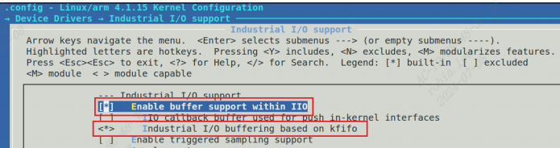
## 5.2 驱动代码分析

### 5.2.0 源码
```c
#include <linux/spi/spi.h>  
#include <linux/kernel.h>  
#include <linux/module.h>  
#include <linux/init.h>  
#include <linux/delay.h>  
#include <linux/ide.h>  
#include <linux/errno.h>  
#include <linux/platform_device.h>  
#include "icm20608reg.h"  
#include <linux/gpio.h>  
#include <linux/device.h>  
#include <asm/uaccess.h>  
#include <linux/cdev.h>  
#include <linux/regmap.h>  
#include <linux/iio/iio.h>  
#include <linux/iio/sysfs.h>  
#include <linux/iio/buffer.h>  
#include <linux/iio/trigger.h>  
#include <linux/iio/triggered_buffer.h>  
#include <linux/iio/trigger_consumer.h>  
#include <linux/unaligned/be_byteshift.h>  
  
#define ICM20608_NAME	"icm20608"  
#define ICM20608_TEMP_OFFSET	     0  
#define ICM20608_TEMP_SCALE		     326800000  
  
#define ICM20608_CHAN(_type, _channel2, _index)                \  
	{                                                          \  
		.type = _type,                                        \  
		.modified = 1,                                        \  
		.channel2 = _channel2,                                \  
		.info_mask_shared_by_type = BIT(IIO_CHAN_INFO_SCALE), \  
		.info_mask_separate = BIT(IIO_CHAN_INFO_RAW) |	      \  
				      BIT(IIO_CHAN_INFO_CALIBBIAS),   \  
		.scan_index = _index,                                 \  
		.scan_type = {                                        \  
				.sign = 's',                          \  
				.realbits = 16,                       \  
				.storagebits = 16,                    \  
				.shift = 0,                           \  
				.endianness = IIO_BE,                 \  
			     },                                       \  
	}  
  
/*   
 * ICM20608的扫描元素，3轴加速度计、  
 * 3轴陀螺仪、1路温度传感器，1路时间戳   
 */  
enum inv_icm20608_scan {  
	INV_ICM20608_SCAN_ACCL_X,  
	INV_ICM20608_SCAN_ACCL_Y,  
	INV_ICM20608_SCAN_ACCL_Z,  
	INV_ICM20608_SCAN_TEMP,  
	INV_ICM20608_SCAN_GYRO_X,  
	INV_ICM20608_SCAN_GYRO_Y,  
	INV_ICM20608_SCAN_GYRO_Z,  
	INV_ICM20608_SCAN_TIMESTAMP,  
};  
  
struct icm20608_dev {  
	struct spi_device *spi;		/* spi设备 */  
	struct regmap *regmap;				/* regmap */  
	struct regmap_config regmap_config;	  
	struct mutex lock;  
};  
  
/*  
 * icm20608陀螺仪分辨率，对应250、500、1000、2000，计算方法：  
 * 以正负250度量程为例，500/2^16=0.007629，扩大1000000倍，就是7629  
 */  
static const int gyro_scale_icm20608[] = {7629, 15258, 30517, 61035};  
  
/*   
 * icm20608加速度计分辨率，对应2、4、8、16 计算方法：  
 * 以正负2g量程为例，4/2^16=0.000061035，扩大1000000000倍，就是61035  
 */  
static const int accel_scale_icm20608[] = {61035, 122070, 244140, 488281};  
  
/*  
 * icm20608通道，1路温度通道，3路陀螺仪，3路加速度计  
 */  
static const struct iio_chan_spec icm20608_channels[] = {  
	/* 温度通道 */  
	{  
		.type = IIO_TEMP,  
		.info_mask_separate = BIT(IIO_CHAN_INFO_RAW)  
				| BIT(IIO_CHAN_INFO_OFFSET)  
				| BIT(IIO_CHAN_INFO_SCALE),  
		.scan_index = INV_ICM20608_SCAN_TEMP,  
		.scan_type = {  
				.sign = 's',  
				.realbits = 16,  
				.storagebits = 16,  
				.shift = 0,  
				.endianness = IIO_BE,  
			     },  
	},  
  
	ICM20608_CHAN(IIO_ANGL_VEL, IIO_MOD_X, INV_ICM20608_SCAN_GYRO_X),	/* 陀螺仪X轴 */  
	ICM20608_CHAN(IIO_ANGL_VEL, IIO_MOD_Y, INV_ICM20608_SCAN_GYRO_Y),	/* 陀螺仪Y轴 */  
	ICM20608_CHAN(IIO_ANGL_VEL, IIO_MOD_Z, INV_ICM20608_SCAN_GYRO_Z),	/* 陀螺仪Z轴 */  
  
	ICM20608_CHAN(IIO_ACCEL, IIO_MOD_Y, INV_ICM20608_SCAN_ACCL_Y),	/* 加速度X轴 */  
	ICM20608_CHAN(IIO_ACCEL, IIO_MOD_X, INV_ICM20608_SCAN_ACCL_X),	/* 加速度Y轴 */  
	ICM20608_CHAN(IIO_ACCEL, IIO_MOD_Z, INV_ICM20608_SCAN_ACCL_Z),	/* 加速度Z轴 */  
};  
  
static unsigned char icm20608_read_onereg(struct icm20608_dev *dev, u8 reg)  
{  
	u8 ret;  
	unsigned int data;  
  
	ret = regmap_read(dev->regmap, reg, &data);  
	return (u8)data;  
}  
  
static void icm20608_write_onereg(struct icm20608_dev *dev, u8 reg, u8 value)  
{  
	regmap_write(dev->regmap,  reg, value);  
}  
  
void icm20608_reginit(struct icm20608_dev *dev)  
{  
	u8 value = 0;  
	  
	icm20608_write_onereg(dev, ICM20_PWR_MGMT_1, 0x80);  
	mdelay(50);  
	icm20608_write_onereg(dev, ICM20_PWR_MGMT_1, 0x01);  
	mdelay(50);  
  
	value = icm20608_read_onereg(dev, ICM20_WHO_AM_I);  
	printk("ICM20608 ID = %#X\r\n", value);	  
  
	icm20608_write_onereg(dev, ICM20_SMPLRT_DIV, 0x00); /* 输出速率是内部采样率*/  
	icm20608_write_onereg(dev, ICM20_GYRO_CONFIG, 0x18); /* 陀螺仪±2000dps量程 */  
	icm20608_write_onereg(dev, ICM20_ACCEL_CONFIG, 0x18); /* 加速度计±16G量程 */  
	icm20608_write_onereg(dev, ICM20_CONFIG, 0x04); /* 陀螺仪低通滤波BW=20Hz */  
	icm20608_write_onereg(dev, ICM20_ACCEL_CONFIG2, 0x04); /* 加速度计低通滤波BW=21.2Hz */  
	icm20608_write_onereg(dev, ICM20_PWR_MGMT_2, 0x00); /* 打开加速度计和陀螺仪所有轴 */  
	icm20608_write_onereg(dev, ICM20_LP_MODE_CFG, 0x00); /* 关闭低功耗 */  
	icm20608_write_onereg(dev, ICM20_INT_ENABLE, 0x01);	/* 使能FIFO溢出以及数据就绪中断	*/  
}  
  
/*  
  * @description  	: 设置ICM20608传感器，可以用于陀螺仪、加速度计设置  
  * @param - dev	: icm20608设备   
  * @param - reg  	: 要设置的通道寄存器首地址。  
  * @param - anix  	: 要设置的通道，比如X，Y，Z。  
  * @param - val  	: 要设置的值。  
  * @return			: 0，成功；其他值，错误  
  */  
static int icm20608_sensor_set(struct icm20608_dev *dev, int reg,  
				int axis, int val)  
{  
	int ind, result;  
	__be16 d = cpu_to_be16(val);  
  
	ind = (axis - IIO_MOD_X) * 2;  
	result = regmap_bulk_write(dev->regmap, reg + ind, (u8 *)&d, 2);  
	if (result)  
		return -EINVAL;  
  
	return 0;  
}  
  
/*  
  * @description  	: 读取ICM20608传感器数据，可以用于陀螺仪、加速度计、温度的读取  
  * @param - dev	: icm20608设备   
  * @param - reg  	: 要读取的通道寄存器首地址。  
  * @param - anix  	: 需要读取的通道，比如X，Y，Z。  
  * @param - val  	: 保存读取到的值。  
  * @return			: 0，成功；其他值，错误  
  */  
static int icm20608_sensor_show(struct icm20608_dev *dev, int reg,  
				   int axis, int *val)  
{  
	int ind, result;  
	__be16 d;  
  
	ind = (axis - IIO_MOD_X) * 2;  
	result = regmap_bulk_read(dev->regmap, reg + ind, (u8 *)&d, 2);  
	if (result)  
		return -EINVAL;  
	*val = (short)be16_to_cpup(&d);  
  
	return IIO_VAL_INT;  
}  
  
/*  
  * @description  		: 读取ICM20608陀螺仪、加速度计、温度通道值  
  * @param - indio_dev	: iio设备   
  * @param - chan  		: 通道。  
  * @param - val  		: 保存读取到的通道值。  
  * @return				: 0，成功；其他值，错误  
  */  
static int icm20608_read_channel_data(struct iio_dev *indio_dev,  
					 struct iio_chan_spec const *chan,  
					 int *val)  
{  
	struct icm20608_dev *dev = iio_priv(indio_dev);  
	int ret = 0;  
  
	switch (chan->type) {  
	case IIO_ANGL_VEL:	/* 读取陀螺仪数据, channel2为X、Y、Z轴*/  
		ret = icm20608_sensor_show(dev, ICM20_GYRO_XOUT_H, chan->channel2, val);  
		break;  
	case IIO_ACCEL:		/* 读取加速度计数据,channel2为X、Y、Z轴 */  
		ret = icm20608_sensor_show(dev, ICM20_ACCEL_XOUT_H, chan->channel2, val);  
		break;  
	case IIO_TEMP:		/* 读取温度 */  
		ret = icm20608_sensor_show(dev, ICM20_TEMP_OUT_H, IIO_MOD_X, val);    
		break;  
	default:  
		ret = -EINVAL;  
		break;  
	}  
	return ret;  
}  
  
/*  
  * @description  	: 设置ICM20608的陀螺仪计量程(分辨率)  
  * @param - dev	: icm20608设备  
  * @param - val   	: 量程(分辨率值)。  
  * @return			: 0，成功；其他值，错误  
  */  
static int icm20608_write_gyro_scale(struct icm20608_dev *dev, int val)  
{  
	int result, i;  
	u8 d;  
  
	for (i = 0; i < ARRAY_SIZE(gyro_scale_icm20608); ++i) {  
		if (gyro_scale_icm20608[i] == val) {  
			d = (i << 3);  
			result = regmap_write(dev->regmap, ICM20_GYRO_CONFIG, d);  
			if (result)  
				return result;  
			return 0;  
		}  
	}  
	return -EINVAL;  
}  
  
 /*  
  * @description  	: 设置ICM20608的加速度计量程(分辨率)  
  * @param - dev	: icm20608设备  
  * @param - val   	: 量程(分辨率值)。  
  * @return			: 0，成功；其他值，错误  
  */  
static int icm20608_write_accel_scale(struct icm20608_dev *dev, int val)  
{  
	int result, i;  
	u8 d;  
  
	for (i = 0; i < ARRAY_SIZE(accel_scale_icm20608); ++i) {  
		if (accel_scale_icm20608[i] == val) {  
			d = (i << 3);  
			result = regmap_write(dev->regmap, ICM20_ACCEL_CONFIG, d);  
			if (result)  
				return result;  
			return 0;  
		}  
	}  
	return -EINVAL;  
}  
  
/*  
  * @description     	: 读函数，当读取sysfs中的文件的时候最终此函数会执行，此函数  
  * 					：里面会从传感器里面读取各种数据，然后上传给应用。  
  * @param - indio_dev	: iio_dev  
  * @param - chan   	: 通道  
  * @param - val   		: 读取的值，如果是小数值的话，val是整数部分。  
  * @param - val2   	: 读取的值，如果是小数值的话，val2是小数部分。  
  * @param - mask   	: 掩码。  
  * @return				: 0，成功；其他值，错误  
  */  
static int icm20608_read_raw(struct iio_dev *indio_dev,  
			   struct iio_chan_spec const *chan,  
			   int *val, int *val2, long mask)  
{  
	struct icm20608_dev *dev = iio_priv(indio_dev);  
	int ret = 0;  
	unsigned char regdata = 0;  
  
	switch (mask) {  
	case IIO_CHAN_INFO_RAW:	/* 读取ICM20608加速度计、陀螺仪、温度传感器原始值 */  
		mutex_lock(&dev->lock); /* 上锁 */  
		ret = icm20608_read_channel_data(indio_dev, chan, val); /* 读取通道值 */  
		mutex_unlock(&dev->lock);/* 释放锁 */  
		return ret;  
	case IIO_CHAN_INFO_SCALE:  
		switch (chan->type) {  
		case IIO_ANGL_VEL:  
			mutex_lock(&dev->lock);  
			regdata = (icm20608_read_onereg(dev, ICM20_GYRO_CONFIG) & 0X18) >> 3;  
			*val  = 0;  
			*val2 = gyro_scale_icm20608[regdata];  
			mutex_unlock(&dev->lock);  
			return IIO_VAL_INT_PLUS_MICRO;	/* 值为val+val2/1000000 */  
		case IIO_ACCEL:  
			mutex_lock(&dev->lock);  
			regdata = (icm20608_read_onereg(dev, ICM20_ACCEL_CONFIG) & 0X18) >> 3;  
			*val = 0;  
			*val2 = accel_scale_icm20608[regdata];;  
			mutex_unlock(&dev->lock);  
			return IIO_VAL_INT_PLUS_NANO;/* 值为val+val2/1000000000 */  
		case IIO_TEMP:					  
			*val = ICM20608_TEMP_SCALE/ 1000000;  
			*val2 = ICM20608_TEMP_SCALE % 1000000;  
			return IIO_VAL_INT_PLUS_MICRO;	/* 值为val+val2/1000000 */  
		default:  
			return -EINVAL;  
		}  
		return ret;  
	case IIO_CHAN_INFO_OFFSET:		/* ICM20608温度传感器offset值 */  
		switch (chan->type) {  
		case IIO_TEMP:  
			*val = ICM20608_TEMP_OFFSET;  
			return IIO_VAL_INT;  
		default:  
			return -EINVAL;  
		}  
		return ret;  
	case IIO_CHAN_INFO_CALIBBIAS:	/* ICM20608加速度计和陀螺仪校准值 */  
		switch (chan->type) {  
		case IIO_ANGL_VEL:		/* 陀螺仪的校准值 */  
			mutex_lock(&dev->lock);  
			ret = icm20608_sensor_show(dev, ICM20_XG_OFFS_USRH, chan->channel2, val);  
			mutex_unlock(&dev->lock);  
			return ret;  
		case IIO_ACCEL:			/* 加速度计的校准值 */  
			mutex_lock(&dev->lock);	  
			ret = icm20608_sensor_show(dev, ICM20_XA_OFFSET_H, chan->channel2, val);  
			mutex_unlock(&dev->lock);  
			return ret;  
		default:  
			return -EINVAL;  
		}  
		  
	default:  
		return ret -EINVAL;  
	}  
}	  
  
/*  
  * @description     	: 写函数，当向sysfs中的文件写数据的时候最终此函数会执行，一般在此函数  
  * 					：里面设置传感器，比如量程等。  
  * @param - indio_dev	: iio_dev  
  * @param - chan   	: 通道  
  * @param - val   		: 应用程序写入的值，如果是小数值的话，val是整数部分。  
  * @param - val2   	: 应用程序写入的值，如果是小数值的话，val2是小数部分。  
  * @return				: 0，成功；其他值，错误  
  */  
static int icm20608_write_raw(struct iio_dev *indio_dev,  
			    struct iio_chan_spec const *chan,  
			    int val, int val2, long mask)  
{  
	struct icm20608_dev *dev = iio_priv(indio_dev);  
	int ret = 0;  
  
	switch (mask) {  
	case IIO_CHAN_INFO_SCALE:	/* 设置陀螺仪和加速度计的分辨率 */  
		switch (chan->type) {  
		case IIO_ANGL_VEL:		/* 设置陀螺仪 */  
			mutex_lock(&dev->lock);  
			ret = icm20608_write_gyro_scale(dev, val2);  
			mutex_unlock(&dev->lock);  
			break;  
		case IIO_ACCEL:			/* 设置加速度计 */  
			mutex_lock(&dev->lock);  
			ret = icm20608_write_accel_scale(dev, val2);  
			mutex_unlock(&dev->lock);  
			break;  
		default:  
			ret = -EINVAL;  
			break;  
		}  
		break;  
	case IIO_CHAN_INFO_CALIBBIAS:	/* 设置陀螺仪和加速度计的校准值*/  
		switch (chan->type) {  
		case IIO_ANGL_VEL:		/* 设置陀螺仪校准值 */  
			mutex_lock(&dev->lock);  
			ret = icm20608_sensor_set(dev, ICM20_XG_OFFS_USRH,  
									    chan->channel2, val);  
			mutex_unlock(&dev->lock);  
			break;  
		case IIO_ACCEL:			/* 加速度计校准值 */  
			mutex_lock(&dev->lock);  
			ret = icm20608_sensor_set(dev, ICM20_XA_OFFSET_H,  
							             chan->channel2, val);  
			mutex_unlock(&dev->lock);  
			break;  
		default:  
			ret = -EINVAL;  
			break;  
		}  
		break;  
	default:  
		ret = -EINVAL;  
		break;  
	}  
	return ret;  
}  
  
/*  
  * @description     	: 用户空间写数据格式，比如我们在用户空间操作sysfs来设置传感器的分辨率，  
  * 					：如果分辨率带小数，那么这个小数传递到内核空间应该扩大多少倍，此函数就是  
  *						: 用来设置这个的。  
  * @param - indio_dev	: iio_dev  
  * @param - chan   	: 通道  
  * @param - mask   	: 掩码  
  * @return				: 0，成功；其他值，错误  
  */  
static int icm20608_write_raw_get_fmt(struct iio_dev *indio_dev,  
				 struct iio_chan_spec const *chan, long mask)  
{  
	switch (mask) {  
	case IIO_CHAN_INFO_SCALE:  
		switch (chan->type) {  
		case IIO_ANGL_VEL:		/* 用户空间写的陀螺仪分辨率数据要乘以1000000 */  
			return IIO_VAL_INT_PLUS_MICRO;  
		default:				/* 用户空间写的加速度计分辨率数据要乘以1000000000 */  
			return IIO_VAL_INT_PLUS_NANO;  
		}  
	default:  
		return IIO_VAL_INT_PLUS_MICRO;  
	}  
	return -EINVAL;  
}  
  
static const struct iio_info icm20608_info = {  
	.read_raw		= icm20608_read_raw,  
	.write_raw		= icm20608_write_raw,  
	.write_raw_get_fmt = &icm20608_write_raw_get_fmt,	/* 用户空间写数据格式 */  
};  
	  
static int icm20608_probe(struct spi_device *spi)  
{  
	int ret;  
	struct icm20608_dev *dev;  
	struct iio_dev *indio_dev;  
  
	/*  1、申请iio_dev内存 */  
	indio_dev = devm_iio_device_alloc(&spi->dev, sizeof(*dev));  
	if (!indio_dev)  
		return -ENOMEM;  
  
	/* 2、获取icm20608_dev结构体地址 */  
	dev = iio_priv(indio_dev);   
	dev->spi = spi;  
	spi_set_drvdata(spi, indio_dev);    		/* 将indio_de设置为spi->dev的driver_data */  
	mutex_init(&dev->lock);  
  
	/* 3、iio_dev的其他成员变量 */  
	indio_dev->dev.parent = &spi->dev;  
	indio_dev->info = &icm20608_info;  
	indio_dev->name = ICM20608_NAME;	  
	indio_dev->modes = INDIO_DIRECT_MODE;	/* 直接模式，提供sysfs接口 */  
	indio_dev->channels = icm20608_channels;  
	indio_dev->num_channels = ARRAY_SIZE(icm20608_channels);  
  
	/* 4、注册iio_dev */  
	ret = iio_device_register(indio_dev);  
	if (ret < 0) {  
		dev_err(&spi->dev, "iio_device_register failed\n");  
		goto err_iio_register;  
	}  
  
	/* 5、初始化regmap_config设置 */  
	dev->regmap_config.reg_bits = 8;			/* 寄存器长度8bit */  
	dev->regmap_config.val_bits = 8;			/* 值长度8bit */  
	dev->regmap_config.read_flag_mask = 0x80;  
	/* 读掩码设置为0X80，ICM20608使用SPI接口读的时候寄存器最高位应该为1 */  
      
	/* 6、初始化SPI接口的regmap */  
	dev->regmap = regmap_init_spi(spi, &dev->regmap_config);  
	if (IS_ERR(dev->regmap)) {  
		ret = PTR_ERR(dev->regmap);  
		goto err_regmap_init;  
	}  
  
	/* 7、初始化spi_device */  
	spi->mode = SPI_MODE_0;	/*MODE0，CPOL=0，CPHA=0*/  
	spi_setup(spi);  
	  
	/* 初始化ICM20608内部寄存器 */  
	icm20608_reginit(dev);	  
	return 0;  
  
err_regmap_init:  
    iio_device_unregister(indio_dev);  
err_iio_register:  
	return ret;  
}  
  
static int icm20608_remove(struct spi_device *spi)  
{  
	struct iio_dev *indio_dev = spi_get_drvdata(spi);  
	struct icm20608_dev *dev;  
	  
	dev = iio_priv(indio_dev);  
  
	/* 1、删除regmap */   
	regmap_exit(dev->regmap);  
  
	/* 2、注销IIO */  
	iio_device_unregister(indio_dev);  
	return 0;  
}  
  
static const struct spi_device_id icm20608_id[] = {  
	{"alientek,icm20608", 0},  
	{}  
};  
  
static const struct of_device_id icm20608_of_match[] = {  
	{ .compatible = "alientek,icm20608" },  
	{ /* Sentinel */ }  
};  
  
static struct spi_driver icm20608_driver = {  
	.probe = icm20608_probe,  
	.remove = icm20608_remove,  
	.driver = {  
			.owner = THIS_MODULE,  
		   	.name = "icm20608",  
		   	.of_match_table = icm20608_of_match,  
		   },  
	.id_table = icm20608_id,  
};  
  
static int __init icm20608_init(void)  
{  
	return spi_register_driver(&icm20608_driver);  
}  
  
static void __exit icm20608_exit(void)  
{  
	spi_unregister_driver(&icm20608_driver);  
}  
  
module_init(icm20608_init);  
module_exit(icm20608_exit);  
MODULE_LICENSE("GPL");  
MODULE_AUTHOR("ALIENTEK");  
MODULE_INFO(intree, "Y");
```

### 5.2.1 probe

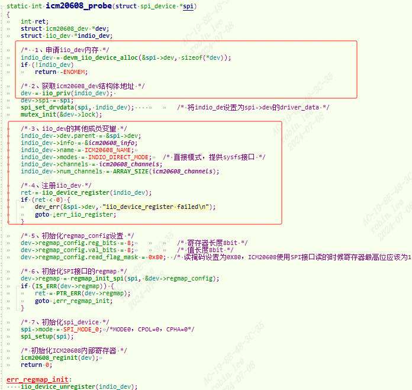
还是按照`spi子系统框架`，`probe`时利用iio子系统，初始化`iio_dev`。

`iio_info`属性赋值：

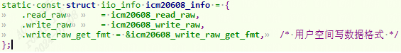
`iio_channels`属性赋值：

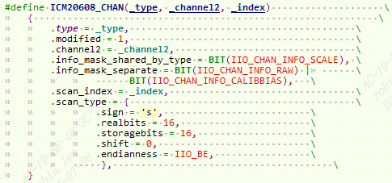
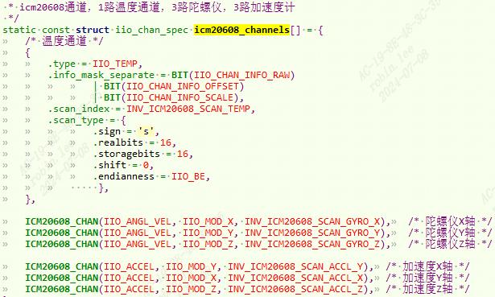
**温度通道**：

1. `info_mask_separate`设置为`IIO_CHAN_INFO_RAW,IIO_CHAN_INFO_SCALE, IIO_CHAN_INFO_OFFSET`此通。
    
    `IIO_CHAN_INFO_RAW` 为温度通道的原始值，`IIO_CHAN_INFO_OFFSET` 是 `ICM20608` 温度 offset 值，这个要查阅数 据手册。`IIO_CHAN_INFO_SCALE` 是 `ICM20608` 的比例，也就是一个单位的原始值为多少℃， 这个也要查阅 `ICM20608` 的数据手册。
    
2. 扫描元素设置成`SCAN_TEMP`。
    
3. 扫描类型：有符号数据，数据位数16位，存储位数16位，右移位数0， 大端传输（一般MSB传输）
    

**陀螺仪通道**：

1. `modified` 成员变量为 1，所以 `channel2` 就是`通道修饰符`，用来指定 X、Y、Z 轴。
    
2. 扫描元素设置`SCAN_GYRO_X, Y,Z`。
    
3. `info_mask_separate`设置为`IIO_CHAN_INFO_RAW, IIO_CHAN_INFO_CALIBBIAS`此通。“scale”是比例的意思，在这里就是量程(分辨率)，因为 ICM20608 的陀螺仪和加速度计的量程是可以调整的，量程不同分辨率也就不同。设置每个通道的`IIO_CHAN_INFO_RAW`和`IIO_CHAN_INFO_CALIBBIAS`这两个属性都是独立的，`IIO_CHAN_INFO_RAW` 表示 ICM20608 每个通道的原始值，这个肯定 是每个通道独立的。`IIO_CHAN_INFO_CALIBBIAS` 是 ICM20608 每个通道的校准值，这个是 ICM20608 的特性，不是所有的传感器都有校准值，一切都要以实际所使用的传感器为准。
    
4. `info_mask_shared_by_type`设置为`IIO_CHAN_INFO_SCALE`此通。表示量程分辨率共享对陀螺仪通道。
    
5. 扫描类型：有符号数据，数据位数16位，存储位数16位，右移位数0， 大端传输（一般MSB传输）
    

**加速度通道**：同理与陀螺仪通道.

`INDIO_DIRECT_MODE` 直接模式，提供`sysfs`接口。

### 5.2.2 icm20608_read_raw

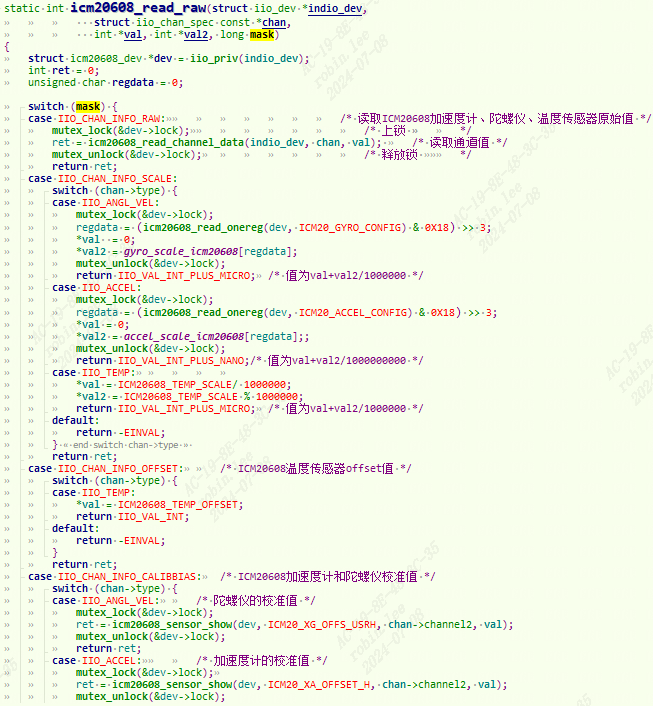
#### 5.2.2.1 读raw数据

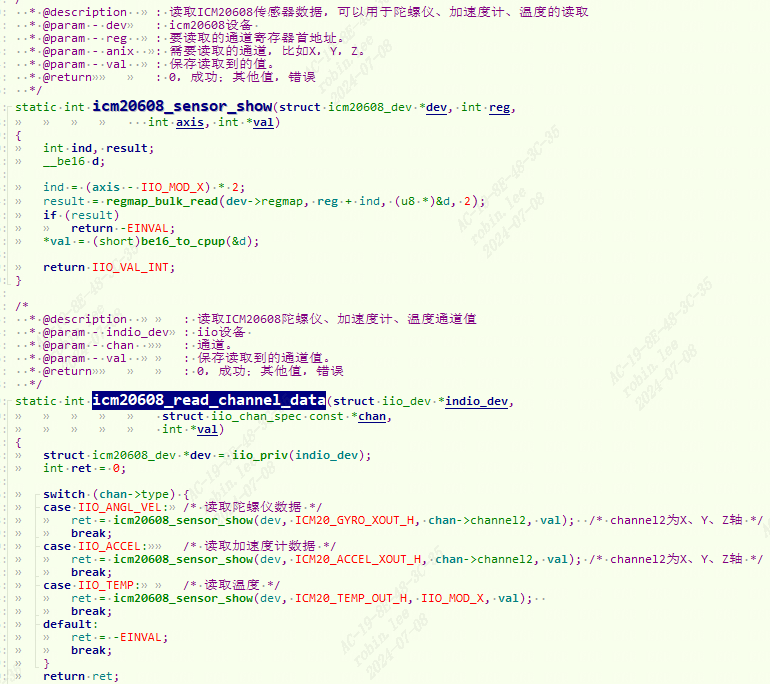
`icm20608_read_raw`会传入具体通道和mask, 比如温度通道的raw,传入`ICM20_TEMP_OUT_H`寄存器，`IIO_MOD_X`那么`ind`就等于0，那么`regmap_bulk_read`出来就是一个16位的温度值。

同理，读加速度通道，传入`ICM20_ACCEL_XOUT_H`寄存器，`ind = (IIO_MOD_X - IIO_MOD_X )*2 = 0;`,因此读出16bit的x数据。再次传入`ind = (IIO_MOD_Y - IIO_MOD_X)*2 = 2`,得到`ICM20_ACCEL_YOUT_H`寄存器，因此读取出16bit的y数据。再次传入`ind = (IIO_MOD_Z - IIO_MOD_X)*2 = 4`,得到`ICM20_ACCEL_ZOUT_H`寄存器,因此读取出16bit的z数据。

同理，读陀螺仪通道。
#### 5.2.2.2 读量程

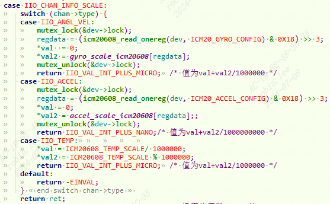
温度通道： 直接用预设量程即可或者`val1,val2`。分别表示整数，小数。
加速度通道: 获取量程参考数据手册。

根据读到的寄存器值：`regdata`配置量程如下：
```c
/*  
 * icm20608陀螺仪分辨率，对应250、500、1000、2000，计算方法：  
 * 以正负250度量程为例，500/2^16=0.007629，扩大1000000倍，就是7629  
 */  
static const int gyro_scale_icm20608[] = {7629, 15258, 30517, 61035};  
  
/*   
 * icm20608加速度计分辨率，对应2、4、8、16 计算方法：  
 * 以正负2g量程为例，4/2^16=0.000061035，扩大1000000000倍，就是61035  
 */  
static const int accel_scale_icm20608[] = {61035, 122070, 244140, 488281};
```

陀螺仪通道：同理

陀螺仪量程计算：

可选的量程有`±250、±500、±1000 和±2000°/s`。以`± 250` 这个量程为例，每个数值对应的度数就是 `500/2^10≈0.007629°/s`。同理，`±500` 量程对应 的度数为 `0.015258`，`±1000` 量程对应的度数为 `0.030517`，`±2000` 量程为`0.061035`。假设现在设 置量程为`±2000`，读取到的原始值为 `12540`，那么对应的度数就是 `12540*0.061035≈765.37°/s`。 注意，这里扩大了 1000000 倍。

加速度量程计算：

计算方法和陀螺仪一样。这里扩大了 1000000000 倍。

#### 5.2.2.3 读offset

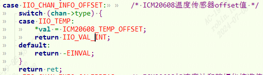
只有温度有`offset`。

### 5.2.3 icm20608_write_raw

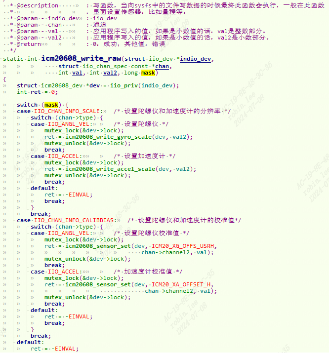
通过写寄存器来配置量程，校准值。

#### 5.2.3.1 配置量程

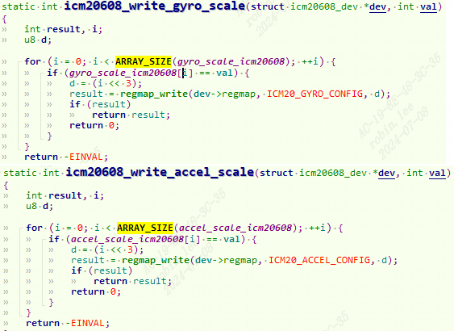
根据设置的`val`量程值，匹配到`i`量程等级，`d<<3`然后设置量程等级。

#### 5.2.3.2 配置校准值

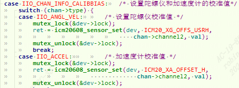
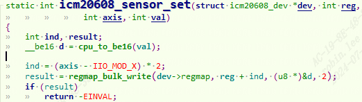
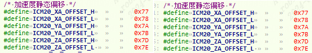
根据静态偏移寄存器，进行校准，写入校准值。

### 5.2.4 icm20608_write_raw_get_fmt

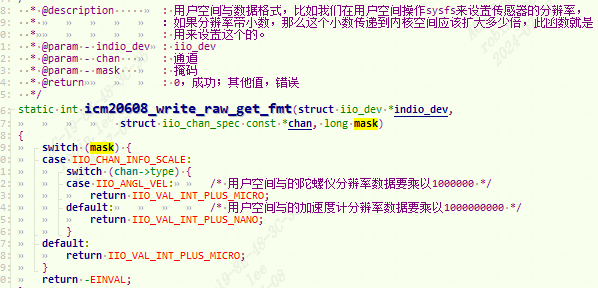
用户空间设置数据格式。

陀螺仪通道：规定用户空间写的陀螺仪分辨率数据要乘以1000000。

加速度通道：规定用户空间写的陀螺仪分辨率数据要乘以1000000000。

比如我们在用户空间要设置加速度计量程为`±4g`，只需要向 `in_accel_scale` 写 入 `0.000122070` ， 那 么 最 终 传 入 到 驱 动 里 面 的 就 是 `0.000122070*1000000000=122070`。

## 5.3 测试

进入`“/sys/bus/iio/devices/”`目录：可以看到，此时有两个 IIO 设备`“iio:device0”，iio:device0` 是 I.MX6ULL 内 部 ADC，`iio:device1` 才是 ICM20608。

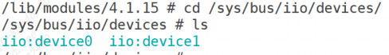
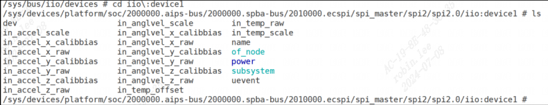
可以看出，`iio:device1` 对应`spi2.0` 上的设备，也就是 `ICM20608`。

此目录下有 很多文件，比如`in_accel_scale、in_accel_x_calibias、in_accel_x_raw`等，这些就是我们设置的通道。`in_accel_scale` 就是加速度计的比例，也就是分辨率(量程)，`in_accel_x_calibias` 就是加速度 计 X 轴的校准值，`in_accel_x_raw` 就是加速度计的 X 轴原始值。我们在配置通道的时候，设置 了类型相同的所有通道共用 `SCALE`，所以这里只有一个 `in_accel_scale`，而 X、Y、Z 轴的原始值和校准值每个轴都有一个文件，陀螺仪和温度计同理。

### 5.3.1 通道文件命名方式

源码见4.1.1 `iio_device_register_sysfs`过程。

`IIO_CHAN_INFO_RAW` 和 `IIO_CHAN_INFO_CALIBBIAS`这两个专属属性，对应`in_accel_x_raw` 和 `in_accel_x_calibias` 这两个文件。

通道的命名:`[direction]_[type]_[index]_[modifier]_[info_mask]`

**direction**：为属性对应的方向
```c
static const char * const iio_direction[] = {  
	[0] = "in",  
	[1] = "out",  
};
```

**type**：也就是配置通道的时候 type 值，type 对应的字符可以参考 `iio_chan_type_name_spec`:
```c
static const char * const iio_chan_type_name_spec[] = {  
	[IIO_VOLTAGE] = "voltage",  
	[IIO_CURRENT] = "current",  
	[IIO_POWER] = "power",  
	[IIO_ACCEL] = "accel",  
	[IIO_ANGL_VEL] = "anglvel",  
...  
}
```

**index**：索引，如果配置通道的时候设置了 indexed=1，那么就会使用通道的 channel 成员变 量来替代此部分命名。比如，有个 ADC 芯片支持 8 个通道，那么就可以使用 channel 来表示对 应的通道，最终在用户空间呈现的每个通道文件名的 index 部分就是通道号。

**modifier**：当通道的 modified 成员变量为 1 的时候，channel2 就是修饰符, `iio_modifier_names`:
```c
static const char * const iio_modifier_names[] = {  
	[IIO_MOD_X] = "x",  
	[IIO_MOD_Y] = "y",  
	[IIO_MOD_Z] = "z",  
......  
	[IIO_MOD_PM4] = "pm4",  
	[IIO_MOD_PM10] = "pm10",  
};
```

**info_mask**：属性掩码，也就是属性:
```c
static const char * const iio_chan_info_postfix[] = {  
	[IIO_CHAN_INFO_RAW] = "raw",  
	[IIO_CHAN_INFO_PROCESSED] = "input",  
	[IIO_CHAN_INFO_SCALE] = "scale",  
	[IIO_CHAN_INFO_OFFSET] = "offset",  
	[IIO_CHAN_INFO_CALIBSCALE] = "calibscale",  
	[IIO_CHAN_INFO_CALIBBIAS] = "calibbias",  
......  
	[IIO_CHAN_INFO_DEBOUNCE_TIME] = "debounce_time",  
	[IIO_CHAN_INFO_CALIBEMISSIVITY] = "calibemissivity",  
	[IIO_CHAN_INFO_OVERSAMPLING_RATIO] = "oversampling_ratio",  
};
```

综上所述，`in_accel_x_raw` 组成形式如图:

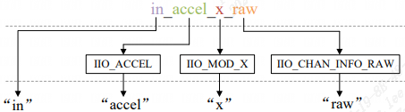
### 5.3.2 读取raw数据

`进入“/sys/bus/iio/devices/”`目录,`cat iio:device1/in_ccel_x`,这时驱动中的`icm20608_read_raw`执行。

读取一下 `in_accel_scale` 这个文件，这是加速度计的分辨率，我们默认设置了加速度计 量程为`±16g`，因此分辨率为 `0.000488281`。

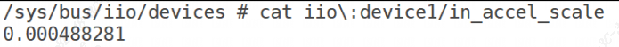
这时候有朋友可能会疑问,我们设置加速度计`±16g` 的分辨率为 `488281`，也就是扩大了1000000000 倍，为啥这里读出来的是 `0.000488281` 这个原始值？

驱动返回的是`IIO_VAL_INT_PLUS_NANO`, 因 此 用 户 空 间 得 到 分 辨 率 以 后 会 除 以 1000000000 ， 得 到 真 实 的 分 辨 率 ， `488281/1000000000=0.000488281`。

再读取一下 `in_accel_z_raw`，加速度计的 Z 轴原始值。静态情况 下 Z 轴应该是 1g 的重力加速度计。

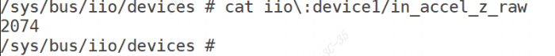
`2074×0.000488281≈1.01g`，此时 Z 轴重力为 1g，结果正确。

### 5.3.3 编写应用程序测试
```c
#include "stdio.h"  
#include "unistd.h"  
#include "sys/types.h"  
#include "sys/stat.h"  
#include "sys/ioctl.h"  
#include "fcntl.h"  
#include "stdlib.h"  
#include "string.h"  
#include <poll.h>  
#include <sys/select.h>  
#include <sys/time.h>  
#include <signal.h>  
#include <fcntl.h>  
#include <errno.h>  
  
/* 字符串转数字，将浮点小数字符串转换为浮点数数值 */  
#define SENSOR_FLOAT_DATA_GET(ret, index, str, member)\  
	ret = file_data_read(file_path[index], str);\  
	dev->member = atof(str);\  
	  
/* 字符串转数字，将整数字符串转换为整数数值 */  
#define SENSOR_INT_DATA_GET(ret, index, str, member)\  
	ret = file_data_read(file_path[index], str);\  
	dev->member = atoi(str);\  
  
/* icm20608 iio框架对应的文件路径 */  
static char *file_path[] = {  
	"/sys/bus/iio/devices/iio:device1/in_accel_scale",  
	"/sys/bus/iio/devices/iio:device1/in_accel_x_calibbias",  
	"/sys/bus/iio/devices/iio:device1/in_accel_x_raw",  
	"/sys/bus/iio/devices/iio:device1/in_accel_y_calibbias",  
	"/sys/bus/iio/devices/iio:device1/in_accel_y_raw",  
	"/sys/bus/iio/devices/iio:device1/in_accel_z_calibbias",  
	"/sys/bus/iio/devices/iio:device1/in_accel_z_raw",  
	"/sys/bus/iio/devices/iio:device1/in_anglvel_scale",  
	"/sys/bus/iio/devices/iio:device1/in_anglvel_x_calibbias",  
	"/sys/bus/iio/devices/iio:device1/in_anglvel_x_raw",  
	"/sys/bus/iio/devices/iio:device1/in_anglvel_y_calibbias",  
	"/sys/bus/iio/devices/iio:device1/in_anglvel_y_raw",  
	"/sys/bus/iio/devices/iio:device1/in_anglvel_z_calibbias",  
	"/sys/bus/iio/devices/iio:device1/in_anglvel_z_raw",  
	"/sys/bus/iio/devices/iio:device1/in_temp_offset",  
	"/sys/bus/iio/devices/iio:device1/in_temp_raw",  
	"/sys/bus/iio/devices/iio:device1/in_temp_scale",  
};  
  
/* 文件路径索引，要和file_path里面的文件顺序对应 */  
enum path_index {  
	IN_ACCEL_SCALE = 0,  
	IN_ACCEL_X_CALIBBIAS,  
	IN_ACCEL_X_RAW,  
	IN_ACCEL_Y_CALIBBIAS,  
	IN_ACCEL_Y_RAW,  
	IN_ACCEL_Z_CALIBBIAS,  
	IN_ACCEL_Z_RAW,  
	IN_ANGLVEL_SCALE,  
	IN_ANGLVEL_X_CALIBBIAS,  
	IN_ANGLVEL_X_RAW,  
	IN_ANGLVEL_Y_CALIBBIAS,  
	IN_ANGLVEL_Y_RAW,  
	IN_ANGLVEL_Z_CALIBBIAS,  
	IN_ANGLVEL_Z_RAW,  
	IN_TEMP_OFFSET,  
	IN_TEMP_RAW,  
	IN_TEMP_SCALE,  
};  
  
/*  
 * icm20608数据设备结构体  
 */  
struct icm20608_dev{  
	int accel_x_calibbias, accel_y_calibbias, accel_z_calibbias;  
	int accel_x_raw, accel_y_raw, accel_z_raw;  
  
	int gyro_x_calibbias, gyro_y_calibbias, gyro_z_calibbias;  
	int gyro_x_raw, gyro_y_raw, gyro_z_raw;  
  
	int temp_offset, temp_raw;  
  
	float accel_scale, gyro_scale, temp_scale;  
  
	float gyro_x_act, gyro_y_act, gyro_z_act;  
	float accel_x_act, accel_y_act, accel_z_act;  
	float temp_act;  
};  
  
struct icm20608_dev icm20608;  
  
 /*  
 * @description			: 读取指定文件内容  
 * @param - filename 	: 要读取的文件路径  
 * @param - str 		: 读取到的文件字符串  
 * @return 				: 0 成功;其他 失败  
 */  
static int file_data_read(char *filename, char *str)  
{  
	int ret = 0;  
	FILE *data_stream;  
  
    data_stream = fopen(filename, "r"); /* 只读打开 */  
    if(data_stream == NULL) {  
		printf("can't open file %s\r\n", filename);  
		return -1;  
	}  
  
	ret = fscanf(data_stream, "%s", str);  
    if(!ret) {  
        printf("file read error!\r\n");  
    } else if(ret == EOF) {  
        /* 读到文件末尾的话将文件指针重新调整到文件头 */  
        fseek(data_stream, 0, SEEK_SET);    
    }  
	fclose(data_stream);	/* 关闭文件 */	  
	return 0;  
}  
  
 /*  
 * @description	: 获取ICM20608数据  
 * @param - dev : 设备结构体  
 * @return 		: 0 成功;其他 失败  
 */  
static int sensor_read(struct icm20608_dev *dev)  
{  
	int ret = 0;  
	char str[50];  
  
	/* 1、获取陀螺仪原始数据 */  
	SENSOR_FLOAT_DATA_GET(ret, IN_ANGLVEL_SCALE, str, gyro_scale);  
	SENSOR_INT_DATA_GET(ret, IN_ANGLVEL_X_RAW, str, gyro_x_raw);  
	SENSOR_INT_DATA_GET(ret, IN_ANGLVEL_Y_RAW, str, gyro_y_raw);  
	SENSOR_INT_DATA_GET(ret, IN_ANGLVEL_Z_RAW, str, gyro_z_raw);  
  
	/* 2、获取加速度计原始数据 */  
	SENSOR_FLOAT_DATA_GET(ret, IN_ACCEL_SCALE, str, accel_scale);  
	SENSOR_INT_DATA_GET(ret, IN_ACCEL_X_RAW, str, accel_x_raw);  
	SENSOR_INT_DATA_GET(ret, IN_ACCEL_Y_RAW, str, accel_y_raw);  
	SENSOR_INT_DATA_GET(ret, IN_ACCEL_Z_RAW, str, accel_z_raw);  
  
	/* 3、获取温度值 */  
	SENSOR_FLOAT_DATA_GET(ret, IN_TEMP_SCALE, str, temp_scale);  
	SENSOR_INT_DATA_GET(ret, IN_TEMP_OFFSET, str, temp_offset);  
	SENSOR_INT_DATA_GET(ret, IN_TEMP_RAW, str, temp_raw);  
  
	/* 3、转换为实际数值 */  
	dev->accel_x_act = dev->accel_x_raw * dev->accel_scale;  
	dev->accel_y_act = dev->accel_y_raw * dev->accel_scale;  
	dev->accel_z_act = dev->accel_z_raw * dev->accel_scale;  
  
	dev->gyro_x_act = dev->gyro_x_raw * dev->gyro_scale;  
	dev->gyro_y_act = dev->gyro_y_raw * dev->gyro_scale;  
	dev->gyro_z_act = dev->gyro_z_raw * dev->gyro_scale;  
  
	dev->temp_act = ((dev->temp_raw - dev->temp_offset) / dev->temp_scale) + 25;  
	return ret;  
}  
  
/*  
 * @description		: main主程序  
 * @param - argc 	: argv数组元素个数  
 * @param - argv 	: 具体参数  
 * @return 			: 0 成功;其他 失败  
 */  
int main(int argc, char *argv[])  
{  
	int ret = 0;  
  
	if (argc != 1) {  
		printf("Error Usage!\r\n");  
		return -1;  
	}  
  
	while (1) {  
		ret = sensor_read(&icm20608);  
		if(ret == 0) { 			/* 数据读取成功 */  
			printf("\r\n原始值:\r\n");  
			printf("gx = %d, gy = %d, gz = %d\r\n"  
                   , icm20608.gyro_x_raw, icm20608.gyro_y_raw, icm20608.gyro_z_raw);  
			printf("ax = %d, ay = %d, az = %d\r\n"  
                   , icm20608.accel_x_raw, icm20608.accel_y_raw, icm20608.accel_z_raw);  
			printf("temp = %d\r\n", icm20608.temp_raw);  
			printf("实际值:");  
			printf("act gx = %.2f°/S, act gy = %.2f°/S, act gz = %.2f°/S\r\n"  
                   , icm20608.gyro_x_act, icm20608.gyro_y_act, icm20608.gyro_z_act);  
			printf("act ax = %.2fg, act ay = %.2fg, act az = %.2fg\r\n"  
                   , icm20608.accel_x_act, icm20608.accel_y_act, icm20608.accel_z_act);  
			printf("act temp = %.2f°C\r\n", icm20608.temp_act);  
		}  
		usleep(100000); /*100ms */  
	}  
	return 0;  
}
```

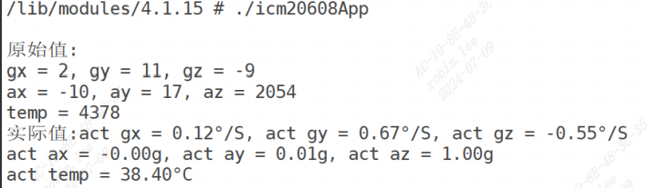
# 6 IIO实验-操作vf610_adc.c

以imx6ull芯片为例子，`drivers/iio/adc/vf610_adc.c`

## 6.1 dts描述

dtsi描述如下：默认是关闭的
```c
adc1: adc@02198000 {  
	compatible = "fsl,imx6ul-adc", "fsl,vf610-adc";  
	reg = <0x02198000 0x4000>;  
	interrupts = <GIC_SPI 100 IRQ_TYPE_LEVEL_HIGH>;  
	clocks = <&clks IMX6UL_CLK_ADC1>;  
	num-channels = <2>;  
	clock-names = "adc";  
	status = "disabled";  
};
```

我们最后在 `imx6ull-alientek-emmc.dts`添加节点内容：
```c
pinctrl_adc1: adc1grp {  
	fsl,pins = <MX6UL_PAD_GPIO1_IO01__GPIO1_IO01 0xb0>;  
};  
reg_vref_adc: regulator@2 {  
	compatible = "regulator-fixed";  
	regulator-name = "VREF_3V3";  
	regulator-min-microvolt = <3300000>;  
	regulator-max-microvolt = <3300000>;  
};  
&adc1 {  
	pinctrl-names = "default";  
	pinctrl-0 = <&pinctrl_adc1>;  
	num-channels = <2>;  
	vref-supply = <&reg_vref_adc>;  
	status = "okay";  
};
```

1. 添加 ADC 使用的`GPIO1_IO01`引脚配置信息
2. `regulators` 节点下添加参考电源子节点，最后status设置成okay

## 6.2 使能 ADC 驱动
```c
-> Device Drivers  
	-> Industrial I/O support  
		-> Analog to digital converters  
			-> <*> Freescale vf610 ADC driver //选中
```

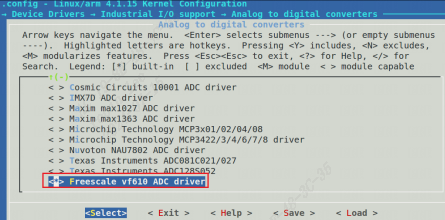
`drivers/iio/adc/`下的`makefile和Kconfig`:

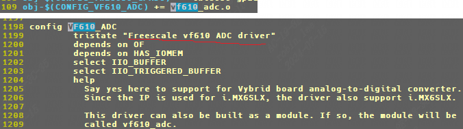
## 6.3 驱动代码分析

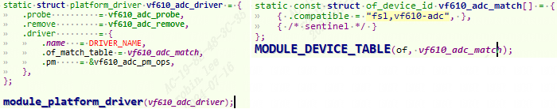
### 6.3.1 probe

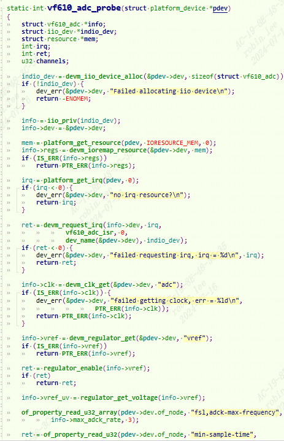
申请初始化iio设备，alloc iio设备有多分一块内存给info结构体。

从dts获取寄存器地址信息，进行ioremap。获取中断号，注册中断服务程序。

获取时钟资源，电源资源，使能电源输出。并且获取电源参考电压`vref_uv`.


获取adc采样周期，`num-channels =2`.

中间`vf610_adc_cfg_init和vf610_adc_hw_init`是ADC controller的寄存器配置不展开介绍。

然后设置`iio_dev`结构体，最后注册iio设备。

### 6.3.2 vf610_read_raw

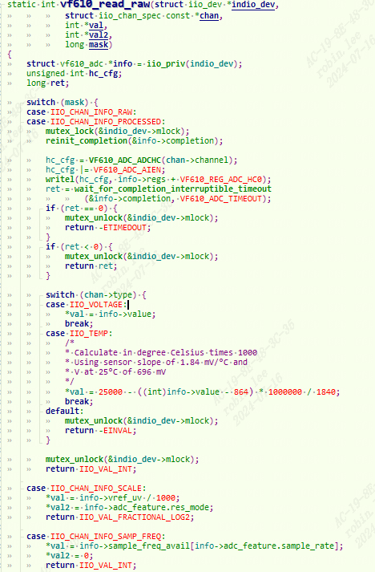
读取 ADC 原始数据值，type 值为 `IIO_VOLTAGE`，也就是读取电压值。这里`info->value`是怎么来的呢？

当然是中断服务程序进行ADC采样啊，如下：

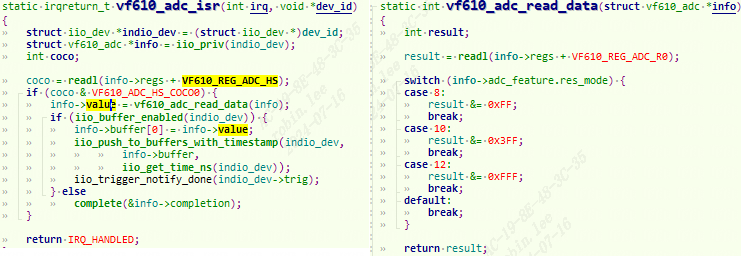
## 6.4 用户态测试

进入`/sys/bus/iio/devices/iio:device0` 目录下,该`iio`就是对应`vf610`这个ADC:

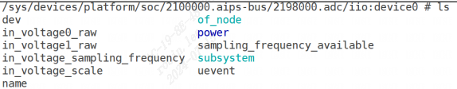
`in_voltage1_raw：`ADC1 通道 1 原始值文件。

`in_voltage_scale：`ADC1 比例文件(分辨率)，单位为 mV。实际电压值`(mV)=in_voltage1_raw* in_voltage_scale`

我的开发板此时 `in_voltage1_raw` 和 `in_voltage_scale` 这两个文件内容如下：

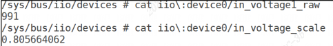
经过计算，实际电压：`991*0.805664062≈798.4mV`，也就是 `0.7984V`。
```c
#include "stdio.h"  
#include "unistd.h"  
#include "sys/types.h"  
#include "sys/stat.h"  
#include "sys/ioctl.h"  
#include "fcntl.h"  
#include "stdlib.h"  
#include "string.h"  
#include <poll.h>  
#include <sys/select.h>  
#include <sys/time.h>  
#include <signal.h>  
#include <fcntl.h>  
#include <errno.h>  
  
/* 字符串转数字，将浮点小数字符串转换为浮点数数值 */  
#define SENSOR_FLOAT_DATA_GET(ret, index, str, member)\  
	ret = file_data_read(file_path[index], str);\  
	dev->member = atof(str);\  
  
/* 字符串转数字，将整数字符串转换为整数数值 */  
#define SENSOR_INT_DATA_GET(ret, index, str, member)\  
	ret = file_data_read(file_path[index], str);\  
	dev->member = atoi(str);\  
  
static char *file_path[] = {  
	"/sys/bus/iio/devices/iio:device0/in_voltage_scale",  
	"/sys/bus/iio/devices/iio:device0/in_voltage1_raw",  
};  
enum path_index {  
	IN_VOLTAGE_SCALE = 0,  
	IN_VOLTAGE_RAW,  
};  
  
struct adc_dev{  
	int raw;  
	float scale;  
	float act;  
};  
struct adc_dev imx6ulladc;  
  
static int file_data_read(char *filename, char *str) {  
	int ret = 0;  
	FILE *data_stream;  
  
    data_stream = fopen(filename, "r"); /* 只读打开 */  
    if(data_stream == NULL) {  
		printf("can't open file %s\r\n", filename);  
		return -1;  
	}  
  
	ret = fscanf(data_stream, "%s", str);  
    if(!ret) {  
        printf("file read error!\r\n");  
    } else if(ret == EOF) {  
        /* 读到文件末尾的话将文件指针重新调整到文件头 */  
        fseek(data_stream, 0, SEEK_SET);    
    }  
	fclose(data_stream);	/* 关闭文件 */	  
	return 0;  
}  
  
static int adc_read(struct adc_dev *dev){  
	int ret = 0;  
	char str[50];  
  
	SENSOR_FLOAT_DATA_GET(ret, IN_VOLTAGE_SCALE, str, scale);  
	SENSOR_INT_DATA_GET(ret, IN_VOLTAGE_RAW, str, raw);  
	/* 转换得到实际电压值mV */  
	dev->act = (dev->scale * dev->raw)/1000.f;  
	return ret;  
}  
int main(int argc, char *argv[]) {  
	int ret = 0;  
  
	if (argc != 1) {  
		printf("Error Usage!\r\n");  
		return -1;  
	}  
	while (1) {  
		ret = adc_read(&imx6ulladc);  
		if(ret == 0) { 			/* 数据读取成功 */  
			printf("ADC原始值：%d，电压值：%.3fV\r\n", imx6ulladc.raw, imx6ulladc.act);  
		}  
		usleep(100000); /*100ms */  
	}  
	return 0;  
}
```

注意应用程序用到了浮点运算，因此：

`arm-linux-gnueabihf-gcc -march=armv7-a -mfpu=neon -mfloat-abi=hard adcApp.c -o adcApp`

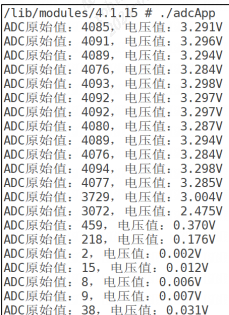
