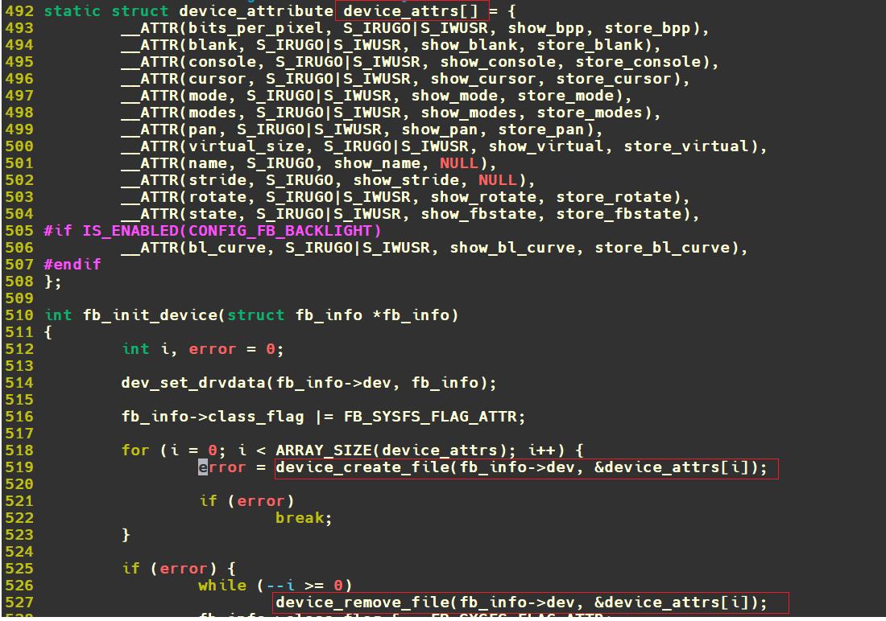
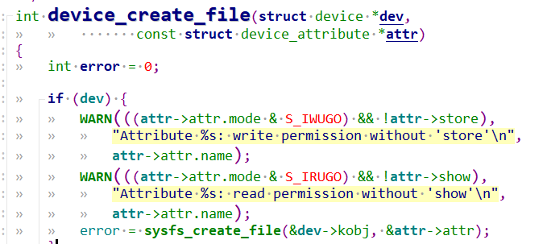
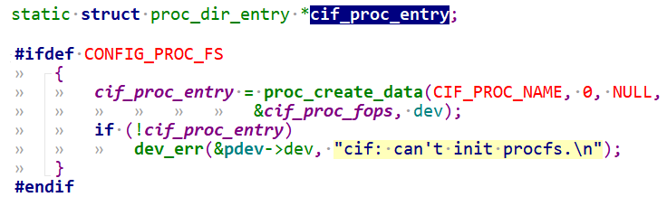
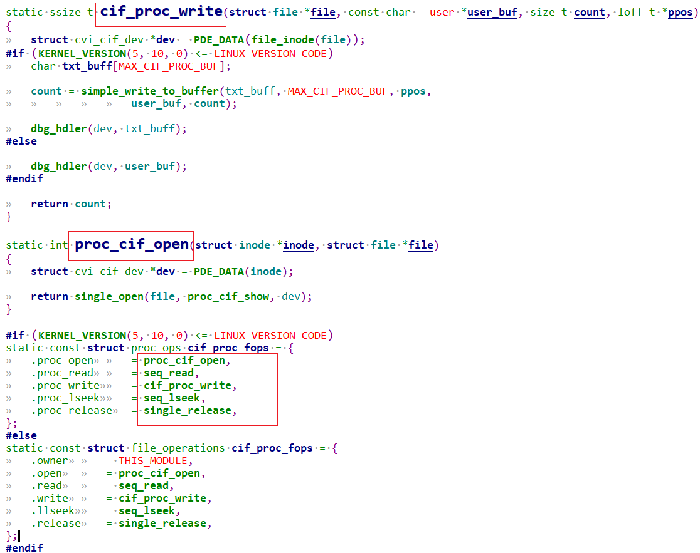
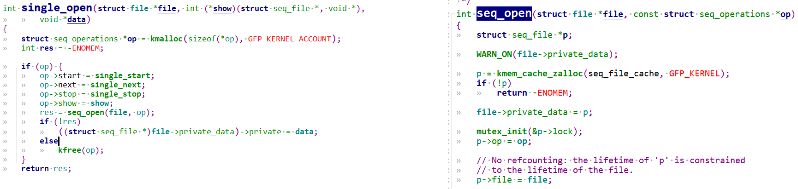
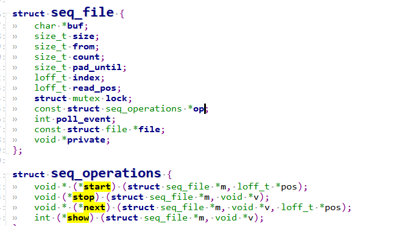
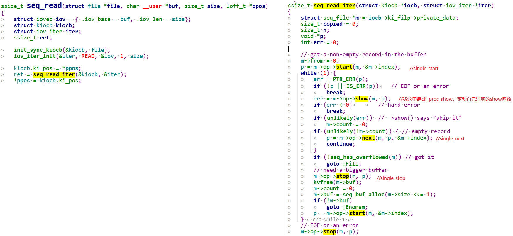
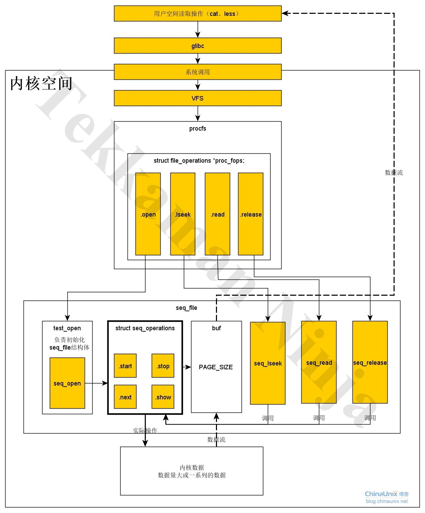
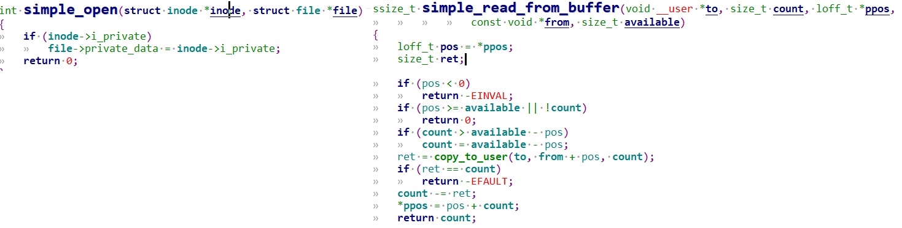

# 1 内存文件系统

Linux遵循**一切皆文件**的设计哲学。linux内核提供了3种 `“内存文件系统”`，分别是`sysfs`、`debugfs`、`procfs`，驱动工程师可以通过任意一种文件系统向用户空间传递内核信息。

```c
Sysfs的挂载点为/sys  
Debugfs的挂载点为/sys/kernel/debug  
Procfs的挂载点为/proc
```

`内存文件系统`: 一种临时文件系统，一般会利用脚本挂载到rootfs，但是这些目录都是使用RAM空间，他们中的信息只存在于内存中，断电后即消失。他们的出现旨在提供一种与用户空间交互信息的方式。

脚本如下：

```c
[root@xxx]/etc# cat fstab  
# <file system> <mount pt>      <type>  <options>       <dump>  <pass>  
/dev/root       /               ext2    rw,noauto       0       1  
proc            /proc           proc    defaults        0       0  
devpts          /dev/pts        devpts  defaults,gid=5,mode=620,ptmxmode=0666 0 0  
tmpfs           /dev/shm        tmpfs   mode=0777       0       0  
tmpfs           /tmp            tmpfs   mode=1777       0       0  
sysfs           /sys            sysfs   defaults        0       0  
nodev           /sys/kernel/debug debugfs   defaults    0       0
```

输入`mount`查看挂载信息：可以看到有挂载`procfs, sysfs，以及debugfs`

```c
[root@xxx]~# mount  
/dev/root on / type squashfs (ro,relatime)  
devtmpfs on /dev type devtmpfs (rw,relatime,size=1381884k,nr_inodes=345471,mode=755)  
proc on /proc type proc (rw,relatime)    #procfs  
sysfs on /sys type sysfs (rw,relatime)   #sysfs  
nodev on /sys/kernel/debug type debugfs (rw,relatime)   #debugfs  
/dev/mmcblk0p6 on /mnt/cfg type ext4 (rw,sync,relatime)  
/dev/mmcblk0p7 on /mnt/data type ext4 (rw,sync,relatime)  
/dev/mmcblk0p7 on /var/log type ext4 (rw,sync,relatime)
```

## 1.1 sysfs

Linux 的 sysfs 是一个虚拟文件系统，用于向用户空间导出内核中的对象（如设备、驱动程序、模块等）的属性和状态信息。它挂载在 /sys 目录下，提供了一个统一的接口，方便用户和程序查看或配置内核层的信息。
sysfs 的主要作用：
- 1.暴露内核对象信息将硬件设备、驱动程序、内核模块、总线类型等内核对象的信息以文件形式展示，供用户空间读取或写入。用户可以通过操作这些文件进而控制设备。
	例如：读取陀螺仪数据、操作 gpio、查看 CPU 温度、调整电源管理策略、配置网络设备参数等。
- 2.支持动态设备管理
	与 udev（Linux 设备管理器）配合，实现设备的动态发现和配置（如热插拔设备）。
- 3.统一硬件抽象接口
	提供标准化的接口，简化用户程序与内核的交互。应用程序可通过这些统一的接口操作内核设备。

### 1.1.1 sysfs举例

sysfs在linux驱动开发中经常使用。

```c
echo 256 > /sys/class/gpio/export  #/sys/class/gpio会生成gpio256目录  
echo 256 > /sys/class/gpio/unexport  
  
echo 255 > /sys/class/leds/led1/brightness  
cat /sys/class/leds/led1/brightness  
cat /sys/class/leds/led1/max_brightness
```

### 1.1.2 sysfs使用

```c
[root@xxx]/sys/module/soph_stitch/drivers# ls -l  
total 0  
lrwxrwxrwx  1 root root  0 Jan  1 10:00 platform:stitch -> ../../../bus/platform/drivers/stitch  
  
[root@cvitek]/sys/module/soph_stitch/parameters# ls -l     
#对应驱动模块的模块参数，比如module_param(clk_sys_freq, int, 0644);module_param(gStitchDumpReg, int, 0644);  
-rw-r--r--    1 root     root          4096 Jan  1 10:01 clk_sys_freq  
-rw-r--r--    1 root     root          4096 Jan  1 10:01 gStitchDumpDmaCfg  
-rw-r--r--    1 root     root          4096 Jan  1 10:01 gStitchDumpReg  
-rw-r--r--    1 root     root          4096 Jan  1 10:01 stitch_log_lv
```

`/sys/module/xxx/parameters`下定义了驱动xxx模块的模块参数。

#### 1.1.2.0 sysfs下的platform设备和驱动信息

```c
[root@cvitek]/sys/bus/platform/devices# ls -l  
...  
lrwxrwxrwx 1 root  root    0 Jan  1 10:06 680b8000.stitch -> ../../../devices/platform/680b8000.stitch  
lrwxrwxrwx 1 root  root    0 Jan  1 10:06 680ba000.dpu -> ../../../devices/platform/680ba000.dpu  
lrwxrwxrwx 1 root  root    0 Jan  1 10:06 680be000.sys -> ../../../devices/platform/680be000.sys  
lrwxrwxrwx 1 root  root    0 Jan  1 10:06 68100000.cif -> ../../../devices/platform/68100000.cif  
lrwxrwxrwx 1 root  root    0 Jan  1 10:06 68100000.cif_v4l2 -> ../../../devices/platform/68100000.cif_v4l2  
lrwxrwxrwx 1 root  root    0 Jan  1 10:06 Fixed MDIO bus.0 -> ../../../devices/platform/Fixed MDIO bus.0  
lrwxrwxrwx 1 root  root    0 Jan  1 10:06 base -> ../../../devices/platform/base  
...  
[root@cvitek]/sys/bus/platform/drivers# ls -l  
...  
drwxr-xr-x    2 root     root             0 Jan  1 10:15 cif  
drwxr-xr-x    2 root     root             0 Jan  1 10:00 stitch  
...  
[root@cvitek]/sys/bus/platform/drivers/stitch# ls -l  
total 0  
lrwxrwxrwx 1 root     root   0 Jan  1 10:00 680b8000.stitch -> ../../../../devices/platform/680b8000.stitch  
lrwxrwxrwx 1 root     root   0 Jan  1 10:00 module -> ../../../../module/soph_stitch  
--w------- 1 root     root   4096 Jan  1 10:00 uevent
```

可以看到只要用`platform_driver_register`、`platform_device_register`注册的驱动和设备就会在`/sys/bus/platform`。

#### 1.1.2.1 syfs下的misc设备信息

```c
[root@cvitek]/sys/class/misc# ls  
misccvitekadc_0  soph-dpu         soph-stitch      watchdog  
misccvitekadc_1  soph-ldc         soph-sys  
misccvitekdac_0  soph-mipi-rx     soph-vpss  
[root@cvitek]/sys/class/misc# ls -l soph-stitch  
lrwxrwxrwx    1 root  root    0 Jan  1 13:57 soph-stitch -> ../../devices/virtual/misc/soph-stitch  
  
[root@cvitek]/sys/class/soph-vi# ls -l  
lrwxrwxrwx    1 root  root    0 Jan  1 08:02 soph-vi -> ../../devices/platform/68000000.vi/soph-vi/soph-vi
```

可以看到只要是misc设备注册的字符设备，都会在`/sys/class/misc`下。`device_create`函数内部会调用到`device_add`函数，会在`/sys/device`目录下生成相应的sys文件，同时会判断device结构中的devt变量是否可用，如果可用才会调用`devtmpfs_create_node(dev);`在/dev目录下生成对应的设备文件。所以`device_add`是否会生成设备文件需要根据device结构体中是否传入了设备号来决定的。

```c
device_create(dev->vi_class, dev->dev, dev->cdev_id, NULL, "%s", VI_DEV_NAME);
```

#### 1.1.2.2 syfs API

```c
static inline int __must_check sysfs_create_file(struct kobject *kobj,  
	const struct attribute *attr)//生成sysfs属性文件，此接口用于生成单个属性文件  
  
//在参数kobj目录下面创建一个属性集合，并且显示该集合的文件。  
//attribute_group *grp 中描述的是一组属性类型  
int __must_check sysfs_create_group(struct kobject *kobj,  
				    const struct attribute_group *grp);  
  
int __must_check sysfs_create_groups(struct kobject *kobj,  
				     const struct attribute_group **groups);  
  
//动态生成一个struct kobject数据结构，然后将其注册到sysfs文件系统  
/*  
name就是要创建的文件或者目录的名称，  
parent指向父目录的kobject数据结构，若parent为NULL，说明父目录就是/sys目录，  
比如：kobject_create_and_add()在/sys 目录下建立一个名为“kernel”的目录，  
然后sysfs_create_group()函数在该目录下面创建一些属性集合  
*/  
struct kobject *kobject_create_and_add(const char *name, struct kobject*parent);  
  
//会调用到sysfs_create_file函数来生成sysfs属性文件，此接口用于生成单个属性文件  
int device_create_file ( struct device * dev, const struct device_attribute * attr);  
  
//移除组属性  
void sysfs_remove_group(struct kobject *kobj,  
			const struct attribute_group *grp);  
  
//\include\linux\sysfs.h
```

#### 1.1.2.3 给驱动模块添加sysfs参数举例

1. 使用`DEVICE_ATTR`声明一个sys节点, 这里是一个`led_status`节点，申明了`led_status_show`，`led_status_store`函数。

```c
/*  
led_status：在sys接口中显示的节点名字  
0600：表示操作这个led_status节点的权限  
led_status_show：使用cat命令查看sys接口时调用的函数  
led_status_store：使用echo命令往sys接口写入内容时调用的函数  
*/  
static DEVICE_ATTR(led_status, 0600, led_status_show, led_status_store);
```

2. 完成sys节点的读写函数，执行 `cat /sys/devices/platform/leds/led_status`时会调用`led_status_show`,把buf内容显示出来。用echo命令往sys节点写入内容时调用`led_status_store`。

```c
static unsigned int led = 0;  
  
static ssize_t led_status_show(struct device *dev, struct device_attribute *attr, char *buf){  
	return sprintf(buf, "%s:%d.\n", "led", led);  
}  
   
static ssize_t led_status_store(struct device *dev, struct device_attribute *attr,  
            const char *buf, size_t count){  
	//写入的内容会存放到buf中，这里将buf内容赋值给led变量  
 	sscanf(buf, "%d", &led);  
	return count;  
}
```

3. 定义`struct attribute`和`struct attribute_group`数组。

```c
static struct attribute *led_attributes[]={  
  /*上述使用了DEVICE_ATTR声明节点名字为led_status，  
  * 则struct attribute名字应为：  
  *  dev_attr_ + (节点名) + .attr  
  * 所以名字为dev_attr_led_status.attr  
  */  
  &dev_attr_led_status.attr,  
 NULL,  
};  
   
static const struct attribute_group led_attrs={  
 .attrs = led_attributes,//引用上述struct attribute数组  
};
```

4. 调用`sysfs_create_group()`注册sysfs接口, 完整驱动实例如下：
    
```c
static unsigned int led = 0;  
   
static ssize_t led_status_show(struct device *dev, struct device_attribute *attr, char *buf){  
 	return sprintf(buf, "%s:%d.\n", "led", led);  
}  
   
static ssize_t led_status_store(struct device *dev, struct device_attribute *attr,  
       const char *buf, size_t count){  
 	sscanf(buf, "%d", &led);  
 	return count;  
}  
   
static DEVICE_ATTR(led_status, 0600, led_status_show, led_status_store);  
static struct attribute *led_attributes[]={  
     &dev_attr_led_status.attr,  
     NULL,  
};  
static const struct attribute_group led_attrs={  
 	.attrs = led_attributes,  
};  
   
  
static int xx_led_probe(struct platform_device *pdev){  
 	sysfs_create_group(&pdev->dev.kobj, &led_attrs);  
 	return 0;  
}  
static int xx_led_remove(struct platform_device *pdev){  
     sysfs_remove_group(&pdev->dev.kobj, &led_attrs);  
     return 0;  
}  
static const struct of_device_id xx_led_of_match[] = {  
     {.compatible = "xx,xx-led"},  
};  
static struct platform_driver xx_led_driver = {  
     .probe = xx_led_probe,  
     .remove = xx_led_remove,  
     .driver = {  
      .name = "xx-led",  
      .owner = THIS_MODULE,  
      .of_match_table = xx_led_of_match,  
     },  
};  
static int __init xx_led_init(void){  
	 return platform_driver_register(&xx_led_driver);  
}  
static void __exit xx_led_exit(void){  
	 platform_driver_unregister(&xx_led_driver);  
}  
module_init(xx_led_init);  
module_exit(xx_led_exit);
```

### 1.1.3 DEVICE_ATTR宏

```c
#define DEVICE_ATTR(_name, _mode, _show, _store) \  
	struct device_attribute dev_attr_##_name = __ATTR(_name, _mode, _show, _store)  
#define __ATTR(_name, _mode, _show, _store) {				\  
	.attr = {.name = __stringify(_name),				\  
		 .mode = VERIFY_OCTAL_PERMISSIONS(_mode) },		\  
	.show	= _show,						\  
	.store	= _store,						\  
}  
  
struct device_attribute {  
	struct attribute	attr;  
	ssize_t (*show)(struct device *dev, struct device_attribute *attr,  
			char *buf);  
	ssize_t (*store)(struct device *dev, struct device_attribute *attr,  
			 const char *buf, size_t count);  
};
```

`DEVICE_ATTR`宏会定义一个`struct device_attribute`结构体实例`dev_attr_##_name`并初始化。一般用`device_create_file`生成sysfs属性文件。

注意：属性文件的权限`mode`不可以随便定义，是有限制的，mode不合理会报错：

```c
error: negative width in bit-field anonymous
```

#### 1.1.3.0 DEVICE_ATTR示例

以Linux下Framebuffer子系统 为例，打开`linux_5.10/drivers/video/fbdev/core/fbsysfs.c`:


可以看到很多属性文件，都调用`device_create_file`建立了sysfs属性文件。

#### 1.1.3.1 device_create_file


可以看到本质还是用`sysfs_creat_file`创建sysfs属性文件。

## 1.2 procfs

procfs用于获取进程的运行信息、系统的运行信息等。可以查看某个进程的相关信息，也可以查看系统的信息，比如/proc/meminfo 用来查看内存的管理信息，/proc/cpuinfo用来观察CPU的信息。

```c
[root@cvitek]~# ls -l /proc/  
total 0  
dr-xr-xr-x    8 root     root             0 Jan  1 08:00 1  
dr-xr-xr-x    8 root     root             0 Jan  1 08:00 234  
dr-xr-xr-x    8 root     root             0 Jan  1 08:00 273  
-r--r--r--    1 root     root             0 Jan  1 08:02 cmdline  
-r--r--r--    1 root     root             0 Jan  1 08:02 cpuinfo  
dr-xr-xr-x    3 root     root             0 Jan  1 08:02 dynamic_debug  
-r--r--r--    1 root     root             0 Jan  1 08:02 fb  
-r--r--r--    1 root     root             0 Jan  1 08:02 filesystems  
dr-xr-xr-x    8 root     root             0 Jan  1 08:02 fs  
-r--r--r--    1 root     root             0 Jan  1 08:02 interrupts  
-r--r--r--    1 root     root             0 Jan  1 08:02 iomem  
-r--r--r--    1 root     root             0 Jan  1 08:02 ioports  
dr-xr-xr-x   92 root     root             0 Jan  1 08:02 irq  
-r--r--r--    1 root     root             0 Jan  1 08:02 meminfo  
-r--------    1 root     root             0 Jan  1 08:02 pagetypeinfo  
-r--r--r--    1 root     root             0 Jan  1 08:02 partitions  
-r--r--r--    1 root     root             0 Jan  1 08:02 sched_debug  
lrwxrwxrwx    1 root     root             0 Jan  1 08:00 self -> 291  
lrwxrwxrwx    1 root     root             0 Jan  1 08:00 thread-self -> 291/task/291  
-r--------    1 root     root             0 Jan  1 08:02 vmallocinfo  
-r--r--r--    1 root     root             0 Jan  1 08:02 vmstat  
-r--r--r--    1 root     root             0 Jan  1 08:02 zoneinfo
```

可以看到很多信息，我们敲的命令ps、top等很多shell命令正是从proc系统中读取信息，且更具可读性。例如free命令就是解析/proc/meminfo。

### 1.2.1 procfs API

procfs文件系统提供了一些常用的API，这些API函数定义在`fs/proc/internal.h`

```c
struct proc_dir_entry *proc_mkdir(const char *name,  
      struct proc_dir_entry *parent);// 如果传入的名字是null, 那么就在/proc/下创建一个目录  
  
//添加一个proc条目, linux5.10后file_operations换成了proc_ops  
#if (LINUX_VERSION_CODE >= KERNEL_VERSION(5, 10, 0))  
struct proc_dir_entry *proc_create_data(const char *name, umode_t mode,  
		struct proc_dir_entry *parent,  
		const struct proc_ops *proc_ops, void *data);  
#else  
struct proc_dir_entry *proc_create_data(const char *name, umode_t mode,  
					struct proc_dir_entry *parent,  
					const struct file_operations *proc_fops,  
					void *data);  
#endif  
//也可以直接用这种添加条目，支持多级目录如/proc/aaa/bbb/ccc条目  
struct proc_dir_entry *proc_create_data(const char *name, umode_t mode,  
					struct proc_dir_entry *parent,  
					const struct file_operations *proc_fops,  
					void *data);  
//删除条目  
void remove_proc_entry(const char *name, struct proc_dir_entry *parent);  
//删除目录  
void proc_remove(struct proc_dir_entry *de);  
  
// procfs的实现见\linux_5.10\fs\proc\generic.c  
// 头文件见\linux_5.10\include\linux\proc_fs.h
```

### 1.2.2 使用举例

例如misc杂项设备子系统初始化时:

```c
static int __init misc_init(void) {  
	int err;  
#ifdef CONFIG_PROC_FS  
	proc_create("misc", 0, NULL, &misc_proc_fops);  
#endif  
	misc_class = class_create(THIS_MODULE, "misc");  
	err = PTR_ERR(misc_class);  
	if (IS_ERR(misc_class))  
		goto fail_remove;  
	err = -EIO;  
	if (register_chrdev(MISC_MAJOR,"misc",&misc_fops))  
		goto fail_printk;  
	misc_class->devnode = misc_devnode;  
	return 0;  
  
fail_printk:  
	printk("unable to get major %d for misc devices\n", MISC_MAJOR);  
	class_destroy(misc_class);  
fail_remove:  
	remove_proc_entry("misc", NULL);  
	return err;  
}
```

就创建了`/proc/misc`条目和`/sys/class/misc`目录。`/proc/misc`条目统计了包含的misc杂项字符设备：

```c
[root@xxxx]/proc# cat misc  
 48 soph-stitch  
 49 soph-dpu  
 50 soph-mipi-tx1  
 51 soph-mipi-tx0  
 52 soph-rgn
```

再举一个例子：透过`procfs`进行`cif驱动`的状态显示到用户，以及用户配置参数，动态调用cif驱动的流程控制。

```c
#define CIF_PROC_NAME "v4l2/mipi-rx"  
static struct proc_dir_entry *cif_proc_entry;  
//根据txt_buff做一些驱动流程控制，复位处理，时钟配置等等  
int dbg_hdler(struct cvi_cif_dev *dev, char const *input){  
	struct cvi_link *link = &dev->link[0];  
	struct cif_ctx *ctx;  
	//int reset;  
	u32 num;  
	u8 str[80] = {0};  
	u8 t = 0;  
	u32 a, v, v2;  
	u8 i, n;  
	u8 *p;  
  
	num = sscanf(input, "%s %d %d %d", str, &a, &v, &v2);  
	if (num > 4) {  
		dbg_print_usage(link->dev);  
		return -EINVAL;  
	}  
  
	dev_info(link->dev, "input = %s %d\n", str, num);  
	/* convert to lower case for following type compare */  
	p = str;  
	for (; *p; ++p)  
		*p = tolower(*p);  
	n = ARRAY_SIZE(dbg_type);  
	for (i = 0; i < n; i++) {  
		if (!strcmp(str, dbg_type[i])) {  
			t = i;  
			break;  
		}  
	}  
	if (i == n) {  
		dev_info(link->dev, "unknown type(%s)!\n", str);  
		dbg_print_usage(link->dev);  
		return -EINVAL;  
	}  
	switch (t) {  
	case 0:  
		/* reset */  
		if (a > MAX_LINK_NUM)  
			return -EINVAL;  
  
		link = &dev->link[a];  
		ctx = &link->cif_ctx;  
  
		if (link->is_on) {  
			link->sts_csi.errcnt_ecc = 0;  
			link->sts_csi.errcnt_crc = 0;  
			link->sts_csi.errcnt_wc = 0;  
			link->sts_csi.errcnt_hdr = 0;  
			link->sts_csi.fifo_full = 0;  
			cif_clear_csi_int_sts(ctx);  
			cif_unmask_csi_int_sts(ctx, 0x0F);  
		}  
		break;  
	case 1:  
		/* hs-settle */  
		if (a > MAX_LINK_NUM)  
			return -EINVAL;  
  
		link = &dev->link[a];  
		ctx = &link->cif_ctx;  
		cif_set_hs_settle(ctx, v);  
		break;  
}  
//cat /proc/v4l2/mipi-rx会调用进行proc输出cif驱动状态信息  
int proc_cif_show(struct seq_file *m, void *v)  
{  
	struct cvi_cif_dev *dev = (struct cvi_cif_dev *)m->private;  
	int i;  
  
	seq_printf(m, "\nModule: [MIPI_RX], Build Time[%s]\n",  
			UTS_VERSION);  
	seq_puts(m, "\n------------Combo DEV ATTR--------------\n");  
	for (i = 0; i < MAX_LINK_NUM; i++)  
		if (dev->link[i].is_on)  
			cif_show_dev_attr(m, &dev->link[i].attr);  
  
	seq_puts(m, "\n------------MIPI info-------------------\n");  
	for (i = 0; i < MAX_LINK_NUM; i++)  
		if (dev->link[i].is_on  
			&& (dev->link[i].attr.input_mode == INPUT_MODE_MIPI)) {  
			cif_show_mipi_sts(m, &dev->link[i]);  
			cif_show_phy_sts(m, &dev->link[i]);  
		}  
	return 0;  
}  
static ssize_t cif_proc_write(struct file *file, const char __user *user_buf,  
          size_t count, loff_t *ppos)  
{  
	struct cvi_cif_dev *dev = PDE_DATA(file_inode(file));  
#if (KERNEL_VERSION(5, 10, 0) <= LINUX_VERSION_CODE)  
	char txt_buff[MAX_CIF_PROC_BUF];  
  
	count = simple_write_to_buffer(txt_buff, MAX_CIF_PROC_BUF, ppos,  
					user_buf, count);  
  
	dbg_hdler(dev, txt_buff);  
#else  
	dbg_hdler(dev, user_buf);//根据txt_buff做一些驱动流程控制，复位处理，时钟配置等等  
#endif  
	return count;  
}  
  
static int proc_cif_open(struct inode *inode, struct file *file)  
{  
	struct cvi_cif_dev *dev = PDE_DATA(inode);  
	return single_open(file, proc_cif_show, dev);//proc_cif_show 输出cif驱动状态信息  
}  
  
#if (KERNEL_VERSION(5, 10, 0) <= LINUX_VERSION_CODE)  
static const struct proc_ops cif_proc_fops = {  
	.proc_open		= proc_cif_open,  
	.proc_read		= seq_read,  
	.proc_write		= cif_proc_write,  
	.proc_lseek		= seq_lseek,  
	.proc_release	= single_release,  
};  
#else  
static const struct file_operations cif_proc_fops = {  
	.owner		= THIS_MODULE,  
	.open		= proc_cif_open,  
	.read		= seq_read,  
	.write		= cif_proc_write,  
	.llseek		= seq_lseek,  
	.release	= single_release,  
};  
#endif  
#ifdef CONFIG_PROC_FS  
		cif_proc_entry = proc_create_data(CIF_PROC_NAME, 0, NULL,  
						&cif_proc_fops, dev);  
		if (!cif_proc_entry)  
			dev_err(&pdev->dev, "cif: can't init procfs.\n");  
#endif
```

1.先创建proc条目:


2.实现`proc_ops`中的成员函数，主要是`.proc_open`和`.proc_write`。注意这里当我们Linux内核版本超过5.10，叫做`proc_ops`, 否则还是叫做`file_operations`.


`procfs`通常会和`seq_file`接口一起使用。`seq_file`是一个序列文件接口，当我们创建的proc数据内容由一系列数据顺序组合而成或者是比较大的proc文件系统时，都建议使用`seq_file`接口，例如`cat /proc/meminfo`就会显示很多内容。

`seq_file`接口主要就是解决proc接口编程存在的问题，推荐在proc接口编程时使用`seq_file`接口，另外`.read、.llseek、.release`成员函数也可以直接用`seq_read、seq_lseek和seq_release`。

#### 1.2.2.1 seq机制

当用户顺序读取`proc`接口时, 比如`cat /proc/v4l2/mipi-rx`, `proc_cif_open`被调用，然后调用`seq_read`。和应用程序一样，操作一个文件就是`open, read, close`操作。

##### 1.2.2.1.0 sigle_open

`proc_cif_open`调用`sigle_open`，`sigle_open`直接调用了`seq_open(file, op)`，该函数会创建个`seq_file`实例，并添加到`file->private_data`。


还会创建一个`seq_operations *op`, 可以看到驱动设置的show函数`cif_proc_show`被给到op的成员函数show,其余几个成员函数赋值为：

```c
op->start = single_start;  
op->next = single_next;  
op->stop = single_stop;  
op->show = show;
```

继续看`seq_open`，把前面的`seq_operations *op`实例给到`seq_file *p->op`。

##### 1.2.2.1.1 seq_file基础


open完后，好接着调用`seq_read`。seq机制实现见：
`\linux_5.10\fs\seq_file.c`
`\linux_5.10\include\linux\seq_file.h`

##### 1.2.2.1.2 seq_read


可以看到不就是调用`sigle_open`时注册的`single_start, single_next`函数嘛，包括驱动自己注册的show函数，我这里是`cif_proc_show`.

网上找了一份图总结了seq机制：



## 1.3 debugfs

debugfs也是一种用来调试内核的内存文件系统，内核开发者可以通过debugfs和用户空间交换数据，有点类似于前文提到的procfs和sysfs。

procfs是为了反映系统以及进程的状态信息，sysfs用于Linux设备驱动模型，

把调试信息加入这两个虚拟文件系统不太合适，因此内核多添加了一个虚拟文件系统，也就是debugfs。

最常见的就是linux内核的`dynamic debug`可以在程序运行后动态开关模块的打印，甚至是具体某个文件，某个函数的打印。

### 1.3.1 debugfs API

debugfs文件系统中有不少API函数可以使用，它们定义在`include/linux/debugfs.h`头文件中。

```c
struct dentry *debugfs_create_dir(const char *name,struct dentry *parent)  
void debugfs_remove(struct dentry *dentry)  
struct dentry *debugfs_create_blob(const char *name, umode_t mode,struct dentry *parent,  
              struct debugfs_blob_wrapper *blob)  
struct dentry *debugfs_create_file(const char *name, umode_t mode,struct dentry *parent,  
              void *data,const struct file_operations *fops)
```

### 1.3.2 debugfs 示例

```c
#ifdef CONFIG_DEBUG_FS  
	static ssize_t vpu_debug_read(struct file *file, char __user *user_buf,  
					  size_t count, loff_t *ppos)  
	{  
		char buf[256];  
		unsigned int len;  
		unsigned int running, pc, vpu_to_host, host_to_vpu, wdt;  
		int ret;  
		struct device *dev = file->private_data;  
		struct mtk_vpu *vpu = dev_get_drvdata(dev);  
	  
		ret = vpu_clock_enable(vpu);  
		if (ret) {  
			dev_err(vpu->dev, "[VPU] enable clock failed %d\n", ret);  
			return 0;  
		}  
	  
		/* vpu register status */  
		running = vpu_running(vpu);  
		pc = vpu_cfg_readl(vpu, VPU_PC_REG);  
		wdt = vpu_cfg_readl(vpu, VPU_WDT_REG);  
		host_to_vpu = vpu_cfg_readl(vpu, HOST_TO_VPU);  
		vpu_to_host = vpu_cfg_readl(vpu, VPU_TO_HOST);  
		vpu_clock_disable(vpu);  
	  
		if (running) {  
			len = snprintf(buf, sizeof(buf), "VPU is running\n\n"  
			"FW Version: %s\n"  
			"PC: 0x%x\n"  
			"WDT: 0x%x\n"  
			"Host to VPU: 0x%x\n"  
			"VPU to Host: 0x%x\n",  
			vpu->run.fw_ver, pc, wdt,  
			host_to_vpu, vpu_to_host);  
		} else {  
			len = snprintf(buf, sizeof(buf), "VPU not running\n");  
		}  
		return simple_read_from_buffer(user_buf, count, ppos, buf, len);  
	}  
  
	static struct dentry *vpu_debugfs;  
	static const struct file_operations vpu_debug_fops = {  
		.open = simple_open,  
		.read = vpu_debug_read,  
	};  
	vpu_debugfs = debugfs_create_file("mtk_vpu", S_IRUGO, NULL, (void *)dev,  
					  &vpu_debug_fops);  
#endif
```

很简单，就是调用`debugfs_create_file`后会在`debugfs`挂载目录下也就是`/sys/kernel/debug/`建立一个`mtk_vpu`文件。

当`cat /sys/kernel/debug/mtk_vpu`会打开该文件，也就是调用`simple_open`，然后调用`vpu_debug_read`，进一步调用`simple_read_from_buffer`：


你可以规定`/sys/kernel/debug/mtk_vpu`文件的格式和信息，这里它是dump了一些寄存器信息。

当然你也可以不用`simple_open`这一套机制，那就要你自己去实现`vpu_debug_fops`中的成员函数,自己去调用`copy_to_user`。这里是利用`simple_open, simple_read`机制帮忙简化了，不需要去调用`copy_to_user`。

`simple_open,simple_read`机制见：`\linux_5.10\fs\libfs.c`
