# 1 dump_stack函数

打印内核调用堆栈。举个例子：

我们定义四个函数`aaa`、`bbb`、`ccc`、`ddd`，然后`bbb`中调用`aaa`，`ccc`中调用`bbb`，`ddd`函数谁都不调用。在入口函数中，我们调用`ccc`与`ddd`函数，看看堆栈打印效果如何：
```c
#include <linux/module.h>  
#include <linux/kernel.h>  
#include <linux/init.h>  
#include <linux/delay.h>  
void aaa(void) {  
    printk(KERN_EMERG "aaa\n");  
    dump_stack();  
    msleep(100);  
}  
void bbb(void) {  
    printk(KERN_EMERG "bbb\n");  
    aaa();  
    msleep(100);  
}  
void ccc(void) {  
    printk(KERN_EMERG "ccc\n");  
    bbb();  
    msleep(100);  
}  
  
void ddd(void) {  
    printk(KERN_EMERG "ddd\n");  
    msleep(100);  
}  
static int __init chrdevTest_init(void) {  
    printk(KERN_EMERG "INIT func\r\n");  
    ccc();  
    ddd();  
  
    return 0;  
}  
static void __exit chrdevTest_exit(void) {  
    printk(KERN_EMERG "EXIT func\r\n");  
}  
module_init(chrdevTest_init);  
module_exit(chrdevTest_exit);  
MODULE_LICENSE("GPL");
```

可以看到当打印完`aaa`后开始`dump_stack`, 打印出函数调用栈。

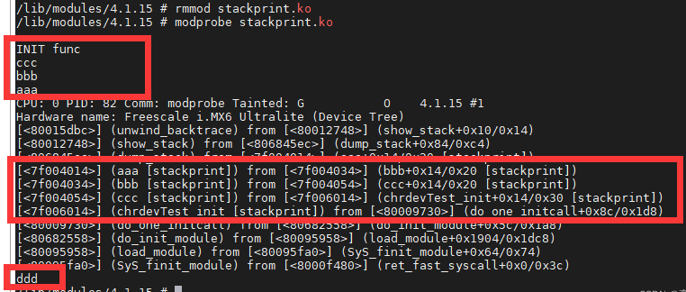
# 2 内核态异常call trace等级

内核态call trace 有三种出错情况，分别是`bug`, `oops`和`panic`。

1、 `bug`- **bug只是提示警告**。  
`BUG: sleeping function called from invalid context at …`, 比如在原子上下文中休眠，总断服务函数休眠，spin_lock中进行might_sleep等。

我在某个设备驱动的中断处理函数 `XXX_ISR()` 里加了 `msleep(10)` 之后：

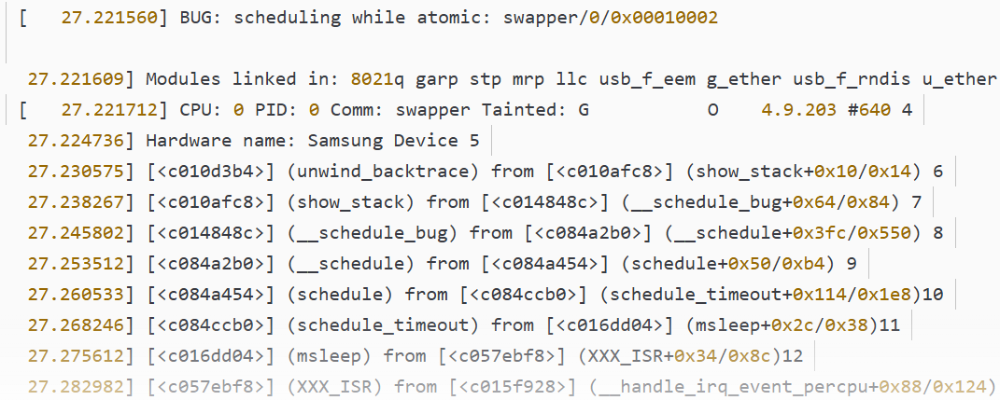
可以看到跑出了BUG打印，为什么是`BUG: scheduling while atomic`呢？而不是`BUG: sleeping function called from invalid context at …`

那是因为在原子上文中发生了调度，我们调用might_sleep是会时间片到了啊，让出CPU自然就进行了schedule。

`BUG: spinlock bad magic on CPU`错误表示自旋锁使用时没有初始化。

2、 `Oops`- **oops会终止进程，但是不会系统崩溃**。  
程序在内核态进入一种异常情况，比如引用非法指针导致的数据异常，数组越界导致的取指异常，此时异常处理机制能够捕获此异常，并将系统关键信息打印到串口上，正常情况下Oops消息会被记录到系统日志中去。

3、 `Panic` -**panic系统崩溃**。  
当Oops发生在中断上下文中或者在进程0和1中，系统将彻底挂起，因为中断服务程序异常后，将无法恢复，这种情况即称为内核panic。

## 2.1 WARN_ON函数

我们把上面的实验`aaa`函数中`dump_stack`改成`WARN_ON(1)`函数。可以看到`WARN_ON(1)`就是调用了`dump_stack`，多了绿色打印部分而已:

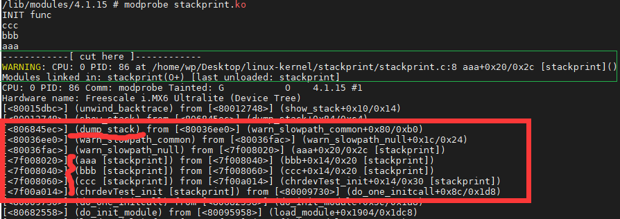
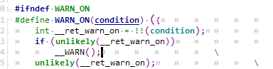
注意只有当`condition=1`时才会真正调用`__warn`:

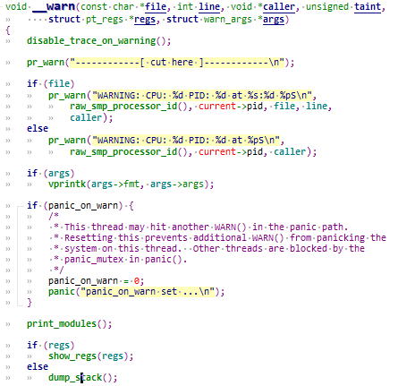
## 2.2 BUG_ON函数

`BUG_ON`这句，一旦执行就会抛出`oops`，导致栈的回溯和错误信息的打印，大部分体系结构把`BUG()`和`BUG_ON()`定义成某种非法操作，这样自然会产生需要的oops。类似一种断言，让进程终止。我们把上面的实验`aaa`函数中`dump_stack`改成`BUG_ON(1)`函数:

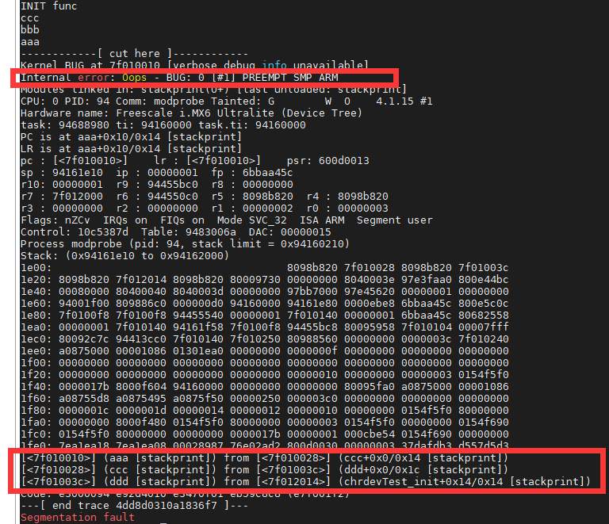
## 2.3 panic函数

当Oops发生在中断上下文中或者在进程0和1中，系统将彻底挂起，因为中断服务程序异常后，将无法恢复，这种情况即称为内核panic

# 3 Ftrace工具集

`Ftrace`是`Function Trace`的简写。它是一个内核函数追踪工具，旨在帮助内核设计和开发人员去追踪系统内部的函数调用流程。

还可以用来调试和分析系统的延迟和性能问题，并发展成为一个追踪类调试工具的框架：

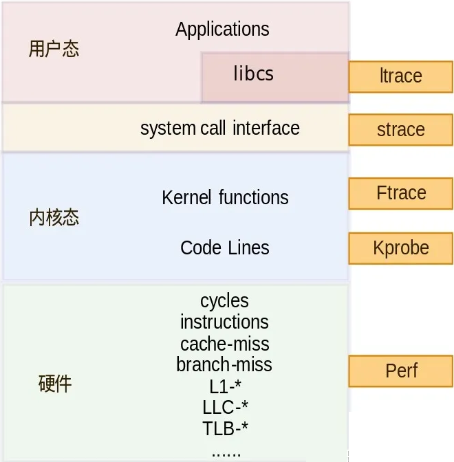
可以看到还包括了用户态的`ltrace`和`ftrace`。

## 3.1 Ftrace是如何记录信息的

`Ftrace`采用了静态插桩和动态插桩两种方式来实现。

### 3.1.1 静态插桩

`Kernel`中打开了`CONFIG_FUNCTION_TRACER`功能后，会增加一个`-pg`的一个编译选项，这样每个函数入口处，都会插入`bl mcount`跳转指令，使得每个函数运行时都会进入`mcount`函数。

既然每个函数都静态插桩，这带来的性能开销是惊人的，有可能导致人们弃用`Ftrace`功能。为了解决这个问题，开发者推出了`Dynamic ftrace`，以此来优化整体的性能。

### 3.1.2 动态插桩

既然静态插桩记录这些可追踪的函数，为了减少性能消耗，将跳转函数替换为`nop`指令，动态将被调试函数的`nop`指令，替换为跳转指令，以实现追踪。

## 3.2 使能Ftrace
```c
CONFIG_FTRACE=y                             # 启用了 Ftrace  
CONFIG_FUNCTION_TRACER=y                    # 启用函数级别的追踪器  
CONFIG_HAVE_FUNCTION_GRAPH_TRACER=y         # 表示内核支持图形显示  
CONFIG_FUNCTION_GRAPH_TRACER=y              # 以图形的方式显示函数追踪过程  
CONFIG_STACK_TRACER=y                       # 启用堆栈追踪器，用于跟踪内核函数调用的堆栈信息。  
CONFIG_DYNAMIC_FTRACE=y                     # 启用动态 Ftrace，允许在运行时启用和禁用 Ftrace 功能。  
CONFIG_HAVE_FTRACE_NMI_ENTER=y              # 表示内核支持非屏蔽中断（NMI）时进入 Ftrace 的功能  
CONFIG_HAVE_FTRACE_MCOUNT_RECORD=y          # 表示内核支持通过 mcount 记录函数调用关系。  
CONFIG_FTRACE_NMI_ENTER=y                   # 表示内核支持通过 mcount 记录函数调用关系。     
CONFIG_FTRACE_SYSCALLS=y                    # 系统调用的追踪  
CONFIG_FTRACE_MCOUNT_RECORD=y               # 启用 mcount 记录函数调用关系。  
CONFIG_SCHED_TRACER=y                       # 支持调度追踪  
CONFIG_CONTEXT_SWITCH_TRACER                #使能上下文切换追踪功能，可以用来跟踪进程之间的切换。  
CONFIG_NOP_TRACER                           #使能空操作追踪功能，可以用来在不需要追踪的情况下占位。  
CONFIG_FUNCTION_PROFILER=y                  # 启用函数分析器，主要用于记录函数的执行时间和调用次数  
CONFIG_DEBUG_FS=y                           # 启用 Debug 文件系统支持
```

上述配置不一定全部打开，勾选自己需要的即可，通常我们选择`CONFIG_FUNCTION_TRACER`和`CONFIG_HAVE_FUNCTION_GRAPH_TRACER`即可，然后编译烧录到开发板。

通过`make menuconfig`的方式写入：
```c
Kernel hacking  --->  
       Tracers ─>  
           [*]   Kernel Function Tracer  
           [*]     Kernel Function Graph Tracer (NEW)  
           // (下面还有几个追踪器的选项，可以根据自己的需要选择)
```

`Ftrace` 通过 `debugfs` 向用户态提供了访问接口，所以还需要将 `debugfs` 编译进内核:
```c
Kernel hacking  --->  
        -*- Debug Filesystem
```

### 3.2.1 挂载debugfs
```c
#用户态需要挂载debugfs,or通过配置修改etc/fstab文件  
mount -t debugfs none /sys/kernel/debug  
或者 mount -t tracefs nodev /sys/kernel/tracing
```

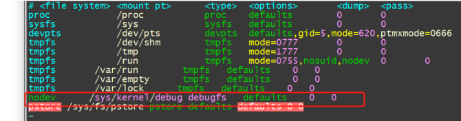
我们能够在`/sys/kernel/debug`下看到内核支持的所有的调试信息:
```c
# cd /sys/kernel/debug/  
# ls  
 asoc                gpio                regmap  
 bdi                 ieee80211           sched_debug  
 block               memblock            sched_features  
 clk                 mmc0                sleep_time  
 device_component    mmc1                suspend_stats  
 devices_deferred    mtd                 tracing  
 dma_buf             opp                 ubi  
 extfrag             pinctrl             ubifs  
 fault_around_bytes  pm_qos              wakeup_sources
```

## 3.3 Ftrace 使用

### 3.3.1 /sys/kernel/tracing介绍

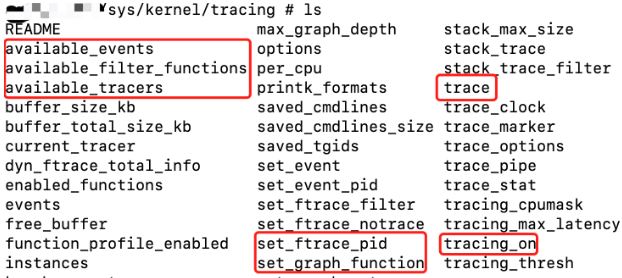
### 3.3.2 trace和trace_pipe使用

`cat trace_pipe`是堵塞读取，有数据就读，没数据就等待。

打开关闭追踪：
```c
echo 1 > tracing_on             // 打开跟踪  
do_someting  
echo 0 > tracing_on             // 关闭跟踪
```

```c
cat trace  > /tmp/log //一次性导出log  
cat trace_pipe > /tmp/log &//后台导出log
```

```c
cat current_tracer                    // 查看当前追踪器  
cat available_tracers                 // 查看当前内核中可用跟踪器  
cat available_events                  // 查看当前内核中可用事件  
cat available_filter_functions          
// 查看当前内核中可用函数,可以被追踪的函数列表，  
// 即可以写到 set_ftrace_filter，set_ftrace_notrace，set_graph_function，  
// set_graph_notrace 文件的函数列表  
  
echo function > current_tracer        // 选用 function 追踪器，  
echo function_graph > current_tracer  // 选用 function_graph 追踪器，  
echo [func] > set_ftrace_filter       // 选择追踪指定 [func] 函数的调用栈  
echo [pid] > set_ftrace_pid           // 选择追踪指定 [pid] 进程的调用栈
```

#### 3.3.2.1 选用函数追踪

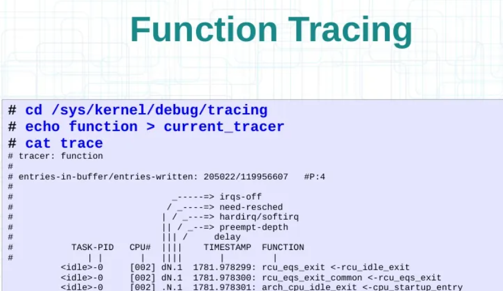
#### 3.3.2.2 选用图像化函数追踪

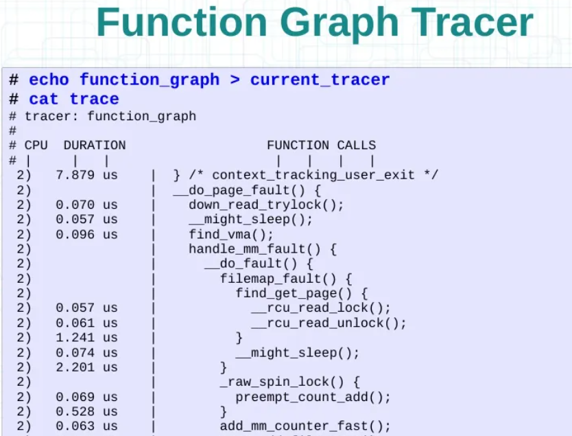
#### 3.3.2.3 选用动态过滤追踪

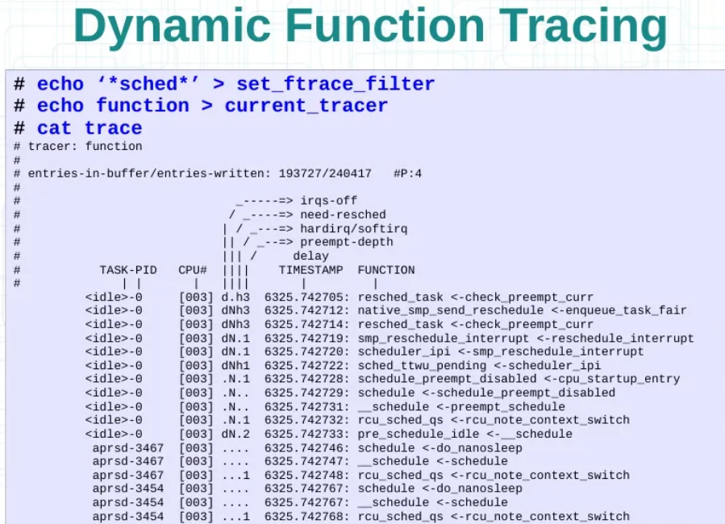
#### 3.3.2.4 追踪特定进程
```c
echo 0 > tracing_on                                 # 关闭追踪器  
 echo function > current_tracer                      # 设置当前追踪类别  
  
echo > trace; echo $$ > set_ftrace_pid; echo 1 > tracing_on; your_command; echo 0 > tracing_on
```

`$$`表示当前bash的pid,这样可以追踪任意命令。

如果我们要抓执行`a.out`的trace信息，那么先要获取到`a.out`程序的pid。

为什么要写成一条语句？

因为`ftrace`当打开时，在没有过滤的情况下，瞬间会抓取到内核所有的函数调用，为了更准确的抓取我们执行的命令，所以需要打开`trace`，执行完命令后，马上关闭。

#### 3.3.2.5 追踪特定函数
```c
echo 1 > options/func_stack_trace
```

```c
echo 0 > tracing_on									# 关闭追踪器  
cat available_filter_functions | grep "xxxxxx"		# 搜索函数是否存在  
echo xxxxxx > set_ftrace_filter						# 设定追踪的函数  
echo function > current_tracer						# 设置当前追踪类别  
echo 1 > options/func_stack_trace					# 记录堆栈信息  
echo > trace										# 清空缓存  
echo 1 > tracing_on
```

查看结果：
```c
# cat trace  
# tracer: function  
#  
# entries-in-buffer/entries-written: 2/2   #P:3  
#  
#                              _-----=> irqs-off  
#                             / _----=> need-resched  
#                            | / _---=> hardirq/softirq  
#                            | / _--=> preempt-depth  
#                            | /     delay  
#           TASK-PID   CPU#  |    TIMESTAMP  FUNCTION  
#              | |       |   |       |         |  
     kworker/1:1-59    [001] ....   168.954199: mmc_rescan <-process_one_work  
     kworker/1:1-59    [001] ....   168.954248: <stack trace>  
 => mmc_rescan  
 => process_one_work  
 => worker_thread  
 => kthread  
 => ret_from_fork  
 => 0
```

#### 3.3.2.6 追踪特定ko模块

编译ko需要加上编译参数`-pg`。否则你在`available_filter_functions`列表中，查找不到你想要的函数。
```c
# 示例  
Format: :mod:<module-name>  
example: echo :mod:ext3 > set_ftrace_filter
```

追踪`ext3`模块内的所有函数。

#### 3.3.2.7 重置追踪
```c
echo 0 > tracing_on         # 关闭trace  
echo > trace                # 清空当前trace记录
```

#### 3.3.2.8 事件追踪

**查看事件**:
```c
root@100ask:/sys/kernel/debug/tracing/events# ls  
alarmtimer    exceptions    i2c          migrate         power         signal   
block         ext4          initcall     mmc             printk        skb                      
enable        hyperv        mdio         percpu  
      
root@100ask:/sys/kernel/debug/tracing/events/sched# ls  
enable                  sched_move_numa     sched_process_free  sched_stat_runtime  sched_switch            
filter                  sched_pi_setprio    sched_process_hang  sched_stat_sleep  
sched_kthread_stop      sched_process_exec  sched_process_wait  sched_stat_wait
```

**追踪一个/若干事件**:
```c
# echo 1 > events/sched/sched_wakeup/enable  
 ...（省略追踪过程）  
  
# cat trace | head -10  
# tracer: nop  
#TASK-PID  CPU#  TIMESTAMP    FUNCTION  
# | | |  
bash-2613 [001] 425.078164: sched_wakeup: task bash:2613 [120] success=0 [001]  
bash-2613 [001] 425.078184: sched_wakeup: task bash:2613 [120] success=0 [001]
```

**追踪所有事件**:
```c
# echo 1 > events/enable  
...  
  
# cat trace | head -10  
# tracer: nop  
#TASK-PID     CPU#     TIMESTAMP    FUNCTION  
#   |                    |                    |                   |   
cpid-1470       [001]   794.947181:         kfree: call_site=ffffffff810c996d ptr=(null)  
acpid-1470     [001] 794.947182:      sys_read -> 0x1
```

#### 3.3.2.n trace_printk函数使用

内核头文件 `include/linux/kernel.h` 中描述了 `ftrace` 提供的工具函数的原型，这些函数包括 `trace_printk`、`tracing_on`/`tracing_off` 等。

## 3.4 引入用户态ltrace和strace

### 3.4.1 ltrace

跟踪进程调用`C库函数`的情况。

常用的参数：
```c
-a : 对齐具体某个列的返回值。  
-c : 计算时间和调用，并在程序退出时打印摘要。  
-d : 打印调试信息。  
-h : 打印帮助信息。  
-i : 打印指令指针，当库调用时。  
-l : 只打印某个库中的调用。  
-o, --output=file : 把输出定向到文件。  
-p : PID 附着在值为PID的进程号上进行ltrace。  
-r : 打印相对时间戳。  
-S : 显示系统调用。  
-t, -tt, -ttt : 打印绝对时间戳。  
-T : 输出每个调用过程的时间开销。  
-V, --version : 打印版本信息，然后退出。
```

```c
#include <stdio.h>  
#include <string.h>  
#include <stdlib.h>  
int main(void) {  
	int n = 10;  
	int *arr = (int *)malloc(n * sizeof(int));  
	if (arr == NULL) {  
		printf("failed!\r\n");  
		return 1;  
	}  
	memset(arr, 2, n*sizeof(int));  
	for (int i = 0; i < n; i++) {  
		printf("%d\t", arr[i]);  
	}  
	return 0;  
}
```

1.查看c库调用：

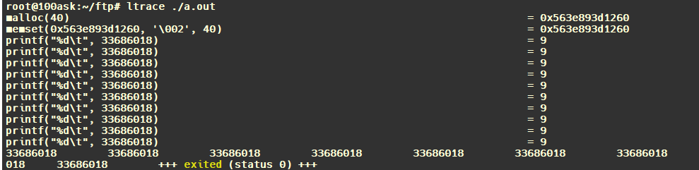
2.查看c库调用次数：

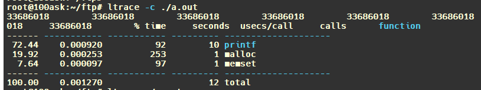
3.查看c库执行时间：

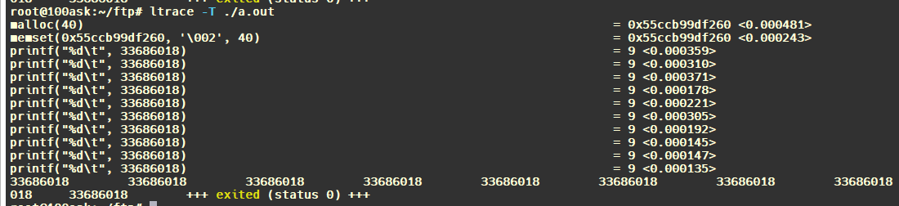
4.查看系统调用情况：

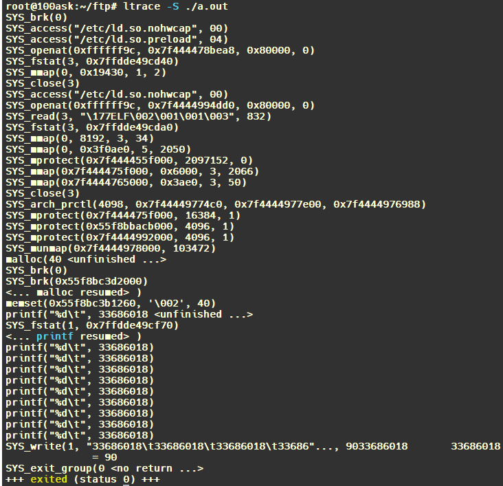
### 3.4.2 strace

跟踪进程系统调用`System Call`使用情况。

常用的参数如下:
```c
-c 统计每一系统调用的所执行的时间,次数和出错的次数等.  
-d 输出strace关于标准错误的调试信息.  
-f 跟踪由fork调用所产生的子进程.  
-ff 如果提供-o filename,则所有进程的跟踪结果输出到相应的filename.pid中,pid是各进程的进程号.  
-F 尝试跟踪vfork调用.在-f时,vfork不被跟踪.  
-h 输出简要的帮助信息.  
-i 输出系统调用的入口指针.  
-q 禁止输出关于脱离的消息.  
-r 打印出相对时间关于,,每一个系统调用.  
-t 在输出中的每一行前加上时间信息.  
-tt 在输出中的每一行前加上时间信息,微秒级.  
-ttt 微秒级输出,以秒了表示时间.  
-T 显示每一调用所耗的时间.  
-v 输出所有的系统调用.一些调用关于环境变量,状态,输入输出等调用由于使用频繁,默认不输出.  
-V 输出strace的版本信息.  
-x 以十六进制形式输出非标准字符串  
-xx 所有字符串以十六进制形式输出.  
-a column 设置返回值的输出位置.默认 为40.  
-e expr 指定一个表达式,用来控制如何跟踪.格式：[qualifier=][!]value1[,value2]...  
qualifier只能是 trace,abbrev,verbose,raw,signal,read,write其中之一.value是用来限定的符号或数字.默认的 qualifier是 trace.感叹号是否定符号.例如:-eopen等价于 -e trace=open,表示只跟踪open调用.而-etrace!=open 表示跟踪除了open以外的其他调用.有两个特殊的符号 all 和 none. 注意有些shell使用!来执行历史记录里的命令,所以要使用\\.  
-e trace=set 只跟踪指定的系统 调用.例如:-e trace=open,close,rean,write表示只跟踪这四个系统调用.默认的为set=all.  
-e signal=set 指定跟踪的系统信号.默认为all.如 signal=!SIGIO(或者signal=!io),表示不跟踪SIGIO信号.  
-e read=set 输出从指定文件中读出 的数据.例如: -e read=3,5  
-e write=set 输出写入到指定文件中的数据.  
-o filename 将strace的输出写入文件filename  
-p pid 跟踪指定的进程pid.
```

查看系统调用的时间：

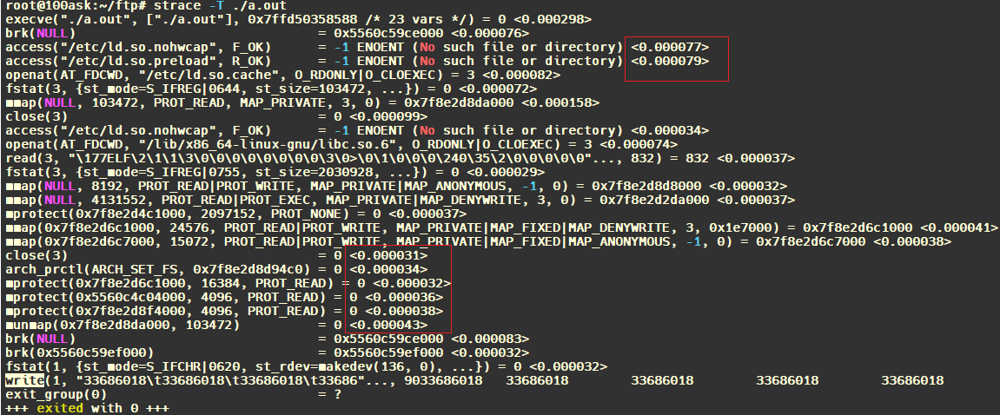
