# 1 链接脚本vmlinux.lds

先编译一下 Linux 源码，因为有很多文件是需要编译才会生成的。首先分析 Linux 内核的连接脚本文件 `arch/arm/kernel/vmlinux.lds`，通过链接脚本可以找到 Linux 内核的第一行程序是从哪里执行的。vmlinux.lds 中有如下代码:
```c
492 OUTPUT_ARCH(arm)  
493 ENTRY(stext)  
494 jiffies = jiffies_64;  
495 SECTIONS  
496 {  
497 	/*  
498 	* XXX: The linker does not define how output sections are  
499 	* assigned to input sections when there are multiple statements  
500 	* matching the same input section name. There is no documented  
501 	* order of matching.  
502 	*  
503 	* unwind exit sections must be discarded before the rest of the  
504 	* unwind sections get included.  
505 	*/  
506 	/DISCARD/ : {  
507 	*(.ARM.exidx.exit.text)  
508 	*(.ARM.extab.exit.text)  
509 	  
......  
645 }
```

ENTRY 指明了了 Linux 内核入口，入口为 stext，stext 定义在文件arch/arm/kernel/head.S 中 ， 因 此 要 分 析 Linux 内 核 的 启 动 流 程 ， 就 得 先 从 文 件arch/arm/kernel/head.S 的 stext 处开始分析。

# 2 Linux 内核启动流程

## 2.0 Linux kernel启动流程概述

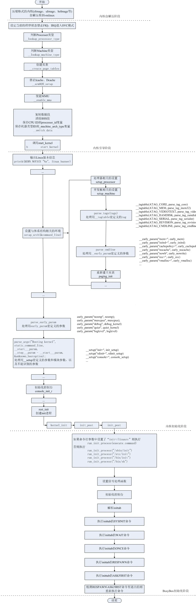
## 2.1pre linux内核镜像解压

`kernel/lib/inflate.c`的`decompress_kernel`， `inflate.c`是从gzip 插件源代码移过来的。解压完后会看到：
```c
UncompressingLinux...done, booting the kernel.
```

```c
call_kernel: bl    cache_clean_flush  
  bl    cache_off  
  mov       r0, #0          @ must be zero  
  mov       r1, r7          @ restore architecture number  
  mov       r2, r8          @ restore atags pointer  
  mov       pc, r4          @ call kernel
```

r4 中已经在head.S处预置为内核镜像的地址,因此会跳转到r4去执行，就是Linux 内核入口 stext。
```c
#ifdef CONFIG_AUTO_ZRELADDR  
  @determine final kernel image address  
  mov       r4, pc  
  and r4, r4, #0xf8000000  
  add r4, r4, #TEXT_OFFSET  
#else  
  ldr   r4, =zreladdr  
#endif
```

## 2.1 Linux 内核入口 stext

打开arch/arm/kernel/head.S可以看到：
```c
/*  
* Kernel startup entry point.  
* ---------------------------  
*  
* This is normally called from the decompressor code. The requirements  
* are: MMU = off, D-cache = off, I-cache = dont care, r0 = 0,  
* r1 = machine nr, r2 = atags or dtb pointer.  
.....  
*/
```

Linux 内核的入口点 stext 其实相当于内核的入口函数，stext 函数内容如下：

依据上面的注释内容，Linux 内核启动之前要求如下：
```c
①、关闭 MMU。  
②、关闭 D-cache。  
③、I-Cache 无所谓。  
④、r0=0。  
⑤、r1=machine nr(也就是机器 ID)。  
⑥、r2=atags 或者设备树(dtb)首地址。
```

stext代码如下：  
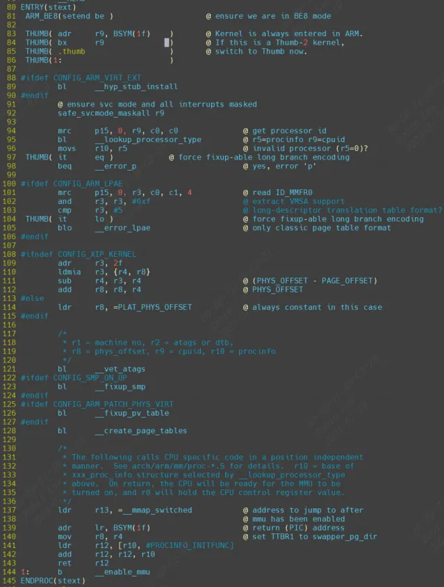
第 92 行，调用函数 `safe_svcmode_maskall` 确保 CPU 处于 SVC 模式，并且关闭了所有的中断。`safe_svcmode_maskall` 定义在文件 `arch/arm/include/asm/assembler.h` 中。  
第 94 行，读处理器 ID，ID 值保存在 r9 寄存器中。  
第 95 行，调用函数`__lookup_processor_type` 检查当前系统是否支持此 CPU，如果支持就获取 procinfo 信 息 。 procinfo 是 `proc_info_list` 类 型 的 结 构 体，`proc_info_list` 在 文 件`arch/arm/include/asm/procinfo.h` 中的定义：
```c
struct proc_info_list {  
	 unsigned int cpu_val;  
	 unsigned int cpu_mask;  
	 unsigned long __cpu_mm_mmu_flags; /* used by head.S */  
	 unsigned long __cpu_io_mmu_flags; /* used by head.S */  
	 unsigned long __cpu_flush; /* used by head.S */  
	 const char *arch_name;  
	 const char *elf_name;  
	 unsigned int elf_hwcap;  
	 const char *cpu_name;  
	 struct processor *proc;  
	 struct cpu_tlb_fns *tlb;  
	 struct cpu_user_fns *user;  
	 struct cpu_cache_fns *cache;  
};
```

每种处理器都抽象为一个 proc_info_list 结构体，每种处理器都对应一个procinfo。因此可以通过处理器 ID 来找到对应的 procinfo 结构，`__lookup_processor_type` 函数找到对应处理器的 procinfo 以后会将其保存到 r5 寄存器中。

第121行，函数`__vet_atags` 验证 atags 或设备树(dtb)的合法性。函数`__vet_atags` 定义在文件 `arch/arm/kernel/head-common.S` 中。  
第128行，调用函数`__create_page_tables` 创建页表。  
第 137 行，将函数`__mmap_switched` 的地址保存到 r13 寄存器中。`__mmap_switched` 定义在文件 `arch/arm/kernel/head-common.S`，`__mmap_switched` 最终会调用 start_kernel 函数。  
第 144 行 ， 调 用 `__enable_mmu` 函 数 使 能 MMU ，`__enable_mmu`定 义 在 文 件`arch/arm/kernel/head.S` 中。`__enable_mmu` 最终会通过调用`__turn_mmu_on` 来打开 MMU，`__turn_mmu_on` 最后会执行 r13 里面保存的`__mmap_switched` 函数。

### 2.1.0 `__create_page_tables`

- 内核所在物理内存块的初始地址，保存在寄存器 r8 中。
- 内核代码相对于初始地址的偏移值，是在程序编译前就确定的一个宏：`TEXT_OFFSET`，arm32 中通常是 0x8000，也就是偏移地址为 32 K，前面保留的 32K 内存就是用来存放页表。

在建立页表之前，目前所处的相关寄存器环境为：`r8 = phys_offset, r9 = cpuid, r10 = procinfo.`

### 2.1.1 `__enable_mmu`

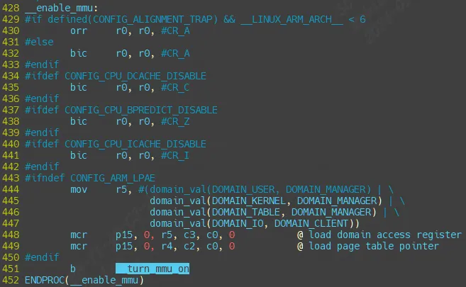
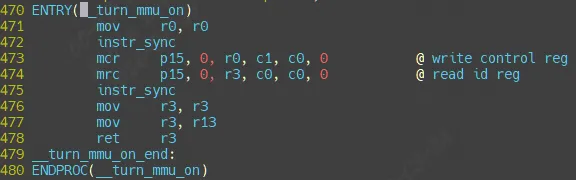
#### 2.1.1.1 `__mmap_switched`

前面讲到`__enable_mmu`会调用`__mmap_switched` 函数（通过调用`__turn_mmu_on` 再调用r13）。现在具体分析它：  
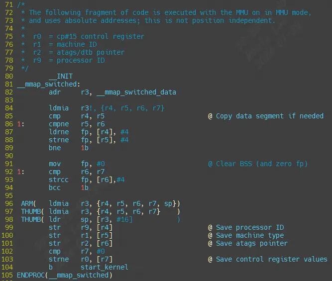
可以看到`__mmap_switched`主要就是做clear bss,然后保存处理器ID, 序列号，最终跳转start_kernel函数。

##### 2.1.1.1.1 start_kernel

start_kernel会调用大量的子函数完成linux启动前的一些初始化工作，start_kernel 函数里面调用的子函数太多，而这些子函数又很复杂。我们简单的来看一下一些重要的子函数。精简并添加注释后的 start_kernel 函数内容如下：

init/main/start_kenel函数
```c
asmlinkage __visible void __init start_kernel(void)  
{  
	char *command_line;  
	char *after_dashes;  
  
	/*  
	 * Need to run as early as possible, to initialize the  
	 * lockdep hash:  
	 */  
	lockdep_init();  
	set_task_stack_end_magic(&init_task);  
	smp_setup_processor_id();  
	debug_objects_early_init();  
  
	/*  
	 * Set up the the initial canary ASAP:  
	 */  
	boot_init_stack_canary();  
  
	cgroup_init_early();  
  
	local_irq_disable();  
	early_boot_irqs_disabled = true;  
  
/*  
 * Interrupts are still disabled. Do necessary setups, then  
 * enable them  
 */  
	boot_cpu_init();  
	page_address_init();  
	pr_notice("%s", linux_banner);  
	setup_arch(&command_line);  
	mm_init_cpumask(&init_mm);  
	setup_command_line(command_line);  
	setup_nr_cpu_ids();  
	setup_per_cpu_areas();  
	smp_prepare_boot_cpu();	/* arch-specific boot-cpu hooks */  
  
	build_all_zonelists(NULL, NULL);  
	page_alloc_init();  
  
	pr_notice("Kernel command line: %s\n", boot_command_line);  
	parse_early_param();  
	after_dashes = parse_args("Booting kernel",  
				  static_command_line, __start___param,  
				  __stop___param - __start___param,  
				  -1, -1, &unknown_bootoption);  
	if (!IS_ERR_OR_NULL(after_dashes))  
		parse_args("Setting init args", after_dashes, NULL, 0, -1, -1,  
			   set_init_arg);  
  
	jump_label_init();  
  
	/*  
	 * These use large bootmem allocations and must precede  
	 * kmem_cache_init()  
	 */  
	setup_log_buf(0);  
	pidhash_init();  
	vfs_caches_init_early();  
	sort_main_extable();  
	trap_init();  
	mm_init();  
  
	/*  
	 * Set up the scheduler prior starting any interrupts (such as the  
	 * timer interrupt). Full topology setup happens at smp_init()  
	 * time - but meanwhile we still have a functioning scheduler.  
	 */  
	sched_init();  
	/*  
	 * Disable preemption - early bootup scheduling is extremely  
	 * fragile until we cpu_idle() for the first time.  
	 */  
	preempt_disable();  
	if (WARN(!irqs_disabled(),  
		 "Interrupts were enabled *very* early, fixing it\n"))  
		local_irq_disable();  
	idr_init_cache();  
	rcu_init();  
  
	/* trace_printk() and trace points may be used after this */  
	trace_init();  
  
	context_tracking_init();  
	radix_tree_init();  
	/* init some links before init_ISA_irqs() */  
	early_irq_init();  
	init_IRQ();  
	tick_init();  
	rcu_init_nohz();  
	init_timers();  
	hrtimers_init();  
	softirq_init();  
	timekeeping_init();  
	time_init();  
	sched_clock_postinit();  
	perf_event_init();  
	profile_init();  
	call_function_init();  
	WARN(!irqs_disabled(), "Interrupts were enabled early\n");  
	early_boot_irqs_disabled = false;  
	local_irq_enable();  
  
	kmem_cache_init_late();  
  
	/*  
	 * HACK ALERT! This is early. We're enabling the console before  
	 * we've done PCI setups etc, and console_init() must be aware of  
	 * this. But we do want output early, in case something goes wrong.  
	 */  
	console_init();  
	if (panic_later)  
		panic("Too many boot %s vars at `%s'", panic_later,  
		      panic_param);  
  
	lockdep_info();  
  
	/*  
	 * Need to run this when irqs are enabled, because it wants  
	 * to self-test [hard/soft]-irqs on/off lock inversion bugs  
	 * too:  
	 */  
	locking_selftest();  
  
#ifdef CONFIG_BLK_DEV_INITRD  
	if (initrd_start && !initrd_below_start_ok &&  
	    page_to_pfn(virt_to_page((void *)initrd_start)) < min_low_pfn) {  
		pr_crit("initrd overwritten (0x%08lx < 0x%08lx) - disabling it.\n",  
		    page_to_pfn(virt_to_page((void *)initrd_start)),  
		    min_low_pfn);  
		initrd_start = 0;  
	}  
#endif  
	page_ext_init();  
	debug_objects_mem_init();  
	kmemleak_init();  
	setup_per_cpu_pageset();  
	numa_policy_init();  
	if (late_time_init)  
		late_time_init();  
	sched_clock_init();  
	calibrate_delay();  
	pidmap_init();  
	anon_vma_init();  
	acpi_early_init();  
#ifdef CONFIG_X86  
	if (efi_enabled(EFI_RUNTIME_SERVICES))  
		efi_enter_virtual_mode();  
#endif  
#ifdef CONFIG_X86_ESPFIX64  
	/* Should be run before the first non-init thread is created */  
	init_espfix_bsp();  
#endif  
	thread_info_cache_init();  
	cred_init();  
	fork_init();  
	proc_caches_init();  
	buffer_init();  
	key_init();  
	security_init();  
	dbg_late_init();  
	vfs_caches_init(totalram_pages);  
	signals_init();  
	/* rootfs populating might need page-writeback */  
	page_writeback_init();  
	proc_root_init();  
	nsfs_init();  
	cpuset_init();  
	cgroup_init();  
	taskstats_init_early();  
	delayacct_init();  
  
	check_bugs();  
  
	acpi_subsystem_init();  
	sfi_init_late();  
  
	if (efi_enabled(EFI_RUNTIME_SERVICES)) {  
		efi_late_init();  
		efi_free_boot_services();  
	}  
  
	ftrace_init();  
  
	/* Do the rest non-__init'ed, we're now alive */  
	rest_init();  
}
```

如下，打上注释方便清楚每个子调用的含义：
```c
lockdep_init() //lockdep 是死锁检测模块，此函数会初始化两个 hash 表  
set_task_stack_end_magic() //设置任务栈结束魔术数，用于栈溢出检测  
smp_setup_processor_id() //跟 SMP 有关(多核处理器)，设置处理器 ID  
debug_objects_early_init() //做一些和 debug 有关的初始化  
boot_init_stack_canary() //栈溢出检测初始化  
cgroup_init_early() //cgroup 初始化，cgroup 用于控制 Linux 系统资源  
local_irq_disable() //关闭当前 CPU 中断, 中断关闭期间做一些重要的操作，然后打开中断  
boot_cpu_init() //跟 CPU 有关的初始化  
page_address_init() //页地址相关的初始化  
pr_notice("%s", linux_banner);/* 打印 Linux 版本号、编译时间等信息 */  
setup_arch(&command_line); //架构相关的初始化，此函数会解析传递进来的ATAGS 或者设备树(DTB)文件。会根据设备树里面的 model 和 compatible 这两个属性值来查找Linux 是否支持这个单板。此函数也会获取设备树中 chosen 节点下的 bootargs 属性值来得到命令行参数，也就是 uboot 中的 bootargs 环境变量的值，获取到的命令行参数会保存到command_line 中  
mm_init_cpumask(&init_mm) //内存有关的初始化  
setup_command_line(command_line) //存储命令行参数  
setup_nr_cpu_ids() //如果只是 SMP(多核 CPU)的话，此函数用于获取CPU 核心数量，CPU 数量保存在变量nr_cpu_ids 中  
setup_per_cpu_areas() //在 SMP 系统中有用，设置每个 CPU 的 per-cpu 数据  
smp_prepare_boot_cpu()  
build_all_zonelists(NULL, NULL); /* 建立系统内存页区(zone)链表 */  
page_alloc_init(); /* 处理用于热插拔 CPU 的页 */  
pr_notice("Kernel command line: %s\n", boot_command_line); //打印命令行信息  
parse_early_param(); /* 解析命令行中的 console 参数 */  
after_dashes = parse_args("Booting kernel",  
		static_command_line, __start___param,  
		__stop___param - __start___param,  
		-1, -1, &unknown_bootoption);  
setup_log_buf(0); /* 设置 log 使用的缓冲区*/  
pidhash_init(); // 构建 PID 哈希表，Linux 中每个进程都有一个 ID,这个 ID 叫做 PID。通过构建哈希表可以快速搜索进程信息结构体  
idr_init_cache(); // IDR 初始化，IDR 是 Linux 内核的整数管理机制，也就是将一个整数 ID 与一个指针关联起来  
rcu_init(); // 初始化 RCU，RCU 全称为 Read Copy Update(读-拷贝修改)  
trace_init(); // 跟踪调试相关初始化   
radix_tree_init(); //基数树相关数据结构初始化  
early_irq_init(); //初始中断相关初始化,主要是注册 irq_desc 结构体变量，因为 Linux 内核使用 irq_desc 来描述一个中断  
init_IRQ(); /* 中断初始化 */  
tick_init(); /* tick 初始化 */  
init_timers(); /* 初始化定时器 */  
hrtimers_init(); /* 初始化高精度定时器 */  
softirq_init(); /* 软中断初始化 */  
timekeeping_init();   
time_init(); /* 初始化系统时间 */  
WARN(!irqs_disabled(), "Interrupts were enabled early\n");  
early_boot_irqs_disabled = false;  
local_irq_enable(); /* 使能中断 */  
kmem_cache_init_late(); /* slab 初始化，slab 是 Linux 内存分配器 */  
console_init(); //初始化控制台，之前 printk 打印的信息都存放缓冲区中，并没有打印出来。只有调用此函数初始化控制台以后才能在控制台上打印信息  
locking_selftest() /* 锁自测 */  
kmemleak_init(); /* kmemleak 初始化，kmemleak 用于检查内存泄漏 */  
calibrate_delay(); /* 测定 BogoMIPS 值，可以通过 BogoMIPS 来判断 CPU 的性能BogoMIPS 设置越大，说明 CPU 性能越好*/  
pidmap_init(); /* PID 位图初始化 */  
anon_vma_init(); /* 生成 anon_vma slab 缓存 */  
cred_init(); /* 为对象的每个用于赋予资格(凭证) */  
fork_init(); /* 初始化一些结构体以使用 fork 函数 */  
proc_caches_init(); /* 给各种资源管理结构分配缓存 */  
buffer_init(); /* 初始化缓冲缓存 */  
key_init(); /* 初始化密钥 */  
security_init(); /* 安全相关初始化 */  
vfs_caches_init(totalram_pages); /* 为 VFS 创建缓存 */  
signals_init(); /* 初始化信号 */  
page_writeback_init(); /* 页回写初始化 */  
proc_root_init(); /* 注册并挂载 proc 文件系统 */  
cpuset_init(); /* 初始化 cpuset，cpuset 是将 CPU 和内存资源以逻辑性和层次性集成的一种机制，是 cgroup 使用的子系统之一*/  
cgroup_init(); /* 初始化 cgroup */  
taskstats_init_early(); /* 进程状态初始化 */  
check_bugs(); /* 检查写缓冲一致性 */  
rest_init(); /* rest_init 函数 */
```

start_kernel完成内核初始化工作。具体包括以下部分：

（1）内核架构 、通用配置相关初始化

（2） 内存管理相关初始化

（3）进程管理相关初始化

（4）进程调度相关初始化

（5）网络子系统管理

（6）虚拟文件系统

（7）文件系统

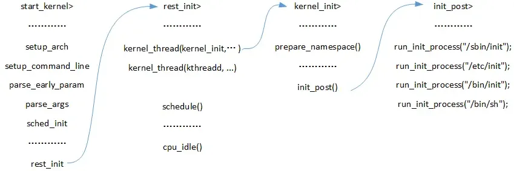
###### 2.1.1.1.1.1 setup_arch

内核架构相关的初始化函数, 包含了处理器相关参数的初始化、内核启动参数（tagged list）的获取和前期处理、内存子系统的早期初始化。

`setup_arch(&command_line);`

若uboot中bootargs的值为空，`command_line = default_command_line`，即为内核中的默认命令行参数，其值在`.config`文件中配置，对应`CONFIG_CMDLINE`配置项。

###### 2.1.1.1.1.2 setup_command_line、parse_early_param以及parse_args

完成命令行参数的解析、保存。譬如：
```c
cmdline = console=ttySAC2,115200 root=/dev/mmcblk0p2 rw  
init=/linuxrc rootfstype=ext3 #解析为一下四个参数：  
console=ttySAC2,115200 #指定控制台的串口设备号，及其波特率  
root=/dev/mmcblk0p2 rw #指定根文件系统rootfs的路径  
init=/linuxrc #指定第一个用户进程init的路径rootf stype=ext3
```

###### 2.1.1.1.1.n reset_init

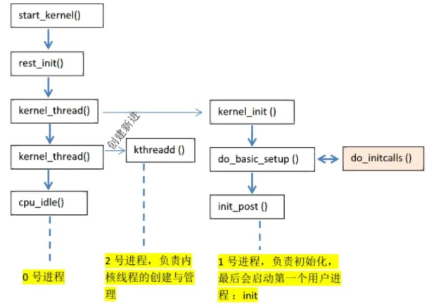
```c
1）调用kernel_thread函数启动了2个内核线程，分别是：kernel_init和kthreadd。  
    kernel_init线程中调用prepare_namespace函数挂载根文件系统rootfs；  
    然后调用init_post函数，执行根文件系统rootfs下的第一个用户进程init。  
    用户进程有4个备选方案，若command_line中init的路径错误，则会执行备用方案。  
    第一备用：/sbin/init，第二备用：/etc/init，第三备用：/bin/init，第四备用：/bin/sh。  
  
2）调用schedule函数开启内核调度系统；  
3）调用cpu_idle函数，启动空闲进程idle，完成内核启动。
```

```c
static noinline void __init_refok rest_init(void)  
{  
	int pid;  
  
	rcu_scheduler_starting();  
	smpboot_thread_init();  
	/*  
	 * We need to spawn init first so that it obtains pid 1, however  
	 * the init task will end up wanting to create kthreads, which, if  
	 * we schedule it before we create kthreadd, will OOPS.  
	 */  
	kernel_thread(kernel_init, NULL, CLONE_FS);  
	numa_default_policy();  
	pid = kernel_thread(kthreadd, NULL, CLONE_FS | CLONE_FILES);  
	rcu_read_lock();  
	kthreadd_task = find_task_by_pid_ns(pid, &init_pid_ns);  
	rcu_read_unlock();  
	complete(&kthreadd_done);  
  
	/*  
	 * The boot idle thread must execute schedule()  
	 * at least once to get things moving:  
	 */  
	init_idle_bootup_task(current);  
	schedule_preempt_disabled();  
	/* Call into cpu_idle with preempt disabled */  
	cpu_startup_entry(CPUHP_ONLINE);  
}
```

调用函数 rcu_scheduler_starting，启动 RCU 锁调度器。  
调用函数 kernel_thread 创建 kernel_init 进程，也就是大名鼎鼎的 init 内核进程。init 进程的 PID 为 1。init 进程一开始是内核进程(也就是运行在内核态)，后面 init 进程会在根文件系统中查找名为“init”这个程序，这个“init”程序处于用户态，通过运行这个“init”程序，init 进程就会实现从内核态到用户态的转变。  
调用函数 kernel_thread 创建 kthreadd 内核进程，此内核进程的 PID 为 2。kthreadd进程负责所有内核进程的调度和管理。  
最后调用函数 cpu_startup_entry 来进入 idle 进程，cpu_startup_entry 会调用cpu_idle_loop，cpu_idle_loop 是个 while 循环，也就是 idle 进程代码。idle 进程的 PID 为 0，idle进程叫做空闲进程，如果学过 FreeRTOS 或者 UCOS 的话应该听说过空闲任务。idle 空闲进程就和空闲任务一样，当 CPU 没有事情做的时候就在 idle 空闲进程里面“瞎逛游”，反正就是给CPU 找点事做。当其他进程要工作的时候就会抢占 idle 进程，从而夺取 CPU 使用权。其实大家应该可以看到 idle 进程并没有使用 kernel_thread 或者 fork 函数来创建，因为它是有主进程演变而来的。  
在 Linux 终端中输入`“ps -A”`就可以打印出当前系统中的所有进程，其中就能看到 init 进程和 kthreadd 进程：  
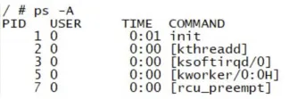
init 进程的 PID 为 1，kthreadd 进程的 PID 为 2。没有显示 PID 为 0 的 idle 进程，那是因为 idle 进程是内核进程。kernel_init 就是 init 进程的进程函数。

## 2.2 kernel_init(init进程详解)

把reset_init中的`kernel_init` 拆出来，函数`kernel_init` 就是 init 进程具体做的工作，函数内容如下：
```c
static int __ref kernel_init(void *unused)  
{  
	int ret;  
	kernel_init_freeable(); /* init 进程的一些其他初始化工作 */  
	/* need to finish all async __init code before freeing the memory */  
	async_synchronize_full(); /* 等待所有的异步调用执行完成 */  
	free_initmem(); /* 释放 init 段内存 */  
	mark_rodata_ro();  
	system_state = SYSTEM_RUNNING; /* 标记系统正在运行 */  
	numa_default_policy();  
  
	flush_delayed_fput();  
  
	if (ramdisk_execute_command) {  
		ret = run_init_process(ramdisk_execute_command);  
		if (!ret)  
			return 0;  
		pr_err("Failed to execute %s (error %d)\n",  
		ramdisk_execute_command, ret);  
	}  
  
	/*  
	* We try each of these until one succeeds.  
	*  
	* The Bourne shell can be used instead of init if we are  
	* trying to recover a really broken machine.  
	*/  
	if (execute_command) {  
		ret = run_init_process(execute_command);  
		if (!ret)  
			return 0;  
		panic("Requested init %s failed (error %d).",  
		execute_command, ret);  
	}  
	if (!try_to_run_init_process("/sbin/init") |  
		!try_to_run_init_process("/etc/init") |  
		!try_to_run_init_process("/bin/init") |  
		!try_to_run_init_process("/bin/sh"))  
		return 0;  
  
	panic("No working init found. Try passing init= option to kernel. "  
	"See Linux Documentation/init.txt for guidance.");  
}
```

`kernel_init_freeable` 函数用于完成 init 进程的一些其他初始化工作，稍后再来具体看一下此函数。  
`ramdisk_execute_command` 是一个全局的 char 指针变量，此变量值为`“/init”`，也就是根目录下的 init 程序。`ramdisk_execute_command` 也可以通过 uboot 传递，在 bootargs 中使用`“rdinit=xxx”`即可，xxx 为具体的 init 程序名字。  
如果存在`“/init”`程序的话就通过函数 `run_init_process` 来运行此程序。  
如果 `ramdisk_execute_command` 为空的话就看 `execute_command` 是否为空，反正不管如何一定要在根文件系统中找到一个可运行的 init 程序。`execute_command` 的值是通过uboot 传递，在 bootargs 中使用`“init=xxxx”`就可以了，比如`“init=/linuxrc”`表示根文件系统中的 linuxrc 就是要执行的用户空间 init 程序。  
如果`ramdisk_execute_command`和 `execute_command` 都为空，那么就依次查找`“/sbin/init”`、`“/etc/init”`、`“/bin/init”`和`“/bin/sh”`，这四个相当于备用 init 程序，如果这四个也不存在，那么 Linux 启动失败！  
如果以上步骤都没有找到用户空间的 init 程序，那么就提示错误发生！

### 2.2.1 kernel_init_freeable

`kernel_init_freeable` 定义在文件 init/main.c 中，缩减后的函数内容如下：
```c
static noinline void __init kernel_init_freeable(void)  
{  
	/*  
	* Wait until kthreadd is all set-up.  
	*/  
	wait_for_completion(&kthreadd_done);/* 等待 kthreadd 进程准备就绪 */  
	smp_init(); /* SMP 初始化 */  
	sched_init_smp(); /* 多核(SMP)调度初始化 */  
	do_basic_setup(); /* 设备初始化都在此函数中完成 */  
	/* Open the /dev/console on the rootfs, this should never fail */  
	if (sys_open((const char __user *) "/dev/console", O_RDWR, 0) < 0)	  
		pr_err("Warning: unable to open an initial console.\n");  
	(void) sys_dup(0);  
	(void) sys_dup(0);  
	/*  
	* check if there is an early userspace init. If yes, let it do   
	* all the work  
	*/	  
	if (!ramdisk_execute_command)  
		ramdisk_execute_command = "/init";  
	if (sys_access((const char __user *) ramdisk_execute_command, 0) != 0) {  
		ramdisk_execute_command = NULL;  
		prepare_namespace();  
	}  
	/*  
	* Ok, we have completed the initial bootup, and  
	* we're essentially up and running. Get rid of the  
	* initmem segments and start the user-mode stuff..  
	*  
	* rootfs is available now, try loading the public keys  
	* and default modules  
	*/  
	integrity_load_keys();  
	load_default_modules();  
}
```

#### 2.2.1.1 driver_init

`do_basic_setup` 函数用于完成 Linux 下设备驱动初始化工作！非常重要。do_basic_setup 会调用 `driver_init` 函数完成 Linux 下驱动模型子系统的初始化。

#### 2.2.1.2 设置控制台

打开设备`“/dev/console”`，在 Linux 中一切皆为文件！因此`“/dev/console”`也是一个文件，此文件为控制台设备。每个文件都有一个文件描述符，此处打开的`“/dev/console”`文件描述符为 0，作为标准输入(0)。  
`sys_dup` 函数将标准输入(0)的文件描述符复制了 2 次，一个作为标准输出(1)，一个作为标准错误(2)。这样标准输入、输出、错误都是/dev/console 了。console 通过uboot 的 bootargs 环境变量设置，`“console=ttymxc0,115200”`表示将`/dev/ttymxc0` 设置为 console，也就是 I.MX6U 的串口 1。当然，也可以设置其他的设备为 console，比如虚拟控制台 tty1，设置 tty1 为 console 就可以在 LCD 屏幕上看到系统的提示信息。

#### 2.2.1.3 挂载根文件系统

调用函数 `prepare_namespace` 来挂载根文件系统。根文件系统也是由命令行参数指定的，就是 uboot 的 bootargs 环境变量。比如`“root=/dev/mmcblk1p2 rootwait rw”`就表示根文件系统在/dev/mmcblk1p2 中，也就是 EMMC 的分区 2 中。

下面2张图都是emmc存储，分别挂载ext3格式和squashfs格式根文件系统：

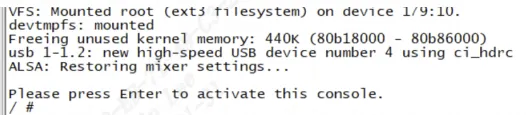
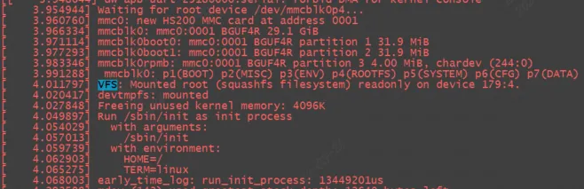
如果根文件系统缺失错误，这里我们故意将:
```c
setenv bootargs 'console=ttymxc0,115200'  
saveenv
```

这时候挂载根文件系统时，由于没有指定`root=/dev/mmcblk1p2 rootwait rw`，因此报错如下：  

还能看到call trace如下：  
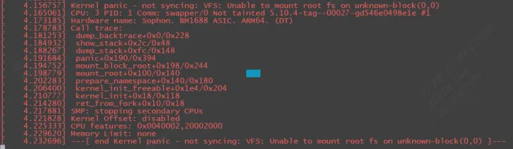
##### 2.2.1.3.1 init 服务

启动init服务时，init服务会读取`/etc/inittab`文件，`/etc/inittab`中设置了初始化系统环境的工作。 `/etc/inittab`定义 init 服务在 linux启动过程中必须依序执行以下几个Script ：
```c
/etc/rc.d/rc.sysinit  
/etc/rc.d/rc  
/etc/rc.d/rc.local
```

###### 2.2.1.3.1.1 rc.sysinit

`/etc/rc.d/rc.sysinit`主要的功能是设置系统的基本环境:

(1)启动`udev`

(2)设置内核参数：执行`sysctl –p` ,以便从 `/etc/sysctl.conf` 设置内核参数

(3)设置系统时间：将硬件时间设置为系统时间

(4)启用交换内存空间：执行 `swpaon –a –e`，以便根据`/etc/fstab`的设置启用所有的交换内存空间。

(5)检查并挂载所有文件系统：检查所有需要挂载的文件系统，以确保这些文件系统的完整性。检查完毕后以可读可写的方式挂载文件系统。

(6)初始化硬件设备：Linux除了在启动内核时以静态驱动程序驱动部分的硬件外，在执行`rc.sysinit` 时，也会试着驱动剩余的硬件设备

# 3 Linux内核initcall机制

linux内核提供`xxx_init(init_func)`宏定义接口,驱动开发者只需要将驱动程序的`init_func`使用`xxx_init()`来修饰，这个函数就被自动添加到了上述的段中，开发者完全不需要关心实现细节。

## 3.1 xxx_initcall的源码

在平台对应的`init.h`文件中，可以找到`xxx_initcall`的定义：

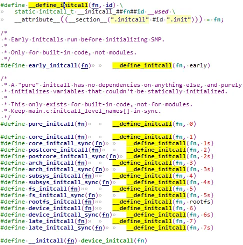
n是一个数字或者是数字+s，这个数字代表这个fn执行的优先级，数字越小，优先级越高，带s的fn优先级低于不带s的fn优先级。可以看到上面的从`pure_initcall`到`late_initcall`优先级依次变低。

这里`__attribute__((__section__(".initcall" #id ".init")))`表示编译时将目标符号放置在括号指定的段中。

举个例子，对`pure_initcall(test_init);`展开：

- 首先宏展开成：`__define_initcall(test_init, 0)`
- 然后接着展开：`static initcall_t __initcall_test_init0 = test_init;`这就是一个简单的变量定义。
- 同时声明`__initcall_test_init0这个变量`即使没被引用也保留符号，且将其放置在内核镜像的`.initcall0.init`段处。

在开发者添加 `xxx_initcall(fn)` 时，事实上是将`fn`放置到了 `".initcall##level##.init"` 的段中。

## 3.2 xxx_initcall修饰的函数怎么被调用

见`Linux-4.9.88\init\main.c`

### 3.2.1 do_initcalls
```c
start_kernel  
-> rest_init();  
    -> kernel_thread(kernel_init, NULL, CLONE_FS);  
        -> kernel_init()  
            -> kernel_init_freeable();  
                -> do_basic_setup();  
                    -> do_initcalls();
```

这个`do_initcalls()`就是我们需要寻找的函数了，在这个函数中执行所有使用`xxx_initcall()`声明的函数。

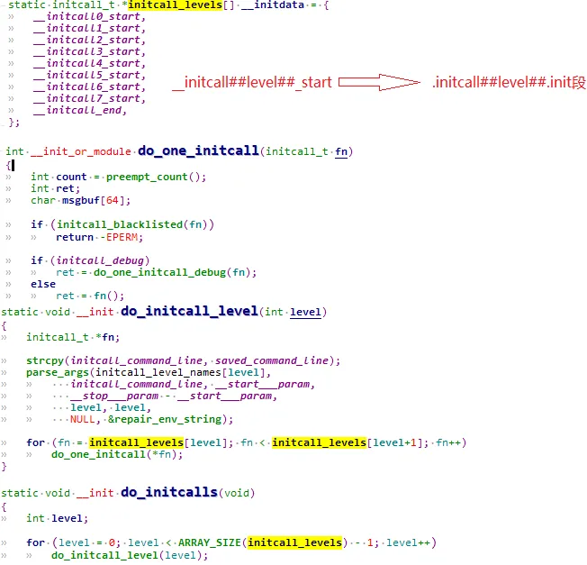
`do_initcalls()` 循环调用 `do_initcall_level(level)`，level就是 `initcall` 的优先级数字，由 for 循环的终止条件`ARRAY_SIZE(initcall_levels) - 1`可知，总共会调用8次。

而 `do_initcall_level(level)` 中则会遍历 `initcall_levels[level]` 中的每个函数指针，`initcall_levels[level]` 实际上是对应的`__initcall##level##_start` 指针变量，然后依次取出`__initcall##level##_start` 指向地址存储的每个函数指针，并调用 `do_one_initcall(*fn)`，实际上就是执行当前函数。

这个`__initcall##level##_start` 所存储的函数指针就是开发者用 `xxx_initcall()` 宏添加的函数，对应`".initcall_##level##.init"`段。

听起来很绕，举个例子：

比如有一个`core_initcall(beagle_init);`展开为`__define_initcall(beagle_init, 1)`，所以 `beagle_init()` 这个函数被放置在 `".initcall1.init"`段处。

再比如有一个`core_initcall(beagle2_init);`, 在 `".initcall1.init"`段就会增加一组函数。

那么`do_one_initcall(*fn)` 的执行：判断`initcall_debug`的值，如果为真，则调用 `do_one_initcall_debug(fn);` 如果为假，则直接调用`fn`。

事实上，调用`do_one_initcall_debug(fn)`只是在调用`fn`的基础上添加一些额外的打印信息，可以直接看成是调用`fn`。

可能有些C语言基础不太好的朋友不太理解 `do_initcall_level()` 函数中依次取出地址并执行的函数执行逻辑：
```c
for (fn = initcall_levels[level]; fn < initcall_levels[level+1]; fn++)  
    do_one_initcall(*fn);
```

`fn`为函数指针，`fn++`相当于函数指针+1，相当于：`内存地址+sizeof(fn)`，`sizeof(fn)`根据平台不同而不同，一般来说，32位机上是4字节，64位机则是8字节.

也就是在同等level下，会从同一个`".initcall_##level##.init"`段中依次取出对应的函数指针。  
也就是从`".initcall##level##.init"`段开始，每次取一个函数出来执行，并累加指针，直到取完（即到了下一个段的起始地址就表示取完了）。

#### 3.2.1.1 `__initcall##level##_start`与`.initcall##level##.init`段的关联

前面说了在开发者添加 `xxx_initcall(fn)` 时，事实上是将`fn`放置到了 `".initcall##level##.init"` 的段中。

在`do_initcall()`的时候，却是从`initcall_levels[level]`(即`__initcall##level##_start`指针)取出，那么

`initcall_levels[level]` 是怎么关联到`".initcall##level##.init"`段的呢？

在vmlinux.lds.h中：  
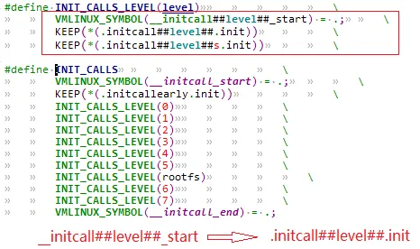
关联到`".initcallearly.init"`段。

然后对每个 level 定义了`INIT_CALLS_LEVEL(level)`，将`INIT_CALLS_LEVEL(level)`展开之后的结果是定义 `__initcall##level##_start`,并将`__initcall##level##_start`关联到 `".initcall##level##.init"` 段和`".initcall##level##s.init"`段。

到这里，`__initcall##level##_start` 和`".initcall##level##.init"`段的对应就比较清晰了，所以，从 `initcall_levels[level]` 部分一个个取出函数指针并执行函数就是执行`xxx_init_call()`定义的函数。

