# 1 内核链表

内核链表本质就是一个双向循环链表：

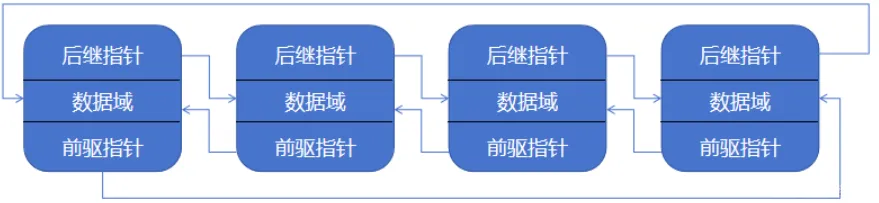
链表的实现仅用一个`include/linux/list.h`实现。

内核链表有别于传统链表就在节点本身不包含数据域，只包含指针域。故而可以很灵活的拓展数据结构。使用时包含在用户数据结构内部。

## 1.1 内核链表结构体
```c
struct list_head {  
   struct list_head *next, *prev;  
};
```

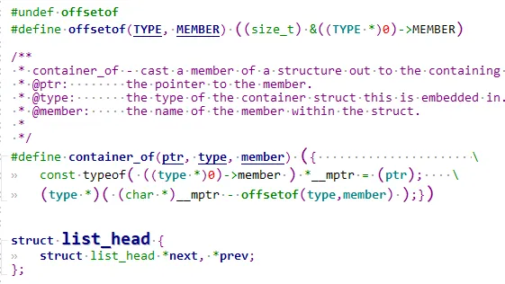
这里把内核经典的`container_of`和`offsetof`实现也贴进来了。实际上一般使用`container_of`，需要包含`include\linux\kernel.h`头文件。

## 1.2 list初始化

### 1.2.1 用宏初始化-LIST_HEAD
```c
#define LIST_HEAD_INIT(name) { &(name), &(name) }  
#define LIST_HEAD(name) \  
   struct list_head name = LIST_HEAD_INIT(name)
```

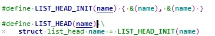
`LIST_HEAD` 定义一个`list_head`变量, 让`next，和prev`，也就是【前驱】和【后继】指针都指向自己，作为链表头指针。

例如：
```c
LIST_HEAD(list); // struct list_head list = {.next = list, .prev = list};
```

### 1.2.2 用接口初始化-INIT_LIST_HEAD

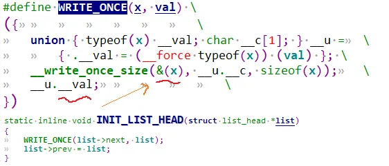
`INIT_LIST_HEAD`函数用来对一个list_head指针初始化。`WRITE_ONCE`是一种内存屏障机制，只写入一次， 防止并发产生竞态条件。

因此`INIT_LIST_HEAD`等效于：
```c
static inline void INIT_LIST_HEAD(struct list_head *list) {  
   list->next = list;  
   list->prev = list;  
}
```

例如：
```c
struct list_head list;  
INIT_LIST_HEAD(&list);
```

### 1.2.3 初始化完后头部节点图例

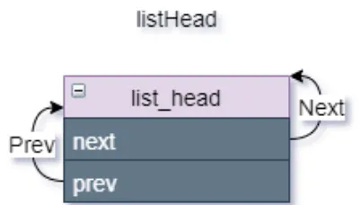
## 1.3 内核链表操作

### 1.3.1 插入节点

`list_add`总是在链表的头部插入, `list_add_tail`插在链表尾部。
```c
static inline void __list_add(struct list_head *new,  
			      struct list_head *prev,  
			      struct list_head *next)  
{  
	next->prev = new;  
	new->next = next;  
	new->prev = prev;  
	WRITE_ONCE(prev->next, new);  
}  
  
static inline void list_add(struct list_head *new, struct list_head *head)  
{  
	__list_add(new, head, head->next);  
}  
  
static inline void list_add_tail(struct list_head *new, struct list_head *head)  
{  
	__list_add(new, head->prev, head);  
}
```

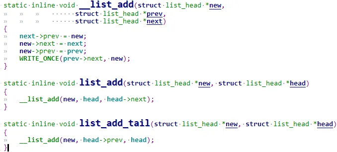
#### 1.3.1.1 创建一个节点
```c
struct my_data_list {  
    int data ;  
    struct list_head node;  
};  
  
struct my_data_list first_data = {   
    .val = 1,  
    .list = LIST_HEAD_INIT(first_data.node),//作为节点，其实可以不用初始化next和prev域  
};
```

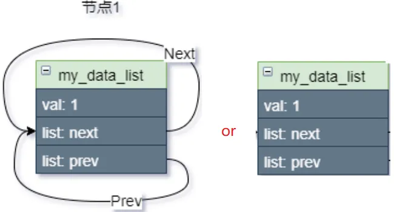
#### 1.3.1.2 头插节点-list_add

`list_add(&frist_data.node, &listHead);`

`list_add`总是在链表的头部插入,先看**插入第一个节点**:

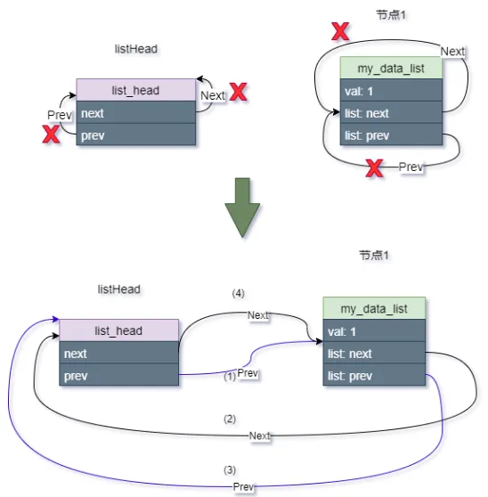
插入第一个节点，就是让`list_head`的`next`和`prev`都指向第一个节点，第一个节点的`next`和`prev`也都指向了`list_head`，构成一个单元素的环。

**再插入第二个节点**：

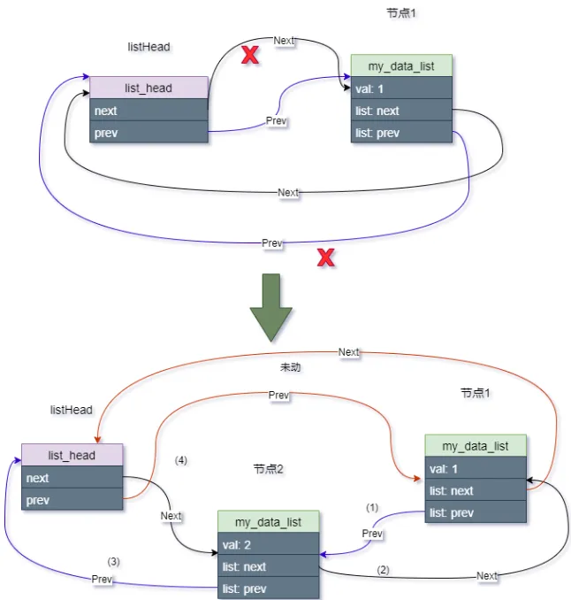
结合代码讲解：
```c
static inline void __list_add(struct list_head *new,  
			      struct list_head *prev,  
			      struct list_head *next)  
{  
	next->prev = new;  
	new->next = next;  
	new->prev = prev;  
	WRITE_ONCE(prev->next, new);  
}  
  
//我们把__list_add(new, head, head->next);带入进去得：  
{  
    head->next->prev  = new; //①  
    new->next = head->next; //②  
    new->prev = head;  //③  
    head->next = new;  //④  
}
```

①让节点1的prev指向节点2。

②让节点2的next指向节点1.

③让节点2的prev指向头节点。

④让头节点的next指向节点2。

##### 1.3.1.2.1 头插入的要点总结

**总结1**： head的next是指向链表中最新的节点，head的prev指向链表中最旧的节点。

**总结2**：`list_add`函数作为头插本质：

​ ①把链表头的next剪掉，next去指向新节点；但是得提前将旧节点的prev剪掉，旧节点prev也去指向新节点。注意为什么要先操作旧节点？因为旧节点就是`head->next`啊。

​ ②让新节点前驱prev指向head, 后继next指向旧节点。

**总结3**：头插遍历总是先访问到最新的元素，类似于`”栈stack“, ”先进后出“`。

#### 1.3.1.3 尾插节点-list_add_tail

`list_add_tail(&frist_data.node, &listHead);`

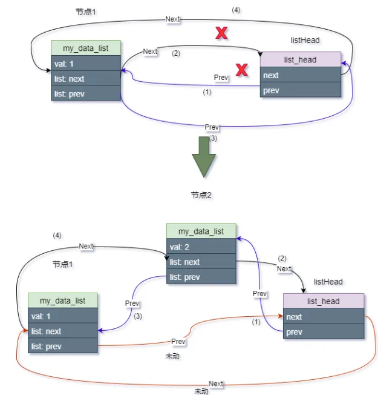
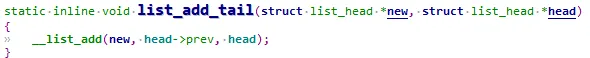
```c
static inline void __list_add(struct list_head *new,  
			      struct list_head *prev,  
			      struct list_head *next)  
{  
	next->prev = new;  
	new->next = next;  
	new->prev = prev;  
	WRITE_ONCE(prev->next, new);  
}  
//我们把__list_add(new, head->prev, head);带入进去得：  
{  
    head->prev  = new;       //①  
    new->next = head;        //②  
    new->prev = head->prev;  //③  
    head->prev->next = new;  //④  
}
```

①头节点的prev指向节点2。

②让节点2的next指向头节点.

③让节点2的prev指向头节点的prev。

④让节点1的next指向节点2。

##### 1.3.1.3.1 尾插入的要点总结

**总结1**： head的next是指向链表中最旧的节点，head的prev指向链表中最新的节点。

**总结2**：`list_add_tail`函数作为尾插本质：

​ ①先把链表头的prev剪掉，prev去指向新节点；最后把旧节点（尾节点）的next指向新节点。这样插入的就变成了新的尾节点。

​ ②同时让新节点的next指向head, prev指向旧节点(尾节点)。

**总结3**：尾插遍历总是先访问到旧的元素，类似于`”队列FIFO“, ”先进先出“`。

### 1.3.2 删除节点-list_del

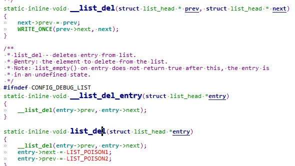
```c
static inline void __list_del(struct list_head * prev, struct list_head * next)  
{  
	next->prev = prev;  
	WRITE_ONCE(prev->next, next);  
}  
static inline void __list_del_entry(struct list_head *entry)  
{  
	__list_del(entry->prev, entry->next);  
}  
static inline void list_del(struct list_head *entry)  
{  
	__list_del(entry->prev, entry->next);  
	entry->next = LIST_POISON1;  
	entry->prev = LIST_POISON2;  
}
```

可以看到`list_del`和`__list_del_entry`没有本质区别，核心都是`__list_del`。举个例子比如：
```c
list_del(&frist_data.node);
```

非常好理解就不画图了，就是将下一个节点的prev指向前一个节点，同时反过来也要将前一个节点的next指向下一个节点。这个节点不就删除掉了。

注意：摘掉的节点prev、next 指针分别被设为 `LIST_POSITION2`和`LIST_POSITION1`两个特殊值，这样设置是为了保证不在链表中的节点项不可访问–对`LIST_POSITION1`和`LIST_POSITION2`的访问都将引起页故障。一访问就会立马出错，这样保证了数据安全性。来看下`LIST_POSITION1`和`LIST_POSITION2`, 在`include\linux\poison.h`:

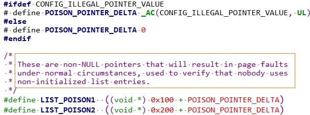
### 1.3.3 链表删除与反初始化-list_del_init

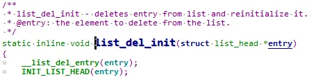
可以看到调用了`__list_del_entry`摘除自己这个节点，同时`INIT_LIST_HEAD`用接口初始化自己这个节点。

### 1.3.4 链表遍历

#### 1.3.4.0 list_entry

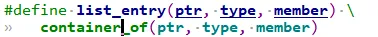
遍历的关键就是这个`list_entry` 宏。它等效于`container_of`。

#### 1.3.4.1 list_for_each(正向遍历)

作用：传入头节点，去遍历里面的node

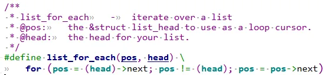
从`head->next`开始，也就是从第一个节点开始往后遍历，直到最后一个节点，这时pos就等于head了，循环结束。

#### 1.3.4.1 list_for_each_safe

下面这个`list_for_each_safe`， 多了一个tmp变量而已，提前用n去试探下一节点,安全情况下才赋给pos.

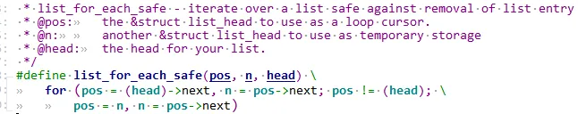
#### 1.3.4.2 list_for_each_entry

作用：传入头节点，去遍历里面的node所对应的外层宿主结构体。举个例子比较好理解：
```c
struct xxx_dev {  
    struct list_head job_list;  
    char name[64];  
    int irq;  
    ...  
};  
struct xxx_job {  
	atomic_t job_state;  
	struct list_head node;//add to xxx_dev job_list  
	atomic_t job_id;  
    ...  
};  
struct xxx_dev dev;  
struct xxx_job job;  
  
list_add_tail(&job->node, &dev->job_list);  
  
struct xxx_job *job_tmp;  
list_for_each_entry(job_tmp, &dev->job_list, node) {  
    //从链表中取出job_tmp，do someting  
}
```

首先定义一个链表`job_list`藏在`xxx_dev`里面，然后链表的节点宿主是`xxx_job`。

`list_add_tail`将`xxx_job`的`node`即可加入`xxx_dev`的`job_list`。

`list_for_each_entry`即可根据`xxx_job`的`node`成员取出宿主结构。

来分析一下`list_for_each_entry`函数：

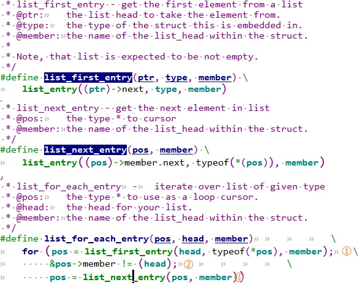
`list_for_each_entry(job_tmp, &dev->job_list, node)`那么首先进入for循环:

①代入`list_first_entry(&dev->job_list, typeof(*job_tmp), node)`

继续代入：看到了熟悉的`list_entry(&dev->job_list->next, typeof(*job_tmp), node)`，是不是就是对应第一个节点的宿主结构`xxx_job`地址。

那么pos(也就是`job_tmp`)就指向了第一个节点的宿主结构。

②判断node是否达到head（也就是看有没有遍历到最后一个节点）

③此时pos已经是第一个节点的宿主结构，继续代入`list_next_entry(第一个节点的宿主结构, node)`，看到了熟悉的`list_entry(第一个节点的宿主结构->member->next, typeof(*job_tmp), node)`,这不就是下一个节点的宿主结构嘛，赋值给pos。

#### 1.3.4.2 list_for_each_entry_safe

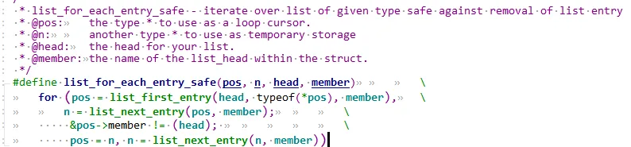
和前面的`list_for_each_entry`作用完全一样，可以看到实现也是基本一致。多了一个tmp变量而已，提前用n去试探下一节点,安全情况下才赋给pos.

#### 1.3.4.3 list_for_each_prev(反向遍历)

作用：传入头节点，反向去遍历里面的node

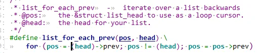
没什么好说的，和`list_for_each`相反方向遍历。

#### 1.3.4.3 list_for_each_prev_safe

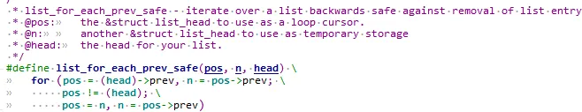
#### 1.3.4.4 list_for_each_entry_reverse

作用：传入头节点，反向去遍历里面的node所对应的外层宿主结构体。和`list_for_each_entry`方向相反。

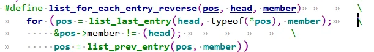
#### 1.3.4.4 list_for_each_entry_safe_reverse

和`list_for_each_entry_reverse`作用完全一样。

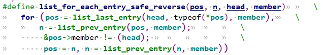
#### 1.3.4.5 list_for_each_entry_continue/list_for_each_entry_from(从中间某个节点开始遍历)

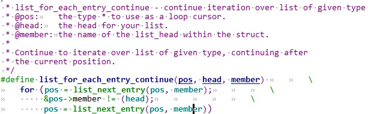
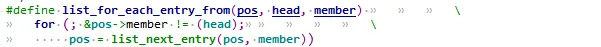
#### 1.3.4.5 list_for_each_entry_continue_reverse(从中间某个节点开始反向遍历)

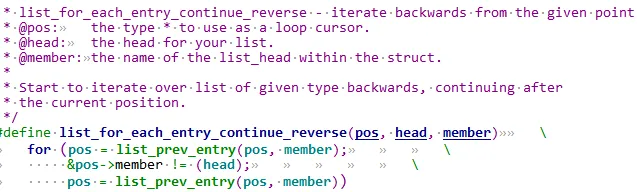
### 1.3.5 判段链表是否为空

#### 1.3.5.1 list_empty

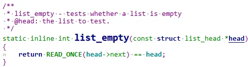
只要头节点的next还是自己，那就代表链表为空。

### 1.3.6 判段节点是否为最后一个节点

#### 1.3.6.1 list_is_last

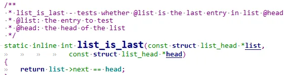
只要传入的节点的next为头节点，那就是最后一个节点。

### 1.3.7 获取第一个节点的宿主结构

#### 1.3.7.1 list_first_entry/list_first_entry_or_null

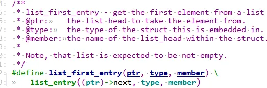
```c
struct xxx_job *job_tmp;  
job_tmp = list_first_entry(&dev->job_list, typeof(*job_tmp), node)
```

前面`1.3.4.2 list_for_each_entry`小节其实已经分析过了，取出第一个节点的宿主结构指针。

下面这个`list_first_entry_or_null`多了一个判空，如果空链表，则会返回null。

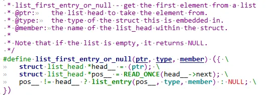
### 1.3.8 获取最后一个节点的宿主结构

#### 1.3.8.1 list_last_entry/list_first_entry_or_null

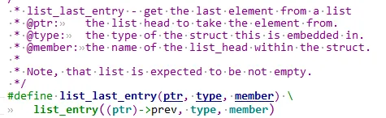
头节点的prev不就对应对应最后一个节点嘛。然后`list_entry`找到宿主结果。

### 1.3.9 获取上一个节点的宿主结构

#### 1.3.9.1 list_prev_entry

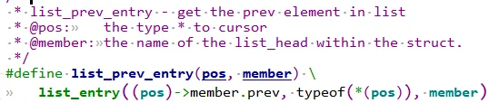
传入某个节点取prev不就是上一个节点嘛，然后`list_entry`找到宿主结果。

### 1.3.10 获取下一个节点的宿主结构

#### 1.3.10.1 list_next_entry


传入某个节点取next不就是下一个节点嘛，然后`list_entry`找到宿主结果。

## 1.4 内核链表进阶操作

### 1.4.1 节点从A链表转移到B链表

#### 1.4.1.1 搬移到新链表头-list_move

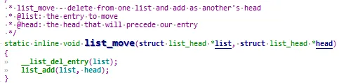
可以看到就是从旧链表摘除节点，再头插到新链表。

#### 1.4.1.2 搬移到新链表尾-list_move_tail

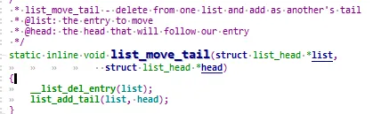
可以看到就是从旧链表摘除节点，再尾插到新链表。

### 1.4.2 链表A和链表B合并-list_splice

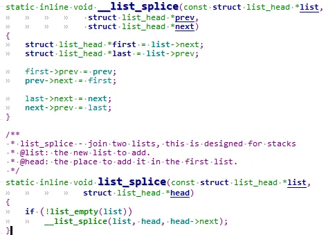
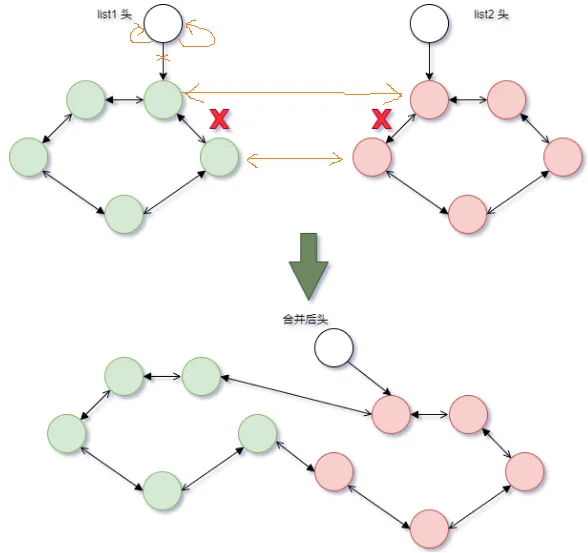
分析：`list_splice(list1, list2);`

带入：`__list_splice(list1, list2, list2->next)`，那么：
```c
first = list1->next;  
last = list1->prev;  
  
list1->next = list2;  
list2->next = list1->next;  
  
list1->prev->next = list2->next;  
list2->next->prev = list1->prev;
```

最后最好是将还要list1进行反初始化，这样list1才彻底和各个节点断链，比如`list_splice_init`函数：

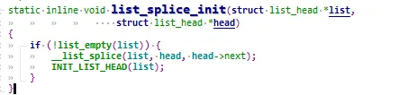
### 1.4.3 节点的替换-list_replace

`list_replace`：将新的节点替换到旧的节点上。

`list_replace_init`：将新的节点替换到旧的节点上。同时将旧的节点的prev和next指向自己，反初始化。

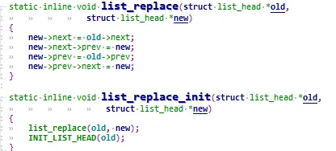
```c
static inline void list_replace(struct list_head *old,  
				struct list_head *new) {  
    new->next = old->next;//①  
    new->next->prev = new;//②  
    new->prev = old->prev;//③  
    new->prev->next = new;//④  
}
```

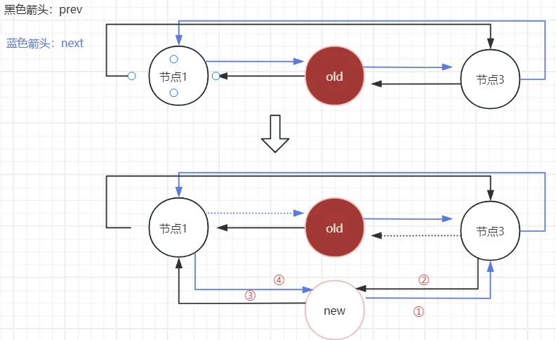
可以看到虽然替换成功了，但是old还是有指向关系，我们再对old进行`INIT_LIST_HEAD(old);`断掉old的指向关系，也就是对应`list_replace_init`函数：

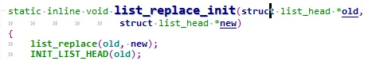
old断链后图像那么最后就会变成：

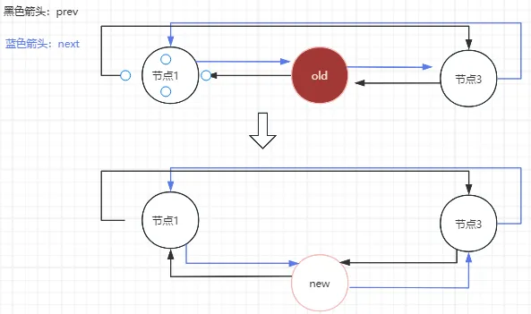
# 2 内核链表总结

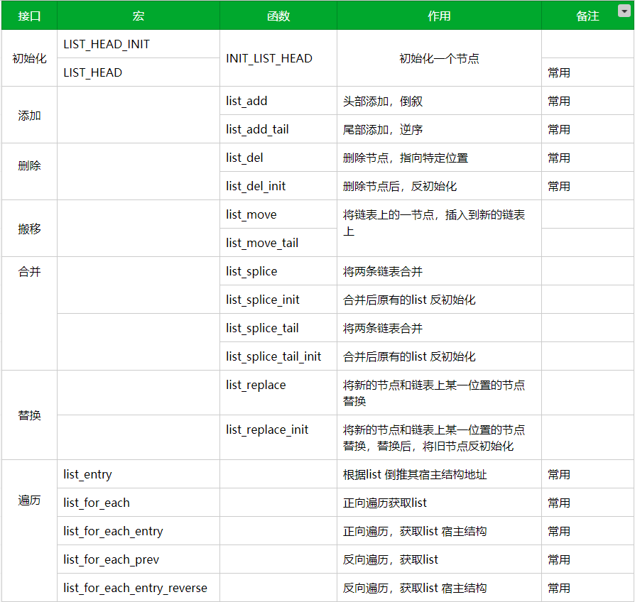
