# 1 kmalloc/vmalloc区别

|函数|位置|特性|大小限制|
|---|---|---|---|
|kmalloc|物理内存映射区域|物理地址虚拟地址均连续|不能超过128K|
|kzalloc|物理内存映射区域|物理地址虚拟地址均连续|不能超过128K|
|vmalloc|虚拟内存映射区域|虚拟地址连续，物理地址不一定连续|无限制|
|vzalloc|虚拟内存映射区域|虚拟地址连续，物理地址不一定连续|无限制|

kzalloc只是相当于附加了 **__GFP_ZERO** 标志。所以它除了申请内核内存外，还会对申请到的内存内容清零。  
同理，vzalloc也是一样，会对申请内存内容清零。  

## 1.1 kmalloc函数原型：

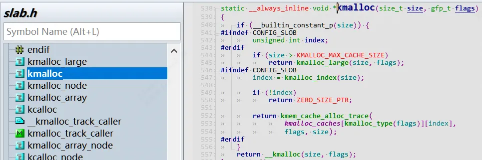
```c
static __always_inline void *kmalloc(size_t size, gfp_t flags)；
```

### 1.1.1 gpf flags含义
```c
|– 在进程上下文，可以睡眠　　　　　GFP_KERNEL  
 |– 在进程上下文，不可以睡眠，如： GFP_ATOMIC  
 |　　|– 中断处理程序　　　　　　　GFP_ATOMIC  
 |　　|– 软中断　　　　　　　　　　GFP_ATOMIC  
 |　　|– Tasklet　　　　　　　　　GFP_ATOMIC  
 |– 用于DMA的内存，可以睡眠　　　GFP_DMA | GFP_KERNEL  
 |– 用于DMA的内存，不可以睡眠　　GFP_DMA |GFP_ATOMIC
```

如果进程上下文允许睡眠情况下尽量用`GFP_KERNEL`， 如果进程上下文禁止休眠的话（如中断，taskletd等）必须用`GFP_ATOMIC`

## 1.2 vmalloc函数原型：

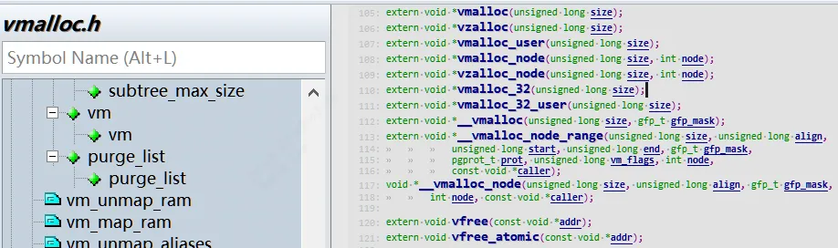
```c
extern void *vmalloc(unsigned long size);
```

注意：vmalloc和vfree可以睡眠，因此中断上下文禁止使用。

## 1.3 内存释放
```c
void kfree(const void *);  
extern void vfree(const void *addr);
```

# 2 kmalloc/vmalloc内存分配原理

参考[11-1. linux内核内存管理](../%E5%AE%8B%E5%AE%9D%E5%8D%8E%E9%A9%B1%E5%8A%A8%E5%BC%80%E5%8F%91%E8%AF%BB%E4%B9%A6%E7%AC%94%E8%AE%B0/11-1.%20linux%E5%86%85%E6%A0%B8%E5%86%85%E5%AD%98%E7%AE%A1%E7%90%86/)

# 3 CMA介绍

## 3.0 引入Linux内核Buddy系统

Linux伙伴系统`(Buddy)`使用 Page 粒度来管理内存，每个页面大小为4K。伙伴系统按照空闲内存块的长度，把内存挂载到不同长度的 `free_list`链表中。`free_list` 的单位是以 (`2^order个Page`) 来递增的，即 `1 page、2 page、… 2^n`，通常情况下最大 order 为10 对应的空闲内存大小为 4M bytes。我们使用伙伴系统来申请连续的物理页面最大的页面为4M bytes。

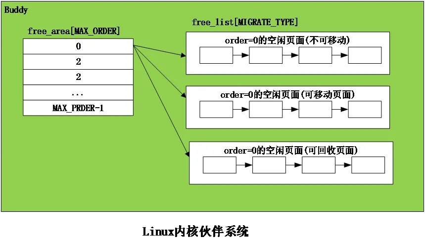
当系统内存碎片化严重的时候，也很难分配到高order的页面，这时就引入了CMA概念，接着往下看。

## 3.1 CMA概述

连续内存分配器（`Contiguous Memory Allocator`），简称CMA。在系统长时间运行后，内存可能碎片化，很难找到连续的物理页，CMA很好的避免了这个问题。  
举个例子：  
手机上1300万像素的摄像头，一个像素占用3字节，拍摄一张照片需要大约37MB内存。在系统长时间运行后，内存可能碎片化，很难找到连续的物理页，页分配器（kmalloc）和块分配器(vmalloc)很可能无法分配这么大的连续内存块。

方案1：  
最开始的一种解决方案是使用内存池`mempool`为设备保留一块大的内存区域，比如为摄像头驱动预留一块大内存，通过ioremap来映射后作为私有内存使用，缺点是：当设备驱动不使用的时候（大多数时间手机摄像头是空闲的），内核的其他模块不能使用这块内存。  
方案2：  
连续内存分配器CMA很好的解决了这个问题，保留一块大的内存区域，当设备驱动不使用的时候，内核的其他模块可以使用。一般我们把这块区域定义为`reserved-memory`。  

## 3.2 CMA内核使能

编译内核时需要开启以下配置宏：  
（1）配置宏CONFIG_CMA，启用连续内存分配器。  
（2）配置宏CONFIG_CMA_AREAS，指定CMA区域的最大数量，默认值是7。  
（3）配置宏CONFIG_DMA_CMA，启用允许设备驱动分配内存的连续内存分配器

## 3.3 CMA的定义

CMA每个区域实际上就是一个`reserved memory`。CMA分两种:
1. 通用的CMA区域，该区域是给整个系统分配使用的;如下面的`"linux,cma"`
2. 专用的CMA区域，这种是专门为单个模块定义的。如下面的`"ion”`

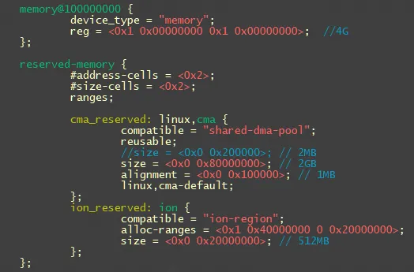

dts中CMA属性：
```c
1. reusable:表示当前的内存区域除了被dma使用之外，还可以被内存管理(buddy)子系统reuse。  
2. no-map:表示是否需要创建页表映射，对于通用的内存，必须要创建映射才可以使用，共享CMA是可以作为通用内存进行分配使用的，因此必须要创建页表映射。  
3. 对于共享的CMA区域，需要配置上linux,cma-default属性，标志着它是共享的CMA。  
4. alignment：对齐参数，保留内存的起始地址需要向该参数对齐  
5. alloc-ranges：指定可以用来申请动态保留内存的区间
```

下面定义了3段区域CMA:  
1.全局CMA区域，节点名称是`“linux,cma”`，大小是2GB，8K对齐。配置上`linux,cma-default`属性,reusable属性。  
2.私有CMA区域，节点名字`“de_mem0” “de_mem1”`，128M给GPU 2D engine使用，私有无需建立页表映射。  
3.私有CMA区域，节点名字`“ion”`，给video pipeline使用，私有无需建立页表映射。  
​ 2de模块中定义memory-region属性，并且把对应dts定义的cma节点de_reserved0，de_reserved1传递给该模块。
```c
reserved-memory {  
        #address-cells = <0x2>;  
        #size-cells = <0x2>;  
        ranges;  
        cma_reserved: linux,cma {  
                compatible = "shared-dma-pool";  
                reusable;//表示 cma 内存可被 buddy 系统使用  
                size = <0x0 0x80000000>; // 2GB  
                alignment = <0x0 0x2000>; // 8KB  
                linux,cma-default;  
        };  
        de_reserved0: de_mem0 {  
                        reg = <0x1 0x10000000 0x0 0x8000000>; // 128M, for 2de  
                        no-map;  
        };  
        de_reserved1: de_mem1 {  
                        reg = <0x1 0x18000000 0x0 0x8000000>; // 128M, for 2de  
                        no-map;  
        };  
        ion_reserved: ion {  
                compatible = "ion-region";  
                size = <0x0 0x04000000>; // 64MB  
        };  
        vo_2de0 {  
                compatible = "sophgo,vg-lite0";  
                memory-region = <&de_reserved0>;  
                interrupt-parent = <&gic>;  
                interrupts = <GIC_SPI 27 IRQ_TYPE_LEVEL_HIGH>;  
                interrupt-names = "vo_2de0";  
        };  
        vo_2de1 {  
                compatible = "sophgo,vg-lite1";  
                memory-region = <&de_reserved1>;  
                interrupt-parent = <&gic>;  
                interrupts = <GIC_SPI 28 IRQ_TYPE_LEVEL_HIGH>;  
                interrupt-names = "vo_2de1";  
        };
```

## 3.5 CMA内存原理和流程

设备驱动程序不能直接使用CMA，而是调用DMA映射框架来使用连续内存分配器CMA。

### 3.5.1 CMA调用层次框架

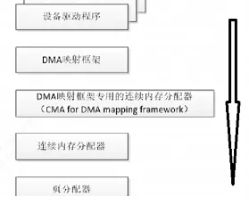
1. 最底层为`页分配器（以后分析）`。
2. cma_alloc用来从CMA区域分配页，cma_release用来释放从CMA区域分配的页。
3. 第3层为DMA映射框架专用的连续内存分配器，简称DMA专用连续内存分配器，提供的接口`dma_alloc_from_contiguous`用来从CMA区域分配页，接口`dma_release_from_contiguous`用来释放从CMA区域分配的页。
4. 第4层就是DMA通用映射框架，供驱动程序调用`dma_alloc_coherent`和`dma_alloc_noncoherent`用来分配内存，接口`dma_free_coherent`和`dma_free_noncoherent`用来释放内存。

### 3.5.2 CMA结构体
```c
// mm/cma.h  
struct cma {  
	 unsigned long    base_pfn; //该CMA区域的起始页帧号  
	 unsigned long    count; //该cma区域的页数  
	 unsigned long    *bitmap; //位图，每个位描述对应的页的分配状态，0表示空闲，1表示已分配  
	 unsigned int order_per_bit;//页阶数对应的位偏移预计算值，唯一目的是快速计算 CMA 内存块的位图掩码(mask)
	 struct mutex     lock;  
	 const char *name;  
};  
  
// mm/cma.c  
struct cma cma_areas[MAX_CMA_AREAS];//定义多个CMA区域。  
unsigned cma_area_count;//表示实际使用的cma区域数量
```

cma模块使用bitmap来管理其内存的分配，0表示free，1表示已经分配。

CMA 把大块连续内存按「页阶数（order）」拆分管理：

- 内存页阶数 `order`：表示连续页的数量，公式为 `2^order` 个物理页（比如 `order=3` 对应 8 个连续页）；
- CMA 管理的内存块会按不同 `order` 分组，`order_pre_bit` 是这个分组逻辑的核心辅助字段。

`order_per_bit`表示阶数对应的位偏移预计算值，它的唯一目的是**快速计算 CMA 内存块的"位图掩码(mask)"**，用于：

- 标记 CMA 内存块中「可用 / 已分配」的**连续页区间**；
- 快速判断某段连续内存是否符合目标 `order` 的分配要求。

其计算公式为：
```
order_pre_bit = BITS_PER_LONG - 1 - order; //`BITS_PER_LONG` 是内核长整型的位数（32 位系统 = 32，64 位系统 = 64）
```

其作用的关键代码逻辑（简化版）：

```
// 计算对应 order 的掩码
unsigned long mask = (1UL << (1UL << order)) - 1;
// 通过 order_pre_bit 移位，得到内存块的位掩码
mask <<= order_pre_bit;

// 实际用途：检查 CMA 位图中是否有连续的 2^order 个页可用
if ((cma_bitmap & mask) == 0) {
    // 该区间可用，分配连续内存
}
```

### 3.5.3 CMA区域初始化

#### 3.5.3.0 整个memory初始化
```c
start_kernel  
    ------>setup_arch  
        ------>setup_machine_fdt  
            ------>early_init_dt_scan_nodes  
                ------>of_scan_flat_dt  
                    ------>early_init_dt_scan_memory  
                        ------>early_init_dt_add_memory_arch  
                            ------>memblock_add
```

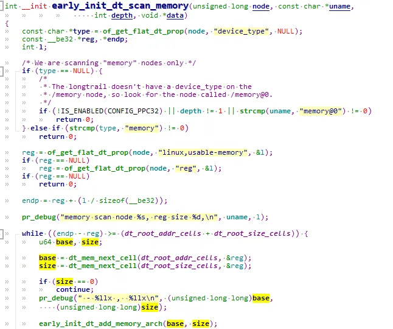
#### 3.5.3.1 dts描述中cma内存的初始化

linux内核首先需要解析dtb中节点`“memory”`，把内存块添加到`memblock`的memory类型，memory类型保存内存块的物理地址范围，reserved类型保存保留内存块的物理地址范围，CMA区域就属于保留内存块。  

创建CMA区域的执行流程如下所示：  
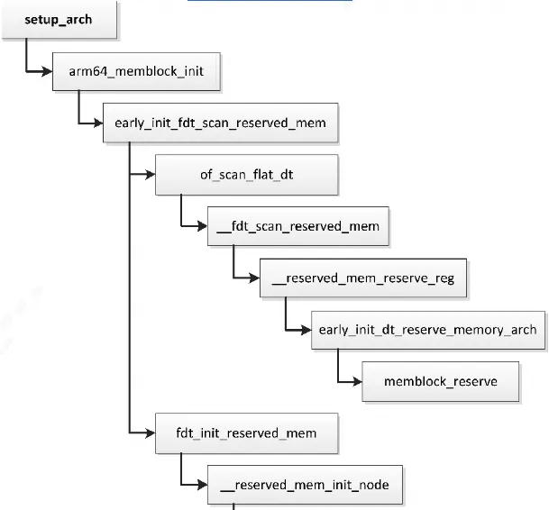
```c
start_kernel  
    ------>setup_arch  
        ------>arm_memblock_init  
            ------>early_init_fdt_scan_reserved_mem  
                ------>of_scan_flat_dt  
                     ------> __fdt_scan_reserved_mem  
                        ------> fdt_init_reserved_mem  
                            ------> memblock_add
```

linux内核启动时，当调用到`__reserved_mem_init_node`时会调用所有使用`RESERVEDMEM_OF_DECLARE`声明的CMA区域。

`__reserved_mem_init_node`会遍历`__reservedmem_of_table section`中的内容，检查到dts中有compatible匹配（CMA这里为“shared-dma-pool”）就进一步执行对应的`initfn`。通过`RESERVEDMEM_OF_DECLARE`定义的都会被链接到`__reservedmem_of_table`这个section段中，最终会调到使用`RESERVEDMEM_OF_DECLAR`E定义的函数:

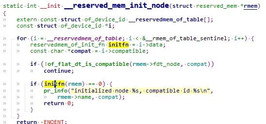
其中全局CMA区域的初始化函数是`rmem_cma_setup`：

##### 3.5.3.1.1 全局cma内存初始化rmem_cma_setup

`rmem_cma_setup`的作用就是将`reserved-memory`添加到cma子系统：

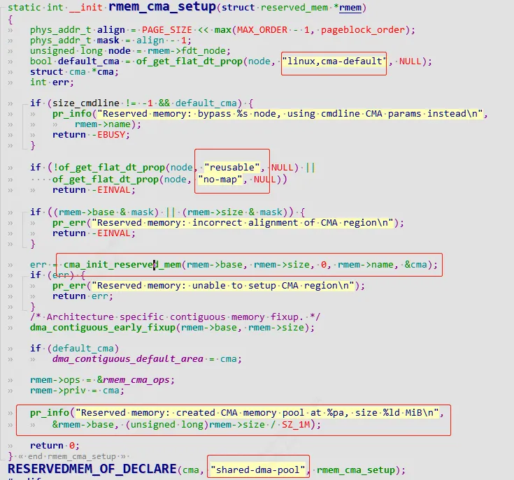
```c
rmem_cma_setup  
    |------>cma_init_reserved_mem       // 将reserved-memory 添加到cma_areas数组中  
    |------>dma_contiguous_early_fixup// dma remap  
    |------>dma_contiguous_set_default// set_default cma area
```

###### 3.5.3.1.1.1 cma_init_reserved_mem

来看调用的cma_init_reserved_mem：  
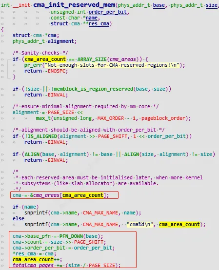
从数组`cma_areas`分配一个数组项，保存CMA区域的起始页帧号和页数。dts指定了属性`“linux,cma-default”`，那么这个CMA区域是默认的CMA区域，最后设置全局变量`dma_contiguous_default_area`指向这个CMA区域(默认全局CMA区域)  
红色圈出了该cma区域的dts描述和dts是不是完全吻合。

#### 3.5.3.2 dts没有描述cma内存的初始化

如果内核参数或配置宏配置全局CMA区域，cma初始化则流程如下所示：  
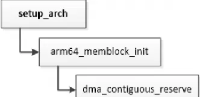
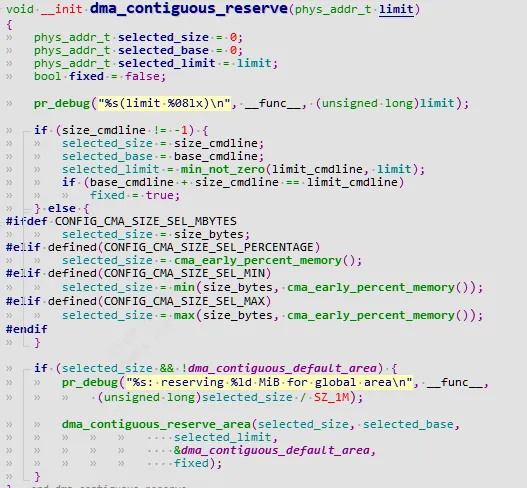
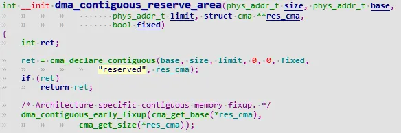
### 3.5.4 CMA 区域内存映射

CMA 区域创建初始化完后还不能直接使用，需要单独进行页表映射。

[Linux内核启动流程](Linux%E5%86%85%E6%A0%B8%E5%90%AF%E5%8A%A8%E6%B5%81%E7%A8%8B/)有介绍start_kernel启动流程。
```c
start_kernel  
    ------>setup_arch  
        ------>paging_init//建立页表映射，包括非保留内存和保留内存。  
            ------>dma_contiguous_remap
```

#### 3.5.4.1 dma_contiguous_remap-建立cma area的页表映射

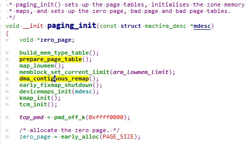
`prepare_page_table`负责普通内存的页表映射。`dma_contiguous_remap`建立`cma area`的页表映射:

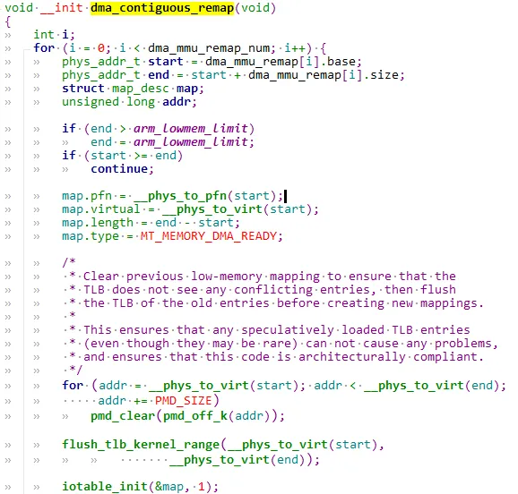
### 3.5.5 cma_init_reserved_areas-激活cma area内存

`cma_activate_area`函数用于将 CMA 区域内的预留页全部释放添加到 Buddy 管理器内，然后激活 CMA 区域供系统使用。

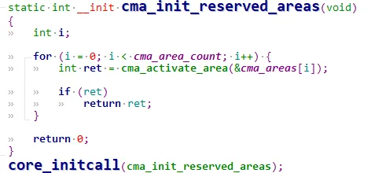
#### 3.5.5.1 cma_activate_area

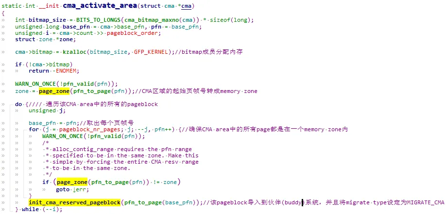
##### 3.5.5.1.1 init_cma_reserved_pageblock

cma默认是从`reserved memory`中分配的，通常情况这块内存是直接分配并预留不做任何使用，无形之中造成了浪费。所以在不用的时候放入伙伴系统，作为普通内存使用。

# 4 CMA内存使用
```c
struct page   *page = NULL;  
page = cma_alloc(dev_get_cma_area(dev)，mem_size, 0, false);
```

`dev_get_cma_area`可以获取对应的cma handler，如果获取不到，比如对应模块中并未定义memory-region，那么就会返回共享的`cma handler`，还记的上面的 `linux,cma-default`属性吗，共享cma区域会被作为缺省cma来使用。

## 4.1 dma_alloc_from_contiguous

## 4.2 dma_release_from_contiguous

不过一般内核模块要使用CMA内存时，使用的接口依然是dma的接口：
```c
extern void *dma_alloc_coherent(struct device *dev, size_t size, dma_addr_t *dma_handle, gfp_t flag);  
extern void dma_free_coherent(struct device *dev, size_t size, void *cpu_addr, dma_addr_t dma_handle);
```

最终也会进入`dma_alloc_from_contiguous`调用`cma_alloc`分配内存。
```c
struct page *dma_alloc_from_contiguous(struct device *dev, size_t count,  
	unsigned int align, bool no_warn)  
{  
	if (align > CONFIG_CMA_ALIGNMENT)  
		align = CONFIG_CMA_ALIGNMENT;  
	return cma_alloc(dev_get_cma_area(dev), count, align, no_warn);  
}  
  
bool dma_release_from_contiguous(struct device *dev, struct page *pages,  
	 int count)  
{  
	return cma_release(dev_get_cma_area(dev), pages, count);  
}
```

```c
/**  
 * cma_alloc() - allocate pages from contiguous area  
 * @cma:   Contiguous memory region for which the allocation is performed.  
 * @count: Requested number of pages.  
 * @align: Requested alignment of pages (in PAGE_SIZE order).  
 * @no_warn: Avoid printing message about failed allocation  
 *  
 * This function allocates part of contiguous memory on specific  
 * contiguous memory area.  
 */  
struct page *cma_alloc(struct cma *cma, size_t count, unsigned int align,  
			   bool no_warn);  
extern void *dma_alloc_coherent(struct device *dev, size_t size, dma_addr_t *dma_handle, gfp_t flag);  
extern void dma_free_coherent(struct device *dev, size_t size, void *cpu_addr, dma_addr_t dma_handle);  
struct page *dma_alloc_from_contiguous(struct device *dev, size_t count,  
	unsigned int align, bool no_warn);  
bool dma_release_from_contiguous(struct device *dev, struct page *pages,  
	 int count);
```

## 4.3 cma_alloc

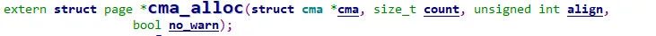
从指定的CMA 区域上分配count个连续的页面，按照align对齐。

## 4.4 cma_release

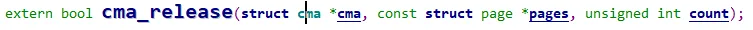
释放已经分配count个连续的页面。
```c
/**  
 * cma_release() - release allocated pages  
 * @cma:   Contiguous memory region for which the allocation is performed.  
 * @pages: Allocated pages.  
 * @count: Number of allocated pages.  
 *  
 * This function releases memory allocated by cma_alloc().  
 * It returns false when provided pages do not belong to contiguous area and  
 * true otherwise.  
 */  
bool cma_release(struct cma *cma, const struct page *pages, unsigned int count)；
```

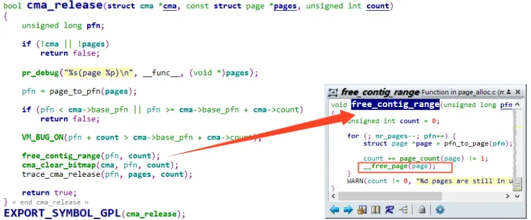
# 5 通过procfs查看cma area

## 5.1 获得ram地址范围

第一个比较重要的是获得系统物理内存的范围：
```c
$ cat /proc/iomem   
10000000-17ffffff : System RAM  
  10008000-107fffff : Kernel code  
  10900000-10960677 : Kernel data  
40002000-4000201f : serial  
4000a000-4000a01f : codec@4000a000  
40010000-40011fff : i2c0@40010000  
40014000-4001401f : serial  
40016000-4001601f : serial  
40020000-40021fff : i2c2@40020000  
4003a000-4003a01f : wdt0@4003a000  
40056000-40056fff : video0@40056000  
4005a000-4005bfff : dma0@4005a000  
40064000-40064fff : video1@40064000  
40068000-40069fff : dma1@40068000  
4006a000-4006a1ff : lsacc2d@4006a000  
40080000-40081fff : clock@40080000  
40082000-40082027 : msgunit@40082000  
400a0000-400a00ff : mmc0@400a0000  
400aa000-400aa1ff : gauss@400aa000
```

 **“System RAM”**代表系统物理内存的起始物理地址和终止物理地址。

## 5.2 获得reserved-memory范围
```c
$ cat /sys/kernel/debug/memblock/reserved   
   0: 0x10004000..0x10007fff  
   1: 0x10100000..0x10960677  
   2: 0x12000000..0x127fffff  
   3: 0x1579b000..0x157a1fff  
   4: 0x17ea1cc0..0x17eb9fc3  
   5: 0x17eba000..0x17ee0fff  
   6: 0x17ee3180..0x17ee347f  
   7: 0x17ee34b0..0x17ffefff  
   8: 0x17fff100..0x17fff177  
   9: 0x17fff180..0x17fff1c4  
  10: 0x17fff200..0x17fff23b  
  11: 0x17fff240..0x17fff3c3  
  12: 0x17fff400..0x17fff5c4  
  13: 0x17fff600..0x17fff677  
  14: 0x17fff680..0x17fff68b  
  15: 0x17fff6c0..0x17fff6cb  
......
```

通过这个命令可以知道系统已预留的内存信息，这些已预留的内存信息不可使用。

# 6 dts的reserved-memory内容解析

通常使用memory-region将设备和reserved memory 关联起，cvifb 通过 memory-region 关联到 fb_reserved 这块 reserved memory 上面.  
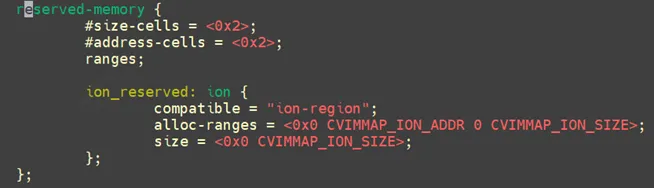
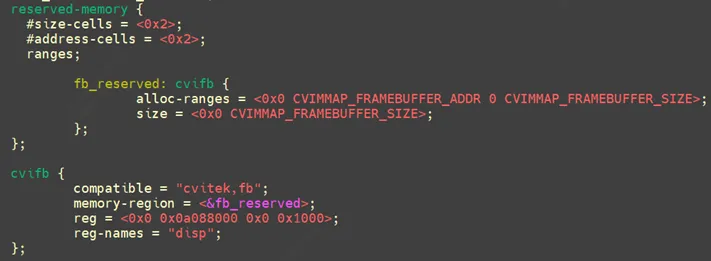
通过`cvifb`节点的`memory-region`属性找到`reserved-memory`，`of_reserved_mem_lookup`根据关联的`reserved-momory`节点找到预留内存地址.  
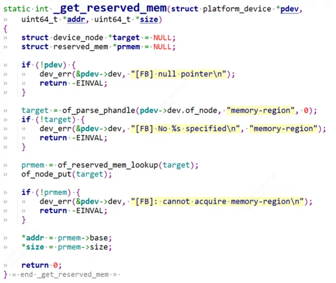
