# 1 pwm子系统框架

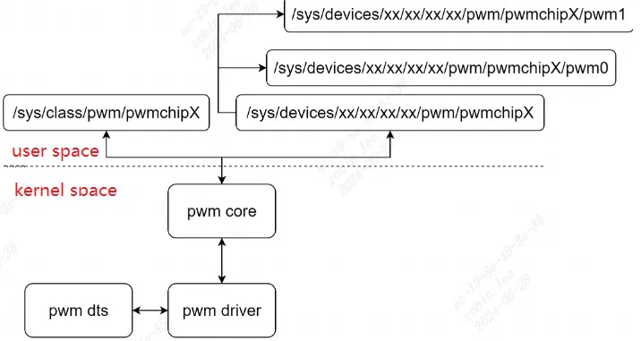
用户态：基于sysfs操作pwm

内核态分为：
```c
pwm core：pwm_chip的添加删除，pwm_class类pwm_chip/pwm_device的sysfs创建。  
  
pwm driver：pwm_chip对象实例，注册添加到pwm core。  
	pwm_chip可以包含一个或多个pwm_device，每个pwm_device通过设置不同pwm_state来达到目的。
```

## 1.1 源码结构
```c
drivers/pwm/  
	core.c //pwm子系统核心。  
	sysfs.c//pwm子系统的pwm_class注册，pwm_chip属性，pwm_device属性等定义。  
	pwm-imx.c//imx的pwm_chip驱动。
```

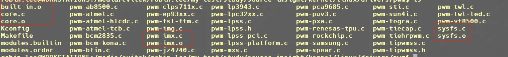
我已经编译进`vmlinux`了，可以看到`built-in.o`。`Makefile`如下：

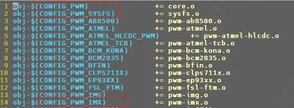
`Kconfig`如下，我的内核`.config`配置选中了`PWM和PWM_IMX`，因此编译进了内核镜像。

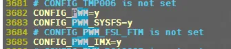
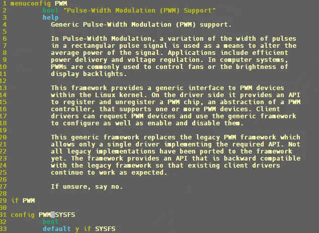
## 1.2 数据结构

### 1.2.1 `pwm_chip`

是对一个pwm控制器的抽象。
```c
struct pwm_chip {  
    struct device *dev;  
    const struct pwm_ops *ops;  
    int base;  
    unsigned int npwm;//pwm控制器的pwm数量。  
    struct pwm_device * (*of_xlate)(struct pwm_chip *pc,  
                    const struct of_phandle_args *args);  
    unsigned int of_pwm_n_cells;  
    /* only used internally by the PWM framework */  
    struct list_head list;  
    struct pwm_device *pwms;  
}; //include/linux/pwm.h
```

### 1.2.2 `pwm_ops`

pwm控制器的操作接口。
```c
struct pwm_ops {  
	int (*request)(struct pwm_chip *chip, //请求 PWM  
	struct pwm_device *pwm);  
	void (*free)(struct pwm_chip *chip, //释放 PWM  
	struct pwm_device *pwm);  
	int (*config)(struct pwm_chip *chip, //配置 PWM 周期和占空比  
	struct pwm_device *pwm,  
	int duty_ns, int period_ns);  
	int (*set_polarity)(struct pwm_chip *chip, //设置 PWM 极性  
	struct pwm_device *pwm,  
	enum pwm_polarity polarity);  
	int (*enable)(struct pwm_chip *chip, //使能 PWM  
	struct pwm_device *pwm);  
	void (*disable)(struct pwm_chip *chip, //关闭 PWM  
	struct pwm_device *pwm);  
	struct module *owner;  
};
```

### 1.2.3 `pwm_state`

pwm_state就是控制占空比控制转速，亮度参数。
```c
struct pwm_state {  
    unsigned int period; //pwm的周期，单位ns。  
    unsigned int duty_cycle; //占空比duty_cycle，单位ns。  
    enum pwm_polarity polarity;//PWM_POLARITY_NORMAL表示高电平持续duty_cycle，  
    //然后是低电平持续剩余时间。PWM_POLARITY_INVERSED表示低电平持续duty_cycle，然后是高电平持续剩余时间。  
    bool enabled; //是否使能  
};
```

## 1.3 API

api声明见`linux\include\linux\pwm.h`，实现`linux\drivers\pwm\core.c`

### 1.3.1 `pwmchip_add`

向`pwm`子系统注册一个`pwm_chip`。

`int pwmchip_add(struct pwm_chip *chip);`
```c
pwmchip_add  
	pwmchip_add_with_polarity  
		->pwm_ops_check   //检查pwm_ops是否支持apply等。  
		->alloc_pwms     //为pwm_chip的pwm_device分配allocated_pwms。  
		->//初始化每个pwm_device，并加入pwm_tree。  
		->pwmchip_sysfs_export  
			->pwmchip_sysfs_export //创建pwm_class类设备pwmchpX，位于/sys/class/pwm/pwmchipX。
```

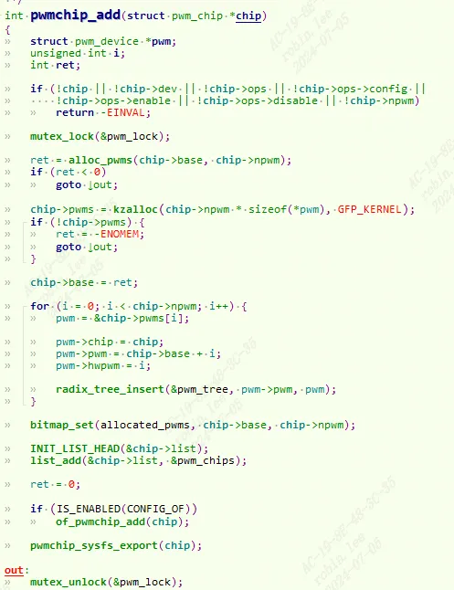
### 1.3.2 `pwmchip_remove`

`int pwmchip_remove(struct pwm_chip *chip);`

删除一个`pwm_chip`。

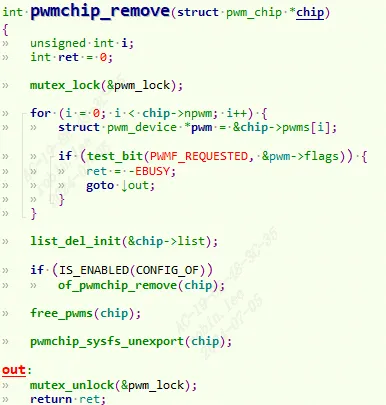
### 1.3.3 pwm_request

请求 PWM。

`struct pwm_device *pwm_request(int pwm, const char *label)`

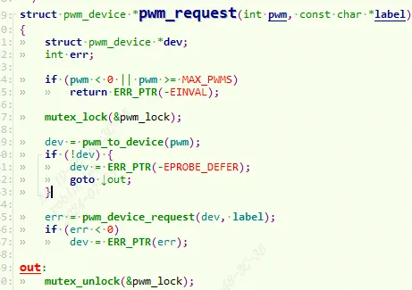
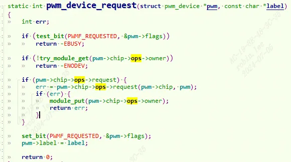
可以看到就是调用具体pwm示例的request函数。

### 1.3.4 pwm_free

释放 PWM。

`void pwm_free(struct pwm_device *pwm)`

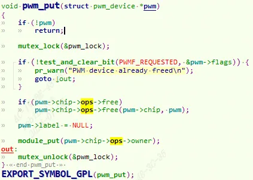
### 1.3.5 `pwm_config`

配置 PWM 周期和占空比,操作具体pwm实例。

`int pwm_config(struct pwm_device *pwm, int duty_ns, int period_ns)`

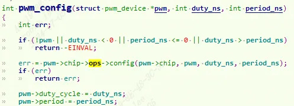
### 1.3.6 `pwm_set_polarity`

设置 PWM 极性。

`int pwm_set_polarity(struct pwm_device *pwm, enum pwm_polarity polarity)`

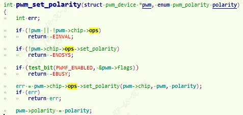
### 1.3.6 pwm_enable

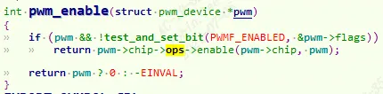
### 1.3.7 pwm_disable

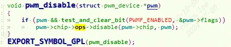
从`1.3.3`到`1.3.7`本质都是调用`pwm_ops`。

# 2 pwm驱动实例

`I.MX6ULL` 有 8 路 PWM 控制器。这 8 路 PWM 都属于`I.MX6ULL 的 AIPS-1`域，但是在设备树`imx6ull.dtsi`中 分为了两部分，`PWM1~PWM4` 在一起，`PWM5~PWM8` 在一起。以`pwm3`为例：

## 2.1 dts描述

打开`imx6ull.dtsi`：可以看到`pwm3`的描述：
```c
pwm3: pwm@02088000 {  
	compatible = "fsl,imx6ul-pwm", "fsl,imx27-pwm";  
	reg = <0x02088000 0x4000>;  
	interrupts = <GIC_SPI 85 IRQ_TYPE_LEVEL_HIGH>;  
	clocks = <&clks IMX6UL_CLK_PWM3>,  
	<&clks IMX6UL_CLK_PWM3>;  
	clock-names = "ipg", "per";  
	#pwm-cells = <2>;  
};
```

关 于`I.MX6ULL`的`PWM dts`节点描述参考对应的绑定文档 ： `Documentation/devicetree/bindings/pwm/ imx-pwm.txt`

`GPIO1_IO04` 这里作为`PWM3`的输出引脚，所以我们需要在设备树里面添加 `GPIO1_IO04` 的引脚信息以及`PWM3`控制器对应的节点信息:

打开 `imx6ull-alientek-emmc.dts`, 添加`iomux`配置信息：
```c
pinctrl_pwm3: pwm3grp {  
	fsl,pins = <MX6UL_PAD_GPIO1_IO04__PWM3_OUT 0x110b0>;  
};
```

```c
&pwm3 {  
	pinctrl-names = "default";  
	pinctrl-0 = <&pinctrl_pwm3>;  
	status = "okay";  
};
```

## 2.2 使能PWM驱动


从`.config`中已经使能了，但是为了学习， 我们还是需要知道怎么使能。

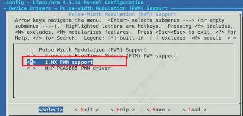
```c
-> Device Drivers  
    -> Pulse-Width Modulation (PWM) Support  
        -> <*> i.MX PWM support
```

## 2.3 PWM 背光设置

`linux` 内核里面关于 `backlight(背光)`的绑定文档，路径为 `Documentation/devicetree/bindings/video/backlight/pwm-backlight.txt`，此文档描述了如何创建 `backlight 节点`来使用`linux`内核自带的`pwm`背光驱动。
```c
compatible：内容必须为“pwm-backlight”，通过这个可以匹配到内核自带的 PWM 背光驱  
动，驱动文件为 drivers/video/backlight/pwm_bl.c，这里就不去分析驱动源码了。  
  
pwms：此属性指定背光使用哪一路 PWM，以及 PWM 相关的属性。  
  
brightness-levels：背光等级数组，范围 0~255，对应占空比为 0%~100%。数组内的值必须  
从 0 开始，也就是 0%占空比，最后一个值必须是 255，也就是 100%占空比。数组中间值的个  
数以及值大小可以自行定义。  
  
default-brightness-level：默认的背光等级，也就是 brightness-levels 属性中第几个值，注意  
这里是数索引编号，不是具体的数值！  
  
power-supply：支持的电压，此属性可以不需要
```

```c
backlight {  
    compatible = "pwm-backlight";  
    pwms = <&pwm1 0 5000000>;// PWM 周期为 5000000ns，频率为 200Hz  
    brightness-levels = <0 4 8 16 32 64 128 255>;  
    default-brightness-level = <7>;  
    status = "okay";  
};
```

## 2.4 驱动源码分析

### 2.4.1 probe过程

#### 2.4.1.1 imx_chip

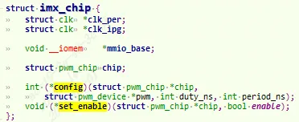
定义了`imx_chip`，包装了`pwm_chip`结构。

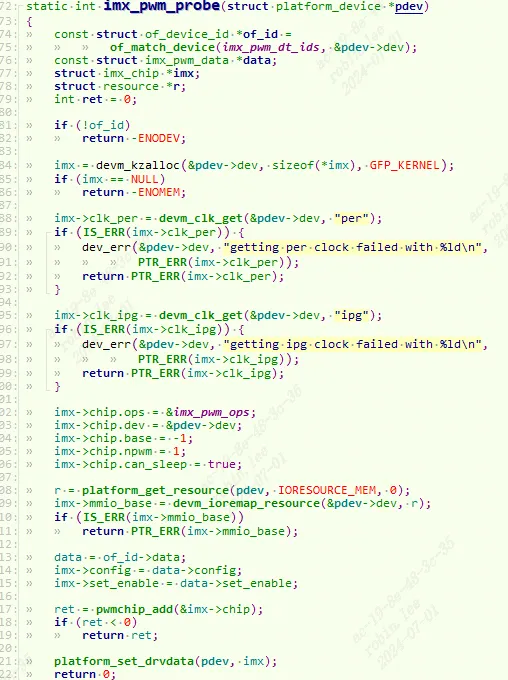
probe时，先分配内存，从dts获取`per, ipg`等时钟信息，设置pwm的ops为`imx_pwm_ops`。最后`pwmchip_add`注册进pwm子系统。注意这里有一个`of_id->data`,对应如下：可以看到有`v1,v2两2版本`，到时候会被ops中的函数调用。

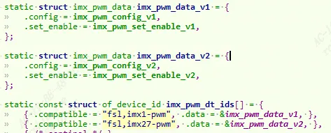
同理，驱动卸载最后调用`pwmchip_remove`注销pwm。

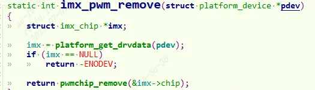
### 2.4.2 imx_pwm_ops

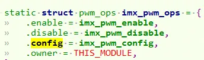
#### 2.4.2.1 imx_pwm_config

配置 PWM 周期和占空比。根据dts描述(`”imx27-pwm“`)我们使用的是v2。

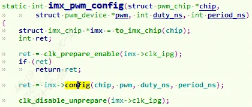
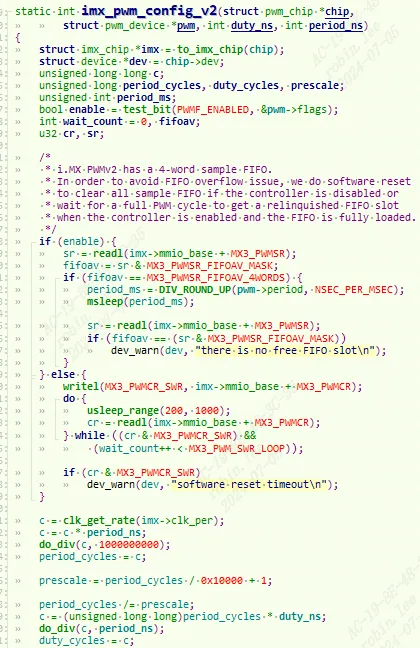
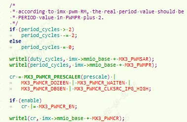
`PWMv2`会有4 word的采样fifo, 为了避免采样FIFO溢出，当pwm关闭时，对所有采样FIFO进行软件复位。当pwm使能后处于工作中，要等待完整的 PWM 周期以保证pwm空闲。

然后设置`PWM 周期period_cycles`，和`占空比duty_cycles`。

最后调用`writel`写入寄存器。

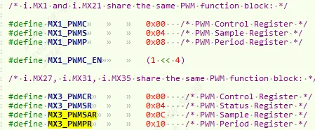
#### 2.4.2.2 imx_pwm_enable

控制`MX3_PWMCR`寄存器，使能关闭开关。

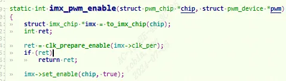
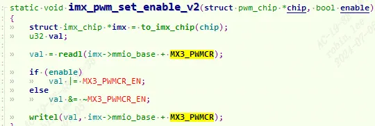
#### 2.4.2.3 imx_pwm_disable

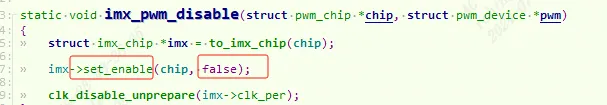
# 3 pwm sysfs文件接口测试

`alpha`开发板 `JP2 排针`上的 `GPIO_4(GPIO1_IO04)`引脚连接到 示波器上。等下看pwm信号效果。

可以看到一共8 路 PWM 控制器：

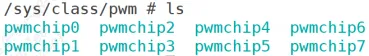
我们使用的`pwm3`,对应出 `pwmchip2`, 导出chip2通道的0设备文件:
```c
echo 0 > /sys/class/pwm/pwmchip2/export
```

执行完成会在`pwmchip2` 目录下生成一个名为`“pwm0”`的子目录:

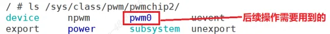
```c
echo 1 > /sys/class/pwm/pwmchip2/pwm0/enable #使能pwm3  
echo 50000 > /sys/class/pwm/pwmchip2/pwm0/period #设置周期值，单位为 ns，比如 20KHz 频率的周期就是 50000ns  
echo 10000 > /sys/class/pwm/pwmchip2/pwm0/duty_cycle #20%占空比
```

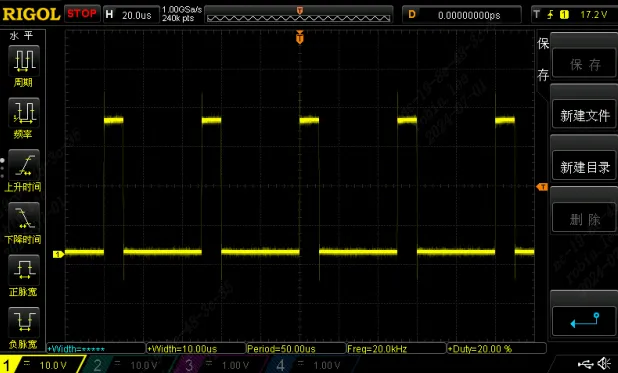
总结：
```c
导出chip1通道的0设备文件：echo 0 > /sys/class/pwm/pwmchip1/export  
配置chip1通道0的周期： echo 10000000 > /sys/class/pwm/pwmchip1 /pwm0/period  
配置chip1通道0的占空比:echo 4000000 >/sys/class/pwm/pwmchip1/pwm0/duty_cycle  
配置片chip通道0使能： echo 1 > /sys/class/pwm/pwmchip1/pwm0/enable  
配置片chip通道0禁能： echo 0 > /sys/class/pwm/pwmchip1/pwm0/enable  
取消导出片chip通道0设备文件： echo 0 >/sys/class/pwm/pwmchip1/unexport
```
