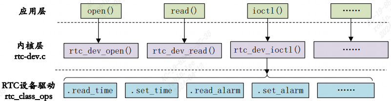
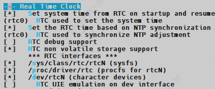
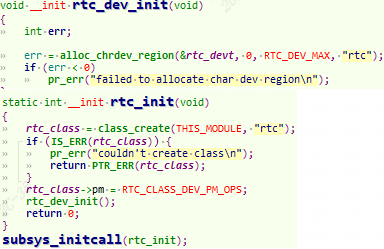
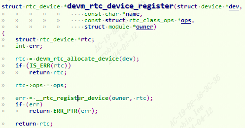
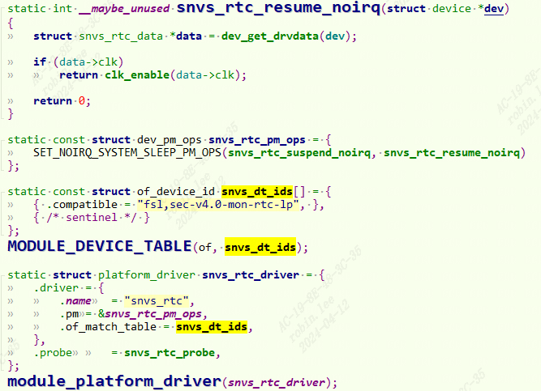
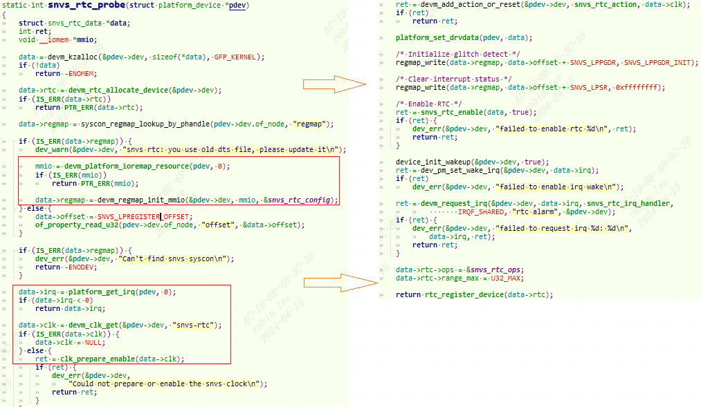
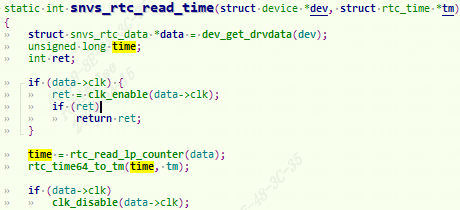
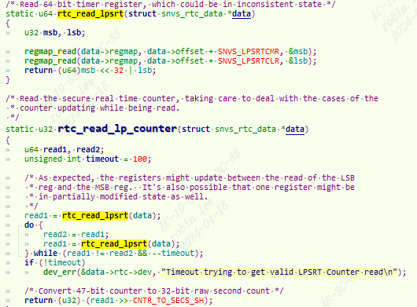
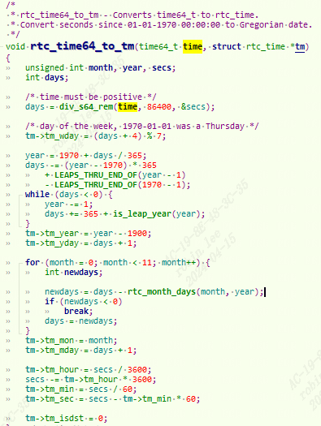
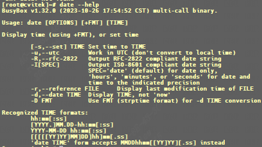

# Linux下RTC子系统驱动

# 1 引入RTC

CPU内部有很多定时器，像看门狗`WDT，PWM`定时器，高精度定时器Timer等等, 只在“启动”即“通电时”运行，断电时停止。

当然，如果时钟不能连续跟踪时间，则必须手动设置。那么当关机后就没办法自动计数统计时间了。`RTC` 就很好的解决了这个问题，RTC是实时时钟，用于记录当前系统时间。

# 2 Linux 内核 RTC 驱动框架

RTC在linux内核态也是用一个字符设备驱动去实现的。Linux 内核将 RTC 设备抽象为`rtc_device`结构体，定义在 `include/linux/rtc.h`, 进入`drivers/rtc`子系统目录：
```c
class.c：为底层驱动提供 register 与 unregister 接口用于 RTC 设备的注册/注销。初始化 RTC 设备结构、sysfs、proc  
interface.c：提供用户程序与 RTC 的接口函数  
dev.c：将 RTC 设备抽象为通用的字符设备，提供文件操作函数集  
sysfs.c：管理 RTC 设备的 sysfs 属性，获取 RTC 设备名、日期、时间等  
proc.c：管理 RTC 设备的 procfs 属性，提供中断状态和标志查询  
lib.c：提供 RTC、Data 和 Time 之间的转换函数  
rtc-xxx.c：各平台 RTC 设备的实际驱动
```


## 2.1 rtc子系统Makefile

rtc子系统Makefile如下， 可以根据配置宏去裁剪rtc子系统。
```c
obj-$(CONFIG_RTC_LIB)           += lib.o  
obj-$(CONFIG_RTC_SYSTOHC)       += systohc.o  
obj-$(CONFIG_RTC_CLASS)         += rtc-core.o  
obj-$(CONFIG_RTC_MC146818_LIB)  += rtc-mc146818-lib.o  
rtc-core-y                      := class.o interface.o  
  
rtc-core-$(CONFIG_RTC_NVMEM)            += nvmem.o  
rtc-core-$(CONFIG_RTC_INTF_DEV)         += dev.o  
rtc-core-$(CONFIG_RTC_INTF_PROC)        += proc.o  
rtc-core-$(CONFIG_RTC_INTF_SYSFS)       += sysfs.o
```


Linux默认rtc是开启的。
```c
Device Drivers  
　　->Real Time Clock  
　　　　[]Set system time from RTC on startup and resume  
　　　　[](rtc0)  RTC used to set the system time  
　　　　[]Set the RTC time based on NTP synchronization  
　　　　[](rtc0)  RTC used to synchronize NTP adjustment  
　　　　[]RTC debug support  
　　　　[]RTC non volatile storage support  
　　　　[]/sys/class/rtc/rtcN (sysfs)  
　　　　[]/proc/driver/rtc (procfs for rtcN)  
　　　　[]/dev/rtcN (character devices)
```

## 2.2 rtc数据结构

### 2.2.1 rtc_device
```c
struct rtc_device {  
	struct device dev;  
	struct module *owner;  
  
	int id; /* ID, 当前rtc设备在rtc子系统的子序号*/  
	char name[RTC_DEVICE_NAME_SIZE]; /* 名字 */  
  
	const struct rtc_class_ops *ops; /* RTC 设备底层操作函数 */  
	struct mutex ops_lock;  
  
	struct cdev char_dev; /* 字符设备 */  
	unsigned long flags;  
  
	unsigned long irq_data;  
	spinlock_t irq_lock;  
	wait_queue_head_t irq_queue;  
	struct fasync_struct *async_queue;  
  
	struct rtc_task *irq_task;  
	spinlock_t irq_task_lock;  
	int irq_freq;  
	int max_user_freq;  
  
	struct timerqueue_head timerqueue;  
	struct rtc_timer aie_timer;  
	struct rtc_timer uie_rtctimer;  
	struct hrtimer pie_timer; /* sub second exp, so needs hrtimer */  
	int pie_enabled;  
	struct work_struct irqwork;  
	/* Some hardware can't support UIE mode */  
	int uie_unsupported;  
};
```

### 2.2.2 rtc_class_ops
```c
struct rtc_class_ops {  
	int (*open)(struct device *);  
	void (*release)(struct device *);  
	int (*ioctl)(struct device *, unsigned int, unsigned long);  
	int (*read_time)(struct device *, struct rtc_time *);  
	int (*set_time)(struct device *, struct rtc_time *);  
	int (*read_alarm)(struct device *, struct rtc_wkalrm *);  
	int (*set_alarm)(struct device *, struct rtc_wkalrm *);  
	int (*proc)(struct device *, struct seq_file *);  
	int (*set_mmss64)(struct device *, time64_t secs);  
	int (*set_mmss)(struct device *, unsigned long secs);  
	int (*read_callback)(struct device *, int data);  
	int (*alarm_irq_enable)(struct device *, unsigned int enabled);  
};
```

`rtc_class_ops` 为 RTC 设备的**最底层操作函数集合**，包括从 RTC 设备中读取时间、向 RTC 设备写入新的时间值等，**对接RTC硬件控制器**，不直接对接应用。

### 2.2.3 rtc_dev_fops

Linux 内核提供了一个 **RTC 通用字符设备驱动文件**，文件名为 `drivers/rtc/rtc-dev.c`，r该文件提供了所有 RTC 设备共用的 `file_operations` 函数操作集，**对接应用ioctl**。
```c
static const struct file_operations rtc_dev_fops = {  
	.owner = THIS_MODULE,  
	.llseek = no_llseek,  
	.read = rtc_dev_read,  
	.poll = rtc_dev_poll,  
	.unlocked_ioctl = rtc_dev_ioctl,  
	.open = rtc_dev_open,  
	.release = rtc_dev_release,  
	.fasync = rtc_dev_fasync,  
};  
  
//调用关系：以RTC_RD_TIME为例  
rtc_dev_ioctl  
	->rtc_read_time  
    	->rtc->ops->read_time(rtc->dev.parent, tm);  
//可以看出，rtc_read_time 函数最终会调用 rtc_class_ops 中的.read_time 来从 RTC 设备中获取当前时间
```

`rtc_dev_ioctl` 函数对其他的命令处理都是类似的，比 如 `RTC_ALM_READ` 命令会通过`rtc_read_alarm`函数获取到闹钟值，而 `rtc_read_alarm` 函数经过层层调用，最终会调用`rtc_class_ops`中的 `read_alarm` 函数来获取闹钟值。上下调用关系如下：


## 2.3 rtc子系统初始化

rtc子系统初始化，主要分配`rtc_class类`，以及rtc设备的`rtc_devt`为设备号：
```c
rtc_init  
　　->class_create--创建rtc_class类。　　  
    ->rtc_dev_init　　　  
    ->alloc_chrdev_region--为rtc设备分配子设备号范围0~15。主设备号随机分配。最终结果放入rtc_devt。
```


系统启动时会将RTC时间设置到系统时间：
```c
rtc_hctosys  
　　->rtc_read_time  
　　->rtc_tm_to_time64  
　　->do_settimeofday64
```

## 2.4 rtc设备操作API

对rtc设备的操作主要有：alarm读取和设置、rtc time读取和设置、中断配置, 对应`drivers\rtc\interface.c`，头文件对应`include/linux/rtc.h`。
```c
extern int rtc_read_time(struct rtc_device *rtc, struct rtc_time *tm);  
extern int rtc_set_time(struct rtc_device *rtc, struct rtc_time *tm);  
extern int rtc_set_ntp_time(struct timespec64 now, unsigned long *target_nsec);  
int __rtc_read_alarm(struct rtc_device *rtc, struct rtc_wkalrm *alarm);  
extern int rtc_read_alarm(struct rtc_device *rtc,struct rtc_wkalrm *alrm);  
extern int rtc_set_alarm(struct rtc_device *rtc,struct rtc_wkalrm *alrm);  
extern int rtc_initialize_alarm(struct rtc_device *rtc,struct rtc_wkalrm *alrm);  
extern void rtc_update_irq(struct rtc_device *rtc,  
            unsigned long num, unsigned long events);  
extern int rtc_irq_set_state(struct rtc_device *rtc, int enabled);  
extern int rtc_irq_set_freq(struct rtc_device *rtc, int freq);  
extern int rtc_update_irq_enable(struct rtc_device *rtc, unsigned int enabled);  
extern int rtc_alarm_irq_enable(struct rtc_device *rtc, unsigned int enabled);
```

## 2.5 注册RTC设备

`devm_rtc_device_register`或者`rtc_register_device`注册rtc设备到rtc子系统。
```c
struct rtc_device *devm_rtc_device_register(struct device *dev,  
					    const char *name,  
					    const struct rtc_class_ops *ops,  
					    struct module *owner);  
  
int __rtc_register_device(struct module *owner, struct rtc_device *rtc);  
  
void rtc_device_unregister(struct rtc_device *rtc);
```


# 3 RTC驱动实例

以nxp的imx6ull芯片为例，打开`imx6ull.dtsi`，找到`snvs_rtc`设备节点。

## 3.1 设备树节点
```c
snvs_rtc: snvs-rtc-lp {  
	compatible = "fsl,sec-v4.0-mon-rtc-lp";  
	regmap = <&snvs>;  
	offset = <0x34>;  
	interrupts = <GIC_SPI 19 IRQ_TYPE_LEVEL_HIGH>, <GIC_SPI 20 IRQ_TYPE_LEVEL_HIGH>;  
};
```

对应驱动文件 `drivers/rtc/rtc-snvs.c`。


## 3.2 驱动probe

### 3.2.1 snvs_rtc_probe


1. Linux3.1 引入了一个全新的 regmap 机制。regmap 用于提供一套方便的 API 函 数去操作底层硬件寄存器，以提高代码的可重用性。`snvs-rtc.c` 文件会采用 `regmap 机制`来读写 RTC 底层硬件寄存器。这里使用 `devm_regmap_init_mmio` 函数将 RTC 的硬件寄存器转化为 regmap 形式，这样 regmap 机制的 `regmap_write`、`regmap_read` 等 API 函数才能操作寄存器。
    
2. 获取中断号，时钟，使能时钟。
    
3. 设置 `RTC_ LPPGDR` 寄存器值为 `SNVS_LPPGDR_INIT= 0x41736166`，这里就是用的 regmap 机制的 `regmap_write` 函数完成对寄存器进行写操作。
    
4. `RTC_LPSR` 寄存器，写入 `0xffffffff`，`LPSR` 是 `RTC 状态寄存器`，写 1 清零， 因此这一步就是清除 `LPSR` 寄存器。
    
5. 调用`snvs_rtc_enable`函数使能 RTC，此函数会设置 `RTC_LPCR` 寄存器。
    
6. `devm_request_irq`函数请求RTC中断，中断服务函数为`snvs_rtc_irq_handler`， 用于 RTC 闹钟中断。
    
7. 设置`rtc_class_ops`，并且调用`rtc_register_device`注册rtc子系统。
    

### 3.2.2 rtc_class_ops实例
```c
static const struct rtc_class_ops snvs_rtc_ops = {  
	.read_time = snvs_rtc_read_time,  
	.set_time = snvs_rtc_set_time,  
	.read_alarm = snvs_rtc_read_alarm,  
	.set_alarm = snvs_rtc_set_alarm,  
	.alarm_irq_enable = snvs_rtc_alarm_irq_enable,  
};
```

#### 3.2.2.1 snvs_rtc_read_time
`SNVS_SRTCMR[14:0]`代表`SRTC计数器`的高15位  
`SNVS_SRTCLR[31:15]`代表`SRTC计数器`的低17位  
注意：是以 1970 年 1 月 1 日0点0分0秒为起点，加上经过的总秒数即可得到现在的时间点。  
`SNVS_HPCOMR[31]`, `NPSWA_EN`位，非特权软件访问控制位，如果非特权软件要访问 SNVS 的话此位必须为 1。  
`SNVS_LPCR[0]`, `SRTC_ENV`位，使能 RTC 计数器。
```c
#define SNVS_LPREGISTER_OFFSET	0x34  
/* These register offsets are relative to LP (Low Power) range */  
#define SNVS_LPCR		0x04  
#define SNVS_LPSR		0x18  
#define SNVS_LPSRTCMR		0x1c  
#define SNVS_LPSRTCLR		0x20  
#define SNVS_LPTAR		0x24  
#define SNVS_LPPGDR		0x30  
#define SNVS_LPCR_SRTC_ENV	(1 << 0)  
#define SNVS_LPCR_LPTA_EN	(1 << 1)  
#define SNVS_LPCR_LPWUI_EN	(1 << 3)  
#define SNVS_LPSR_LPTA		(1 << 0)  
#define SNVS_LPPGDR_INIT	0x41736166  
#define CNTR_TO_SECS_SH		15  
static int snvs_rtc_read_time(struct device *dev, struct rtc_time *tm){  
	struct snvs_rtc_data *data = dev_get_drvdata(dev);  
	unsigned long time;  
	int ret;  
	if (data->clk) {  
		ret = clk_enable(data->clk);  
		if (ret)  
			return ret;  
	}  
  
	time = rtc_read_lp_counter(data);  
	rtc_time64_to_tm(time, tm);  
  
	if (data->clk)  
		clk_disable(data->clk);  
	return 0;  
}
```


```c
/* Read 64 bit timer register, which could be in inconsistent state */  
static u64 rtc_read_lpsrt(struct snvs_rtc_data *data){  
	u32 msb, lsb;  
	regmap_read(data->regmap, data->offset + SNVS_LPSRTCMR, &msb);  
	regmap_read(data->regmap, data->offset + SNVS_LPSRTCLR, &lsb);  
	return (u64)msb << 32 | lsb;  
}  
  
/* Read the secure real time counter, taking care to deal with the cases of the  
 * counter updating while being read.  
 */  
static u32 rtc_read_lp_counter(struct snvs_rtc_data *data){  
	u64 read1, read2;  
	unsigned int timeout = 100;  
  
	/* As expected, the registers might update between the read of the LSB  
	 * reg and the MSB reg.  It's also possible that one register might be  
	 * in partially modified state as well.  
	 */  
	read1 = rtc_read_lpsrt(data);  
	do {  
		read2 = read1;  
		read1 = rtc_read_lpsrt(data);  
	} while (read1 != read2 && --timeout);  
	if (!timeout)  
		dev_err(&data->rtc->dev, "Timeout trying to get valid LPSRT Counter read\n");  
	/* Convert 47-bit counter to 32-bit raw second count */  
	return (u32) (read1 >> CNTR_TO_SECS_SH);  
}
```


```c
void rtc_time64_to_tm(time64_t time, struct rtc_time *tm) {  
	unsigned int month, year, secs;  
	int days;  
	/* time must be positive */  
	days = div_s64_rem(time, 86400, &secs);  
	/* day of the week, 1970-01-01 was a Thursday */  
	tm->tm_wday = (days + 4) % 7;  
	year = 1970 + days / 365;  
	days -= (year - 1970) * 365  
		+ LEAPS_THRU_END_OF(year - 1)  
		- LEAPS_THRU_END_OF(1970 - 1);  
	while (days < 0) {  
		year -= 1;  
		days += 365 + is_leap_year(year);  
	}  
	tm->tm_year = year - 1900;  
	tm->tm_yday = days + 1;  
	for (month = 0; month < 11; month++) {  
		int newdays;  
		newdays = days - rtc_month_days(month, year);  
		if (newdays < 0)  
			break;  
		days = newdays;  
	}  
	tm->tm_mon = month;  
	tm->tm_mday = days + 1;  
	tm->tm_hour = secs / 3600;  
	secs -= tm->tm_hour * 3600;  
	tm->tm_min = secs / 60;  
	tm->tm_sec = secs - tm->tm_min * 60;  
	tm->tm_isdst = 0;  
}
```


1. `rtc_read_lpsrt`函数RTC定时器寄存器，得到64位原始数据。让后将其转换成按秒计算单位。可以看到就是设置读取RTC寄存器信息。
2. 调用`drivers\rtc\lib.c`的`rtc_time64_to_tm`将秒数转换成`rtc_time`, 也就是年月日单位。

#### 3.2.2.2 snvs_rtc_set_time

设置时钟，和`snvs_rtc_read_time`同理，也是寄存器操作，就不展开细节分析。

## 3.3 应用测试

### 3.3.1 读取rtc时间
```c
[root@imx6ull]~# date  
Thu Jan  1 08:00:13 CST 1970
```

### 3.3.2 设置rtc时间


现在我要设置当前时间为 2023 年 8 月 31 日 18:13:00。  
`date -s "2023-08-31 18:13:00"`
```c
[root@imx6ull]~# date -s "2023-08-31 18:13:00"  
Thu Aug 31 18:13:00 CST 2023
```

注意我们使用`“date -s”`命令仅仅是将当前系统时间设置了，此时间还没有写入到RTC 芯片里面，因此系统重启以后时间又会丢失。我们需要将 当前的时间写入到 RTC 里面，这里要用到 `hwclock` 命令，输入如下命令将系统时间写入到 RTC 里面：  
`hwclock -w`
