# 1 Linux SPI驱动框架

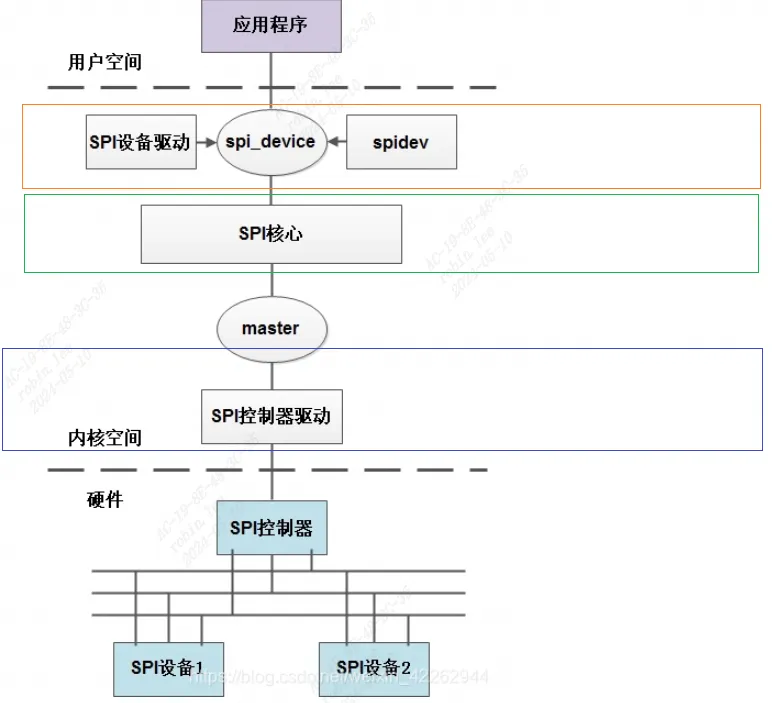
linux SPI驱动框架层次如上图：

除开硬件和用户态应用程序，由上到下分成3层：
```c
设备驱动层: spi框架使用者  
核心层：spi框架搭建者  
控制器驱动层： spi框架适配者
```

## 1.1 spi核心层

SPI核心层代码位于`linux_5.10\drivers\spi`目录:
```c
# SPDX-License-Identifier: GPL-2.0  
#  
# Makefile for kernel SPI drivers.  
#  
ccflags-$(CONFIG_SPI_DEBUG) := -DDEBUG  
# small core, mostly translating board-specific  
# config declarations into driver model code  
obj-$(CONFIG_SPI_MASTER)		+= spi.o  
obj-$(CONFIG_SPI_MEM)			+= spi-mem.o  
obj-$(CONFIG_SPI_MUX)			+= spi-mux.o  
obj-$(CONFIG_SPI_SPIDEV)		+= spidev.o  
obj-$(CONFIG_SPI_LOOPBACK_TEST)		+= spi-loopback-test.o  
# SPI master controller drivers (bus)  
obj-$(CONFIG_SPI_ALTERA)		+= spi-altera.o  
obj-$(CONFIG_SPI_AR934X)		+= spi-ar934x.o  
obj-$(CONFIG_SPI_ARMADA_3700)		+= spi-armada-3700.o  
obj-$(CONFIG_SPI_ATMEL)			+= spi-atmel.o  
obj-$(CONFIG_SPI_ATMEL_QUADSPI)		+= atmel-quadspi.o  
obj-$(CONFIG_SPI_AT91_USART)		+= spi-at91-usart.o  
obj-$(CONFIG_SPI_ATH79)			+= spi-ath79.o  
obj-$(CONFIG_SPI_AU1550)		+= spi-au1550.o  
obj-$(CONFIG_SPI_AXI_SPI_ENGINE)	+= spi-axi-spi-engine.o  
obj-$(CONFIG_SPI_BCM2835)		+= spi-bcm2835.o
```

```c
drivers/spi/spi.c spi-mem.c spi-mux.c  
include/linux/spi/spi.h  
spi.c：  
    一方面对SPI子系统进行初始化工作，注册spi bus，注册spi_master class，  
    同时提供spi设备驱动对spi总线进行操作的API。  
    另一方面SPI子系统对spi控制器层，提供注册控制器的api和回调操作函数。  
spi.h包含了spi核心层的一些重要数据结构，struct spi_master;   
	struct spi_transfer; struct spi_message，以及一些实现比较简单的函数等。  
  
spi-gpio.c：SPI GPIO框架：SPI子系统提供了一个名为spi-gpio的框架，  
        可使用GPIO引脚模拟SPI总线，gpio模拟spi代码在drivers/spi/spi-gpio.c中。  
        这个框架允许将GPIO引脚配置为SPI总线的时钟、片选、输入和输出信号，  
        并提供了对应的接口函数供驱动程序使用。  
spi-bitbang：spi-bitbang是Linux内核中提供的一个通用框架，用于在没有硬件SPI控制器  
        或需要灵活控制SPI时序和配置的系统中模拟SPI总线的通信。代码在spi-bitbang.c中
```

核心层的作用:

对上层的使用者，也就是SPI设备驱动：提供标准的spi收发API，以及设备注册函数。  
对底下的适配者，也就是控制器驱动层：提供注册控制器接口，并提供一些需要控制器驱动实现的回调函数。

### 1.1.1 核心层初始化

#### 1.1.1.1 spi_init
```c
static int __init spi_init(void) {  
	int	status;  
	buf = kmalloc(SPI_BUFSIZ, GFP_KERNEL);  
	if (!buf) {  
		status = -ENOMEM;  
		goto err0;  
	}  
	status = bus_register(&spi_bus_type);  
	if (status < 0)  
		goto err1;  
	status = class_register(&spi_master_class);  
	if (status < 0)  
		goto err2;  
	if (IS_ENABLED(CONFIG_SPI_SLAVE)) {  
		status = class_register(&spi_slave_class);  
		if (status < 0)  
			goto err3;  
	}  
  
	if (IS_ENABLED(CONFIG_OF_DYNAMIC))  
		WARN_ON(of_reconfig_notifier_register(&spi_of_notifier));  
	if (IS_ENABLED(CONFIG_ACPI))  
		WARN_ON(acpi_reconfig_notifier_register(&spi_acpi_notifier));  
  
	return 0;  
err3:  
	class_unregister(&spi_master_class);  
err2:  
	bus_unregister(&spi_bus_type);  
err1:  
	kfree(buf);  
	buf = NULL;  
err0:  
	return status;  
}
```

spi子系统初始化函数，仅仅是注册了`spi bus`，以及`spi_master class`。

成功注册后，在`/sys/bus` 下即可找到spi 文件目录，在`/sys/class`下可以看到spi_master目录:

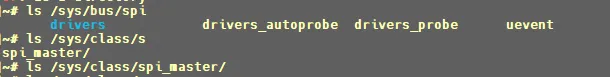
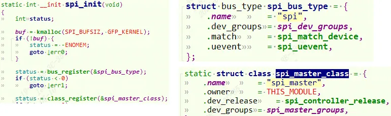
#### 1.1.1.2 spi从设备和驱动的匹配

当spi总线和类注册后，当有驱动和设备匹配上就会调用`spi_match_device`，也就是`spi_bus_type.match`函数。
```c
static int spi_match_device(struct device *dev, struct device_driver *drv) {  
	const struct spi_device	*spi = to_spi_device(dev);  
	const struct spi_driver	*sdrv = to_spi_driver(drv);  
  
	/* Check override first, and if set, only use the named driver */  
	if (spi->driver_override)  
		return strcmp(spi->driver_override, drv->name) == 0;  
  
	/* Attempt an OF style match */  
	if (of_driver_match_device(dev, drv))  
		return 1;  
  
	/* Then try ACPI */  
	if (acpi_driver_match_device(dev, drv))  
		return 1;  
  
	if (sdrv->id_table)  
		return !!spi_match_id(sdrv->id_table, spi);  
	return strcmp(spi->modalias, drv->name) == 0;  
}
```

1. 通过`of_match_table`的`compatible`和设备树匹配；
2. 通过`acpi_match_table`的`compatible`和`device`的`of_node`的`compatible`匹配；
3. 通过驱动和设备的`id_table`去匹配。
4. 最后通过驱动和设备的`名字`去匹配。

### 1.1.2 核心层API

#### 1.1.2.1 spi_register_master-(供适配层调用)
```c
int spi_register_master(struct spi_master *master) {  
	...  
	status = of_spi_register_master(master);  
	if (status)  
		return status;  
	...  
	dev_set_name(&master->dev, "spi%u", master->bus_num);  
	status = device_add(&master->dev);  
	if (status < 0)  
		goto done;  
	dev_dbg(dev, "registered master %s%s\n", dev_name(&master->dev),  
			dynamic ? " (dynamic)" : "");  
  
	if (master->transfer)  
		dev_info(dev, "master is unqueued, this is deprecated\n");  
	else {  
		status = spi_master_initialize_queue(master);  
		if (status) {  
			device_del(&master->dev);  
			goto done;  
		}  
	}  
	...  
	mutex_lock(&board_lock);  
	list_add_tail(&master->list, &spi_master_list);  
	list_for_each_entry(bi, &board_list, list)  
		spi_match_master_to_boardinfo(master, &bi->board_info);  
	mutex_unlock(&board_lock);  
	...  
	of_register_spi_devices(master);  
	...  
done:  
	return status;  
}
```

1. `of_spi_register_master`，根据设备树节点中的`"cs-gpios"`，向`struct spi_master`添加gpio cs引脚。
    
2. `device_add`将device注册到设备模型中。
    
3. 如果控制器驱动没有自己实现`transfer`函数，则初始化发送队列`spi_master_initialize_queue`。（核心层填充默认transfer函数)
    
4. `spi_match_master_to_boardinfo`老的方式，遍历所有`spi_board_info`数据结构，并注册`spi_device`
    
5. `of_register_spi_devices`新的设备树方式，遍历spi控制器节点下所有子节点，并注册成对应的`spi_device`设备
    

##### 1.1.2.1.1 spi_controller_initialize_queue/spi_master_initialize_queue

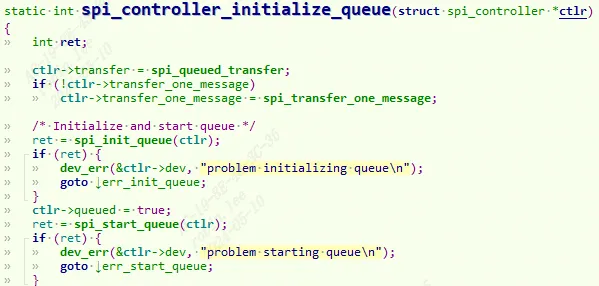
可以看到是对控制器`spi_master（或者叫做spi_controller）`成员函数赋值。`transfer_one_message`或者`transfer`赋值成默认的函数。然后调用`spi_init_queue`和`spi_start_queue`函数初始化队列并启动工作线程。`spi_init_queue`函数最主要的作用就是建立一个内核工作线程。
```c
static int spi_init_queue(struct spi_master *master)  
{  
	......  
	kthread_init_worker(&master->kworker);  
	master->kworker_task = kthread_run(kthread_worker_fn,  
            &master->kworker, "%s", dev_name(&master->dev));  
	......  
	kthread_init_work(&master->pump_messages, spi_pump_messages);  
	......  
	return 0;  
}  
static int spi_start_queue(struct spi_master *master)  
{  
	......  
	master->running = true;  
	master->cur_msg = NULL;  
	......  
	kthread_queue_work(&master->kworker, &master->pump_messages);  
	......  
	return 0;  
}  
/* spi_init_queue函数先初始化kthread_worker，为kthread_worker创建一个内核线程来处理work，  
		随后初始化kthread_work,设置work执行函数，work执行函数为spi_pump_messages  
spi_start_queue就相对简单了，只是唤醒该工作线程而已；自此，队列化的相关工作已经完成，  
		系统等待message请求被发起，然后在工作线程中处理message的传送工作。  
*/
```

#### 1.1.2.2 spi_message_init-(供从设备调用)

对`spi_massage`进行初始化.
```c
static inline void spi_message_init_no_memset(struct spi_message *m)  
{  
	INIT_LIST_HEAD(&m->transfers);  
	INIT_LIST_HEAD(&m->resources);  
}  
static inline void spi_message_init(struct spi_message *m)  
{  
	memset(m, 0, sizeof *m);  
	spi_message_init_no_memset(m);  
}
```

#### 1.1.2.3 spi_message_add_tail-(供从设备调用)
```c
static inline void  
spi_message_add_tail(struct spi_transfer *t, struct spi_message *m) {  
	list_add_tail(&t->transfer_list, &m->transfers);  
}
```

可以看到就是把`spi_transfer`这个`buffer`添加到`spi_message`传输链表中。

#### 1.1.2.4 spi_async-(供从设备调用)

发起数据传输。可以看到就是调用控制器内部的`master->transfer`。既然是`async`那就是异步执行的，不会等待传输是否完成，就直接返回。
```c
spi_async->  
		__spi_async->  
				master->transfer
```

那假如`master->transfer`控制器这边没有去实现。内核会自己填充默认的transfer函数`spi_queued_transfer`.

##### 1.1.2.4.1 SPI_QUEUED_TRANSFER
```c
spi_queued_transfer(struct spi_device *spi, struct spi_message *msg) {  
		__spi_queued_transfer(spi, msg, true);  
}  
static int __spi_queued_transfer(struct spi_device *spi,  
				 struct spi_message *msg,  
				 bool need_pump) {  
	struct spi_master *master = spi->master;  
	unsigned long flags;  
  
	spin_lock_irqsave(&master->queue_lock, flags);  
	...  
	list_add_tail(&msg->queue, &master->queue);  
	if (!master->busy && need_pump)  
		kthread_queue_work(&master->kworker, &master->pump_messages);  
	spin_unlock_irqrestore(&master->queue_lock, flags);  
	return 0;  
}
```

可以看到默认的`spi_queued_transfer`就是去把`message`添加到`master`的发送链表中。接下来就交给工作服务线程`__spi_pump_messages`去处理`message`。

#### 1.1.2.5 spi_sync-(供从设备调用)

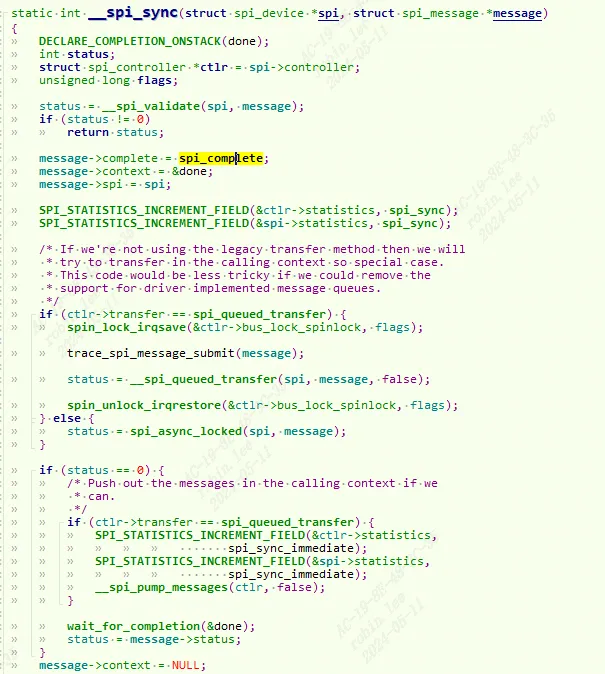
同理，`spi_sync`就是用来同步传输 `spi_message`, 完成传输后会调用`spi_comlete`唤醒等待的线程。

那假如`master->transfer`控制器这边没有去实现。内核也会自己填充默认的transfer函数`spi_queued_transfer`.可以看到`need_pump=false`,因此还是一样就是去把message添加到master的发送链表中。

然后调用`__spi_pump_messages`，也就是工作线程服务，交给工作服务线程去处理message。

最后调用`wait_for_completion`去等待传输完成。

#### 1.1.2.6 spi_bitbang_start-(供适配层调用)
```c
int spi_bitbang_start(struct spi_bitbang *bitbang)  
{  
    struct spi_master *master = bitbang->master;  
    int ret;  
  
    if (!master | !bitbang->chipselect)  
        return -EINVAL;  
  
    mutex_init(&bitbang->lock);  
  
    if (!master->mode_bits)  
        master->mode_bits = SPI_CPOL | SPI_CPHA | bitbang->flags;  
  
    if (master->transfer | master->transfer_one_message)  
        return -EINVAL;  
  
    master->prepare_transfer_hardware = spi_bitbang_prepare_hardware;  
    master->unprepare_transfer_hardware = spi_bitbang_unprepare_hardware;  
    master->transfer_one = spi_bitbang_transfer_one;  
    master->set_cs = spi_bitbang_set_cs;  
  
    if (!bitbang->txrx_bufs) {  
        bitbang->use_dma = 0;  
        bitbang->txrx_bufs = spi_bitbang_bufs;  
        if (!master->setup) {  
            if (!bitbang->setup_transfer)  
                bitbang->setup_transfer =  
                     spi_bitbang_setup_transfer;  
            master->setup = spi_bitbang_setup;  
            master->cleanup = spi_bitbang_cleanup;  
        }  
    }  
  
    /* driver may get busy before register() returns, especially  
     * if someone registered boardinfo for devices  
     */  
    ret = spi_register_master(spi_master_get(master));  
    if (ret)  
        spi_master_put(master);  
  
    return ret;  
}
```

1. 如果主设备结构体中的传输模式位字段 `mode_bits` 未设置，则设置为默认的模式位，包括 `SPI_CPOL`、`SPI_CPHA` 和`位移传输控制`结构体中的标志位。
    
2. 检查主设备结构体中的传输函数是否已经定义，如果已定义则返回错误码 `-EINVAL`。
    
3. 设置主设备结构体中的准备硬件传输函数、释放硬件传输函数、单次传输函数和片选信号控制函数，分别对应位移传输控制结构体中的对应函数。
    
4. 如果位移传输控制结构体中的数据缓冲区传输函数未定义，则设置使用 DMA 标志为 0，并将数据缓冲区传输函数设置为默认的位移传输函数 `spi_bitbang_bufs`。如果主设备结构体中的设置函数未定义，则设置使用默认的设置函数 `spi_bitbang_setup` 和清理函数 `spi_bitbang_cleanup`。
    
5. 注册 SPI 主设备，将其添加到系统中。
    

##### 1.1.2.5.1 spi_register_master

## 1.2 SPI控制器驱动层

控制器驱动就是用来实现`spi_master`中的成员函数。如`transfer, transfer_one_message`。基本流程是：申请 `spi_master`，然后初始化 `spi_master`，最后向 Linux 内核注册 `spi_master`。

### 1.2.1 SPI控制器API

#### 1.2.1.1 spi_alloc_master

申请spi控制器内存。

`struct spi_master *spi_alloc_master(struct device *dev, unsigned size);`

dev：设备，一般是 platform_device 中的 dev 成员变量。

size：私有数据大小，可以通过 `spi_master_get_devdata` 函数获取到这些私有数据。

返回值：申请到的 spi_master。

#### 1.2.1.2 spi_master_put

`spi_master` 的释放通过 `spi_master_put`函数来完成，当我们删除一个 SPI 主机驱动的时候就 需要释放掉前面申请的 spi_master，`spi_master_put` 函数原型如下：

`void spi_master_put(struct spi_master *master);`

释放spi控制器内存。

#### 1.2.1.3 spi_register_master/spi_register_controller

当 spi_master 初始化完成以后就需要将其注册到 Linux 内核，`spi_register_master`注册spi控制器。

`int spi_register_master(struct spi_master *master);`

#### 1.2.1.4 spi_unregister_master/spi_unregister_controller

spi控制器卸载。

`void spi_unregister_master(struct spi_master *master);`

### 1.2.2 SPI控制器示例

以飞思卡尔nxp官方spi驱动为例，文件位于`linux\drivers\spi\spi-imx.c`

#### 1.2.2.1 spi控制器设备树描述

打开设备树文件`imx6ul.dtsi`：

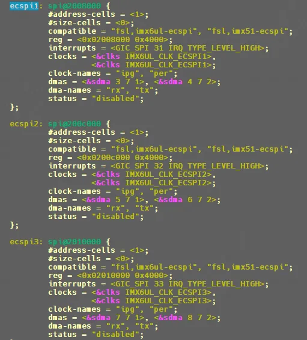
```c
ecspi3: spi@2010000 {  
        #address-cells = <1>;  
        #size-cells = <0>;  
        compatible = "fsl,imx6ul-ecspi", "fsl,imx51-ecspi";  
        reg = <0x02010000 0x4000>;  
        interrupts = <GIC_SPI 33 IRQ_TYPE_LEVEL_HIGH>;  
        clocks = <&clks IMX6UL_CLK_ECSPI3>,  
                 <&clks IMX6UL_CLK_ECSPI3>;  
        clock-names = "ipg", "per";  
        dmas = <&sdma 7 7 1>, <&sdma 8 7 2>;  
        dma-names = "rx", "tx";  
        status = "disabled";  
};
```

#### 1.2.2.2 imx6ul spi控制器驱动

##### 1.2.2.2.1 probe-(初始化spi_master)

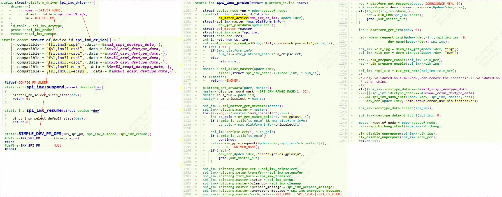
1. 解析设备树，初始化控制器
    
    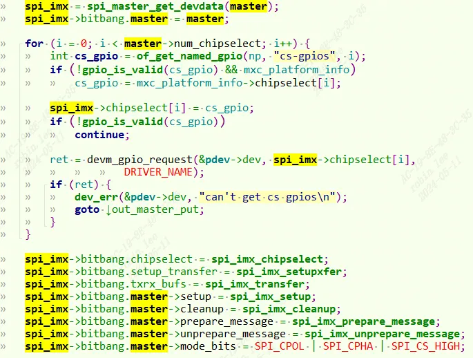
    配置master和spi_imx。包括传输函数，片选函数，片选引脚。`master`作为平台设备的dev的driver_data, `spi_imx`作为master的dev的driver_data。
    
    获取irq, res等信息，进行ioremap和注册irq。
    
    设置时钟，开启时钟。
    
    初始话dma寄存器。进行控制器初始化和复位。
    
    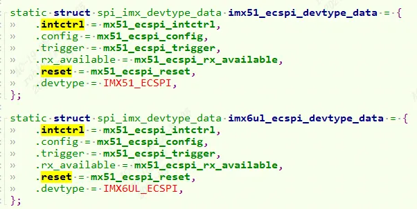
    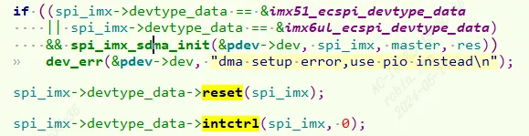
2. 申请并初始化 spi_master， 调用 `spi_bitbang_start` 函数(`spi_bitbang_start 会调用 spi_register_master 函数`)向 Linux 内核注册 spi_master。
    

##### 1.2.2.2.2 spi_imx_setupxfer-(设置位宽和配置控制器)

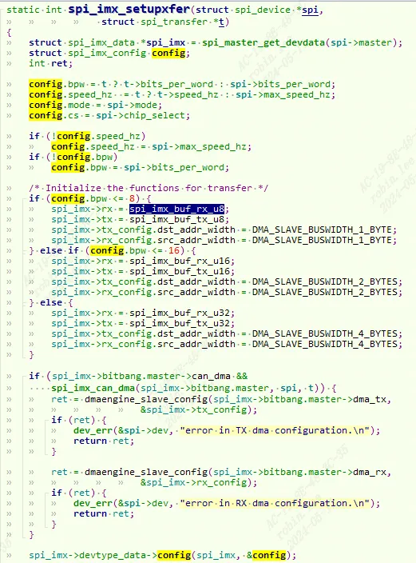
设置 `spi_imx` 的 tx 和 rx 传输函数。根据要发送的数据数据位宽的不 同，分别有 8 位、16 位和 32 位的发送函数：
```c
spi_imx_buf_tx_u8  
spi_imx_buf_tx_u16  
spi_imx_buf_tx_u32  
spi_imx_buf_rx_u8  
spi_imx_buf_rx_u16  
spi_imx_buf_rx_u32
```

```c
#define MXC_SPI_BUF_RX(type)						\  
static void spi_imx_buf_rx_##type(struct spi_imx_data *spi_imx)		\  
{	    //将要接收的数据值读到 ECSPI 的 MXC_CSPIRXDATA 寄存器里面去	\  
	unsigned int val = readl(spi_imx->base + MXC_CSPIRXDATA);	\  
									\  
	if (spi_imx->rx_buf) {						\  
		*(type *)spi_imx->rx_buf = val;				\  
		spi_imx->rx_buf += sizeof(type);			\  
	}								\  
}  
#define MXC_SPI_BUF_TX(type)						\  
static void spi_imx_buf_tx_##type(struct spi_imx_data *spi_imx)		\  
{									\  
	type val = 0;							\  
									\  
	if (spi_imx->tx_buf) {						\  
		val = *(type *)spi_imx->tx_buf;				\  
		spi_imx->tx_buf += sizeof(type);			\  
	}								\  
									\  
	spi_imx->count -= sizeof(type);					\  
//将要发送的数据值写入到 ECSPI 的 TXDATA 寄存器里面去		\  
	writel(val, spi_imx->base + MXC_CSPITXDATA);	\  
}  
  
MXC_SPI_BUF_RX(u8)  
MXC_SPI_BUF_TX(u8)  
MXC_SPI_BUF_RX(u16)  
MXC_SPI_BUF_TX(u16)  
MXC_SPI_BUF_RX(u32)  
MXC_SPI_BUF_TX(u32)
```

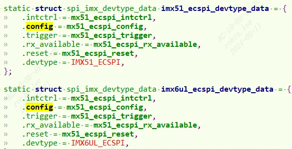
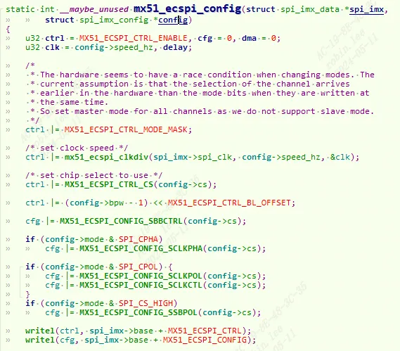
调用关系如下：`mx51_ecspi_config`就是最底层`SPI controller`的寄存器配置，这里不做分析。
```c
spi_imx->bitbang.setup_transfer = spi_imx_setupxfer  
	spi_imx->devtype_data->config = mx51_ecspi_config
```

##### 1.2.2.2.3 spi_imx_transfer-(数据收发)

数据收发函数为 `spi_imx_transfer`:
```c
spi_imx_transfer  
    -> spi_imx_pio_transfer  
        -> spi_imx_push  
        	-> spi_imx->tx
```

`spi_imx` 是个 `spi_imx_data` 类型的机构指针变量，其中 tx 和 rx 这两个成员变量分别为 SPI 数据发送和接收函数。
```c
spi_bitbang_start中  
    ->master->transfer_one = spi_bitbang_transfer_one;  
当spi_bitbang_transfer_on时  
    bitbang->txrx_bufs(spi,t) = spi_imx_transfer  
    也就是spi_imx->tx就可以spi_imx_buf_tx_u8
```

##### 1.2.2.2.4 spi_imx_isr

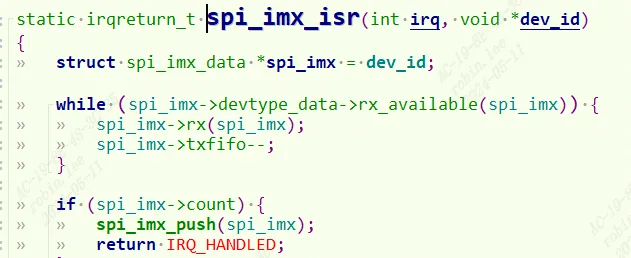
中断服务程序，只要rx_available,启用spi_imx->rx。从`MXC_CSPIRXDATA` 寄存器读出数据。
```c
static int __maybe_unused mx51_ecspi_rx_available(struct spi_imx_data *spi_imx)  
{  
	return readl(spi_imx->base + MX51_ECSPI_STAT) & MX51_ECSPI_STAT_RR;  
}  
#define MXC_SPI_BUF_RX(type)						\  
static void spi_imx_buf_rx_##type(struct spi_imx_data *spi_imx)		\  
{									\  
	unsigned int val = readl(spi_imx->base + MXC_CSPIRXDATA);	\  
									\  
	if (spi_imx->rx_buf) {						\  
		*(type *)spi_imx->rx_buf = val;				\  
		spi_imx->rx_buf += sizeof(type);			\  
	}								\  
}
```

##### 1.2.2.2.5 SPI_IMX_CHIPSELECT-(片选)

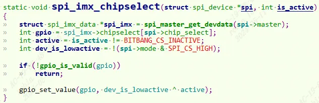
设置片选gpio电平。

## 1.3 SPI从设备驱动层

### 1.3.1 SPI从设备API

#### 1.3.1.1 spi_message_init

`void spi_message_init(struct spi_message *m);`

在使用`spi_message`之前需要对其进行初始化。

#### 1.3.1.2 spi_message_add_tail

`void spi_message_add_tail(struct spi_transfer *t, struct spi_message *m);`

`spi_message` 初始化完成以后需要将 `spi_transfer` 添加到 `spi_message` 队列中。

#### 1.3.1.3 spi_async

参考核心层api有介绍。

#### 1.3.1.4 spi_sync

参考核心层api有介绍。

#### 1.3.1.5 spi_register_driver

#### 1.3.1.6 spi_unregister_driver

#### 1.3.1.7 spi_read/spi_write
```c
static inline void spi_message_init_with_transfers(struct spi_message *m,  
             struct spi_transfer *xfers, unsigned int num_xfers) {  
	unsigned int i;  
	spi_message_init(m);  
	for (i = 0; i < num_xfers; ++i)  
		spi_message_add_tail(&xfers[i], m);  
}  
static inline int spi_sync_transfer(struct spi_device *spi, struct spi_transfer *xfers,  
             unsigned int num_xfers) {  
	struct spi_message msg;  
	spi_message_init_with_transfers(&msg, xfers, num_xfers);  
	return spi_sync(spi, &msg);  
}  
static inline int spi_read(struct spi_device *spi, void *buf, size_t len) {  
	struct spi_transfer	t = {  
			.rx_buf		= buf,  
			.len		= len,  
		};  
	return spi_sync_transfer(spi, &t, 1);  
}  
static inline int spi_write(struct spi_device *spi, const void *buf, size_t len)  
{  
	struct spi_transfer	t = {  
			.tx_buf		= buf,  
			.len		= len,  
		};  
  
	return spi_sync_transfer(spi, &t, 1);  
}
```

`spi_read, spi_write`本质还是调用`spi_sync`传输函数，做了一层封装把`spi_transfrer`和`spi_message`包装好了。

### 1.3.2 SPI从设备示例-ICM-20608-G
参考ICM-20608-G开发手册。

#### 1.3.2.1 dts描述

打开自己board对应的dts,我这里是`imx6ull-alientek-emmc.dts`。我们修改`ecspi3 spi控制器`。我的spi3接了一个`ICM-20608`。资源定义如下：

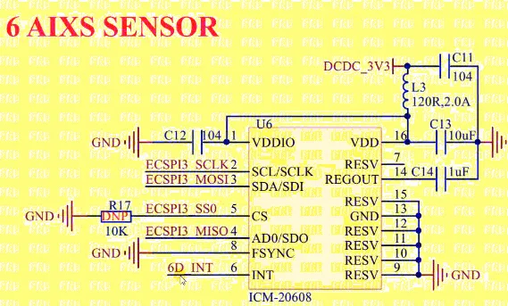
根据原理图接线先配置`iomux`:
```c
pinctrl_ecspi3: icm20608 {  
	fsl,pins = <  
		MX6UL_PAD_UART2_TX_DATA__GPIO1_IO20 0x10b0 /* CS */  
		MX6UL_PAD_UART2_RX_DATA__ECSPI3_SCLK 0x10b1 /* SCLK */  
		MX6UL_PAD_UART2_RTS_B__ECSPI3_MISO 0x10b1 /* MISO */  
		MX6UL_PAD_UART2_CTS_B__ECSPI3_MOSI 0x10b1 /* MOSI */  
	>;  
};
```

`UART2_TX_DATA` 这个 IO 是 `ICM20608` 的片选信号，这里我们并没有将其复用为 ECSPI3 的`SS0`信号，而是将其复用为了普通的 GPIO。因为我们需要自己控制片选信号，所以将其复 用为普通的 GPIO。

`imx6ull-alientek-emmc.dts`重新修改`ecspi3`节点，追加从设备描述：
```c
&ecspi3 {  
	fsl,spi-num-chipselects = <1>;  
	cs-gpios = <&gpio1 20 GPIO_ACTIVE_LOW>;  
	pinctrl-names = "default";  
	pinctrl-0 = <&pinctrl_ecspi3>;  
	status = "okay";  
  
	spidev: icm20608@0 {  
		compatible = "alientek,icm20608";  
		spi-max-frequency = <8000000>;  
		reg = <0>;  
	};  
};
```

1. 设置当前片选数量为 1，因为就只接了一个 `ICM20608`。
2. 一定要使用 `“cs-gpios”`属性来描述片选引脚，SPI 主机驱动就会控制片选引脚。
3. `imx6ull.dtsi` 文件中默认将 `ecspi3` 节点状态(status)设置为`“disable”`，这里我们要将 其改为`“okay”`。
4. `icm20608` 设备子节点，因为 `icm20608` 连接在`ECSPI3`的第 0 个通道上，因此 @后面为 0。
    1. 设置节点属性兼容值为`“alientek,icm20608”`。
    2. 设置 SPI 最大时钟频 率为 `8MHz`，这是 ICM20608 的 SPI 接口所能支持的最大的时钟频率。
    3. icm20608 连接 在`通道 0` 上，因此 reg 为 0。

##### 1.3.2.1.1 SPI从设备DTS描述规则

打开`linux\Documentation\devicetree\bindings\spi\spi-bus.txt`
```c
SPI slave nodes must be children of the SPI master node and can  
contain the following properties.  
- reg             - (required) chip select address of device.  
- compatible      - (required) name of SPI device following generic names  
    		recommended practice  
- spi-max-frequency - (required) Maximum SPI clocking speed of device in Hz  
- spi-cpol        - (optional) Empty property indicating device requires  
    		inverse clock polarity (CPOL) mode  
- spi-cpha        - (optional) Empty property indicating device requires  
    		shifted clock phase (CPHA) mode  
- spi-cs-high     - (optional) Empty property indicating device requires  
    		chip select active high  
- spi-3wire       - (optional) Empty property indicating device requires  
    		    3-wire mode.  
- spi-lsb-first   - (optional) Empty property indicating device requires  
		LSB first mode.  
- spi-tx-bus-width - (optional) The bus width(number of data wires) that  
                      used for MOSI. Defaults to 1 if not present.  
- spi-rx-bus-width - (optional) The bus width(number of data wires) that  
                      used for MISO. Defaults to 1 if not present.
```

#### 1.3.2.2 ICM20608驱动

##### 1.3.2.2.1 icm20608reg.h
```c
#ifndef ICM20608_H  
#define ICM20608_H  
/***************************************************************  
文件名		: icm20608reg.h  
***************************************************************/  
#define ICM20608G_ID			0XAF	/* ID值 */  
#define ICM20608D_ID			0XAE	/* ID值 */  
/* ICM20608寄存器   
 *复位后所有寄存器地址都为0，除了  
 *Register 107(0X6B) Power Management 1 	= 0x40  
 *Register 117(0X75) WHO_AM_I 				= 0xAF或0xAE  
 */  
/* 陀螺仪和加速度自测(出产时设置，用于与用户的自检输出值比较） */  
#define	ICM20_SELF_TEST_X_GYRO		0x00  
#define	ICM20_SELF_TEST_Y_GYRO		0x01  
#define	ICM20_SELF_TEST_Z_GYRO		0x02  
#define	ICM20_SELF_TEST_X_ACCEL		0x0D  
#define	ICM20_SELF_TEST_Y_ACCEL		0x0E  
#define	ICM20_SELF_TEST_Z_ACCEL		0x0F  
/* 陀螺仪静态偏移 */  
#define	ICM20_XG_OFFS_USRH			0x13  
#define	ICM20_XG_OFFS_USRL			0x14  
#define	ICM20_YG_OFFS_USRH			0x15  
#define	ICM20_YG_OFFS_USRL			0x16  
#define	ICM20_ZG_OFFS_USRH			0x17  
#define	ICM20_ZG_OFFS_USRL			0x18  
#define	ICM20_SMPLRT_DIV			0x19  
#define	ICM20_CONFIG				0x1A  
#define	ICM20_GYRO_CONFIG			0x1B  
#define	ICM20_ACCEL_CONFIG			0x1C  
#define	ICM20_ACCEL_CONFIG2			0x1D  
#define	ICM20_LP_MODE_CFG			0x1E  
#define	ICM20_ACCEL_WOM_THR			0x1F  
#define	ICM20_FIFO_EN				0x23  
#define	ICM20_FSYNC_INT				0x36  
#define	ICM20_INT_PIN_CFG			0x37  
#define	ICM20_INT_ENABLE			0x38  
#define	ICM20_INT_STATUS			0x3A  
/* 加速度输出 */  
#define	ICM20_ACCEL_XOUT_H			0x3B  
#define	ICM20_ACCEL_XOUT_L			0x3C  
#define	ICM20_ACCEL_YOUT_H			0x3D  
#define	ICM20_ACCEL_YOUT_L			0x3E  
#define	ICM20_ACCEL_ZOUT_H			0x3F  
#define	ICM20_ACCEL_ZOUT_L			0x40  
/* 温度输出 */  
#define	ICM20_TEMP_OUT_H			0x41  
#define	ICM20_TEMP_OUT_L			0x42  
/* 陀螺仪输出 */  
#define	ICM20_GYRO_XOUT_H			0x43  
#define	ICM20_GYRO_XOUT_L			0x44  
#define	ICM20_GYRO_YOUT_H			0x45  
#define	ICM20_GYRO_YOUT_L			0x46  
#define	ICM20_GYRO_ZOUT_H			0x47  
#define	ICM20_GYRO_ZOUT_L			0x48  
#define	ICM20_SIGNAL_PATH_RESET		0x68  
#define	ICM20_ACCEL_INTEL_CTRL 		0x69  
#define	ICM20_USER_CTRL				0x6A  
#define	ICM20_PWR_MGMT_1			0x6B  
#define	ICM20_PWR_MGMT_2			0x6C  
#define	ICM20_FIFO_COUNTH			0x72  
#define	ICM20_FIFO_COUNTL			0x73  
#define	ICM20_FIFO_R_W				0x74  
#define	ICM20_WHO_AM_I 				0x75  
/* 加速度静态偏移 */  
#define	ICM20_XA_OFFSET_H			0x77  
#define	ICM20_XA_OFFSET_L			0x78  
#define	ICM20_YA_OFFSET_H			0x7A  
#define	ICM20_YA_OFFSET_L			0x7B  
#define	ICM20_ZA_OFFSET_H			0x7D  
#define	ICM20_ZA_OFFSET_L 			0x7E  
#endif
```

##### 1.3.2.2.2 icm20608.c

点击查看代码
```c
#include <linux/types.h>  
#include <linux/kernel.h>  
#include <linux/delay.h>  
#include <linux/ide.h>  
#include <linux/init.h>  
#include <linux/module.h>  
#include <linux/errno.h>  
#include <linux/gpio.h>  
#include <linux/cdev.h>  
#include <linux/device.h>  
#include <linux/of_gpio.h>  
#include <linux/semaphore.h>  
#include <linux/timer.h>  
#include <linux/i2c.h>  
#include <linux/spi/spi.h>  
#include <linux/of.h>  
#include <linux/of_address.h>  
#include <linux/of_gpio.h>  
#include <linux/platform_device.h>  
#include <asm/mach/map.h>  
#include <asm/uaccess.h>  
#include <asm/io.h>  
#include "icm20608reg.h"  
#define ICM20608_CNT	1  
#define ICM20608_NAME	"icm20608"  
struct icm20608_dev {  
	dev_t devid;				/* 设备号 	 */  
	struct cdev cdev;			/* cdev 	*/  
	struct class *class;		/* 类 		*/  
	struct device *device;		/* 设备 	 */  
	struct device_node	*nd; 	/* 设备节点 */  
	int major;					/* 主设备号 */  
	void *private_data;			/* 私有数据 		*/  
	signed int gyro_x_adc;		/* 陀螺仪X轴原始值 	 */  
	signed int gyro_y_adc;		/* 陀螺仪Y轴原始值		*/  
	signed int gyro_z_adc;		/* 陀螺仪Z轴原始值 		*/  
	signed int accel_x_adc;		/* 加速度计X轴原始值 	*/  
	signed int accel_y_adc;		/* 加速度计Y轴原始值	*/  
	signed int accel_z_adc;		/* 加速度计Z轴原始值 	*/  
	signed int temp_adc;		/* 温度原始值 			*/  
};  
static struct icm20608_dev icm20608dev;  
  
/*  
 * @description	: 从icm20608读取多个寄存器数据  
 * @param - dev:  icm20608设备  
 * @param - reg:  要读取的寄存器首地址  
 * @param - val:  读取到的数据  
 * @param - len:  要读取的数据长度  
 * @return 		: 操作结果  
 */  
static int icm20608_read_regs(struct icm20608_dev *dev, u8 reg, void *buf, int len)  
{  
	int ret = -1;  
	unsigned char txdata[1];  
	unsigned char * rxdata;  
	struct spi_message m;  
	struct spi_transfer *t;  
	struct spi_device *spi = (struct spi_device *)dev->private_data;  
      
	t = kzalloc(sizeof(struct spi_transfer), GFP_KERNEL);	/* 申请内存 */  
	if(!t) {  
		return -ENOMEM;  
	}  
  
	rxdata = kzalloc(sizeof(char) * len, GFP_KERNEL);	/* 申请内存 */  
	if(!rxdata) {  
		goto out1;  
	}  
    #if 1  
	/* 一共发送len+1个字节的数据，第一个字节为  
	寄存器首地址，一共要读取len个字节长度的数据，*/  
	txdata[0] = reg | 0x80;		/* 写数据的时候首寄存器地址bit8要置1 */			  
	t->tx_buf = txdata;			/* 要发送的数据 */  
    t->rx_buf = rxdata;			/* 要读取的数据 */  
	t->len = len+1;				/* t->len=发送的长度+读取的长度 */  
	spi_message_init(&m);		/* 初始化spi_message */  
	spi_message_add_tail(t, &m);/* 将spi_transfer添加到spi_message队列 */  
	ret = spi_sync(spi, &m);	/* 同步发送 */  
	#else  
    //第一步，发送寄存器地址  
    txdata[0] = reg | 0x80;  
    t->tx_buf = txdata;  
    t->len = 1;  
    spi_message_init(&m);  
	spi_message_add_tail(t, &m);  
	ret = spi_sync(spi, &m);  
      
    //第二步，读取数据  
    txdata[0] = 0xff;  
    t->rx_buf = buf;  
    t->len = len;  
    spi_message_init(&m);  
	spi_message_add_tail(t, &m);  
	ret = spi_sync(spi, &m);  
    #endif  
    if(ret) {  
		goto out2;  
	}  
    memcpy(buf , rxdata+1, len);  /* 只需要读取的数据 */  
out2:  
	kfree(rxdata);					/* 释放内存 */  
out1:	  
	kfree(t);						/* 释放内存 */  
	return ret;  
}  
/*  
 * @description	: 向icm20608多个寄存器写入数据  
 * @param - dev:  icm20608设备  
 * @param - reg:  要写入的寄存器首地址  
 * @param - val:  要写入的数据缓冲区  
 * @param - len:  要写入的数据长度  
 * @return 	  :   操作结果  
 */  
static s32 icm20608_write_regs(struct icm20608_dev *dev, u8 reg, u8 *buf, u8 len)  
{  
	int ret = -1;  
	unsigned char *txdata;  
	struct spi_message m;  
	struct spi_transfer *t;  
	struct spi_device *spi = (struct spi_device *)dev->private_data;  
	  
	t = kzalloc(sizeof(struct spi_transfer), GFP_KERNEL);	/* 申请内存 */  
	if(!t) {  
		return -ENOMEM;  
	}  
	  
	txdata = kzalloc(sizeof(char)+len, GFP_KERNEL);  
	if(!txdata) {  
		goto out1;  
	}  
	/* 一共发送len+1个字节的数据，第一个字节为  
	寄存器首地址，len为要写入的寄存器的集合，*/  
    #if 1  
	*txdata = reg & ~0x80;	/* 写数据的时候首寄存器地址bit8要清零 */  
    memcpy(txdata+1, buf, len);	/* 把len个寄存器拷贝到txdata里，等待发送 */  
	t->tx_buf = txdata;			/* 要发送的数据 */  
	t->len = len+1;				/* t->len=发送的长度+读取的长度 */  
	spi_message_init(&m);		/* 初始化spi_message */  
	spi_message_add_tail(t, &m);/* 将spi_transfer添加到spi_message队列 */  
	ret = spi_sync(spi, &m);	/* 同步发送 */  
    #else  
    //第一步，发送寄存器地址  
    txdata[0] = reg & ~0x80;  
    t->tx_buf = txdata;  
    t->len = 1;  
    spi_message_init(&m);  
	spi_message_add_tail(t, &m);  
	ret = spi_sync(spi, &m);  
      
    //第二步，写入数据  
    t->tx_buf = buf;  
    t->len = len;  
    spi_message_init(&m);  
	spi_message_add_tail(t, &m);  
	ret = spi_sync(spi, &m);  
    #endif  
    if(ret) {  
        goto out2;  
    }  
out2:  
	kfree(txdata);				/* 释放内存 */  
out1:  
	kfree(t);					/* 释放内存 */  
	return ret;  
}  
/*  
 * @description	: 读取icm20608指定寄存器值，读取一个寄存器  
 * @param - dev:  icm20608设备  
 * @param - reg:  要读取的寄存器  
 * @return 	  :   读取到的寄存器值  
 */  
static unsigned char icm20608_read_onereg(struct icm20608_dev *dev, u8 reg) {  
	u8 data = 0;  
	icm20608_read_regs(dev, reg, &data, 1);  
	return data;  
}  
/*  
 * @description	: 向icm20608指定寄存器写入指定的值，写一个寄存器  
 * @param - dev:  icm20608设备  
 * @param - reg:  要写的寄存器  
 * @param - data: 要写入的值  
 * @return   :    无  
 */	  
static void icm20608_write_onereg(struct icm20608_dev *dev, u8 reg, u8 value) {  
	u8 buf = value;  
	icm20608_write_regs(dev, reg, &buf, 1);  
}  
void icm20608_readdata(struct icm20608_dev *dev) {  
	unsigned char data[14] = { 0 };  
	icm20608_read_regs(dev, ICM20_ACCEL_XOUT_H, data, 14);  
  
	dev->accel_x_adc = (signed short)((data[0] << 8) | data[1]);   
	dev->accel_y_adc = (signed short)((data[2] << 8) | data[3]);   
	dev->accel_z_adc = (signed short)((data[4] << 8) | data[5]);   
	dev->temp_adc    = (signed short)((data[6] << 8) | data[7]);   
	dev->gyro_x_adc  = (signed short)((data[8] << 8) | data[9]);   
	dev->gyro_y_adc  = (signed short)((data[10] << 8) | data[11]);  
	dev->gyro_z_adc  = (signed short)((data[12] << 8) | data[13]);  
}  
  
  
static int icm20608_open(struct inode *inode, struct file *filp){  
	filp->private_data = &icm20608dev; /* 设置私有数据 */  
	return 0;  
}  
static ssize_t icm20608_read(struct file *filp, char __user *buf, size_t cnt, loff_t *off){  
	signed int data[7];  
	long err = 0;  
	struct icm20608_dev *dev = (struct icm20608_dev *)filp->private_data;  
  
	icm20608_readdata(dev);  
	data[0] = dev->gyro_x_adc;  
	data[1] = dev->gyro_y_adc;  
	data[2] = dev->gyro_z_adc;  
	data[3] = dev->accel_x_adc;  
	data[4] = dev->accel_y_adc;  
	data[5] = dev->accel_z_adc;  
	data[6] = dev->temp_adc;  
	err = copy_to_user(buf, data, sizeof(data));  
	return 0;  
}  
static int icm20608_release(struct inode *inode, struct file *filp){  
	return 0;  
}  
static const struct file_operations icm20608_ops = {  
	.owner = THIS_MODULE,  
	.open = icm20608_open,  
	.read = icm20608_read,  
	.release = icm20608_release,  
};  
  
void icm20608_reginit(void){  
	u8 value = 0;  
	icm20608_write_onereg(&icm20608dev, ICM20_PWR_MGMT_1, 0x80);  
	mdelay(50);  
	icm20608_write_onereg(&icm20608dev, ICM20_PWR_MGMT_1, 0x01);  
	mdelay(50);  
	value = icm20608_read_onereg(&icm20608dev, ICM20_WHO_AM_I);  
	printk("ICM20608 ID = %#X\r\n", value);	  
	icm20608_write_onereg(&icm20608dev, ICM20_SMPLRT_DIV, 0x00); 	/* 输出速率是内部采样率					*/  
	icm20608_write_onereg(&icm20608dev, ICM20_GYRO_CONFIG, 0x18); 	/* 陀螺仪±2000dps量程 				*/  
	icm20608_write_onereg(&icm20608dev, ICM20_ACCEL_CONFIG, 0x18); 	/* 加速度计±16G量程 					*/  
	icm20608_write_onereg(&icm20608dev, ICM20_CONFIG, 0x04); 		/* 陀螺仪低通滤波BW=20Hz 				*/  
	icm20608_write_onereg(&icm20608dev, ICM20_ACCEL_CONFIG2, 0x04); /* 加速度计低通滤波BW=21.2Hz 			*/  
	icm20608_write_onereg(&icm20608dev, ICM20_PWR_MGMT_2, 0x00); 	/* 打开加速度计和陀螺仪所有轴 				*/  
	icm20608_write_onereg(&icm20608dev, ICM20_LP_MODE_CFG, 0x00); 	/* 关闭低功耗 						*/  
	icm20608_write_onereg(&icm20608dev, ICM20_FIFO_EN, 0x00);		/* 关闭FIFO						*/  
}	  
static int icm20608_probe(struct spi_device *spi){  
	if (icm20608dev.major) {  
		icm20608dev.devid = MKDEV(icm20608dev.major, 0);  
		register_chrdev_region(icm20608dev.devid, ICM20608_CNT, ICM20608_NAME);  
	} else {  
		alloc_chrdev_region(&icm20608dev.devid, 0, ICM20608_CNT, ICM20608_NAME);  
		icm20608dev.major = MAJOR(icm20608dev.devid);  
	}  
  
	cdev_init(&icm20608dev.cdev, &icm20608_ops);  
	cdev_add(&icm20608dev.cdev, icm20608dev.devid, ICM20608_CNT);  
  
	icm20608dev.class = class_create(THIS_MODULE, ICM20608_NAME);  
	if (IS_ERR(icm20608dev.class)) {  
		return PTR_ERR(icm20608dev.class);  
	}  
	icm20608dev.device = device_create(icm20608dev.class, NULL, icm20608dev.devid, NULL, ICM20608_NAME);  
	if (IS_ERR(icm20608dev.device)) {  
		return PTR_ERR(icm20608dev.device);  
	}  
  
	/*初始化spi_device */  
	spi->mode = SPI_MODE_0;	/*MODE0，CPOL=0，CPHA=0*/  
	spi_setup(spi);  
	icm20608dev.private_data = spi; /* 设置私有数据 */  
	/* 初始化ICM20608内部寄存器 */  
	icm20608_reginit();		  
	return 0;  
}  
static int icm20608_remove(struct spi_device *spi) {  
	cdev_del(&icm20608dev.cdev);  
	unregister_chrdev_region(icm20608dev.devid, ICM20608_CNT);  
	device_destroy(icm20608dev.class, icm20608dev.devid);  
	class_destroy(icm20608dev.class);  
	return 0;  
}  
  
/* 传统匹配方式ID列表 */  
static const struct spi_device_id icm20608_id[] = {  
	{"alientek,icm20608", 0},    
	{}  
};  
  
/* 设备树匹配列表 */  
static const struct of_device_id icm20608_of_match[] = {  
	{ .compatible = "alientek,icm20608" },  
	{ /* Sentinel */ }  
};  
  
/* SPI驱动结构体 */	  
static struct spi_driver icm20608_driver = {  
	.probe = icm20608_probe,  
	.remove = icm20608_remove,  
	.driver = {  
			.owner = THIS_MODULE,  
		   	.name = "icm20608",  
		   	.of_match_table = icm20608_of_match,   
		   },  
	.id_table = icm20608_id,  
};  
		     
static int __init icm20608_init(void)  
{  
	return spi_register_driver(&icm20608_driver);  
}  
  
static void __exit icm20608_exit(void)  
{  
	spi_unregister_driver(&icm20608_driver);  
}  
  
module_init(icm20608_init);  
module_exit(icm20608_exit);  
MODULE_LICENSE("GPL");
```

###### 1.3.2.2.2.1 驱动过程分析

1. 作为一个spi从设备驱动，需要定义一个`spi_driver` `icm20608_driver`。通过`spi_register_driver`、`spi_unregister_driver`注册卸载。
    
2. `compatible`匹配执行probe。
    
    1. 定一个`icm20608_dev`，按照字符设备框架，注册字符设备。
    2. `spi_setup`设置`spi_device`从设备, 设置spi设备的模式和速率。  
        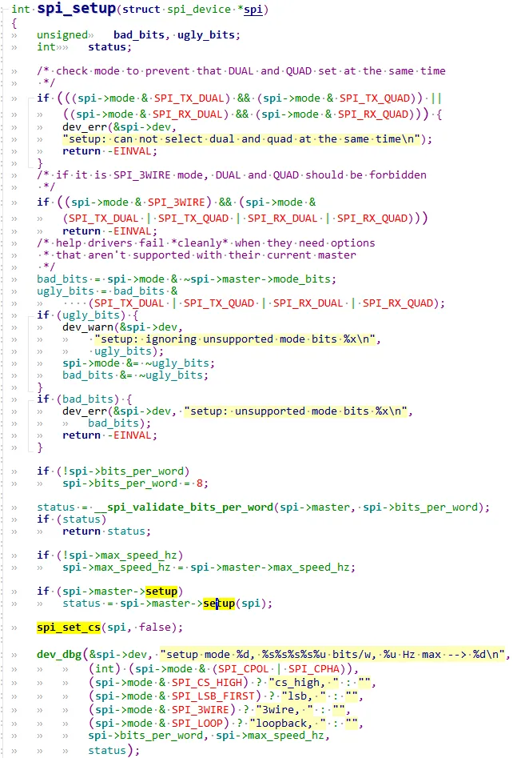
    3. 初始化`ICM20608`内部寄存器（发起spi传输）。
        1. 设置启动时序，使能读写。
        2. 读id。
        3. 设置量程，速率。
3. `ICM20608`的读写
    
4. `icm20608_read`调用`icm20608_readdata`，调用`icm20608_read_regs`
    
5. `icm20608_write_regs`， `icm20608_read_regs`用来spi协议让主控去读写spi从设备，都是通过`spi_sync`进行数据传输。
    

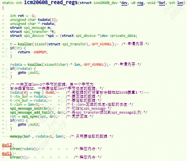
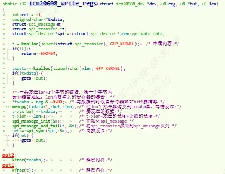
```
  将函数精简话一下：
```

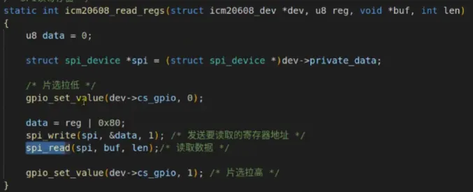
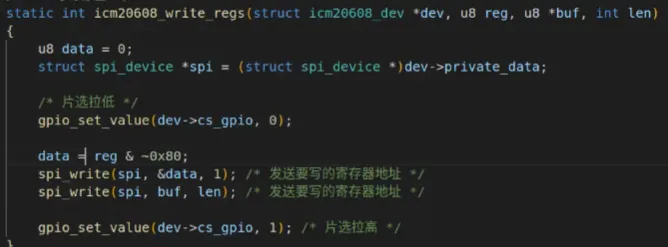
注意精简后有个bug, 就是调用spi_write后，又继续调用spi_read。这时imx6ul spi控制器驱动内部会帮忙控制cs片选信号。又会重新拉高，再拉低cs片选。因此导致数据传输异常。nxp官方也是用的gpio作为cs片选，软件手动去控制的。因此优化如下：

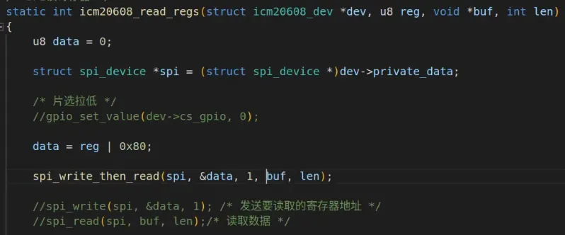
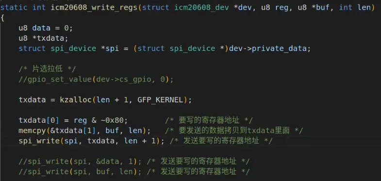
probe读出icm20608 `id`为：

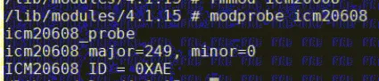
##### 1.3.2.2.3 icm20608App.c
```c
#include "stdio.h"  
#include "unistd.h"  
#include "sys/types.h"  
#include "sys/stat.h"  
#include "sys/ioctl.h"  
#include "fcntl.h"  
#include "stdlib.h"  
#include "string.h"  
#include <poll.h>  
#include <sys/select.h>  
#include <sys/time.h>  
#include <signal.h>  
#include <fcntl.h>  
int main(int argc, char *argv[])  
{  
	int fd;  
	char *filename;  
	signed int databuf[7];  
	unsigned char data[14];  
	signed int gyro_x_adc, gyro_y_adc, gyro_z_adc;  
	signed int accel_x_adc, accel_y_adc, accel_z_adc;  
	signed int temp_adc;  
  
	float gyro_x_act, gyro_y_act, gyro_z_act;  
	float accel_x_act, accel_y_act, accel_z_act;  
	float temp_act;  
	int ret = 0;  
  
	if (argc != 2) {  
		printf("Error Usage!\r\n");  
		return -1;  
	}  
	filename = argv[1];  
	fd = open(filename, O_RDWR);  
	if(fd < 0) {  
		printf("can't open file %s\r\n", filename);  
		return -1;  
	}  
	while (1) {  
		ret = read(fd, databuf, sizeof(databuf));  
		if(ret == 0) { 			/* 数据读取成功 */  
			gyro_x_adc = databuf[0];  
			gyro_y_adc = databuf[1];  
			gyro_z_adc = databuf[2];  
			accel_x_adc = databuf[3];  
			accel_y_adc = databuf[4];  
			accel_z_adc = databuf[5];  
			temp_adc = databuf[6];  
  
			/* 计算实际值 */  
			gyro_x_act = (float)(gyro_x_adc)  / 16.4;  
			gyro_y_act = (float)(gyro_y_adc)  / 16.4;  
			gyro_z_act = (float)(gyro_z_adc)  / 16.4;  
			accel_x_act = (float)(accel_x_adc) / 2048;  
			accel_y_act = (float)(accel_y_adc) / 2048;  
			accel_z_act = (float)(accel_z_adc) / 2048;  
			temp_act = ((float)(temp_adc) - 25 ) / 326.8 + 25;  
			printf("\r\n原始值:\r\n");  
			printf("gx = %d, gy = %d, gz = %d\r\n", gyro_x_adc, gyro_y_adc, gyro_z_adc);  
			printf("ax = %d, ay = %d, az = %d\r\n", accel_x_adc, accel_y_adc, accel_z_adc);  
			printf("temp = %d\r\n", temp_adc);  
			printf("实际值:");  
			printf("act gx = %.2f°/S, act gy = %.2f°/S, act gz = %.2f°/S\r\n", gyro_x_act, gyro_y_act, gyro_z_act);  
			printf("act ax = %.2fg, act ay = %.2fg, act az = %.2fg\r\n", accel_x_act, accel_y_act, accel_z_act);  
			printf("act temp = %.2f°C\r\n", temp_act);  
		}  
		usleep(100000); /*100ms */  
	}  
	close(fd);	  
	return 0;  
}
```

测试结果：

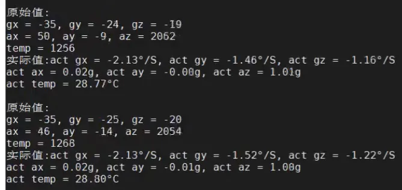
### 1.3.3 SPI万能从设备驱动-spidev.c

万能SPI从设备驱动对应spidev， 驱动代码位于`/drivers/spi/spidev.c`。不用为每个spi从设备去写一个驱动，linux内核有一个万能通用的从设备驱动。

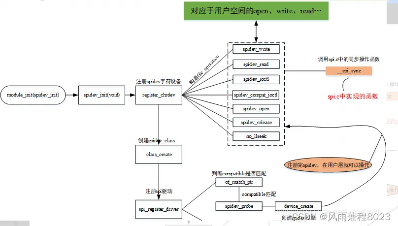
为什么说`spidev.c`是一个通用的从设备驱动。

spidev不是专门针对某一SPI硬件设备做的驱动，只是简单的注册字符设备，用户空间通过`read、write、ioctl`，直接对spi进行操作，相当于是用户空间和spi设备的桥梁。用户空间操作时，打开设备节点，然后通过IOCTL设置模式、速度等参数，然后就可以调用`read write`进行操作了。

#### 1.3.3.1 spidev_init

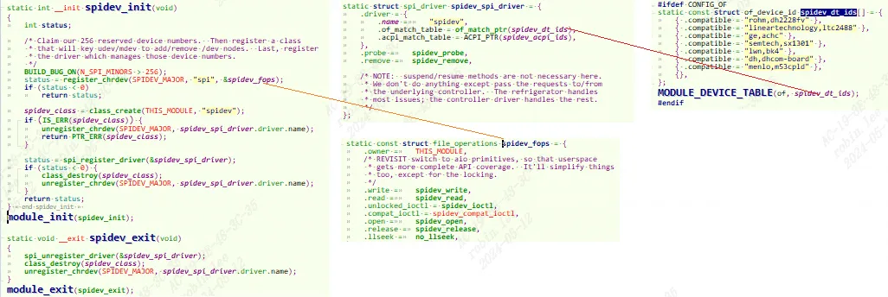
注册了字符设备，主设备号`SPIDEV_MAJOR= 153`，绑定`spidev_fops`。

创建了spidev的class，创建完成后在用户空间`/sys/class/`下可以看到spidev目录结构。

`spi_register_driver`按照标准流程注册spidev从设备驱动。

#### 1.3.3.2 spidev的probe
```c
static const struct of_device_id spidev_dt_ids[] = {  
	{ .compatible = "rohm,dh2228fv" },  
	{ .compatible = "lineartechnology,ltc2488" },  
	{ .compatible = "ge,achc" },  
	{ .compatible = "nanopi,spidev" },  
	{ .compatible = "semtech,sx1301" },  
	{},  
};  
static struct spi_driver spidev_spi_driver = {  
	.driver = {  
		.name =		"spidev",  
		.of_match_table = of_match_ptr(spidev_dt_ids),  
		.acpi_match_table = ACPI_PTR(spidev_acpi_ids),  
	},  
	.probe =	spidev_probe,  
	.remove =	spidev_remove,  
};  
static int spidev_probe(struct spi_device *spi){  
	struct spidev_data	*spidev;  
	int			status;  
	unsigned long		minor;  
  
	if (spi->dev.of_node && !of_match_device(spidev_dt_ids, &spi->dev)) {  
		dev_err(&spi->dev, "buggy DT: spidev listed directly in DT\n");  
		WARN_ON(spi->dev.of_node &&  
			!of_match_device(spidev_dt_ids, &spi->dev));  
	}  
  
	spidev_probe_acpi(spi);  
	/* Allocate driver data */  
	spidev = kzalloc(sizeof(*spidev), GFP_KERNEL);  
	if (!spidev)  
		return -ENOMEM;  
	/* Initialize the driver data */  
	spidev->spi = spi;  
	spin_lock_init(&spidev->spi_lock);  
	mutex_init(&spidev->buf_lock);  
	INIT_LIST_HEAD(&spidev->device_entry);  
	/* If we can allocate a minor number, hook up this device.  
	 * Reusing minors is fine so long as udev or mdev is working.  
	 */  
	mutex_lock(&device_list_lock);  
	minor = find_first_zero_bit(minors, N_SPI_MINORS);  
	if (minor < N_SPI_MINORS) {  
		struct device *dev;  
		spidev->devt = MKDEV(SPIDEV_MAJOR, minor);  
		dev = device_create(spidev_class, &spi->dev, spidev->devt,  
				    spidev, "spidev%d.%d",  
				    spi->master->bus_num, spi->chip_select);  
		status = PTR_ERR_OR_ZERO(dev);  
	} else {  
		dev_dbg(&spi->dev, "no minor number available!\n");  
		status = -ENODEV;  
	}  
	if (status == 0) {  
		set_bit(minor, minors);  
		list_add(&spidev->device_entry, &device_list);  
	}  
	mutex_unlock(&device_list_lock);  
	spidev->speed_hz = spi->max_speed_hz;  
	if (status == 0)  
		spi_set_drvdata(spi, spidev);  
	else  
		kfree(spidev);  
  
	return status;  
}
```

调用`device_create`创建了`/dev/`下的`spidev`节点,主设备号`SPIDEV_MAJOR= 153`，如`spi总线0`上`cs1`设备，则设备名为`/dev/spidev0.1`，其他以此类推。

#### 1.3.3.3 spidev_fops

##### 1.3.3.3.1 spidev_read
```c
spidev_read  
	->spidev_sync_read  
		->spidev_sync  
			->spi_sync
```

##### 1.3.3.3.2 spidev_write
```c
spidev_write  
	->spidev_sync_write  
		->spidev_sync  
			->spi_sync
```

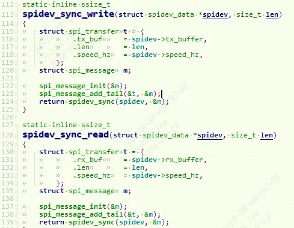
构造`spi_message`,`spi_transfer`调用`spi_sync`进行数据传输。

##### 1.3.3.3.3 spidev_ioctl
```c
static long spidev_ioctl(struct file *filp, unsigned int cmd, unsigned long arg) {  
	int			retval = 0;  
	struct spidev_data	*spidev;  
	struct spi_device	*spi;  
	u32			tmp;  
	unsigned		n_ioc;  
	struct spi_ioc_transfer	*ioc;  
    /* Check type and command number */  
    if (_IOC_TYPE(cmd) != SPI_IOC_MAGIC)  
        return -ENOTTY;  
    /* guard against device removal before, or while,  
     * we issue this ioctl.  
     */  
    spidev = filp->private_data;  
    spin_lock_irq(&spidev->spi_lock);  
    spi = spi_dev_get(spidev->spi);  
    spin_unlock_irq(&spidev->spi_lock);  
  
    if (spi == NULL)  
        return -ESHUTDOWN;  
  
    /* use the buffer lock here for triple duty:  
     *  - prevent I/O (from us) so calling spi_setup() is safe;  
     *  - prevent concurrent SPI_IOC_WR_* from morphing  
     *    data fields while SPI_IOC_RD_* reads them;  
     *  - SPI_IOC_MESSAGE needs the buffer locked "normally".  
     */  
    mutex_lock(&spidev->buf_lock);  
    switch (cmd) {  
    /* read requests */  
    case SPI_IOC_RD_MODE:  
        retval = put_user(spi->mode & SPI_MODE_MASK,  
                    (__u8 __user *)arg);  
        break;  
    case SPI_IOC_RD_MODE32:  
        retval = put_user(spi->mode & SPI_MODE_MASK,  
                    (__u32 __user *)arg);  
        break;  
    case SPI_IOC_RD_LSB_FIRST:  
        retval = put_user((spi->mode & SPI_LSB_FIRST) ?  1 : 0,  
                    (__u8 __user *)arg);  
        break;  
    case SPI_IOC_RD_BITS_PER_WORD:  
        retval = put_user(spi->bits_per_word, (__u8 __user *)arg);  
        break;  
    case SPI_IOC_RD_MAX_SPEED_HZ:  
        retval = put_user(spidev->speed_hz, (__u32 __user *)arg);  
        break;  
  
    /* write requests */  
    case SPI_IOC_WR_MODE:  
    case SPI_IOC_WR_MODE32:  
        if (cmd == SPI_IOC_WR_MODE)  
            retval = get_user(tmp, (u8 __user *)arg);  
        else  
            retval = get_user(tmp, (u32 __user *)arg);  
        if (retval == 0) {  
            struct spi_controller *ctlr = spi->controller;  
            u32	save = spi->mode;  
  
            if (tmp & ~SPI_MODE_MASK) {  
                retval = -EINVAL;  
                break;  
            }  
  
            if (ctlr->use_gpio_descriptors && ctlr->cs_gpiods &&  
                ctlr->cs_gpiods[spi->chip_select])  
                tmp |= SPI_CS_HIGH;  
  
            tmp |= spi->mode & ~SPI_MODE_MASK;  
            spi->mode = (u16)tmp;  
            retval = spi_setup(spi);  
            if (retval < 0)  
                spi->mode = save;  
            else  
                dev_dbg(&spi->dev, "spi mode %x\n", tmp);  
        }  
        break;  
    case SPI_IOC_WR_LSB_FIRST:  
        retval = get_user(tmp, (__u8 __user *)arg);  
        if (retval == 0) {  
            u32	save = spi->mode;  
  
            if (tmp)  
                spi->mode |= SPI_LSB_FIRST;  
            else  
                spi->mode &= ~SPI_LSB_FIRST;  
            retval = spi_setup(spi);  
            if (retval < 0)  
                spi->mode = save;  
            else  
                dev_dbg(&spi->dev, "%csb first\n",  
                        tmp ? 'l' : 'm');  
        }  
        break;  
    case SPI_IOC_WR_BITS_PER_WORD:  
        retval = get_user(tmp, (__u8 __user *)arg);  
        if (retval == 0) {  
            u8	save = spi->bits_per_word;  
  
            spi->bits_per_word = tmp;  
            retval = spi_setup(spi);  
            if (retval < 0)  
                spi->bits_per_word = save;  
            else  
                dev_dbg(&spi->dev, "%d bits per word\n", tmp);  
        }  
        break;  
    case SPI_IOC_WR_MAX_SPEED_HZ:  
        retval = get_user(tmp, (__u32 __user *)arg);  
        if (retval == 0) {  
            u32	save = spi->max_speed_hz;  
  
            spi->max_speed_hz = tmp;  
            retval = spi_setup(spi);  
            if (retval == 0) {  
                spidev->speed_hz = tmp;  
                dev_dbg(&spi->dev, "%d Hz (max)\n",  
                    spidev->speed_hz);  
            }  
            spi->max_speed_hz = save;  
        }  
        break;  
    default:  
        /* segmented and/or full-duplex I/O request */  
        /* Check message and copy into scratch area */  
        ioc = spidev_get_ioc_message(cmd,  
                (struct spi_ioc_transfer __user *)arg, &n_ioc);  
        if (IS_ERR(ioc)) {  
            retval = PTR_ERR(ioc);  
            break;  
        }  
        if (!ioc)  
            break;	/* n_ioc is also 0 */  
        /* translate to spi_message, execute */  
        retval = spidev_message(spidev, ioc, n_ioc);  
        kfree(ioc);  
        break;  
    }  
    mutex_unlock(&spidev->buf_lock);  
    spi_dev_put(spi);  
    return retval;  
}
```

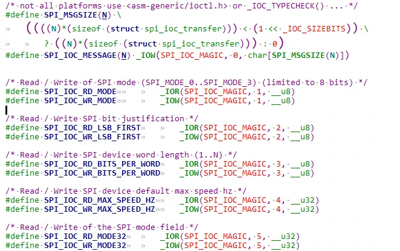
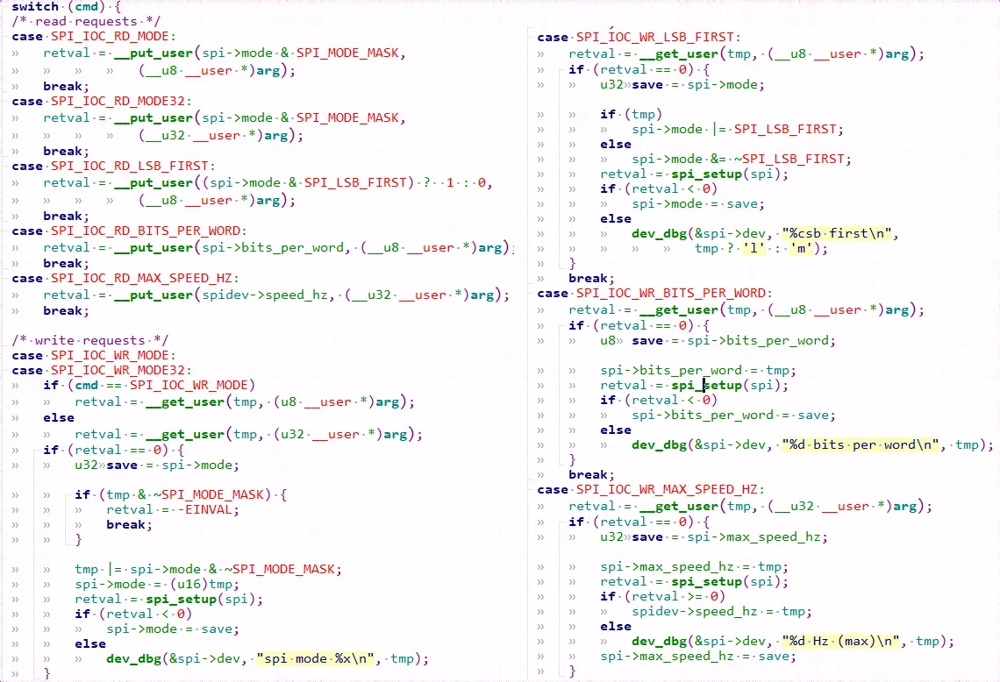
这些SPI_IOC命令就是一些设置速率参数，spi模式啊，然后就可以通过read,write操作`/dev/spidev%d.%d`设备了。

### 1.3.4 使用SPI万能驱动oled举例

#### 1.3.4.1 spi oled原理
参考具体spi oled开发手册。

#### 1.3.4.2 spi_oled.c
```c
#include <stdio.h>  
#include <unistd.h>  
#include <stdlib.h>  
#include <fcntl.h>  
#include <string.h>  
#include <sys/ioctl.h>  
#include <sys/types.h>  
#include <sys/stat.h>  
#include <linux/types.h>  
#include <linux/spi/spidev.h>  
#include "font.h"  
static int fd_spidev;  
static int dc_pin_num;  
void OLED_DIsp_Set_Pos(int x, int y);  
void dc_pin_init(int number)  
{  
	// echo 509 > /sys/class/gpio/export  
	// echo out > /sys/class/gpio/gpio509/direction	  
	char cmd[100];  
	dc_pin_num = number;  
   
	sprintf(cmd, "echo %d > /sys/class/gpio/export", number);  
	system(cmd);  
	sprintf(cmd, "echo out > /sys/class/gpio/gpio%d/direction", number);  
	system(cmd);	  
}  
   
void oled_set_dc_pin(int val)  
{  
	/* echo 1 > /sys/class/gpio/gpio509/value  
	 * echo 0 > /sys/class/gpio/gpio509/value  
	 */  
	char cmd[100];  
	sprintf(cmd, "echo %d > /sys/class/gpio/gpio%d/value", val, dc_pin_num);  
	system(cmd);	  
}  
   
void spi_write_datas(const unsigned char *buf, int len)  
{  
	write(fd_spidev, buf, len);  
}  
   
void oled_write_datas(const unsigned char *buf, int len)  
{  
	oled_set_dc_pin(1);//拉高，表示写入数据  
	spi_write_datas(buf, len);  
}  
  			 		  						  					  				 	   		  	  	 	    
/**********************************************************************  
	 * 函数名称： oled_write_cmd  
	 * 功能描述： oled向特定地址写入数据或者命令  
	 * 输入参数：@uc_data :要写入的数据  
	 			@uc_cmd:为1则表示写入数据，为0表示写入命令  
	 * 输出参数：无  
	 * 返 回 值： 无  
 ***********************************************************************/  
void oled_write_cmd_data(unsigned char uc_data,unsigned char uc_cmd)  
{  
	unsigned char uc_read=0;  
	if(uc_cmd==0)  
		oled_set_dc_pin(0);  
	else  
		oled_set_dc_pin(1);//拉高，表示写入数据  
  
	spi_write_datas(&uc_data, 1);//写入  
}  
int oled_init(void)  
{  
	unsigned char uc_dev_id = 0;  
		  			 		  						  					  				 	   		  	  	 	    
	oled_write_cmd_data(0xae,OLED_CMD);//关闭显示  
	oled_write_cmd_data(0x00,OLED_CMD);//设置 lower column address  
	oled_write_cmd_data(0x10,OLED_CMD);//设置 higher column address  
	oled_write_cmd_data(0x40,OLED_CMD);//设置 display start line  
	oled_write_cmd_data(0xB0,OLED_CMD);//设置page address  
	oled_write_cmd_data(0x81,OLED_CMD);// contract control  
	oled_write_cmd_data(0x66,OLED_CMD);//128  
	oled_write_cmd_data(0xa1,OLED_CMD);//设置 segment remap  
	oled_write_cmd_data(0xa6,OLED_CMD);//normal /reverse  
	oled_write_cmd_data(0xa8,OLED_CMD);//multiple ratio  
	oled_write_cmd_data(0x3f,OLED_CMD);//duty = 1/64  
	oled_write_cmd_data(0xc8,OLED_CMD);//com scan direction  
	oled_write_cmd_data(0xd3,OLED_CMD);//set displat offset  
	oled_write_cmd_data(0x00,OLED_CMD);//  
	oled_write_cmd_data(0xd5,OLED_CMD);//set osc division  
	oled_write_cmd_data(0x80,OLED_CMD);//  
	oled_write_cmd_data(0xd9,OLED_CMD);//ser pre-charge period  
	oled_write_cmd_data(0x1f,OLED_CMD);//  
	oled_write_cmd_data(0xda,OLED_CMD);//set com pins  
	oled_write_cmd_data(0x12,OLED_CMD);//  
	oled_write_cmd_data(0xdb,OLED_CMD);//set vcomh  
	oled_write_cmd_data(0x30,OLED_CMD);//  
	oled_write_cmd_data(0x8d,OLED_CMD);//set charge pump disable   
	oled_write_cmd_data(0x14,OLED_CMD);//  
	oled_write_cmd_data(0xaf,OLED_CMD);//set dispkay on  
	return 0;  
}		  			 		  						  					  				 	   		  	  	 	    
/**********************************************************************  
	 * 函数名称： oled_fill_data  
	 * 功能描述： 整个屏幕显示填充某个固定数据  
	 * 输入参数：@fill_Data：要填充的数据  
 ***********************************************************************/  
int oled_fill_data(unsigned char fill_Data)  
{  
	unsigned char x,y;  
	for(x=0;x<8;x++) {  
		oled_write_cmd_data(0xb0+x,OLED_CMD);		//page0-page1  
		oled_write_cmd_data(0x00,OLED_CMD);		//low column start address  
		oled_write_cmd_data(0x10,OLED_CMD);		//high column start address	  
		for(y=0;y<128;y++)  
			oled_write_cmd_data(fill_Data,OLED_DATA);//填充数据				  
	}  
	return 0;  
}  
void OLED_DIsp_Clear(void)    
{  
    unsigned char x, y;  
	char buf[128];  
	memset(buf, 0, 128);  
    for (y = 0; y < 8; y++) {  
        OLED_DIsp_Set_Pos(0, y);  
        //for (x = 0; x < 128; x++)  
        //    oled_write_cmd_data(0, OLED_DATA); /* 清零 */  
        oled_write_datas(buf, 128);  
    }  
}  
   
/**********************************************************************  
	 * 函数名称： OLED_DIsp_All  
	 * 功能描述： 整个屏幕显示全部点亮，可以用于检查坏点  
 ***********************************************************************/  
void OLED_DIsp_All(void)    
{  
	unsigned char x, y;  
	for (y = 0; y < 8; y++)  
	{  
		OLED_DIsp_Set_Pos(0, y);  
		for (x = 0; x < 128; x++)  
			oled_write_cmd_data(0xff, OLED_DATA); /* 全点亮 */  
	}  
}  
   
//坐标设置  
/**********************************************************************  
	 * 函数名称： OLED_DIsp_Set_Pos  
	 * 功能描述：设置要显示的位置  
	 * 输入参数：@ x ：要显示的column address  
	 			@y :要显示的page address  
 ***********************************************************************/  
void OLED_DIsp_Set_Pos(int x, int y)  
{ 	oled_write_cmd_data(0xb0+y,OLED_CMD);  
	oled_write_cmd_data((x&0x0f),OLED_CMD);   
	oled_write_cmd_data(((x&0xf0)>>4)|0x10,OLED_CMD);  
}   	      	   			   
void OLED_DIsp_Char(int x, int y, unsigned char c)  
{  
	int i = 0;  
	/* 得到字模 */  
	const unsigned char *dots = oled_asc2_8x16[c - ' '];  
   
	/* 发给OLED */  
	OLED_DIsp_Set_Pos(x, y);  
	/* 发出8字节数据 */  
	//for (i = 0; i < 8; i++)  
	//	oled_write_cmd_data(dots[i], OLED_DATA);  
	oled_write_datas(&dots[0], 8);  
   
	OLED_DIsp_Set_Pos(x, y+1);  
	/* 发出8字节数据 */  
	//for (i = 0; i < 8; i++)  
		//oled_write_cmd_data(dots[i+8], OLED_DATA);  
	oled_write_datas(&dots[8], 8);  
}  
   
void OLED_DIsp_String(int x, int y, char *str)  
{  
	unsigned char j=0;  
	while (str[j]){		  
		OLED_DIsp_Char(x, y, str[j]);//显示单个字符  
		x += 8;  
		if(x > 127){  
			x = 0;  
			y += 2;  
		}//移动显示位置  
		j++;  
	}  
}  
  
void OLED_DIsp_Test(void)  
{ 	  
	int i;  
	OLED_DIsp_String(0, 0, "wiki.100ask.net");  
	OLED_DIsp_String(0, 2, "book.100ask.net");  
	OLED_DIsp_String(0, 4, "bbs.100ask.net");  
}   
   
/* spi_oled /dev/spidevB.D <DC_pin_number> */  
int main(int argc, char **argv)  
{  
	int dc_pin;  
	  
	if (argc != 3){  
		printf("Usage: %s <dev/spidevB.D> <DC_pin_number>\n", argv[0]);//B表示spi bus, D表示cs片选  
		return -1;  
	}  
   
	fd_spidev = open(argv[1], O_RDWR);  
	if (fd_spidev < 0) {  
		printf("open %s err\n", argv[1]);  
		return -1;  
	}  
   
	dc_pin = strtoul(argv[2], NULL, 0);  
	dc_pin_init(dc_pin);  
   
	oled_init();  
	OLED_DIsp_Clear();  
	OLED_DIsp_Test();  
	return 0;  
}
```

##### 1.3.4.2.1 用户态驱动分析

有了spidev.c万能SPI从设备驱动，就不需要去写spi从设备驱动了，直接用户态去读写spidev即可。

1. `open("/dev/spi%d.%d", O_RDWR);`//根据自己外设使用的spi bus和cs片选去设置
2. 对外设oled进行初始化`D/C（data or cmd ）引脚`, 利用gpio子系统的命令去设置gpio模式为输出。
3. 利用spi协议发送初始化序列：
    1. `spi_write_datas`就是操作`spidev`，write数据到底层`spidev`，再调用对应的fops中的`spidev_write`，最终调用`spi_sync`传输数据。这里是每次传输1byte，把初始化序列利用spi协议写完。
4. 清屏并且测试`oled`显示字符。

### 1.3.5 不使用SPI万能驱动oled举例

#### 1.3.5.1 dts描述
```c
&ecspi1 {  
    pinctrl-names = "default";  
    pinctrl-0 = <&pinctrl_ecspi1>;  
    fsl,spi-num-chipselects = <2>;  
    cs-gpios = <&gpio4 26 GPIO_ACTIVE_LOW>, <&gpio4 24 GPIO_ACTIVE_LOW>;  
    status = "okay";  
   
    oled: oled {  
        compatible = "100ask,oled";  
        reg = <0>;  
        spi-max-frequency = <10000000>;  
        dc-gpios = <&gpio4 20 GPIO_ACTIVE_HIGH>;   
    };  
};
```

`spi1`下接了一个`spi oled`，修改对应dts文件，修改`ecspi1`节点，添加oled子节点。oled有一个`dc引脚`，叫做`data/cmd`引脚，选择是发送数据还是命令。参考spi oled原理。

#### 1.3.5.2 oled_drv.c
```c
#include <linux/init.h>  
#include <linux/module.h>  
#include <linux/ioctl.h>  
#include <linux/fs.h>  
#include <linux/device.h>  
#include <linux/err.h>  
#include <linux/list.h>  
#include <linux/errno.h>  
#include <linux/mutex.h>  
#include <linux/slab.h>  
#include <linux/compat.h>  
#include <linux/of.h>  
#include <linux/of_device.h>  
#include <linux/acpi.h>  
#include <linux/spi/spi.h>  
#include <linux/spi/spidev.h>  
#include <linux/uaccess.h>  
#include <linux/gpio/consumer.h>  
   
#define OLED_IOC_INIT 			123  
#define OLED_IOC_SET_POS 		124  
   
//为0 表示命令，为1表示数据  
#define OLED_CMD 	0  
#define OLED_DATA 	1  
   
static struct spi_device *oled;  
static int major;  
static struct gpio_desc *dc_gpio;  
   
static void dc_pin_init(void) {  
	gpiod_direction_output(dc_gpio, 1);  
}  
   
static void oled_set_dc_pin(int val) {  
	gpiod_set_value(dc_gpio, val);  
}  
   
static void spi_write_datas(const unsigned char *buf, int len) {  
	spi_write(oled, buf, len);  
}  
  
static void oled_write_cmd_data(unsigned char uc_data,unsigned char uc_cmd) {  
	if(uc_cmd==0)  
		oled_set_dc_pin(0);  
	else  
		oled_set_dc_pin(1);//拉高，表示写入数据  
  
	spi_write_datas(&uc_data, 1);//写入  
}  
   
static int oled_init(void) {  
	oled_write_cmd_data(0xae,OLED_CMD);//关闭显示  
	oled_write_cmd_data(0x00,OLED_CMD);//设置 lower column address  
	oled_write_cmd_data(0x10,OLED_CMD);//设置 higher column address  
	oled_write_cmd_data(0x40,OLED_CMD);//设置 display start line  
	oled_write_cmd_data(0xB0,OLED_CMD);//设置page address  
	oled_write_cmd_data(0x81,OLED_CMD);// contract control  
	oled_write_cmd_data(0x66,OLED_CMD);//128  
	oled_write_cmd_data(0xa1,OLED_CMD);//设置 segment remap  
	oled_write_cmd_data(0xa6,OLED_CMD);//normal /reverse  
	oled_write_cmd_data(0xa8,OLED_CMD);//multiple ratio  
	oled_write_cmd_data(0x3f,OLED_CMD);//duty = 1/64  
	oled_write_cmd_data(0xc8,OLED_CMD);//com scan direction  
	oled_write_cmd_data(0xd3,OLED_CMD);//set displat offset  
	oled_write_cmd_data(0x00,OLED_CMD);//  
	oled_write_cmd_data(0xd5,OLED_CMD);//set osc division  
	oled_write_cmd_data(0x80,OLED_CMD);//  
	oled_write_cmd_data(0xd9,OLED_CMD);//ser pre-charge period  
	oled_write_cmd_data(0x1f,OLED_CMD);//  
	oled_write_cmd_data(0xda,OLED_CMD);//set com pins  
	oled_write_cmd_data(0x12,OLED_CMD);//  
	oled_write_cmd_data(0xdb,OLED_CMD);//set vcomh  
	oled_write_cmd_data(0x30,OLED_CMD);//  
	oled_write_cmd_data(0x8d,OLED_CMD);//set charge pump disable   
	oled_write_cmd_data(0x14,OLED_CMD);//  
	oled_write_cmd_data(0xaf,OLED_CMD);//set dispkay on  
   
	return 0;  
}		  			 		  						  					  				 	   		  	  	 	    
   
static void OLED_DIsp_Set_Pos(int x, int y)  
{ 	oled_write_cmd_data(0xb0+y,OLED_CMD);  
	oled_write_cmd_data((x&0x0f),OLED_CMD);   
	oled_write_cmd_data(((x&0xf0)>>4)|0x10,OLED_CMD);  
}   	      	   			   
   
static long spidev_ioctl(struct file *filp, unsigned int cmd, unsigned long arg) {  
	int x, y;  
	/* 根据cmd操作硬件 */  
	switch (cmd) {  
		case OLED_IOC_INIT: /* init */  
		{  
			dc_pin_init();  
			oled_init();  
			break;  
		}  
		case OLED_IOC_SET_POS: /* set pos */  
		{  
			x = arg & 0xff;  
			y = (arg >> 8) & 0xff;  
			OLED_DIsp_Set_Pos(x, y);  
			break;  
		}  
	}  
	return 0;  
}  
   
static ssize_t spidev_write(struct file *filp, const char __user *buf, size_t count, loff_t *f_pos) {  
	char *ker_buf;  
	int err;  
	ker_buf = kmalloc(count, GFP_KERNEL);  
	err = copy_from_user(ker_buf, buf, count);  
	oled_set_dc_pin(1);//拉高，表示写入数据  
	spi_write_datas(ker_buf, count);  
	kfree(ker_buf);  
	return count;  
}  
   
static const struct file_operations spidev_fops = {  
	.owner =	THIS_MODULE,  
	.write =	spidev_write,  
	.unlocked_ioctl = spidev_ioctl,  
};  
   
static struct class *spidev_class;  
static const struct of_device_id spidev_dt_ids[] = {  
	{ .compatible = "100ask,oled" },  
	{},  
};  
  
static int spidev_probe(struct spi_device *spi)  
{  
	oled = spi;  
   
	major = register_chrdev(0, "100ask_oled", &spidev_fops);  
	spidev_class = class_create(THIS_MODULE, "100ask_oled");  
	device_create(spidev_class, NULL, MKDEV(major, 0), NULL, "100ask_oled");	  
   
	/* 3. 获得GPIO引脚 */  
	dc_gpio = gpiod_get(&spi->dev, "dc", 0);  
	return 0;  
}  
   
static int spidev_remove(struct spi_device *spi) {  
	gpiod_put(dc_gpio);  
	device_destroy(spidev_class, MKDEV(major, 0));  
	class_destroy(spidev_class);  
	unregister_chrdev(major, "cumtchw_oled");  
	return 0;  
}  
static struct spi_driver spidev_spi_driver = {  
	.driver = {  
		.name =		"cumtchw_spi_oled_drv",  
		.of_match_table = of_match_ptr(spidev_dt_ids),  
	},  
	.probe =	spidev_probe,  
	.remove =	spidev_remove,  
};  
static int __init spidev_init(void) {  
	int status;  
	status = spi_register_driver(&spidev_spi_driver);  
	if (status < 0) {  
	}  
	return status;  
}  
static void __exit spidev_exit(void){  
	spi_unregister_driver(&spidev_spi_driver);  
}  
module_init(spidev_init);  
module_exit(spidev_exit);  
MODULE_LICENSE("GPL");
```

##### 1.3.5.2.1 驱动分析

1. 调用`spi_register_driver`注册SPI从设备驱动，probe函数中利用标准字符设备驱动框架编写的驱动，注册字符设备，添加类。
2. 当用户调用`open("/dev/100ask_oled")`后，就可以调用read,write函数读写oled。
    1. spidev_ioctl提供了2个ioctl命令，用来初始化oled和设置坐标位置。用`spi_write_datas`写入初始化序列，每次写1byte。
    2. `spi_write_datas`调用标准的SPI从设备驱动API(`spi_write`)传输数据。
3. spi oled初始化完后就可以使用另一个`OLED_IOC_SET_POS` ioctl命令设置坐标位置。
4. 调用spidev_write写入数据。

#### 1.3.5.3 spi_oled.c应用测试
```c
#include <stdio.h>  
#include <unistd.h>  
#include <stdlib.h>  
#include <fcntl.h>  
#include <string.h>  
#include <sys/ioctl.h>  
#include <sys/types.h>  
#include <sys/stat.h>  
#include <linux/types.h>  
#include <linux/spi/spidev.h>  
#include "font.h"  
#define OLED_IOC_INIT 			123  
#define OLED_IOC_SET_POS 		124  
   
//为0 表示命令，为1表示数据  
#define OLED_CMD 	0  
#define OLED_DATA 	1  
static int fd_spidev;  
static int dc_pin_num;  
void OLED_DIsp_Set_Pos(int x, int y);  
   
void oled_write_datas(const unsigned char *buf, int len)  
{  
	write(fd_spidev, buf, len);  
}  
void OLED_DIsp_Clear(void) {  
    unsigned char x, y;  
	char buf[128];  
	memset(buf, 0, 128);  
    for (y = 0; y < 8; y++) {  
        OLED_DIsp_Set_Pos(0, y);  
        oled_write_datas(buf, 128);  
    }  
}  
   
void OLED_DIsp_All(void)  {  
    unsigned char x, y;  
	char buf[128];  
	memset(buf, 0xff, 128);  
    for (y = 0; y < 8; y++) {  
        OLED_DIsp_Set_Pos(0, y);  
        oled_write_datas(buf, 128);  
    }  
}  
   
void OLED_DIsp_Set_Pos(int x, int y)  
{ 	  
	ioctl(fd_spidev, OLED_IOC_SET_POS, x  | (y << 8));  
}   	      	   			   
  
void OLED_DIsp_Char(int x, int y, unsigned char c)  
{  
	int i = 0;  
	/* 得到字模 */  
	const unsigned char *dots = oled_asc2_8x16[c - ' '];  
   
	/* 发给OLED */  
	OLED_DIsp_Set_Pos(x, y);  
	/* 发出8字节数据 */  
	//for (i = 0; i < 8; i++)  
	//	oled_write_cmd_data(dots[i], OLED_DATA);  
	oled_write_datas(&dots[0], 8);  
   
	OLED_DIsp_Set_Pos(x, y+1);  
	/* 发出8字节数据 */  
	//for (i = 0; i < 8; i++)  
		//oled_write_cmd_data(dots[i+8], OLED_DATA);  
	oled_write_datas(&dots[8], 8);  
}  
void OLED_DIsp_String(int x, int y, char *str)  
{  
	unsigned char j=0;  
	while (str[j]) {		  
		OLED_DIsp_Char(x, y, str[j]);//显示单个字符  
		x += 8;  
		if(x > 127) {  
			x = 0;  
			y += 2;  
		}//移动显示位置  
		j++;  
	}  
}  
void OLED_DIsp_Test(void) { 	  
	int i;  
	OLED_DIsp_String(0, 0, "100ask test");  
}   
  
int main(int argc, char **argv) {	  
	if (argc != 2) {  
		printf("Usage: %s /dev/cumtchw_oled\n", argv[0]);  
		return -1;  
	}  
   
	fd_spidev = open(argv[1], O_RDWR);  
	if (fd_spidev < 0) {  
		printf("open %s err\n", argv[1]);  
		return -1;  
	}  
	ioctl(fd_spidev, OLED_IOC_INIT);  
	OLED_DIsp_Clear();  
	OLED_DIsp_Test();  
	return 0;  
}
```

# 2 数据结构

## 2.1 spi_master/spi_controller
```c
struct spi_master {  
	struct device	dev;	/* SPI设备的device数据结构 */  
	s16			bus_num;		/* SPI总线序号 */  
	u16			num_chipselect;	/* 片选信号数量 */  
	u16			dma_alignment;	/* SPI控制器DMA缓冲区对齐定义 */  
	u16			mode_bits;		/* 工作模式位，由驱动定义 */  
	u32			min_speed_hz;	/* 最小速度 */  
	u32			max_speed_hz;	/* 最小速度 */  
	u16			flags;			/* 限制条件标志 */  
	int			(*setup)(struct spi_device *spi);   /* 设置SPI设备的工作参数 */  
	int			(*transfer)(struct spi_device *spi,	/* SPI发送函数1 */  
						struct spi_message *mesg);  
	void		(*cleanup)(struct spi_device *spi);	/* SPI清除函数，当spi_master被释放时调用 */  
	int (*transfer_one_message)(struct spi_master *master,	/* SPI发送函数2 */  
	int (*transfer_one)(struct spi_master *master, struct spi_device *spi,/* SPI发送函数3 */  
			    struct spi_transfer *transfer);  
	...  
};
```

struct `spi_master`描述一个spi控制器，包扩spi控制器的属性描述信息，spi的一些操作回调函数，如`transfer`，`setup`。

## 2.2 spi_driver
```c
struct spi_driver {  
	const struct spi_device_id *id_table;  
	int			(*probe)(struct spi_device *spi);  
	int			(*remove)(struct spi_device *spi);  
	void			(*shutdown)(struct spi_device *spi);  
	struct device_driver	driver;  
};
```

用来描述一个spi从设备驱动。用来和spi从设备匹配。

## 2.3 spi_device
```c
struct spi_device {  
	struct device		dev;  
	struct spi_controller	*controller;  
	struct spi_controller	*master;	/* compatibility layer */  
	u32			max_speed_hz;  
	u8			chip_select;  
#define	SPI_CPHA	0x01			/* clock phase */  
#define	SPI_CPOL	0x02			/* clock polarity */  
#define	SPI_MODE_0	(0|0)			/* (original MicroWire) */  
#define	SPI_MODE_1	(0|SPI_CPHA)  
#define	SPI_MODE_2	(SPI_CPOL|0)  
#define	SPI_MODE_3	(SPI_CPOL|SPI_CPHA)  
#define	SPI_CS_HIGH	0x04			/* chipselect active high? */  
#define	SPI_LSB_FIRST	0x08			/* per-word bits-on-wire */  
#define	SPI_3WIRE	0x10			/* SI/SO signals shared */  
#define	SPI_LOOP	0x20			/* loopback mode */  
#define	SPI_NO_CS	0x40			/* 1 dev/bus, no chipselect */  
#define	SPI_READY	0x80			/* slave pulls low to pause */  
#define	SPI_TX_DUAL	0x100			/* transmit with 2 wires */  
#define	SPI_TX_QUAD	0x200			/* transmit with 4 wires */  
#define	SPI_RX_DUAL	0x400			/* receive with 2 wires */  
#define	SPI_RX_QUAD	0x800			/* receive with 4 wires */  
#define	SPI_CS_WORD	0x1000			/* toggle cs after each word */  
#define	SPI_TX_OCTAL	0x2000			/* transmit with 8 wires */  
#define	SPI_RX_OCTAL	0x4000			/* receive with 8 wires */  
#define	SPI_3WIRE_HIZ	0x8000			/* high impedance turnaround */  
	int			irq;  
	void			*controller_state;  
	void			*controller_data;  
	char			modalias[SPI_NAME_SIZE];  
	const char		*driver_override;  
	int			cs_gpio;	/* LEGACY: chip select gpio */  
	struct gpio_desc	*cs_gpiod;	/* chip select gpio desc */  
	struct spi_delay	word_delay; /* inter-word delay */  
};
```

用来描述一个spi从设备。用来和spi从设备驱动匹配。

## 2.4 spi_message/spi_transfer
```c
struct spi_transfer {  
	const void	*tx_buf;  
	void		*rx_buf;  
	unsigned	len;  
	...  
	u8		bits_per_word;  
	u16		delay_usecs;  
	u32		speed_hz;  
	...  
	struct list_head transfer_list;  
};  
struct spi_message {  
	struct list_head	transfers;  
	...  
	struct spi_device	*spi;  
	...  
	void			(*complete)(void *context);  
	void			*context;  
	...  
	struct list_head	queue;  
};
```

`spi_message`是发起一次数据传输，里面的`transfers`构成基本输入输出数据，通过`spi_sync`函数或`spi_async`函数发送。
