# 1 UART工作原理
略

# 2 Linux下TTY驱动框架

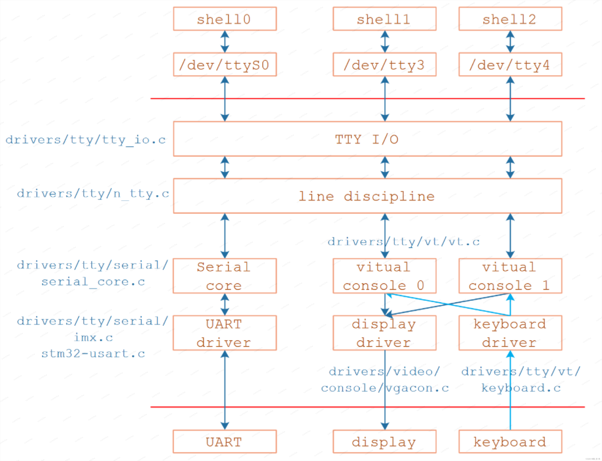
可以看到`tty框架`下不止包含uart,还有display设备，键盘设备。

详细展开如下，`tty_driver`位于`tty_io.c`， 调用底下的`uart_diver`位于`serial_core.c`。`uart_driver`子系统会被最底层的soc厂商拿去适配，调用`uart_register_driver`注册自己的uart控制器，去实现控制器要实现的`uart_fops`操作函数。  
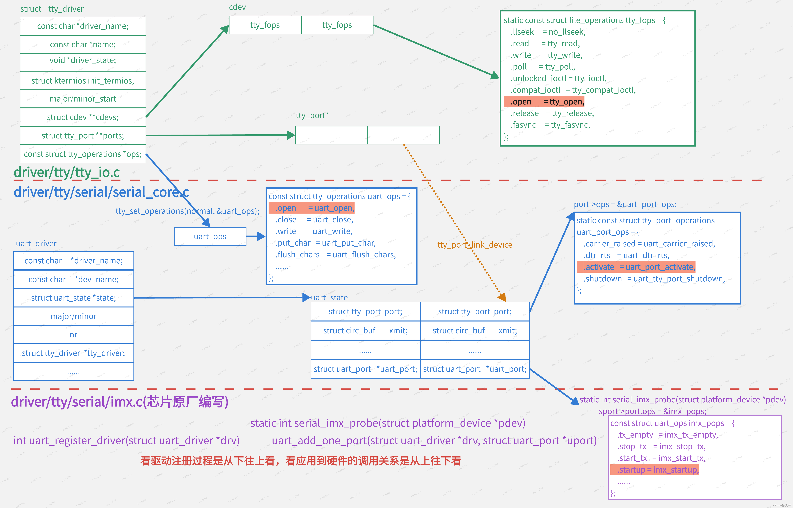
## 2.1 设备节点差别

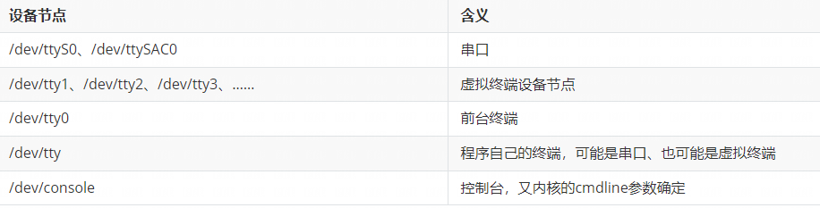
### 2.1.1 串口终端（/dev/ttyS*）

串口终端是使用计算机串口连接的终端设备。Linux把每个串行端口都看做是一个字符设备。这些串行端口所对应的设备名称是`/dev/ttyS*`。

### 2.1.2 控制台终端（/dev/console）

在Linux系统中，计算机的输出设备通常被称为控制台终端，这里特指printk信息输出到设备。`/dev/console`是一个虚拟的设备，它需要映射到真正的tty上，比如通过内核启动参数`“console=ttySCA0”`就把console映射到了串口0。

### 2.1.3 虚拟终端（/dev/tty*）

当用户登录时，使用的是虚拟终端。使用`Ctcl+Alt[F1 - F6]`组合键时，我们就可以切换到tty1、tty2、tty3等上面去。tty*就称为虚拟终端，而`tty0`则是当前所使用虚拟终端的一个别名。

## 2.2 架构层次

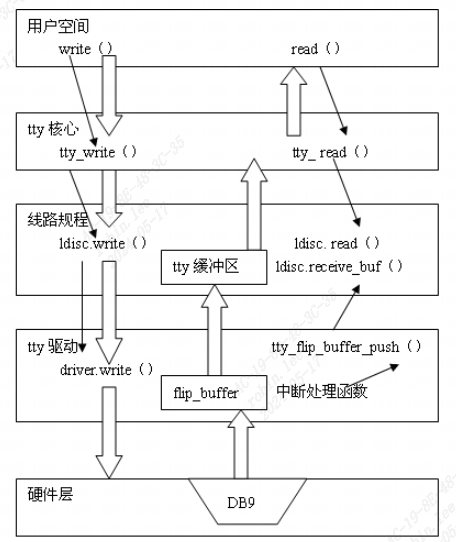
TTY核心层->行规程层->tty驱动层。

## 2.3 UART驱动子系统

### 2.3.1 数据结构和API

#### 2.3.1.1 uart_driver
```c
struct uart_driver {  
	struct module *owner; /* 模块所属者 */  
	const char *driver_name; /* 驱动名字 */  
	const char *dev_name; /* 设备名字 */  
	int major; /* 主设备号 */  
	int minor; /* 次设备号 */  
	int nr; /* 设备数 */  
	struct console *cons; /* 控制台 */  
	/*  
	* these are private; the low level driver should not  
	* touch these; they should be initialised to NULL  
	*/  
	struct uart_state *state;  
	struct tty_driver *tty_driver;  
};  
//include/linux/serial_core.h
```

##### 2.3.1.1.1 uart_driver 注册与注销

`int uart_register_driver(struct uart_driver *drv);`

`返回值：0，成功；负值，失败。`

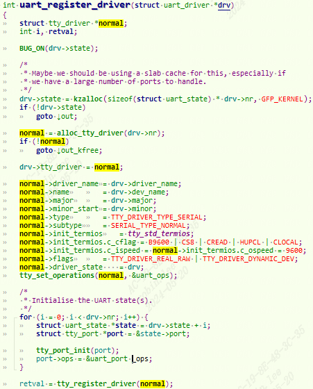
```c
retval = tty_register_driver(normal);  
	error = register_chrdev_region(dev, driver->num, driver->name);//也是通过字符设备驱动框架注册  
		d = tty_register_device(driver, i, NULL);  
			tty_register_device_attr(driver, index, device, NULL, NULL);  
				retval = tty_cdev_add(driver, devt, index, 1);  
					driver->cdevs[index]->ops = &tty_fops;  
					err = cdev_add(driver->cdevs[index], dev, count);
```

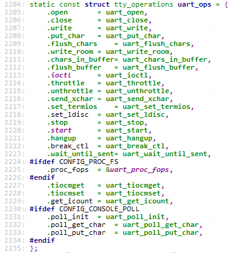
设置`uart_ops`为tty的`tty_operations`。然后调用`tty_register_driver`注册到tty子系统。

`void uart_unregister_driver(struct uart_driver *drv);`

#### 2.3.1.2 uart_port

描述串口端口的I/O端口或I/O内存地址、FIFO大小、端口类型、串口时钟等信息。实际上，一个`uart_port`实现对应一个串口设备。
```c
struct uart_port {  
	spinlock_t lock; /* port lock */  
	unsigned long iobase; /* in/out[bwl] */  
	unsigned char __iomem *membase; /* read/write[bwl] */  
	..  
	const struct uart_ops *ops;  
	unsigned int custom_divisor;  
	unsigned int line; /* port index */  
	unsigned int minor;  
	resource_size_t mapbase; /* for ioremap */  
	resource_size_t mapsize;  
	struct device *dev; /* parent device */  
	..  
};  
//include/linux/serial_core.h
```

##### 2.3.1.2.1 uart_port 的添加与移除

`int uart_add_one_port(struct uart_driver *drv, struct uart_port *uport);`

`返回值：0，成功；负值，失败。`

`uart_port` 和 `uart_driver` 结合起来。

`int uart_remove_one_port(struct uart_driver *drv, struct uart_port *uport);`

##### 2.3.1.2.2 uart_port 的休眠与恢复
```c
int uart_suspend_port(struct uart_driver *drv, struct uart_port *port);//挂起特定的串口端口  
int uart_resume_port(struct uart_driver *drv, struct uart_port *port);  
//唤醒上层因串口端口写数据而堵塞的进程，通常在串口发送中断处理函数中调用该函数  
void uart_write_wakeup(struct uart_port *port);
```

#### 2.3.1.3 uart_ops
```c
struct uart_ops {  
	unsigned int (*tx_empty)(struct uart_port *);  
	void (*set_mctrl)(struct uart_port *, unsigned int mctrl);  
	unsigned int (*get_mctrl)(struct uart_port *);  
	void (*stop_tx)(struct uart_port *);  
	void (*start_tx)(struct uart_port *);  
	void (*throttle)(struct uart_port *);  
	void (*unthrottle)(struct uart_port *);  
	void (*send_xchar)(struct uart_port *, char ch);  
	void (*stop_rx)(struct uart_port *);  
	void (*enable_ms)(struct uart_port *);  
	void (*break_ctl)(struct uart_port *, int ctl);  
	int (*startup)(struct uart_port *);  
	void (*shutdown)(struct uart_port *);  
	void (*flush_buffer)(struct uart_port *);  
	void (*set_termios)(struct uart_port *, struct ktermios *new,struct ktermios *old);  
	void (*set_ldisc)(struct uart_port *, struct ktermios *);  
	void (*pm)(struct uart_port *, unsigned int state,unsigned int oldstate);  
	/*  
	* Return a string describing the type of the port  
	*/  
	const char *(*type)(struct uart_port *);  
  
	/*  
	* Release IO and memory resources used by the port.  
	* This includes iounmap if necessary.  
	*/  
	void (*release_port)(struct uart_port *);  
	/*  
	* Request IO and memory resources used by the port.  
	* This includes iomapping the port if necessary.  
	*/  
	int (*request_port)(struct uart_port *);  
	void (*config_port)(struct uart_port *, int);  
	int (*verify_port)(struct uart_port *, struct serial_struct *);  
	int (*ioctl)(struct uart_port *, unsigned int, unsigned long);  
	#ifdef CONFIG_CONSOLE_POLL  
	int (*poll_init)(struct uart_port *);  
	void (*poll_put_char)(struct uart_port *, unsigned char);  
	int (*poll_get_char)(struct uart_port *);  
	#endif  
};
```

#### 2.3.1.4 console
```c
struct console {  
      char name[16];  
      void(*write)(struct console *，const char *, unsigined);  
      int (*read)(struct console *, char *, unsigned);  
      struct tty_driver *(struct console *,int*);  
      void (*unblank)(void);  
      int  (*setup)(struct console *, char *);  
      int  (*early_setup)(void);  
      short  flags;  
      short  index; /*用来指定该console使用哪一个uart port (对应的uart_port中的line),  
      如果为-1,kernel会自动选择第一个uart port*/  
      int   cflag;  
      void  *data;  
      struct   console *next;  
};
```

#### 2.3.1.5 波特率相关
```c
/*功能：uart_get_baud_rate通过解码termios结构体来获取指定串口的波特率  
 *参数：  
 *     port：要获取波特率的串口端口  
 *     termios:当前期望的termios配置(包括串口波特率)  
 *     old:以前的termios配置，可以为NULL  
 *     min:可以接受的最小波特率  
 *     max:可以接受的最大波特率  
 *     返回值：串口波特率  
 */  
unsigned int uart_get_baund_rate(struct uart_port *port, struct ktermios *termios  
                                 , struct ktermios *old,unsigned int min, unsigned int max);  
/*功能：uart_get_divisor 用于计算某一波特率的串口时钟分频数(串口波特率除数）  
 *参数：  
 *     port：要计算分频数的串口端口  
 *     baud：期望的波特率  
 *返回值：串口时钟分频数  
 */  
unsigned int uart_get_divisor(struct uart_port *port, unsigned int baund);
```

#### 2.3.1.6 向串口写控制台信息
```c
/*功能：uart_console_write用于向串口端口写一控制台信息  
 *参数：  
 *     port：要写信息的串口端口  
 *     s:要写的信息  
 *     count：信息的大小  
 *     putchar：用于向串口端口写字符的函数，该函数有两个参数：串口端口和要写的字符  
 */  
Void uart_console_write(struct uart_port *port,const char *s,  
     unsigned int count,viod(*putchar)(struct uart_port*, int));
```

## 2.4 UART控制器示例-imx为例

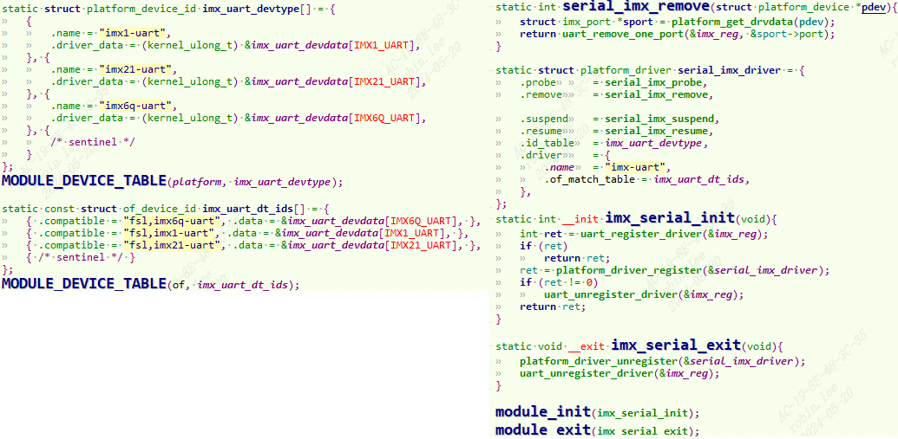
位于`drivers\tty\serial\imx.c`,使用platform_driver框架，调用`uart_register_driver`注册到uart子系统。

### 2.4.1 dts描述

板子使用的是uart3,打开`imx6ul.dtsi`，可以看到默认status是disabled。
```c
uart3: serial@021ec000 {  
	compatible = "fsl,imx6ul-uart",  
	"fsl,imx6q-uart", "fsl,imx21-uart";  
	reg = <0x021ec000 0x4000>;  
	interrupts = <GIC_SPI 28 IRQ_TYPE_LEVEL_HIGH>;  
	clocks = <&clks IMX6UL_CLK_UART3_IPG>,  
	<&clks IMX6UL_CLK_UART3_SERIAL>;  
	clock-names = "ipg", "per";  
	dmas = <&sdma 29 4 0>, <&sdma 30 4 0>;  
	dma-names = "rx", "tx";  
	status = "disabled";  
};
```

我们再外面引用它，打开`imx6ull-alientek-emmc.dts`：
```c
pinctrl_uart3: uart3grp {  
	fsl,pins = <  
		MX6UL_PAD_UART3_TX_DATA__UART3_DCE_TX 0X1b0b1  
		MX6UL_PAD_UART3_RX_DATA__UART3_DCE_RX 0X1b0b1  
	>;  
};  
&uart3 {  
	pinctrl-names = "default";  
	pinctrl-0 = <&pinctrl_uart3>;  
	status = "okay";  
};
```

### 2.4.2 probe初始化

当dts和驱动的compatible匹配，那么probe执行如下：

初始化 `uart_port`，然后将其添加到对应的 `uart_driver` 中。

1. 解析dts, 设置中断号，io基地址后`ioremap`, 设置port属性。

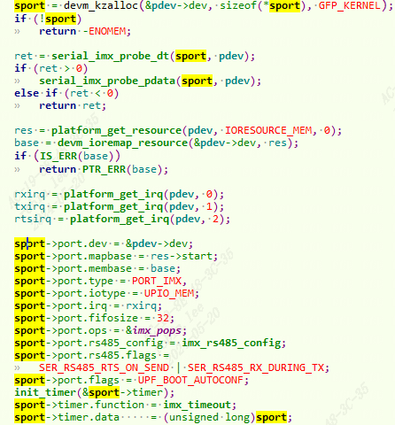
2. 设置port属性的ops

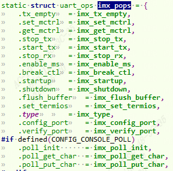
3. 更具dts获取和设置时钟频率。
4. 注册中断

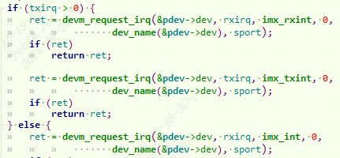
5. `uart_add_one_port(&imx_reg, &sport->port);`添加端口到uart_driver。

### 2.4.2 收据收发流程

#### 2.4.2.1 open过程
```c
//tty_io.c  
static const struct file_operations tty_fops = {  
	.read		= tty_read,  
	.write		= tty_write,  
	.open		= tty_open,  
	.release	= tty_release,  
     ······  
};//open("/dev/tty");  
//进入tty_open函数：  
static int tty_open(struct inode *inode, struct file *filp){  
    struct tty_struct *tty;  
    struct tty_driver *driver = NULL;  
    ......  
	if (tty->ops->open)	/*即uart_open*/  
		retval = tty->ops->open(tty, filp);//  
	return 0;  
}
```

```c
static int uart_open(struct tty_struct *tty, struct file *filp) {  
	struct uart_driver *drv = (struct uart_driver *)tty->driver->driver_state;  
	int retval;  
	struct uart_state *state = drv->state + line;  
	retval = uart_startup(tty, state, 0);  
}  
static int uart_startup(struct tty_struct *tty, struct uart_state *state, int init_hw) {  
	retval = uart_port_startup(tty, state, init_hw);  
}  
static int uart_port_startup(struct tty_struct *tty, struct uart_state *state, int init_hw) {  
	struct uart_port *uport = state->uart_port;  
	if (!state->xmit.buf) {  
		page = get_zeroed_page(GFP_KERNEL);		/*分配了一页内存*/  
		state->xmit.buf = (unsigned char *) page;	/*串口底层发送缓冲区*/  
		uart_circ_clear(&state->xmit);  
	}  
	retval = uport->ops->startup(uport);		/*即imx_startup*/  
	return retval;  
}  
   
static int imx_startup(struct uart_port *port)  
{  
	struct imx_port *sport = (struct imx_port *)port;  
	int retval, i;  
	unsigned long flags, temp;  
    .....  
	/* Can we enable the DMA support? */  
	if (is_imx6q_uart(sport) && !uart_console(port)  
		&& !sport->dma_is_inited)  
		imx_uart_dma_init(sport);  //配置发送消息时DMA搬运的目标地址，接收消息时DMA搬运的源地址  
   
	if (sport->dma_is_inited)  
		INIT_DELAYED_WORK(&sport->tsk_dma_tx, dma_tx_work);//定义了一个延后工作任务  
    //DMA发送搬运，在串口发送数据会唤醒调度  
	return 0;  
}
```

#### 2.4.2.2 发送接收总流程

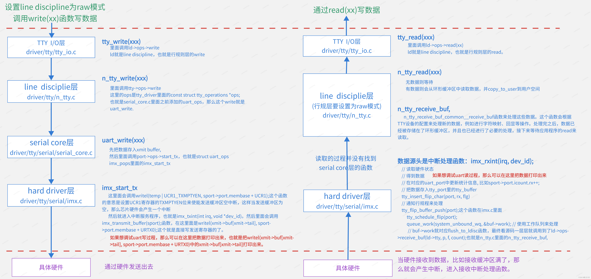
#### 2.4.2.3 发送-write过程
```c
1. 应用层调用write系统调用来写入数据  
2. write系统调用会调用到tty_write函数，这个函数定义在driver/tty/tty_io.c文件中。  
    而在tty_write函数里面调用的是ld->ops->write函数，这个就是line discipline层的write函数。  
3. line discipline层的write函数就是n_tty_write函数，这个函数定义在driver/tty/n_tty.c文件中。  
    n_tty_write函数会进一步调用到uart_write函数，这个函数是通过tty_operations结构体的指针来访问的。  
4. uart_write函数会进一步调用到start_tx函数，这个函数也是通过tty_operations结构体的指针来访问的。  
    在i.MX6ULL平台上，这个函数对应的就是imx_start_tx函数。  
5. 在imx_start_tx函数中，会通过设置UCR1寄存器的TXMPTYEN位来使能发送缓冲区空中断。  
    这个操作是通过调用writel(temp | UCR1_TXMPTYEN, sport->port.membase + UCR1)来完成的。  
6. 当UART控制器的发送缓冲区空了之后，就会产生一个中断。这个中断会被内核的中断处理机制捕获，  
    并调用相应的中断处理程序来处理。  
7. 在中断处理程序中，会从环形缓冲区中取出数据，并写入到UART控制器的发送缓冲区中。  
    然后UART控制器会自动将这些数据发送出去。
```

##### 2.4.2.3.1 用户写数据流程

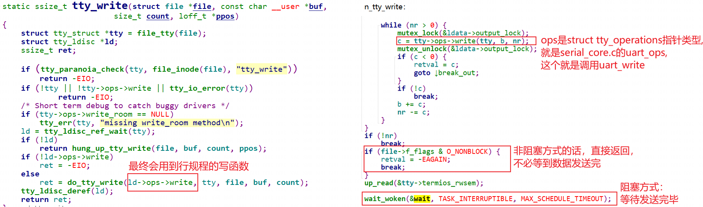
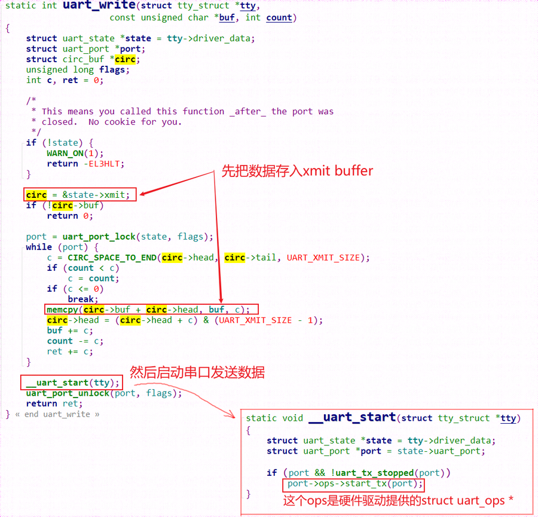
在`tty_write`中通过`ld->ops->write`调用了线路规程的write函数，也就是调用了`tty_ldisc_N_TTY`的`ntty_write`函数。

##### 2.4.2.3.2 硬件写数据流程

`drivers\tty\serial\imx.c`的发送函数`imx_start_tx`和发送中断函数`imx_txint`。

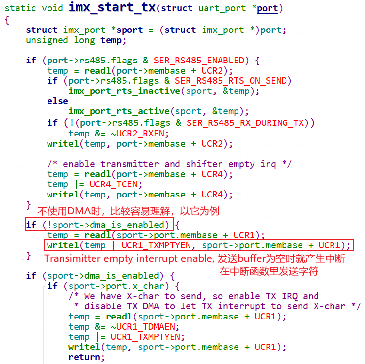
一开始时，发送buffer肯定为空，会立刻产生中断:

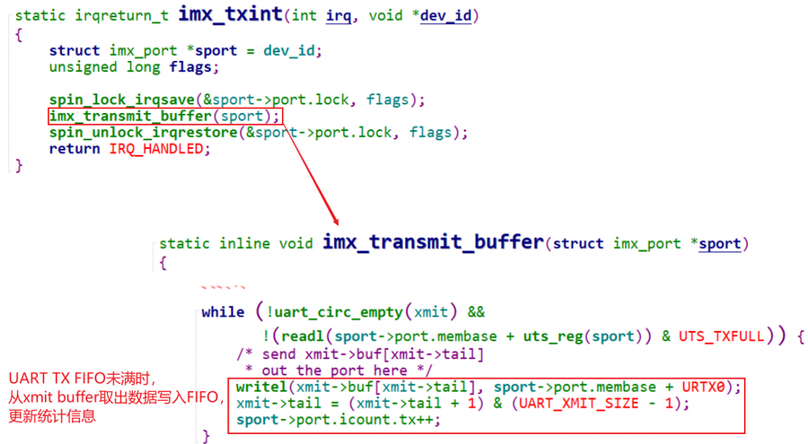
#### 2.4.2.4 接收-read过程
```c
1. UART硬件控制器的接收端接收到数据后，数据会被自动写入接收缓冲区。  
    如果接收缓冲区中的数据达到一定数量（例如，半满或者满），  
    或者在一定时间内没有新的数据到来，那么就会产生一个接收中断。  
2. 执行中断服务程序。在i.MX6ULL平台上，对应imx_rxint函数，在drivers/tty/serial/imx.c文件中。  
    2.1 imx_rxint函数中，首先会得到数据，然后通知line_disciplie层来处理，  
    	调用line_disciplie层的n_tty_receive_buf函数。  
    2.2 n_tty_receive_buf调用n_tty_receive_buf_common__receive_buf。  
    	这个函数会根据TTY设备的配置来处理新的数据，例如进行字符映射、回显等操作。  
    	处理完之后，数据已经被存储在了环形缓冲区，并且也已经进行了必要的处理，接下来等待应用程序的read来读取。  
3. 应用层的read来读取数据，调用tty层的tty_read函数，进一步调用line discipline层的read函数，  
    这个line discipline层的read函数就可以读取前面从底层传过来的数据了。
```

##### 2.4.2.4.1 中断产生数据流程

`imx_rxint`  
// 读取硬件状态  
// 得到数据  
// 在对应的`uart_port`中更新统计信息, 比如`sport->port.icount.rx++`;  
// 把数据存入`tty_port`里的`tty_buffer`  
`tty_insert_flip_char(port, rx, flg)`  
// 通知行规程来处理  
`tty_flip_buffer_push(port);`  
`tty_schedule_flip(port);`  
`queue_work(system_unbound_wq, &buf->work);` // 使用工作队列来处理  
// 对应flush_to_ldisc函数

##### 2.4.2.4.2 用户读取数据流程

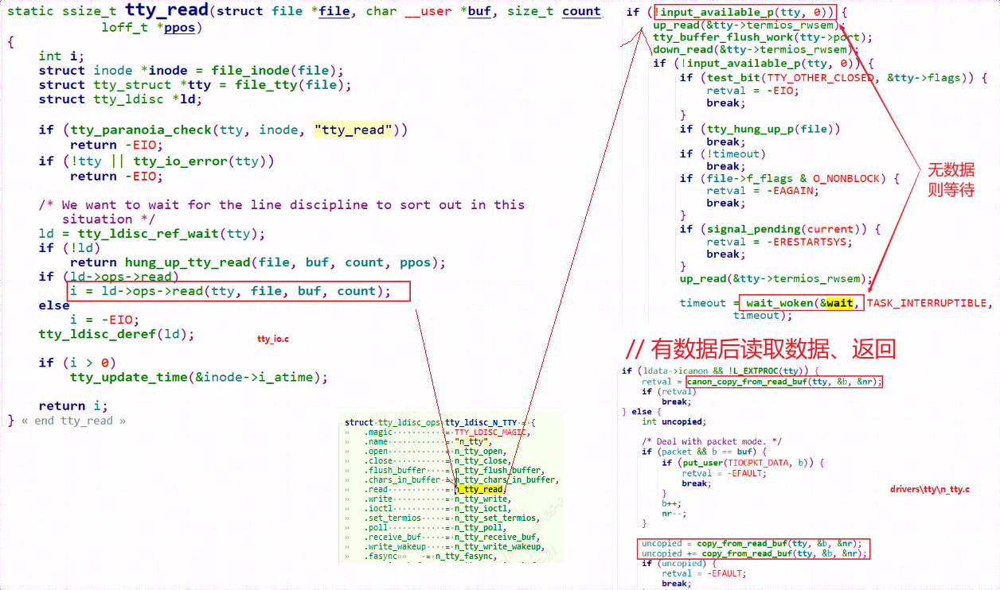
在`tty_read`中通过`ld->ops->read`调用了线路规程的read函数，也就是调用了`tty_ldisc_N_TTY`的`ntty_read`函数。

# 3 UART用户态控制函数

## 3.1 API说明

|属性|说明|
|---|:--|
|tcgetatrr|取属性（termios结构）|
|tcsetarr|设置属性（termios结构）|
|cfgetispeed|得到输入速度|
|cfsetispeed|得到输出速度|
|cfstospeed|设置输出速度|
|tcdrain|等待所有输出都被传输|
|tcflow|挂起传输或接收|
|tcflush|刷请未决输出和/或输入|
|tcsendbreak|送BREAK字符|
|tcgetpgrp|得到前台进程组ID|
|Tcsetpgrp|设置前台进程组ID|

### 3.1.1 设置参数

1. 获取属性， `tegetatrr(fd, &oldtio);`
```c
struct termious newtio, oldtio;  
tegetattr(fd, &oldtio);
```

2. 激活选项有`CLOCAL`和`CREAD`，用于本地连接和接收使用
```c
newtio.cflag |= CLOCAL|CREAD;
```

3. 设置波特率
```c
newtio.c_cflag = B115200;
```

4. 设置数据位，需使用掩码设置
```c
newtio.c_cflag &= ~CSIZE;  
Newtio.c_cflag |= CS8;
```

5. 设置停止位，通过激活`c_cflag`中的`CSTOP`实现。若停止位为1,则清除`CSTOPB`，若停止位为2，则激活`CSTOP`
```c
newtio.c_cflag &= ~CSTOPB; /*停止位设置为1*/  
Newtio.c_cflag |= CSTOPB; /*停止位设置为2 */
```

6. 设置流控
```c
newtio.c_cfag |= CRTSCTS /*开启硬件流控 */  
newtio.c_cfag |= (IXON | IXOFF | IXANY); /*开启软件流控*/
```

7. 奇偶检验位设置，使用`c_cflag`和`c_ifag`.  
    7.1 设置奇校验
```c
newtio.c_cflag |= PARENB;  
newtio.c_cflag |= PARODD;  
newtio.c_iflag |= (INPCK | ISTRIP);
```

7.2 设置偶校验
```c
newtio.c_iflag |= (INPCK | ISTRIP);  
newtio.c_cflag |= PARENB;  
newtio.c_cflag |= ~PARODD;
```

8. 设置最少字符和等待时间，对于接收字符和等待时间没有什么特别的要求，可设置为0：
```c
newtio.c_cc[VTIME] = 0;  
newtio.c_cc[VMIN]  = 0;
```

9. 处理要写入的引用对象  
    `tcflush`函数刷清(抛弃）输入缓冲（终端程序已经接收到，但用户程序尚未读）或输出缓冲（用户程序已经写，但未发送）。
```c
int tcflash(int filedes, int quene)  
quene数应当是下列三个常数之一:  
  *TCIFLUSH 刷清输入队列  
  *TCOFLUSH 刷清输出队列  
  *TCIOFLUSH 刷清输入、输出队列  
例如：  
tcflush(fd, TCIFLUSH);
```

10. 激活配置，在完成配置后，需要激活配置使其生效。使用`tcsetattr()`函数：
```c
int tcsetarr(int filedes, const struct termios *termptr);  
opt 指定在什么时候新的终端属性才起作用，  
   *TCSANOW:更改立即发生  
   *TCSADRAIN:发送了所有输出后更改才发生。若更改输出参数则应使用此选项  
   *TCSAFLUSH:发送了所有输出后更改才发生。更进一步，在更改发生时未读的  
                 所有输入数据都被删除（刷清）  
例如：tcsetatrr(fd, TCSANOW, &newtio);
```

### 3.1.2 操作流程

1. 打开串口，例如`"/dev/ttySLB0"`
```c
fd = open("/dev/ttySLB0",O_RDWR | O_NOCTTY | O_NDELAY);  
/*O_NOCTTY：是为了告诉Linux这个程序不会成为这个端口上的“控制终端”。  
	如果不这样做的话，所有的输入，比如键盘上过来的Ctrl+C中止信号等等，会影响到你的进程。  
O_NDELAY：这个标志则是告诉Linux这个程序并不关心DCD信号线的状态，  
	也就是不管串口是否有数据到来，都是非阻塞的，程序继续执行。  
*/
```

2. 恢复串口状态为阻塞状态，用于等待串口数据的读入，用fcntl函数：
```c
fcntl(fd,F_SETFL,0);  //F_SETFL：设置文件flag为0，即默认，即阻塞状态
```

3. 接着测试打开的文件描述符是否应用一个终端设备，以进一步确认串口是否正确打开。
```c
isatty(STDIN_FILENO);
```

4. 读写串口
```c
串口的读写与普通文件一样，使用read，write函数  
read(fd, buf ,8);  
write(fd,buff,8);
```

## 3.2 demo举例
```c
#include <sys/types.h>  
#include <sys/stat.h>  
#include <fcntl.h>  
#include <termios.h>  
#include <stdio.h>  
#include <string.h>  
#include <unistd.h>  
#include <log/log.h>  
#include <stdlib.h>  
#define UART_DEVICE     "/dev/ttySLB1"  
struct temp {  
	float temp_max1;  
	float temp_max2;  
	float temp_max3;  
	float temp_min;  
	float temp_mean;  
	float temp_enviromem;  
	char temp_col[1536];  
};  
  
int main(void) {  
	int count, i, fd;  
	struct termios oldtio, newtio;  
	struct temp *temp;  
	temp = (struct temp *)malloc(sizeof(struct temp));  
	if (!temp) {  
		printf("malloc failed\n");  
		return -1;  
	}  
  
	char cmd_buf1[] = { 0xAA, 0x01, 0x04, 0x00, 0x06, 0x10, 0x05, 0x00, 0xBB};  
	char cmd_buf2[] = { 0xAA, 0x01, 0x04, 0x00, 0x00, 0xA0, 0x00, 0x03, 0xBB};  
	char cmd_buf3[] = { 0xAA, 0x01, 0x04, 0x00, 0x03, 0x10, 0x01, 0x00, 0xBB};  
	char read_buf[2000];  
  
	fd = open(UART_DEVICE, O_RDWR | O_NOCTTY);  
	if (fd < 0) {  
		printf("Open %s failed\n", UART_DEVICE);  
		return -1;  
	}   
	tcgetattr(fd, &oldtio);//获取当前操作模式参数  
	memset(&newtio, 0, sizeof(newtio));  
	//波特率=230400 数据位=8 使能数据接收  
	newtio.c_cflag = B230400 | CS8 | CLOCAL | CREAD | CSTOPB;  
	newtio.c_iflag = IGNPAR;  
	tcflush(fd, TCIFLUSH);//清空输入缓冲区和输出缓冲区  
	tcsetattr(fd, TCSANOW, &newtio);//设置新的操作参数  
  
	//printf("input: %s, len = %d\n", cmd_buf, strlen(cmd_buf));  
	//------------向uart发送数据-------------------  
	for (i = 0; i < 9; i++)  
		printf("%#X ", cmd_buf1[i]);  
  
	count = write(fd, cmd_buf1, 9);  
	if (count != 9) {  
		printf("send failed\n");  
		return -1;  
	}  
	usleep(500000);  
	memset(read_buf, 0, sizeof(read_buf));  
	count = read(fd, read_buf, sizeof(read_buf));  
	if (count > 0) {  
		for (i = 0; i < count; i++);  
		temp->temp_max1 = read_buf[7] << 8 | read_buf[6];  
		temp->temp_max2 = read_buf[9] << 8 | read_buf[8];  
		temp->temp_max3 = read_buf[11] << 8 | read_buf[10];  
		temp->temp_min  = read_buf[13] << 8 | read_buf[12];  
		temp->temp_mean = read_buf[15] << 8 | read_buf[14];  
  
		printf("temp->temp_max1 = %f\n", temp->temp_max1 * 0.01);  
		printf("temp->temp_max2 = %f\n", temp->temp_max2 * 0.01);  
		printf("temp->temp_max3 = %f\n", temp->temp_max3 * 0.01);  
		printf("temp->temp_min  = %f\n", temp->temp_min  * 0.01);  
		printf("temp->temp_mean = %f\n", temp->temp_mean * 0.01);  
	} else {  
		printf("read temp failed\n");  
		return -1;  
	}  
  
	count = write(fd, cmd_buf3, 9);  
	if (count != 9) {  
		printf("send failed\n");  
		return -1;  
	}  
  
	usleep(365);  
	memset(read_buf, 0, sizeof(read_buf));  
	count = read(fd, read_buf, sizeof(read_buf));  
	if (count > 0) {  
		for (i = 0; i < count; i++);  
		temp->temp_enviromem = read_buf[7] << 8 | read_buf[6];  
		printf("temp->temp_enviromem = %f\n", temp->temp_enviromem * 0.01);	  
	} else {  
		printf("read enviromem failed\n");  
		return -1;  
	}  
  
	count = write(fd, cmd_buf2, 9);  
	if (count != 9) {  
		printf("send failed\n");  
		return -1;  
	}  
  
	usleep(70000);  
	memset(read_buf, 0, sizeof(read_buf));  
	memset(temp->temp_col, 0, sizeof(temp->temp_col));  
	count = read(fd, read_buf, sizeof(read_buf));  
	printf("count = %d\n", count);  
	if (count > 0) {  
		for (i = 0; i < count - 7; i++)  
		temp->temp_col[i] = read_buf[i+6];  
		for (i = 0; i < 1536; i++)  
		{  
			if (!(i%10))  
				printf("\n");  
			printf("%#X ", temp->temp_col[i]);  
		}  
	} else {  
		printf("read temp colour failed\n");  
		return -1;  
	}  
	free(temp);   
	close(fd);  
	tcsetattr(fd, TCSANOW, &oldtio); //恢复原先的设置  
	return 0;  
}
```

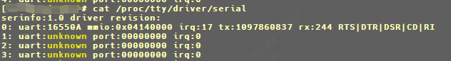
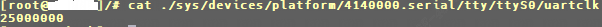
