# 1 gpio 子系统

如果 `pinctrl` 子系统将一个 PIN 复用为 GPIO 的话，那么接下来要用到 gpio 子系统了。gpio 子系统用于初始化 GPIO 并且提供相应的 API 函数，比如设置 GPIO为输入输出，设置读取 GPIO 的值等。

gpio 子系统的主要目的就是方便驱动开发者使用 gpio，驱动开发者在设备树中添加 gpio 相关信息，然后就可以在驱动程序中使用 gpio 子系统提供的 API函数来操作 GPIO，Linux 内核向驱动开发者屏蔽掉了 GPIO 的设置过程，极大的方便了驱动开发者使用 GPIO。

# 2 gpio子系统架构

Linux的GPIO子系统驱动框架由三个主要部分组成：
① GPIO控制器驱动程序
②gpio lib驱动程序 
③GPIO字符设备驱动程序
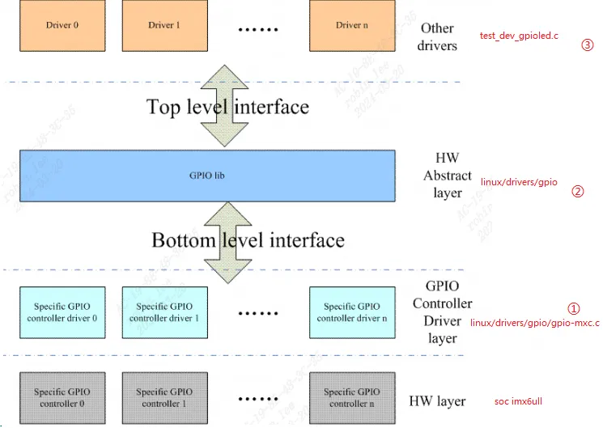

## 2.0 gpio控制器源码分析

`drivers/gpio/gpio-mxc.c` 就是 I.MX6ULL的 GPIO 控制器驱动文件，在此文件中有如下所示`of_device_id` 匹配表:  
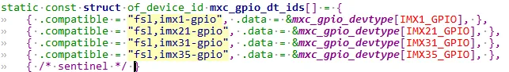
对照`imx6ull.dtsi`的gpio控制器可以看到能匹配：  
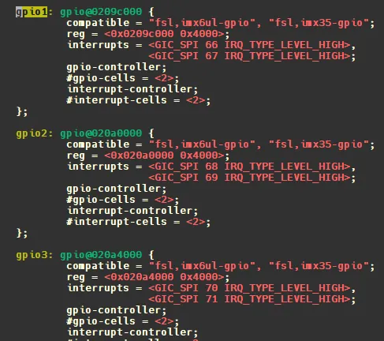
打开`drivers/gpio/gpio-mxc.c`：  
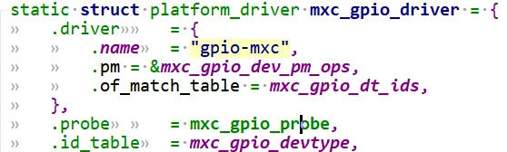
probe函数内容如下：

```c
static int mxc_gpio_probe(struct platform_device *pdev){  
	struct device_node *np = pdev->dev.of_node;  
	struct mxc_gpio_port *port;  
	struct resource *iores;  
	int irq_base = 0;  
	int err;  
  
	mxc_gpio_get_hw(pdev);  
  
	port = devm_kzalloc(&pdev->dev, sizeof(*port), GFP_KERNEL);  
	if (!port)  
		return -ENOMEM;  
  
	iores = platform_get_resource(pdev, IORESOURCE_MEM, 0);  
	port->base = devm_ioremap_resource(&pdev->dev, iores);  
	if (IS_ERR(port->base))  
		return PTR_ERR(port->base);  
  
	port->irq_high = platform_get_irq(pdev, 1);  
	port->irq = platform_get_irq(pdev, 0);  
	if (port->irq < 0)  
		return port->irq;  
  
	/* the controller clock is optional */  
	port->clk = devm_clk_get(&pdev->dev, NULL);  
	if (IS_ERR(port->clk))  
		port->clk = NULL;  
  
	err = clk_prepare_enable(port->clk);  
	if (err) {  
		dev_err(&pdev->dev, "Unable to enable clock.\n");  
		return err;  
	}  
  
	pm_runtime_set_active(&pdev->dev);  
	pm_runtime_enable(&pdev->dev);  
	err = pm_runtime_get_sync(&pdev->dev);  
	if (err < 0)  
		goto out_pm_dis;  
  
	/* disable the interrupt and clear the status */  
	writel(0, port->base + GPIO_IMR);  
	writel(~0, port->base + GPIO_ISR);  
  
	if (mxc_gpio_hwtype == IMX21_GPIO) {  
		/*  
		 * Setup one handler for all GPIO interrupts. Actually setting  
		 * the handler is needed only once, but doing it for every port  
		 * is more robust and easier.  
		 */  
		irq_set_chained_handler(port->irq, mx2_gpio_irq_handler);  
	} else {  
		/* setup one handler for each entry */  
		irq_set_chained_handler_and_data(port->irq,  
						 mx3_gpio_irq_handler, port);  
		if (port->irq_high > 0)  
			/* setup handler for GPIO 16 to 31 */  
			irq_set_chained_handler_and_data(port->irq_high,  
							 mx3_gpio_irq_handler,  
							 port);  
	}  
  
	err = bgpio_init(&port->gc, &pdev->dev, 4,  
			 port->base + GPIO_PSR,  
			 port->base + GPIO_DR, NULL,  
			 port->base + GPIO_GDIR, NULL,  
			 BGPIOF_READ_OUTPUT_REG_SET);  
	if (err)  
		goto out_bgio;  
  
	if (of_property_read_bool(np, "gpio_ranges"))  
		port->gpio_ranges = true;  
	else  
		port->gpio_ranges = false;  
  
	port->gc.request = mxc_gpio_request;  
	port->gc.free = mxc_gpio_free;  
	port->gc.parent = &pdev->dev;  
	port->gc.to_irq = mxc_gpio_to_irq;  
	port->gc.base = (pdev->id < 0) ? of_alias_get_id(np, "gpio") * 32 :  
					     pdev->id * 32;  
  
	err = devm_gpiochip_add_data(&pdev->dev, &port->gc, port);  
	if (err)  
		goto out_bgio;  
  
	irq_base = irq_alloc_descs(-1, 0, 32, numa_node_id());  
	if (irq_base < 0) {  
		err = irq_base;  
		goto out_bgio;  
	}  
  
	port->domain = irq_domain_add_legacy(np, 32, irq_base, 0,  
					     &irq_domain_simple_ops, NULL);  
	if (!port->domain) {  
		err = -ENODEV;  
		goto out_irqdesc_free;  
	}  
  
	/* gpio-mxc can be a generic irq chip */  
	err = mxc_gpio_init_gc(port, irq_base, &pdev->dev);  
	if (err < 0)  
		goto out_irqdomain_remove;  
  
	list_add_tail(&port->node, &mxc_gpio_ports);  
  
	platform_set_drvdata(pdev, port);  
	pm_runtime_put(&pdev->dev);  
  
	return 0;  
  
out_pm_dis:  
	pm_runtime_disable(&pdev->dev);  
	clk_disable_unprepare(port->clk);  
out_irqdomain_remove:  
	irq_domain_remove(port->domain);  
out_irqdesc_free:  
	irq_free_descs(irq_base, 32);  
out_bgio:  
	dev_info(&pdev->dev, "%s failed with errno %d\n", __func__, err);  
	return err;  
}
```

### 2.0.1 probe分析

里面定义了一个很重要的结构体`mxc_gpio_port` 就是对 `I.MX6ULL GPIO` 的抽象。`mxc_gpio_port` 结构体定义如下：  
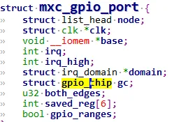
`mxc_gpio_probe`又会继续调用`mxc_gpio_get_hw`获取gpio的硬件相关数据，也就是gpio组，gpio1，gpio2等。

#### 2.0.1.0 mxc_gpio_get_hw

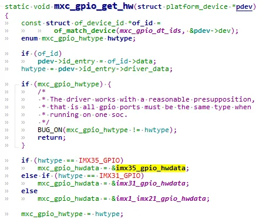
我们imx6ull gpio`控制器类型`就是`imx35系列`。因此选用`imx35_gpio_hwdata`，如下：可以看出这些成员就是对应寄存器的偏移量吗？

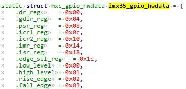
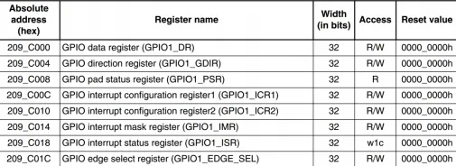
#### 2.0.1.1 get resource and ioremap

probe中通过`platform_get_resource` 获取`gpio1`的基地址为`0X0209,C000`，那么就可以通过配置`mxc_gpio_hwdata`结构体成员来配置寄存器。

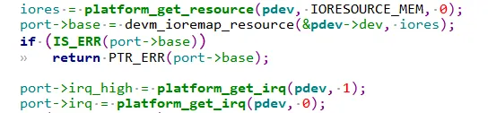
然后调用 `devm_ioremap_resource` 函数进行内存映射，得到 `0x0209C000` 在 Linux 内核中的虚拟地址。  
然后`platform_get_irq` 函数获取中断号，分为获取高 16 位 GPIO 的中断号，和获取低 16 位 GPIO 中断号。

操作 GPIO1 的 `IMR` 和 `ISR` 这两个寄存器，关闭 GPIO1 所有 IO 中断，并且清除状态寄存器:  
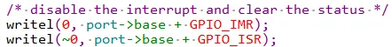
设置对应 GPIO 的中断服务函数，不管是高 16 位还是低 16 位，中断服务函数都是 `mx3_gpio_irq_handler`:  
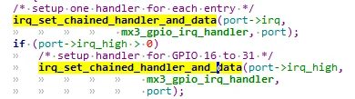
#### 2.0.1.2 bgpio_init

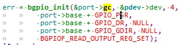
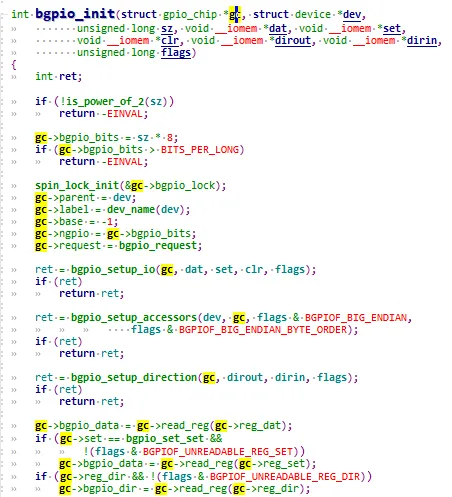
调用`bgpio_init` 函数主 要 任 务 就 是 初 始 化 `port->gc, (gc就是gpio_chip)`。顾名思义`bgpio_init`就是`basic gpio init`，里 面 有 三 个 `setup` 函 数 :

1. `bgpio_setup_io`
2. `bgpio_setup_accessors`
3. `bgpio_setup_direction`。这三个函数就是初始化 `port->gc` 中的各种有关GPIO 的操作，比如输出，输入等等。

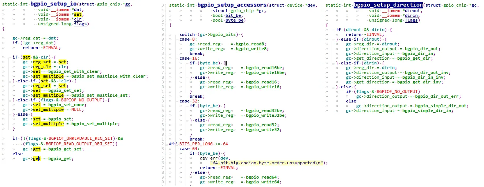
#### 2.0.1.3 devm_gpiochip_add_data

调用`devm_gpiochip_add_data`注册这个port。gpio控制器就成功注册给了gpio子系统。  
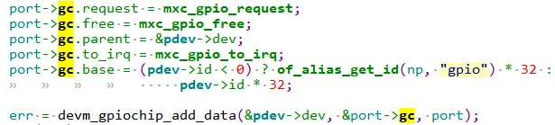
至此，`port->gc`既有了对 GPIO 的操作函数，又有了 I.MX6ULL 有关 GPIO的寄存器，那么只要得到 port 就可以对 I.MX6ULL 的 GPIO 进行操作。

## 2.1 gpio子系统数据结构
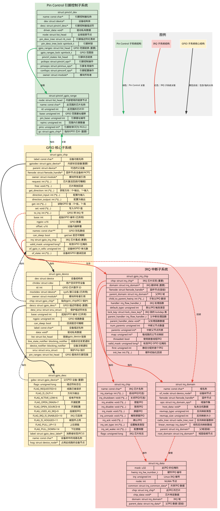
### 2.1.1 gpio_device

每个`GPIO Controller`用一个`gpio_device`来表示:

1. 每组gpio引脚对应一个`gpio_desc`数组和一个`gpio_chip`
2. gpio引脚的操作函数，都放在`gpio_chip`成员函数中。

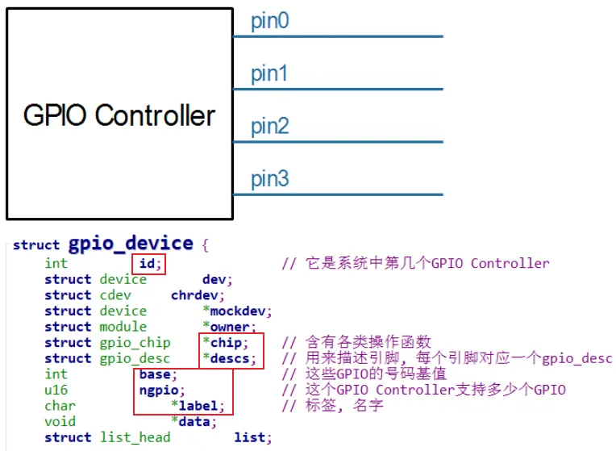
### 2.1.2 gpio_chip

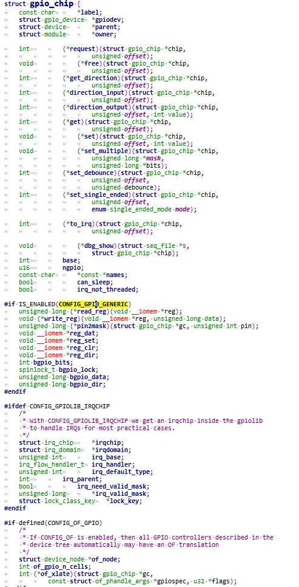
```c
struct gpio_chip {  
	const char		*label;  
	struct gpio_device	*gpiodev;  
	struct device		*parent;  
	struct module		*owner;  
	int			(*request)(struct gpio_chip *chip,  
						unsigned offset);//请求一个 GPIO 引脚  
	void			(*free)(struct gpio_chip *chip,  
						unsigned offset);//释放一个之前请求的 GPIO 引脚  
	int			(*get_direction)(struct gpio_chip *chip,  
						unsigned offset);//获取方向  
	int			(*direction_input)(struct gpio_chip *chip,  
						unsigned offset);//输入模式  
	int			(*direction_output)(struct gpio_chip *chip,  
						unsigned offset, int value);//输出模式，并且set gpio val  
	int			(*get)(struct gpio_chip *chip,  
						unsigned offset);//读取 GPIO 引脚的值  
	void			(*set)(struct gpio_chip *chip,  
						unsigned offset, int value);//设置gpio 引脚值  
	void			(*set_multiple)(struct gpio_chip *chip,  
						unsigned long *mask,  
						unsigned long *bits);  
	int			(*set_debounce)(struct gpio_chip *chip,  
						unsigned offset,  
						unsigned debounce);//设置 GPIO 引脚的去抖动时间  
	int			(*set_single_ended)(struct gpio_chip *chip,  
						unsigned offset,  
						enum single_ended_mode mode);  
	int			(*to_irq)(struct gpio_chip *chip,  
						unsigned offset);  
	void			(*dbg_show)(struct seq_file *s,  
						struct gpio_chip *chip);//调试目的，显示 GPIO 引脚的状态  
	int			base;// 由此gpiochip处理的第一个gpio的编号
	u16			ngpio;// 由此gpiochip处理的GPIO 引脚数量  
	const char		*const *names;  
	bool			can_sleep;  
	bool			irq_not_threaded;  
#if IS_ENABLED(CONFIG_GPIO_GENERIC)// bgpio使能  
	unsigned long (*read_reg)(void __iomem *reg);  
	void (*write_reg)(void __iomem *reg, unsigned long data);  
	unsigned long (*pin2mask)(struct gpio_chip *gc, unsigned int pin);  
	void __iomem *reg_dat;  
	void __iomem *reg_set;  
	void __iomem *reg_clr;  
	void __iomem *reg_dir;  
	int bgpio_bits;  
	spinlock_t bgpio_lock;  
	unsigned long bgpio_data;  
	unsigned long bgpio_dir;  
#endif  
#ifdef CONFIG_GPIOLIB_IRQCHIP  
	struct irq_chip		*irqchip;  
	struct irq_domain	*irqdomain;  
	unsigned int		irq_base;  
	irq_flow_handler_t	irq_handler;  
	unsigned int		irq_default_type;  
	int			irq_parent;  
	bool			irq_need_valid_mask;  
	unsigned long		*irq_valid_mask;  
	struct lock_class_key	*lock_key;  
#endif  
  
#if defined(CONFIG_OF_GPIO)  
	struct device_node *of_node;  
	int of_gpio_n_cells;//dts描述几个cells构成  
	int (*of_xlate)(struct gpio_chip *gc,  
			const struct of_phandle_args *gpiospec, u32 *flags);//设备树中 GPIO 引脚的转换  
#endif
```

### 2.1.3 gpio_desc

在`gpio_device`中有一个`gpio_desc`数组，每一引脚有一项`gpio_desc`。

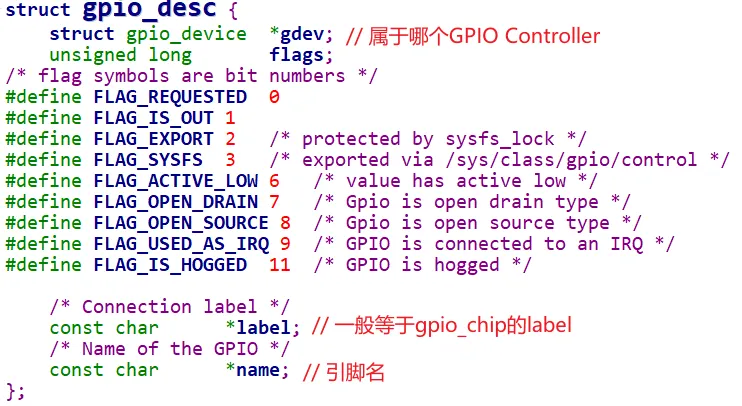
# 3 gpio子系统api

## 3.1使用整数的GPIO传统方式

### 3.1.1 请求和配置
```c
// 请求和释放GPIO  
static int gpio_request(unsigned gpio, const char* label);  
void gpio_free(unsigned gpio);  
  
// 判断gpio释放可用  
static bool gpio_is_valid(unsigned gpio);  
  
// 设置gpio为输入还是输出  
static int gpio_direction_input(unsigned gpio);  
static int gpio_direction_output(unsigned gpio, int value);   
  
// 设置gpio的去抖动时间，其中debounce以ms为单位  
static int gpio_set_debounce(unsigned gpio, unsigned debounce);
```

### 3.1.2 读取和设置值
```c
// 当gpio没有连接到I2C或SPI等慢速总线上，不会导致睡眠，可以在原子上下文中使用  
static int gpio_get_value(unsigned gpio);  
void gpio_set_value(unsigned gpio, int value); // value为bool值，0表示低电平，非0高电平  
  
// 可以用gpio_can_sleep()判断gpio线是否可能睡眠  
bool gpio_cansleep(unsigned gpio);  
  
// 当gpio没有连接到I2C或SPI等慢速总线上，不会导致睡眠，可以在原子上下文中使用  
static int gpio_get_value_cansleep(unsigned gpio);  
void gpio_set_value_cansleep(unsigned gpio, int value);   
  
// 当gpio映射到irq时，使用方式如下gpio_to_irq，返回irq号，接下来可以使用request_irq申请irq  
int gpio_to_irq(unsigned gpio);  
int irq_to_gpio(int irq)
```

### 3.1.3 gpiochip操作
```c
static inline int gpiochip_add(struct gpio_chip *chip)//注册一个gpio_chip结构体，它描述了一组GPIO引脚及其操作函数。  
void gpiochip_remove(struct gpio_chip *chip)//移除之前注册的gpio_chip。  
  
gpiochip_line_config//配置gpio_chip中的特定引脚。  
gpiochip_request_own//请求对gpio_chip中的引脚的所有权。  
gpiochip_request_unown//释放对gpio_chip中的引脚的所有权。  
gpiochip_set//为gpio_chip中的多个引脚设置值。  
gpiochip_clear//清除gpio_chip中的多个引脚的值。  
  
gpiochip_set_direction//为gpio_chip中的多个引脚设置方向。  
gpiochip_get_direction//获取gpio_chip中引脚的方向。
```

## 3.2 基于描述符的GPIO方式
```c
foo_device {  
	compatible = "acme,foo";  
	[...];  
	led-gpios = <&gpio 15 GPIO_ACTIVE_HIGH> //红色  
				<&gpio 16 GPIO_ACTIVE_HIGH> //绿色  
				<&gpio 17 GPIO_ACTIVE_HIGH> //蓝色  
				;  
	power-gpios = <&gpio 1 GPIO_ACTIVE_LOW>;  
	reset-gpios = <&gpio 1 GPIO_ACTIVE_LOW>;  
};
```

在代码中获取GPIO的方式：
```c
//获取gpio的代码  
sruct gpio_desc * gpiod_get_index(struct device *dev, char *con_id,  
								enum gpiod_flags flags);  
sruct gpio_desc * gpiod_get(struct device *dev, char *con_id,  
								enum gpiod_flags flags);  
void gpiod_put(sruct gpio_desc *desc);  
  
//使用示例：  
struct gpio_desc *red, *green, *blue, *power, *reset;  
red = gpiod_get_index(dev, "led", 0, GPIO_OUT_HIGH);  
green = gpiod_get_index(dev, "led", 1, GPIO_OUT_HIGH);  
blue = gpiod_get_index(dev, "led", 2, GPIO_OUT_HIGH);  
  
power = gpiod_get(dev, "power", GPIO_OUT_HIGH);  
reset = gpiod_get(dev, "reset", GPIO_OUT_HIGH);
```

其他类似的功能函数：
```c
int gpiod_direction_input(struct gpio_desc *desc);  
int gpiod_direction_output(struct gpio_desc *desc, int value);  
  
int gpiod_set_debounce(struct gpio_desc *desc, unsigned debounce);  
// 输出逻辑1  
// 在Active-High的情况下它会输出高电平  
// 在Active-Low的情况下它会输出低电平  
void gpiod_set_value(struct gpio_desc *desc, int val);  
  
void gpiod_set_value_cansleep(struct gpio_desc *desc, int val);  
  
int gpiod_get_value(struct gpio_desc *desc);  
int gpiod_get_value_cansleep(struct gpio_desc *desc);  
  
// 二者之间相互转换  
struct gpio_desc *gpio_to_desc(unsigned gpio);  
int desc_to_gpio(struct gpio_desc *desc);
```

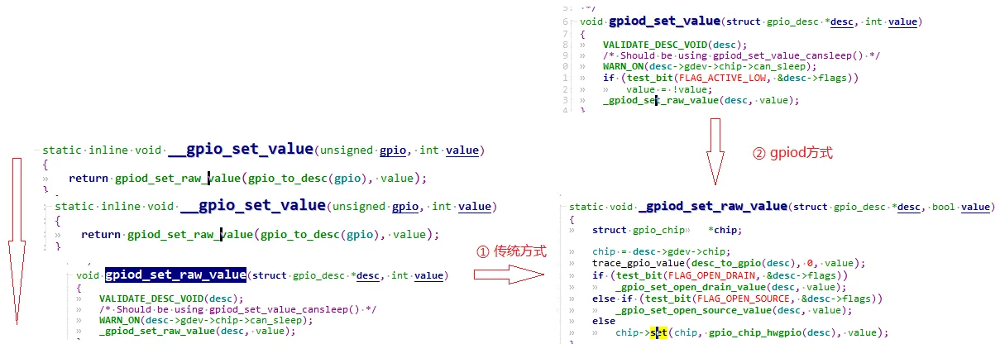
无论是传统GPIO控制还是基于描述符的gpio方式，都是调用底层控制器gpio_chip的操作函数。

## 3.3 和设备树相关GPIO接口
```c
gpio1: gpio1 {  
	gpio-controller;  
	#gpio-cells = <2>;  
};  
  
gpio2 : gpio2 {  
	gpio-controller;  
	#gpio-cells = <1>;  
};  
foo-device {  
	cs-gpios = <&gpio1 17 0>  
				<&gpio1 2>  
				<&gpio1 17 0>;  
	reset-gpio = <&gpio1 30 0>;  
	cs-gpios = <&gpio2 10>;  
};  
  
// 在传统使用gpio的方式中，需要获取gpio编号，获取方式如下：  
int n_gpios = of_get_named_gpio_count(dev.of_node, "cs-gpios");  
int first_gpio = of_get_named_gpio(dev.of_node, "cs-gpios");
```


# 4 gpio子系统示例

以`nxp`官方`evk`公板`imx6ull-14x14-evk.dts`为例：  
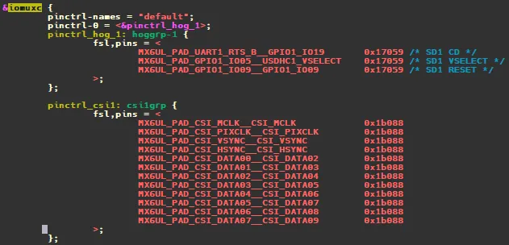
重新定义了`iomuxc`引脚控制器，`evk`设备默认default状态对应的pins为`pinctrl_hog_1`, 配置3个引脚（`UART1_RTS_B, GPIO1_IO05, GPIO1_IO09`)信息。看起来是要做成sd卡的热插拔功能。  
我们再找到描述sd的设备树节点：`usdhc1`和`usdhc2`:
```c
&usdhc1 {  
         pinctrl-names = "default", "state_100mhz", "state_200mhz";  
         pinctrl-0 = <&pinctrl_usdhc1>;  
         pinctrl-1 = <&pinctrl_usdhc1_100mhz>;  
         pinctrl-2 = <&pinctrl_usdhc1_200mhz>;  
         cd-gpios = <&gpio1 19 GPIO_ACTIVE_LOW>;  
         keep-power-in-suspend;  
         enable-sdio-wakeup;  
         vmmc-supply = <&reg_sd1_vmmc>;  
         status = "okay";  
};
```

`iomuxc`控制器节点下有`usdhc1`要用的`pins`信息，包括`pinctrl_hog_1`，`pinctrl_usdhc1`，`pinctrl_usdhc1_100mhz`节点。
```c
&iomuxc {  
     pinctrl_usdhc1: usdhc1grp {  
             fsl,pins = <  
                     MX6UL_PAD_SD1_CMD__USDHC1_CMD     0x17059  
                     MX6UL_PAD_SD1_CLK__USDHC1_CLK     0x10071  
                     MX6UL_PAD_SD1_DATA0__USDHC1_DATA0 0x17059  
                     MX6UL_PAD_SD1_DATA1__USDHC1_DATA1 0x17059  
                     MX6UL_PAD_SD1_DATA2__USDHC1_DATA2 0x17059  
                     MX6UL_PAD_SD1_DATA3__USDHC1_DATA3 0x17059  
             >;  
     };  
  
     pinctrl_usdhc1_100mhz: usdhc1grp100mhz {  
             fsl,pins = <  
                     MX6UL_PAD_SD1_CMD__USDHC1_CMD     0x170b9  
                     MX6UL_PAD_SD1_CLK__USDHC1_CLK     0x100b9  
                     MX6UL_PAD_SD1_DATA0__USDHC1_DATA0 0x170b9  
                     MX6UL_PAD_SD1_DATA1__USDHC1_DATA1 0x170b9  
                     MX6UL_PAD_SD1_DATA2__USDHC1_DATA2 0x170b9  
                     MX6UL_PAD_SD1_DATA3__USDHC1_DATA3 0x170b9  
             >;  
     };  
  
     pinctrl_usdhc1_200mhz: usdhc1grp200mhz {  
             fsl,pins = <  
                     MX6UL_PAD_SD1_CMD__USDHC1_CMD     0x170f9  
                     MX6UL_PAD_SD1_CLK__USDHC1_CLK     0x100f9  
                     MX6UL_PAD_SD1_DATA0__USDHC1_DATA0 0x170f9  
                     MX6UL_PAD_SD1_DATA1__USDHC1_DATA1 0x170f9  
                     MX6UL_PAD_SD1_DATA2__USDHC1_DATA2 0x170f9  
                     MX6UL_PAD_SD1_DATA3__USDHC1_DATA3 0x170f9  
             >;  
     };  
}
```

## 4.1 gpio控制器dts描述

前面讲的其实都还是`pinctrl`的内容，`usdhc1`有一个属性`cd-gpios`。这时就需要用到gpio控制器了，以`imx6ull`为例，gpio控制器描述如下：
```c
Linux-4.9.88/Documentation/devicetree/bindings/gpio$ ls -l fsl-imx-gpio.txt  
  
   * Freescale i.MX/MXC GPIO controller  
    
   Required properties:  
   - compatible : Should be "fsl,<soc>-gpio"  
   - reg : Address and length of the register set for the device  
   - interrupts : Should be the port interrupt shared by all 32 pins, if  
     one number.  If two numbers, the first one is the interrupt shared  
     by low 16 pins and the second one is for high 16 pins.  
   - gpio-controller : Marks the device node as a gpio controller.  
  - #gpio-cells : Should be two.  The first cell is the pin number and  
    the second cell is used to specify the gpio polarity:  
        0 = active high  
        1 = active low  
  - interrupt-controller: Marks the device node as an interrupt controller.  
  - #interrupt-cells : Should be 2.  The first cell is the GPIO number.  
    The second cell bits[3:0] is used to specify trigger type and level flags:  
        1 = low-to-high edge triggered.  
        2 = high-to-low edge triggered.  
        4 = active high level-sensitive.  
        8 = active low level-sensitive.  
   
  Example:  
   
gpio0: gpio@73f84000 {  
        compatible = "fsl,imx51-gpio", "fsl,imx35-gpio";  
        reg = <0x73f84000 0x4000>;  
        interrupts = <50 51>;  
        gpio-controller;  
        #gpio-cells = <2>;  
        interrupt-controller;  
        #interrupt-cells = <2>;  
};
```

打开具体的`imx6ull.dtsi`:  
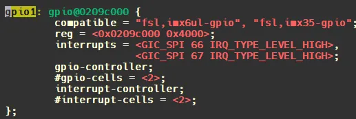
打开芯片参考书册，刚好对应gpio1控制器：  
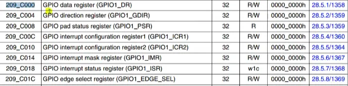
## 4.2 gpio控制器使用者

回到`usdhc1`的属性`cd-gpios`。
```c
cd-gpios = <&gpio1 19 GPIO_ACTIVE_LOW>;
```

表述使用gpio1控制器，由于该控制器的gpio-cells为2， 根据描述：
```c
#gpio-cells : Should be two.  The first cell is the pin number and  
the second cell is used to specify the gpio polarity:  
    0 = active high  
    1 = active low
```

19表示`pin number`， `GPIO_ACTIVE_LOW`是一个宏定义：可以看到为1，也就是低电平有效  
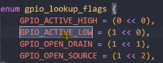
### 4.2.1 使用者操作流程
```c
1. of_find_node_by_path获取使用该gpio的节点  
2. of_get_named_gpio，获取gpio编号  
3. gpio_request,申请gpio  
4. gpio_direction_set/gpio_direction_get  
5. gpio_val_set
```

#### 4.2.1.1 dts自定义gpio控制器使用者（demo1,gpio_led）

编写一个gpioled节点：

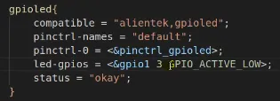
同时修改`iomuxc`节点，因为用到了`GPIO1_IO03`，要设置该pin脚为`gpio`：  
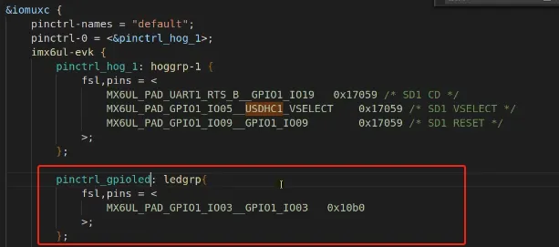
点击查看代码
```c
#include <linux/types.h>  
#include <linux/kernel.h>  
#include <linux/delay.h>  
#include <linux/ide.h>  
#include <linux/init.h>  
#include <linux/module.h>  
#include <linux/errno.h>  
#include <linux/gpio.h>  
#include <linux/cdev.h>  
#include <linux/device.h>  
#include <linux/of.h>  
#include <linux/of_address.h>  
#include <linux/of_gpio.h>  
#include <asm/mach/map.h>  
#include <asm/uaccess.h>  
#include <asm/io.h>  
  
#define GPIOLED_CNT			1  
#define GPIOLED_NAME		"gpioled"  
#define LEDOFF 				0  
#define LEDON 				1  
  
struct gpioled_dev{  
	dev_t devid;  
	struct cdev cdev;  
	struct class *class;  
	struct device *device;  
	int major;  
	int minor;  
	struct device_node	*nd;  
	int led_gpio;  
};  
  
struct gpioled_dev gpioled;  
  
static int led_open(struct inode *inode, struct file *filp)  
{  
	filp->private_data = &gpioled;  
	return 0;  
}  
  
static ssize_t led_read(struct file *filp, char __user *buf, size_t cnt, loff_t *offt)  
{  
	return 0;  
}  
  
static ssize_t led_write(struct file *filp, const char __user *buf, size_t cnt, loff_t *offt)  
{  
	int retvalue;  
	unsigned char databuf[1];  
	unsigned char ledstat;  
	struct gpioled_dev *dev = filp->private_data;  
  
	retvalue = copy_from_user(databuf, buf, cnt);  
	if(retvalue < 0) {  
		printk("kernel write failed!\r\n");  
		return -EFAULT;  
	}  
  
	ledstat = databuf[0];  
  
	if(ledstat == LEDON) {	  
		gpio_set_value(dev->led_gpio, 0);  
	} else if(ledstat == LEDOFF) {  
		gpio_set_value(dev->led_gpio, 1);  
	}  
	return 0;  
}  
  
static int led_release(struct inode *inode, struct file *filp)  
{  
	return 0;  
}  
  
static struct file_operations gpioled_fops = {  
	.owner = THIS_MODULE,  
	.open = led_open,  
	.read = led_read,  
	.write = led_write,  
	.release = 	led_release,  
};  
  
static int __init led_init(void)  
{  
	int ret = 0;  
  
	gpioled.nd = of_find_node_by_path("/gpioled");  
	if(gpioled.nd == NULL) {  
		printk("gpioled node not find!\r\n");  
		return -EINVAL;  
	} else {  
		printk("gpioled node find!\r\n");  
	}  
  
	gpioled.led_gpio = of_get_named_gpio(gpioled.nd, "led-gpio", 0);  
	if(gpioled.led_gpio < 0) {  
		printk("can't get led-gpio");  
		return -EINVAL;  
	}  
	printk("led-gpio num = %d\r\n", gpioled.led_gpio);  
  
	ret = gpio_direction_output(gpioled.led_gpio, 1);  
	if(ret < 0) {  
		printk("can't set gpio!\r\n");  
	}  
  
	if (gpioled.major) {  
		gpioled.devid = MKDEV(gpioled.major, 0);  
		register_chrdev_region(gpioled.devid, GPIOLED_CNT, GPIOLED_NAME);  
	} else {  
		alloc_chrdev_region(&gpioled.devid, 0, GPIOLED_CNT, GPIOLED_NAME);  
		gpioled.major = MAJOR(gpioled.devid);  
		gpioled.minor = MINOR(gpioled.devid);  
	}  
	printk("gpioled major=%d,minor=%d\r\n",gpioled.major, gpioled.minor);	  
	  
	gpioled.cdev.owner = THIS_MODULE;  
	cdev_init(&gpioled.cdev, &gpioled_fops);  
	  
	cdev_add(&gpioled.cdev, gpioled.devid, GPIOLED_CNT);  
  
	gpioled.class = class_create(THIS_MODULE, GPIOLED_NAME);  
	if (IS_ERR(gpioled.class)) {  
		return PTR_ERR(gpioled.class);  
	}  
  
	gpioled.device = device_create(gpioled.class, NULL, gpioled.devid, NULL, GPIOLED_NAME);  
	if (IS_ERR(gpioled.device)) {  
		return PTR_ERR(gpioled.device);  
	}  
	return 0;  
}  
  
static void __exit led_exit(void)  
{  
	cdev_del(&gpioled.cdev);  
	unregister_chrdev_region(gpioled.devid, GPIOLED_CNT);  
  
	device_destroy(gpioled.class, gpioled.devid);  
	class_destroy(gpioled.class);  
}  
  
module_init(led_init);  
module_exit(led_exit);  
MODULE_LICENSE("GPL");
```

#### 4.2.1.2 dts自定义gpio控制器使用者（demo2,beep）

evk公板的蜂鸣器。`BEEP`使用了`SNVS_TAMPER1`这个PIN，打开`imx6ull-alientek-emmc.dts`，`SNVS_TAMPER1`属于`iomuxc_snvs`这个`pin controller`。  
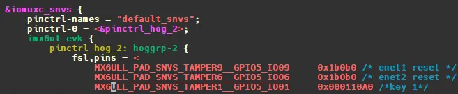
在`iomuxc`节点的`imx6ul-evk`子节点下创建一个名为`“pinctrl_beep”`的子节点:
```c
pinctrl_beep: beepgrp {  
	fsl,pins = <  
		MX6ULL_PAD_SNVS_TAMPER1__GPIO5_IO01 0x10B0 /* beep */  
	>;  
};
```

根节点`“/”`下创建`BEEP`节点：可以看到用到了引脚控制器的`pinctrl_beep`节点。同时使用gpio子系统，`beep-gpio`属性用到`gpio5`控制器。
```c
beep {  
	#address-cells = <1>;  
	#size-cells = <1>;  
	compatible = "evk-beep";  
	pinctrl-names = "default";  
	pinctrl-0 = <&pinctrl_beep>;  
	beep-gpio = <&gpio5 1 GPIO_ACTIVE_HIGH>;  
	status = "okay";  
};
```

蜂鸣器使用的 PIN 为 `SNVS_TAMPER1`，因此先检查 PIN 为`SNVS_TAMPER1` 这个 PIN 有没有被其他的 pinctrl 节点使用，如果有使用的话就要屏蔽掉，然后再检查 `GPIO5_IO01` 这个 GPIO 有没有被其他外设使用，如果有的话也要屏蔽掉。

输入`“make dtbs”`命令重新编译设备树，然后使用新编译出来的 `imx6ull-alientek-emmc.dtb` 文件启动 Linux 系统，进入`“/proc/device-tree”`目录中 查看`“beep”`节点是否存在：  
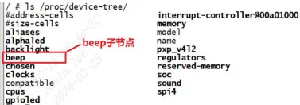
点击查看代码
```c
#include <linux/types.h>  
#include <linux/kernel.h>  
#include <linux/delay.h>  
#include <linux/ide.h>  
#include <linux/init.h>  
#include <linux/module.h>  
#include <linux/errno.h>  
#include <linux/gpio.h>  
#include <linux/cdev.h>  
#include <linux/device.h>  
#include <linux/of.h>  
#include <linux/of_address.h>  
#include <linux/of_gpio.h>  
#include <asm/mach/map.h>  
#include <asm/uaccess.h>  
#include <asm/io.h>  
  
#define BEEP_CNT			1		/* 设备号个数 */  
#define BEEP_NAME			"beep"	/* 名字 */  
#define BEEPOFF 			0		/* 关蜂鸣器 */  
#define BEEPON 				1		/* 开蜂鸣器 */  
  
struct beep_dev{  
	dev_t devid;			/* 设备号 	 */  
	struct cdev cdev;		/* cdev 	*/  
	struct class *class;	/* 类 		*/  
	struct device *device;	/* 设备 	 */  
	int major;				/* 主设备号	  */  
	int minor;				/* 次设备号   */  
	struct device_node	*nd; /* 设备节点 */  
	int beep_gpio;			/* beep所使用的GPIO编号		*/  
};  
  
struct beep_dev beep;		/* beep设备 */  
  
static int beep_open(struct inode *inode, struct file *filp)  
{  
	filp->private_data = &beep; /* 设置私有数据 */  
	return 0;  
}  
  
static ssize_t beep_write(struct file *filp, const char __user *buf, size_t cnt, loff_t *offt)  
{  
	int retvalue;  
	unsigned char databuf[1];  
	unsigned char beepstat;  
	struct beep_dev *dev = filp->private_data;  
  
	retvalue = copy_from_user(databuf, buf, cnt);  
	if(retvalue < 0) {  
		printk("kernel write failed!\r\n");  
		return -EFAULT;  
	}  
  
	beepstat = databuf[0];		/* 获取状态值 */  
  
	if(beepstat == BEEPON) {	  
		gpio_set_value(dev->beep_gpio, 0);	/* 打开蜂鸣器 */  
	} else if(beepstat == BEEPOFF) {  
		gpio_set_value(dev->beep_gpio, 1);	/* 关闭蜂鸣器 */  
	}  
	return 0;  
}  
  
static int beep_release(struct inode *inode, struct file *filp)  
{  
	return 0;  
}  
  
static struct file_operations beep_fops = {  
	.owner = THIS_MODULE,  
	.open = beep_open,  
	.write = beep_write,  
	.release = 	beep_release,  
};  
  
static int __init beep_init(void)  
{  
	int ret = 0;  
  
	/* 1、获取设备节点：beep */  
	beep.nd = of_find_node_by_path("/beep");  
	if(beep.nd == NULL) {  
		printk("beep node not find!\r\n");  
		return -EINVAL;  
	} else {  
		printk("beep node find!\r\n");  
	}  
  
	/* 2、 获取设备树中的gpio属性，得到BEEP所使用的BEEP编号 */  
	beep.beep_gpio = of_get_named_gpio(beep.nd, "beep-gpio", 0);  
	if(beep.beep_gpio < 0) {  
		printk("can't get beep-gpio");  
		return -EINVAL;  
	}  
	printk("led-gpio num = %d\r\n", beep.beep_gpio);  
  
	/* 3、设置GPIO5_IO01为输出，并且输出高电平，默认关闭BEEP */  
	ret = gpio_direction_output(beep.beep_gpio, 1);  
	if(ret < 0) {  
		printk("can't set gpio!\r\n");  
	}  
  
	/* 1、创建设备号 */  
	if (beep.major) {		/*  定义了设备号 */  
		beep.devid = MKDEV(beep.major, 0);  
		register_chrdev_region(beep.devid, BEEP_CNT, BEEP_NAME);  
	} else {						/* 没有定义设备号 */  
		alloc_chrdev_region(&beep.devid, 0, BEEP_CNT, BEEP_NAME);	/* 申请设备号 */  
		beep.major = MAJOR(beep.devid);	/* 获取分配号的主设备号 */  
		beep.minor = MINOR(beep.devid);	/* 获取分配号的次设备号 */  
	}  
	printk("beep major=%d,minor=%d\r\n",beep.major, beep.minor);	  
	  
	beep.cdev.owner = THIS_MODULE;  
	cdev_init(&beep.cdev, &beep_fops);  
	cdev_add(&beep.cdev, beep.devid, BEEP_CNT);  
  
	beep.class = class_create(THIS_MODULE, BEEP_NAME);  
	if (IS_ERR(beep.class)) {  
		return PTR_ERR(beep.class);  
	}  
  
	beep.device = device_create(beep.class, NULL, beep.devid, NULL, BEEP_NAME);  
	if (IS_ERR(beep.device)) {  
		return PTR_ERR(beep.device);  
	}  
	return 0;  
}  
  
static void __exit beep_exit(void)  
{  
	cdev_del(&beep.cdev);/*  删除cdev */  
	unregister_chrdev_region(beep.devid, BEEP_CNT); /* 注销设备号 */  
  
	device_destroy(beep.class, beep.devid);  
	class_destroy(beep.class);  
}  
  
module_init(beep_init);  
module_exit(beep_exit);  
MODULE_LICENSE("GPL");
```

核心代码分析：
```c
1. of_find_node_by_path("/beep");//找到设备节点  
2. of_get_named_gpio(beep.nd, "beep-gpio", 0);//获取beep-gpio这个引脚编号  
3. gpio_direction_output(beep.beep_gpio, 1);//请求gpio并且配成输出  
4. gpio_set_value(dev->beep_gpio, 0);//设置高低电平
```

注意这里并没有使用`pinctrl`, `pinctrl子系统`是内核启动时就对`pinctrl(也叫iomuxc)控制器`进行了配置，进行了IOMUX配置。因此`SNVS_TAMPER1`会复用成gpio模式。  
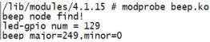
按键作为输入时：

```
static int keyio_init(void)
{
    keydev.nd = of_find_node_by_path("/key");
    if (keydev.nd== NULL) {
        return -EINVAL;
    }

    keydev.key_gpio = of_get_named_gpio(keydev.nd ,"key-gpio", 0);
    if (keydev.key_gpio < 0) {
        printk("can't get key0\r\n");
        return -EINVAL;
    }
    printk("key_gpio=%d\r\n", keydev.key_gpio);

    /* 初始化key所使用的IO */
    gpio_request(keydev.key_gpio, "key0");	/* 请求IO */
    gpio_direction_input(keydev.key_gpio);	/* 设置为输入 */
    return 0;
}
```

# 5 应用层使用gpio的方式
现代 Linux 内核（4.8+）建议使用 `/dev/gpiochip*`（字符设备，libgpiod 库），替代老旧的 sysfs 接口（sysfs 已被标记为 “deprecated”，但仍广泛兼容）。
## 5.1 /sys/class/gpio/ 接口
```c
# 1. 导出 GPIO18（将其暴露到用户态，需要 root 权限）
echo 18 > /sys/class/gpio/export

# 2. 配置方向：输出（out）或输入（in）
echo out > /sys/class/gpio/gpio18/direction

# 3. 设置输出电平：高电平（1）/低电平（0）
echo 1 > /sys/class/gpio/gpio18/value  # 高电平
echo 0 > /sys/class/gpio/gpio18/value  # 低电平

# 4. 若配置为输入，读取电平
cat /sys/class/gpio/gpio18/value

# 4. 用完后注销 GPIO（释放资源）
echo 18 > /sys/class/gpio/unexport
```

## 5.2 使用/dev/gpiochip* 设备文件 + libgpiod库
- 工具库
```sh
# 读取 GPIO18 电平（gpiochip0 为控制器，18 为偏移量）
gpiodetect  # 查看系统中的 GPIO 控制器
gpioget gpiochip0 18  # 读取电平

# 设置 GPIO18 为输出，输出高电平
gpioset gpiochip0 18=1

# 监听 GPIO18 上升沿中断
gpiomon -r rising gpiochip0 18
```
- libgpiod 库代码示例
```c
#include <gpiod.h>
#include <stdio.h>

int main() {
    struct gpiod_chip *chip;
    struct gpiod_line *line;
    int ret;

    // 1. 打开 GPIO 控制器（gpiochip0）
    chip = gpiod_chip_open("/dev/gpiochip0");
    if (!chip) {
        perror("Failed to open chip");
        return -1;
    }

    // 2. 获取 GPIO18 引脚（偏移量 18）
    line = gpiod_chip_get_line(chip, 18);
    if (!line) {
        perror("Failed to get line");
        gpiod_chip_close(chip);
        return -1;
    }

    // 3. 请求引脚，配置为输出
    ret = gpiod_line_request_output(line, "myapp", 0); // 初始电平 0
    if (ret < 0) {
        perror("Failed to request line");
        gpiod_chip_close(chip);
        return -1;
    }

    // 4. 设置高电平
    ret = gpiod_line_set_value(line, 1);
    if (ret < 0) {
        perror("Failed to set value");
        gpiod_line_release(line);
        gpiod_chip_close(chip);
        return -1;
    }

    // 5. 释放资源
    gpiod_line_release(line);
    gpiod_chip_close(chip);

    return 0;
}
```