# 1 input 子系统介绍

按键、鼠标、键盘、触摸屏等都属于输入(`input`)设备，Linux 内核为此专门做了一个叫做 input子系统的框架来处理输入事件。  
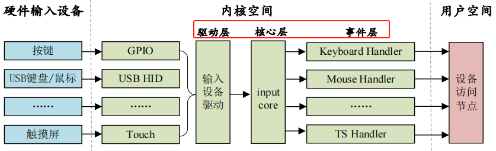
input 子系统分为 input 驱动层、input 核心层、input 事件处理层，最终给用户空间提供可访问的设备节点。  
驱动层：输入设备的具体驱动程序，比如按键驱动程序，向内核层报告输入内容。  
核心层：承上启下，为驱动层提供输入设备注册和操作接口。通知事件层对输入事件进行处理。  
事件层：主要和用户空间进行交互。

## 1.0 数据结构

### 1.0.1 input_dev
```c
1:  struct input_dev {  
   2:      const char *name;      //设备名  
   3:      const char *phys;     // 设备在系统中路径  
   4:      const char *uniq;  
   5:      struct input_id id;    //与input_handler匹配用的id;  
  
   9:      unsigned long evbit[BITS_TO_LONGS(EV_CNT)]; //设备所支持事件类型主要有EV_SYNC,EV_KEY,EV_REL,EV_ABS  
  10:      unsigned long keybit[BITS_TO_LONGS(KEY_CNT)];// 按键所对应的位图  
  11:      unsigned long relbit[BITS_TO_LONGS(REL_CNT)];//  相对坐标对应位图  
  12:      unsigned long absbit[BITS_TO_LONGS(ABS_CNT)];// 绝对坐标对应位图  
  13:      unsigned long mscbit[BITS_TO_LONGS(MSC_CNT)];//支持其它事件  
  14:      unsigned long ledbit[BITS_TO_LONGS(LED_CNT)];//支持led事件  
  15:      unsigned long sndbit[BITS_TO_LONGS(SND_CNT)];//支持声音事件  
  16:      unsigned long ffbit[BITS_TO_LONGS(FF_CNT)];//支持受力事件  
  17:      unsigned long swbit[BITS_TO_LONGS(SW_CNT)];//支持开关机事件  
  18:     
  19:      unsigned int hint_events_per_packet;  
  21:      unsigned int keycodemax;  
  22:      unsigned int keycodesize;  
  23:      void *keycode;  
  24:     
  25:      int (*setkeycode)(struct input_dev *dev,  
  26:                const struct input_keymap_entry *ke,  
  27:                unsigned int *old_keycode);  
  28:      int (*getkeycode)(struct input_dev *dev,  
  29:                struct input_keymap_entry *ke);  
  30:     
  31:      struct ff_device *ff;  
  33:      unsigned int repeat_key;//最近一次的按键值
```

## 1.1 input 驱动编写流程

### 1.1.0 input类的建立和proc建立

`drivers/input/input.c`就是input子系统的核心层，此文件里面有如下代码：
```c
struct class input_class = {  
	.name = "input",  
	.devnode = input_devnode,  
};  
.....  
static int __init input_init(void)  
{  
	int err;  
	err = class_register(&input_class);  
	if (err) {  
		pr_err("unable to register input_dev class\n");  
		return err;  
	}  
  
	err = input_proc_init();  
	if (err)  
		goto fail1;  
  
	err = register_chrdev_region(MKDEV(INPUT_MAJOR, 0),  
		INPUT_MAX_CHAR_DEVICES, "input");  
	if (err) {  
		pr_err("unable to register char major %d", INPUT_MAJOR);  
		goto fail2;  
	}  
  
	return 0;  
  
fail2: input_proc_exit();  
fail1: class_unregister(&input_class);  
	return err;  
}
```

注册一个 input 类，这样系统启动以后就会在/sys/class 目录下有一个 input 子目录:  
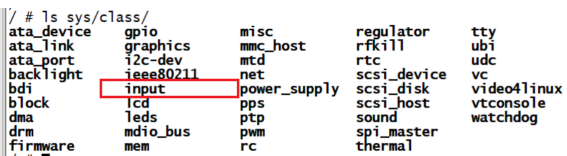
创建`proc/input`信息，申请主设备号为 `INPUT_MAJOR, INPUT_MAJOR` 定义在 `include/uapi/linux/major.h`:  
`#define INPUT_MAJOR 13`  
因此，input 子系统的所有设备主设备号都为 `13`，我们在使用 input 子系统处理输入设备的时候就不需要去注册字符设备了，我们只需要向系统注册一个 `input_device` 即可。

### 1.1.1 注册 input_dev

使用 input 子系统的时候我们只需要注册一个 input 设备即可，`input_dev` 结构体表示 `input设备`，此结构体定义在 `include/linux/input.h`：
```c
struct input_dev {  
	const char *name;  
	const char *phys;  
	const char *uniq;  
	struct input_id id;  
	unsigned long propbit[BITS_TO_LONGS(INPUT_PROP_CNT)];  
	unsigned long evbit[BITS_TO_LONGS(EV_CNT)]; /* 事件类型的位图 */  
	unsigned long keybit[BITS_TO_LONGS(KEY_CNT)]; /* 按键值的位图 */  
	unsigned long relbit[BITS_TO_LONGS(REL_CNT)]; /* 相对坐标的位图 */   
	unsigned long absbit[BITS_TO_LONGS(ABS_CNT)]; /* 绝对坐标的位图 */  
	unsigned long mscbit[BITS_TO_LONGS(MSC_CNT)]; /* 杂项事件的位图 */  
	unsigned long ledbit[BITS_TO_LONGS(LED_CNT)]; /*LED 相关的位图 */  
	unsigned long sndbit[BITS_TO_LONGS(SND_CNT)];/* sound 有关的位图 */  
	unsigned long ffbit[BITS_TO_LONGS(FF_CNT)]; /* 压力反馈的位图 */  
	unsigned long swbit[BITS_TO_LONGS(SW_CNT)]; /*开关状态的位图 */  
	.....  
	bool devres_managed;  
};
```

`evbit` 表示输入事件类型:
```c
#define EV_SYN 0x00 /* 同步事件 */  
#define EV_KEY 0x01 /* 按键事件 */  
#define EV_REL 0x02 /* 相对坐标事件 */  
#define EV_ABS 0x03 /* 绝对坐标事件 */  
#define EV_MSC 0x04 /* 杂项(其他)事件 */  
#define EV_SW 0x05 /* 开关事件 */  
#define EV_LED 0x11 /* LED */  
#define EV_SND 0x12 /* sound(声音) */  
#define EV_REP 0x14 /* 重复事件 */  
#define EV_FF 0x15 /* 压力事件 */  
#define EV_PWR 0x16 /* 电源事件 */  
#define EV_FF_STATUS 0x17 /* 压力状态事件 */
```

`evbit、keybit、relbit` 等等都是存放不同事件对应的值。比如我们本章要使用按键事件，因此要用到 keybit，keybit 就是按键事件使用的位图，Linux 内核定义了很多按键值:
```c
#define KEY_RESERVED 0  
#define KEY_ESC 1  
#define KEY_1 2  
#define KEY_2 3  
#define KEY_3 4  
#define KEY_4 5  
#define KEY_5 6  
#define KEY_6 7  
#define KEY_7 8  
#define KEY_8 9  
#define KEY_9 10  
#define KEY_0 11  
......  
#define BTN_TRIGGER_HAPPY39 0x2e6  
#define BTN_TRIGGER_HAPPY40 0x2e7
```

我们可以将开发板上的按键值设置为任意一个，比如就叫`KEY_0`。

**申请input内存：**  
`struct input_dev *input_allocate_device(void);`

**释放input内存：**  
`void input_free_device(struct input_dev *dev);`

**注册input设备：**  
`int input_register_device(struct input_dev *dev);`

**注销input设备：**  
`void input_unregister_device(struct input_dev *dev);`

#### 1.1.1.1 input_dev 注册过程
```c
struct input_dev *inputdev; /* input 结构体变量 */  
  
static int __init xxx_init(void)  
{  
	inputdev = input_allocate_device(); /* 申请 input_dev */  
	inputdev->name = "test_inputdev"; /* 设置 input_dev 名字 */  
  
	 /*********第一种设置事件和事件值的方法***********/  
	 __set_bit(EV_KEY, inputdev->evbit); /* 设置产生按键事件 */  
	 __set_bit(EV_REP, inputdev->evbit); /* 重复事件 */  
	 __set_bit(KEY_0, inputdev->keybit); /*设置产生哪些按键值 */  
	 /************************************************/  
	   
	 /*********第二种设置事件和事件值的方法***********/  
	 keyinputdev.inputdev->evbit[0] = BIT_MASK(EV_KEY) |  
	T_MASK(EV_REP);  
	 keyinputdev.inputdev->keybit[BIT_WORD(KEY_0)] |=  
	T_MASK(KEY_0);  
	 /************************************************/  
     
	 /*********第三种设置事件和事件值的方法***********/  
	 keyinputdev.inputdev->evbit[0] = BIT_MASK(EV_KEY) |  
	T_MASK(EV_REP);  
	 input_set_capability(keyinputdev.inputdev, EV_KEY, KEY_0);  
	 /************************************************/  
	 input_register_device(inputdev);  
	 return 0;  
 }  
 static void __exit xxx_exit(void)  
 {  
	 input_unregister_device(inputdev); /* 注销 input_dev */  
	 input_free_device(inputdev); /* 删除 input_dev */  
 }
```

### 1.1.2 中断上报输入事件

当输入设备中断到来，我们需要上报input输入事件给linux内核的input核心层，比如按键：我们需要在按键中断处理函数，或者消抖定时器中断函数中将按键值上报给 Linux 内核，这样 Linux 内核才能获取到正确的输入值。  
不同的事件，上报事件的 API 函数不一样:  
**input_event:**
```c
void input_event(struct input_dev *dev, unsigned int type, unsigned int code, int value)  
/*  
	dev：需要上报的 input_dev。  
	type: 上报的事件类型，比如 EV_KEY。  
	code：事件码，也就是我们注册的按键值，比如 KEY_0、KEY_1 等等。  
	value：事件值，比如 1 表示按键按下，0 表示按键松开。  
*/
```

当然linux系统帮我们也封装了一层api去使用：  
**input_report_key：**
```c
static inline void input_report_key(struct input_dev *dev,unsigned int code, int value){  
	input_event(dev, EV_KEY, code, !!value);  
}
```

同样的还有一些其他的事件上报函数:
```c
void input_report_rel(struct input_dev *dev, unsigned int code, int value)  
void input_report_abs(struct input_dev *dev, unsigned int code, int value)  
void input_report_ff_status(struct input_dev *dev, unsigned int code, int value)  
void input_report_switch(struct input_dev *dev, unsigned int code, int value)  
void input_mt_sync(struct input_dev *dev)
```

我们上报事件以后还需要使用`input_sync`函数来告诉 Linux 内核 input 子系统上报结束，`input_sync` 函数本质是上报一个同步事件:  
`void input_sync(struct input_dev *dev);`  
举个例子，按键中断服务函数如下：
```c
/* 用于按键消抖的定时器服务函数 */  
void timer_function(unsigned long arg) {  
	unsigned char value;  
	value = gpio_get_value(keydesc->gpio); /* 读取 IO 值 */  
	if(value == 0){ /* 按下按键 */  
		/* 上报按键值 */  
		input_report_key(inputdev, KEY_0, 1); /* 最后一个参数 1，按下 */  
		input_sync(inputdev); /* 同步事件 */  
	} else { /* 按键松开 */  
		input_report_key(inputdev, KEY_0, 0); /* 最后一个参数 0，松开 */  
		input_sync(inputdev); /* 同步事件 */  
	}  
}
```

### 1.1.3 input_event 结构体

`include/uapi/linux/input.h` 文件中:  
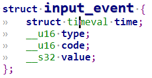
`type`：事件类型，比如 EV_KEY，表示此次事件为`按键事件`，此成员变量为 16 位。  
`code`：事件码，比如在 EV_KEY 事件中 code 就表示具体的`按键码`，如：`KEY_0、KEY_1`等等这些按键。此成员变量为 16 位。  
`value`：值，比如 EV_KEY 事件中 value 就是`按键值`，表示按键有没有被按下，如果为 1 的话说明按键按下，如果为 0 的话说明按键没有被按下或者按键松开了

`input_envent` 这个结构体非常重要,用户态的应用程序也是通过 `input_event` 来获取到具体的输入事件或相关的值，比如按键值等。

# 2 input子系统示例

还是以之前的按键来举例，利用input子系统来做一个按键驱动程序：

```c
#include <linux/types.h>  
#include <linux/kernel.h>  
#include <linux/delay.h>  
#include <linux/ide.h>  
#include <linux/init.h>  
#include <linux/module.h>  
#include <linux/errno.h>  
#include <linux/gpio.h>  
#include <linux/cdev.h>  
#include <linux/device.h>  
#include <linux/of.h>  
#include <linux/of_address.h>  
#include <linux/of_gpio.h>  
#include <linux/input.h>  
#include <linux/semaphore.h>  
#include <linux/timer.h>  
#include <linux/of_irq.h>  
#include <linux/irq.h>  
#include <asm/mach/map.h>  
#include <asm/uaccess.h>  
#include <asm/io.h>  
  
#define KEYINPUT_CNT		1			/* 设备号个数 	*/  
#define KEYINPUT_NAME		"keyinput"	/* 名字 		*/  
#define KEY0VALUE			0X01		/* KEY0按键值 	*/  
#define INVAKEY				0XFF		/* 无效的按键值 */  
#define KEY_NUM				1			/* 按键数量 	*/  
  
struct irq_keydesc {  
	int gpio;								/* gpio */  
	int irqnum;								/* 中断号     */  
	unsigned char value;					/* 按键对应的键值 */  
	char name[10];							/* 名字 */  
	irqreturn_t (*handler)(int, void *);	/* 中断服务函数 */  
};  
  
struct keyinput_dev{  
	dev_t devid;			/* 设备号 	 */  
	struct cdev cdev;		/* cdev 	*/  
	struct class *class;	/* 类 		*/  
	struct device *device;	/* 设备 	 */  
	struct device_node	*nd; /* 设备节点 */  
	struct timer_list timer;/* 定义一个定时器*/  
	struct irq_keydesc irqkeydesc[KEY_NUM];	/* 按键描述数组 */  
	unsigned char curkeynum;				/* 当前的按键号 */  
	struct input_dev *inputdev;		/* input结构体 */  
};  
  
struct keyinput_dev keyinputdev;  
  
static irqreturn_t key0_handler(int irq, void *dev_id)  
{  
	struct keyinput_dev *dev = (struct keyinput_dev *)dev_id;  
  
	dev->curkeynum = 0;  
	dev->timer.data = (volatile long)dev_id;  
	mod_timer(&dev->timer, jiffies + msecs_to_jiffies(10));	/* 10ms定时 */  
	return IRQ_RETVAL(IRQ_HANDLED);  
}  
void timer_function(unsigned long arg)  
{  
	unsigned char value;  
	unsigned char num;  
	struct irq_keydesc *keydesc;  
	struct keyinput_dev *dev = (struct keyinput_dev *)arg;  
  
	num = dev->curkeynum;  
	keydesc = &dev->irqkeydesc[num];  
	value = gpio_get_value(keydesc->gpio); 	/* 读取IO值 */  
	if(value == 0){/* 按下按键 */  
		/* 上报按键值 */  
		//input_event(dev->inputdev, EV_KEY, keydesc->value, 1);  
        /* 最后一个参数表示按下还是松开，1为按下，0为松开 */  
		input_report_key(dev->inputdev, keydesc->value, 1);  
		input_sync(dev->inputdev);  
	} else {/* 按键松开 */  
		//input_event(dev->inputdev, EV_KEY, keydesc->value, 0);  
		input_report_key(dev->inputdev, keydesc->value, 0);  
		input_sync(dev->inputdev);  
	}	  
}  
 int keyio_init(void)  
{  
	unsigned char i = 0;  
	char name[10];  
	int ret = 0;  
	  
	keyinputdev.nd = of_find_node_by_path("/key");  
	if (keyinputdev.nd== NULL){  
		printk("key node not find!\r\n");  
		return -EINVAL;  
	}   
  
	/* 提取GPIO */  
	for (i = 0; i < KEY_NUM; i++) {  
		keyinputdev.irqkeydesc[i].gpio = of_get_named_gpio(keyinputdev.nd ,"key-gpio", i);  
		if (keyinputdev.irqkeydesc[i].gpio < 0) {  
			printk("can't get key%d\r\n", i);  
		}  
	}  
	  
	/* 初始化key所使用的IO，并且设置成中断模式 */  
	for (i = 0; i < KEY_NUM; i++) {  
		memset(keyinputdev.irqkeydesc[i].name, 0, sizeof(name));	/* 缓冲区清零 */  
		sprintf(keyinputdev.irqkeydesc[i].name, "KEY%d", i);		/* 组合名字 */  
		gpio_request(keyinputdev.irqkeydesc[i].gpio, name);  
		gpio_direction_input(keyinputdev.irqkeydesc[i].gpio);	  
		keyinputdev.irqkeydesc[i].irqnum = irq_of_parse_and_map(keyinputdev.nd, i);  
	}  
	/* 申请中断 */  
	keyinputdev.irqkeydesc[0].handler = key0_handler;  
	keyinputdev.irqkeydesc[0].value = KEY_0;  
	  
	for (i = 0; i < KEY_NUM; i++) {  
		ret = request_irq(keyinputdev.irqkeydesc[i].irqnum, keyinputdev.irqkeydesc[i].handler,   
		                 IRQF_TRIGGER_FALLING|IRQF_TRIGGER_RISING,  
                         keyinputdev.irqkeydesc[i].name, &keyinputdev);  
		if(ret < 0){  
			printk("irq %d request failed!\r\n", keyinputdev.irqkeydesc[i].irqnum);  
			return -EFAULT;  
		}  
	}  
  
	/* 创建定时器 */  
	init_timer(&keyinputdev.timer);  
	keyinputdev.timer.function = timer_function;  
  
	/* 申请input_dev */  
	keyinputdev.inputdev = input_allocate_device();  
	keyinputdev.inputdev->name = KEYINPUT_NAME;  
#if 0  
	/* 初始化input_dev，设置产生哪些事件 */  
	__set_bit(EV_KEY, keyinputdev.inputdev->evbit);	/* 设置产生按键事件          */  
	__set_bit(EV_REP, keyinputdev.inputdev->evbit);	/* 重复事件，比如按下去不放开，就会一直输出信息*/  
  
	/* 初始化input_dev，设置产生哪些按键 */  
	__set_bit(KEY_0, keyinputdev.inputdev->keybit);	  
#endif  
  
#if 0  
	keyinputdev.inputdev->evbit[0] = BIT_MASK(EV_KEY) | BIT_MASK(EV_REP);  
	keyinputdev.inputdev->keybit[BIT_WORD(KEY_0)] |= BIT_MASK(KEY_0);  
#endif  
  
	keyinputdev.inputdev->evbit[0] = BIT_MASK(EV_KEY) | BIT_MASK(EV_REP);  
	input_set_capability(keyinputdev.inputdev, EV_KEY, KEY_0);  
  
	/* 注册输入设备 */  
	ret = input_register_device(keyinputdev.inputdev);  
	if (ret) {  
		printk("register input device failed!\r\n");  
		return ret;  
	}  
	return 0;  
}  
static int __init keyinput_init(void)  
{  
	keyio_init();  
	return 0;  
}  
static void __exit keyinput_exit(void)  
{  
	unsigned int i = 0;  
	del_timer_sync(&keyinputdev.timer);	/* 删除定时器 */  
		  
	for (i = 0; i < KEY_NUM; i++) {  
		free_irq(keyinputdev.irqkeydesc[i].irqnum, &keyinputdev);  
	}  
	input_unregister_device(keyinputdev.inputdev);  
	input_free_device(keyinputdev.inputdev);  
}  
  
module_init(keyinput_init);  
module_exit(keyinput_exit);
```

## 2.1 定义input_dev

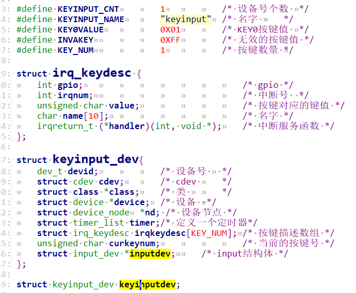
## 2.2 初始话input_dev

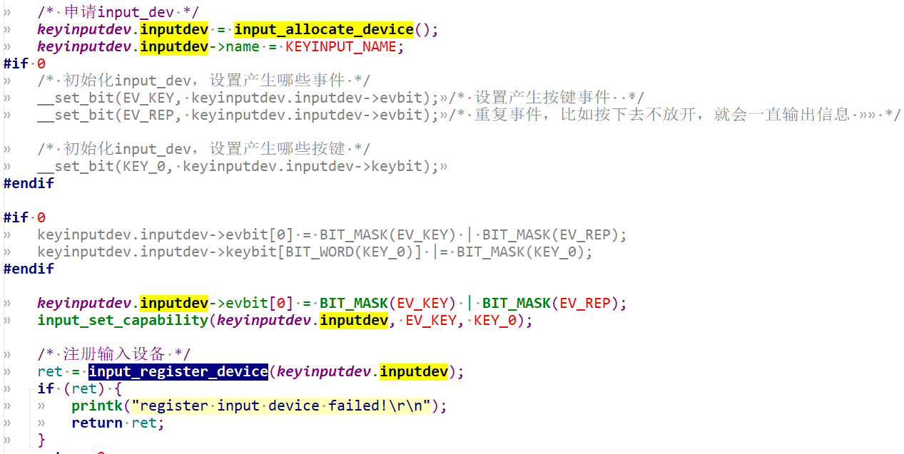
1. `input_allocate_device`分配内存
2. 设置事件和事件值，`input_event`类型是`EV_KEY`,键值`KEY_0`, `evbit`为`EV_KEY | EV_REP`
3. 注册input设备

## 2.3 中断上报输入事件

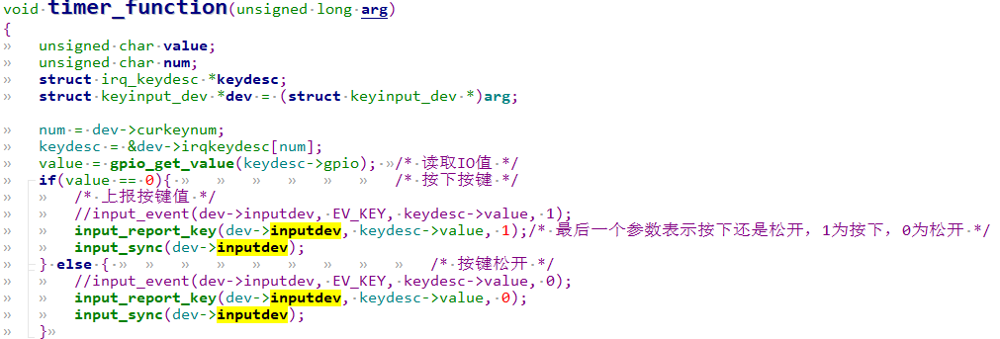
## 2.4 释放input_dev

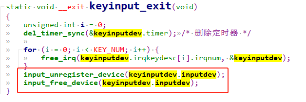
# 3 APP测试
```c
#include "stdio.h"  
#include "unistd.h"  
#include "sys/types.h"  
#include "sys/stat.h"  
#include "sys/ioctl.h"  
#include "fcntl.h"  
#include "stdlib.h"  
#include "string.h"  
#include <poll.h>  
#include <sys/select.h>  
#include <sys/time.h>  
#include <signal.h>  
#include <fcntl.h>  
#include <linux/input.h>  
static struct input_event inputevent;  
int main(int argc, char *argv[]){  
	int fd;  
	int err = 0;  
	char *filename;  
	filename = argv[1];  
	if(argc != 2) {  
		printf("Error Usage!\r\n");  
		return -1;  
	}  
  
	fd = open(filename, O_RDWR);  
	if (fd < 0) {  
		printf("Can't open file %s\r\n", filename);  
		return -1;  
	}  
	while (1) {  
		err = read(fd, &inputevent, sizeof(inputevent));  
		if (err > 0) { /* 读取数据成功 */  
			switch (inputevent.type) {  
				case EV_KEY:  
					if (inputevent.code < BTN_MISC) { /* 键盘键值 */  
						printf("key %d %s\r\n", inputevent.code,  
                               inputevent.value ? "press" : "release");  
					} else {  
						printf("button %d %s\r\n", inputevent.code,  
                               inputevent.value ? "press" : "release");  
					}  
					break;  
				/* 其他类型的事件，自行处理 */  
				case EV_REL:  
					break;  
				case EV_ABS:  
					break;  
			}  
		} else  
			printf("读取数据失败\r\n");  
	}  
	return 0;  
}
```

当我们向 Linux 内核成功注册 input_dev 设备以后，会在`/dev/input` 目录下生成一个名为`“eventX(X=0….n)”`的文件，这个`/dev/input/eventX` 就是对应的 input 设备文件。

测试：  
在加载`keyinput.ko`驱动模块之前，先看一下`/dev/input` 目录下都有哪些文件：  
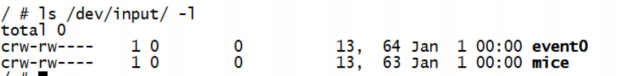
`modprobe keyinput.ko` 可以看到多一个`input1`,就是我们刚创建的设备节点：  
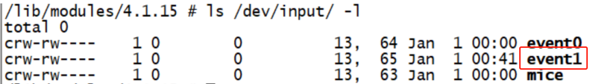
运行app:  
`./keyinputApp /dev/input/event1`  
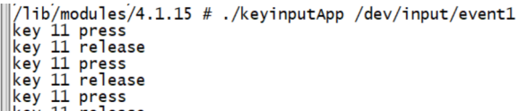
可以看出，当我们按下或者释放开发板上的按键以后都会在终端上输出相应的内容，提示我们哪个按键按下或释放了，在 Linux 内核中 `KEY_0` 为 `11`。  
另外，我们也可以不用`keyinputApp`来测试驱动，可以直接使用`hexdump`命令来查看`/dev/input/event1` 文件内容，输入如下命令：  
`hexdump /dev/input/event1`  
这就是`input_event` 类型的原始事件数据值：  
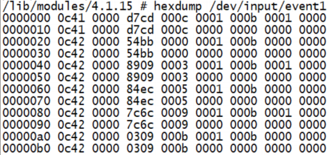
含义如下：  
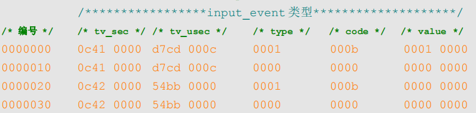
`type` 为事件类型，`EV_KEY` 事件值为 1，`EV_SYN` 事件值为0。因此第 1 行表示 `EV_KEY` 事件，第 2 行表示 `EV_SYN` 事件。code 为事件编码，也就是按键号，`KEY_0` 这个按键编号为 11，对应的十六进制为 `0xb`，因此第1 行表示 `KEY_0` 这个按键事件，最后的 value 就是按键值，为 1 表示按下，为 0 的话表示松开。  
综上所述，上述原始事件值含义如下：  
第 1 行，按键`(KEY_0)`按下事件。  
第 2 行，`EV_SYN` 同步事件，因为每次上报按键事件以后都要同步的上报一个 `EV_SYN` 事件。  
第 3 行，按键`(KEY_0)`松开事件。  
第 4 行，`EV_SYN` 同步事件，和第 2 行一样。

# 4 Linux input子系统补充-Linux 自带按键驱动

Linux 内核也自带了 KEY 驱动，如果要使用内核自带的 KEY 驱动的话需要配置 Linux 内核，不过 Linux 内核一般默认已经使能了 KEY 驱动。
```c
-> Device Drivers  
	-> Input device support  
		-> Generic input layer (needed for keyboard, mouse, ...) (INPUT [=y])  
			-> Keyboards (INPUT_KEYBOARD [=y])  
				->GPIO Buttons
```

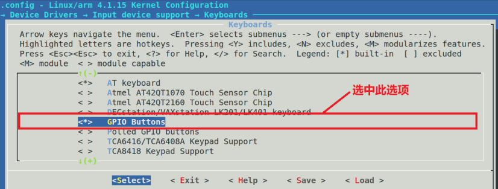
选中以后就会在`.config` 文件中出现`“CONFIG_KEYBOARD_GPIO=y”`这一行，Linux 内核  
就会根据这一行来将 KEY 驱动文件编译进 Linux 内核。Linux 内核自带的 KEY 驱动文件为  
`drivers/input/keyboard/gpio_keys.c`，`gpio_keys.c` 采用了 platform 驱动框架，在 KEY 驱动上使用  
了 input 子系统实现。

## 4.1 gpio_keys源码分析

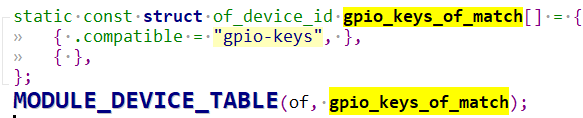
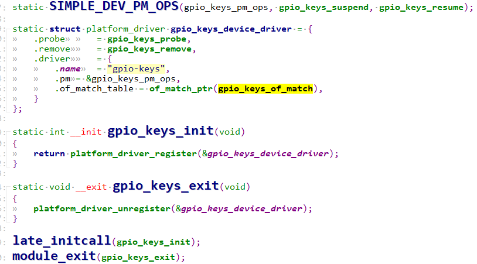
要使用 Linux 内 核 自 带 的 按 键 驱 动 程 序 很 简 单 ， 只 需 要 根 据`Documentation/devicetree/bindings/input/gpio-keys.txt` 这个文件在设备树中添加指定的设备节点即可，节点要求如下：
```c
①、节点名字为“gpio-keys”。  
②、gpio-keys 节点的 compatible 属性值一定要设置为“gpio-keys”。  
③、所有的 KEY 都是 gpio-keys 的子节点，每个子节点可以用如下属性描述自己：  
	gpios：KEY 所连接的 GPIO 信息。  
	interrupts：KEY 所使用 GPIO 中断信息，不是必须的，可以不写。  
	label：KEY 名字  
	linux,code：KEY 要模拟的按键，也就是示例代码  
④、如果按键要支持连按的话要加入 autorepeat。
```

打开 `imx6ull-alientek-emmc.dts`定义如下：
```c
gpio-keys {  
	compatible = "gpio-keys";  
	#address-cells = <1>;  
	#size-cells = <0>;  
	autorepeat;  
	key0 {  
		label = "GPIO Key Enter";  
		linux,code = <KEY_ENTER>;  
		gpios = <&gpio1 18 GPIO_ACTIVE_LOW>;  
	};  
};
```

ALPHA 开发板 KEY 按键信息，名字设置为`“GPIO Key Enter”`，这里我们将开发板上的 KEY 按键设置为`“EKY_ENTER”`这个按键，也就是回车键，效果和键盘上的回车键一样。

### 4.1.1 gpio_keys_probe分析

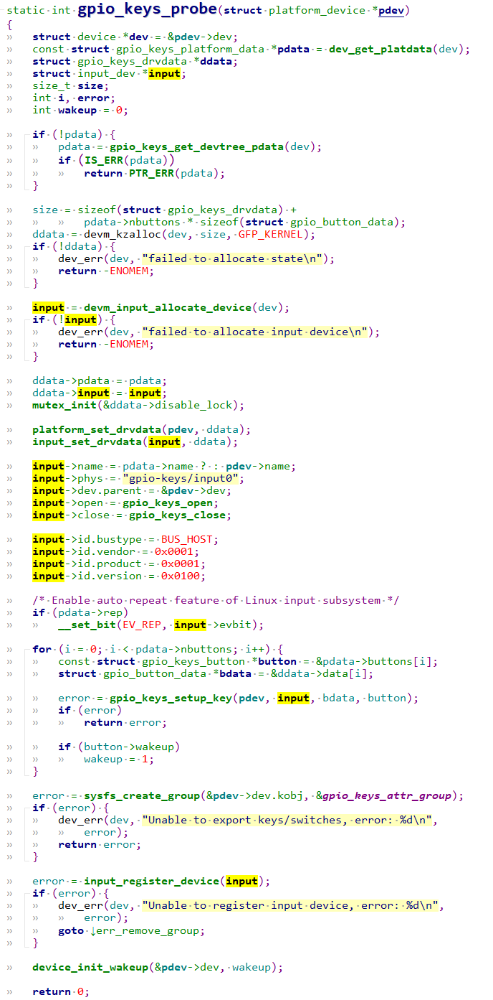
可以看到就是对`input`子系统的调用封装，实例化了一个利用input子系统写的驱动程序。  
调用 `gpio_keys_get_devtree_pdata` 函数从设备树中获取到 KEY 相关的设备节点信息。  
使用 `devm_input_allocate_device` 函数申请 input_dev。  
初始化 `input_dev`。  
设置 `input_dev 事件`，这里设置了 `EV_REP` 事件.  
**调用 `gpio_keys_setup_key` 函数继续设置 KEY，此函数会设置 input_dev 的EV_KEY 事件已经事件码(也就是 KEY 模拟为哪个按键)**  
调用 `input_register_device` 函数向 Linux 系统注册 `input_dev`。

#### 4.1.1.1 gpio_keys_setup_key

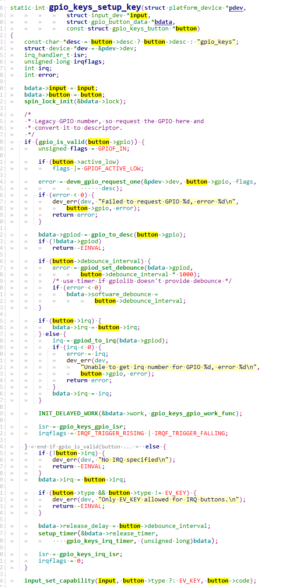
调用 `input_set_capability` 函数设置 `EV_KEY` 事件以及 KEY 的按键类型，也就是 KEY 作为哪个按键？我们会在设备树里面设置指定的 KEY 作为哪个按键.

#### 4.1.1.2 gpio_keys_irq_isr

当dts对应的按键按下后，中断进行响应，函数如下：  
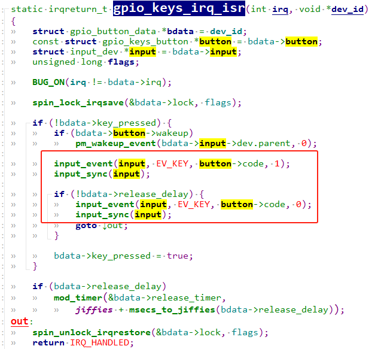
可以看到同理还是调用input_event， input_sync进行上报事件。

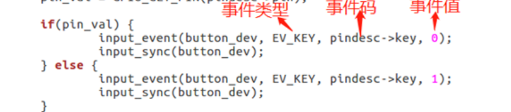
## 4.2 测试验证

烧录新的dtb和kernel进去，可以看出存在 event1 这个文件，这个文件就是 KEY 对应的设备文件，使用  
hexdump 命令来查看`/dev/input/event1` 文件：  
`hexdump /dev/input/event1`  
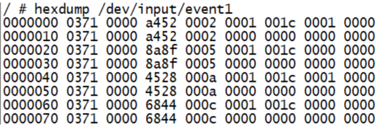
大家如果发现按下 KEY 按键以后没有反应，那么请检查一下三方面：  
①、是否使能 Linux 内核 KEY 驱动。  
②、设备树中 `gpio-keys` 节点是否创建成功。  
③、在设备树中是否有其他外设也使用了 KEY 按键对应的 GPIO，但是我们并没有删除掉这些外设信息。检查 Linux 启动 log 信息，看看是否有类似下面这条信息:  
`gpio-keys gpio_keys：Failed to request GPIO 18, error -16`

# 5 Linux input子系统-电容触摸屏应用

## 5.1 FT5426电容触摸屏简介

### 5.1.1 特性

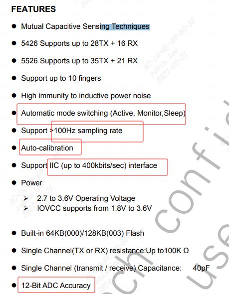
特性如下：
```c
1. 自动模式切换。  
2. 100hz采样率  
3. 自动校准  
4. i2c接口，速率高达400k  
5. 12位ADC精度转换
```

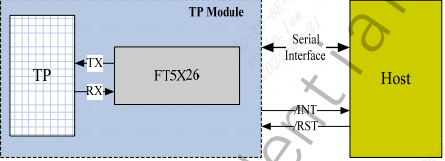
触摸 IC 提供了中断信号引脚(INT)，可以通过中断来获取触摸信息。电容触摸屏得到的是触摸位置绝对信息以及触摸屏是否有按下。

### 5.1.2 i2c传输格式

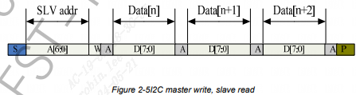
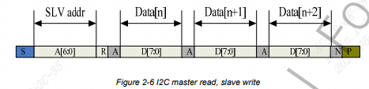
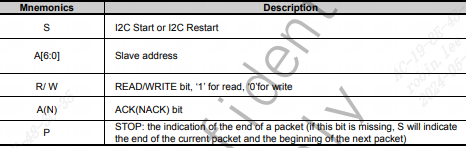
可以看到slave addr是7位，第8位表示方向。数据是每次传输1byte。

### 5.1.3 上电及复位时序

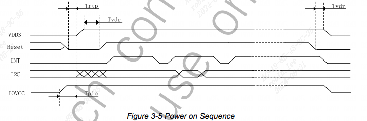
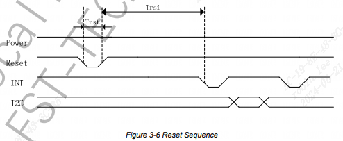
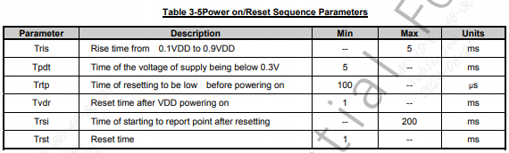
### 5.1.4 寄存器描述

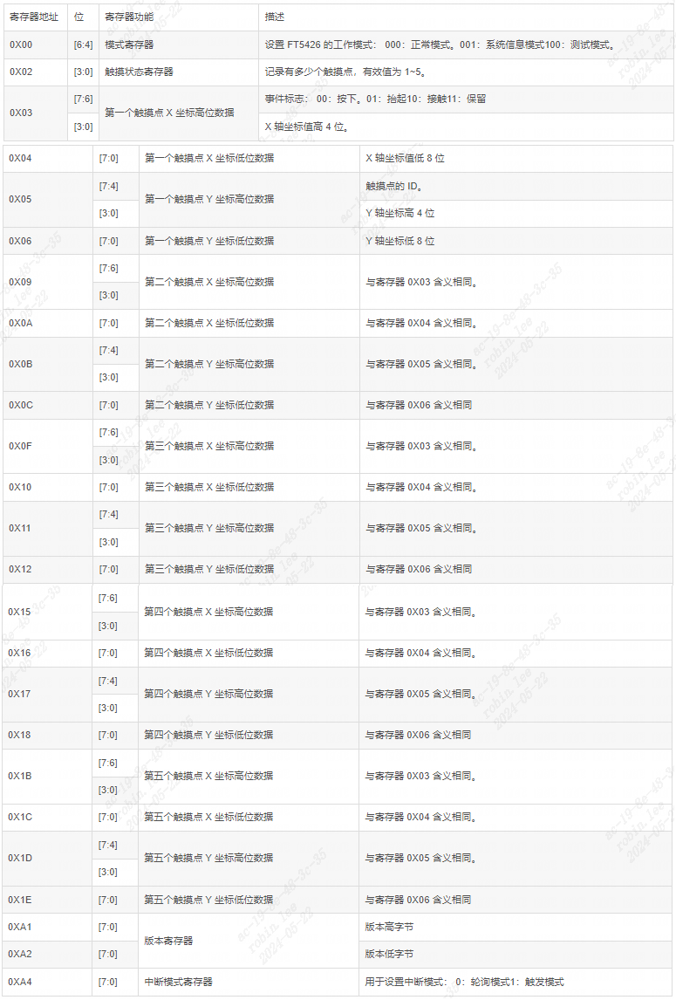
## 5.2 多点触摸(MT)协议

多点电容触摸屏协议，文档路径为：`Documentation/input/multitouch-protocol.txt。`

老版本的 2.x 版本 linux 内核是不支持多点电容触摸的(`Multi-touch，简称 MT`)，MT 协议是后面加入 的。

MT 协议被分为两种类型，`Type A` 和 `TypeB`，这两种类型的区别如下：
```c
Type A：适用于触摸点不能被区分或者追踪，此类型的设备上报原始数据(此类型在实际使用中非常少)。  
Type B：适用于有硬件追踪并能区分触摸点的触摸设备，此类型设备通过 slot 更新某一个 触摸点的信息，FT5426 就属于此类型，一般的多点电容触摸屏 IC 都有此能力。
```

### 5.2.1 ABS_MT 事件

ABS_MT 事件是用于多点触摸的，ABS_MT 事件定义在文件 `include/uapi/linux/input.h` 中, 上报给 linux 内核。
```c
#define ABS_MT_SLOT 0x2f /* MT slot being modified */  
#define ABS_MT_TOUCH_MAJOR 0x30 /* Major axis of touching ellipse */  
#define ABS_MT_TOUCH_MINOR 0x31 /* Minor axis (omit if circular) */  
#define ABS_MT_WIDTH_MAJOR 0x32 /* Major axis of approaching ellipse */  
#define ABS_MT_WIDTH_MINOR 0x33 /* Minor axis (omit if circular) */  
#define ABS_MT_ORIENTATION 0x34 /* Ellipse orientation */  
#define ABS_MT_POSITION_X 0x35 /* Center X touch position */  
#define ABS_MT_POSITION_Y 0x36 /* Center Y touch position */  
#define ABS_MT_TOOL_TYPE 0x37 /* Type of touching device */  
#define ABS_MT_BLOB_ID 0x38 /* Group a set of packets as a blob */  
#define ABS_MT_TRACKING_ID 0x39 /* Unique ID of initiated contact */  
#define ABS_MT_PRESSURE 0x3a /* Pressure on contact area */  
#define ABS_MT_DISTANCE 0x3b /* Contact hover distance */  
#define ABS_MT_TOOL_X 0x3c /* Center X tool position */  
#define ABS_MT_TOOL_Y 0x3d /* Center Y tool position */
```

`ABS_MT_POSITION_X 和 ABS_MT_POSITION_Y` 用来上 报触摸 点的 (X,Y) 坐标 信息。`ABS_MT_SLOT` 用来上 报触摸点 ID ， 对 于 Type B 类型的设备，需要用到 `ABS_MT_TRACKING_ID` 事件来区分触摸点。

#### 5.2.1.1 input_mt_sync-隔离typeA类的不同触摸点

对于 `Type A` 类型的设备，通过 `input_mt_sync()`函数来隔离不同的触摸点数据信息。`nput_mt_sync()` 函数会触发 `SYN_MT_REPORT` 事件，此事件会通知接收者获取当前触摸数据，并且准备接收 下一个触摸点数据。

`void input_mt_sync(struct input_dev *dev);`

#### 5.2.1.2 input_mt_slot-区分typeB类的不同触摸点

对于`Type B`类型的设备，上报触摸点信息的时候需要通过 `input_mt_slot()`函数区分是哪一 个触摸点。

`void input_mt_slot(struct input_dev *dev, int slot);`

第一个参数是 input_dev 设备，第二个参数 slot 用于指定当前上报的是 哪个触摸点信息。`input_mt_slot()`函数会触发 `ABS_MT_SLOT` 事件，此事件会告诉接收者当前 正在更新的是哪个触摸点(slot)的数据。

#### 5.2.1.3 input_sync-结束上报

不管是哪个类型的设备，最终都要调用 `input_sync()`函数来标识多点触摸信息传输完成，告 诉接收者处理之前累计的所有消息，并且准备好下一次接收。

可以通过 slot 的 `ABS_MT_TRACKING_ID` 来新增、替换或删除触摸点。一个非负数 的 ID 表示一个有效的触摸点，-1 这个 ID 表示未使用 slot。一个以前不存在的 ID 表示这是一个 新加的触摸点，一个 ID 如果再也不存在了就表示删除了。上报 `SYN_REPORT` 事件。

#### 5.2.1.4 input_report_abs-上报坐标

上报触摸屏原始数据。

`void input_report_abs(struct input_dev *dev, unsigned int code, int value);`

### 5.2.2 Type A 触摸点信息上报流程
```c
ABS_MT_POSITION_X x[0]//通过 ABS_MT_POSITION_X 事件上报第一个触摸点的 X 坐标数据，通过input_report_abs 函数实现，下面同理  
ABS_MT_POSITION_Y y[0]//上报第一个触摸点的 Y 坐标数据  
SYN_MT_REPORT //上报 SYN_MT_REPORT 事件，通过调用 input_mt_sync 函数来实现。  
  
ABS_MT_POSITION_X x[1]//通过 ABS_MT_POSITION_X 事件上报第二个触摸点的 X 坐标数据  
ABS_MT_POSITION_Y y[1]//上报第二个触摸点的 Y 坐标数据  
SYN_MT_REPORT //上报 SYN_MT_REPORT 事件,通知接收者获取坐标  
SYN_REPORT //最后，上报 SYN_REPORT 事件，通过调用 input_sync 函数实现。
```

Linux 内核里面也有 `Type A` 类型的多点触摸驱动，如 `st2332.c`。

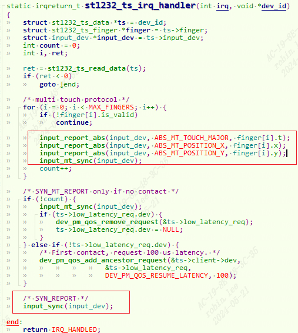
### 5.2.3 Type B 触摸点信息上报流程

对于`Type B`类型的设备，发送触摸点信息的时序如下:
```c
ABS_MT_SLOT 0 /* 上报 ABS_MT_SLOT 事件。  
    每次上报一个触摸点坐标之前要先使用input_mt_slot函数上报当前触摸点SLOT，触摸点的SLOT其实就是触摸点ID，需要由触摸 IC 提供  
    */  
ABS_MT_TRACKING_ID 45 /*根据 Type B 的要求，每个 SLOT 必须关联一个 ABS_MT_TRACKING_ID，通过  
	修改 SLOT 关联的 ABS_MT_TRACKING_ID 来完成对触摸点的添加、替换或删除。具体用到  
	的函数就是 input_mt_report_slot_state，如果是添加一个新的触摸点，那么此函数的第三个参数  
	active 要设置为 true，linux 内核会自动分配一个 ABS_MT_TRACKING_ID 值，不需要用户去指  
	定具体的 ABS_MT_TRACKING_ID 值。  
	*/  
ABS_MT_POSITION_X x[0] //上报触摸点 0 的 X 轴坐标，使用函数 input_report_abs 来完成  
ABS_MT_POSITION_Y y[0] //上报触摸点 0 的 y 轴坐标  
  
ABS_MT_SLOT 1 //同理， 上报 ABS_MT_SLOT 事件。  
ABS_MT_TRACKING_ID 46  
ABS_MT_POSITION_X x[1] //坐标1的x  
ABS_MT_POSITION_Y y[1] //坐标1的y  
SYN_REPORT //最后，上报 SYN_REPORT 事件，通过调用 input_sync 函数实现。
```

当一个触摸点移除以后，同样需要通过 SLOT 关联的`ABS_MT_TRACKING_ID`来处理:
```c
ABS_MT_TRACKING_ID -1 /*当一个触摸点(SLOT)移除以后，需要通过 ABS_MT_TRACKING_ID 事件发送一  
个-1 给内核。方法很简单，同样使用 input_mt_report_slot_state 函数来完成，只需要将此函数的  
第三个参数 active 设置为 false 即可，不需要用户手动去设置-1。  
*/  
SYN_REPORT
```

Linux 内核里面有大量的 `Type B` 类型的多点触摸驱动程序,`drivers/input/touchscreen/ili210x.c` 上报示例：
```c
static void ili210x_report_events(struct input_dev *input, const struct touchdata *touchdata) {  
	int i;  
	bool touch;  
	unsigned int x, y;  
	const struct finger *finger;  
  
	for (i = 0; i < MAX_TOUCHES; i++) {  
		input_mt_slot(input, i);//上报ABS_MT_SLOT事件  
		finger = &touchdata->finger[i];  
		touch = touchdata->status & (1 << i);  
        //上报ABS_MT_TRACKING_ID和ABS_MT_TOOL_TYPE事件  
		input_mt_report_slot_state(input, MT_TOOL_FINGER, touch);  
		if (touch) {  
			x = finger->x_low | (finger->x_high << 8);  
			y = finger->y_low | (finger->y_high << 8);  
			input_report_abs(input, ABS_MT_POSITION_X, x);  
			input_report_abs(input, ABS_MT_POSITION_Y, y);  
		}  
	}  
	input_mt_report_pointer_emulation(input, false);  
	input_sync(input);  
}
```

### 5.2.4 ABS_MT其他事件

如果设备支持的话，还可以使用 `ABS_MT_TOUCH_MAJOR` 和 `ABS_MT_WIDTH_MAJOR` 这两个消息上报触摸面积信息，关于 其他 ABS_MT 事件的具体含义大家可以查看 Linux 内核中的 `multi-touch-protocol.txt` 文档。

#### 5.2.4.1 ABS_MT_TOOL_TYPE

上报触摸工具类型。

很多内核驱动都不能区分出触摸设备类型 ，是手指还是触摸 笔？ 这种情况下， 这个事件可以忽略掉 。目前的协议支持
```c
MT_TOOL_FINGER(手指)  
MT_TOOL_PEN(笔)  
MT_TOOL_PALM(手掌)这三种触摸设备类型
```

要 上 报 ABS_MT_TOOL_TYPE 事件，那么可以使用 `input_mt_report_slot_state` 函数来完成此工作。

## 5.3 多点触摸API

### 5.3.1 input_mt_init_slots

初始化 MT 的输入 slots槽，`drivers/input/input-mt.c`。

`int input_mt_init_slots( struct input_dev *dev, unsigned int num_slots, unsigned int flags);`

num_slots: 要使用的 SLOT 数量，也就是触摸点的数量。

flags：
```c
#define INPUT_MT_POINTER 0x0001 /* pointer device, e.g. trackpad */  
#define INPUT_MT_DIRECT 0x0002 /* direct device, e.g. touchscreen */  
#define INPUT_MT_DROP_UNUSED0x0004 /* drop contacts not seen in frame */  
#define INPUT_MT_TRACK 0x0008 /* use in-kernel tracking */  
#define INPUT_MT_SEMI_MT 0x0010 /* semi-mt device, finger count handled manually */
```

### 5.3.2 input_mt_slot

Type B类型，此函数用于产生 `ABS_MT_SLOT` 事件，告诉内核当前上报的是哪个触摸点的坐标数据，定义在文件 `include/linux/input/mt.h`。

`void input_mt_slot(struct input_dev *dev, int slot);`

slot：当前发送的是哪个 slot 的坐标信息，也就是哪个触摸点。

### 5.3.3 input_mt_report_slot_state

Type B类型，用于产生`ABS_MT_TRACKING_ID和ABS_MT_TOOL_TYPE` 事件 ，`ABS_MT_TRACKING_ID`事件给slot关联一个`ABS_MT_TRACKING_ID` ， `ABS_MT_TOOL_TYPE`事件指定触摸类型（是笔还是手指等 ）。此函数定义在文件`drivers/input/input-mt.c`

`void input_mt_report_slot_state( struct input_dev *dev, unsigned int tool_type, bool active);`

tool_type：触摸类型，可以选择 MT_TOOL_FINGER(手指)、MT_TOOL_PEN(笔)或 MT_TOOL_PALM(手掌)，对于多点电容触摸屏来说一般都是手指。

active：true，连续触摸，input 子系统内核会自动分配一个 ABS_MT_TRACKING_ID 给 slot。 false，触摸点抬起，表示某个触摸点无效了，input 子系统内核会分配一个-1 给 slot，表示触摸 点溢出。

### 5.3.4 input_report_abs

上报`ABS_MT_POSITION_X 和 ABS_MT_POSITION_Y` 事件，上报坐标。include/linux/input.h。

`void input_report_abs( struct input_dev *dev, unsigned int code, int value);`

`code`：要上报的是什么数据，设置为 `ABS_MT_POSITION_X` 或 `ABS_MT_POSITION_Y`

`value`：具体的 X 轴或 Y 轴坐标数据值。

### 5.3.5 input_mt_report_pointer_emulation

如果追踪到的触摸点数量多于当前上报的数量，驱动程序使用 `BTN_TOOL_TAP` 事件来通 知用户空间当前追踪到的触摸点总数量，然后调用`input_mt_report_pointer_emulation`函数将 `use_count` 参数设置为 false。否则的话将 use_count 参数设置为 true，表示当前的触摸点数量(此函数会获取到具体的触摸点数量，不需要用户给出)，`drivers/input/input-mt.c`

`void input_mt_report_pointer_emulation(struct input_dev *dev, bool use_count);`

`use_count`：true，有效的触摸点数量；false，追踪到的触摸点数量多于当前上报的数量.

## 5.4 Linux触摸屏驱动示例-FT5426

### 5.4.1 设备树添加

#### 5.4.1.1 iomux引脚配置
```c
pinctrl_tsc: tscgrp {  
	fsl,pins = <  
		MX6UL_PAD_GPIO1_IO09__GPIO1_IO09 0xF080 /* TSC_INT */  
	>;  
};  
pinctrl_tsc_reset: tsc_reset {  
	fsl,pins = <  
		MX6ULL_PAD_SNVS_TAMPER9__GPIO5_IO09 0x10B0 /* TSC_RST */  
	>;  
}  
pinctrl_i2c2: i2c2grp {  
	fsl,pins = <  
		MX6UL_PAD_UART5_TX_DATA__I2C2_SCL 0x4001b8b0  
		MX6UL_PAD_UART5_RX_DATA__I2C2_SDA 0x4001b8b0  
	>;  
};
```

触摸屏要用到4个IO, i2c 2个引脚和1个`RST`, 1个`INT`引脚。

#### 5.4.1.2 ft5426节点
```c
&i2c2 {  
	clock_frequency = <100000>;  
	pinctrl-names = "default";  
	pinctrl-0 = <&pinctrl_i2c2>;  
	status = "okay";  
	......  
	ft5426: ft5426@38 {  
		compatible = "edt,edt-ft5426";  
		reg = <0x38>;  
		pinctrl-names = "default";  
		pinctrl-0 = <&pinctrl_tsc  
			&pinctrl_tsc_reset>;  
		interrupt-parent = <&gpio1>;  
		interrupts = <9 0>;  
		reset-gpios = <&gpio5 9 GPIO_ACTIVE_LOW>;  
		interrupt-gpios = <&gpio1 9 GPIO_ACTIVE_LOW>;  
	};  
};
```

找到`i2c2`节点，引用`pinctrl_i2c2`，设置好I2c的iomux。设置时钟100k, status开启okay。

添加子节点`ft5426`，器件地址为 `0X38`，引用`pinctrl_tsc`， `pinctrl_tsc_reset`设置`rst`和`int`引脚的iomux。

`interrupt-parent` 属性描述中断 IO 对应的 GPIO 组为 `GPIO1`。

`interrupts` 属性描述中断 IO 对应的是 GPIO1 组的 `IOI09`。

`reset-gpios` 属性描述复位 IO 对应的 GPIO 为 `GPIO5_IO09`。

`interrupt-gpios` 属性描述中断 IO 对应的 GPIO 为 `GPIO1_IO09`。

### 5.4.2 FT5426驱动源码解析


```c
//ft5x06.c  
#include <linux/module.h>  
#include <linux/ratelimit.h>  
#include <linux/interrupt.h>  
#include <linux/input.h>  
#include <linux/i2c.h>  
#include <linux/uaccess.h>  
#include <linux/delay.h>  
#include <linux/debugfs.h>  
#include <linux/slab.h>  
#include <linux/gpio.h>  
#include <linux/of_gpio.h>  
#include <linux/input/mt.h>  
#include <linux/input/touchscreen.h>  
#include <linux/input/edt-ft5x06.h>  
#include <linux/i2c.h>  
  
#define MAX_SUPPORT_POINTS		5			/* 5点触摸 	*/  
#define TOUCH_EVENT_DOWN		0x00		/* 按下 	*/  
#define TOUCH_EVENT_UP			0x01		/* 抬起 	*/  
#define TOUCH_EVENT_ON			0x02		/* 接触 	*/  
#define TOUCH_EVENT_RESERVED	0x03		/* 保留 	*/  
  
/* FT5X06寄存器相关宏定义 */  
#define FT5X06_TD_STATUS_REG	0X02		/*	状态寄存器地址 		*/  
#define FT5x06_DEVICE_MODE_REG	0X00 		/* 模式寄存器 			*/  
#define FT5426_IDG_MODE_REG		0XA4		/* 中断模式				*/  
#define FT5X06_READLEN			29			/* 要读取的寄存器个数 	*/  
  
struct ft5x06_dev {  
	struct device_node	*nd; 				/* 设备节点 		*/  
	int irq_pin,reset_pin;					/* 中断和复位IO		*/  
	int irqnum;								/* 中断号    		*/  
	void *private_data;						/* 私有数据 		*/  
	struct input_dev *input;				/* input结构体 		*/  
	struct i2c_client *client;				/* I2C客户端 		*/  
};  
  
static struct ft5x06_dev ft5x06;  
  
static int ft5x06_ts_reset(struct i2c_client *client, struct ft5x06_dev *dev){  
	int ret = 0;  
	if (gpio_is_valid(dev->reset_pin)) {  
		/* 申请复位IO，并且默认输出低电平 */  
		ret = devm_gpio_request_one(&client->dev,	  
					dev->reset_pin, GPIOF_OUT_INIT_LOW,  
					"edt-ft5x06 reset");  
		if (ret) {  
			return ret;  
		}  
		msleep(5);  
		gpio_set_value(dev->reset_pin, 1);/* 输出高电平，停止复位 */  
		msleep(300);  
	}  
	return 0;  
}  
  
static int ft5x06_read_regs(struct ft5x06_dev *dev, u8 reg, void *val, int len){  
	int ret;  
	struct i2c_msg msg[2];  
	struct i2c_client *client = (struct i2c_client *)dev->client;  
	/* msg[0]为发送要读取的首地址 */  
	msg[0].addr = client->addr;			/* ft5x06地址 */  
	msg[0].flags = 0;					/* 标记为发送数据 */  
	msg[0].buf = &reg;					/* 读取的首地址 */  
	msg[0].len = 1;						/* reg长度*/  
	/* msg[1]读取数据 */  
	msg[1].addr = client->addr;			/* ft5x06地址 */  
	msg[1].flags = I2C_M_RD;			/* 标记为读取数据*/  
	msg[1].buf = val;					/* 读取数据缓冲区 */  
	msg[1].len = len;					/* 要读取的数据长度*/  
	ret = i2c_transfer(client->adapter, msg, 2);  
	if(ret == 2) {  
		ret = 0;  
	} else {  
		ret = -EREMOTEIO;  
	}  
	return ret;  
}  
  
static s32 ft5x06_write_regs(struct ft5x06_dev *dev, u8 reg, u8 *buf, u8 len) {  
	u8 b[256];  
	struct i2c_msg msg;  
	struct i2c_client *client = (struct i2c_client *)dev->client;  
	b[0] = reg;					/* 寄存器首地址 */  
	memcpy(&b[1],buf,len);		/* 将要写入的数据拷贝到数组b里面 */  
	msg.addr = client->addr;	/* ft5x06地址 */  
	msg.flags = 0;				/* 标记为写数据 */  
  
	msg.buf = b;				/* 要写入的数据缓冲区 */  
	msg.len = len + 1;			/* 要写入的数据长度 */  
	return i2c_transfer(client->adapter, &msg, 1);  
}  
  
static void ft5x06_write_reg(struct ft5x06_dev *dev, u8 reg, u8 data) {  
	u8 buf = 0;  
	buf = data;  
	ft5x06_write_regs(dev, reg, &buf, 1);  
}  
  
static irqreturn_t ft5x06_handler(int irq, void *dev_id) {  
	struct ft5x06_dev *multidata = dev_id;  
  
	u8 rdbuf[29];  
	int i, type, x, y, id;  
	int offset, tplen;  
	int ret;  
	bool down;  
  
	offset = 1; 	/* 偏移1，也就是0X02+1=0x03,从0X03开始是触摸值 */  
	tplen = 6;		/* 一个触摸点有6个寄存器来保存触摸值 */  
  
	memset(rdbuf, 0, sizeof(rdbuf));		/* 清除 */  
  
	/* 读取FT5X06触摸点坐标从0X02寄存器开始，连续读取29个寄存器 */  
	ret = ft5x06_read_regs(multidata, FT5X06_TD_STATUS_REG, rdbuf, FT5X06_READLEN);  
	if (ret) {  
		goto fail;  
	}  
  
	/* 上报每一个触摸点坐标 */  
	for (i = 0; i < MAX_SUPPORT_POINTS; i++) {  
		u8 *buf = &rdbuf[i * tplen + offset];  
  
		/* 以第一个触摸点为例，寄存器TOUCH1_XH(地址0X03),各位描述如下：  
		 * bit7:6  Event flag  0:按下 1:释放 2：接触 3：没有事件  
		 * bit5:4  保留  
		 * bit3:0  X轴触摸点的11~8位。  
		 */  
		type = buf[0] >> 6;     /* 获取触摸类型 */  
		if (type == TOUCH_EVENT_RESERVED)  
			continue;  
   
		/* 我们所使用的触摸屏和FT5X06是反过来的 */  
		x = ((buf[2] << 8) | buf[3]) & 0x0fff;  
		y = ((buf[0] << 8) | buf[1]) & 0x0fff;  
		  
		/* 以第一个触摸点为例，寄存器TOUCH1_YH(地址0X05),各位描述如下：  
		 * bit7:4  Touch ID  触摸ID，表示是哪个触摸点  
		 * bit3:0  Y轴触摸点的11~8位。  
		 */  
		id = (buf[2] >> 4) & 0x0f;  
		down = type != TOUCH_EVENT_UP;  
  
		input_mt_slot(multidata->input, id);  
		input_mt_report_slot_state(multidata->input, MT_TOOL_FINGER, down);  
  
		if (!down)  
			continue;  
  
		input_report_abs(multidata->input, ABS_MT_POSITION_X, x);  
		input_report_abs(multidata->input, ABS_MT_POSITION_Y, y);  
	}  
  
	input_mt_report_pointer_emulation(multidata->input, true);  
	input_sync(multidata->input);  
fail:  
	return IRQ_HANDLED;  
  
}  
  
static int ft5x06_ts_irq(struct i2c_client *client, struct ft5x06_dev *dev) {  
	int ret = 0;  
	if (gpio_is_valid(dev->irq_pin)) {  
		ret = devm_gpio_request_one(&client->dev, dev->irq_pin,  
					GPIOF_IN, "edt-ft5x06 irq");  
		if (ret) {  
			dev_err(&client->dev,  
				"Failed to request GPIO %d, error %d\n",  
				dev->irq_pin, ret);  
			return ret;  
		}  
	}  
	ret = devm_request_threaded_irq(&client->dev, client->irq, NULL,  
					ft5x06_handler, IRQF_TRIGGER_FALLING | IRQF_ONESHOT,  
					client->name, &ft5x06);  
	if (ret) {  
		dev_err(&client->dev, "Unable to request touchscreen IRQ.\n");  
		return ret;  
	}  
	return 0;  
}  
  
static int ft5x06_ts_probe(struct i2c_client *client, const struct i2c_device_id *id)  
{  
	int ret = 0;  
  
	ft5x06.client = client;  
  
	ft5x06.irq_pin = of_get_named_gpio(client->dev.of_node, "interrupt-gpios", 0);  
	ft5x06.reset_pin = of_get_named_gpio(client->dev.of_node, "reset-gpios", 0);  
  
	ret = ft5x06_ts_reset(client, &ft5x06);  
	if(ret < 0) {  
		goto fail;  
	}  
  
	ret = ft5x06_ts_irq(client, &ft5x06);  
	if(ret < 0) {  
		goto fail;  
	}  
  
	/* 4，初始化FT5X06 */  
	ft5x06_write_reg(&ft5x06, FT5x06_DEVICE_MODE_REG, 0); 	/* 进入正常模式 	*/  
	ft5x06_write_reg(&ft5x06, FT5426_IDG_MODE_REG, 1); 		/* FT5426中断模式	*/  
  
	/* 5，input设备注册 */  
	ft5x06.input = devm_input_allocate_device(&client->dev);  
	if (!ft5x06.input) {  
		ret = -ENOMEM;  
		goto fail;  
	}  
	ft5x06.input->name = client->name;  
	ft5x06.input->id.bustype = BUS_I2C;  
	ft5x06.input->dev.parent = &client->dev;  
	__set_bit(EV_KEY, ft5x06.input->evbit);  
	__set_bit(EV_ABS, ft5x06.input->evbit);  
	__set_bit(BTN_TOUCH, ft5x06.input->keybit);  
  
	input_set_abs_params(ft5x06.input, ABS_X, 0, 1024, 0, 0);  
	input_set_abs_params(ft5x06.input, ABS_Y, 0, 600, 0, 0);  
	input_set_abs_params(ft5x06.input, ABS_MT_POSITION_X,0, 1024, 0, 0);  
	input_set_abs_params(ft5x06.input, ABS_MT_POSITION_Y,0, 600, 0, 0);	       
	ret = input_mt_init_slots(ft5x06.input, MAX_SUPPORT_POINTS, 0);  
	if (ret) {  
		goto fail;  
	}  
	ret = input_register_device(ft5x06.input);  
	if (ret)  
		goto fail;  
	return 0;  
fail:  
	return ret;  
}  
  
static int ft5x06_ts_remove(struct i2c_client *client){  
	input_unregister_device(ft5x06.input);  
	return 0;  
}  
  
static const struct i2c_device_id ft5x06_ts_id[] = {  
	{ "edt-ft5206", 0, },  
	{ "edt-ft5426", 0, },  
	{ /* sentinel */ }  
};  
static const struct of_device_id ft5x06_of_match[] = {  
	{ .compatible = "edt,edt-ft5206", },  
	{ .compatible = "edt,edt-ft5426", },  
	{ /* sentinel */ }  
};  
  
static struct i2c_driver ft5x06_ts_driver = {  
	.driver = {  
		.owner = THIS_MODULE,  
		.name = "edt_ft5x06",  
		.of_match_table = of_match_ptr(ft5x06_of_match),  
	},  
	.id_table = ft5x06_ts_id,  
	.probe    = ft5x06_ts_probe,  
	.remove   = ft5x06_ts_remove,  
};  
  
static int __init ft5x06_init(void){  
	int ret = 0;  
  
	ret = i2c_add_driver(&ft5x06_ts_driver);  
  
	return ret;  
}  
static void __exit ft5x06_exit(void){  
	i2c_del_driver(&ft5x06_ts_driver);  
}  
module_init(ft5x06_init);  
module_exit(ft5x06_exit);  
MODULE_LICENSE("GPL");
```

#### 5.4.2.1 probe过程

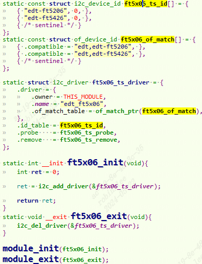
dts中的`compatible`和驱动匹配，`of_match_table`匹配，因此触发probe函数。

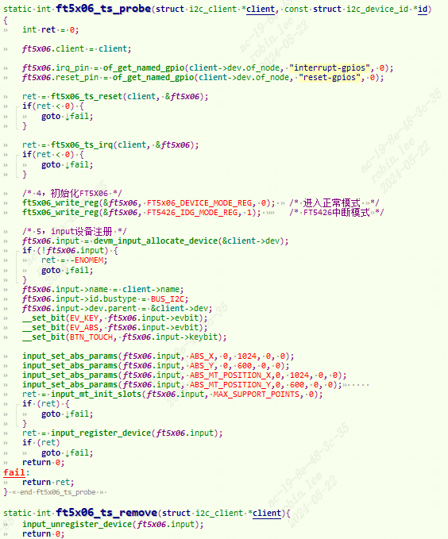
由于`i2c_client`描述i2c从设备的i2c相关硬件信息。 一个`i2c_driver`可以支持多个同类型的`i2c_client`。`i2c_client`一般描述在设备树中, 这里`对应i2c2的ft5426子节点`。

1. 当驱动和设备匹配，`ft5x06_ts_probe`执行。首先获取dts中的属性`reset-gpios`,`interrupt-gpios`。
    
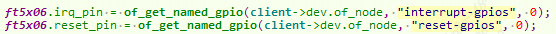
2. 对复位引脚进行复位。
    
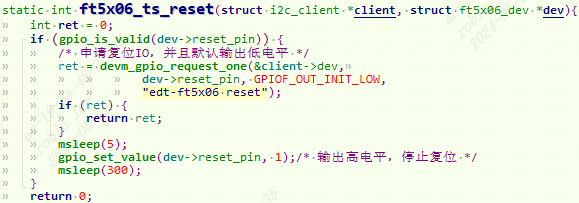
3. 注册中断服务

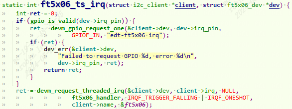
4. 初始化ft5426内部寄存器
    
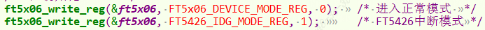
5. 利用input子系统设置MT协议参数，并且注册input设备。
    
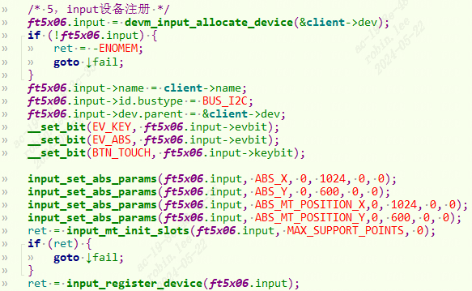
需要上报的事件为 `EV_KEY 和 EV_ABS`，需要上报的按键码为 `BTN_TOUCH`(`BTN_TOUCH见include\uapi\linux\input-event-codes.h`)。`EV_KEY` 是按键事件，用于上报触摸屏是否被按下，相当于把触摸屏当做一个按键。`EV_ABS` 是触摸点坐标数据，`BTN_TOUCH` 表示将触摸屏的按下和抬起用作 `BTN_TOUCH` 按键。

`input_set_abs_params` 函数设置 EV_ABS 事件需要上报 `ABS_X、ABS_Y、ABS_MT_POSITION_X 和 ABS_MT_POSITION_Y`。单点触摸需要上报`ABS_X` 和 `ABS_Y`，对于多点触摸需要上报 `ABS_MT_POSITION_X` 和 `ABS_MT_POSITION_Y`。

`input_mt_init_slots` 函数初始 化 slots，也就是最大触摸点数量，FT5426 是个 5 点电容触摸芯片，因此一共 5 个 slot。

#### 5.4.2.2 I2C数据传输
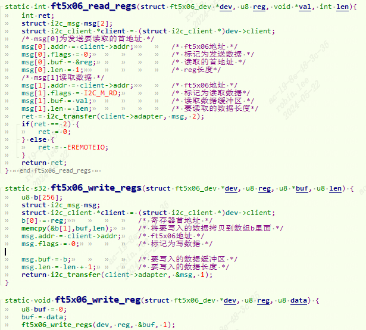
读过程：

构造`i2c_msg[0]`，flag=0表示写，先发送i2c从设备器件地址0x38。然后发送要读哪个寄存器地址。

构造`i2c_msg[1]`，flag=1表示读，先发送i2c从设备器件地址0x38。然后传入要读的buf。

写过程：

构造`i2c_msg`，flag=0表示写，先发送i2c从设备器件地址0x38。然后发送要写哪个寄存器地址和写入的内容。

#### 5.4.2.3 中断触摸数据上报

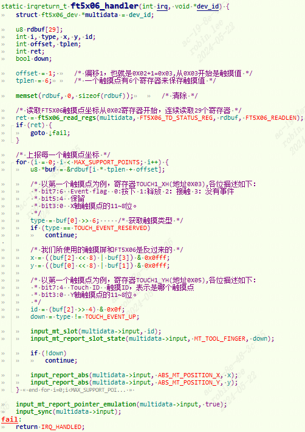
1. 通过`I2c_read`获取寄存器值。一共29个寄存器，读出29 byte。从0X02寄存器开始读。
2. for循环内部用来拆解坐标信息，上报每一个点的坐标。
3. 最后调用`input_sync`上传上报`SYN_REPORT`事件。

### 5.4.3 用户态应用测试

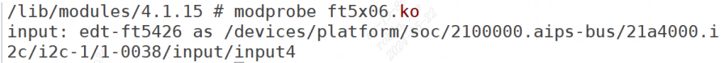
驱动加载成功以后就会生成`/dev/input/eventX`(X=1,2,3…)

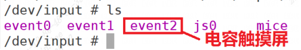
#### 5.4.3.1 触摸屏原始数据解析

`hexdump /dev/input/event2`可以查看原始数据。

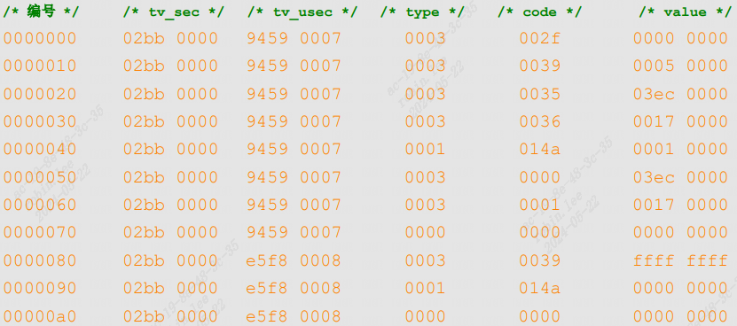
第1行，type为0x3，说明是一个`EV_ABS`事件，`code为0x2f`，为`ABS_MT_SLOT`，因此这一行就是`input_mt_slot`函数上报的`ABS_MT_SLOT`事件。value=0，说明接下来上报的是第一个触摸点坐标。

第2行，type为0x3，说明是一个`EV_ABS`事件，`code为0x39`，也就是`ABS_MT_TRACKING_ID`，这一行就是`input_mt_report_slot_state`函数上报`ABS_MT_TRACKING_ID`事件。`value=5`说明给`SLOT0`分配的ID为5。

​ 第3行，type为0x3，是一个`EV_ABS`事件，`code为0x35`，为`ABS_MT_POSITION_X`，这一行就是`input_report_abs`函数上报的`ABS_MT_POSITION_X`事件，也就是触摸点的X轴坐标。`value=0x03ec=1004`，说明触摸点X轴坐标为1004，属于屏幕右上角区域。

​ 第4行，type为0x3，是一个`EV_ABS`事件，`code为0x36`，为`ABS_MT_POSITION_Y`，这一行就是`input_report_abs`函数上报的`ABS_MT_POSITION_Y`事件，也就是触摸点的Y轴坐标。`value=0x17=23`，说明Y轴坐标为23，由此可以看出本次触摸的坐标为(1004,23)，处于屏幕右上角区域。

​ 第5行，type为0x1，是一个`EV_KEY`事件，`code=0x14a`，为`BTN_TOUCH`，`value=0x1`表示触摸屏被按下。

​ 第6行，type为0x3，是一个`EV_ABS`事件，`code为0x0`，为`ABS_X`，用于单点触摸的时候上报X轴坐标。在这里和`ABS_MT_POSITION_X`相同，`value也为0x3f0=1008`。ABS_X是由`input_mt_report_pointer_emulation`函数上报的。

​ 第7行，type为0x3，是一个`EV_ABS`事件，`code为0x1`，为`ABS_Y`，用于单点触摸的时候上报Y轴坐标。在这里和`ABS_MT_POSITION_Y`相同，`value也为0x17=23`。ABS_Y是由`input_mt_report_pointer_emulation`函数上报的。

第8行，type为0x0，是一个`EV_SYN`事件，由`input_sync`函数上报。

第9行，type为0x3，是一个`EV_ABS`事件，`code为0x39`，也就是`ABS_MT_TRACKING_ID`，`value=0xffffffff=-1`，说明触摸点离开了屏幕。

第10行，type为0x1，是一个`EV_KEY`事件，`code=0x14a`，为`BTN_TOUCH`，`value=0x0`表示手指离开触摸屏，也就是触摸屏没有被按下了。

第11行，type为0x0，是一个`EV_SYN`事件，由`input_sync`函数上报。

以上就是一个触摸点的坐标上报过程。

## 5.5 Linux内核自带的触摸驱动

打开`driver/input/touchscreen/Makefile`。

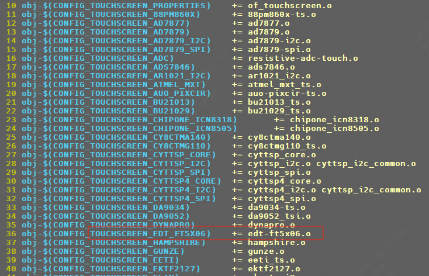
linux内核默认已经帮我们实现了这款`edt-ft5x06.c`触摸屏驱动。此驱动文件不仅仅 能够驱动 `FT5426，FT5206、FT5406` 这些都可以驱动。

`make menuconfig`,选中这款触摸屏即可。
```c
Location:  
 -> Device Drivers  
 	-> Input device support  
 		-> Generic input layer (needed for keyboard, mouse, ...) (INPUT [=y])  
			-> Touchscreens (INPUT_TOUCHSCREEN [=y])  
				-> <*> EDT FocalTech FT5x06 I2C Touchscreen support
```

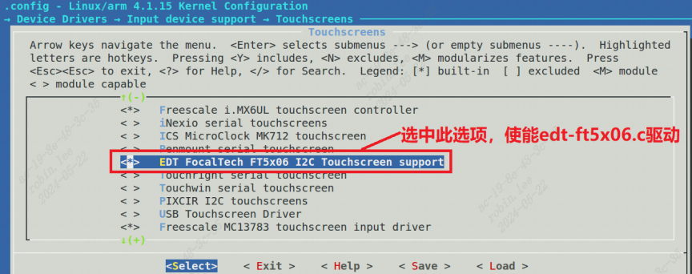
编译后开机如下打印：

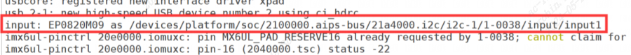
直接运行 ts_test_mt 来测试触摸屏是否可以使用。

# 6 IS_ENABLED-在驱动中判断某CONFIG是否定义
```c
linux/kconfig.h:73:#define IS_ENABLED(option) __or(IS_BUILTIN(option), IS_MODULE(option))
```
