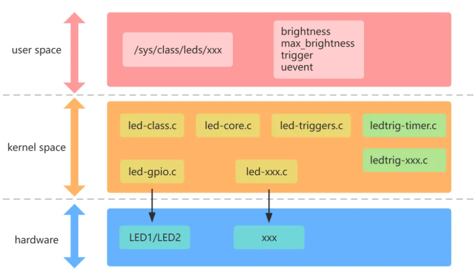
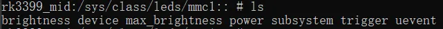
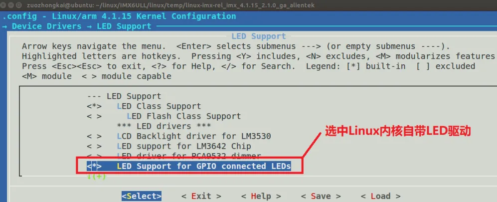
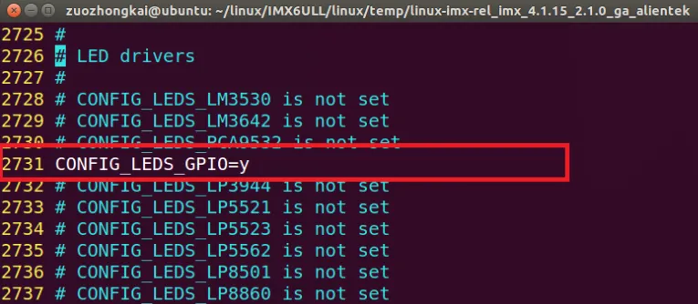
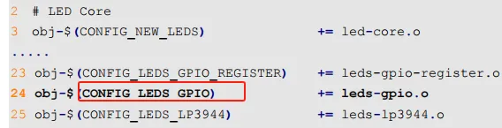
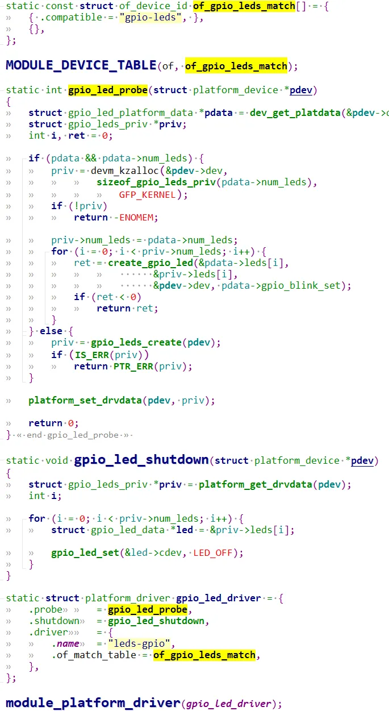
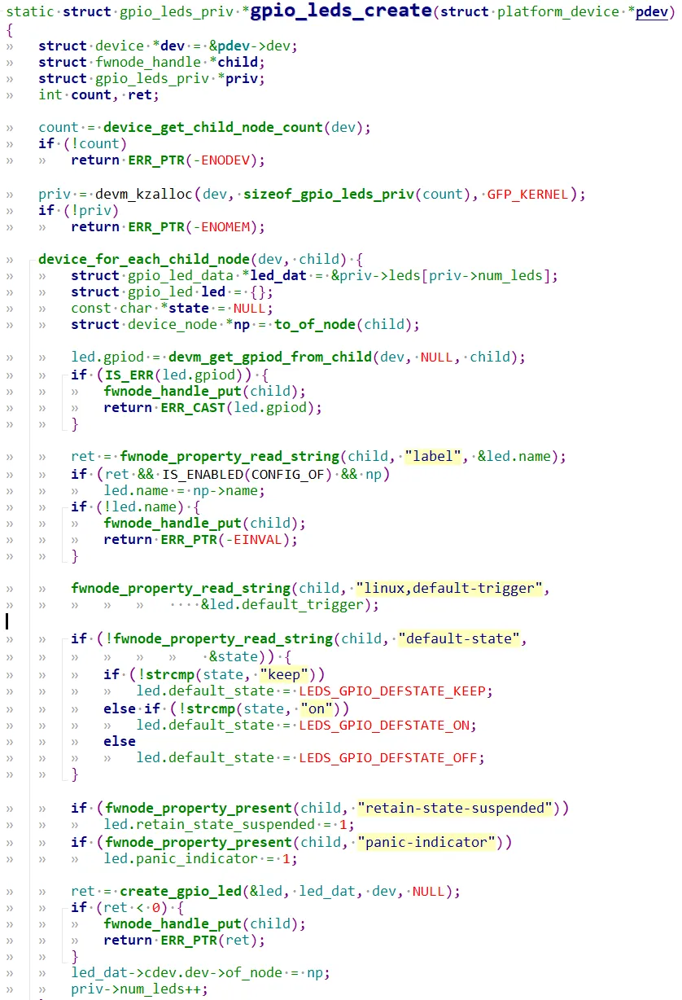
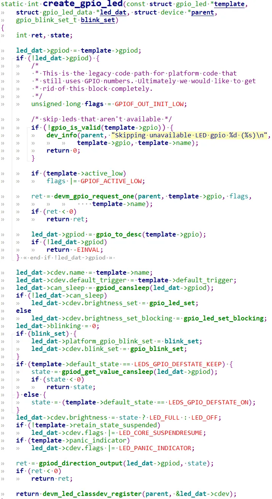
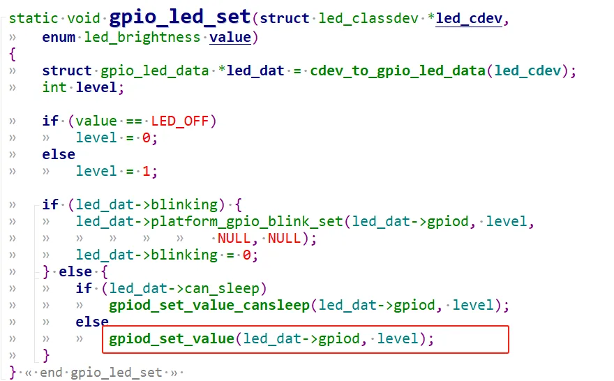
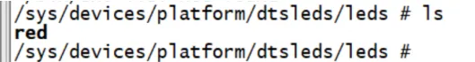

# 1 LED子系统介绍

用来管理控制板子的led灯，比如系统心跳灯，普通的硬盘指示灯光，颜色灯，休眠唤醒灯等等。


led 子系统相关描述可在内核源码 `Documentation/leds/leds-class.txt` 了解。

led 子系统是一个简单的 Linux 子系统 ，在目录 `/sys/class/leds` 下展示该子系统设备，每个设备都有自己的属性：  

```c
brightness：设置 LED 亮度，范围 0 ~ max_brightness  
max_brightness：最大亮度（255 或其他数字）  
trigger：触发方式，如 heartbeat、mmc0、backlight、gpio  
delay_off、delay_on：trigger为timer时，LED亮灭的时间，单位ms
```

`kernel/include/linux/leds.h`
```c
enum led_brightness {  
	LED_OFF  = 0,    //全暗  
	LED_HALF = 127,  //一半亮度  
	LED_FULL = 255,  //最大亮度  
};
```

## 1.1 代码框架分析

`led-class.c` (led 子系统框架的入口)
```c
维护 LED 子系统的所有 LED 设备，为 LED 设备提供注册操作函数:   
  
led_classdev_register()  
devm_led_classdev_register()  
  
注销操作函数:  
led_classdev_unregister()  
devm_led_classdev_unregister();  
  
电源管理的休眠和恢复操作函数:   
led_classdev_suspend()  
led_classdev_resume();  
  
用户态操作接口:brightness 、max_brightness
```

`led-core.c`
```c
抽象出 LED 操作逻辑，封装成函数导出，供其它文件使用:  
  
led_init_core(): 核心初始化;  
led_blink_set(): 设置led闪烁时间:  
led_blink_set_oneshot() : 闪烁一次  
led_stop_software_blink() : led停止闪烁  
led_set_brightness() : 设置led的亮度  
led_update_brightness : 更新亮度  
led_sysfs_disable : 用户态关闭  
led_sysfs enable : 用户态打开  
leds_list : leds链表;  
leds_list_lock : leds链表锁
```

`led-triggers.c`
```c
维护 LED 子系统的所有触发器，为触发器提供注册操作函数:   
  
led_trigger_register()  
devm_led_trigger_register()  
led_trigger_register_simple()  
  
注销操作函数:   
led_trigger_unregister()  
led_trigger_unregister_simple()  
  
以及其它触发器相关的操作函数
```

`ledtrig-timer.c、ledtrig-xxx.c`
```c
以 ledtrig-timer.c 为例  
  
入口函数调用 led_trigger_register() 注册触发器，  
注册时候传入 led_trigger 结构体，里面有 activate 和 deactivate 成员函数指针，  
作用是生成 delay_on 、 delay_off 文件  
  
同时还提供 delay_on 和 delay_off 的用户态操作接口  
卸载时，使用 led_trigger_unregister() 注销触发器
```

`leds-gpio.c、leds-xxx.c`
```c
以 leds-gpio.c 为例  
  
在通过设备树或者其它途径匹配到设备信息后，将调用 probe() 函数，  
然后再根据设备信息设置 led_classdev，  
最后调用 devm_led_classdev_register() 注册 LED 设备。
```

对于驱动开发人员，LED框架已经有了，并不需要我们去熟悉，只要知道如何使用，它是如何与我们的硬件相关联的，只要熟悉`leds-gpio.c`。

## 1.2 结构体描述

### 1.2.1 led_classdev
```c
struct led_classdev {  
	 const char  *name;//名字  
	 enum led_brightness  brightness;//亮度  
	 enum led_brightness  max_brightness;//最大亮度  
	 int    flags;  
  
	 /* Lower 16 bits reflect status */  
	#define LED_SUSPENDED  (1 << 0)  
	 /* Upper 16 bits reflect control information */  
	#define LED_CORE_SUSPENDRESUME (1 << 16)  
	#define LED_BLINK_ONESHOT (1 << 17)  
	#define LED_BLINK_ONESHOT_STOP (1 << 18)  
	#define LED_BLINK_INVERT (1 << 19)  
	#define LED_SYSFS_DISABLE (1 << 20)  
	#define SET_BRIGHTNESS_ASYNC (1 << 21)  
	#define SET_BRIGHTNESS_SYNC (1 << 22)  
	#define LED_DEV_CAP_FLASH (1 << 23)  
  
	//设置亮度API  
	 void  (*brightness_set)(struct led_classdev *led_cdev,enum led_brightness brightness);  
	 int  (*brightness_set_sync)(struct led_classdev *led_cdev,enum led_brightness brightness);  
  
	//获取亮度API  
	 enum led_brightness (*brightness_get)(struct led_classdev *led_cdev);  
  
	//闪烁时点亮和熄灭的时间设置  
	 int  (*blink_set)(struct led_classdev *led_cdev,unsigned long *delay_on,unsigned long *delay_off);  
  
	 struct device  *dev;  
	 const struct attribute_group **groups;  
  
	//leds-list的node  
	 struct list_head  node;  
	//默认trigger的名字  
	 const char  *default_trigger;  
	//闪烁的开关时间  
	 unsigned long   blink_delay_on, blink_delay_off;  
	//闪烁的定时器链表  
	 struct timer_list  blink_timer;  
	//闪烁的亮度  
	 int    blink_brightness;  
	 void   (*flash_resume)(struct led_classdev *led_cdev);  
  
	 struct work_struct set_brightness_work;  
	 int   delayed_set_value;  
  
	#ifdef CONFIG_LEDS_TRIGGERS  
	//trigger的锁  
	 struct rw_semaphore  trigger_lock;  
	//led的trigger  
	 struct led_trigger *trigger;  
	//trigger的链表  
	 struct list_head  trig_list;  
	//trigger的数据  
	 void   *trigger_data;  
	 bool   activated;  
	#endif  
	 struct mutex  led_access;  
	};
```

### 1.2.2 gpio_led
```c
struct gpio_led {  
	const char *name;  
	const char *default_trigger;  
	unsigned 	gpio;  
	unsigned	active_low : 1;  
	unsigned	retain_state_suspended : 1;  
	unsigned	panic_indicator : 1;  
	unsigned	default_state : 2;  
	/* default_state should be one of LEDS_GPIO_DEFSTATE_(ON|OFF|KEEP) */  
	struct gpio_desc *gpiod;  
};
```

`name`: led名字  
`default_trigger`: LED 灯在Linux 系统中的默认功能，比如作为系统心跳指示灯等等。  
`default_state`: 默认状态，如：
```c
#define LEDS_GPIO_DEFSTATE_OFF		0  
#define LEDS_GPIO_DEFSTATE_ON		1  
#define LEDS_GPIO_DEFSTATE_KEEP		2
```

`gpiod`：用于描述控制LED的gpio。

# 2 LED 驱动使能

输入`make menuconfig`
```c
-> Device Drivers  
	-> LED Support (NEW_LEDS [=y])  
		->LED Support for GPIO connected LEDs
```


可 以 看 出 ， 把 Linux 内 部 自 带 的 LED 灯 驱 动 编 译 进 内 核 以 后，`CONFIG_LEDS_GPIO` 就会等于‘y’：  

# 3 Linux 内核自带 LED 驱动分析

LED 灯驱动文件为`/drivers/leds/leds-gpio.c`，大家可以打开`/drivers/leds/Makefile` 这个文件：  

来看一下`leds-gpio.c`这个驱动文件：
```c
static const struct of_device_id of_gpio_leds_match[] = {  
	{ .compatible = "gpio-leds", },  
	{},  
};  
......  
static struct platform_driver gpio_led_driver = {  
	.probe = gpio_led_probe,  
	.remove = gpio_led_remove,  
	.driver = {  
	.name = "leds-gpio",  
	.of_match_table = of_gpio_leds_match,  
	},  
};  
  
module_platform_driver(gpio_led_driver);
```

LED 驱动的匹配表，此表只有一个匹配项，`compatible` 内容为`“gpio-leds”`，  
因此设备树中的 LED 灯设备节点的 `compatible` 属性值也要为`“gpio-leds”`，否则设备和驱动匹  
配不成功，驱动就没法工作。

利用内核自带LED子系统驱动，可以帮我们很好的控制板子产品的指示灯，不需要单独编写驱动程序。

## 3.1 gpio_led_probe 函数简析


进入probe函数，pdata此时为空，**进入gpio_leds_create**：  

1. 调用 `device_get_child_node_count` 函数统计子节点数量，一般在在设备树中创建  
    一个节点表示 LED 灯，然后在这个节点下面为每个 LED 灯创建一个子节点。因此子节点数量也是 LED 灯的数量。
2. 遍历每个子节点，获取每个子节点的信息：  
    2.1 `devm_get_gpiod_from_child`获取每个gpio灯的`gpio_desc`信息。  
    2.2 获取`label`属性，`label`作为led的名字  
    2.3 获取`“linux,default-trigger”`属性，可以通过此属性设置某个 LED 灯在Linux 系统中的默认功能，比如作为系统心跳指示灯等等。  
    2.4 获取`“default-state”`属性值，也就是 LED 灯的默认状态属性  
    2.5 `create_gpio_led` 函数创建 LED 相关的 io，常用gpio操作，下面详细介绍

### 3.1.1 create_gpio_led


1. 先获取`gpiod`信息
2. 配置`led_dat`属性，包括`default_state, brightness`等信息
3. 配置`gpio`方向
4. 将led注册给LED子系统

### 3.1.2 开启关闭led


# 4 led子系统应用举例

## 4.1 dts编写
```c
dtsleds {  
	compatible = "gpio-leds";  
	led0 {  
		label = "red";  
		gpios = <&gpio1 3 GPIO_ACTIVE_LOW>;  
		default-state = "off";  
	};  
};
```

创建一个节点表示 LED 灯设备，比如 `dtsleds`，如果板子上有多个 LED 灯的话每个 LED灯都作为 `dtsleds` 的子节点。

1. `dtsleds` 节点的`compatible`属性值一定要为`“gpio-leds”`。
2. 设置`label`属性，此属性为可选，每个子节点都有一个 label 属性，label 属性一般表示LED 灯的名字，比如以颜色区分的话就是 red、green 等等。
3. 每个子节点必须要设置`gpios`属性值，表示此 LED 所使用的 GPIO 引脚！
4. 可以设置`“linux,default-trigger”`属性值，也就是设置 LED 灯的默认功能，可以查阅`Documentation/devicetree/bindings/leds/common.txt` 这个文档来查看可选功能，比如：
```c
backlight：LED 灯作为背光。  
default-on：LED 灯打开  
heartbeat：LED 灯作为心跳指示灯，可以作为系统运行提示灯。  
ide-disk：LED 灯作为硬盘活动指示灯。  
timer：LED 灯周期性闪烁，由定时器驱动，闪烁频率可以修改
```
    
5. 可以设置`“default-state”`属性值，可以设置为 on、off 或 keep，为 on 的时候 LED 灯默认打开，为 off 的话 LED 灯默认关闭，为 keep 的话 LED 灯保持当前模式

启动开发板：  

进入到 leds 目录中：  

测试：
```c
echo 1 > /sys/class/leds/red/brightness //打开 LED0  
echo 0 > /sys/class/leds/red/brightness //关闭 LED0
```

如果能正常的打开和关闭 LED 灯话就说明使用led子系统ok。

## 4.2 修改该led成系统心跳灯
```c
dtsleds {  
	compatible = "gpio-leds";  
	led0 {  
		label = "red";  
		gpios = <&gpio1 3 GPIO_ACTIVE_LOW>;  
		linux,default-trigger = "heartbeat";  
		default-state = "on";  
	};  
};
```

设置 LED0 为 `heartbeat`。  
第 8 行，默认打开 LED0。

# 5 基于sysfs操作led子系统

## 5.1 点亮 LED
```c
echo 255 > /sys/class/leds/led1/brightness  
cat /sys/class/leds/led1/brightness  
cat /sys/class/leds/led1/max_brightness
```

## 5.2 闪烁
```c
cat /sys/class/leds/led1/trigger  
  
会看到 trigger_list  
[none] mmc0 mmc1 mmc2 timer  
其中的 timer 这个 trigger 是 ledtrig-timer.c 中模块初始化的时候注册进去的  
  
echo timer > /sys/class/leds/led1/trigger  
这一句会调用  
led_trigger_store()->  
   led_trigger_set()->  
     trigger->activate(led_cdev);  
从而调用 ledtrig-timer.c 文件里 的timer_trig_activate()，  
在 /sys/class/leds/led1/ 下创建 delay_on、delay_off 两个文件  
  
echo 100 > /sys/class/leds/led1/delay_on  
echo 200 > /sys/class/leds/led1/delay_off  
这样会闪烁，亮 100ms 灭 200ms
```

## 5.3 关闭 LED
```c
echo 0 > /sys/class/leds/led1/delay_on  
或  
echo 0 > /sys/class/leds/led1/brightness
```
