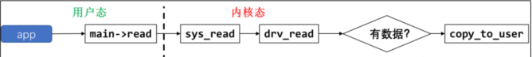
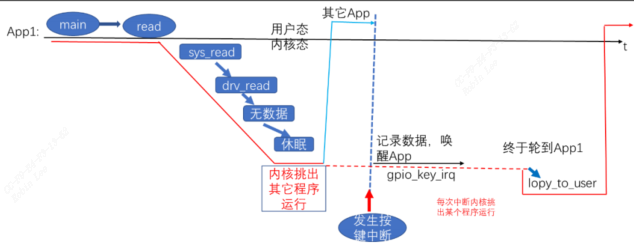
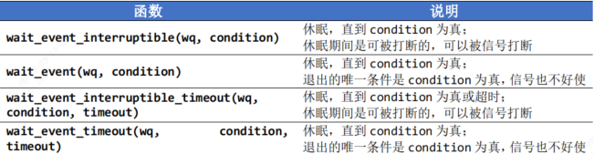
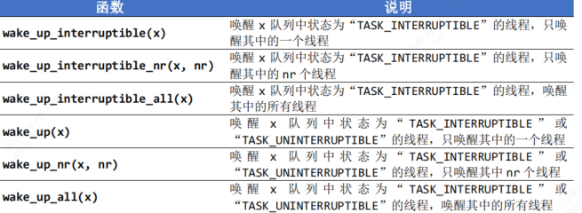
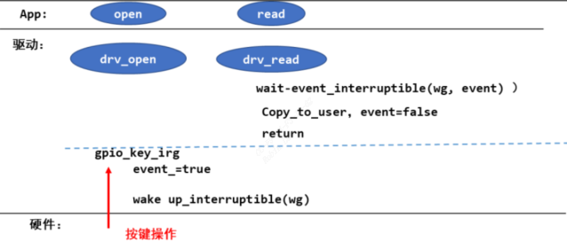
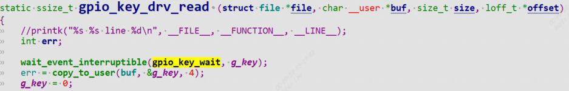
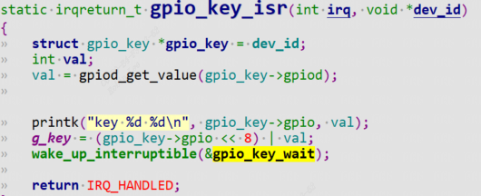

# 1 休眠与唤醒


```
1.APP 调用 read 等函数试图读取数据，比如读取按键；
2.APP 进入内核态，也就是调用驱动中的对应函数，发现有数据则复制到用户空间并马上返回；
3.如果 APP 在内核态，也就是在驱动程序中发现没有数据，则 APP 休眠；
4.当有数据时，比如当按下按键时，驱动程序的中断服务程序被调用，它会记录数据、唤醒 APP；
5.APP 继续运行它的内核态代码，也就是驱动程序中的函数，复制数据到用户空间并马上返回
```

drv_read函数当没有数据时需要休眠等待有数据唤醒。当按下按键，驱动程序中的中断服务程序被调用，它会记录数据，并唤醒 APP的read函数。

## 1.0 引入上下文概念

app执行整个过程如下图，可以把它看作被拆分成2段：被叫做`“上下文”`。  

- 进程上下文
红实线所涉及的代码，都是APP调用的，被叫做`进程上下文`，drv_read中有数据直接返回数据，没有数据的话让出CPU休眠等待。

- 中断上下文
按键的中断服务程序，不属于APP的 `“上下文”`，当中断发生时，APP1 正在休眠。在 APP 的`“上下文”`中可以休眠。  
在中断的处理过程中，也就是`gpio_key_irq`的执行过程中，不能休眠。

所以**：在中断处理函数中，不能休眠，也就不能调用会导致休眠的函数**, 被叫做`中断上下文`。

## 1.1 休眠函数

内核源码：`include\linux\wait.h`  

参数1：`wq:` `waitqueue`等待队列  ，用来等待条件值，`condition`不为0则立即返回  
参数2：`condition`  可以是一个变量，也可以是任何表达式。表示一直等待，直到 `condition`为真

## 1.2 唤醒函数


## 1.3 示例代码


1.read函数中进行`wait_event_interruptible`，因此需要初始化一个`wq`, 用`init_waitqueue_head`函数进行初始化等待队列。
```c
wait_queue_head_t job_done_wq;  
init_waitqueue_head(&job->job_done_wq);
```


或者用`DECLARE_WAIT_QUEUE_HEAD`声明定义初始化一起。  

```c
static DECLARE_WAIT_QUEUE_HEAD(gpio_key_wait);
```

read函数判断是否有key，有key则直接返回，否则`wait_event_interruptible`休眠。  

```
wait_event_interruptible(gpio_key_wait, g_key);
```

2.如果按键按下了，中断isr进行响应，调用`wake_up_interruptible`,并且设置`condition`为true.驱动的read函数将会被唤醒。  

驱动代码
```c
#include <linux/module.h>  
#include <linux/fs.h>  
#include <linux/errno.h>  
#include <linux/miscdevice.h>  
#include <linux/kernel.h>  
#include <linux/major.h>  
#include <linux/mutex.h>  
#include <linux/proc_fs.h>  
#include <linux/seq_file.h>  
#include <linux/stat.h>  
#include <linux/init.h>  
#include <linux/device.h>  
#include <linux/tty.h>  
#include <linux/kmod.h>  
#include <linux/gfp.h>  
#include <linux/gpio/consumer.h>  
#include <linux/platform_device.h>  
#include <linux/of_gpio.h>  
#include <linux/of_irq.h>  
#include <linux/interrupt.h>  
#include <linux/irq.h>  
#include <linux/slab.h>  
  
struct gpio_key{  
	int gpio;  
	struct gpio_desc *gpiod;  
	int flag;  
	int irq;  
} ;  
  
static struct gpio_key *gpio_keys_100ask;  
static int major = 0;  
static struct class *gpio_key_class;  
static int g_key = 0;  
static DECLARE_WAIT_QUEUE_HEAD(gpio_key_wait);  
  
static ssize_t gpio_key_drv_read (struct file *file, char __user *buf, size_t size, loff_t *offset){  
	int err;  
  
	wait_event_interruptible(gpio_key_wait, g_key);  
	err = copy_to_user(buf, &g_key, 4);  
	g_key = 0;  
	return 4;  
}  
  
static struct file_operations gpio_key_drv = {  
	.owner	 = THIS_MODULE,  
	.read    = gpio_key_drv_read,  
};  
  
static irqreturn_t gpio_key_isr(int irq, void *dev_id){  
	struct gpio_key *gpio_key = dev_id;  
	int val;  
  
	val = gpiod_get_value(gpio_key->gpiod);  
	printk("key %d %d\n", gpio_key->gpio, val);  
	g_key = (gpio_key->gpio << 8) | val;  
	wake_up_interruptible(&gpio_key_wait);  
	return IRQ_HANDLED;  
}  
  
/* 1. 从platform_device获得GPIO  
 * 2. gpio=>irq  
 * 3. request_irq  
 */  
static int gpio_key_probe(struct platform_device *pdev){  
	int err;  
	struct device_node *node = pdev->dev.of_node;  
	int count;  
	int i;  
	enum of_gpio_flags flag;  
  
	count = of_gpio_count(node);  
	if (!count){  
		printk("%s %s line %d, there isn't any gpio available\n", __FILE__, __FUNCTION__, __LINE__);  
		return -1;  
	}  
  
	gpio_keys_100ask = kzalloc(sizeof(struct gpio_key) * count, GFP_KERNEL);  
	for (i = 0; i < count; i++){  
		gpio_keys_100ask[i].gpio = of_get_gpio_flags(node, i, &flag);  
		if (gpio_keys_100ask[i].gpio < 0){  
			printk("%s %s line %d, of_get_gpio_flags fail\n", __FILE__, __FUNCTION__, __LINE__);  
			return -1;  
		}  
		gpio_keys_100ask[i].gpiod = gpio_to_desc(gpio_keys_100ask[i].gpio);  
		gpio_keys_100ask[i].flag = flag & OF_GPIO_ACTIVE_LOW;  
		gpio_keys_100ask[i].irq  = gpio_to_irq(gpio_keys_100ask[i].gpio);  
	}  
  
	for (i = 0; i < count; i++){  
		err = request_irq(gpio_keys_100ask[i].irq, gpio_key_isr, IRQF_TRIGGER_RISING | IRQF_TRIGGER_FALLING, "100ask_gpio_key",&gpio_keys_100ask[i]);  
	}  
  
	major = register_chrdev(0, "100ask_gpio_key", &gpio_key_drv);  /* /dev/100ask_gpio_key */  
	gpio_key_class = class_create(THIS_MODULE, "100ask_gpio_key_class");  
	if (IS_ERR(gpio_key_class)) {  
		printk("%s %s line %d\n", __FILE__, __FUNCTION__, __LINE__);  
		unregister_chrdev(major, "100ask_gpio_key");  
		return PTR_ERR(gpio_key_class);  
	}  
	device_create(gpio_key_class, NULL, MKDEV(major, 0), NULL, "100ask_gpio_key"); /* /dev/100ask_gpio_key */  
    return 0;  
}  
static int gpio_key_remove(struct platform_device *pdev){  
	struct device_node *node = pdev->dev.of_node;  
	int count;  
	int i;  
	device_destroy(gpio_key_class, MKDEV(major, 0));  
	class_destroy(gpio_key_class);  
	unregister_chrdev(major, "100ask_gpio_key");  
	count = of_gpio_count(node);  
	for (i = 0; i < count; i++){  
		free_irq(gpio_keys_100ask[i].irq, &gpio_keys_100ask[i]);  
	}  
	kfree(gpio_keys_100ask);  
    return 0;  
}  
  
static const struct of_device_id ask100_keys[] = {  
    { .compatible = "100ask,gpio_key" },  
    { },  
};  
static struct platform_driver gpio_keys_driver = {  
    .probe      = gpio_key_probe,  
    .remove     = gpio_key_remove,  
    .driver     = {  
        .name   = "100ask_gpio_key",  
        .of_match_table = ask100_keys,  
    },  
};  
static int __init gpio_key_init(void){  
    int err;  
    err = platform_driver_register(&gpio_keys_driver);   
	return err;  
}  
static void __exit gpio_key_exit(void){  
    platform_driver_unregister(&gpio_keys_driver);  
}  
module_init(gpio_key_init);  
module_exit(gpio_key_exit);  
MODULE_LICENSE("GPL");
```

驱动代码2(使用环形buf存放键值)
```c
#include <linux/module.h>  
#include <linux/fs.h>  
#include <linux/errno.h>  
#include <linux/miscdevice.h>  
#include <linux/kernel.h>  
#include <linux/major.h>  
#include <linux/mutex.h>  
#include <linux/proc_fs.h>  
#include <linux/seq_file.h>  
#include <linux/stat.h>  
#include <linux/init.h>  
#include <linux/device.h>  
#include <linux/tty.h>  
#include <linux/kmod.h>  
#include <linux/gfp.h>  
#include <linux/gpio/consumer.h>  
#include <linux/platform_device.h>  
#include <linux/of_gpio.h>  
#include <linux/of_irq.h>  
#include <linux/interrupt.h>  
#include <linux/irq.h>  
#include <linux/slab.h>  
  
struct gpio_key{  
	int gpio;  
	struct gpio_desc *gpiod;  
	int flag;  
	int irq;  
} ;  
static struct gpio_key *gpio_keys_100ask;  
static int major = 0;  
static struct class *gpio_key_class;  
  
/* 环形缓冲区 */  
#define BUF_LEN 128  
static int g_keys[BUF_LEN];  
static int r, w;  
#define NEXT_POS(x) ((x+1) % BUF_LEN)  
static int is_key_buf_empty(void){  
	return (r == w);  
}  
static int is_key_buf_full(void){  
	return (r == NEXT_POS(w));  
}  
static void put_key(int key){  
	if (!is_key_buf_full()){  
		g_keys[w] = key;  
		w = NEXT_POS(w);  
	}  
}  
static int get_key(void){  
	int key = 0;  
	if (!is_key_buf_empty()){  
		key = g_keys[r];  
		r = NEXT_POS(r);  
	}  
	return key;  
}  
  
static DECLARE_WAIT_QUEUE_HEAD(gpio_key_wait);  
  
static ssize_t gpio_key_drv_read (struct file *file, char __user *buf, size_t size, loff_t *offset){  
	int err;  
	int key;  
	wait_event_interruptible(gpio_key_wait, !is_key_buf_empty());  
	key = get_key();  
	err = copy_to_user(buf, &key, 4);  
	return 4;  
}  
static struct file_operations gpio_key_drv = {  
	.owner	 = THIS_MODULE,  
	.read    = gpio_key_drv_read,  
};  
  
static irqreturn_t gpio_key_isr(int irq, void *dev_id){  
	struct gpio_key *gpio_key = dev_id;  
	int val;  
	int key;  
	val = gpiod_get_value(gpio_key->gpiod);  
	  
	printk("key %d %d\n", gpio_key->gpio, val);  
	key = (gpio_key->gpio << 8) | val;  
	put_key(key);  
	wake_up_interruptible(&gpio_key_wait);  
	return IRQ_HANDLED;  
}  
  
/* 1. 从platform_device获得GPIO  
 * 2. gpio=>irq  
 * 3. request_irq  
 */  
static int gpio_key_probe(struct platform_device *pdev){  
	int err;  
	struct device_node *node = pdev->dev.of_node;  
	int count;  
	int i;  
	enum of_gpio_flags flag;  
  
	count = of_gpio_count(node);  
	if (!count){  
		printk("%s %s line %d, there isn't any gpio available\n", __FILE__, __FUNCTION__, __LINE__);  
		return -1;  
	}  
  
	gpio_keys_100ask = kzalloc(sizeof(struct gpio_key) * count, GFP_KERNEL);  
	for (i = 0; i < count; i++){  
		gpio_keys_100ask[i].gpio = of_get_gpio_flags(node, i, &flag);  
		if (gpio_keys_100ask[i].gpio < 0){  
			printk("%s %s line %d, of_get_gpio_flags fail\n", __FILE__, __FUNCTION__, __LINE__);  
			return -1;  
		}  
		gpio_keys_100ask[i].gpiod = gpio_to_desc(gpio_keys_100ask[i].gpio);  
		gpio_keys_100ask[i].flag = flag & OF_GPIO_ACTIVE_LOW;  
		gpio_keys_100ask[i].irq  = gpio_to_irq(gpio_keys_100ask[i].gpio);  
	}  
	for (i = 0; i < count; i++){  
		err = request_irq(gpio_keys_100ask[i].irq, gpio_key_isr, IRQF_TRIGGER_RISING | IRQF_TRIGGER_FALLING, "100ask_gpio_key",&gpio_keys_100ask[i]);  
	}  
  
	major = register_chrdev(0, "100ask_gpio_key", &gpio_key_drv);  /* /dev/gpio_key */  
	gpio_key_class = class_create(THIS_MODULE, "100ask_gpio_key_class");  
	if (IS_ERR(gpio_key_class)) {  
		printk("%s %s line %d\n", __FILE__, __FUNCTION__, __LINE__);  
		unregister_chrdev(major, "100ask_gpio_key");  
		return PTR_ERR(gpio_key_class);  
	}  
	device_create(gpio_key_class, NULL, MKDEV(major, 0), NULL, "100ask_gpio_key"); /* /dev/100ask_gpio_key */  
    return 0;  
}  
static int gpio_key_remove(struct platform_device *pdev){  
	struct device_node *node = pdev->dev.of_node;  
	int count;  
	int i;  
	device_destroy(gpio_key_class, MKDEV(major, 0));  
	class_destroy(gpio_key_class);  
	unregister_chrdev(major, "100ask_gpio_key");  
	count = of_gpio_count(node);  
	for (i = 0; i < count; i++){  
		free_irq(gpio_keys_100ask[i].irq, &gpio_keys_100ask[i]);  
	}  
	kfree(gpio_keys_100ask);  
    return 0;  
}  
static const struct of_device_id ask100_keys[] = {  
    { .compatible = "100ask,gpio_key" },  
    { },  
};  
static struct platform_driver gpio_keys_driver = {  
    .probe      = gpio_key_probe,  
    .remove     = gpio_key_remove,  
    .driver     = {  
        .name   = "100ask_gpio_key",  
        .of_match_table = ask100_keys,  
    },  
};  
static int __init gpio_key_init(void){  
    int err;  
    err = platform_driver_register(&gpio_keys_driver);   
	return err;  
}  
static void __exit gpio_key_exit(void){  
    platform_driver_unregister(&gpio_keys_driver);  
}  
module_init(gpio_key_init);  
module_exit(gpio_key_exit);  
MODULE_LICENSE("GPL");
```

app代码
```c
#include <sys/types.h>  
#include <sys/stat.h>  
#include <fcntl.h>  
#include <unistd.h>  
#include <stdio.h>  
#include <string.h>  
/*  
 * ./button_test /dev/100ask_button0  
 *  
 */  
int main(int argc, char **argv){  
	int fd;  
	int val;  
  
	if (argc != 2) {  
		printf("Usage: %s <dev>\n", argv[0]);  
		return -1;  
	}  
  
	fd = open(argv[1], O_RDWR);  
	if (fd == -1){  
		printf("can not open file %s\n", argv[1]);  
		return -1;  
	}  
	while (1){  
		read(fd, &val, 4);  
		printf("get button : 0x%x\n", val);  
	}  
	close(fd);  
	return 0;  
}
```
