# 1 poll机制

## 1.1 阻塞与非阻塞IO

APP 调用 open 函数时，不传入`O_NONBLOCK`，APP 调用 read 函数读取数据时,为`阻塞io`。  
APP 调用 open 函数时，传入`O_NONBLOCK`表示`“非阻塞”`，APP 调用 read 函数读取数据时，如果驱动程序中有数据，那么 APP 的 read函数会返回数据，否则会立刻返回错误。这种需要APP反复主动去”轮询”设备，否则无法及时响应。  
注意：对于普通文件、块设备文件，`O_NONBLOCK`不起作用。  
注意：对于字符设备文件，`O_NONBLOCK` 起作用的前提是驱动程序针对`O_NONBLOCK`做了处理  
只能在 open 时表明 `O_NONBLOCK` 吗？  
在 open 之后，也可以通过 fcntl 修改为阻塞或非阻塞：  
- open 时设置：
```c
int fd = open(“/dev/xxx”, O_RDWR | O_NONBLOCK); /* 非阻塞方式 */  
int fd = open(“/dev/xxx”, O_RDWR ); /* 阻塞方式 */
```

- open 之后设置：
```c
int flags = fcntl(fd, F_GETFL);  
fcntl(fd, F_SETFL, flags | O_NONBLOCK); /* 非阻塞方式 */  
fcntl(fd, F_SETFL, flags & ~O_NONBLOCK); /* 阻塞方式 */
```

驱动处理`O_NONBLOCK` flag时，如果没有数据read函数立即返回。  
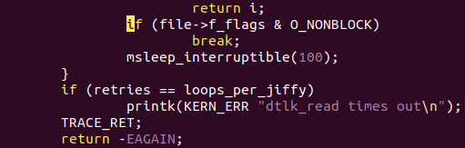
## 1.2 带超时的阻塞IO(poll/select)

`POLL` 机制、`SELECT`机制是完全一样的，只是 APP 接口函数不一样。简单地说，它们就是 `“定个闹钟”` ：在调用 poll、 select 函数时可以传入`“超时时间”`。在这段时间内，条件合适时(比如有数据可读、有空间可写)就会立刻返回，否则等到“超时时间”结束时返回错误。  

### 1.2.1 select

select会循环遍历它所监测的`fd_set`内的所有文件描述符对应的驱动程序的poll函数。select通过每个设备文件对应的poll函数提供的信息判断当前是否有资源可用(如可读或写)，如果有的话则返回可用资源的文件描述符个数，没有的话则睡眠，等待有资源变为可用时再被唤醒继续执行。

那么select会有2个结果：
```c
1, 查询到资源，返回查询到的fd总数。  
2，没查到，则睡眠  
	①带timeout参数，timeout后，唤醒退出，此时fd总数为0  
	②不带timeout, 阻塞且睡眠中，直到有资源可用才唤醒
```

fd_set结构体就是一个可用资源文件描述符的集合。

```c
FD_SET(int fd, fd_set *fdset);       //将fd加入set集合  
FD_CLR(int fd, fd_set *fdset);       //将fd从set集合中清除  
FD_ISSET(int fd, fd_set *fdset);     //检测fd是否在set集合中，不在则返回0  
FD_ZERO(fd_set *fdset);              //将set清零使集合中不含任何fd
```

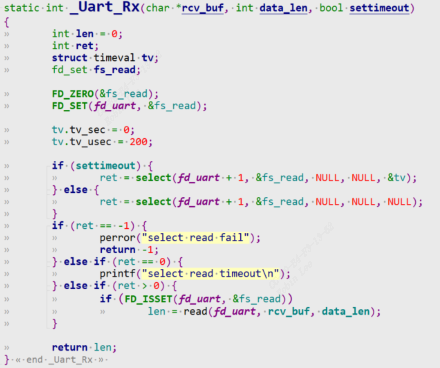
该示例假如传入200us的timeout，表示200us内有被驱动唤醒就可以检测到fd在set集合中，从而调用read读取数据。假如不传入timeout，那么select查询会立即返回。

### 1.2.2 poll

休眠唤醒机制实现简单。但是有一个缺点，如果按键一直未按下，read函数将会一直休眠，应用程序用户进程一直被阻塞。

```
1. poll机制就是给它加一个超时机制，防止一直休眠和用户线程被阻塞。
2. APP 不知道驱动程序中是否有数据，可以先调用 poll 函数查询一下， poll 函数可以传入超时时间；
3. APP 进入内核态，调用到驱动程序的 poll 函数
    3.1 如果发现没有数据时就休眠一段时间；当超时时间到了之后，内核也会唤醒 APP；
    3.2 当有数据时，比如当按下按键时，驱动程序的中断服务程序被调用，它会记录数据、唤醒 APP；
4. APP 根据 poll 函数的返回值就可以知道是否有数据，如果有数据就调用read 得到数据
```

poll/select 监测的事件  
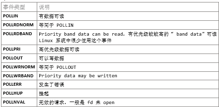

```c
struct pollfd fds[1];  
nfds_t nfds = 1;  
while (1) {  
	fds[0].fd = fd;  
	fds[0].events  = POLLIN;  
	fds[0].revents = 0;  
	ret = poll(fds, nfds, 5000);  
	if (ret > 0) {  
		if (fds[0].revents == POLLIN) {  
			while (read(fd, &event, sizeof(event)) == sizeof(event)) {  
				printf("get event: type = 0x%x, code = 0x%x, value = 0x%x\n", event.type, event.code, event.value);  
			}  
		}  
	} else if (ret == 0) {  
		printf("time out\n");  
	} else {  
		printf("poll err\n");  
	}  
}
```

## 1.3 休眠唤醒

poll底层机制用到了一个休眠唤醒机制，既`等待队列wait_queue`。参考：[linux内核机制-1-休眠唤醒机制](linux%E5%86%85%E6%A0%B8%E6%9C%BA%E5%88%B6-1-%E4%BC%91%E7%9C%A0%E5%94%A4%E9%86%92%E6%9C%BA%E5%88%B6/)

### 1.3.1 等待队列

**wait_event_interruptible_timeout:**  
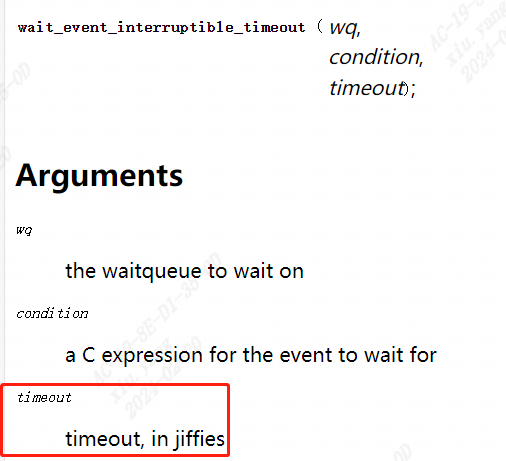
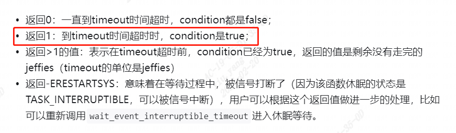
```c
void init_waitqueue_head(wait_queue_head_t *q);  
void wake_up(wait_queue_head_t *q)  
void wake_up_interruptible(wait_queue_head_t *q)  
wait_event(wq, condition);  
wait_event_timeout(wq, condition, timeout);  
wait_event_interruptible(wq, condition);  
wait_event_interruptible_timeout(wq, condition, timeout);
```

### 1.3.2 等待队列项

利用等待队列项来实现read函数的阻塞式访问，底层驱动去进行状态切换。下图把wait_event的方式换成等待队列项。  
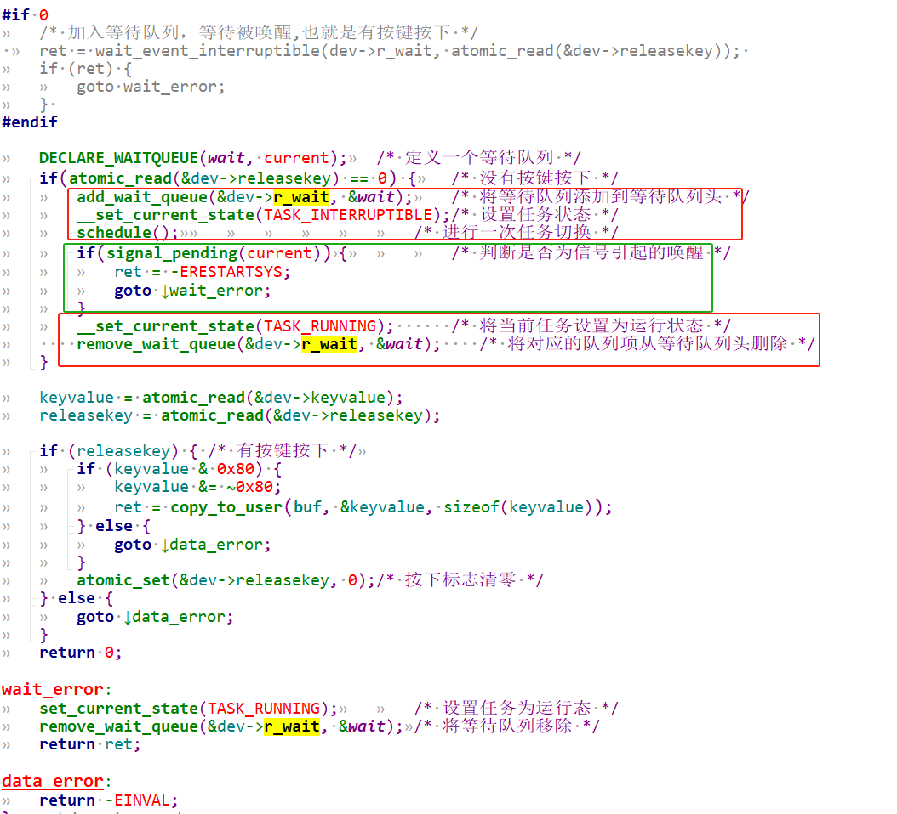
# 3 poll机制驱动底层原理

## 3.1 我们期望的poll流程

我们期望的大致流程如下：  
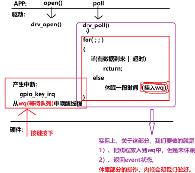
```
1. app进行open, drv进行drv_open，注册好中断服务
2. app进行poll , drv进行drv_poll
3. 第一次如果没有数据到来，那么会执行else进行休眠，加入等待队列。
    要么被中断服务程序唤醒，进入for循环此时有数据到来返回；
    要么超时，也会从等待队列唤醒回来，进入for循环此时返回超时
```

可以看到会查询判断2次，但实际上内核做的更好，我们drv_poll中只需要（这些流程内核帮我们已经做好了）：

```
1.把线程放入wq等待队列，并不会调用休眠
2.返回event状态
```

## 3.2 Linux内核实际的poll机制

实际内核中poll函数流程如下：
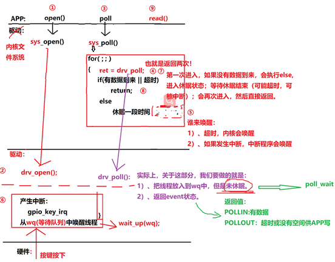
```
1. app进行open, drv进行drv_open，注册好中断服务
2. app进行poll , 内核文件系统进行sys_poll
3. 调用驱动开发者实现的drv_poll
    调用poll_wait,把线程加入wq，但是不会进入休眠，而是直接返回event状态
4. drv_poll返回后，sys_poll中进行数据判断（如果第一次进入没有数据到来，执行else, 将线程休眠（可以看到休眠是drv_poll上层sys_poll已经帮我们做好了），如果有数据则直接返回,那么就只会进入一次drv_poll）
   sys_poll函数执行else休眠的过程中，会被event唤醒or被超时唤醒
   第2进入for循环执行drv_poll，如果被event唤醒了，则返回数据，否则说明是超时唤醒，返回超时
5.最终内核文件系统sys_poll返回，唤醒userspace线程
```

可以看到当用户调用poll函数，在底层drv下可能会调用2次`drv_poll`。用户线程不会被一直阻塞休眠，要么有数据时中断的`event`唤醒，要么超时唤醒。我们只要实现`drv_poll`的部分，也就是紫色绿色的提示部分。

# 4 poll驱动编程实例（gpio key为例）

使用 poll 机制时，驱动程序的核心就是提供对应的 drv_poll 函数。在drv_poll 函数中要做 2 件事：
```c
1. 把当前线程挂入队列 wq： poll_wait  
	a) APP 调用一次 poll，drv_poll可能会被调用 2 次，但是我们并不需要把当前线程挂入队列 2 次。  
	b) 可以使用内核的帮助函数 poll_wait 把线程挂入队列，如果线程已经在队列里了，它就不会再次挂入。  
2. 返回设备状态：  
	APP 调用 poll 函数时，有可能是查询“有没有数据可以读”： POLLIN  
	也有可能是查询“你有没有空间给我写数据”： POLLOUT。  
	所以 drv_poll 要返回自己的当前状态： (POLLIN | POLLRDNORM) 或 (POLLOUT | POLLWRNORM)。  
a) POLLRDNORM 等同于 POLLIN，为了兼容某些 APP 把它们一起返回。  
b) POLLWRNORM 等同于 POLLOUT ，为了兼容某些 APP 把它们一起返回。
```

APP 调用 poll 后，很有可能会休眠。对应的，在中断服务程序中，也要有唤醒操作。  
完整驱动代码如下：

```c
#include <linux/module.h>  
#include <linux/poll.h>  
#include <linux/fs.h>  
#include <linux/errno.h>  
#include <linux/miscdevice.h>  
#include <linux/kernel.h>  
#include <linux/major.h>  
#include <linux/mutex.h>  
#include <linux/proc_fs.h>  
#include <linux/seq_file.h>  
#include <linux/stat.h>  
#include <linux/init.h>  
#include <linux/device.h>  
#include <linux/tty.h>  
#include <linux/kmod.h>  
#include <linux/gfp.h>  
#include <linux/gpio/consumer.h>  
#include <linux/platform_device.h>  
#include <linux/of_gpio.h>  
#include <linux/of_irq.h>  
#include <linux/interrupt.h>  
#include <linux/irq.h>  
#include <linux/slab.h>  
  
struct gpio_key{  
	int gpio;  
	struct gpio_desc *gpiod;  
	int flag;  
	int irq;  
} ;  
  
static struct gpio_key *gpio_keys_100ask;  
static int major = 0;  
static struct class *gpio_key_class;  
  
/* 环形缓冲区 */  
#define BUF_LEN 128  
static int g_keys[BUF_LEN];  
static int r, w;  
  
#define NEXT_POS(x) ((x+1) % BUF_LEN)  
  
static int is_key_buf_empty(void){  
	return (r == w);  
}  
  
static int is_key_buf_full(void){  
	return (r == NEXT_POS(w));  
}  
  
static void put_key(int key){  
	if (!is_key_buf_full()){  
		g_keys[w] = key;  
		w = NEXT_POS(w);  
	}  
}  
  
static int get_key(void){  
	int key = 0;  
	if (!is_key_buf_empty()) {  
		key = g_keys[r];  
		r = NEXT_POS(r);  
	}  
	return key;  
}  
  
static DECLARE_WAIT_QUEUE_HEAD(gpio_key_wait);  
  
static ssize_t gpio_key_drv_read (struct file *file, char __user *buf, size_t size, loff_t *offset){  
	printk("%s %s line %d\n", __FILE__, __FUNCTION__, __LINE__);  
	int err;  
	int key;  
	  
	if (is_key_buf_empty() && (file->f_flags & O_NONBLOCK)){
			return -EAGAIN;  
	} else {  
		wait_event_interruptible(gpio_key_wait, !is_key_buf_empty());  
		key = get_key();  
		err = copy_to_user(buf, &key, 4);  
	}  
	return 4;  
}  
  
static unsigned int gpio_key_drv_poll(struct file *fp, poll_table * wait){  
	printk("%s %s line %d\n", __FILE__, __FUNCTION__, __LINE__);  
	poll_wait(fp, &gpio_key_wait, wait);  
	return is_key_buf_empty() ? 0 : POLLIN | POLLRDNORM;  
}  
  
static struct file_operations gpio_key_drv = {  
	.owner	 = THIS_MODULE,  
	.read    = gpio_key_drv_read,  
	.poll    = gpio_key_drv_poll,  
};  
  
static irqreturn_t gpio_key_isr(int irq, void *dev_id){  
	struct gpio_key *gpio_key = dev_id;  
	int val;  
	int key;  
	  
	val = gpiod_get_value(gpio_key->gpiod);  
	  
	printk("key %d %d\n", gpio_key->gpio, val);  
	key = (gpio_key->gpio << 8) | val;  
	put_key(key);  
	wake_up_interruptible(&gpio_key_wait);  
	return IRQ_HANDLED;  
}  
  
/* 1. 从platform_device获得GPIO  
 * 2. gpio=>irq  
 * 3. request_irq  
 */  
static int gpio_key_probe(struct platform_device *pdev){  
	int err;  
	struct device_node *node = pdev->dev.of_node;  
	int count;  
	int i;  
	enum of_gpio_flags flag;  
  
	count = of_gpio_count(node);  
	if (!count){  
		printk("%s %s line %d, there isn't any gpio available\n", __FILE__, __FUNCTION__, __LINE__);  
		return -1;  
	}  
  
	gpio_keys_100ask = kzalloc(sizeof(struct gpio_key) * count, GFP_KERNEL);  
	for (i = 0; i < count; i++){  
		gpio_keys_100ask[i].gpio = of_get_gpio_flags(node, i, &flag);  
		if (gpio_keys_100ask[i].gpio < 0){  
			printk("%s %s line %d, of_get_gpio_flags fail\n", __FILE__, __FUNCTION__, __LINE__);  
			return -1;  
		}  
		gpio_keys_100ask[i].gpiod = gpio_to_desc(gpio_keys_100ask[i].gpio);  
		gpio_keys_100ask[i].flag = flag & OF_GPIO_ACTIVE_LOW;  
		gpio_keys_100ask[i].irq  = gpio_to_irq(gpio_keys_100ask[i].gpio);  
	}  
  
	for (i = 0; i < count; i++){  
		err = request_irq(gpio_keys_100ask[i].irq, gpio_key_isr, IRQF_TRIGGER_RISING | IRQF_TRIGGER_FALLING, "100ask_gpio_key", 			&gpio_keys_100ask[i]);  
	}  
  
	major = register_chrdev(0, "100ask_gpio_key", &gpio_key_drv);  
	gpio_key_class = class_create(THIS_MODULE, "100ask_gpio_key_class");/* /sys/class/100ask_gpio_key_class */  
	if (IS_ERR(gpio_key_class)) {  
		printk("%s %s line %d\n", __FILE__, __FUNCTION__, __LINE__);  
		unregister_chrdev(major, "100ask_gpio_key");  
		return PTR_ERR(gpio_key_class);  
	}  
	device_create(gpio_key_class, NULL, MKDEV(major, 0), NULL, "100ask_gpio_key"); /* /dev/100ask_gpio_key */  
    return 0;  
}  
  
static int gpio_key_remove(struct platform_device *pdev){  
	struct device_node *node = pdev->dev.of_node;  
	int count;  
	int i;  
  
	device_destroy(gpio_key_class, MKDEV(major, 0));  
	class_destroy(gpio_key_class);  
	unregister_chrdev(major, "100ask_gpio_key");  
  
	count = of_gpio_count(node);  
	for (i = 0; i < count; i++){  
		free_irq(gpio_keys_100ask[i].irq, &gpio_keys_100ask[i]);  
	}  
	kfree(gpio_keys_100ask);  
    return 0;  
}  
  
static const struct of_device_id ask100_keys[] = {  
    { .compatible = "100ask,gpio_key" },  
    { },  
};  
static struct platform_driver gpio_keys_driver = {  
    .probe      = gpio_key_probe,  
    .remove     = gpio_key_remove,  
    .driver     = {  
        .name   = "100ask_gpio_key",  
        .of_match_table = ask100_keys,  
    },  
};  
  
static int __init gpio_key_init(void){  
    int err;  
    err = platform_driver_register(&gpio_keys_driver);   
	return err;  
}  
static void __exit gpio_key_exit(void){  
    platform_driver_unregister(&gpio_keys_driver);  
}  
module_init(gpio_key_init);  
module_exit(gpio_key_exit);  
MODULE_LICENSE("GPL");
```

## 4.1 probe函数分析

定义gpio_key:  
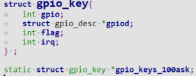
先确保dts中含有`gpio_key`设备树节点，才能通过`.compatible = "100ask,gpio_key"`匹配`plateform_device`和`platform_driver`, 当`insmod ko`时probe函数被调用。
```c
struct device_node *node = pdev->dev.of_node;//可以从platform_device获取到device_node
```

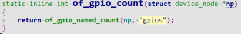
`of_gpio_count`可以根据设备树节点获取到gpio的数量。

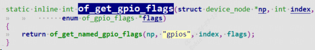
`of_get_gpio_flags`可以根据设备树节点获取到gpio编号和`gpio flags`

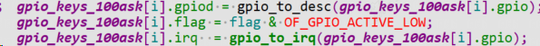
获取gpio描述符和gpio中断号

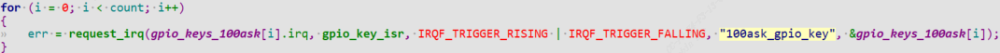
注册中断服务程序`gpio_key_isr`，当按键按下会触发gpio中断，执行`gpio_key_isr`.

## 4.2 drv_poll函数分析
```c
static DECLARE_WAIT_QUEUE_HEAD(gpio_key_wait);
```

这里先定义并初始化一个`wait_queue gpio_key_wait`。
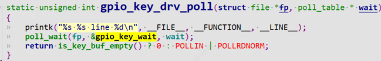
1. `drv_poll`函数中调用 `poll_wait`将线程加入等待队列，并返回`event`。
    1. 如果有数据，返回`POLLIN | POLLRDNORM`(那么`drv_poll`只会被调用1次)； 回到`sys_poll`
    2. 如果没有数据则返回0, 也回到`sys_poll`
2. 回到`sys_poll`后发现
	1. 如果有数据，直接返回
	2. 如果没有数据则进入休眠，当超时或者被`event`唤醒后，`sys_poll`又会再次进入`drv_poll`，此时`poll_wait`不会再次将线程加入等待队列，判断`is_key_buf_empty`，如果是按键按下触发中断响应，那么就有数据，返回`POLLIN | POLLRDNORM`，否则无数据表示是被超时唤醒，event为0。
3. `sys_poll`最终返回，回到`userspace`线程


## 4.3 drv_read函数分析

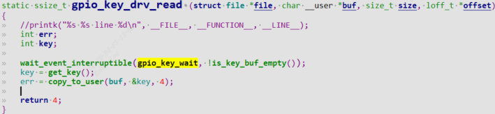
当userspace得知驱动有数据时，调用read函数，进入`drv_read`中调用`wait_event_interruptible`  
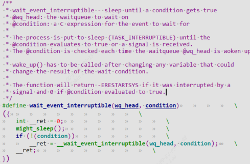
这里是利用等待队列，等待队列`gpio_key_wait`的`event`为true后，`wait_event_interruptible`该函数会返回。那么在对应的中断处理函数中，需要call `wake_up`函数来唤醒等待队列，并且把`event`设置成true，也就是把`wait_event_interruptible`的`condition`设置成true.

## 4.4 按键中断服务函数分析

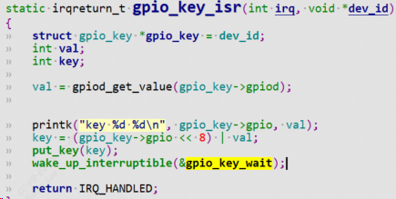
`put_key`是将`event`设置成true,这样表示有数据了，`is_key_buf_empty`非空了。调用`wake_up_interrptible`函数唤醒等待队列`gpio_key_wait`，因此`drv_read`函数就能立马返回数据。

## 4.5 测试

测试demo用户态程序如下：
```c
#include <sys/types.h>  
#include <sys/stat.h>  
#include <fcntl.h>  
#include <unistd.h>  
#include <stdio.h>  
#include <string.h>  
#include <poll.h>  
/*  
 * ./button_test /dev/100ask_gpio_key  
 *  
 */  
int main(int argc, char **argv){  
	int fd;  
	int val;  
	struct pollfd fds[1];  
	int timeout_ms = 5000;  
	int ret;  
  
	if (argc != 2) {  
		printf("Usage: %s <dev>\n", argv[0]);  
		return -1;  
	}  
  
	fd = open(argv[1], O_RDWR);  
	if (fd == -1){  
		printf("can not open file %s\n", argv[1]);  
		return -1;  
	}  
	fds[0].fd = fd;  
	fds[0].events = POLLIN;  
  
	while (1){  
		ret = poll(fds, 1, timeout_ms);  
		if ((ret == 1) && (fds[0].revents & POLLIN)){  
			read(fd, &val, 4);  
			printf("get button : 0x%x\n", val);  
		}else{  
			printf("timeout\n");  
		}  
	}  
	close(fd);  
	return 0;  
}
```
