# 1.异步通知概述


什么是异步通知？  
你去买奶茶：
- 你在旁边等着，眼睛盯着店员，生怕别人插队，他一做好你就知道：你是主动等待他做好，这叫 “同步”。  
- 你付钱后就去玩手机了，店员做好后他会叫号告诉你：你是被动获得结果，这叫“异步”。  

还是以`gpio_key`的例子，app想要判断按键是否有按下，无需去查询或者休眠，只需要注册`SIGIO信号`给driver, 当按键按下，driver中会自己主动通知app，给app发送`SIGIO信号`，app上层收到`信号SIGIO`会执行事先注册的`信号处理函数`读取按键。

异步通知使用信号来实现。在 Linux 内核源文件 `include\uapi\asmgeneric\signal.h` 中:  
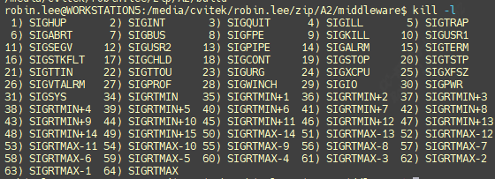
## 1.1 sigaction函数
```c
/* 第一个参数为信号值， 可以是除SIGKILL及SIGSTOP外的任何一个特定有效的信号。  
 * 第二个参数是指向结构体sigaction的一个实例的指针， 在结构体sigaction的实例中，   
 *     指定了对特定信号的处理函数， 若为空， 则进程会以缺省方式对信号处理；  
 * 第三个参数oldact指向的对象用来保存原来对相应信号的处理函数， 可指定oldact为NULL。  
 *     如果把第二、 第三个参数都设为NULL， 那么该函数可用于检查信号的有效性。
 */
int sigaction(int signum,const struct sigaction *act,struct sigaction *oldact));  
  
struct sigaction {  
	void (*sa_handler)(int);  
	void (*sa_sigaction)(int, siginfo_t *, void *);  
	sigset_t sa_mask;  
	int sa_flags;  
	void (*sa_restorer)(void);  
};  
/*  
sa_flags：用来设置信号处理的其他相关操作，下列的数值可用：  
        1.SA_RESETHAND：当调用信号处理函数时，将信号的处理函数重置为缺省值；  
        2.SIG_DFLSA_RESTART：如果信号中断了进程的某个系统调用，  
        	则系统自动启动该系统调用；  
        3.SA_NODEFER：当信号处理函数运行时，内核将阻塞该给定信号。
*/
```

```c
void _SAMPLE_PLAT_SYS_HandleSig(int nSignal, siginfo_t *si, void *arg) {  
        _SAMPLE_PLAT_ERR_Exit();  
        exit(1);  
}  
  
struct sigaction sa;  
memset(&sa, 0, sizeof(struct sigaction));  
sigemptyset(&sa.sa_mask);  
sa.sa_sigaction = _SAMPLE_PLAT_SYS_HandleSig;  
sa.sa_flags = SA_SIGINFO|SA_RESETHAND;  // Reset signal handler to  
//system default after signal triggered  
sigaction(SIGINT, &sa, NULL);  
sigaction(SIGTERM, &sa, NULL);
```

## 1.2 signal函数

### 1.2.1 示例1

按下`“Ctrl+C”`将向其发出`SIGINT`信号， 正在运行kill的进程将向其发出`SIGTERM`信号， 以下代码的进程可捕获这两个信号并输出信号值：

点击查看代码
```c
void sigterm_handler(int signo){  
        printf("Have caught sig N.O. %d\n",signo);  
        exit(0);  
}  
int main(void){  
        signal(SIGINT,sigterm_handler);  
        signal(SIGTERM,sigterm_handler);  
        while(1);  
        return0;  
}
```

可以看到对应`SIGINT`  
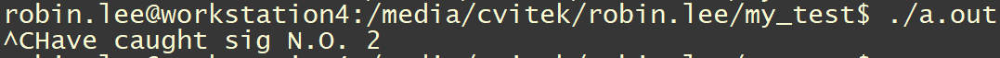
输入`kill [pid]`  
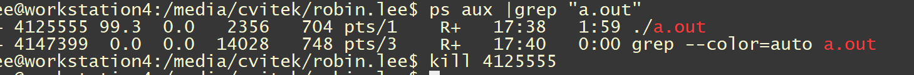
可以看到对应`SIGTERM`信号  
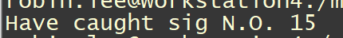
### 1.2.2 示例2

通过`signal(SIGIO, input_handler);` 对标准输入文件描述符`STDIN_FILENO`启动信号机制。用户输入后， 应用程序将接收到`SIGIO`信号， 其处理函数`input_handler()`将被调用.

```c
void input_handler(int num)  
{  
	char data[MAX_LEN];  
	int len;  
	/* 读取并输出STDIN_FILENO上的输入 */  
	len = read(STDIN_FILENO, &data, MAX_LEN);  
	data[len] = 0;  
	printf("input available:%s\n", data);  
}  
int main(void)  
{  
	int oflags;  
	/* 启动信号驱动机制 */  
	/*为SIGIO信号安装input_handler()作为处理函数*/  
	signal(SIGIO, input_handler);  
	/*设置本进程为STDIN_FILENO文件的拥有者，  
	没有这一步，内核不会知道应该将信号发给哪个进程*/  
	fcntl(STDIN_FILENO, F_SETOWN, getpid());  
	/*而为了启用异步通知机制， 还需对设备设置FASYNC标志，下面两行行代码可实现此目的。 */  
	oflags = fcntl(STDIN_FILENO, F_GETFL);  
	fcntl(STDIN_FILENO, F_SETFL, oflags | FASYNC);  
	while(1);  
	return 0;  
}
```

### 1.1.3 示例3

手动对app进程发送`SIGIO`信号

```c
#include <stdio.h>  
#include <unistd.h>  
#include <signal.h>  
void my_sig_func(int signo)  
{  
    printf("get a signal : %d\n", signo);  
}  
int main(int argc, char **argv)  
{  
    int i = 0;  
    signal(SIGIO, my_sig_func);  
    while (1)  
    {  
        printf("Hello, world %d!\n", i++);  
        sleep(2);  
    }  
    return 0;  
}
```

发送`SIGIO`信号给进程，也就是`kill -29 [pid]`  
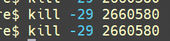
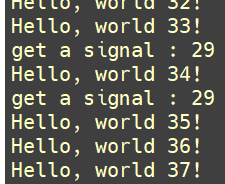
# 2 异步通知的实现原理流程

驱动程序怎么通知 APP：发信号，这只有 3 个字，却可以引发很多问题：
```c
1. 谁发：驱动程序发  
2. 发什么：信号  
3. 发什么信号：SIGIO  
4. 怎么发：内核里提供有函数  
5. 发给谁：APP，APP 要把PID告诉驱动  
6. APP 收到后做什么：执行信号处理函数  
7. 信号处理函数和信号，之间怎么挂钩：APP 注册信号处理函数
```

Linux系统中也有很多信号，内核源文件`include\uapi\asmgeneric\signal.h`中，有很多信号的宏定义：  
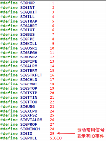
就APP而言，你想处理 `SIGIO` 信息，那么需要提供信号处理函数，并且要跟`SIGIO` 挂钩。这可以通过一个 signal 函数来 “给某个信号注册处理函数”，用法如下：  
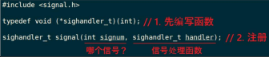
APP 还要做什么事？想想这几个问题：
```c
a) 内核里有那么多驱动，你想让哪一个驱动给你发 SIGIO 信号？APP 要打开驱动程序的设备节点。  
b) 驱动程序怎么知道要发信号给你而不是别人？APP 要把自己的进程 ID 告诉驱动程序。  
c) APP 有时候想收到信号，有时候又不想收到信号应该可以把 APP 的意愿告诉驱动。
```

驱动程序要做什么？发信号。
```c
a) APP 设置进程 ID 时，驱动程序要记录下进程 ID；  
b) APP 还要使能驱动程序的异步通知功能，驱动中有对应的函数：APP 打开驱动程序时，  内核会创建对应的 file 结构体，file 中有 f_flags；  
c) FASYNC 位:  
	flags 中有一个 FASYNC 位，它被设置为 1 时表示使能异步通知功能。  
    当 f_flags 中的 FASYNC 位发生变化时，驱动程序的 fasync 函数被调用;  
d) 发生中断时，有数据时，驱动程序调用内核辅助函数发信号。这个辅助函数名为 kill_fasync.
```

## 2.1. 异步通知的信号流程

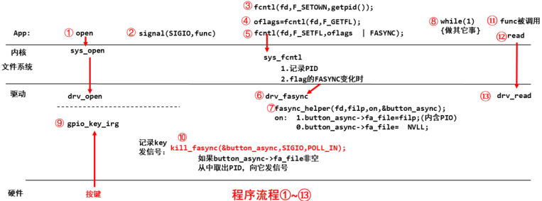
① APP open，在drv中调用`drv_open`，进行注册按键中断服务函数`gpio_key_irq`;  
② APP 给`SIGIO`信号注册`信号处理函数func`, 以后 APP 收到 `SIGIO`信号时，这个函数会被自动调用;  
③ APP 调用`fcntl`, 把PID(进程 ID)告诉驱动程序，这个调用不涉及驱动程序，只是在内核的文件系统层次`sys_cntl`,记录 PID在`filp`中（`sys_call`会建立`filp`结构)；  
④ APP 调用`fcntl`, 读取驱动程序文件 Flag；  
⑤ 设置 Flag 里面的`FASYNC`位为 1：当 `FASYNC` 位发生变化时，会导致驱动程序的`fasync`被调用；  
⑥⑦ 调 用 `faync_helper` ， 它 会 根 据`FAYSNC`的值决定是否设置`button_async->fa_file = 驱动文件filp`：  
驱动文件`filp`结构体里面含有之前设置的 PID。  
⑧ APP 可以做其他事；  
⑨⑩ 按下按键，发生中断，驱动程序的中断服务程序被调用，里面调用`kill_fasync` 发信号；  
⑪⑫⑬ APP 收到信号后，它的信号处理函数被自动调用，可以在里面调用read 函数读取按键。

# 3.驱动代码编写

先修改`Linux-4.9.88/arch/arm/boot/dts/100ask_imx6ull-14x14.dts`建立dts节点，`“100ask，gpio_key”`和`platform drvier`中保持一致。这里将`goio-keys` `disabled`掉是为了drv去匹配新添加的这个节点。  
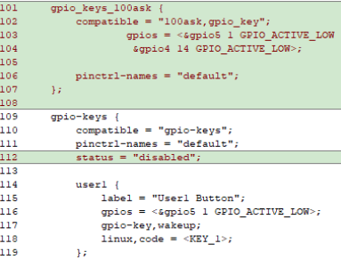
使用异步通知时，驱动程序的核心有2个：  
① 提供对应的`drv_fasync`函数；  
② 并在合适的时机发信号。

## 3.1 开启async

`drv_fasync` 函数很简单，调用 **`fasync_helper`** 函数就可以，如下：  

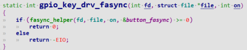
`fasync_helper` 函 数 会 分 配 、 构 造 一 个 `fasync_struct` 结构体`button_async`：  
- 驱动文件的 flag 被设置为 `FAYNC 时`：  
`button_async->fa_file = filp; // filp 表示驱动程序文件，里面含有之前设置的 PID`  
- 驱动文件被设置为非`FASYNC` 时：  
`button_async->fa_file = NULL;`  
以后想发送信号时，使用 `button_async` 作为参数就可以。

## 3.2 发SIGIO信号

什么时候发信号呢？在本例中，在 GPIO 中断服务程序中发信号。  
怎么发信号呢？代码如下：
```c
kill_fasync(&button_async, SIGIO, POLL_IN);
```

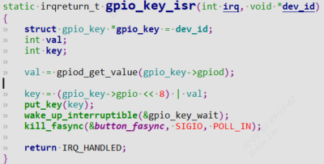
第 1 个参数：`button_async->fa_file` 非空时，可以从中得到 PID，表示发给哪一个 APP；  
第 2 个参数表示发什么信号：`SIGIO`；  
第 3 个参数表示为什么发信号：`POLL_IN`，有数据可以读了。(APP 用不到这个参数)

```c
#include <linux/module.h>  
#include <linux/poll.h>  
#include <linux/fs.h>  
#include <linux/errno.h>  
#include <linux/miscdevice.h>  
#include <linux/kernel.h>  
#include <linux/major.h>  
#include <linux/mutex.h>  
#include <linux/proc_fs.h>  
#include <linux/seq_file.h>  
#include <linux/stat.h>  
#include <linux/init.h>  
#include <linux/device.h>  
#include <linux/tty.h>  
#include <linux/kmod.h>  
#include <linux/gfp.h>  
#include <linux/gpio/consumer.h>  
#include <linux/platform_device.h>  
#include <linux/of_gpio.h>  
#include <linux/of_irq.h>  
#include <linux/interrupt.h>  
#include <linux/irq.h>  
#include <linux/slab.h>  
#include <linux/fcntl.h>  
  
struct gpio_key{  
	int gpio;  
	struct gpio_desc *gpiod;  
	int flag;  
	int irq;  
} ;  
  
static struct gpio_key *gpio_keys_100ask;  
static int major = 0;  
static struct class *gpio_key_class;  
  
/* 环形缓冲区 */  
#define BUF_LEN 128  
static int g_keys[BUF_LEN];  
static int r, w;  
  
struct fasync_struct *button_fasync;  
  
#define NEXT_POS(x) ((x+1) % BUF_LEN)  
  
static int is_key_buf_empty(void){  
	return (r == w);  
}  
  
static int is_key_buf_full(void){  
	return (r == NEXT_POS(w));  
}  
  
static void put_key(int key){  
	if (!is_key_buf_full()){  
		g_keys[w] = key;  
		w = NEXT_POS(w);  
	}  
}  
  
static int get_key(void){  
	int key = 0;  
	if (!is_key_buf_empty()){  
		key = g_keys[r];  
		r = NEXT_POS(r);  
	}  
	return key;  
}  
  
static DECLARE_WAIT_QUEUE_HEAD(gpio_key_wait);  
  
static ssize_t gpio_key_drv_read (struct file *file, char __user *buf,   
                                  size_t size, loff_t *offset){  
	int err;  
	int key;  
	  
	if (is_key_buf_empty() && (file->f_flags & O_NONBLOCK))
		return -EAGAIN;  
	wait_event_interruptible(gpio_key_wait, !is_key_buf_empty());  
	key = get_key();  
	err = copy_to_user(buf, &key, 4);  
	return 4;  
}  
  
static unsigned int gpio_key_drv_poll(struct file *fp, poll_table * wait){  
	poll_wait(fp, &gpio_key_wait, wait);  
	return is_key_buf_empty() ? 0 : POLLIN | POLLRDNORM;  
}  
  
static int gpio_key_drv_fasync(int fd, struct file *file, int on){  
	if (fasync_helper(fd, file, on, &button_fasync) >= 0)  
		return 0;  
	else  
		return -EIO;  
}  
  
static struct file_operations gpio_key_drv = {  
	.owner	 = THIS_MODULE,  
	.read    = gpio_key_drv_read,  
	.poll    = gpio_key_drv_poll,  
	.fasync  = gpio_key_drv_fasync,  
};  
  
static irqreturn_t gpio_key_isr(int irq, void *dev_id){  
	struct gpio_key *gpio_key = dev_id;  
	int val;  
	int key;  
	  
	val = gpiod_get_value(gpio_key->gpiod);  
	  
	printk("key %d %d\n", gpio_key->gpio, val);  
	key = (gpio_key->gpio << 8) | val;  
	put_key(key);  
	wake_up_interruptible(&gpio_key_wait);  
	kill_fasync(&button_fasync, SIGIO, POLL_IN);  
	return IRQ_HANDLED;  
}  
  
static int gpio_key_probe(struct platform_device *pdev){  
	int err;  
	struct device_node *node = pdev->dev.of_node;  
	int count;  
	int i;  
	enum of_gpio_flags flag;  
  
	count = of_gpio_count(node);  
	if (!count){  
		printk("%s %s line %d, there isn't any gpio available\n"  
               , __FILE__, __FUNCTION__, __LINE__);  
		return -1;  
	}  
  
	gpio_keys_100ask = kzalloc(sizeof(struct gpio_key) * count, GFP_KERNEL);  
	for (i = 0; i < count; i++){  
		gpio_keys_100ask[i].gpio = of_get_gpio_flags(node, i, &flag);  
		if (gpio_keys_100ask[i].gpio < 0){  
			printk("%s %s line %d, of_get_gpio_flags fail\n"  
                   , __FILE__, __FUNCTION__, __LINE__);  
			return -1;  
		}  
		gpio_keys_100ask[i].gpiod = gpio_to_desc(gpio_keys_100ask[i].gpio);  
		gpio_keys_100ask[i].flag = flag & OF_GPIO_ACTIVE_LOW;  
		gpio_keys_100ask[i].irq  = gpio_to_irq(gpio_keys_100ask[i].gpio);  
	}  
  
	for (i = 0; i < count; i++){  
		err = request_irq(gpio_keys_100ask[i].irq, gpio_key_isr  
                          , IRQF_TRIGGER_RISING | IRQF_TRIGGER_FALLING  
                          ,"100ask_gpio_key"  
                          ,&gpio_keys_100ask[i]);  
	}  
  
	major = register_chrdev(0, "100ask_gpio_key", &gpio_key_drv);  
  
	gpio_key_class = class_create(THIS_MODULE, "100ask_gpio_key_class");  
	if (IS_ERR(gpio_key_class)) {  
		printk("%s %s line %d\n", __FILE__, __FUNCTION__, __LINE__);  
		unregister_chrdev(major, "100ask_gpio_key");  
		return PTR_ERR(gpio_key_class);  
	}  
	device_create(gpio_key_class, NULL  
                  , MKDEV(major, 0)  
                  , NULL  
                  , "100ask_gpio_key"); /* /dev/100ask_gpio_key */  
    return 0;  
      
}  
static int gpio_key_remove(struct platform_device *pdev)  
{  
	struct device_node *node = pdev->dev.of_node;  
	int count;  
	int i;  
	device_destroy(gpio_key_class, MKDEV(major, 0));  
	class_destroy(gpio_key_class);  
	unregister_chrdev(major, "100ask_gpio_key");  
	count = of_gpio_count(node);  
	for (i = 0; i < count; i++){  
		free_irq(gpio_keys_100ask[i].irq, &gpio_keys_100ask[i]);  
	}  
	kfree(gpio_keys_100ask);  
    return 0;  
}  
  
static const struct of_device_id ask100_keys[] = {  
    { .compatible = "100ask,gpio_key" },  
    { },  
};  
static struct platform_driver gpio_keys_driver = {  
    .probe      = gpio_key_probe,  
    .remove     = gpio_key_remove,  
    .driver     = {  
        .name   = "100ask_gpio_key",  
        .of_match_table = ask100_keys,  
    },  
};  
static int __init gpio_key_init(void){  
    return platform_driver_register(&gpio_keys_driver);   
}  
static void __exit gpio_key_exit(void){  
    platform_driver_unregister(&gpio_keys_driver);  
}  
module_init(gpio_key_init);  
module_exit(gpio_key_exit);  
MODULE_LICENSE("GPL");
```

# 4.应用编写

应用程序要做的事情有这几件：

1. 编写信号处理函数：
```c
static void sig_func(int sig) {  
	int val;  
	read(fd, &val, 4);  
	printf("get button : 0x%x\n", val);  
}
```
    
2. 注册信号处理函数：
```c
signal(SIGIO, sig_func);
```
    
3. 打开驱动：
```c
fd = open(argv[1], O_RDWR);//./aout /dev/100ask_gpio_key
```
    
4. 把进程 ID 告诉驱动：
```c
fcntl(fd, F_SETOWN, getpid());
```
使能驱动的 FASYNC 功能：
```c
flags = fcntl(fd, F_GETFL);  
fcntl(fd, F_SETFL, flags | FASYNC);
```

示例代码：
```c
#include <sys/types.h>  
#include <sys/stat.h>  
#include <fcntl.h>  
#include <unistd.h>  
#include <stdio.h>  
#include <string.h>  
#include <poll.h>  
#include <signal.h>  
static int fd;  
static void sig_func(int sig){  
	int val;  
	read(fd, &val, 4);  
	printf("get button : 0x%x\n", val);  
}  
/*  
 * ./button_test /dev/100ask_button0  
 *  
 */  
int main(int argc, char **argv){  
	int val;  
	struct pollfd fds[1];  
	int timeout_ms = 5000;  
	int ret;  
	int	flags;  
	if (argc != 2) {  
		printf("Usage: %s <dev>\n", argv[0]);  
		return -1;  
	}  
	signal(SIGIO, sig_func);  
	fd = open(argv[1], O_RDWR);  
	if (fd == -1){  
		printf("can not open file %s\n", argv[1]);  
		return -1;  
	}  
	fcntl(fd, F_SETOWN, getpid());  
	flags = fcntl(fd, F_GETFL);  
	fcntl(fd, F_SETFL, flags | FASYNC);  
	while (1){  
		printf("www.100ask.net \n");  
		sleep(2);  
	}  
  
	close(fd);  
	return 0;  
}
```
