# 1 引入定时器

[linux内核机制-1-休眠唤醒机制](linux%E5%86%85%E6%A0%B8%E6%9C%BA%E5%88%B6-1-%E4%BC%91%E7%9C%A0%E5%94%A4%E9%86%92%E6%9C%BA%E5%88%B6/)引入了中断，当按键按下会记录按键信息，理想状况是按下一次按键记录一组数据，但实际上按下机械振动导致电平反复跳动最后才稳定，按下一次gpio irq会触发多次，这个被叫做**“抖动”**，那么可以利用定时器进行**“去抖”**。  
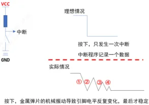
## 1.0 定时器timer_list结构

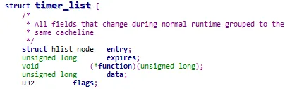
到`linux_5.10`版本`struct timer_list`变成了  
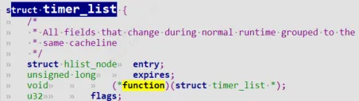
```c
unsigned long expires; //设定的超时的值  
void(*function)(unsigned long); //超时处理函数  
unsigned long data; //超时处理函数参数
```

## 1.1 timer内核函数

在内核中使用定时器很简单，涉及这些函数(参考内核源码`include\linux\timer.h`)

1. `setup_timer(timer, fn, data)`  
    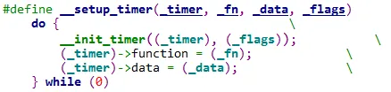
到`linux_5.10`版本变成了`timer_setup`  
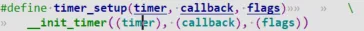
设置定时器，主要是初始化 `timer_list` 结构体，设置其中的函数、参数。
```c
//还有一种用宏DEFINE_TIMER去定义和初始化一个timer_list  
#define DEFINE_TIMER(_name, _function, _expires, _data)     \  
    struct timer_list _name =               \  
        TIMER_INITIALIZER(_function, _expires, _data)  
      
#define __TIMER_INITIALIZER(_function, _expires, _data, _flags) { \  
		.entry = { .next = TIMER_ENTRY_STATIC },	\  
		.function = (_function),			\  
		.expires = (_expires),				\  
		.data = (_data),				\  
		.flags = (_flags),				\  
		__TIMER_LOCKDEP_MAP_INITIALIZER(		\  
			__FILE__ ":" __stringify(__LINE__))	\  
}
```

2. `void add_timer(struct timer_list *timer)`  
    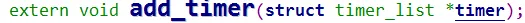
    向内核添加定时器。`timer->expires`表示超时时间。  
    当超时时间到达 ， 就会调用这个函数 ：`timer->function(timer->data)`。
    
3. `int mod_timer(struct timer_list *timer, unsigned long expires)`  
    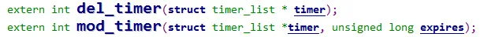
    修改定时器的超时时间:  
    它等同于下列操作，但是更加高效：
```c
del_timer(timer);  
timer->expires = expires;  
add_timer(timer);
```

4. `int del_timer(struct timer_list *timer)`  
    删除定时器。

## 1.2 定时器时间单位

可以在内核源码根目录下用`“ ls -a”`看到一个隐藏文件`.config`, 可以看到如下这项：会被内核转换成`include/generated/autoconf.h`，`HZ`定义在头文件`uapi/asm-generic/param.h`和`include/asm-generic/param.h`  中。
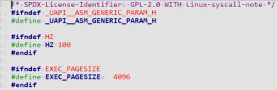
`CONFIG_HZ=100`  
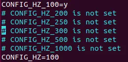
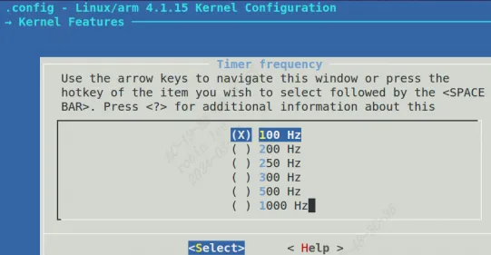
这表示内核**每秒中会发生 100 次系统滴答中断(tick)**，这就像人类的心跳一样，这是 Linux 系统的心跳。**每发生一次 tick 中断，全局变量 jiffies 就会累加 1**。  
`CONFIG_HZ=100` 表示每个滴答是 10ms。  
定时器的时间就是基于`jiffies`的，我们修改超时时间时，一般使用这 2 种方法：

1. `add_timer` 之前，直接修改：  
    `imer.expires = jiffies + xxx; // xxx 表示多少个滴答后超时，也就是 xxx*10ms`  
    `imer.expires = jiffies + 2*HZ; // HZ 等于 CONFIG_HZ， 2*HZ HZ是100个10ms, 就相当于 2 秒`
2. `add_timer` 之后，使用 `mod_timer` 修改：  
    `mod_timer(&timer, jiffies + xxx); // xxx 表示多少个滴答后超时，也就是 xxx*10ms`  
    `mod_timer(&timer, jiffies + 2*HZ); // HZ 等于 CONFIG_HZ， 2*HZ 就相当于 2 秒`

### 1.2.1 jiffies与秒的转换
```c
将 jiffies转换为秒，可采用公式：(jiffies/HZ) 计算。  
将秒转换为jiffies，可采用公式：(seconds*HZ) 计算。
```

### 1.2.2 内核时间获取
```c
ktime_t curTime = 0;  
curTime = ktime_get();//不包含设备进入休眠的时间  
printk("ktime_get:%lld ns", curTime);  
//结果：ktime_get:492257307974640 ns
```

```c
ktime_t curTime = 0;  
curTime = ktime_get_boottime();//包含了设备进入休眠的时间  
printk("ktime_get_boottime:%lld ns", curTime);  
//结果： ktime_get_boottime:581660801601637 ns  
  
void ktime_get_ts64(struct timespec64 *ts); //这也是一种  
  
ktime_t start, end, elapsed;  
start = ktime_get_boottime();  
...  
end = ktime_get_boottime();  
elapsed = ktime_sub(end, start);  
elapsed_msecs = ktime_to_ms(elapsed);  
printk("%d.%03d seconds", elapsed_msecs / 1000,elapsed_msecs % 1000);
```

#### 1.2.2.1 秒-毫秒-微秒-纳秒和jiffies兑换
```c
int jiffies_to_msecs(const unsigned long j);  
int jiffies_to_usecs(const unsigned long j);  
u64 jiffies_to_nsecs(const unsigned long j);  
long msecs_to_jiffies(const unsigned int m);  
long usecs_to_jiffies(const unsigned int u);//jiffies.h  
unsigned long nsecs_to_jiffies(u64 n);  
  
static inline s64 ktime_to_us(const ktime_t kt);//ktime.h  
static inline s64 ktime_to_ms(const ktime_t kt);  
static inline s64 ktime_to_ns(const ktime_t kt);
```

#### 1.2.2.2 usleep_range
```c
void __sched usleep_range(unsigned long min, unsigned long max)；
```

### 1.2.3 CLOCK_MONOTONIC与CLOCK_REALTIME

**CLOCK_MONOTONIC**(即`monotonic time`)  
`CLOCK_MONOTONIC`：以绝对时间为准，获取的时间为系统重启到现在的时间，更改系统时间对它没有影响。  
字面意义：单调时间，表示系统启动后流逝的时间，由变量jiffies来记录的。  
系统每次启动时，`jiffies`初始化为0。每来一个`timer interrupt`，`jiffies`加1，即它代表系统启动后流逝的`tick`数。  
`jiffies`一定是单调递增的，因为时间不可逆。

**CLOCK_REALTIME**(即`wall time`)  
`CLOCK_REALTIME`：相对时间，从`1970.1.1`到目前的时间。更改系统时间会更改获取的值。它以系统时间为坐标。  
字面意思: `wall time`挂钟时间，表示现实的时间，由变量`xtime`来记录的。  
**一些题外话**：  
一些应用软件可能就是用到了这个`wall time`。比如以前用`vmware workstation`，一启动提示试用期已过，但是只要把系统时间调整一下提前一年，再启动就不会有提示了。这很可能就是因为它启动时，用`gettimeofday`去读`wall time`，然后判断是否过期，只要将`wall time`改一下，就可以欺骗过去了。

# 2 内核定时器实例

就前面讲到的gpio按键中断来举例，每次发生gpio 中断，irq中我们都去调用一次`mod_timer`函数判断是不是抖动带来的垃圾数据。如果是抖动，那么irq会一直触发，一直调用`mod_timer`，一直推迟定时器中断函数的触发。  
当按下按键键值稳定下来后机械振动没了，电平数据趋于稳定了，那么gpio irq就不会一直响应了，也就是`mod_timer`函数不会一直调用了，那么等到timer超时，上报数据，整个流程如下图所示：  
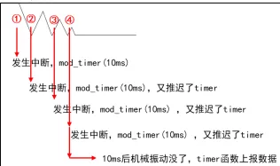
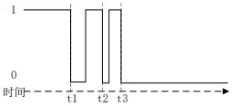
按键为下降沿触发，因此会在`t1、t2 和 t3` 这三个时刻会触发按键中断，每次进入中断处理函数都会重新开器定时器中断，但是 `t1~t2` 和`t2~t3`这两个时间段是小于我们设置的定时器中断周期(也就是消抖时间，比如 10ms)，所以虽然 t1 开启了定时器，但是定时器定时时间还没到呢 t2 时刻就重置了定时器，最终只有 t3 时刻开启的定时器能完整的完成整个定时周期并触发中断，我们就可以在中断处理函数里面做按键处理了，这就是定时器实现按键防抖的原理。

驱动代码
```c
#include <linux/module.h>  
#include <linux/poll.h>  
#include <linux/fs.h>  
#include <linux/errno.h>  
#include <linux/miscdevice.h>  
#include <linux/kernel.h>  
#include <linux/major.h>  
#include <linux/mutex.h>  
#include <linux/proc_fs.h>  
#include <linux/seq_file.h>  
#include <linux/stat.h>  
#include <linux/init.h>  
#include <linux/device.h>  
#include <linux/tty.h>  
#include <linux/kmod.h>  
#include <linux/gfp.h>  
#include <linux/gpio/consumer.h>  
#include <linux/platform_device.h>  
#include <linux/of_gpio.h>  
#include <linux/of_irq.h>  
#include <linux/interrupt.h>  
#include <linux/irq.h>  
#include <linux/slab.h>  
#include <linux/fcntl.h>  
#include <linux/timer.h>  
  
struct gpio_key{  
	int gpio;  
	struct gpio_desc *gpiod;  
	int flag;  
	int irq;  
	struct timer_list key_timer;  
} ;  
  
static struct gpio_key *gpio_keys_100ask;  
static int major = 0;  
static struct class *gpio_key_class;  
  
/* 环形缓冲区 */  
#define BUF_LEN 128  
static int g_keys[BUF_LEN];  
static int r, w;  
  
struct fasync_struct *button_fasync;  
  
#define NEXT_POS(x) ((x+1) % BUF_LEN)  
  
static int is_key_buf_empty(void){  
	return (r == w);  
}  
  
static int is_key_buf_full(void){  
	return (r == NEXT_POS(w));  
}  
  
static void put_key(int key){  
	if (!is_key_buf_full()){  
		g_keys[w] = key;  
		w = NEXT_POS(w);  
	}  
}  
  
static int get_key(void){  
	int key = 0;  
	if (!is_key_buf_empty()){  
		key = g_keys[r];  
		r = NEXT_POS(r);  
	}  
	return key;  
}  
  
static DECLARE_WAIT_QUEUE_HEAD(gpio_key_wait);  
  
static void key_timer_expire(unsigned long data){  
	struct gpio_key *gpio_key = data;  
	int val;  
	int key;  
  
	val = gpiod_get_value(gpio_key->gpiod);  
  
	printk("key_timer_expire key %d %d\n", gpio_key->gpio, val);  
	key = (gpio_key->gpio << 8) | val;  
	put_key(key);  
	wake_up_interruptible(&gpio_key_wait);  
	kill_fasync(&button_fasync, SIGIO, POLL_IN);  
}  
  
static ssize_t gpio_key_drv_read (struct file *file, char __user *buf  
	, size_t size, loff_t *offset){  
	int err;  
	int key;  
  
	if (is_key_buf_empty() && (file->f_flags & O_NONBLOCK))  
		return -EAGAIN;  
	  
	wait_event_interruptible(gpio_key_wait, !is_key_buf_empty());  
	key = get_key();  
	err = copy_to_user(buf, &key, 4);  
	return 4;  
}  
  
static unsigned int gpio_key_drv_poll(struct file *fp, poll_table * wait){  
	poll_wait(fp, &gpio_key_wait, wait);  
	return is_key_buf_empty() ? 0 : POLLIN | POLLRDNORM;  
}  
  
static int gpio_key_drv_fasync(int fd, struct file *file, int on){  
	if (fasync_helper(fd, file, on, &button_fasync) >= 0)  
		return 0;  
	else  
		return -EIO;  
}  
  
static struct file_operations gpio_key_drv = {  
	.owner	 = THIS_MODULE,  
	.read    = gpio_key_drv_read,  
	.poll    = gpio_key_drv_poll,  
	.fasync  = gpio_key_drv_fasync,  
};  
  
static irqreturn_t gpio_key_isr(int irq, void *dev_id){  
	struct gpio_key *gpio_key = dev_id;  
	printk("gpio_key_isr key %d irq happened\n", gpio_key->gpio);  
	mod_timer(&gpio_key->key_timer, jiffies + HZ/5);  
	return IRQ_HANDLED;  
}  
  
static int gpio_key_probe(struct platform_device *pdev){  
	int err;  
	struct device_node *node = pdev->dev.of_node;  
	int count;  
	int i;  
	enum of_gpio_flags flag;  
  
	count = of_gpio_count(node);  
	if (!count){  
		printk("%s %s line %d, there isn't any gpio available\n"  
               , __FILE__, __FUNCTION__, __LINE__);  
		return -1;  
	}  
  
	gpio_keys_100ask = kzalloc(sizeof(struct gpio_key) * count, GFP_KERNEL);  
	for (i = 0; i < count; i++){		  
		gpio_keys_100ask[i].gpio = of_get_gpio_flags(node, i, &flag);  
		if (gpio_keys_100ask[i].gpio < 0){  
			printk("%s %s line %d, of_get_gpio_flags fail\n"  
                   , __FILE__, __FUNCTION__, __LINE__);  
			return -1;  
		}  
		gpio_keys_100ask[i].gpiod = gpio_to_desc(gpio_keys_100ask[i].gpio);  
		gpio_keys_100ask[i].flag = flag & OF_GPIO_ACTIVE_LOW;  
		gpio_keys_100ask[i].irq  = gpio_to_irq(gpio_keys_100ask[i].gpio);  
  
		setup_timer(&gpio_keys_100ask[i].key_timer  
                    , key_timer_expire  
                    , &gpio_keys_100ask[i]);  
		gpio_keys_100ask[i].key_timer.expires = ~0;  
		add_timer(&gpio_keys_100ask[i].key_timer);  
	}  
  
	for (i = 0; i < count; i++){  
		err = request_irq(gpio_keys_100ask[i].irq, gpio_key_isr  
			, IRQF_TRIGGER_RISING | IRQF_TRIGGER_FALLING  
			, "100ask_gpio_key"  
			, &gpio_keys_100ask[i]);  
	}  
  
	major = register_chrdev(0, "100ask_gpio_key"  
			, &gpio_key_drv);  /* /dev/gpio_key */  
  
	gpio_key_class = class_create(THIS_MODULE, "100ask_gpio_key_class");  
	if (IS_ERR(gpio_key_class)) {  
		printk("%s %s line %d\n", __FILE__, __FUNCTION__, __LINE__);  
		unregister_chrdev(major, "100ask_gpio_key");  
		return PTR_ERR(gpio_key_class);  
	}  
	device_create(gpio_key_class  
				, NULL  
				, MKDEV(major, 0)  
				, NULL  
				, "100ask_gpio_key"); /* /dev/100ask_gpio_key */  
    return 0;  
      
}  
  
static int gpio_key_remove(struct platform_device *pdev){  
	struct device_node *node = pdev->dev.of_node;  
	int count;  
	int i;  
	device_destroy(gpio_key_class, MKDEV(major, 0));  
	class_destroy(gpio_key_class);  
	unregister_chrdev(major, "100ask_gpio_key");  
	count = of_gpio_count(node);  
	for (i = 0; i < count; i++){  
		free_irq(gpio_keys_100ask[i].irq, &gpio_keys_100ask[i]);  
		del_timer(&gpio_keys_100ask[i].key_timer);  
	}  
	kfree(gpio_keys_100ask);  
    return 0;  
}  
  
static const struct of_device_id ask100_keys[] = {  
    { .compatible = "100ask,gpio_key" },  
    { },  
};  
  
static struct platform_driver gpio_keys_driver = {  
    .probe      = gpio_key_probe,  
    .remove     = gpio_key_remove,  
    .driver     = {  
        .name   = "100ask_gpio_key",  
        .of_match_table = ask100_keys,  
    },  
};  
static int __init gpio_key_init(void){  
    return platform_driver_register(&gpio_keys_driver);   
}  
static void __exit gpio_key_exit(void){  
    platform_driver_unregister(&gpio_keys_driver);  
}  
module_init(gpio_key_init);  
module_exit(gpio_key_exit);  
MODULE_LICENSE("GPL");
```

## 2.2 实例源码分析

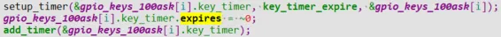
`linux_5.10`内核版本用法  
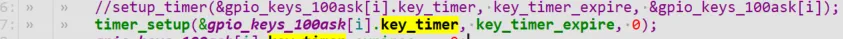
probe函数进行初始化定时器，这里`add_timer`前修改`expires`，为了防止定时器中断提前触发（按键还没按下就触发了定时器中断），因此修改`expires`为一个最大值。  
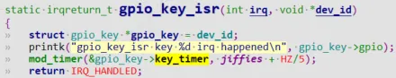
当按下按键gpio_irq按键中断服务程序响应后，调用`mod_timer`进行修改定时器超时时间，用来去除 “抖动”。`jiffies + HZ/5`表示延时20个tick时钟滴答，也就是`20*10ms`，如果这个时间内有多次电平跳动，那么不会去上报数据，而是继续修改定时器超时时间，直到按键数据稳定后，也就是200ms已经到了但是没有人去修改定时器超时时间，那么将会触发定时器中断，上报按键数据。  
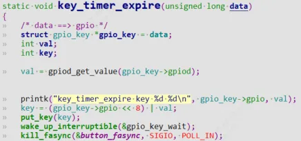
`linux_5.10`内核版本用法:  
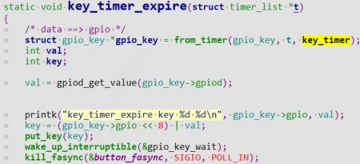
# 3 深入理解定时器中断

## 3.1 硬件中断和软件中断
1. 硬件中断包含硬件定时器，gpio，网卡，外围电路IP等硬件产生的中断，硬件定时器每产生一次`tick`系统滴答中断，`jiffies`加1。
2. 软件中断由软件触发的中断，包含`TIMER` 表示定时中断、`RCU` 表示 RCU 锁中断、`SCHED` 表示内核调度中断

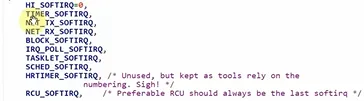

上半部直接处理硬件请求，也就是硬中断，主要是负责耗时短的工作，特点是快速执行；  
下半部主要是负责上半部未完成的耗时工作，有多种实现机制，软中断是其中之一，特点是延迟执行 。
硬中断（上半部）是会打断 CPU 正在执行的任务，然后立即执行中断处理程序，而软中断（下半部）是以内核线程的方式执行

`cat /proc/softirqs`可以看软件中断信息

`cat /proc/interrupts`可以看硬件中断

## 3.2 定时器底层原理

定时器就是通过`软件中断`来实现的，它属于 `TIMER_SOFTIRQ` 软中断  
对于 `TIMER_SOFTIRQ` 软中断，内核启动时会调用`start_kernel`初始化`init_timers();` 代码如下：
```c
void __init init_timers(void) {  
	init_timer_cpus();  
	init_timer_stats();  
	open_softirq(TIMER_SOFTIRQ, run_timer_softirq);  
}
```

当发生硬件中断时，硬件中断处理完后，内核会调用软件中断的处理函数。  
对于 `TIMER_SOFTIRQ`，会调用 `run_timer_softirq`，它的函数如下：
```c
run_timer_softirq  
	__run_timers(base);  
	    while (time_after_eq(jiffies, base->clk)) {  
		    ……  
		    expire_timers(base, heads + levels);  
		        fn = timer->function;  
		        data = timer->data;  
		        call_timer_fn(timer, fn, data);  
					fn(data);
```

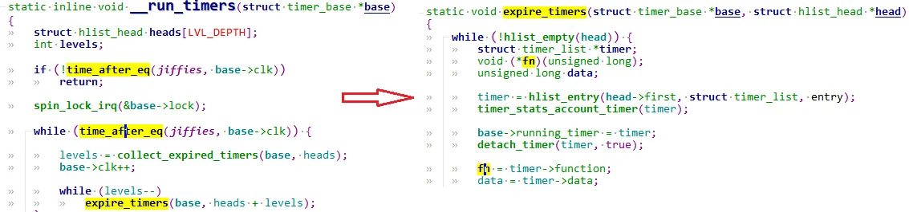
简单地说， `add_timer` 函数会把 timer 放入内核里某个链表；在 `TIMER_SOFTIRQ` 的处理函数`run_timer_softirq`中，会从链表中把这些超时的 timer 取出来，  
执行其中的函数。怎么判断是否超时？ `jiffies` 大于或等于 `timer->expires` 时， timer 就超时，执行超时处理函数。

## 3.3 找到自己芯片的时钟滴答数-jiffies

在开发板执行以下命令，可以看到 CPU0 下有一个数值变化特别快，它就是`滴答中断tick`，`jiffies`也叫做系统节拍数。  
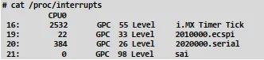
以 `100ASK_IMX6ULL` 为做，滴答中断名字就是`“ i.MX Timer Tick”`。在 Linux内核源码目录下执行以下命令：
```c
grep "i.MX Timer Tick" * -nr  
drivers/clocksource/timer-imx-gpt.c:319: act->name = "i.MX Timer Tick";
```

 在`timer-imx-gpt.c` `319 行`左右，有如下源码：
```c
act->name = "i.MX Timer Tick";  
act->flags = IRQF_TIMER | IRQF_IRQPOLL;  
act->handler = mxc_timer_interrupt;  
act->dev_id = ced;  
return setup_irq(imxtm->irq, act);
```

`mxc_timer_interrupt` 就是滴答中断的处理函数，代码如下：
```c
static irqreturn_t mxc_timer_interrupt(int irq, void *dev_id)  
{  
	struct clock_event_device *ced = dev_id;  
	struct imx_timer *imxtm = to_imx_timer(ced);  
	uint32_t tstat;  
	tstat = readl_relaxed(imxtm->base + imxtm->gpt->reg_tstat);472 / 573  
	imxtm->gpt->gpt_irq_acknowledge(imxtm);  
	ced->event_handler(ced);  
	return IRQ_HANDLED;  
}
```

在看`ced->event_handler(ced);`调用：

`ced->event_handler(ced)`是哪一个函数？在 `mxc_timer_interrupt` 中打断点跟踪代码发现它对应 `tick_handle_periodic`。  
`tick_handle_periodic` 位于 `kernel\time\tick-common.c` 中，它里面的调用关系如下：
```c
tick_handle_periodic  
	tick_periodic(cpu);  
		do_timer(1);  
		jiffies_64 += ticks; // jiffies 就是 jiffies_64
```

为何说`jiffies`就是 `jiffies_64`？在 `arch\arm\kernel\vmlinux.lds.S` 有如下代码：
```c
#ifndef __ARMEB__  
jiffies = jiffies_64;  
#else  
jiffies = jiffies_64 + 4;  
#endif
```

上述代码说明了，对于大字节序的 CPU， `jiffies` 指向 `jiffies_64` 的高 4字节；对于小字节序的 CPU， `jiffies` 指向 `jiffies_64` 的低 4 字节。对 `jiffies_64` 的累加操作，就是对 `jiffies` 的累加操作。  
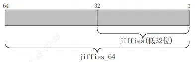
```c
extern u64 __cacheline_aligned_in_smp jiffies_64; //include/linux/jiffies.h  
extern unsigned long volatile __cacheline_aligned_in_smp __jiffy_arch_data jiffies;
```
