# 1 引入mmap

应用程序和驱动程序之间传递数据时，可以通过 read、write 函数进行, 用户态和内核态的数据交互一般用`copy_from_user`,`copy_to_user`。这种方式在数据量比较小时没什么问题；但是数据量比较大时效率就太低了。比如更新 LCD 显示时，如果每次都让 APP 传递一帧数据给内核，假设 LCD 采用`1024x600x32 bpp` 的格式，一帧数据就有`1024x600x32/8=2.3MB` 左右,而且一般为了显示动态画面，LDC输出fps要求是`60fps or 30 fps`，那么一秒数据量为`30x2.3 = 70M`左右，显然`copy_from_user`，`copy_to_user`的方式不再适合。  
改进的方法就是让程序可以直接读写驱动程序中的 buffer，这可以通过mmap 实现(memory map)，把内核的 buffer 映射到用户态，让 APP 在用户态直接读写。  
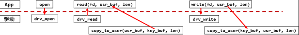
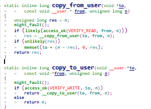
## 1.1 内存映射现象
```c
#include <stdio.h>  
#include <unistd.h>  
#include <stdlib.h>  
int a;  
int main(int argc, char **argv)  
{  
	if (argc != 2) {  
		printf("Usage: %s <number>\n", argv[0]);  
		return -1;  
	}  
	a = strtol(argv[1], NULL, 0);  
	printf("a's address = 0x%lx, a's value = %d\n", &a, a);  
	while (1) {  
		sleep(10);  
	}  
	return 0;  
}
```

在 PC 上如下编译(必须静态编译)：
```c
gcc -o test test.c -staitc
```

分别后台执行 test 程序 2 次。最后执行 ps，可以看到这 2 个程序同时存在，这 2 个程序里 a 变量的地址相同，但是值不同。  
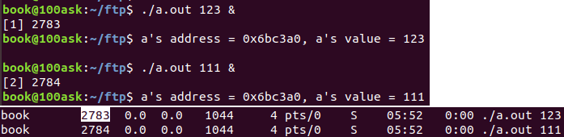
```c
2 个程序同时运行，它们的变量a的地址都是一样的：0x6bc3a0；  
2 个程序同时运行，它们的变量a的值是不一样的，一个是 111，另一个是 123。
```

### 1.1.1 引入MMU

来分析一下：  
2个程序同时在内存中运行，它们的值不一样，所以变量 a 的物理内存地址肯定不同（2个变量存放不是同一个地方）；  
但是打印出来的变量 a 的地址却是一样的。怎么回事？  
这里要引入**虚拟地址**的概念：CPU 发出的地址是虚拟地址，它经过`MMU(Memory Manage Unit，内存管理单元)`映射到物理地址上，对于不同进程的同一个虚拟地址，MMU 会把它们映射到不同的物理地址。  
总结:虽然虚拟地址一样，但物理地址不一样，这个是mmu的功劳，将同一虚拟地址映射到不同物理地址。  
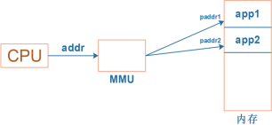

当前运行的是 app1 时，MMU 会把 CPU 发出的虚拟地址 addr 映射为物理地址paddr1，用 paddr1 去访问内存。  
当前运行的是 app2 时，MMU 会把 CPU 发出的虚拟地址 addr 映射为物理地址paddr2，用 paddr2 去访问内存。

### 1.1.2 查看进程地址空间

MMU 负责把虚拟地址映射为物理地址，虚拟地址映射到哪个物理地址去？可以执行`ps`命令查看进程 ID，然后执行`“cat /proc/[PID]/maps”`得到虚拟地址空间映射关系。  
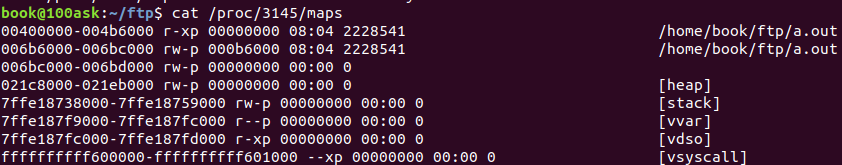
```c
00400000-004b6000 r-xp 00000000 08:04 2228541                            /home/book/ftp/a.out  
006b6000-006bc000 rw-p 000b6000 08:04 2228541                            /home/book/ftp/a.out  
006bc000-006bd000 rw-p 00000000 00:00 0   
021c8000-021eb000 rw-p 00000000 00:00 0                                  [heap]  
7ffe18738000-7ffe18759000 rw-p 00000000 00:00 0                          [stack]  
7ffe187f9000-7ffe187fc000 r--p 00000000 00:00 0                          [vvar]  
7ffe187fc000-7ffe187fd000 r-xp 00000000 00:00 0                          [vdso]  
ffffffffff600000-ffffffffff601000 --xp 00000000 00:00 0                  [vsyscall]
```

第一行地址范围显示权限为可读可执行，表示该程序`代码段（.text）`  
第二行地址范围显示权限为可读可写， 表示该程序的`数据段（.data）`  
第三行地址范围显示权限为可读可写， 表示该程序的`数据段（.data）`刚才变量a地址就在这段地址范围内  
第四行地址范围是`堆空间（.heap段）`，malloc的内存就会处于这段  
第五行地址范围是`栈空间（.stack段）`，局部变量处于这段  
p表示`private`，s表示`share`，再来看一个使用动态库的进程，比如bash进程：  
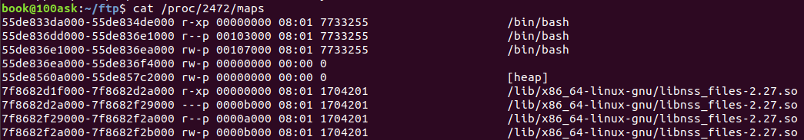
# 2 mmap内核态的描述

## 2.1 进程结构体(task_struct)和进程地址空间(mm_struct)

每一个进程对应了很多虚拟地址空间，比如栈空间，堆空间，数据段，代码段等,也叫做进程地址空间`（mm_strcut）`。  
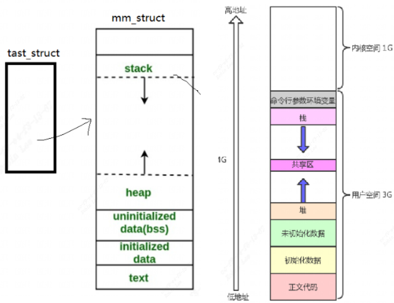
因此每个进程在内核里都有一个 tast_struct，这个结构体中保存有内存信息：mm_struct。而虚拟地址、物理地址的映射关系保存在页目录表中：  
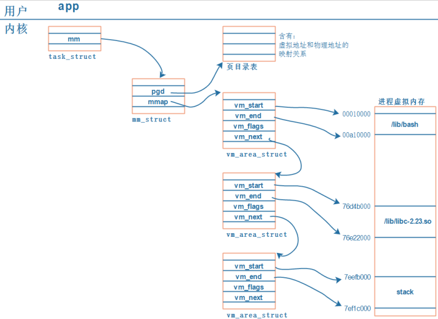
```c
1. 每个 APP 在内核中都有一个 task_struct 结构体，它用来描述一个进程；  
2. 每个 APP 都要占据内存，在 task_struct 中用 mm_struct 来管理进程占用的内存；  
3. 内存有虚拟地址、物理地址，mm_struct 中用 mmap 来描述虚拟地址，  
用 pgd 来描述对应的物理地址。(注意：pgd，Page Global Directory，页目录)  
4. 每个 APP 都有一系列的 VMA：virtual memory，即mmap会指向vm_area_struct,   
比如 APP 含有代码段、数据段、BSS 段、栈等等，还有共享库。这些单元会保存在内存里，  
它们的地址空间不同，权限不同(代码段是只读的可运行的、数据段可读可写)，内核用一系列的 vm_area_struct 来描述它们。  
5. vm_area_struct 中的 vm_start、vm_end 是虚拟地址。  
6. vm_area_struct 中虚拟地址如何映射到物理地址去？ 每一个 APP 的虚拟地址可能相同，  
物理地址不相同，这些对应关系保存在 pgd 中。
```

### 2.1.1 vm_area_struct虚拟内存区域

每个进程有一个`task_struct`和一个`mm_struct`, 其中`mm_struct`中的mmap对应`vm_area_struct`虚拟内存区域：

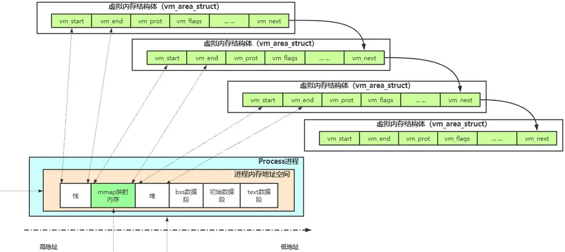
可以看到`mm_struct`每一段都对应一块`vm_area_struct`。

# 3 页表映射

页表是内存中的一段连续地址空间，页表分为很多个页表项，每个页表项里面存放了要映射的物理地址信息。  
ARM 架构支持一级页表映射，也就是说 MMU 根据 CPU 发来的虚拟地址可以找到第 1 个页表，从第 1 个页表里就可以知道这个虚拟地址对应的物理地址。一级页表里地址映射的最小单位是 1M。  
ARM 架构还支持二级页表映射，也就是说 MMU 根据 CPU 发来的虚拟地址先找到第 1 个页表，从第 1 个页表里就可以知道第 2 级页表在哪里；再取出第 2 级页表，从第 2 个页表里才能确定这个虚拟地址对应的物理地址。二级页表地址映射的最小单位有 4K、1K，Linux 使用 4K。  
**一级页表项里的内容，决定了它是指向一块物理内存，还是指问二级页表**，一个页表项格式如下图：
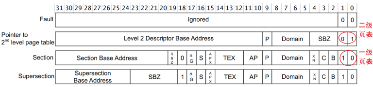

## 3.1 一级页表映射

arm32系统中，一个页表项占4个byte, 32bit,它分为一级页表项和二级页表项，通过`bit[1:0]`区分，一级页表项保存有物理地址，用`bit[31:20]` 共12位表示段基地址，有1M物理内存。比如cpu发出虚拟地址`0x12345678`, MMU发现虚拟地址中一级页表索引为0x123就，也就是从第0x123个页表项中找到`Section Base Address`为`0x92300000`，段内偏移是 `0x45678`，那么最终通过一级页表映射最终映射到物理地址就为`0x0x9230,0000 + 0x45678`,也就是`0x9234,5678`。  
`Section Base Address`的数量为多少呢？一共12bit，也就是4096个，每一个1级页表项大小为1M, 因此总共可表示4G。对于 32 位的系统，虚拟地址空间有 4G，`4G/1M=4096`。所以一级页表要映射整个 4G 空间的话，刚好需要 4096 个页表项。  
所以 CPU 要访问虚拟地址 0x12345678 时，实际上访问的是`0x9234,5678`的物理地址。  
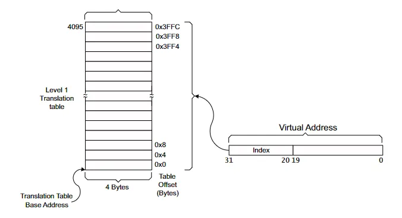

## 3.2 二级页表映射

一级页表项每项有1M空间, 一级页表映射是把虚拟地址的1M映射到物理地址的1M连续空间，但有时我们的程序没有那么大，显然用1M太浪费空间。 那么引入二级页表映射来映射更小的块，对于二级页表，每一个页可以是1K, 4K，64K， Linux系统一般使用4K, 对应`Small Page`, 64K对应的是大页（`Large Page`）, 1K对应的是Tine Page(一般很少用)。  
**二级页表映射过程：**  
首先设置好一级页表、二级页表，并且把一级页表的首地址保存在页表寄存器中。  
二级页表首先也是要经过一级页表映射，通过一级页表项里面的`bit[1:0]`发现它指向二级页表项，从中取出二级页表基地址，然后根据虚拟地址的`bit[19：12]`得到二级页表索引，从而得到二级页表项。  
二级页表项格式如下：  
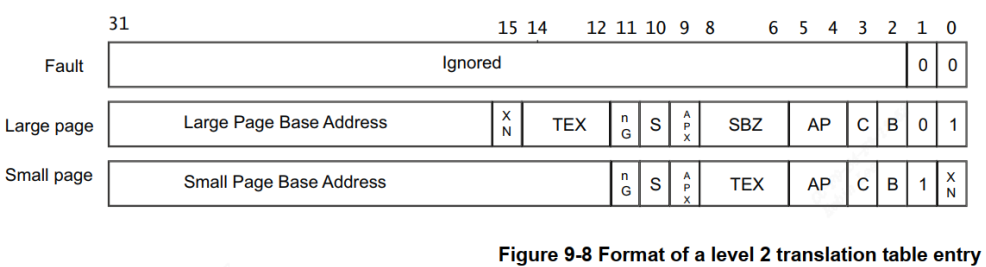
可以看到里面含有`64k(Large Page) 4k(Small Page）`或 `1K(Tine)` 物理空间的基地址 `page base addr`，假设从第0x45个二级页表项取出的物理地址为`0x8188,9000`。然后`offset=0x678`, 那么它跟 `vaddr[11:0]` 组 合 得 到 物 理 地 址 ： `0x8188,9000 + 0x678 = 0x8188,9678`，所以 CPU 要访问虚拟地址 `0x1234,5678` 时，实际上访问的是`0x8188,9678`的物理地址, 根据`bit[1:0]`得到映射的大小为`4K(linux Small Page)`。
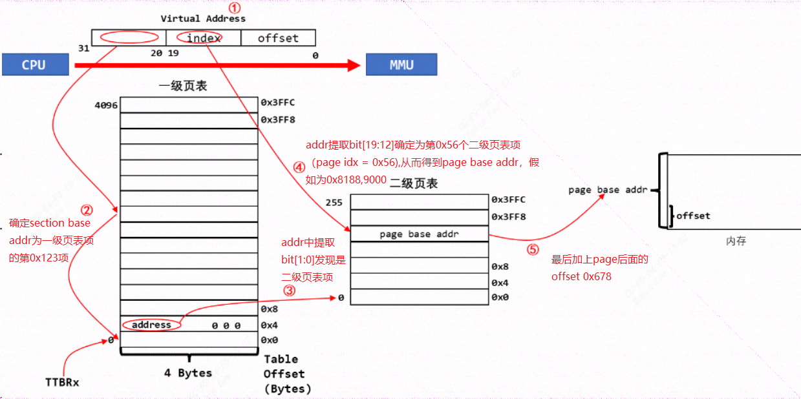
# 4 mmap函数调用过程

从上面内存映射的过程可以知道，要给 APP 新开劈一块虚拟内存，并且让它指向某块内核buffer，我们要做这些事：

1. 得到一个 `vm_area_struct`，它表示 APP 的一块虚拟内存空间：  
    很 幸 运 ， APP 调 用 mmap 系 统 函 数 时 ， 内 核 就 帮 我 们 构 造 了 一 个`vm_area_stuct` 结构体。里面含有虚拟地址的地址范围、权限，属性。
2. 确定物理地址：  
    你想映射某个内核 buffer，你需要得到它的物理地址，这得由你提供。
3. 给`vm_area_struct`和物理地址建立映射关系

比如APP 里调用 mmap 时，导致的内核相关函数调用过程如下：  
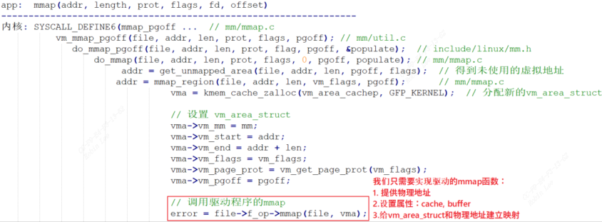
```c
#include <sys/mman.h>  
void *mmap(void *addr, size_t length, int prot, int flags,  
           int fd, off_t offset);  
int munmap(void *addr, size_t length);
```

可以传入一个addr虚拟地址，需要用户自己malloc。也可以将addr设置为NULL, 让linux内核帮你产生一段内存映射，返回虚拟地址给你。  
内核得到可用的虚拟地址后会分配一个`vm_area_struct`, 用来描述一块虚拟地址空间，里面有这块虚拟地址空间的起始地址、结束地址、权限信息。最后会调用驱动里面的mmap函数，参数为刚刚分配的`vm_area_sruct`。  
那么需要再驱动程序实现mmap函数，主要包括：

1. 提供物理地址
2. 设置属性，`cache，buffer`
3. 给`vm_area_stuct`和物理地址建立映射

## 4.1 vm_area_struct描述

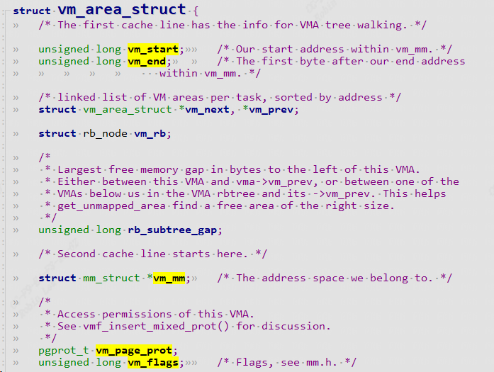
```c
/*  
 * This struct describes a virtual memory area. There is one of these  
 * per VM-area/task. A VM area is any part of the process virtual memory  
 * space that has a special rule for the page-fault handlers (ie a shared  
 * library, the executable area etc).  
 */  
struct vm_area_struct {  
	/* The first cache line has the info for VMA tree walking. */  
  
	unsigned long vm_start;		/* Our start address within vm_mm. */  
	unsigned long vm_end;		/* The first byte after our end address  
					   within vm_mm. */  
	/* linked list of VM areas per task, sorted by address */  
	struct vm_area_struct *vm_next, *vm_prev;  
	struct rb_node vm_rb;  
	/*  
	 * Largest free memory gap in bytes to the left of this VMA.  
	 * Either between this VMA and vma->vm_prev, or between one of the  
	 * VMAs below us in the VMA rbtree and its ->vm_prev. This helps  
	 * get_unmapped_area find a free area of the right size.  
	 */  
	unsigned long rb_subtree_gap;  
	/* Second cache line starts here. */  
	struct mm_struct *vm_mm;	/* The address space we belong to. */  
	/*  
	 * Access permissions of this VMA.  
	 * See vmf_insert_mixed_prot() for discussion.  
	 */  
	pgprot_t vm_page_prot;  
	unsigned long vm_flags;		/* Flags, see mm.h. */
```

它表示的是一块连续的虚拟地址空间区域，给进程使用的，地址空间范围是`0~3G`，对应的物理页面都可以是不连续的.  
主要成员有起始地址、结束地址、权限信息，属性信息。  
`vm_flags`：可读，可写，可执行权限，私有，共享等权限

常用**vm_flags**访问权限的取值说明：
```c
VM_READ：可读  
VM_WRITE：可写  
VM_EXEC：可执行  
VM_SHARD：可多进程之间共享  
VM_IO：可映射至设备 IO 空间  
VM_RESERVED：内存区域不可被换出  
VM_SEQ_READ：内存区域可能被顺序访问  
VM_RAND_READ：内存区域可能被随机访问
```

`vm_pgoff`：`vm_pgoff`表示该虚拟内存区域在映射对象（如文件）中的偏移量，单位是页（通常是 4KB，具体取决于系统的页大小）。

## 4.2 cache和buffer

使用 `mmap` 时，需要有`cache、 buffer`的知识。下图是 CPU 和内存之间的关系，有 `cache、 buffer`(写缓冲器)。 Cache 是一块高速内存；写缓冲器相当于一个 FIFO，可以把多个写操作集合起来一次写入内存。  
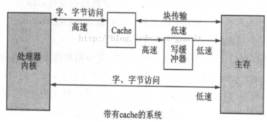

### 4.2.1 时间局部性和空间局部性

当程序运行时有`“局部性原理”`，这又分为**时间局部性、空间局部性**。举个例子：
```c
int i;  
int a = 0;  
for (i = 0; i < 100; i++) {  
	a++;  
}
```

**时间局部性：**  
a++在很短的时间内被重复写了100次，与此同时i也被访问了100次，像这种在某个时间点反复地访问了存储器的特定位置，被称为`“时间局部性”`。  
**空间局部性：**  
访问变量a的同时也访问了它周围临近变量i, 像这种访问了存储器的特定位置，很可能在不久的将来访问它附近的位置被称作`”空间局部性“`， 那么为什么不用`buffer or cache`把它一次性访问完呢？  
根据`“局部性原理”`，引入 `cache`和`buffer`。

### 4.2.2 cache miss和cache hit

读数据：

1. 要读取内存指定addr处的数据时，先看看cache中有没有addr的数据，如果有则直接从cache返回数据，这一过程叫做`cache命中(cache hit)`。
2. 假如cache中没有该addr的数据，触发`cache缺失 (cache miss)`, 那么会从addr读一段连续数据进去，注意：它不是仅仅读入一个数据，而是读入一行数据(cache line)。
3. 那么CPU 短时间内很可能会再次用到甚至多次用到这个 addr 的数据或者周围临近的数据，那么就可以直接从cache快速的获取数据。这样**弥补了时间和空间上的”局部性“**。

写数据：

1. CPU 写数据时，可以**直接写内存**，这很慢；也可以先把数据**写入 cache**，这很快。
2. cache 中的数据终究是要写入内存的啊，这有 2 种写策略:  
    **写通(write through)：**  
    - 数据要同时写入 cache 和内存，所以 cache 和内存中的数据保持一致，但是它的效率很低。能改进吗？可以！使用“**写缓冲器**”：cache 把数据给写缓冲器就可以了，有写缓冲器负责写入内存。  
    - 有些写缓冲器有“**写合并**”的功能，比如 CPU 执行了 4 条写指令：写第 0、 1、 2、 3 个字节，每次写 1 字节；写缓冲器会把这 4 个写操作合并成一个写操作：写 word。对于内存来说，这没什么差别，但是对于硬件寄存器，这就有可能导致问题。  
    - 所以对于寄存器操作，不要启动 buffer 功能；对于内存操作，比如 LCD 的显存，可以启用 buffer 功能(cpu直接用`write buffer`操作`frame buffer`)  
	  
    **写回(write back)：**  
    - 新数据只是写入 `cache`，不会立刻写入内存， `cache` 和内存中的数据并不一致。  
    - 新数据写入 cache 时，这一行 cache 被标为`“脏” (dirty)`；当cache 不够用时，才需要把脏的数据写入内存。

对内存或者变量进行写操作可以使用写回功能，可以大幅提高效率。但是要注意 cache 和内存中的数据很可能不一致。这在很多情况要小心处理：比如 CPU 产生了新数据， DMA 把数据从内存搬到网卡，这时候就要 CPU 执行命令先把新数据从 cache 刷到内存再启动DMA搬运。反过来也是一样的， DMA 从网卡得过了新数据存在内存里， CPU 读数据之前先把 cache中的数据丢弃，更新cache数据，再读cache。下图举例说明哪些硬件可以用或者不能用cache：  
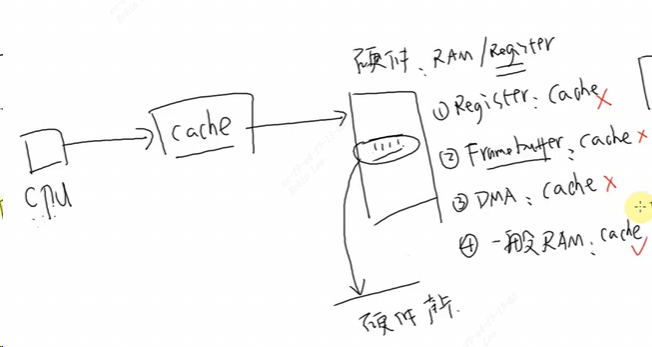
是否使用 cache、是否使用 buffer，就有 4 种组合(位于`arch\arm\include\asm\pgtable-2level.h`：

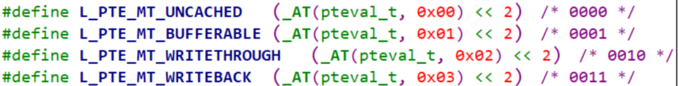
上面 4 种组合对应下表中的各项：

| 是否启用 cache | 是否启用 buffer | 说明                                                                                                                                                                                                                      |
| ---------- | ----------- | ----------------------------------------------------------------------------------------------------------------------------------------------------------------------------------------------------------------------- |
| 0          | 0           | `Non-cached, non-buffered (NCNB)`读、写都直达外设硬件                                                                                                                                                                             |
| 0          | 1           | `Non-cached buffered (NCB)`读、写都直达外设硬件；写操作通过 buffer 实现， CPU 不等待操作完成， CPU 会马上执行下一条指令                                                                                                                                      |
| 1          | 0           | `Cached, write-through mode (WT)`，写通 ①读：`cache hit`时从 cahce 读数据； `cache miss` 时读入一行数据到 cache；②写：同时写入cache和内存                                                                     |
| 1          | 1           | `Cached, write-back mode (WB)`，写回 ①读： `cache hit` 时从 cahce 读数据；`cache miss`时读入一行数据到 cache；②写：通过 buffer 实现， `cache hit` 时新数据不会到达硬件，而是在 cahce 中被标为 “dirty”； `cache miss` 通过 `buffer`写入硬件， CPU 不等待写操作完成， CPU 会马上执行下一条指令 |

- 第 1 种是不使用 cache 也不使用 buffer，读写时都直达硬件，适合寄存器的读写。  
- 第 2 种是不使用 cache 但是使用 buffer，写数据时会用 buffer 进行优化，可能会有`“写合并”`，这适合显存的操作。因为对显存很少有读操作，基本都是写操作，而写操作即使被“合并”也没有关系。  
- 第 3 种是使用 cache 不使用 buffer，就是`“ write through”`，适用于只读设备：在读数据时用 cache 加速，基本不需要写。  
- 第 4 种是既使用 cache 又使用 buffer，适合一般的内存读写

# 5 mmap驱动应用实例
## 5.1 mmap驱动要做的事情

1. 确定物理地址
2. 确定属性：是否使用 `cache、 buffer`
3. 建立映射关系

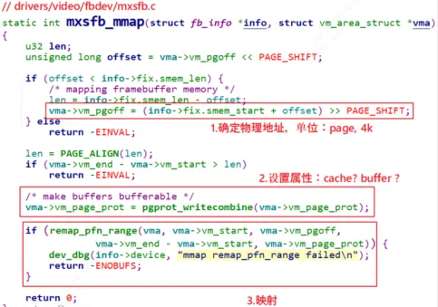
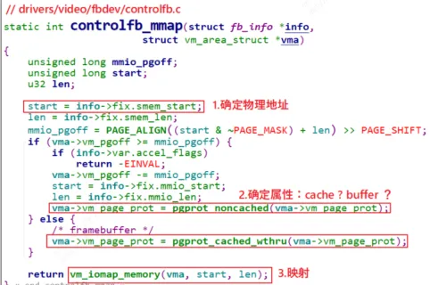
我们要验证mmap功能，在驱动程序中申请一个 8K 的 buffer，让 APP 通过 mmap 能直接访问。

## 5.2 mmap驱动代码示例分析

linux内核中常用的内存申请方式：

|函数名|说明|
|---|---|
|kmalloc|分配到的内存物理地址是连续的|
|kzalloc|分配到的内存物理地址是连续的，内容清 0|
|vmalloc|分配到的内存物理地址不保证是连续的|
|vzalloc|vzalloc 分配到的内存物理地址不保证是连续的，内容清 0|

我们在 mmap 时应该使用 kmalloc 或 kzalloc，这样得到的内存物理地址是连续的，mmap后 APP 才可以使用同一个基地址去访问这块内存。 (如果物理地址不连续，就要执行多次 mmap 了)

```c
#include <linux/module.h>  
#include <linux/fs.h>  
#include <linux/errno.h>  
#include <linux/miscdevice.h>  
#include <linux/kernel.h>  
#include <linux/major.h>  
#include <linux/mutex.h>  
#include <linux/proc_fs.h>  
#include <linux/seq_file.h>  
#include <linux/stat.h>  
#include <linux/init.h>  
#include <linux/device.h>  
#include <linux/tty.h>  
#include <linux/kmod.h>  
#include <linux/gfp.h>  
#include <asm/pgtable.h>  
#include <linux/mm.h>  
#include <linux/slab.h>  
  
static int major = 0;  
static char *kernel_buf;  
static struct class *hello_class;  
static int bufsiz = 1024*8;  
  
#define MIN(a, b) (a < b ? a : b)  
  
static ssize_t hello_drv_read (struct file *file, char __user *buf, size_t size, loff_t *offset){  
	int err;  
	err = copy_to_user(buf, kernel_buf, MIN(bufsiz, size));  
	return MIN(bufsiz, size);  
}  
static ssize_t hello_drv_write (struct file *file, const char __user *buf, size_t size, loff_t *offset)  
{  
	int err;  
	err = copy_from_user(kernel_buf, buf, MIN(1024, size));  
	return MIN(1024, size);  
}  
static int hello_drv_mmap(struct file *file, struct vm_area_struct *vma)  
{  
	/* 获得物理地址 */  
	unsigned long phy = virt_to_phys(kernel_buf);  
	/* 设置属性: cache, buffer */  
	vma->vm_page_prot = pgprot_writecombine(vma->vm_page_prot);  
	/* map */  
	if (remap_pfn_range(vma, vma->vm_start, phy >> PAGE_SHIFT,  
			    vma->vm_end - vma->vm_start, vma->vm_page_prot)) {  
		printk("mmap remap_pfn_range failed\n");  
		return -ENOBUFS;  
	}  
	return 0;  
}  
  
static int hello_drv_open (struct inode *node, struct file *file){  
	return 0;  
}  
static int hello_drv_close (struct inode *node, struct file *file){  
	return 0;  
}  
static struct file_operations hello_drv = {  
	.owner	 = THIS_MODULE,  
	.open    = hello_drv_open,  
	.read    = hello_drv_read,  
	.write   = hello_drv_write,  
	.release = hello_drv_close,  
	.mmap    = hello_drv_mmap,  
};  
  
static int __init hello_init(void)  
{  
	int err;  
	kernel_buf = kmalloc(bufsiz, GFP_KERNEL);  
	strcpy(kernel_buf, "old");  
	major = register_chrdev(0, "hello", &hello_drv);  
	hello_class = class_create(THIS_MODULE, "hello_class");  
	err = PTR_ERR(hello_class);  
	if (IS_ERR(hello_class)) {  
		printk("%s %s line %d\n", __FILE__, __FUNCTION__, __LINE__);  
		unregister_chrdev(major, "hello");  
		return -1;  
	}  
	device_create(hello_class, NULL, MKDEV(major, 0), NULL, "hello");  
	return 0;  
}  
  
static void __exit hello_exit(void)  
{  
	device_destroy(hello_class, MKDEV(major, 0));  
	class_destroy(hello_class);  
	unregister_chrdev(major, "hello");  
	kfree(kernel_buf);  
}  
module_init(hello_init);  
module_exit(hello_exit);  
MODULE_LICENSE("GPL");
```

分析：init时，驱动使用kmalloc分配8K空间(物理地址连续), 初始化为`”old“`字符串。实现read，write函数。mmap函数中：
```c
/* 获得物理地址 */  
unsigned long phy = virt_to_phys(kernel_buf);  
/* 设置属性: cache, buffer */  
vma->vm_page_prot = pgprot_writecombine(vma->vm_page_prot);  
/*映射*/  
remap_pfn_range(vma, vma->vm_start, phy >> PAGE_SHIFT, vma->vm_end - vma->vm_start, vma->vm_page_prot)；
```

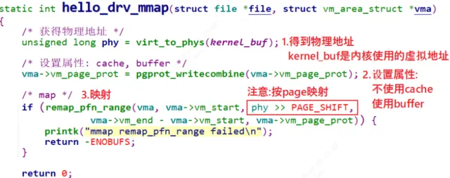
`pgprot_writecombine`设置属性为`Non-cached buffered (NCB)`
```c
#include <asm/pgtable.h>  
#define pgprot_noncached(prot) \  
		__pgprot_modify(prot, PTE_ATTRINDX_MASK, PTE_ATTRINDX(MT_DEVICE_nGnRnE) | PTE_PXN | PTE_UXN)  
#define pgprot_writecombine(prot) \  
		__pgprot_modify(prot, PTE_ATTRINDX_MASK, PTE_ATTRINDX(MT_NORMAL_NC) | PTE_PXN | PTE_UXN)  
#define pgprot_device(prot) \  
		__pgprot_modify(prot, PTE_ATTRINDX_MASK, PTE_ATTRINDX(MT_DEVICE_nGnRE) | PTE_PXN | PTE_UXN)
```

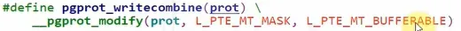

注意：`remap_pfn_range` 中，`pfn` 的意思是`“ Page Frame Number”`。在 Linux 中，整个物理地址空间可以分为第 0 页、第 1 页、第 2 页，诸如此类，这就是 pfn。假设每页大小是 4K，那么给定物理地址 `phy`，它的 `pfn = phy / 4096 = phy >> 12`。内核的 page 一般是 4K，但是也可以配置内核修改 page的大小。所以为了通用， `pfn = phy >> PAGE_SHIFT`
```c
#include <linux/mm.h>  
int remap_pfn_range(struct vm_area_struct *, unsigned long addr,  
			unsigned long pfn, unsigned long size, pgprot_t);
```

如果我们的buf不是用`kmalloc`, 而是`vmalloc`，那么需要映射多次，每次映射一个`page 4k`.(MMU过程中内存以page为单位作为连续内存单元)  
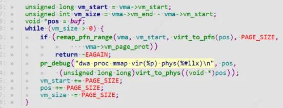

## 5.3 mmap应用代码示例分析

```c
#include <sys/types.h>  
#include <sys/stat.h>  
#include <fcntl.h>  
#include <unistd.h>  
#include <stdio.h>  
#include <string.h>  
#include <sys/mman.h>  
#include <unistd.h>  
  
/*  
 * ./hello_drv_test  
 */  
int main(int argc, char **argv){  
	int fd;  
	char *buf;  
	int len;  
	char str[1024];  
	/* 1. 打开文件 */  
	fd = open("/dev/hello", O_RDWR);  
	if (fd == -1)  
	{  
		printf("can not open file /dev/hello\n");  
		return -1;  
	}  
	/* 2. mmap   
	 * MAP_SHARED  : 多个APP都调用mmap映射同一块内存时, 对内存的修改大家都可以看到。  
	 *               就是说多个APP、驱动程序实际上访问的都是同一块内存  
	 * MAP_PRIVATE : 创建一个copy on write的私有映射。  
	 *               当APP对该内存进行修改时，其他程序是看不到这些修改的。  
	 *               当APP写内存时, 内核会先创建一个页拷贝给这个APP,
	 *               这个页拷贝是这个APP私有的, 其他APP/驱动无法访问。  
	 */  
	buf =  mmap(NULL, 1024*8, PROT_READ | PROT_WRITE, MAP_SHARED, fd, 0);  
	if (buf == MAP_FAILED){  
		printf("can not mmap file /dev/hello\n");  
		return -1;  
	}  
  
	printf("mmap address = 0x%x\n", buf);  
	printf("buf origin data = %s\n", buf); /* old */  
  
	/* 3. write */  
	strcpy(buf, "new");  
  
	/* 4. read & compare */  
	/* 对于MAP_SHARED映射:  str = "new"   
	 * 对于MAP_PRIVATE映射: str = "old"   
	 */  
	read(fd, str, 1024);    
	if (strcmp(buf, str) == 0)  
	{  
		/* 对于MAP_SHARED映射，APP写的数据驱动可见  
		 * APP和驱动访问的是同一个内存块  
		 */  
		printf("compare ok!\n");  
	} else {  
		/* 对于MAP_PRIVATE映射，APP写数据时, 是写入原来内存块的"拷贝"  
		 */  
		printf("compare err!\n");  
		printf("str = %s!\n", str);  /* old */  
		printf("buf = %s!\n", buf);  /* new */  
	}  
  
	while (1){  
		sleep(10);  /* cat /proc/pid/maps */  
	}  
	  
	munmap(buf, 1024*8);  
	close(fd);  
	return 0;  
}
```

### 5.3.1 共享映射与私有映射
```c
/*  
 * MAP_SHARED  : 多个APP都调用mmap映射同一块内存时, 对内存的修改大家都可以看到。  
 *               就是说多个APP、驱动程序实际上访问的都是同一块内存  
 * MAP_PRIVATE : 创建一个copy on write的私有映射。  
 *               当APP对该内存进行修改时，其他程序是看不到这些修改的。  
 *               就是当APP写内存时, 内核会先创建一个拷贝给这个APP,   
 *               这个拷贝是这个APP私有的, 其他APP、驱动无法访问。  
*/  
  
#include <sys/mman.h>  
   void *mmap(void *addr, size_t length, int prot, int flags,  
			  int fd, off_t offset);  
   int munmap(void *addr, size_t length);
```

### 5.3.2 copy on write

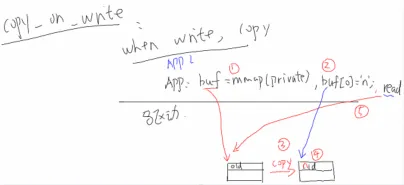

① mmap时使用MAP_PRIVATE
②③ 当写入mmap内存时，会copy这块内存
④写入新数据，会将数据写入新copy的内存
⑤使用`read`读数据还是从旧的那块映射内存去读，因此这时会与buf中的数据不一样

# 6 `vm_area_struct->vm_pgoff`
在设备驱动开发中，`vm_area_struct->vm_pgoff`（以下简称`vm_pgoff`）是虚拟内存区域（VMA）的核心字段之一，本质是**以页为单位的偏移量**，核心作用是关联「用户态虚拟地址」和「内核侧物理 / 线性地址」的映射关系。下面从含义、使用场景、具体示例三个维度讲清楚它的用法。

### 一、先理解 vm_pgoff 的本质

`vm_pgoff` 的定义在 `<linux/mm_types.h>` 中，类型为 `unsigned long`，表示：

> 该 VMA 对应的「后备存储（backing store）」的偏移量，单位是**页（PAGE_SIZE，通常 4KB）**。

不同场景下，「后备存储」的含义不同：

- 文件映射（mmap 文件）：偏移量指向文件的某一页（即文件偏移 ÷ PAGE_SIZE）；
- 设备映射（mmap 设备）：偏移量指向设备的物理内存 / 寄存器的某一页（即设备物理地址 ÷ PAGE_SIZE）；
- 匿名映射：无实际后备存储，vm_pgoff 通常为 0。

对设备驱动来说，核心场景是**设备内存 / 寄存器的 mmap 映射**，此时`vm_pgoff`是用户态传入的偏移量（mmap 的第二个参数`off`）经过页对齐后的结果：

plaintext

```
vm_pgoff = (off >> PAGE_SHIFT);  // PAGE_SHIFT=12（4KB页），等价于 off / PAGE_SIZE
```

### 二、vm_pgoff 的核心使用场景

驱动中使用`vm_pgoff`主要在两个关键函数里：

1. `mmap` 驱动方法（`file_operations->mmap`）：解析用户传入的偏移，验证合法性；
2. `remap_pfn_range`/`io_remap_pfn_range`：将偏移转换为物理页帧号（PFN），完成虚实映射。

#### 关键前置概念：物理页帧号（PFN）

物理地址转换为 PFN 的公式：

```
PFN = (物理地址) >> PAGE_SHIFT;  // 等价于 物理地址 / PAGE_SIZE
```

而`vm_pgoff`是用户期望的「设备物理地址偏移（页单位）」，因此最终映射的 PFN = 设备基地址 PFN + vm_pgoff。

### 三、具体使用示例（设备 mmap 场景）

以「将设备物理寄存器映射到用户态」为例，完整展示`vm_pgoff`的用法：

#### 步骤 1：驱动 mmap 方法的实现

```
#include <linux/module.h>
#include <linux/fs.h>
#include <linux/mm.h>
#include <linux/io.h>
#include <linux/cdev.h>

// 假设设备物理基地址（实际需替换为硬件真实地址）
#define DEV_PHYS_BASE 0x10000000
// 设备寄存器总大小（4页，16KB）
#define DEV_PHYS_SIZE (4 * PAGE_SIZE)
// 设备物理基地址对应的PFN
#define DEV_BASE_PFN (DEV_PHYS_BASE >> PAGE_SHIFT)

static int dev_mmap(struct file *filp, struct vm_area_struct *vma)
{
    unsigned long pfn;
    unsigned long vma_size = vma->vm_end - vma->vm_start;
    unsigned long max_off = DEV_PHYS_SIZE >> PAGE_SHIFT;

    // 1. 验证用户传入的偏移（vm_pgoff）是否合法
    // 若偏移超过设备总页数，或映射大小超过设备剩余空间，直接返回错误
    if (vma->vm_pgoff >= max_off || (vma->vm_pgoff + (vma_size >> PAGE_SHIFT)) > max_off) {
        pr_err("Invalid vm_pgoff: %lu (max: %lu)\n", vma->vm_pgoff, max_off);
        return -EINVAL;
    }

    // 2. 计算要映射的物理页帧号（核心：基地址PFN + vm_pgoff）
    pfn = DEV_BASE_PFN + vma->vm_pgoff;

    // 3. 清除VMA的写保护（若设备需要可写）
    vma->vm_flags |= VM_IO | VM_DONTEXPAND | VM_DONTDUMP;
    vma->vm_page_prot = pgprot_noncached(vma->vm_page_prot);  // 设备寄存器需非缓存

    // 4. 建立虚实映射（核心调用）
    if (io_remap_pfn_range(vma, vma->vm_start, pfn, vma_size, vma->vm_page_prot)) {
        pr_err("remap_pfn_range failed\n");
        return -EAGAIN;
    }

    return 0;
}

// 文件操作集
static const struct file_operations dev_fops = {
    .owner = THIS_MODULE,
    .mmap  = dev_mmap,  // 关联mmap方法
};

// 驱动注册/注销等代码（简化）
static struct cdev dev_cdev;
static dev_t dev_no;

static int __init dev_init(void)
{
    alloc_chrdev_region(&dev_no, 0, 1, "dev_mmap_demo");
    cdev_init(&dev_cdev, &dev_fops);
    cdev_add(&dev_cdev, dev_no, 1);
    return 0;
}

static void __exit dev_exit(void)
{
    cdev_del(&dev_cdev);
    unregister_chrdev_region(dev_no, 1);
}

module_init(dev_init);
module_exit(dev_exit);
MODULE_LICENSE("GPL");
```

#### 步骤 2：用户态测试（验证 vm_pgoff 的作用）

用户态通过`mmap`传入偏移，驱动通过`vm_pgoff`解析：

```
// 用户态代码
#include <stdio.h>
#include <sys/mman.h>
#include <fcntl.h>
#include <unistd.h>

#define PAGE_SIZE 4096
#define DEV_PATH "/dev/dev_mmap_demo"

int main()
{
    int fd = open(DEV_PATH, O_RDWR);
    if (fd < 0) { perror("open"); return -1; }

    // 映射设备的第2页（偏移PAGE_SIZE，对应vm_pgoff=1）
    unsigned char *addr = mmap(NULL, PAGE_SIZE, PROT_READ|PROT_WRITE,
                               MAP_SHARED, fd, PAGE_SIZE);
    if (addr == MAP_FAILED) { perror("mmap"); return -1; }

    // 读写映射地址（对应设备物理地址 0x10000000 + PAGE_SIZE）
    *addr = 0x55;  // 写入设备寄存器第2页的首地址
    printf("Write 0x55 to offset %lu (vm_pgoff=1)\n", (unsigned long)PAGE_SIZE);

    munmap(addr, PAGE_SIZE);
    close(fd);
    return 0;
}
```

### 四、关键注意事项

1. **页对齐检查**：用户传入的`off`（mmap 的第 5 个参数）必须是 PAGE_SIZE 的整数倍，内核会自动将其转为`vm_pgoff`，但驱动仍需验证（避免非对齐偏移导致错误）；
2. **边界校验**：必须检查`vm_pgoff + 映射页数`是否超过设备总页数，否则会导致越界访问；
3. **VM_IO 标记**：映射设备内存时，必须设置`vma->vm_flags |= VM_IO`，告知内核这是 I/O 内存，避免被 swap、kcompactd 等机制干扰；
4. **非缓存属性**：设备寄存器通常需要非缓存（pgprot_noncached），否则用户态写操作可能被 CPU 缓存吞掉，无法到达硬件。
