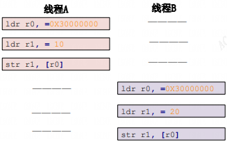
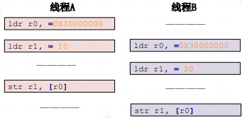
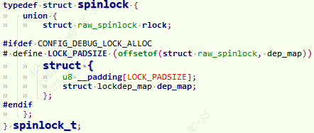
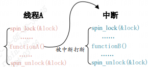
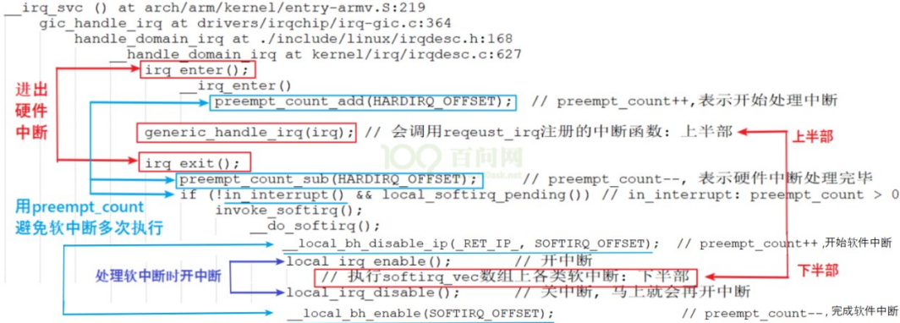
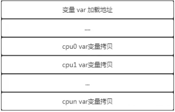

# 1 并发场景

Linux 系统并发产生的原因很复杂，总结一下有下面几个主要原 因：

1. 多线程并发访问，Linux 是多任务(线程)的系统，所以多线程访问是最基本的原因。
2. 抢占式并发访问，从 2.6 版本内核开始，Linux 内核支持抢占，也就是说调度程序可以 在任意时刻抢占正在运行的线程，从而运行其他的线程。
3. 中断程序并发访问，这个无需多说，学过 STM32 的同学应该知道，硬件中断的权利是很大的。
4. SMP(多核)核间并发访问，现在 ARM 架构的多核 SOC 很常见，多核 CPU 存在核间并发访问。

# 2 并发解决方案

## 2.1 内存屏障

### 2.1.1 编译器指令重排（Compiler Instruction Reordering)
```c
int a, b;  
   
void foo(void){  
    a = b + 1;  
    b = 0;  
}
```

```c
<foo>:  
    ...  
    ldr w0, [x0]       //load b to w0  
    add w1, w0, #0x1  
    ...  
    str w1, [x0]       //a = b + 1  
    ...  
    str wzr, [x0]      //b = 0
```

我们把编译优化打开到-O2，再次反汇编：
```c
<foo>:  
    ...  
    ldr w2, [x0]       //load b to w2  
    str wzr, [x0]      //b = 0  
    add w0, w2, #0x1  
    str w0, [x1]       //a = b + 1
```

可以看到编译器 ”自作聪明“， b被提前赋值了。因此要使用内存屏障。

### 2.1.2 内存屏障API
```c
barrier();  
cpu_relax();  
READ_ONCE(val);
```

#### 2.1.2.1 barrier

前面用-O2选项顺序会被错误的排列。加入`barrier();//插入内存屏障`，再次反汇编可以看到OK符合我们的逻辑了。
```c
int a, b;  
   
void foo(void){  
    a = b + 1;  
 	barrier();//插入内存屏障  
	b = 0;  
}  
  
//反汇编如下：  
<foo>:  
    ...  
    ldr w2, [x0]       //load b to w2  
    add w2, w2, #0x1  
    str w2, [x1]       //a = a + 1  
    str wzr, [x0]      //b = 0  
    ...
```

#### 2.1.2.2 cpu_relax
```c
int run = 1;  
void foo(void) {  
    while (run)  
        ;  
}
```

run 是个全局变量，foo() 在一个进程中执行，一直循环。我们期望的结果是 foo() 一直等到其他进程修改 run 的值为 0 才退出循环。反汇编看看：
```c
0000000000000748 <foo>:  
748: 90000080 adrp x0, 10000  
74c: f947e800 ldr x0, [x0, #4048]  
750: b9400000 ldr w0, [x0]            //load run to w0  
754: d503201f nop  
758: 35000000 cbnz w0, 758 <foo+0x10> //if (w0) while (1);  
75c: d65f03c0 ret
```

但实际上编译器帮我们优化成了等效下面的样子：这样永远也不会退出。
```c
int run = 1;  
void foo(void) {  
    int reg = run;  
   
    if (reg)  
        while (1)  
            ;  
}
```

因此加上内存屏障如下：
```c
int run = 1;  
void foo(void) {  
    while (run)  
        cpu_relax();  
}
```

#### 2.1.2.3 READ_ONCE()

也可用这种方式作为内存屏障。
```c
int run = 1;  
void foo(void){  
    while (READ_ONCE(run)) /* similar to while (*(volatile int *)&run) */  
        ;  
}
```

## 2.2 原子操作

### 2.2.0 临界区的原子操作引入

所谓的临界区就是共享数据段，如全局变量，对于临界区必须保证一次只有一个线程访问，也就是要保证临 界区是原子访问的。我们都知道，原子是化学反应不可再分的基本微粒，这里的原子访问就表示这一个访问是一个步骤，不能再进行拆分。

示例1：

`a=3;`

假设变量 a 的地址为 0X3000000，“a=3”这一行 C 语言可能会被编译为如下所示的汇编代码:
```c
ldr r0, =0X30000000 /* 变量 a 地址 */  
2 ldr r1, = 3 /* 要写入的值 */  
3 str r1, [r0] /* 将 3 写入到 a 变量中 */
```

如果多线程同时执行这条语句。我们期望的执行顺序：


实际执行顺序可能是：


线程 A 最终将变量 a 设置为了 20，而并不是要求的 10线程 B 没有问题，是期望的a设置成了20，这就是并发竞态。我们希望三条汇编指令一次性执行完，不被打断和拆解，这就是原子操作。

### 2.2.1 整数原子操作API
```c
typedef struct {  
	int counter;  
} atomic_t;  
atomic_t b = ATOMIC_INIT(0); //定义原子变量 b 并赋初值为 0  
atomic_set(&b, 10); /* 设置 b=10 */  
atomic_read(&b); /* 读取 b 的值，肯定是 10 */  
atomic_inc(&b); /* b 的值加 1，v=11 */  
  
typedef struct {  
 	long long counter;  
} atomic64_t;  
atomic64_t c = ATOMIC64_INIT(0); //定义64位系统原子变量 c 并赋初值为 0  
//注意：如果使用的是64 位的 SOC，那么建议使用 64 位的原子操作函数。Cortex-A7 (armv7)是 32 位的架构，Cortex-A53（armv8）64位架构。
```

|函数|描述|
|---|---|
|ATOMIC_INIT(int i)|定义原子变量的时候对其初始化。|
|int atomic_read(atomic_t *v)|读取 v 的值，并且返回。|
|void atomic_set(atomic_t *v, int i)|向 v 写入 i 值。|
|void atomic_add(int i, atomic_t *v)|给 v 加上 i 值。|
|void atomic_sub(int i, atomic_t *v)|从 v 减去 i 值。|
|void atomic_inc(atomic_t *v)|给 v 加 1，也就是自增。|
|void atomic_dec(atomic_t *v)|从 v 减 1，也就是自减|
|int atomic_dec_return(atomic_t *v)|从 v 减 1，并且返回 v 的值。|
|int atomic_inc_return(atomic_t *v)|给 v 加 1，并且返回 v 的值。|
|atomic_add_return(int i, atomic_t *v)|给 v 加 i，并且返回 v 的值。|
|atomic_sub_return(int i, atomic_t *v)|给 v 减 i，并且返回 v 的值。|
|int atomic_sub_and_test(int i, atomic_t *v)|从 v 减 i，如果结果为 0 就返回真，否则返回假|
|int atomic_dec_and_test(atomic_t *v)|从 v 减 1，如果结果为 0 就返回真，否则返回假|
|int atomic_inc_and_test(atomic_t *v)|给 v 加 1，如果结果为 0 就返回真，否则返回假|
|int atomic_add_negative(int i, atomic_t *v)|给 v 加 i，如果结果为负就返回真，否则返回假|
|atomic_cmpxchg(atomic_t *ptr, int old, int new)|比较old和原子变量ptr中的值，如果相等，那么就把new值赋给原子变量。返回旧的原子变量ptr中的值|

例：
```c
static int led_open(struct inode *inode, struct file *filp)  
{  
	if (!atomic_dec_and_test(&gpioled.lock)) {  
		atomic_inc(&gpioled.lock);/* 小于 0 的话就加 1,使其原子变量等于 0 */  
		return -EBUSY; /* LED 被使用，返回忙 */  
    }  
    filp->private_data = &gpioled;  
	return 0;  
}  
  
static int led_release(struct inode *inode, struct file *filp)  
{  
	struct gpioled_dev *dev = filp->private_data;  
  
	/* 关闭驱动文件的时候释放原子变量 */  
	atomic_inc(&dev->lock);  
	return 0;  
}  
  
static int __init led_init(void)  
{  
	/* 初始化原子变量 */  
	atomic_set(&gpioled.lock, 1); /* 原子变量初始值为 1 */  
}
```

该例子用来实现一次只能允许一个应用访问 LED 灯，不能多个进程同时操作LED。第一个用户程序进行open,成功此时原子值counter=0，第二个用户程序进行open就会fail, 直到第一个用户程序close, counter会进行加一，此时第二个程序才可以open成功。

### 2.2.2 位原子操作API

原 子位操作不像原子整形变量那样有个 atomic_t 的数据结构，原子位操作是直接对内存进行操作：

|函数|描述|
|---|---|
|void set_bit(int nr, void *p)|将 p 地址的第 nr 位置 1。|
|void clear_bit(int nr,void *p)|将 p 地址的第 nr 位清零。|
|void change_bit(int nr, void *p)|将 p 地址的第 nr 位进行翻转。|
|int test_bit(int nr, void *p)|获取 p 地址的第 nr 位的值。|
|int test_and_set_bit(int nr, void *p)|将 p 地址的第 nr 位置 1，并且返回 nr 位原来的值。|
|int test_and_clear_bit(int nr, void *p)|将 p 地址的第 nr 位清零，并且返回 nr 位原来的值。|
|int test_and_change_bit(int nr, void *p)|将 p 地址的第 nr 位翻转，并且返回 nr 位原来的值。|

## 2.3 自旋锁

原子操作只能对整形变量或者位进行保护，但是，在实际的使用环境中怎么可能只有整形 变量或位这么简单的临界区。

自旋锁的定义：

对于自旋锁而言，如果自旋锁 正在被线程 A 持有，线程 B 想要获取自旋锁，那么线程 B 就会处于忙循环-旋转-等待状态，线 程 B 不会进入休眠状态或者说去做其他的处理，而是会一直傻傻的在那里“转圈圈”的等待锁 可用。比如现在有个公用电话亭，一次肯定只能进去一个人打电话，现在电话亭里面有人正在 打电话，相当于获得了自旋锁。此时你到了电话亭门口，因为里面有人，所以你不能进去打电 话，相当于没有获取自旋锁，这个时候你肯定是站在原地等待，你可能因为无聊的等待而转圈 圈消遣时光，反正就是哪里也不能去，要一直等到里面的人打完电话出来。终于，里面的人打 完电话出来了，相当于释放了自旋锁，这个时候你就可以使用电话亭打电话了，相当于获取到 了自旋锁。

自旋锁的“自旋”也就是“原地打转”的意思，“原地打转”的目的是为了等待自旋锁可以 用，可以访问共享资源。把自旋锁比作一个变量 a，变量 a=1 的时候表示共享资源可用，当 a=0 的时候表示共享资源不可用。现在线程 A 要访问共享资源，发现 a=0(自旋锁被其他线程持有)， 那么线程 A 就会不断的查询 a 的值，直到 a=1。可

`缺点：获取自旋锁会原地等待，会浪费处理器时间，降低系统性能，所以自旋锁 的持有时间不能太长。如果临界区比较大，运行时间比较长的话要选择信号量和互斥体。`

`适用范围：适用于短时期的轻量级加锁。`


### 2.3.1 自旋锁API

|函数|描述|
|---|---|
|DEFINE_SPINLOCK(spinlock_t lock)|定义并初始化一个自选变量。|
|int spin_lock_init(spinlock_t *lock)|初始化自旋锁。|
|void spin_lock(spinlock_t *lock)|获取指定的自旋锁，也叫做加锁。|
|void spin_unlock(spinlock_t *lock)|释放指定的自旋锁。|
|int spin_trylock(spinlock_t *lock)|尝试获取指定的自旋锁，如果没有获取到就返回 0|
|int spin_is_locked(spinlock_t *lock)|检查指定的自旋锁是否被获取，如果没有被获取就返回非 0，否则返回 0。|

被自旋锁保护的临界区一定不能调用任何能够引起睡眠和阻塞的 API 函数，否则的话会可能会导致死锁现象（不能带锁休眠）。因为自旋锁会禁止抢占，也就说当线程 A 得到锁以后会暂时禁止内核抢占，那既然禁止内核抢占自己又休眠了，粗俗的形容就是“占着茅坑不拉屎”，自己休眠了又没有释放锁就导致死锁。

#### 2.3.1.1 自旋锁和中断相关

中断里面访问临界资源，也是可以使用自旋锁的，但是在获取锁之前一定要先禁止本地中断。

|函数|描述|
|---|---|
|void spin_lock_irq(spinlock_t *lock)|禁止本地中断，并获取自旋锁。|
|void spin_unlock_irq(spinlock_t *lock)|激活本地中断，并释放自旋锁。|
|void spin_lock_irqsave(spinlock_t *lock,unsigned long flags)|保存中断状态，禁止本地中断，并获取自旋锁。|
|void spin_unlock_irqrestore(spinlock_t*lock, unsigned long flags)|将中断状态恢复到以前的状态，并且激活本地中断，释放自旋锁|

如下图就是没有禁止本地中断导致死锁的例子：


线程 A 先运行，并且获取到了 lock 这个锁，当线程 A 运行 `functionA` 函 数的时候中断发生了，中断抢走了 CPU 使用权。右边的中断服务函数也要获取 lock 这个锁， 但是这个锁被线程 A 占有着，中断就会一直自旋，等待锁有效。但是在中断服务函数执行完之前，线程 A 是不可能执行的，线程 A 说“你先放手”，中断说“你先放手”，场面就这么僵持着， 死锁发生！

使用 `spin_lock_irq/spin_unlock_irq` 的时候需要用户能够确定加锁之前的中断状态，但实际上我们是很难确定某个时刻的中断状态，因此不推荐使用 `spin_lock_irq/spin_unlock_irq`。建议使用 `spin_lock_irqsave/spin_unlock_irqrestore`，因为这一组函数会保存中断状态，在释放锁的时候会恢复中断状态。一般在线程中使用 `spin_lock_irqsave/ spin_unlock_irqrestore`，在中断中使用 `spin_lock/spin_unlock`，例如下面：
```c
DEFINE_SPINLOCK(lock);  
/* 线程 A */  
void functionA (){  
	unsigned long flags; /* 中断状态 */  
	spin_lock_irqsave(&lock, flags); /* 获取锁 */  
	/* 临界区 */  
	spin_unlock_irqrestore(&lock, flags); /* 释放锁 */  
}  
  
 /* 中断服务函数 */  
void irq() {  
	spin_lock(&lock); /* 获取锁 */  
	/* 临界区 */  
	spin_unlock(&lock); /* 释放锁 */  
}
```

有人说为什么中断服务程序不去使用`spin_lock_irqsave`呢？ 难道不需要去禁止中断吗？

因为GIC中断总入口已经帮我们调用了`local_irq_disable()`禁止了中断。


如果下半部(BH)也会竞争共享资源，要在下半部里面使用自旋锁:

|函数|描述|
|---|---|
|void spin_lock_bh(spinlock_t *lock)|关闭下半部，并获取自旋锁|
|void spin_unlock_bh(spinlock_t *lock)|打开下半部，并释放自旋锁|

### 2.3.2 读写自旋锁

读写自旋锁为读和写操作提供了不同的锁，一次只能允许一个写操作，也就是只能一个线程持有写锁，而且不能进行读操作。但是当没有写操作的时候允许一个或多个线程持有读锁， 可以进行并发的读操作。Linux 内核使用 rwlock_t 结构体表示读写锁，结构体定义如下(删除了 条件编译)：
```c
typedef struct {  
 	arch_rwlock_t raw_lock;  
} rwlock_t;
```

使用场景：

现在有个学生信息表，此表存放着学生的年龄、家庭住址、班级等信息，此表可以随时被 修改和读取，那么必须要对其进行保护，如果我们现在使用自旋锁对其进行 保护。每次只能一个读操作或者写操作，但是，实际上此表是可以并发读取的。只需要保证在 修改此表的时候没人读取，或者在其他人读取此表的时候没有人修改此表就行了。也就是此表 的读和写不能同时进行，但是可以多人并发的读取此表。像这样，当某个数据结构符合读/写或 生产者/消费者模型的时候就可以使用读写自旋锁。

|函数|描述|
|---|---|
|DEFINE_RWLOCK(rwlock_t lock)|定义并初始化读写锁|
|void rwlock_init(rwlock_t *lock)|初始化读写锁。|
|读操作||
|void read_lock(rwlock_t *lock)|获取读锁。|
|void read_unlock(rwlock_t *lock)|释放读锁。|
|void read_lock_irq(rwlock_t *lock)|禁止本地中断，并且获取读锁。|
|void read_unlock_irq(rwlock_t *lock)|打开本地中断，并且释放读锁。|
|void read_lock_irqsave(rwlock_t *lock, unsigned long flags)|保存中断状态，禁止本地中断，并获取读锁。|
|void read_unlock_irqrestore(rwlock_t *lock,unsigned long flags)|将中断状态恢复到以前的状态，并且激活本地中断，释放读锁。|
|void read_lock_bh(rwlock_t *lock)|关闭下半部，并获取读锁。|
|void read_unlock_bh(rwlock_t *lock)|打开下半部，并释放读锁。|
|写操作||
|void write_lock(rwlock_t *lock)|获取写锁。|
|void write_unlock(rwlock_t *lock)|释放写锁。|
|void write_lock_irq(rwlock_t *lock)|禁止本地中断，并且获取写锁。|
|void write_unlock_irq(rwlock_t *lock)|打开本地中断，并且释放写锁。|
|void write_lock_irqsave(rwlock_t *lock,unsigned long flags)|保存中断状态，禁止本地中断，并获取写锁|
|void write_unlock_irqrestore(rwlock_t *lock,unsigned long flags)|将中断状态恢复到以前的状态，并且激活本地中断，释放读锁。|
|void write_lock_bh(rwlock_t *lock)|关闭下半部，并获取读锁。|
|void write_unlock_bh(rwlock_t *lock)|打开下半部，并释放读锁。|

### 2.3.3 顺序锁

顺序锁在读写锁的基础上衍生而来的，使用读写锁的时候读操作和写操作不能同时进行。使用顺序锁的话可以允许在写的时候进行读操作，也就是实现同时读写，但是不允许同时进行并发的写操作。
```c
typedef struct {  
 		struct seqcount seqcount;  
 		spinlock_t lock;  
} seqlock_t;
```

|函数|描述|
|---|---|
|DEFINE_SEQLOCK(seqlock_t sl)|定义并初始化顺序锁|
|void seqlock_ini seqlock_t *sl)|初始化顺序锁。|
|void write_seqlock(seqlock_t *sl)|获取写顺序锁。|
|void write_sequnlock(seqlock_t *sl)|释放写顺序锁。|
|void write_seqlock_irq(seqlock_t *sl)|禁止本地中断，并且获取写顺序锁|
|void write_sequnlock_irq(seqlock_t *sl)|打开本地中断，并且释放写顺序锁。|
|void write_seqlock_irqsave(seqlock_t *sl,unsigned long flags)|保存中断状态，禁止本地中断，并获取写顺序锁。|
|void write_sequnlock_irqrestore(seqlock_t *sl,unsigned long flags)|将中断状态恢复到以前的状态，并且激活本地中断，释放写顺序锁。|
|void write_seqlock_bh(seqlock_t *sl)|关闭下半部，并获取写读锁。|
|void write_sequnlock_bh(seqlock_t *sl)|打开下半部，并释放写读锁。|
|unsigned read_seqbegin(const seqlock_t *sl)|读单元访问共享资源的时候调用此函数，此函数会返回顺序锁的顺序号。|
|unsigned read_seqretry(const seqlock_t *sl,unsigned start)|读结束以后调用此函数检查在读的过程中有没有对资源进行写操作，如果有的话就要重读|

## 2.4 信号量

相比于自旋锁，信号量可以使线程进入休眠状态，比如 A 与 B、C 合租了一套房子，这个 房子只有一个厕所，一次只能一个人使用。某一天早上 A 去上厕所了，过了一会 B 也想用厕 所，因为 A 在厕所里面，所以 B 只能等到 A 用来了才能进去。B 要么就一直在厕所门口等着， 等 A 出来，这个时候就相当于自旋锁。B 也可以告诉 A，让 A 出来以后通知他一下，然后 B 继 续回房间睡觉，这个时候相当于信号量。可以看出，使用信号量会提高处理器的使用效率，毕 竟不用一直傻乎乎的在那里“自旋”等待。但是，信号量的开销要比自旋锁大，因为信号量使 线程进入休眠状态以后会切换线程，切换线程就会有开销。

信号量的特点：

`适用于那些占用资源比较久的场合，如线程同步。`

`因此信号量等待不能用于中断中，因为中断不能休眠。`

### 2.4.1 信号量 API
```c
struct semaphore {  
	 raw_spinlock_t lock;  
	 unsigned int count;  
	 struct list_head wait_list;  
};
```

|函数|描述|
|---|---|
|DEFINE_SEAMPHORE(name)|定义一个信号量，并且设置信号量的值为 1。|
|void sema_init(struct semaphore *sem, int val)|初始化信号量 sem，设置信号量值为 val。|
|void down(struct semaphore *sem)|获取信号量，因为会导致休眠，因此不能在中断中使用。|
|int down_trylock(struct semaphore *sem);|尝试获取信号量，如果能获取到信号量就获取，并且返回 0。如果不能就返回非 0，并且不会进入休眠。|
|int down_interruptible(struct semaphore *sem)|获取信号量，和 down 类似，只是使用 down 进入休眠状态的线程不能被信号打断。而使用此函数进入休眠以后是可以被信号打断的。|
|void up(struct semaphore *sem)|释放信号量|
```c
struct semaphore sem; /* 定义信号量 */  
sema_init(&sem, 1); /* 初始化信号量 */  
threadA(){  
    down(&sem); /* 申请信号量 */  
}  
theadB(){  
    up(&sem); /* 释放信号量 */  
}
```

## 2.5 互斥锁

将信号量的值设置为 1 就可以使用信号量进行互斥访问了，虽然可以通过信号量实现互斥，但是 Linux 提供了一个比信号量更专业的机制来进行互斥，它就是互斥体—mutex。互斥访问表示一次只有一个线程可以访问共享资源，不能递归申请互斥锁。
```c
struct mutex {  
	 /* 1: unlocked, 0: locked, negative: locked, possible waiters */  
 	atomic_t count;  
	 spinlock_t wait_lock;  
};
```

使用 mutex 的时候要注意如下几点：

`1. mutex 可以导致休眠，因此不能在中断中使用 mutex，中断中只能使用自旋锁。`

`2. 和信号量一样，mutex 保护的临界区可以调用引起阻塞的 API 函数。`

`3. 因为一次只有一个线程可以持有 mutex，因此，必须由 mutex 的持有者释放 mutex。并且 mutex 不能递归上锁和解锁。`

### 2.5.1 互斥锁API

|函数|描述|
|---|---|
|DEFINE_MUTEX(name)|定义并初始化一个 mutex 变量。|
|void mutex_init(mutex *lock)|初始化 mutex。|
|void mutex_lock(struct mutex *lock)|获取 mutex，也就是给 mutex 上锁。如果获取不到就进休眠。|
|void mutex_unlock(struct mutex *lock)|释放 mutex，也就给 mutex 解锁。|
|int mutex_trylock(struct mutex *lock)|尝试获取 mutex，如果成功就返回 1，如果失败就返回 0。|
|int mutex_is_locked(struct mutex *lock)|判断 mutex 是否被获取，如果是的话就返回1，否则返回 0。|
|int mutex_lock_interruptible(struct mutex *lock)|使用此函数获取信号量失败进入休眠以后可以被信号打断|
```c
struct mutex lock; /* 定义一个互斥体 */  
mutex_init(&lock); /* 初始化互斥体 */  
mutex_lock(&lock); /* 上锁 */  
/* 临界区 */  
mutex_unlock(&lock); /* 解锁 */
```

## 2.6 SMP 架构下percpu变量机制

随着 SMP(对称多处理器架构) 的发展，程序确实是在并发执行，也为数据同步带来了更大的挑战。

在 SMP 架构中，每个 CPU 都拥有自己的高速缓存，通常，L1 cache 是 CPU 独占的，每个 CPU 都有一份，它的速度自然是最快的，而 L2 cache 通常是所有 CPU 共享的高速缓存，当 CPU 载入一个全局数据时，会逐级地查看高速缓存，如果没有在缓存中命中，就从内存中载入，并加入到各级 cache 中，当下次需要读取这个值时，直接读取 cache 。

假如进程在 CPU0 上操作一个共享变量，在某个时刻进程被调度到 CPU1 上执行时，CPU0 和 CPU1 上的 共享变量值就不同。

**percpu机制**：为了避免多个 CPU 对全局数据的竞争而导致的性能损失，**percpu 直接为每个 CPU 生成一份独有的数据备份，每个数据备份占用独立的内存**，CPU 不应该修改不属于自己的这部分数据，这样就避免了多 CPU 对全局数据的竞争问题。

### 2.6.0 percpu 变量的存储格式

对于普通的变量而言，变量的加载地址就是程序中使用的该变量的地址，可以使用取址符获取变量地址。

**percpu 变量**：percpu 变量的加载地址是不允许访问的，取而代之的是对于 n 核的 SMP 架构系统，内核将会为每一个 CPU 另行开辟一片内存，将该 percpu 变量复制 n 份分别放在每个 CPU 独有的内存区中。


也就是说，为 percpu 分配内存的时候，原始的变量 var 与 percpu 变量内存偏移值 offset 被保存了下来，每个 CPU 对应的 percpu 变量地址为 `(&var + offset)`，当然真实情况要比这个复杂，将在后文中讲解。

### 2.6.1 percpu变量使用场景

1. 计数器和统计信息：如果你有计数器或者统计信息需要在每个CPU上独立维护，那么`percpu`变量将会非常有用。
2. 异步任务处理：通过`percpu`变量来维护异步任务的上下文信息。

### 2.6.2 percpu 变量的定义
```c
DEFINE_PER_CPU(type, name);//静态定义一个 percpu变量，type 是变量类型，name 是变量名  
  
type __percpu *ptr alloc_percpu(type);//动态分配一个percpu变量ptr,这只是一个原始数据，真正被使用的数据被 copy 成 n(n=CPU数量) 份分别保存在每个 CPU 独占的地址空间中，在访问 percpu 变量时就是对每个副本进行访问。
```

### 2.6.3 percpu 变量的读写

**静态定义的读写**：
```c
DEFINE_PER_CPU(int, val)=0;  
  
// 获取当前CPU的percpu变量的值  
int value = per_cpu(val, smp_processor_id());  
// 遍历所有CPU，并打印percpu变量的值  
for_each_possible_cpu(cpu) {  
    value = per_cpu(val, cpu);  
    printk(KERN_INFO "my_percpu_var on CPU%d is %d\n", cpu, value);  
}  
  
  
  
/*put_cpu_var 和 get_cpu_var 是成对出现的,因为这段期间内静止内核抢占，  
 *它们之间的代码不宜执行太长时间。  
*/  
int *pint = &get_cpu_var(val);//获取当前 CPU 的 percpu 变量的地址进行操作  
*pint++;  
put_cpu_var(val);
```

为什么在调用 `get_cpu_var` 时，第一步是禁止内核抢占呢?

想想这样一个场景，进程 A 在 CPU0 上执行，读取了 percpu 变量到寄存器中，这时候进程被高优先级进程抢占，继续执行的时候可能被转移到 CPU1 上执行，这时候在 CPU1 执行的代码操作的仍旧是 CPU0 上的 percpu 变量，这显然是错误的。

**动态定义的读写**：
```c
int *pint = alloc_percpu(int);  
...  
int *p = per_cpu_ptr(pint,raw_smp_processor_id());//与静态变量的操作接口不一样，这个接口允许指定 CPU ，不再是只能获取当前 CPU 的值  
(*p)++;
```

`raw_smp_processor_id()` 函数返回`当前 CPU num`，这个示例也就是操作当前 CPU 的 percpu 变量，这个接口**并不需要禁止内核抢占**，因为不管进程被切换到哪个 CPU 上执行，它所操作的都是第二个参数提供的 CPU。

### 2.6.4 percpu 变量实现原理
```c
#define DEFINE_PER_CPU(type, name)                  \  
    DEFINE_PER_CPU_SECTION(type, name, "")  
  
#define DEFINE_PER_CPU_SECTION(type, name, sec)             \  
    __PCPU_ATTRS(sec) PER_CPU_DEF_ATTRIBUTES            \  
    __typeof__(type) name  
  
#define __PCPU_ATTRS(sec)                       \  
    __percpu __attribute__((section(PER_CPU_BASE_SECTION sec))) \  
    PER_CPU_ATTRIBUTES  
  
#ifdef CONFIG_SMP  
    #define PER_CPU_BASE_SECTION ".data..percpu"  
#else  
    #define PER_CPU_BASE_SECTION ".data"  
#endif
```

展开：
```c
#ifdef CONFIG_SMP  
#define DEFINE_PER_CPU(type, name)                  \  
    __percpu __attribute__((section(".data..percpu"))) type name;  \   
#else   \  
    __percpu __attribute__((section(".data"))) type name; \  
#endif
```

1. 在 SMP 架构下，被定义的 percpu 变量在编译后放在 `.data..percpu` 这个 section 中;
2. 在单核系统中， percpu 变量被放在`.data`也就是数据段中;

#### 2.6.4.1 get_cpu_var实现
```c
#define get_cpu_var(var)                    \  
(*({                                        \  
    preempt_disable();                      \  
    this_cpu_ptr(&var);                     \  
}))  
  
#define this_cpu_ptr(ptr) raw_cpu_ptr(ptr)  
  
#define raw_cpu_ptr(ptr)                        \  
({                                              \  
    __verify_pcpu_ptr(ptr);                     \  
    arch_raw_cpu_ptr(ptr);                      \  
})
```

首先，`preempt_disable` 禁用内核抢占，然后使用 `this_cpu_ptr` 接口获取当前 cpu 上对应的 var 变量地址。

对`get_cpu_var`展开：可以看到就能准确获取当前cpu的val地址。
```c
#define get_cpu_var(var)                    \  
(*({                                        \  
    preempt_disable();                      \  
    &var + __per_cpu_offset[raw_smp_processor_id()]  \  
}))
```

使用完变量之后记得调用 `put_cpu_var` 以使能内核抢占功能，恢复系统状态。

# 3 linux内核下不同同步机制的适用场景

1. 原子操作：主要用于进行原子性的读写操作，适用于计数器等场景。
2. 自旋锁：用于短时间内锁定互斥资源，适用于锁持有时间短的场景。
3. 读写锁：用于提供读模式和写模式下的锁操作，适用于读多写少的场景。
4. MUTEX：类似自旋锁，但是可以导致调用线程睡眠，适用于锁持有时间较长的场景。(允许休眠)
5. 信号量：用于实现互斥和同步，适用于保护临界区和控制访问频率。但是可以导致调用线程睡眠，适用于锁持有时间较长的场景。（允许休眠）
