# 1 引入misc device

## 1.1 传统cdev方式

char_drv.c
```c
#include <linux/module.h>  
#include <linux/kernel.h>  
#include <linux/types.h>  
#include <linux/fs.h>  
#include <linux/init.h>  
#include <linux/delay.h>  
#include <asm/uaccess.h>  
#include <asm/irq.h>  
#include <asm/io.h>  
#include <linux/cdev.h>  
#include <linux/device.h>  
static int led_major;  
struct cdev cdev;  
static int led_drv_open(struct inode *inode, struct file *file)  
{  
    return 0;  
}  
static ssize_t led_drv_write(struct file *file, const char __user *buf, size_t count, loff_t * ppos)  
{  
    return 0;  
}  
static struct file_operations led_drv_fops = {  
    .owner  =   THIS_MODULE,  
    .open   =   led_drv_open,  
    .write	=	led_drv_write,  
};  
static void led_setup_cdev(void)  
{  
  int err, devno = MKDEV(led_major, 0);//index 为从设备号  
  cdev_init(&cdev, &led_drv_fops);  
  cdev.owner = THIS_MODULE;  
  cdev.ops = &led_drv_fops;  
  err = cdev_add(&cdev, devno, 1);//devno 为第一个设备号，1为数量  
  if (err)  
    printk(KERN_NOTICE "Error %d adding", err);  
}  
static int led_drv_init(void)  
{  
    int result;  
    dev_t devno;  
    struct class *led_class;  
    struct device *dev;  
    devno=MKDEV(led_major,0);  
    if(led_major)//静态申请设备号  
        result=register_chrdev_region(devno,1,"led1_dev");  
    else{  
        result = alloc_chrdev_region(&devno,0,1,"led1_dev");//动态申请设备号  
        led_major = MAJOR(devno);  
    }  
    if(result<0) {  
        printk (KERN_WARNING "hello: can't get major number %d\n", led_major);  
        return result;  
    }  
    
    led_setup_cdev();  
    led_class = class_create(THIS_MODULE, "led_class");  
	dev = device_create(led_class, NULL, devno, NULL, "%s", "led_dev");  
	if (IS_ERR(dev)) {  
		dev_err(dev, "device create failed error code(%ld)\n", PTR_ERR(dev));  
		return PTR_ERR(dev);  
	}  
    return 0;  
}  
static void led_drv_exit(void)  
{  
    device_destroy(led_class, dev);     /* remove the device */  
    class_destroy(led_class);           /* remove the device class */  
    cdev_del(&cdev);  
    unregister_chrdev_region(MKDEV(led_major,0),1);  
}  
module_init(led_drv_init);  
module_exit(led_drv_exit);  
MODULE_LICENSE("GPL");
```

总结流程：
```c
A：创建设备号。MKDEV(major_no,0)，其值为一个整数。因为linux中使用设备号来关联相应的设备和设备对于的驱动程序。  
B：注册设备号。register_chrdev_region(devno,1,"led1_dev")  
    或者alloc_chrdev_region(&devno,0,1,"led1_dev");//动态申请设备号  
C：初始化并关联file_operations结构体。  cdev_init(&cdev, &led_drv_fops);  
D：添加字符设备到内核。int cdev_add(struct cdev *p, dev_t dev, unsigned count)，  
E：移除字符设备及设备号。cdev_del(&cdev); unregister_chrdev_region(MKDEV(led_major,0),1);
```

`kdev_t.h`  
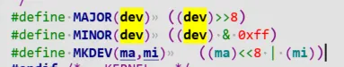
上面涉及到的API可以在函数`linux/fs/char_dev.c`中找到定义。

## 1.2 misc device方式

使用`misc_register`，在加载模块时会自动创建设备节点，为`主设备号为10`的字符设备。使用`misc_deregister`，在卸载模块时会自动删除设备节点。因此`无需调用cdev这一套框架`流程，无需调用`class_create`和`device_create`操作。`misc_register`时会自行调用了 `class_create()`, `device_create()` 因此`/sys/class/misc`类会被创建， `/dev/`下的设备节点也会自动创建。  
`/proc/misc`记录了系统中所有加载的misc设备：  
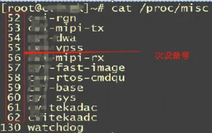
点击查看代码
```c
#include <linux/miscdevice.h>  
#include <linux/delay.h>  
#include <asm/irq.h>  
#include <linux/kernel.h>  
#include <linux/module.h>  
#include <linux/init.h>  
#include <linux/mm.h>  
#include <linux/fs.h>  
#include <linux/types.h>  
#include <linux/delay.h>  
#include <linux/moduleparam.h>  
#include <linux/slab.h>  
#include <linux/errno.h>  
#include <linux/ioctl.h>  
#include <linux/cdev.h>  
#include <linux/string.h>  
#include <linux/list.h>  
#include <linux/pci.h>  
#include <asm/uaccess.h>  
#include <asm/atomic.h>  
#include <asm/unistd.h>  
struct led_dev {  
	struct miscdevice miscdev;  
	void *data;  
}  
struct led_dev my_led;  
static int leds_ioctl(struct inode *inode, struct file *filp, unsigned int cmd, unsigned long arg){  
	return 0;  
}  
static int leds_open(struct inode *inode, struct file *filp){  
	//filp->private_data = &my_led;  
	return 0;  
}  
static int leds_release(struct inode *inode, struct file *filp){  
	return 0;  
}  
static ssize_t leds_read(struct file *filp, char __user *buf, size_t count, loff_t *f_pos){  
	  return 1;  
}  
  
static struct file_operations leds_fops ={  
	.owner   = THIS_MODULE,  
	.read    = leds_read,  
	.ioctl   = leds_ioctl,  
	.open    = leds_open,  
	.release = leds_release  
};  
static int __init dev_init(void){  
	struct miscdevice *miscdev = &my_led.miscdev;  
	miscdev->minor = MISC_DYNAMIC_MINOR,  
	miscdev->name = "misc_leds",  
	miscdev->fops = &leds_fops,  
	miscdev->parent = NULL;  
	int ret = misc_register(miscdev);  
	return ret;  
}  
static void __exit dev_exit(void){  
	misc_deregister(&my_led.miscdev);  
}  
module_init(dev_init);  
module_exit(dev_exit);  
MODULE_LICENSE("GPL");
```

# 2 misc杂项设备解析

源代码位置`driver/char/misc.c`，主设备号固定为10，所有的`miscdevice`设备形成了一个链表，对设备访问时内核根据次设备号查找对应的miscdevice设备，然后调用其`file_operations`结构中注册的文件操作接口进行操作。

## 2.1 misc_init过程

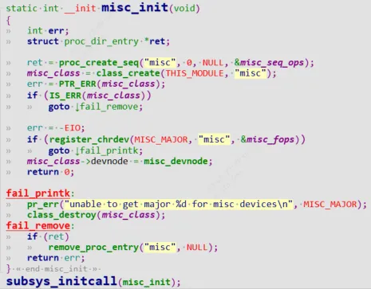
misc子系统的初始化是利用`subsys_initcall`进行子系统初始化，首先创建`/proc/misc`条目，对应`cat /proc/misc`可以看到所有misc设备信息，`cat /proc/misc`于是就会调用`misc_seq_ops`中的`misc_seq_show`函数，可以看到刚好为misc设备的次设备号和名字信息。  
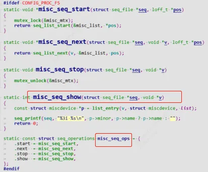
主设备号固定为10，调用`class_create`创建`/sys/class/misc`, 调用`register_chrdev`注册字符设备，添加`file_operations`。(`register_chrdev`如果传入主设备号，则静态注册，否则动态注册返回主设备号)  
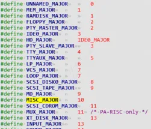

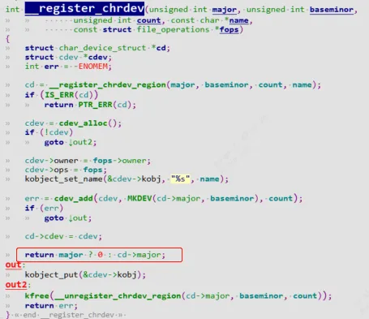
## 2.2 misc设备注册misc_register过程

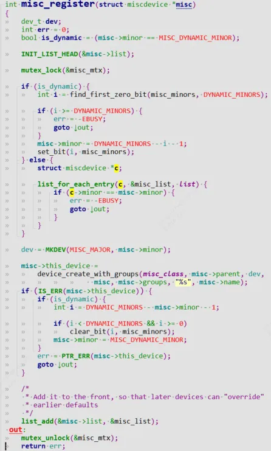
`MISC_DYNAMIC_MINOR = 255`，使用者调用`misc_register`时一般会次设备号传入`MISC_DYNAMIC_MINOR`，那么会自动分配次设备号；否则遍历`misc_list`链表，看这个次设备号以前有没有被用过，如果次设备号已被占有则退出返回-EBUSY。  
得到这个次设备号后`set_bit(i, misc_minors);`设置位图中相应位为1。`device_create_with_groups`等同于`device_create`创建设备节点。  
最后将list节点添加到`misc_list`链表中。  
`cat /sys/class`可以看到所有驱动中调用`class_creat()`函数的模块，`cat /sys/class/misc`则可以看到所有misc杂项驱动模块。`ls /dev/*`可以看到对应的设备节点  
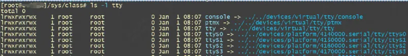
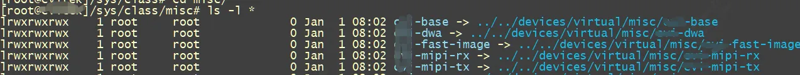
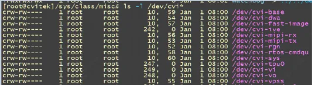
## 2.3 misc设备卸载过程

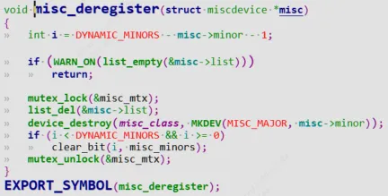
从`misc_list链表`中删除节点list, 然后删除设备节点。释放位图相应位清0，以便次设备号留给下一个模块使用。

## 2.4 misc设备打开过程

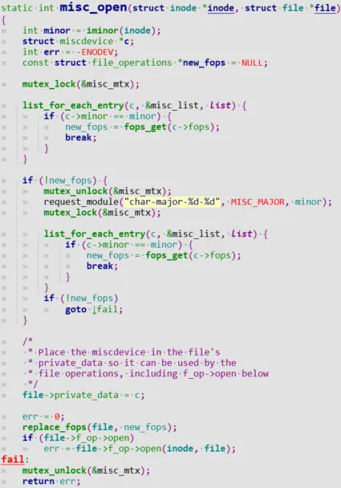
1. 当用户调用`open("/dev/xxx")`时，由于misc设备主设备号都为10，那么会统一进入到`misc_open`，那么会根据次设备号来区分不同的misc设备，首先`iminor(inode)`取出次设备号，`i_rdev`是对应具体misc设备的`设备号dev_t`。  
    
2. 然后遍历`misc_list`链表，找到与`minor次设备号`相匹配的`misc device`，找到后将`file_operations(简称fops)`暂存到`new_fops`。如果匹配不到，则请求加载这个次设备号对应的模块。`request_module`表示让linux系统的用户空间调用`/sbin/modprobe`函数加载名为`char-major-%d-%d`的模块。  
    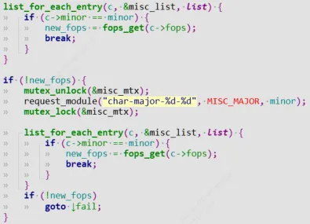
    匹配成功后`file->private_data = c;`表示将链表中匹配出的`miscdevice`作为`file->private_data`(后面会介绍作用)
```c
/*  
* Place the miscdevice in the file's  
* private_data so it can be used by the  
* file operations, including f_op->open below  
*/  
file->private_data = c;
```

最后将暂存的`new_fops`赋值给`file->f_op`，调用具体的misc模块的fops：
```c
file->f_op->open(inode, file)；
```

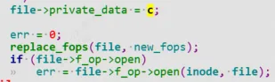
# 3 如何从fops中获取模块设备信息

## 3.1 引入
```c
struct xxx_dev {  
	struct miscdevice miscdev;  
	void *data;  
};  
  
static long dwa_ioctl(struct file *filp, unsigned int cmd, unsigned long arg)  
{  
	struct xxx_dev *m = container_of(filp->private_data, struct xxx_dev, miscdev);  
	...  
	return 0;  
}  
static int __init xxx_init(void) {  
	struct xxx_dev *m;  
	...  
}
```

### 3.1.1 方法1：（对于misc设备）

可以看到如果我们想要重file_oprations获取设备入口，可以通过如下方式：
```c
struct xxx_dev *m = container_of(filp->private_data, struct xxx_dev, miscdev);
```

前面2.4讲过了匹配成功后`file->private_data = c;`表示将链表中匹配出的`miscdevice`作为`file->private_data`.

### 3.1.2 方法2：（对于cdev设备）
```c
struct xxx_dev {  
	struct cdev cdev;  
	void *data;  
};  
int xxx_open(struct inode *inode, struct file *file)  
{  
	int ret = 0;  
	struct xxx_dev *m;  
	m = container_of(inode->i_cdev, struct xxx_dev, cdev);  
}
```

`inode`的`i_cdev`指向的即为`cdev`结构体。调用`container_of`即可获取设备信息。

### 3.1.3方法3：xxx_open中保存设备信息
```c
struct xxx_dev {  
	struct cdev cdev;  
	void *data;  
	struct resource* res;  
};  
struct xxx_dev *m;  
static long keyscan_ioctl(struct file *file, unsigned int cmd,  
			  unsigned long arg)  
{  
	struct xxx_dev *m = file->private_data;  
	uint32_t res_size = (uint32_t)resource_size(m->res);  
}  
int xxx_open(struct inode *inode, struct file *file)  
{  
	file->private_data = m;  
}
```

`file->private_data = m`保存设备信息。
