# 1 pinctrl和gpio 子系统简介
Linux 驱动讲究驱动分离与分层，pinctrl 和 gpio 子系统就是驱动分离与分层思想下的产物。  
pinctrl子系统用来配置引脚mux复用信息，引脚电器属性（比如上/下拉、速度、驱动能力等）信息。  
gpio子系统控制gpio的输入输出，以及高低电平。不过，大多数的芯片并没有单独的IOMUX模块，引脚的复用、配置等，而是在GPIO模块内部实现的。  
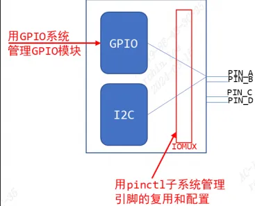
# 2 pinctrl子系统原理介绍

## 2.1 pinctrl子系统

### 2.1.1 pinctrl子系统软件架构

pinctrl子系统源码路径是`linux/drivers/pinctrl`：  
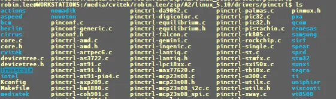
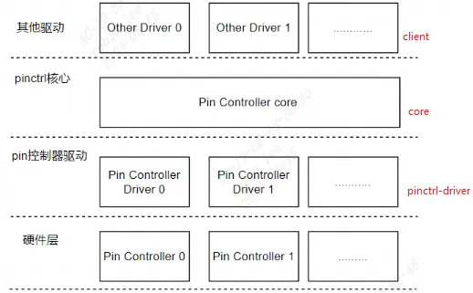

- 其他驱动层（client）：使用系统pin资源的设备驱动程序  
- pinctrl核心层(core)：内核抽象出来，向下为SoC pin controler drvier提供底层通信接口的能力，向上为其他驱动提供了控制pin的能力，比如pin复用、配置引脚的电气特性，同时也为GPIO子系统提供pin操作。  
- pin控制器驱动层(pinctrl-driver)： 提供了操作pin的具体方法。

`pinctrl-driver`主要为`pinctrl-core`提供pin的操作能力。把系统所有的pin以及对于pin的控制接口实例化成`pinctrl_desc`，并将`pinctrl_desc`注册到`pinctrl-core`中去。

### 2.1.2 Pinctrl重要概念

`Documentation\devicetree\bindings\pinctrl\pinctrl-bindings.txt`有介绍重要相关概念：

**1. client device：**  
“客户设备”即使用Pinctrl系统的设备。
```c
/* For a client device requiring named states */
device {
	pinctrl-names = "default", "sleep";
	pinctrl-0 = <&state_0_node_a>;
	pinctrl-1 = <&state_1_node_a>, <&state_1_node_b>;
};
```
- **pin state**  
	对于一个`"client device"`，它有多个`“状态”`：`default、sleep`等。
	比如，默认状态下，UART设备正常工作，那么所用的引脚就要复用为UART功能；  
	休眠状态下，为了省电，可以把这些引脚复用为GPIO功能；或者直接把它们配置输出高电平。
	
	上图`pinctrl-names`定义2种状态：`default，sleep`。  
	`default`状态在`pinctrl-0`中定义，引用了位于`pincontroller`节点中的节点`state_0_node_a`。  
	`sleep`状态在`Pinctrl-1`中定义，引用了位于`pincontroller`节点中的节点`state_1_node_a`和`state_1_node_b`。

**2. pin controller：**  
芯片手册里找不到 `pin controller`，它是一个软件上的概念。对应 IOMUX，用来复用引脚，配置引脚电气特性(比如上下拉电阻，频率等)。
- **groups和function**  
		多个引脚组合可以分为不同`group`，每个`function`可以组合不同的`group`，每个`group`也可以被不同的`function`引用进行组合。 
        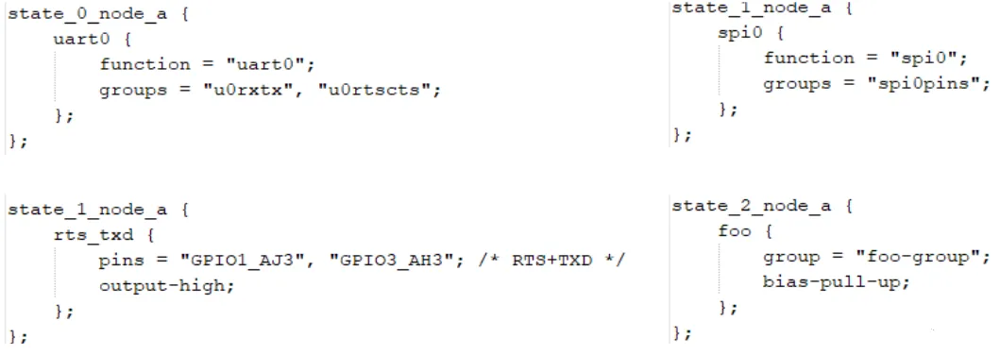
- **Generic pin multiplexing node和Generic pin configuration node**  
        在`pin controller`设备树节点中，有子节点或孙节点，它们是给`client device`引用的。  
        可用来描述复用信息：哪组`（group）`引脚复用为哪个功能`（function）`；  
        配置信息：`哪组（group）`引脚配置为哪个设置功能（`setting`），如上拉、下拉等；

上面仅为概念介绍，pin controller 驱动对应的设备树节点并无统一定义，但基本都有以上分区和功能设置的概念。client device 驱动对应的节点属性通常是固定的，具体示例如下：
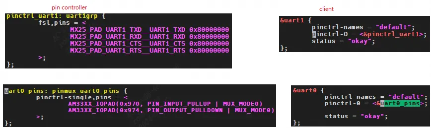


### 2.1.3 pinctrl 子系统注册流程

以imx6ull为例，`drivers/pinctrl/freescale/pinctrl-imx6ul.c` 。
驱动的入口是 `arch_initcall` 中声明的函数，类似于我们经常写的 `module_init`是动态ko加载，`arch_initcall`是编译进入内核镜像。
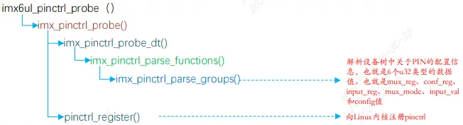
根据 `compatible` 和`设备树的compatible` 字段进行匹配，匹配成功执行 probe 函数，调用`imx_pinctrl_probe_dt`解析dts中的`pinctrl`描述信息。调用`pinctrl_register`或者`devm_pinctrl_register`注册pinctl子系统。

# 3 soc pinctrl主要结构体（controller）
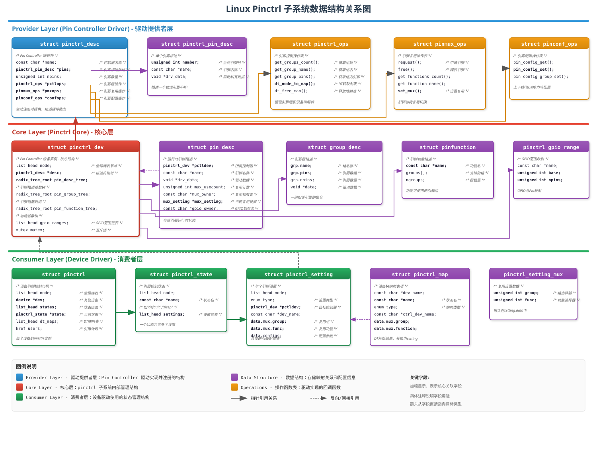
## 3.0 数据结构关系图

总框图记录数据结构之间的关联。  
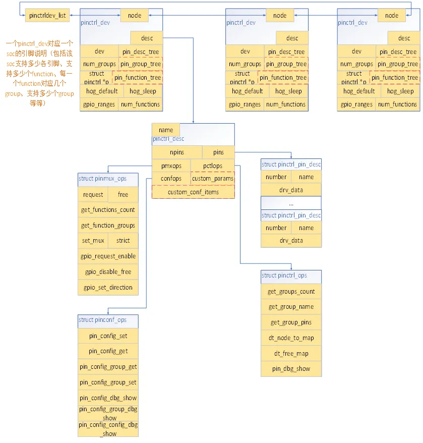
```c
//pincontroller数据结构  
drivers\pinctrl\core.h  
include\linux\pinctrl\pinctrl.h  
include\linux\pinctrl\pinmux.h  
include\linux\pinctrl\pinconf.h  
//client数据结构  
drivers\pinctrl\core.h  
include\linux\pinctrl\devinfo.h  
include\linux\device.h  
include\linux\pinctrl\machine.h
```

## 3.1 pinctrl_dev

`pinctrl_dev` 是 pinctrl 子系统的根源结构体。
```c
struct pinctrl_dev {  
	struct list_head node;  
	struct pinctrl_desc *desc; //提供具体操作方法和抽象包括pincrtl_ops函数，pinmux操作函数和pin的描述等  
	struct radix_tree_root pin_desc_tree;  
#ifdef CONFIG_GENERIC_PINCTRL_GROUPS  
	struct radix_tree_root pin_group_tree;//存储group的描述信息  
	unsigned int num_groups;  
#endif  
#ifdef CONFIG_GENERIC_PINMUX_FUNCTIONS  
	struct radix_tree_root pin_function_tree;//存储function的描述信息  
	unsigned int num_functions;  
#endif  
	struct list_head gpio_ranges;//链接gpio range 2 pin range相关的信息  
	struct device *dev;  
	struct module *owner;  
	void *driver_data;  
	struct pinctrl *p;//每个pinctrl都描述着一组gpio的复用和状态配置，  
    	//如果这个pinctrl_dev是一个通过iic连接的，那么使用这个pinctrl_dev  
    	//就需要配置其占用的gpio为iic功能，那么就要用这个来描述  
	struct pinctrl_state *hog_default;  
	struct pinctrl_state *hog_sleep;  
	struct mutex mutex;  
#ifdef CONFIG_DEBUG_FS  
	struct dentry *device_root;  
#endif  
}
```

`/driver/pinctrl/core.c`中注册pinctrl时将soc中所有的`pinctrl_dev`挂载到`pinctrl_dev_list`链表中方便查询使用。
```c
struct pinctrl_dev *pinctrl_register(struct pinctrl_desc *pctldesc,  
								 struct device *dev, void *driver_data);
```

## 3.2 pinctrl_desc
```c
struct pinctrl_desc {  
   const char *name;  
   const struct pinctrl_pin_desc *pins;   //描述一个pin控制器的引脚,  
   unsigned int npins;                    //描述该控制器有多少个引脚  
   const struct pinctrl_ops *pctlops;     //引脚操作函数，有描述引脚，获取引脚等  
   const struct pinmux_ops *pmxops;       //引脚复用相关的操作函数  
   const struct pinconf_ops *confops;     //引脚配置相关的操作函数  
   struct module *owner;  
#ifdef CONFIG_GENERIC_PINCONF  
   unsigned int num_custom_params;  
   const struct pinconf_generic_params *custom_params;  
   const struct pin_config_item *custom_conf_items;  
#endif  
};
```

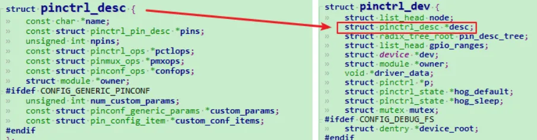
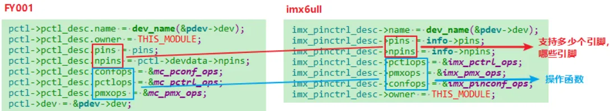
三个ops:

1. `group`操作接口对应数据结构`struct pinctrl_ops`，`pinctrl_ops->dt_node_to_map()`实现`device_node`到`pinctl_map`的转换；
    
2. `mux`操作接口对应的数据结构为`struct pinmux_ops`，包含`pin request`、`free`、`set_mux`、`get_functions_count`、`get_function_groups`等；
    
3. `function`操作接口对应的数据结构为`struct pinconf_ops`，包含`pin_config_set`、`pin_config_get`、`pin_config_group_get`、`pin_config_group_set`等接口；

### 3.2.1 pinctrl_pin_desc
`pinctrl_pin_desc`来描述一个引脚.
```c
struct pinctrl_pin_desc {  
	unsigned number;//引脚序号  
	const char *name;//引脚名  
	void *drv_data;  
};
```

### 3.2.2 pin_desc
```c
struct pin_desc {  
	struct pinctrl_dev *pctldev;  
	const char *name;  
	bool dynamic_name;  
	void *drv_data;  
	/* These fields only added when supporting pinmux drivers */  
#ifdef CONFIG_PINMUX  
	unsigned mux_usecount;  
	const char *mux_owner;  
	const struct pinctrl_setting_mux *mux_setting;  
	const char *gpio_owner;  
#endif  
};
```

记录引脚的使用计数、引脚当前所属的`function、group`信息（该数据结构主要是pinctrl子系统用于判断一个引脚是否被多次配置不同的复用情况使用（`pin_request、pin_free`）

# 4 board pinctrl相关结构体(使用者client)

## 4.0 数据结构关系

前面Soc pin描述相关的数据结构，已经搭建了该soc所支持的`pin`、`function`、`group`以及相关操作接口等信息；而`board pin`描述相关的数据结构则描述一块board所使用到的`function`及相关的`group`：  
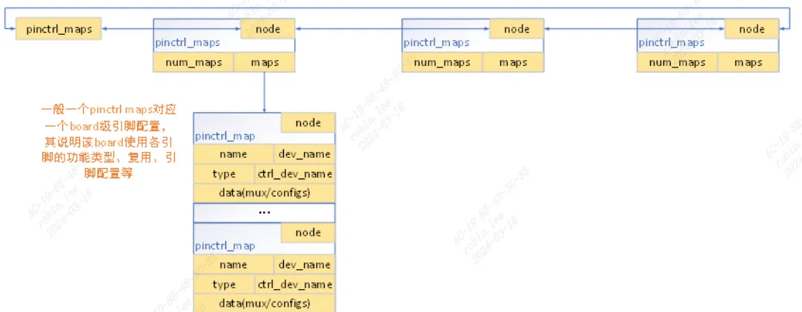
## 4.1 pinctrl_map
```c
struct pinctrl_map {  
	const char *dev_name;//设备名称  
	const char *name;//该pinctrl_map对应的状态（default、idle、sleep等  
	enum pinctrl_map_type type;//pinctrl_map的类型，包括mux group、config group、config pins等  
	const char *ctrl_dev_name;//pinctrl device的名称，根据该名称可获取到soc pin controller对应的pinctrl device  
	union {  
		struct pinctrl_map_mux mux;//引脚复用的内容，该数据结构中包含function名称、group名称，  
        //通过function、group就可以确定进行引脚复用的引脚id与引脚复用值等信息；  
		struct pinctrl_map_configs configs;//引脚配置相关的内容，包括group或者pin的名称，  
        //以及该group、pin的配置信息，实现引脚配置操作。  
	} data;  
};
```

该数据结构可以理解为一个function类型：

## 4.2 dev_pin_info

device结构体中有一个`dev_pin_info`，用来保存设备的pinctrl信息：  
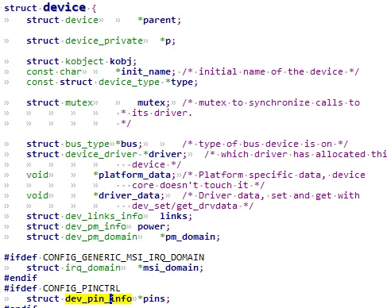
```c
struct dev_pin_info {    //该device对应引脚的配置与复用信息  
	struct pinctrl *p;//该设备支持引脚配置类型（包括支持的pinctrl状态，  
    	//每一种pinctrl状态下的引脚复用以及引脚配置信息）  
	struct pinctrl_state *default_state;  
	struct pinctrl_state *init_state;  
#ifdef CONFIG_PM  
	struct pinctrl_state *sleep_state;  
	struct pinctrl_state *idle_state;  
#endif  
};
```

### 4.2.1 pinctrl

一个设备的所有引脚配置相关的信息:
```c
struct pinctrl {  
	struct list_head node;  
	struct device *dev;  
	struct list_head states;  
	struct pinctrl_state *state;//states下链接了该设备支持的所有引脚配置状态  
	struct list_head dt_maps;  
	struct kref users;  
};
```

##### 4.2.1.1 pinctrl_state
```c
struct pinctrl_state {  
	struct list_head node;  
	const char *name;  
	struct list_head settings;  
};
```

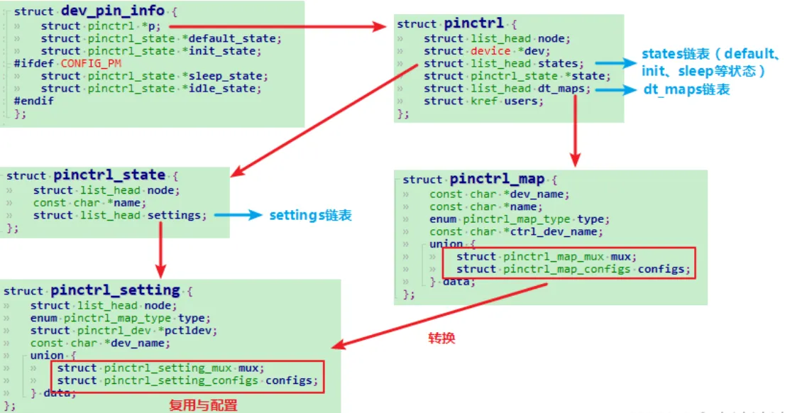
# 5 pinctrl实例化示例

## 5.1 pin controller示例

打开imx6ull的dtsi找到`pin controller`控制器节点，对比IMX6ULL参考手册可知：`imx6ull一共3个IOMUX控制器`：  
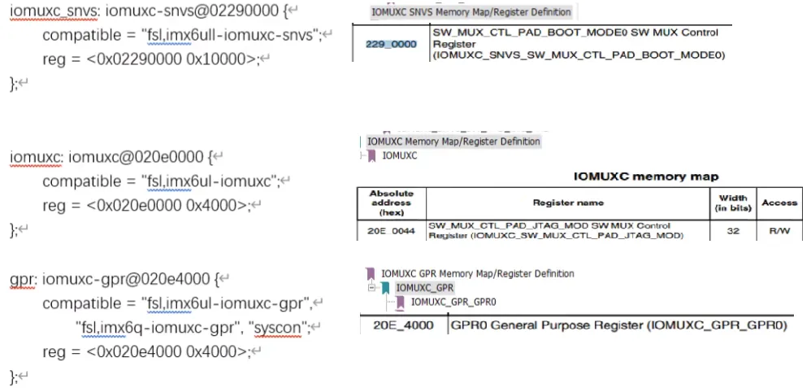

以`evk`公板为例：  
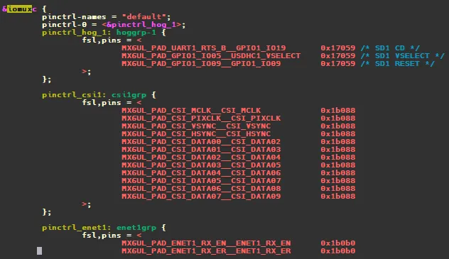
**imx6ull pinmux dts配置描述：**  
```c
MX6UL_PAD_UART1_RTS_B__GPIO1_IO19       0x17059 /* SD1 CD */
```

`UART1_RTS_B`复用成`GPIO1_IO19`:  
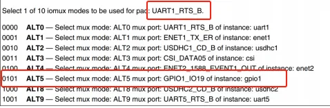
此宏定义在imx_6ull_pinfunc.h, 后面跟着 5 个数字，也就是这个宏定义的具体值，如下所示：加上DTS中的`0x17059`电器属性的值，每个引脚一共6个配置值。
```c
<mux_reg conf_reg input_reg mux_mode input_val>
0x0090 0x031C 0x0000 0x5 0x0
```

- 0x0090表示`UART1_RTS_B`的iomux寄存器  
- 0x031C表示`UART1_RTS_B`的电器属性寄存器  
- 0x0000表示`input寄存器`  
- 0x5表示复用成模式5  
- 0x0表示input寄存器设置值为0x0

### 5.1.1 client如何使用pinctrl

每个client device结构体中包含device结构体，每个device结构体里都有一个`dev_pin_info`结构体，用来保存设备的pinctrl信息。`platform_device`匹配driver会执行probe，probe前会进行pinctrl处理，处理函数为`pinctrl_bind_pins`：
```c
platform_device_register  
	platform_device_add  
		device_add  
			bus_probe_device;  
				device_initial_probe  
					__device_attach  
						bus_for_each_drv(dev->bus, NULL, &data, __device_attach_driver);  
						// 对于plarform_bus_type下的每一个driver, 调用__device_attach_driver  
  
__device_attach_driver  
	driver_match_device(drv, dev);  
		drv->bus->match(dev, drv)// 调用platform_bus_type.match  
			driver_probe_device  
				really_probe  
				/* If using pinctrl, bind pins now before probing */  
					pinctrl_bind_pins  
					drv->probe //执行driver中的probe函数
```

### 5.1.2 pinctrl_bind_pins过程

- 构造`pinctrl`
    - 通过`pinctrl_ops.dt_node_to_map`将设备树节点转换成一系列`pinctrl_map`
    - `pinctrl_map`转换成`pinctrl_setting`，放入settings链表，记录在`pinctrl_state`中
- 选择`state`，遍历settings链表，进行pinctrl的mux和config  
    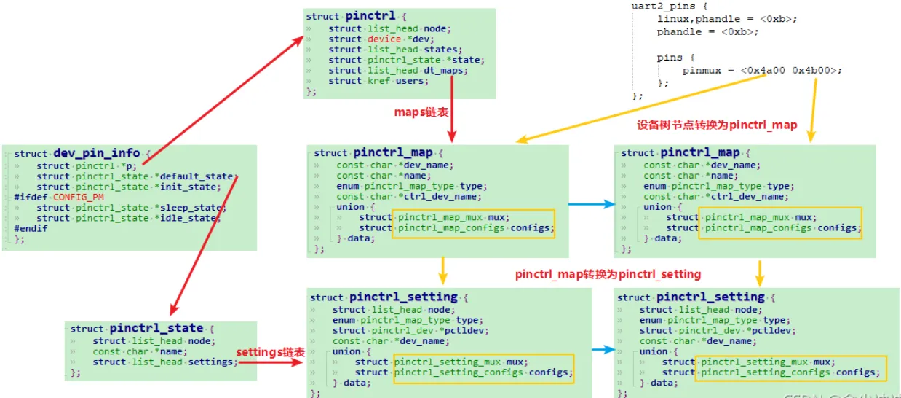
函数调用过程：
```c
pinctrl_bind_pins  
	/* 分配dev_pin_info结构体 */  
	devm_kzalloc(dev, sizeof(*(dev->pins)), GFP_KERNEL);  
	/* 分配并构建pinctrl */  
	devm_pinctrl_get(dev);  
		pinctrl_get  
			/* 构建pinctrl */  
			create_pinctrl(dev);  
				/* 分配pinctrl */  
				p = kzalloc(sizeof(*p), GFP_KERNEL);  
				/* 设备树节点转换为pinctrl_map */  
				pinctrl_dt_to_map(p);  
				/* 每个pinctrl_map，又被转换为一个pinctrl_setting，添加到setting链表 */  
				for_each_maps(maps_node, i, map) {  
					ret = add_setting(p, map);  
				}
```

**节点转换为pinctrl_map过程**：

```c
pinctrl_dt_to_map(p);  
	for (state = 0; ; state++) {  
		propname = kasprintf(GFP_KERNEL, "pinctrl-%d", state);  
	    /* 取出pinctrl-%d节点属性 */  
	   	prop = of_find_property(np, propname, &size);  
	    list = prop->value;  
		size /= sizeof(*list);  
	   	/* 对pinctrl-%d中的每一个phandle进行pinctrl_map转换 */  
	    /* 例如pinctrl-0 = <&state_0_node_a &state_0_node_b>有两个phandle */  
	    for (config = 0; config < size; config++) {  
	    	/* 根据phandle找到对应节点 */  
	       	np_config = of_find_node_by_phandle(phandle);  
	        /* Parse the node */  
			dt_to_map_one_config(p, statename, np_config);  
	           	/* 调用Pincontroller中dt_node_to_map函数,构造pinctrl_map */  
	       		ops->dt_node_to_map()  
	            /* 将pinctrl_map添加到maps链表 */  
	            dt_remember_or_free_map  
	            	pinctrl_register_map  
	                	list_add_tail  
		}  
	}  
   
/* dt_node_to_map函数示例 */  
mc_pctrl_dt_node_to_map()  
	/* 取出每一个子节点 */  
    for_each_child_of_node(np_config, np) {  
   		mc_pctrl_dt_subnode_to_map  
   			/* 获取设备树pinmux属性 */  
        	pins = of_find_property(node, "pinmux", NULL);  
    		num_pins = pins->length / sizeof(u32);  
    		for (i = 0; i < num_pins; i++) {  
            	of_property_read_u32_index(node, "pinmux",i, &pinfunc);   
                /* 解析设备树，将pinmux属性中每一个成员记录在pin和func中 */  
                pin = MC_GET_PIN_NO(pinfunc);  
				func = MC_GET_PIN_FUNC(pinfunc);  
                /* 设置复用的pinctrl_map */  
                mc_pctrl_dt_node_to_map_func();  
                	(*map)[*num_maps].type = PIN_MAP_TYPE_MUX_GROUP;  
					(*map)[*num_maps].data.mux.group = grp->name;  
                	(*map)[*num_maps].data.mux.function = mc_gpio_functions[fnum];  
					(*num_maps)++;  
              	if (has_config) {  
                    /* 设置配置pinctrl_map，fy00没有配置pinctrl_map */  
                    pinctrl_utils_add_map_configs  
                        (*map)[*num_maps].type = type;  
                        (*map)[*num_maps].data.configs.group_or_pin = group;  
                        (*map)[*num_maps].data.configs.configs = dup_configs;  
                        (*map)[*num_maps].data.configs.num_configs = num_configs;  
                        (*num_maps)++;  
                }  
            }  
		}
```

**pinctrl_map转换为pinctrl_setting过程**：
```c
for_each_maps() {  
	add_setting();  
		find_state();  
		if (!state)  
			/* 第一次添加state到states链表 */  
			create_state(p, map->name);  
				list_add_tail(&state->node, &p->states);  
		/* 将map的name和tpye赋值给setting */  
		setting->type = map->type;  
		setting->dev_name = map->dev_name;  
		switch (map->type) {  
			/* MUX类型 */  
			case PIN_MAP_TYPE_MUX_GROUP:  
				pinmux_map_to_setting(map, setting);  
					/* 将pinctrl_map中的function字符串转换为序号，赋值给setting*/  
					pinmux_func_name_to_selector(pctldev, map->data.mux.function);  
					setting->data.mux.func = ret;  
					/* 将pinctrl_map中的group字符串转换为序号，赋值给setting */  
					ret = pinctrl_get_group_selector(pctldev, group);  
					setting->data.mux.group = ret;  
			/* CONFIGS类型 */  
			case PIN_MAP_TYPE_CONFIGS_PIN:  
			case PIN_MAP_TYPE_CONFIGS_GROUP:  
				pinconf_map_to_setting(map, setting);  
					/* 从pinctrl_map取出pin或group赋值给setting */  
					setting->data.configs.group_or_pin = pin;  
					/* 将pinctrl_map的configs赋值给setting */  
					setting->data.configs.num_configs = map->data.configs.num_configs;  
					setting->data.configs.configs = map->data.configs.configs;  
			}  
			/* 添加到settings链表 */  
			list_add_tail(&setting->node, &state->settings);  
}
```

**pin脚的复用和配置过程**：
```c
pinctrl_bind_pins  
	/* 寻找state */  
	pinctrl_lookup_state  
	/* 选择state */  
	pinctrl_select_state  
		pinctrl_commit_state  
			/* 遍历settings链表 */  
        	list_for_each_entry(setting, &state->settings, node) {  
                switch (setting->type) {  
                	case PIN_MAP_TYPE_MUX_GROUP:  
                		/* 设置复用 */  
                   		pinmux_enable_setting(setting);  
                        	ops->set_mux(...);  
                    case PIN_MAP_TYPE_CONFIGS_PIN:  
					case PIN_MAP_TYPE_CONFIGS_GROUP:  
						/* 设置配置 */  
						pinconf_apply_setting(setting);  
							ops->pin_config_group_set(...);  
           }
```
