# 1 总线/设备/驱动模型

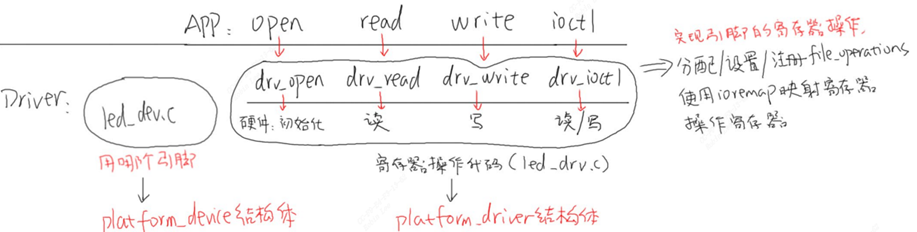
设备定义`platform_device`结构体，注册设备资源

驱动定义`platform_driver`结构体，实现`probe, file_operations`

总线驱动模型优点：
	驱动只是一套控制驱动框架，基本不用修改，和单板硬件相关的都在设备代码里面，硬件修改只需要修改设备资源相关的代码，不用关心具体的函数实现和寄存器控制。

## 1.1 总线/平台设备/平台驱动描述

### 1.1.1 struct bus_type

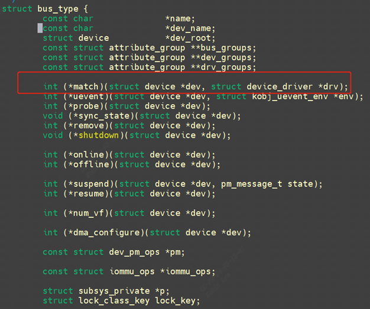
有一个很关键的函数，`match`函数。当设备与设备枚举过程中match函数会按照规则进行匹配,规则见`1.3.1`。

### 1.1.2 struct platform_driver

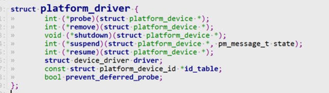
### 1.1.3 struct platform_device

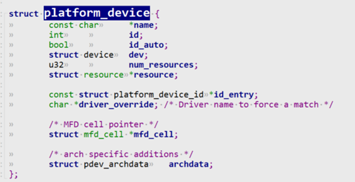
### 1.1.4 总线/设备/驱动三者关系

1. 系统启动后，会调用`buses_init()`函数创建`/sys/bus`文件目录。
2. 接下来就是通过总线注册函数`bus_register()`进行总线注册，注册完成后，在`/sys/bus`目录下生成device文件夹和driver文件夹。
3. 最后分别通过`device_register()`和`driver_register()`函数注册对应的设备和驱动。  
    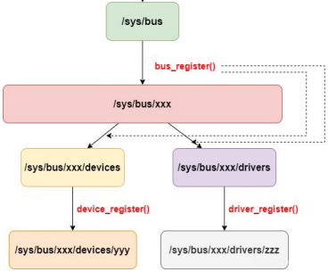    

## 1.2 platform_device的注册过程

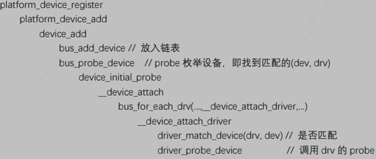
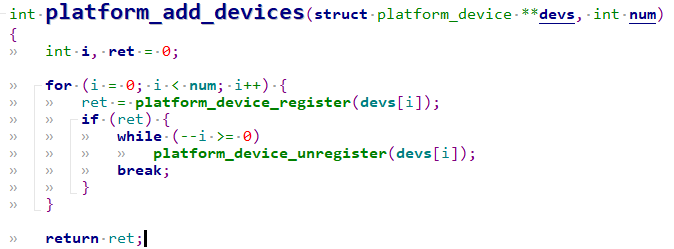
1. 系统初始化时，调用`platform_add_devices`函数，把所有放置在板级`platform_device`数组中的`platform_device`注册到系统中去。
- 1.1 此函数循环调用`platform_device_register`函数，来注册每个`platform_device`。
- 1.2 而`platform_device_register`中会调用`platform_device_add`函数。

2. `platform_device`全部注册到系统之后，便可以通过`platform`的操作接口，来获取`platform_device`中的resource资源。
- 2.1 比如地址、中断号等，以进行`request_mem_region`、`ioremap`（将resource分配的物理地址映射到kernel的虚拟空间来）和`request_irq`操作。
- 2.2 `platform`的操作接口包括`platform_get_irq`、`platform_get_irq_byname`、`platform_get_resource`、`platform_get_resource_byname`等。

## 1.3 platform_driver的注册过程

当`insmod`设备驱动的时候会透过`module_init`调用, 过程如下：
```c
platform_driver_register()  
	driver_register()  
		bus_add_driver//加入driver链表  
			driver_attach()  
				bus_for_each_dev()  
					__driver_attach()  
						driver_match_device//drvier匹配device成功调用driver的probe  
							platform_match  
    					driver_probe_device//drvier匹配device成功调用driver的probe  
    						drv->probe(dev);
```

### 1.3.1 device和driver的匹配过程

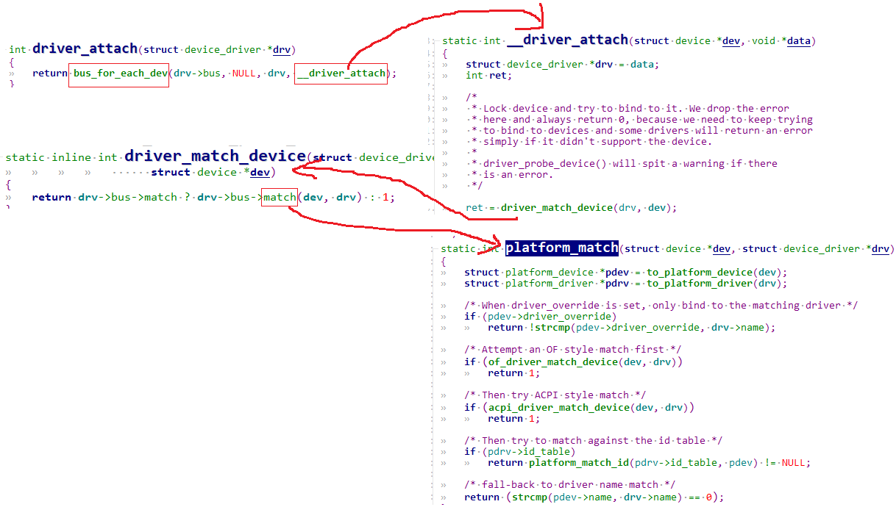
#### 1.3.1.1 device和driver的匹配优先级顺序

一个驱动是可以匹配多个设备的，平台总线中的驱动要具有三种匹配信息的能力，基于这种需求，`platform_driver`中使用不同的成员来进行相应的匹配。系统为platform总线定义了一个`bus_type 的实例platform_bus_type`, 会不断循环呼叫`platform_match函数`去遍历所有设备和驱动:

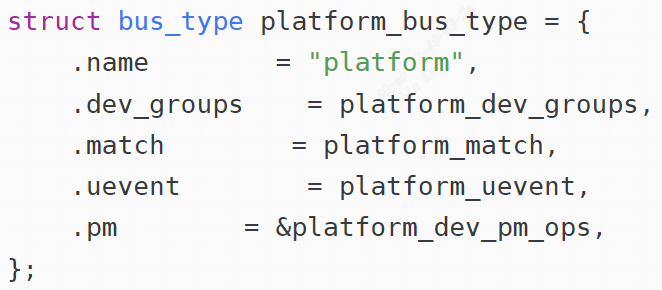
匹配优先级顺序实现位于`drivers/base/platform.c`的platform_match函数，下面按照优先级由高到底的匹配顺序介绍：

##### 1.3.1.1.1 of_match_table

`of_match_table`就是从dts中对应node的`compatible属性`去匹配设备和驱动。

`compatible`属性也叫做`“兼容性”`属性，是一个字符串列表, 格式如下所示:

“manufacturer,model”

`manufacturrer`表示厂商，`model`表示驱动名字，该属性用于将设备和驱动绑定起来。

`platform_device.dev.of_node` 和 `platform_driver.driver.of_match_table`介绍：

由设备树节点转换得来的 `platform_device` 中，含有一个结构体：`of_node`。 它的类型如下：

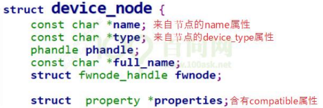
`platform_driver.driver.of_match_table` 类型如下：

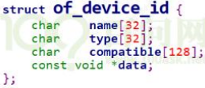
一般驱动程序都会有一个`of_match_table`匹配表，此`of_match_table`匹配表保存着一些`compatible`值，如果dts中的`compatible`属性值和`of_match_table`匹配表中的有一个值相等，那么就表示设备可以使用这个驱动。

如下图dts定义了一个`mipi_rx: cif`节点:

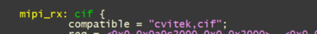
驱动程序中的定义如下：

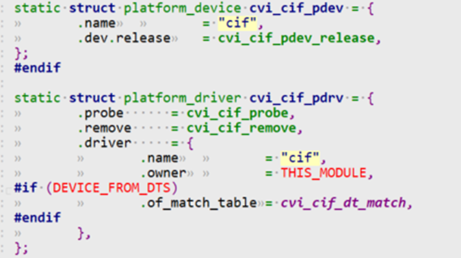
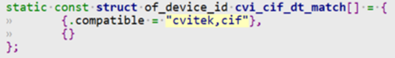
那么这里驱动程序中的`.of_match_table`和dts能够匹配，那么就说明`match`成功，匹配成功后调用`platform driver`的`probe`函数。一般在驱动程序`module int`的时候，也就是`insmod`的时候，会用`platform_driver_register`来进行match过程。

##### 1.3.1.1.2 ID table

下面这个例子就是用一个驱动来匹配两个分别叫`"demo0"`和`"demo1"`的设备，注意，数组最后的{}是一定要的，这个是内核判断数组已经结束的标志。

```c
static struct platform_device_id tbl[] = {  
        {"demo0"},  
        {"demo1"},  
        {},  
};
MODULE_DEVICE_TABLE(platform, tbl);
```

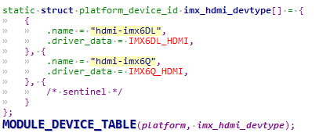
##### 1.3.1.1.3 name

假如前面两项匹配规则都不满足，那么最后可以是用name来匹配。例如：上面的`mipi_rx: cif`节点:


转换后就对应一个`platform_device`，`platform_device`中`.name= “cif”`,利用名字也能匹配上。

### 1.3.2 匹配成功后执行probe

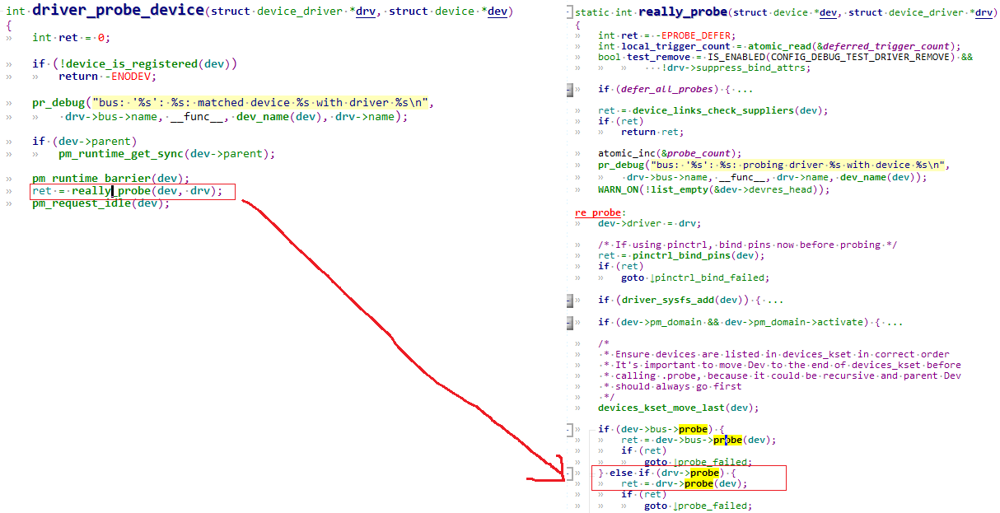
drvier匹配device成功调用driver的probe函数。一般平台设备都不需要驱动代码去定义，而是直接放入设备树作为设备树节点，内核启动后遍历设备树节点，将其转换成`platform_device`。

### 1.3.3 总结下`platform_driver`的注册执行过程

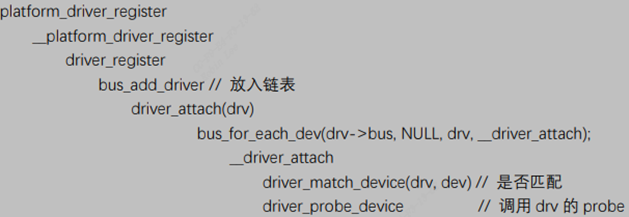
## 1.4 总结平台设备/平台驱动的注册过程

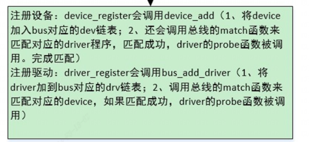
## 1.6 平台设备/平台驱动相关API

### 1.6.1 注册/反注册

```c
//\include\linux\platform_device.h  
platform_device_register/ platform_device_unregister  
platform_driver_register/ platform_driver_unregister  

platform_add_devices // 注册多个 device
```

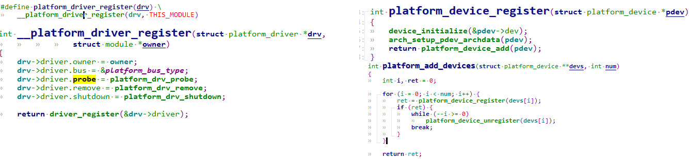
### 1.6.2 资源获取释放

#### 1.6.2.1 IO resource

```c
struct resource *platform_get_resource(struct platform_device *, unsigned int, unsigned int);
```

`kernel\include\linux\ioport.h`中有`resource结构`。用来描述hw设备的资源信息, `include\linux\ioport.h`:

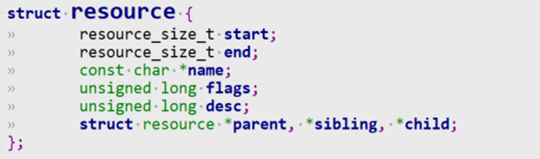
flags一般有以下几种：比如中断资源， IO端口资源， IO内存资源， DMA资源

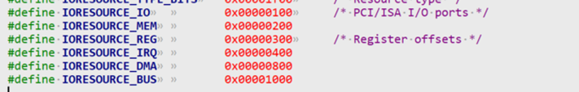
- `IORESOURCE_IO`：表示IO资源，cpu需要用特殊指令才能访问或需要用特殊访问方式才能访问,不能直接用指针来寻址
- `IORESOURCE_MEM`：表示IO内存，可以直接用指针引用来直接寻址操作

这里举个例子：

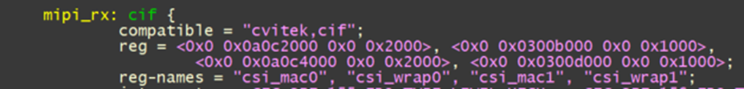
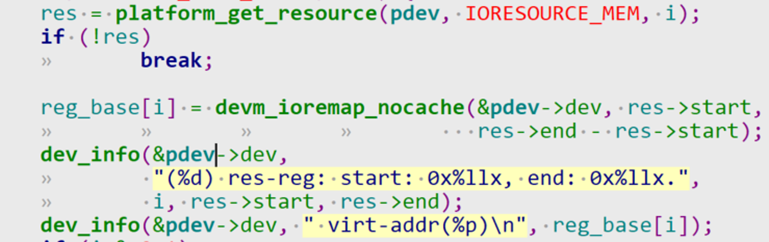
打印如下：那这里的`pdev`对应dts中的`mipi_rx`节点。`platform_get_resource`可以从dts `node`中找到io内存资源。

那这里循环获取4次，如下所示地址范围和上面的dts节点一致：

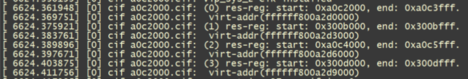
#### 1.6.2.2 IRQ

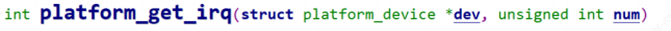
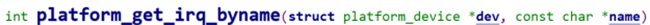
- IORESOURCE_IRQ: 中断irq资源

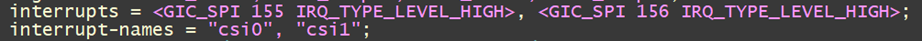
中断触发类型：

```c
//include\linux\platform_device.h  
#define IRQ_TYPE_EDGE_RISING 1     //上升沿触发  
#define IRQ_TYPE_EDGE_FALLING 2    //下降沿触发  
#define IRQ_TYPE_EDGE_BOTH (IRQ_TYPE_EDGE_FALLING | IRQ_TYPE_EDGE_RISING) // 双边沿触发  
#define IRQ_TYPE_LEVEL_HIGH 4    //电平触发-高电平
```

Dts中描述到了GIC相关基础知识。(`Generic Interrupt Controller`)是ARM公司提供的一个通用的中断控制器。

GIC **3要素**：

- - 中断类型
    - 中断号
    - 中断触发方式这三个要素

1. GIC的外设中断（除去SGI）类型有两类：

- - SPI，共享外设中断(由GIC内部的`distributor`来分发到相关CPU)，中断号：`32~1019`
    - PPI，私有外设中断(指定CPU接收)，中断号：`16~31`

2. 外设中断号的分配规则如下：

- - `32~1019`给SPI
    - `16~31`给PPI

3. 所有外设中断都支持四种触发方式:

- - 上升沿触发
    - 下降沿触发
    - 高电平触发
    - 低电平触发

所以DTS中接在GIC的`device node`的`interrupts`属性也是用这三个要素来描述一个具体的中断。

格式如：`interrupts = <interruptType interruptNumber triggerType>`

`sample code`如下:

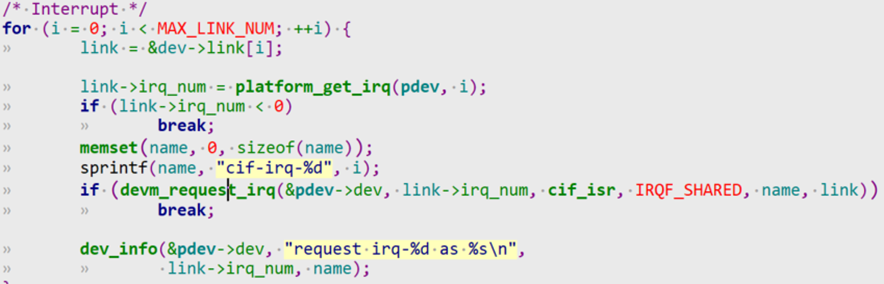
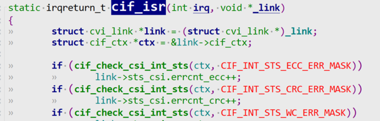
打印结果如下：

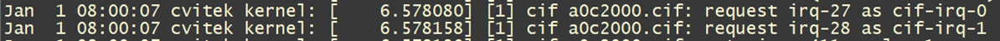
那么最后dts解析的结果为：

```c
out_irq->np = interrupt-parent = gic node  
out_irq->args[0] = GIC_SPI;  
out_irq->args[1] = 硬件中断号 = 155  
out_irq->args[2] = 中断触发类型 = IRQ_TYPE_LEVEL_HIGH  
  
out_irq->np = interrupt-parent = gic node  
out_irq->args[0] = GIC_SPI;  
out_irq->args[1] = 硬件中断号 = 156  
out_irq->args[2] = 中断触发类型 = IRQ_TYPE_LEVEL_HIGH
```

`platform_get_irq`返回一个虚拟中断号，这里对应的是`27， 28`.

`devm_request_irq`用来申请中断，分配`isr中断处理函数`。该函数可以在驱动卸载时不用主动调用`free_irq`显示释放中断请求。

可以看到两次call `devm_request_irq`却是用的同一个中断服务程序`cif_isr`，这也是允许的，我们看一下函数原型：

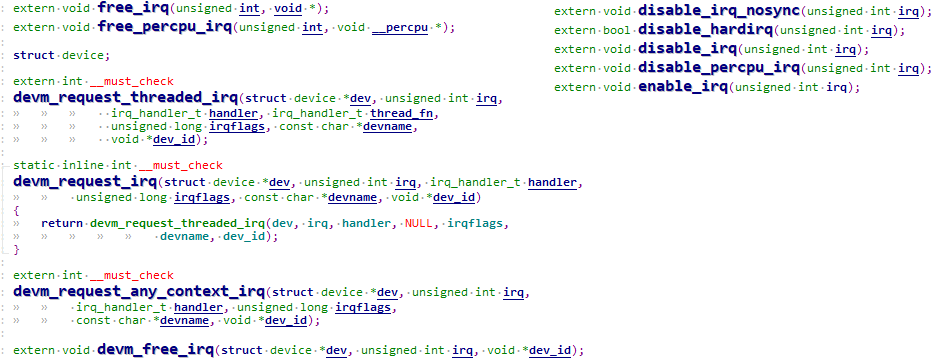
`devm_request_irq`会建立中断号`irq_num`和中断服务程序`isr`的绑定，最后一个参数会传给中断服务程序`isr`.

中断服务程序`isr`能够根据中断号`irq_num`和传进的参数进行区分中断源。

#### 1.6.2.3 GPIO

`of_get_named_gpio_flags`获取dts中`gpio` 编号，并且会找到`device_node`，找到`of_gpio_flags`。

`gpio_request`申请`gpio`

`gpio_direction_output`设置成`output`且`set gpio val`

```c
int of_get_named_gpio_flags(struct device_node *np, const char *list_name,  
			    int index, enum of_gpio_flags *flags);  
int gpio_request(unsigned gpio, const char *label);		      
static inline int gpio_direction_output(unsigned gpio, int value);  
//include\asm-generic\gpio.h  
//include\linux\gpio.h
```

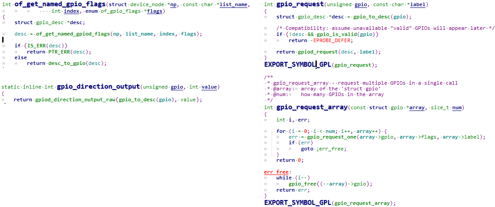
举个例子：


```c
#define GPIO_ACTIVE_HIGH 0  
#define GPIO_ACTIVE_LOW 1  
//include\linux\gpio\machine.h
```

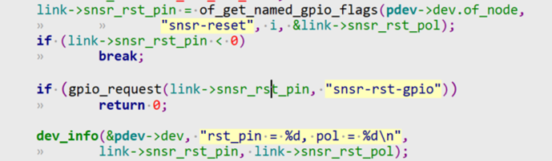
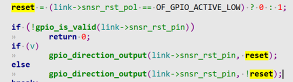
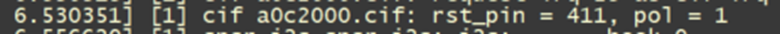
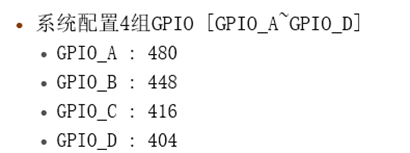
这里的`gpio 编号=411 = GPIO_D + offset = 404 + 7 =411`(也就是dts中配置的`portd 7`)，这里由于是`of_gpio_flags` 是`OF_GPIO_ACTIVE_LOW =0x01`，所以`snsr_rst_pol = 1`.

# 2 平台设备驱动示例

```c
#ifndef _LED_OPR_H  
#define _LED_OPR_H  
struct led_operations {  
        int (*init) (int which); /* 初始化LED, which-哪个LED */         
        int (*ctl) (int which, char status); /* 控制LED, which-哪个LED, status:1-亮,0-灭 */  
};  
struct led_operations *get_board_led_opr(void);  
#endif 
```

①分配/设置/注册`platform_device`结构体 在里面定义所用资源，指定设备名字。-`Board_A_led.c`

②分配/设置/注册 `platform_driver` 结构体 在其中的 probe 函数里，分配/设置/注册 `file_operations` 结构体， 并从 `platform_device` 中确实所用硬件资源。 指定 `platform_driver` 的名字。 -`Chip_demo_gpio.c`

## 2.1 通用字符设备驱动框架

```c
#include <linux/module.h>  
#include <linux/fs.h>  
#include <linux/errno.h>  
#include <linux/miscdevice.h>  
#include <linux/kernel.h>  
#include <linux/major.h>  
#include <linux/mutex.h>  
#include <linux/proc_fs.h>  
#include <linux/seq_file.h>  
#include <linux/stat.h>  
#include <linux/init.h>  
#include <linux/device.h>  
#include <linux/tty.h>  
#include <linux/kmod.h>  
#include <linux/gfp.h>  
#include "led_opr.h"  
                                                               */  
static int major = 0;  
static struct class *led_class;  
struct led_operations *p_led_opr;  
  
void led_class_create_device(int minor) {  
        device_create(led_class, NULL, MKDEV(major, minor), NULL, "100ask_led%d", minor); /* /dev/100ask_led0,1,... */  
}  
void led_class_destroy_device(int minor) {  
        device_destroy(led_class, MKDEV(major, minor));  
}  
void register_led_operations(struct led_operations *opr) {  
        p_led_opr = opr;  
}  
EXPORT_SYMBOL(led_class_create_device);  
EXPORT_SYMBOL(led_class_destroy_device);  
EXPORT_SYMBOL(register_led_operations);  
   
static ssize_t led_drv_read (struct file *file, char __user *buf, size_t size, loff_t *offset) {  
        return 0;  
}  
/* write(fd, &val, 1); */  
static ssize_t led_drv_write (struct file *file, const char __user *buf, size_t size, loff_t *offset){  
        int err;  
        char status;  
        struct inode *inode = file_inode(file);  
        int minor = iminor(inode);  
        err = copy_from_user(&status, buf, 1);  
        /* 根据次设备号和status控制LED */  
        p_led_opr->ctl(minor, status);  
        return 1;  
}  
    
static int led_drv_open (struct inode *node, struct file *file){  
        int minor = iminor(node);  
        /* 根据次设备号初始化LED */  
        p_led_opr->init(minor);  
           
        return 0;  
}  
static int led_drv_close (struct inode *node, struct file *file){  
        return 0;  
}  
static struct file_operations led_drv = {  
        .owner         = THIS_MODULE,  
        .open    = led_drv_open,  
        .read    = led_drv_read,  
        .write   = led_drv_write,  
        .release = led_drv_close,  
};  
  
static int __init led_init(void){  
        int err;  
        major = register_chrdev(0, "100ask_led", &led_drv);  
        led_class = class_create(THIS_MODULE, "100ask_led_class");  
        err = PTR_ERR(led_class);  
        if (IS_ERR(led_class)) {  
                printk("%s %s line %d\n", __FILE__, __FUNCTION__, __LINE__);  
                unregister_chrdev(major, "led");  
                return -1;  
        }  
        return 0;  
}  
static void __exit led_exit(void) {  
        class_destroy(led_class);  
        unregister_chrdev(major, "100ask_led");  
}  
module_init(led_init);  
module_exit(led_exit);  
MODULE_LICENSE("GPL");
```

这里只实现一个框架, 具体的opr操作函数需要具体单板去实现。先注册字符设备驱动，确定好class和主设备号。

因为暂时还不知道具体led驱动是啥，因此需要外部去注册具体的led驱动，交给`platform_driver`去建立。

暂时先不建立设备节点，设备节点交给`platform_device`去建立，因为暂时不知道设备的led资源信息。

`EXPORT_SYMBOL`导出`led_class_create_device`，`led_class_destroy_device`， `register_led_operations`函数。

## 2.2 具体单板资源描述驱动(platform_device暂不使用dts)

```c
#ifndef _LED_RESOURCE_H  
#define _LED_RESOURCE_H  
/* GPIO3_0 */  
/* bit[31:16] = group */  
/* bit[15:0]  = which pin */  
#define GROUP(x) (x>>16)  
#define PIN(x)   (x&0xFFFF)  
#define GROUP_PIN(g,p) ((g<<16) | (p))  
#endif
```

`Board_A_led.c`这里实现了单板的资源定义，这里是`gpio3_1`,`gpio5_8`。

```c
#include <linux/module.h>  
#include <linux/fs.h>  
#include <linux/errno.h>  
#include <linux/miscdevice.h>  
#include <linux/kernel.h>  
#include <linux/major.h>  
#include <linux/mutex.h>  
#include <linux/proc_fs.h>  
#include <linux/seq_file.h>  
#include <linux/stat.h>  
#include <linux/init.h>  
#include <linux/device.h>  
#include <linux/tty.h>  
#include <linux/kmod.h>  
#include <linux/gfp.h>  
#include <linux/platform_device.h>  
#include "led_resource.h"  
  
static void led_dev_release(struct device *dev)  
{  
}  
static struct resource resources[] = {  
        {  
                .start = GROUP_PIN(3,1),  
                .flags = IORESOURCE_IRQ,  
                .name = "100ask_led_pin",  
        },  
        {  
                .start = GROUP_PIN(5,8),  
                .flags = IORESOURCE_IRQ,  
                .name = "100ask_led_pin",  
        },  
};  
static struct platform_device board_A_led_dev = {  
        .name = "100ask_led",  
        .num_resources = ARRAY_SIZE(resources),  
        .resource = resources,  
        .dev = {  
                .release = led_dev_release,  
         },  
};  
  
static int __init led_dev_init(void){  
    int err;  
    err = platform_device_register(&board_A_led_dev);    
    return 0;  
}  
static void __exit led_dev_exit(void){  
    platform_device_unregister(&board_A_led_dev);  
}  
module_init(led_dev_init);  
module_exit(led_dev_exit);  
MODULE_LICENSE("GPL");
```

注意：

如果`platform_device`中不提供 `release` 函数，如下图所示不提供红框部分的函数:

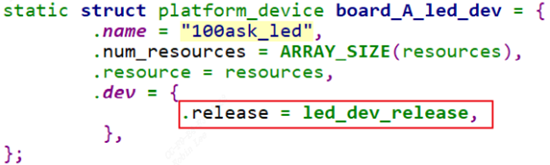
则在调用 `platform_device_unregister` 时会出现警告，如下图所示, 因此我们可以将`release`实现为空。

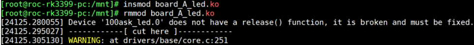
## 2.3 具体芯片驱动(platform_driver)

```c
#ifndef _LEDDRV_H  
#define _LEDDRV_H   
#include "led_opr.h"   
void led_class_create_device(int minor);  
void led_class_destroy_device(int minor);  
void register_led_operations(struct led_operations *opr);  
#endif /* _LEDDRV_H */
```

`Chip_demo_gpio.c`实现opr的gpio控制。

```c
#include <linux/module.h>  
#include <linux/fs.h>  
#include <linux/errno.h>  
#include <linux/miscdevice.h>  
#include <linux/kernel.h>  
#include <linux/major.h>  
#include <linux/mutex.h>  
#include <linux/proc_fs.h>  
#include <linux/seq_file.h>  
#include <linux/stat.h>  
#include <linux/init.h>  
#include <linux/device.h>  
#include <linux/tty.h>  
#include <linux/kmod.h>  
#include <linux/gfp.h>  
#include <linux/platform_device.h>  
#include "led_opr.h"  
#include "leddrv.h"  
#include "led_resource.h"  
  
static int g_ledpins[100];  
static int g_ledcnt = 0;  
  
static int board_demo_led_init (int which) /* 初始化LED, which-哪个LED */        
{    
    printk("init gpio: group %d, pin %d\n", GROUP(g_ledpins[which]), PIN(g_ledpins[which]));  
    switch(GROUP(g_ledpins[which])){  
        case 0:{  
            printk("init pin of group 0 ...\n");  
            break;  
        }  
        case 1:{  
            printk("init pin of group 1 ...\n");  
            break;  
        }  
        case 2:{  
            printk("init pin of group 2 ...\n");  
            break;  
        }  
        case 3:{  
            printk("init pin of group 3 ...\n");  
            break;  
        }  
    }  
    return 0;  
}  
static int board_demo_led_ctl (int which, char status) /* 控制LED, which-哪个LED, status:1-亮,0-灭 */  
{  
    printk("set led %s: group %d, pin %d\n", status ? "on" : "off", GROUP(g_ledpins[which]), PIN(g_ledpins[which]));  
    switch(GROUP(g_ledpins[which])){  
        case 0:{  
            printk("set pin of group 0 ...\n");  
            break;  
        }  
        case 1:{  
            printk("set pin of group 1 ...\n");  
            break;  
        }  
        case 2:{  
            printk("set pin of group 2 ...\n");  
            break;  
        }  
        case 3:{  
            printk("set pin of group 3 ...\n");  
            break;  
        }  
    }  
    return 0;  
}  
static struct led_operations board_demo_led_opr = {  
    .init = board_demo_led_init,  
    .ctl  = board_demo_led_ctl,  
};  
    
static int chip_demo_gpio_probe(struct platform_device *pdev){  
    struct resource *res;  
    int i = 0;  
    
    while (1){  
        res = platform_get_resource(pdev, IORESOURCE_IRQ, i++);  
        if (!res)  
            break;  
           
        g_ledpins[g_ledcnt] = res->start;//获取gpio num  
        led_class_create_device(g_ledcnt);//利用EXPORT_SYMBOL导出的函数为每个led创建设备节点  
        g_ledcnt++;  
    }  
    return 0;  
       
}  
static int chip_demo_gpio_remove(struct platform_device *pdev) {  
    struct resource *res;  
    int i = 0;  
   
    while (1) {  
        res = platform_get_resource(pdev, IORESOURCE_IRQ, i);  
        if (!res)  
            break;          
        led_class_destroy_device(i);  
        i++;  
        g_ledcnt--;  
    }  
    return 0;  
}  
static struct platform_driver chip_demo_gpio_driver = {  
    .probe      = chip_demo_gpio_probe,  
    .remove     = chip_demo_gpio_remove,  
    .driver     = {  
        .name   = "100ask_led",  
    },  
};  
  
static int __init chip_demo_gpio_drv_init(void) {  
    int err;  
    err = platform_driver_register(&chip_demo_gpio_driver);  
    register_led_operations(&board_demo_led_opr);  
    return 0;  
}  
static void __exit lchip_demo_gpio_drv_exit(void){  
    platform_driver_unregister(&chip_demo_gpio_driver);  
}  
module_init(chip_demo_gpio_drv_init);  
module_exit(lchip_demo_gpio_drv_exit);  
MODULE_LICENSE("GPL");
```

当`platform_device`和`platform_driver`都`insmod`（注册）后，总线设备驱动模型会进行`match`匹配，匹配成功调用`probe`函数，这里使用name进行匹配的。

1. `chip_demo_gpio_probe`中, 获取单板定义的资源信息，依次创建设备节点。
2. `register_led_operations`注册了具体chip的opr操作函数(寄存器操作不具体展开实现，opr暂定为空)。

当用户调用open/write时便可操作具体chip的led驱动方法。

## 2.4 测试

### 2.4.1 Makefile
```
# 1. 使用不同的开发板内核时, 一定要修改KERN_DIR  
# 2. KERN_DIR中的内核要事先配置、编译, 为了能编译内核, 要先设置下列环境变量:  
# 2.1 ARCH,          比如: export ARCH=arm64  
# 2.2 CROSS_COMPILE, 比如: export CROSS_COMPILE=aarch64-linux-gnu- 
# 注意: 不同的开发板不同的编译器上述环境变量不一定相同,  
#       请参考各开发板的高级用户使用手册  
   
KERN_DIR = /home/book/100ask_roc-rk3399-pc/linux-4.4  
   
all:  
        make -C $(KERN_DIR) M=`pwd` modules   
        $(CROSS_COMPILE)gcc -o ledtest ledtest.c   
   
clean:  
        make -C $(KERN_DIR) M=`pwd` modules clean  
        rm -rf modules.order  
        rm -f ledtest  
   
# 参考内核源码drivers/char/ipmi/Makefile  
# 要想把a.c, b.c编译成ab.ko, 可以这样指定:  
# ab-y := a.o b.o  
# obj-m += ab.o  
  
obj-m += leddrv.o chip_demo_gpio.o board_A_led.o
```

编译出3个ko，依次insmod `leddrv.ko` `chip_demo_gpio.ko` `board_A_led.ko`

### 2.4.2 ledtest测试程序
```c
#include <sys/types.h>  
#include <sys/stat.h>  
#include <fcntl.h>  
#include <unistd.h>  
#include <stdio.h>  
#include <string.h>  
/*  
 * ./ledtest /dev/100ask_led0 on  
 * ./ledtest /dev/100ask_led0 off  
 */  
int main(int argc, char **argv) {  
        int fd;  
        char status;  
        if (argc != 3) {  
                printf("Usage: %s <dev> <on | off>\n", argv[0]);  
                return -1;  
        }  
        fd = open(argv[1], O_RDWR);  
        if (fd == -1){  
                printf("can not open file %s\n", argv[1]);  
                return -1;  
        }  
        if (0 == strcmp(argv[2], "on")){  
                status = 1;  
                write(fd, &status, 1);  
        }else{  
                status = 0;  
                write(fd, &status, 1);  
        }  
        close(fd);  
        return 0;  
}
```

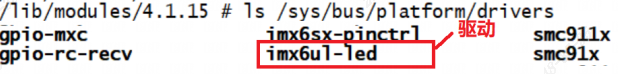
## 2.5 IS_ERR/ERR_PTR/PTR_ERR/NULL_PTR函数族

`include\linux\err.h`:

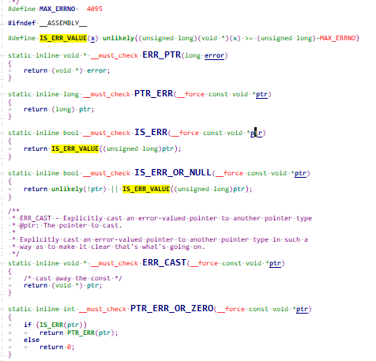
内核中的函数常常返回指针，如果出错，也希望能够通过返回的指针体现出来。那么有三种情况：`合法指针，NULL指针和非法指针`。

1.`合法指针`：内核函数返回的指针一般是4K对齐，即 ptr & 0xfff == 0，也就是0x1000的倍数。其中Linux采用分页机制管理内存，而CPU访问的是线性地址需要通过页表转化成物理地址。所以内核就约定留出最后一页4k（`0xfffffffffffff000 ~ 0xffffffffffffffff`）用来记录内核空间的错误指针(32位的话就是（`0xfffff000 ~ 0xffffffff`）).

2.`非法指针`：一般内核函数地址不会落在`（0xfffff000，0xffffffff）`之间，而一般内核的出错代码也是一个小负数，在`-4095到0`之间，转变成`unsigned long`，正好在`（0xfffff000，0xffffffff)`之间。因此可以用 `(unsigned long)ptr > (unsigned long)-1000L`

`-1000L`正好是`0xfffff000`。

3.linux内核中有一个宏`MAX_ERRNO = 4095`。errno见如下：

```c
include/asm-generic/errno-base.h  //1-34  
include\uapi\asm-generic\errno.h  //35-133  
include\linux\errno.h //512-530
```

### 2.5.1 IS_ERR

作用：判断是否无效非法指针。

实现见上面图片，例如一个地址`0xfffff,ffaa`，那么代入后：很明显返回1,是一个错误非法指针。
`0xfffffffaa > 0xfffff000`

### 2.5.2 IS_ERR_OR_NULL

和IS_ERR基本等同，会先提前判断一下是否空。

### 2.5.3 PTR_ERR

作用：将非法指针转成错误码返回。

实现见上面图片. 将传入的`void *`类型指针强转为long类型，并返回

### 2.5.4 ERR_PTR

将传入的long类型强转为`void *`类型指针，并返回