# 1 regmap的架构

`regmap`是为了方便操作寄存器而设计的，它将所有模块的寄存器(包括soc上模块的寄存器和外围设备的寄存器等)  
抽象出来，用一套统一接口来操作寄存器，统一操作 `i2c、i3c、spi、mmio、sccb、sdw、slimbus、irq`等。

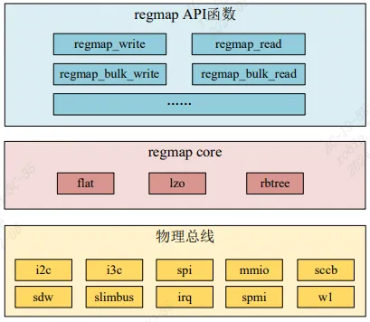
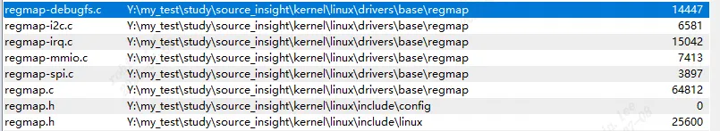
`regmap` 框架分为三层：

①、底层物理总线： `regmap` 支持的物理总线有 `i2c、i3c、spi、mmio、sccb、sdw、slimbus、irq、spmi 和 w1`。
②、`regmap` 核心层：用于实现 `regmap`核心。
③、`regmapAPI` 抽象层，`regmap` 向驱动编写人员提供的 API 接口。

# 2 数据结构

## 2.1 regmap 结构体
```c
struct regmap {  
	union {  
		struct mutex mutex;  
		struct {  
			spinlock_t spinlock;  
			unsigned long spinlock_flags;  
		};  
	};  
	regmap_lock lock;  
	regmap_unlock unlock;  
	void *lock_arg; /* This is passed to lock/unlock functions */  
	struct device *dev; /* Device we do I/O on */  
	void *work_buf; /* Scratch buffer used to format I/O */  
	struct regmap_format format; /* Buffer format */  
	const struct regmap_bus *bus;  
	void *bus_context;  
	const char *name;  
  
	bool async;  
	spinlock_t async_lock;  
	wait_queue_head_t async_waitq;  
	struct list_head async_list;  
	struct list_head async_free;  
	int async_ret;  
	...  
	unsigned int max_register;  
	bool (*writeable_reg)(struct device *dev, unsigned int reg);  
	bool (*readable_reg)(struct device *dev, unsigned int reg);  
	bool (*volatile_reg)(struct device *dev, unsigned int reg);  
	bool (*precious_reg)(struct device *dev, unsigned int reg);  
	const struct regmap_access_table *wr_table;  
	const struct regmap_access_table *rd_table;  
	const struct regmap_access_table *volatile_table;  
	const struct regmap_access_table *precious_table;  
  
	int (*reg_read)(void *context, unsigned int reg,  
	unsigned int *val);  
	int (*reg_write)(void *context, unsigned int reg,  
	 unsigned int val);  
	......  
	struct rb_root range_tree;  
	void *selector_work_buf; /* Scratch buffer used for selector */  
};  // drivers/base/regmap/internal.h
```

`regmap` 的初始化通过结构体 `regmap_config`来完成。

## 2.2 regmap_config
```c
struct regmap_config {  
	const char *name;//名字  
	int reg_bits;//寄存器地址位数，必填字段。  
	int reg_stride;//寄存器地址步长。  
	int pad_bits; //寄存器和值之间的填充位数  
	int val_bits; //寄存器值位数，必填字段  
  
    //可写回调函数  
	bool (*writeable_reg)(struct device *dev, unsigned int reg);  
	//可读回调函数  
    bool (*readable_reg)(struct device *dev, unsigned int reg);  
	//可缓存回调函数  
    bool (*volatile_reg)(struct device *dev, unsigned int reg);  
	//是否不能读回调函数，当寄存器不能读，就返回tree  
    bool (*precious_reg)(struct device *dev, unsigned int reg);  
	regmap_lock lock;  
	regmap_unlock unlock;  
	void *lock_arg;  
    //读操作  
	int (*reg_read)(void *context, unsigned int reg, unsigned int *val);  
	//写操作  
    int (*reg_write)(void *context, unsigned int reg, unsigned int val);  
	bool fast_io;//快速 I/O，使用 spinlock 替代 mutex 来提升锁性能。  
	unsigned int max_register;//有效的最大寄存器地址  
	const struct regmap_access_table *wr_table;//可写的地址范围  
	const struct regmap_access_table *rd_table;//可读的地址范围  
	const struct regmap_access_table *volatile_table;//可缓存的地址范围  
	const struct regmap_access_table *precious_table;//不可读的地址范围  
	const struct reg_default *reg_defaults;//寄存器模式值,有两个成员变量：reg是寄存器地址，def是默认值  
	unsigned int num_reg_defaults;//默认寄存器表中的元素个数  
	enum regcache_type cache_type;  
	const void *reg_defaults_raw;  
	unsigned int num_reg_defaults_raw;  
  
	u8 read_flag_mask; //读标志掩码。  
	u8 write_flag_mask; //写标志掩码  
  
	bool use_single_rw;  
	bool can_multi_write;  
  
	enum regmap_endian reg_format_endian;  
	enum regmap_endian val_format_endian;  
  
	const struct regmap_range_cfg *ranges;  
	unsigned int num_ranges;  
};
```

# 3 API

## 3.1 Regmap 申请与初始化

`regmap` 支持多种物理总线，比如 I2C 和 SPI，我们需要根据所使用的接口来选 择合适的 `regmap` 初始化函数。
```c
struct regmap * regmap_init_spi(struct spi_device *spi, const struct regmap_config *config);  
struct regmap * regmap_init_i2c(struct i2c_client *i2c, const struct regmap_config *config);  
void regmap_exit(struct regmap *map);//不管是什么物理接口，退出都用regmap_exit
```

## 3.2 regmap 设备访问
```c
int regmap_read(struct regmap *map, unsigned int reg, unsigned int *val);  
int regmap_write(struct regmap *map, unsigned int reg, unsigned int val);
```

在 `regmap_read` 和 `regmap_write` 的基础上还衍生出了其他一些 `regmap` 的 API 函数:
```c
/* regmap_update_bits函数，看名字就知道，此函数用来修改寄存器指定的 bit。  
* mask：掩码，需要更新的位必须在掩码中设置为 1。  
* val：需要更新的位值。  
* 比如要将寄存器的 bit1 和 bit2 置 1，那么 mask 应该设置为 0X00000011，此时 val 的 bit1  
和 bit2 应该设置为 1，也就是 0Xxxxxxx11。如果要清除寄存器的 bit4 和 bit7，那么 mask 应该  
设置为 0X10010000，val 的 bit4 和 bit7 设置为 0，也就是 0X0xx0xxxx。  
*/  
  
int regmap_update_bits (struct regmap *map, unsigned int reg, unsigned int mask, unsigned int val);  
  
//读取写入多个寄存器的值  
//map：要操作的 regmap。  
//reg：要读写的第一个寄存器。  
//val：要读写的寄存器数据缓冲区。  
//val_count：要读写的寄存器数量  
int regmap_bulk_read(struct regmap *map, unsigned int reg, void *val, size_t val_count);  
int regmap_bulk_write(struct regmap *map, unsigned int reg, const void *val, size_t val_count)
```

## 3.3 regmap_config 掩码设置

结构体`regmap_config`里面有三个关于掩码的成员变量：`read_flag_mask` 和 `write_flag_mask`.

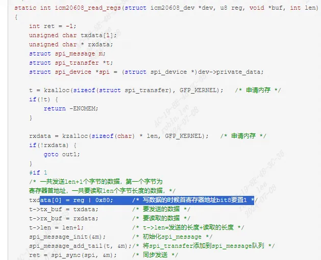
其中读操作要将寄存器的地址 `bit7` 置 1，表示这是 一个读操作。当我们使用`regmap`的时候就不需要手动将寄存器地址的 bit7 置 1，在初始化 `regmap_config` 的时候直接将`read_flag_mask`设置为 `0X80` 即可，这样通过`regmap`读取 SPI 内部寄存器的时候就会将寄存器地址与`read_flag_mask`进行或运算，结果就是将 `bit7` 置 1。
```c
static struct regmap_bus regmap_spi = {  
	.write = regmap_spi_write,  
	.gather_write = regmap_spi_gather_write,  
	.async_write = regmap_spi_async_write,  
	.async_alloc = regmap_spi_async_alloc,  
	.read = regmap_spi_read,  
	.read_flag_mask = 0x80,  
	.reg_format_endian_default = REGMAP_ENDIAN_BIG,  
	.val_format_endian_default = REGMAP_ENDIAN_BIG,  
};  
...  
struct regmap *regmap_init_spi(struct spi_device *spi, const struct regmap_config *config)  
{  
	return regmap_init(&spi->dev, &regmap_spi, &spi->dev, config);  
}// regmap-spi.c
```

在 `regmap_init` 函数中找到如下所示内容:
```c
if (config->read_flag_mask | config->write_flag_mask) {  
	map->read_flag_mask = config->read_flag_mask;  
	map->write_flag_mask = config->write_flag_mask;  
} else if (bus) {  
	map->read_flag_mask = bus->read_flag_mask;  
}
```

可以看到初始化时用`regmap_config` 中的读写掩码来初始化`regmap_bus`中的掩码。由于 `regmap_spi` 默认将 `read_flag_mask` 设置为 0X80，假如你所使用的 SPI 设备不需要读掩码，在初始 化`regmap_config`的时候一定要将 `read_flag_mask` 设置为 0X00。

# 4 Regmap操作SPI-ICM20608实验

参考：[SPI子系统](SPI%E5%AD%90%E7%B3%BB%E7%BB%9F/)


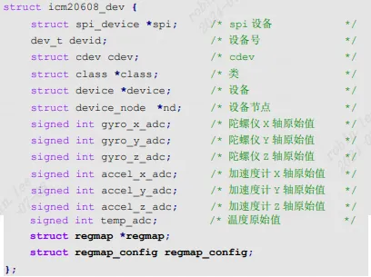
之前构造了`icm20608_dev`利用`spi子系统框架`通信。框架还是保持不变，添加`regmap和regmap_config`参数。

## 4.1 初始化 regmap

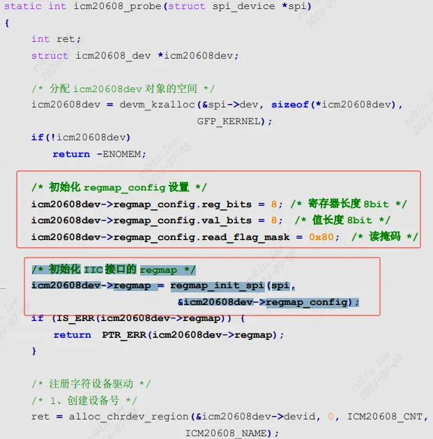
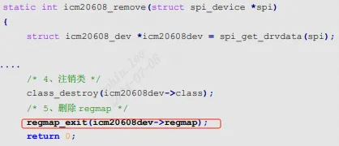
## 4.2 regmap 访问icm20608

以前的读写寄存器操作要构造`spi_message,spi_transfer`:


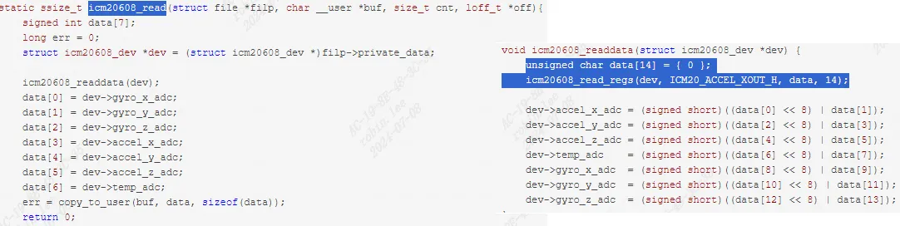
现在直接套用`reg_map`函数,无需要调用spi数据传输相关api：

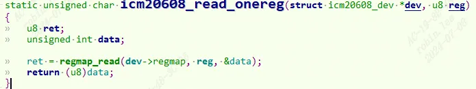
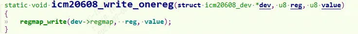
读多组寄存器也是一样，调用`regmap_bulk_read`。

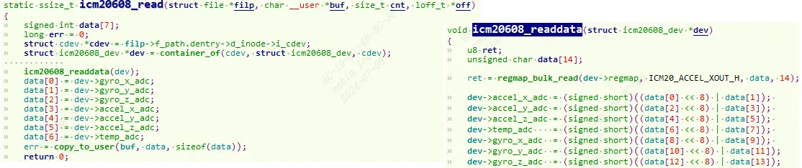
# 5 Regmap操作I2C-ap3216c实验

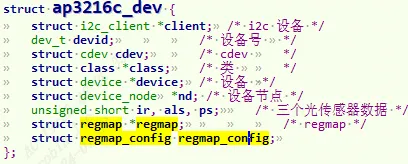
参考：[I2C子系统](I2C%E5%AD%90%E7%B3%BB%E7%BB%9F/)

## 5.1 初始化 regmap

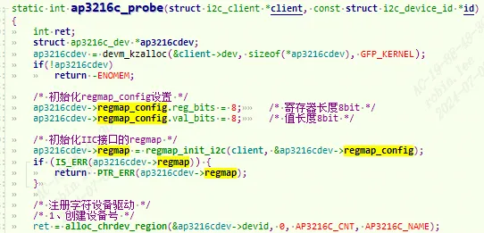
## 5.2 regmap 访问ap3216c

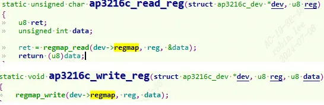
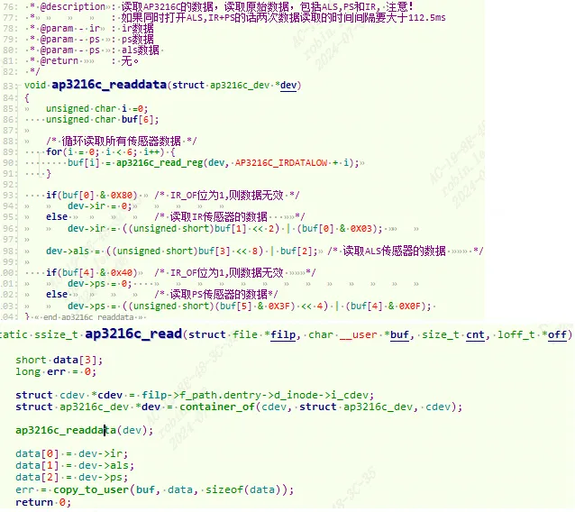
这里初始化`open fd`时，要用到`regmap_write`进行i2c从设备的寄存器写入初始化。然后调用read，调用`regmap_read`进行读操作，这里每次都只读取一个byte，不需要用到`regmap_bulk_read`.
