# 1 根文件系统的引入

文件系统类型有 `FATFS、FAT、EXT4、YAFFS 和 NTFS，squashfs`等。文件系统可以让用户通过文件IO的形式对文件目录进行访问，而不用去访问flash存储地址，在使用上更为方便轻松。  
根文件系统rootfs, 首先是内核启动时所 mount(挂载)的第一个文件系统，系统引导启动程序会在根文件系统挂载之后从中把一些基本的初始化脚本和服务等加载到内存中去运行。  

嵌入式根文件系统和 Linux 内核是分开的，嵌入式 Linux 通常将内核代码镜像保存在 NAND Flash 的指定存储地址、EMMC 专用分区中。  单独的 Linux 内核是没法正常工作的，必须要搭配根文件系统。如果不提供根文件系统，Linux 内核在启动的时候就会提示内核崩溃(Kernel panic)：  
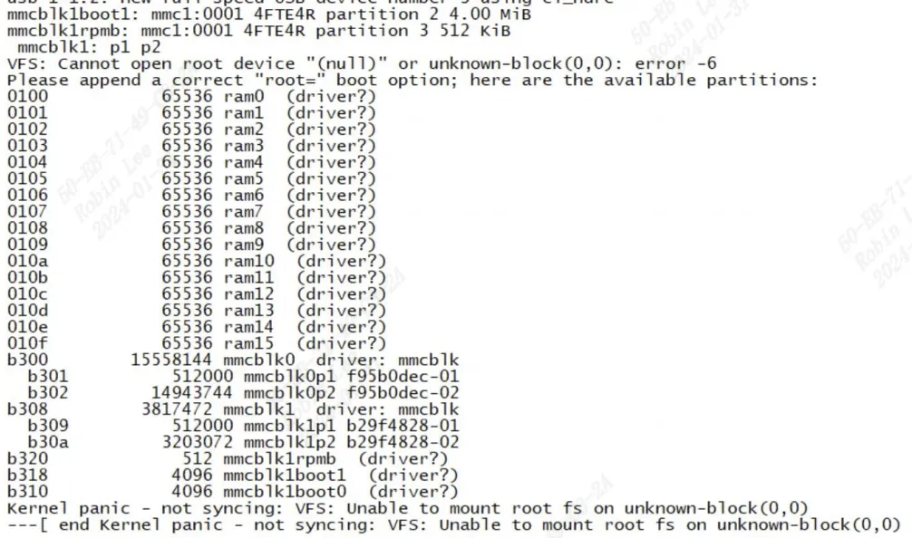
# 2 根文件系统的组成

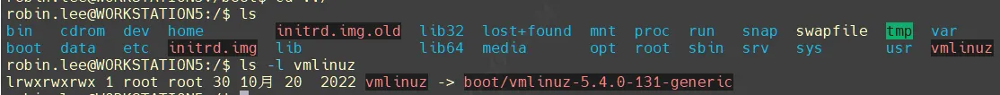
## 2.1 /bin 目录

存放着系统需要的可执行文件，一般都是一些命令，比如`ls、cp、mv`等命令。  
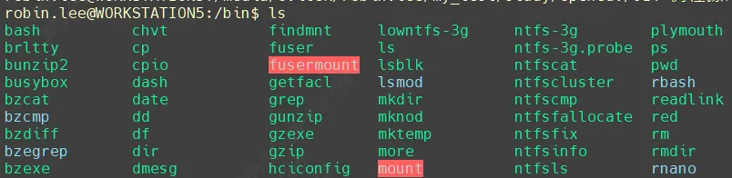
## 2.2 /dev 目录

此目录下的文件都是设备节点文件：
```c
ls -l /dev/  
crw-rw----    1 root     root       89,   9 Jan  1 08:00 /dev/i2c-9  
crw-rw----    1 root     root       10,  62 Jan  1 08:00 /dev/ion  
crw-rw----    1 root     root        1,  11 Jan  1 08:00 /dev/kmsg  
srw-rw-rw-    1 root     root             0 Jan  1 08:00 /dev/log  
crw-rw----    1 root     root       10, 237 Jan  1 08:00 /dev/loop-control  
brw-rw----    1 root     root        7,   0 Jan  1 08:00 /dev/loop0  
brw-rw----    1 root     root        7,   1 Jan  1 08:00 /dev/loop1  
brw-rw----    1 root     root      179,   0 Jan  1 08:00 /dev/mmcblk0  
brw-rw----    1 root     root      179,   8 Jan  1 08:00 /dev/mmcblk0boot0  
brw-rw----    1 root     root      179,  16 Jan  1 08:00 /dev/mmcblk0boot1  
brw-rw----    1 root     root      179,   1 Jan  1 08:00 /dev/mmcblk0p1  
brw-rw----    1 root     root      179,   2 Jan  1 08:00 /dev/mmcblk0p2  
brw-rw----    1 root     root      179,   3 Jan  1 08:00 /dev/mmcblk0p3  
brw-rw----    1 root     root      179,   4 Jan  1 08:00 /dev/mmcblk0p4
```

## 2.3 /etc 目录

此目录下存放着各种配置文件。

## 2.4 /lib 目录

存放着 Linux 所必须的库文件。这些库文件是共享库，命令和用户编写的应用程序要使用这些库文件。

## 2.5 /mnt 目录

临时挂载目录，一般是空目录，可以在此目录下创建空的子目录，比如/mnt/sd、/mnt/usb，这样就可以将 SD 卡或者 U 盘挂载到/mnt/sd 或者/mnt/usb 目录中。

## 2.6 /proc 目录

proc虚拟文件系统，输出硬件驱动模块的相关信息，各种输出打印。（后续专门出一篇博文介绍）  
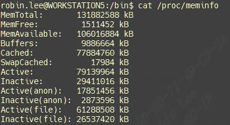
## 2.7 /usr 目录

这里的usr 不是 user 的缩写，而是 `Unix Software Resource` 的缩写，也就是 Unix 操作系统软件资源目录。  
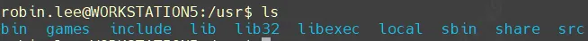
## 2.8 /var 目录

存放一些可以改变的数据。如/var/log。

```
[root@robin]/var/log# ls
messages    messages.0  messages.1  messages.2  messages.3
```

## 2.9 /sys 目录

此目录作为 sysfs 文件系统的挂载点，sysfs 是一个类似于 proc 文件系统的特殊文件系统，sysfs 也是基于 ram 的文件系统，也就是说它也没有实际的存储设备。此目录是系统设备管理的重要目录，此目录通过一定的组织结构向用户提供详细的内核数据结构信息。

查看硬件模块IP的`base addr`：
```c
[root@robin]/sys/devices# cd platform/  
[root@robin]/sys/devices/platform# ls  
1040000.mon                 29230000.spi3  
1900000.rtos_cmdqu          29240000.can  
203c0000.bmtpu              29300000.cv-emmc  
20400000.pcie               29310000.cv-sd  
20bc0000.sata               29320000.cv-sd  
20bc0000.sata:sata-port@0   29330000.wifi-sd  
20bc0000.sata:sata-port@1   29340000.dma  
21020000.vc_drv             29350000.dma  
27000000.cv-wd              39000100.usb  
27010000.gpio               39000200.usb  
27011000.gpio               41d0c00.pdm  
27012000.gpio               5021000.gpio
```

查看debug相关：
```c
[root@robin]/sys/kernel/debug# ls  
27000000.cv-wd      dw_spi2             mtd  
asoc                dw_spi3             pinctrl  
bdi                 dynamic_debug       pwm  
block               extfrag             regmap  
bluetooth           fault_around_bytes  sched_debug  
clear_warn_once     gpio                sched_features  
clk                 hid                 sleep_time  
debug_enabled       ieee80211           split_huge_pages
```

重要的有：
```c
/sys/kernel/debug/debug_enabled  
/sys/kernel/debug/dynamic_debug/control  
/sys/kernel/debug/clk/clk_summary
```

查看和设置驱动模块module param变量：
```c
cd /sys/module/soph_stitch/parameters  
[root@cvitek]/sys/module/soph_stitch/parameters# cat stitch_log_lv  
2  
[root@cvitek]/sys/module/soph_stitch/parameters# echo 2 > stitch_log_lv  
[root@cvitek]/sys/module/soph_stitch/parameters# cat stitch_log_lv  
2
```

# 3 构建根文件系统

## 3.1 busybox

BusyBox 是一个集成了大量的 Linux 命令和工具的软件，像`ls、mv、ifconfig`等命令 BusyBox 都会提供。  
一般下载 BusyBox 的源码，然后配置 BusyBox，选择自己想要的功能，最后编译即可。  
BusyBox 可以在其官网下载到，官网地址为：  
[https://busybox.net/downloads/](https://busybox.net/downloads/)

### 3.1.1 配置编译 BusyBox

这里我下载的`busybox-1.29.0.tar.bz2`， 将其进行解压：
```c
mkdir rootfs；cd rootfs; tar xfj busybox-1.29.0.tar.bz2
```

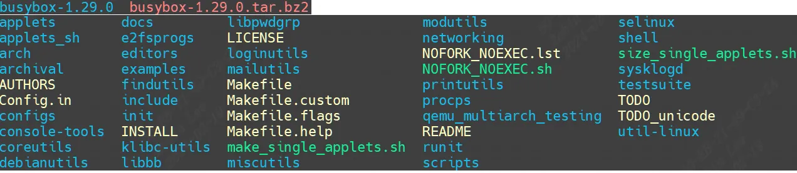
修改Makefile添加`toolchain`:
```c
164 CROSS_COMPILE ?= /usr/local/arm/gcc-linaro-4.9.4-2017.01-x86_64_arm-linux-gnueabihf/bin/arm-linux-gnueabihf-  
......  
190 ARCH ?= arm
```

#### 3.1.1.1 busybox支持中文识别

中文的编码如果采用`utf8`，那么`ascii`值肯定是大于`0x7f`的。因此需要修改busybox源码，让其能识别超过`ascii`的编码范围`0x7f`。

**utf8 中文编码**：  
UTF-8是一种广泛使用的`Unicode`编码方式，它可以用来表示各种语言和符号。对于中文字来说，UTF-8采用了一种特殊的编码方式，即中文字符主要使用三个字节（21比特）来表示。具体来说，当一个汉字的Unicode码位于0x80到0x7FF之间的时，UTF-8会用三个字节来编码这个汉字。例如，汉字“爸”在UTF-8中的编码过程是这样的：

首先，将汉字`“爸”`的`Unicode`码`（0x5BAD）`转换为二进制数`（0111 0010 0011 1000）`。  
然后，按照UTF-8的三字节模式进行编码，即每个字节的最高位都设置为1，剩下的7位用于表示该字节所对应的Unicode值。在这个例子中，第一个字节的高位为1，表示这是一个16位的字节；接下来的三位为1011，对应于Unicode码中的第11位，即十进制的5；最后一位为0，代表这是一个字节的最低位。  
最后，将这三个字节的二进制数转换为十六进制数`（0xE788B8）`，这就是汉字`“爸”`在UTF-8中的编码形式。
```c
vi libbb/unicode.c
```

打开函数`unicode_conv_to_printable2`,修改如下：  
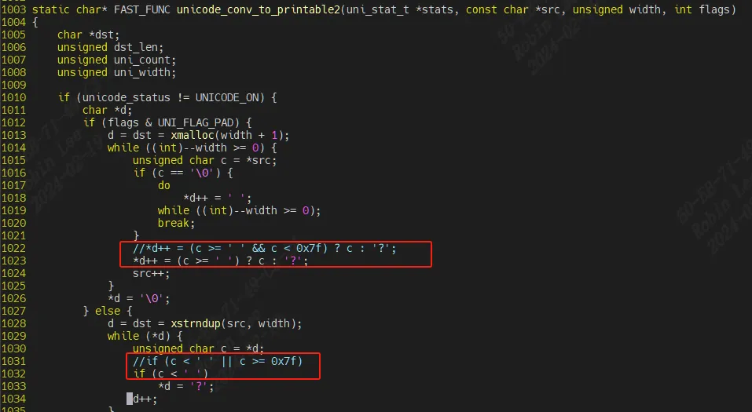
```c
vi libbb/printable_string.c
```

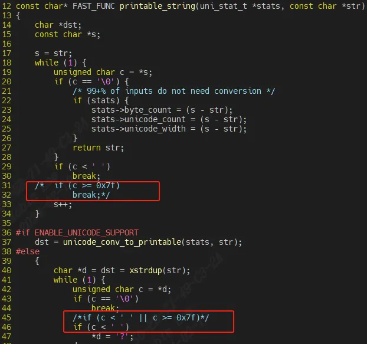
#### 3.1.1.2 busybox配置

编译busybox前要先对 busybox 进行默认的配置，有以下几种配置选项：
```c
①、defconfig，缺省配置，也就是默认配置选项。  
②、allyesconfig，全选配置，也就是选中 busybox 的所有功能  
③、allnoconfig，最小配置。  
  
make defconfig  
make menuconfig
```

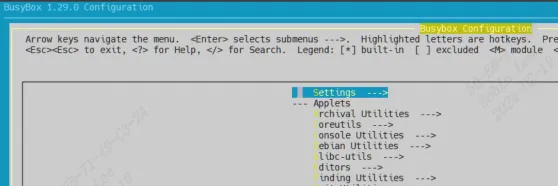
```c
-> Settings   
	-> Build static binary (no shared libs)
```

这项请不要勾选，静态编译 busybox会DNS解析有问题。
```c
-> Settings  
	-> vi-style line editing commands
```

建议勾选这项。
```c
-> Linux Module Utilities  
	-> Simplified modutils
```

默认会选中“Simplified modutils”，这里要取消勾选。
```c
-> Linux System Utilities  
	-> mdev (16 kb) //确保下面的全部选中，默认都是选中的
```

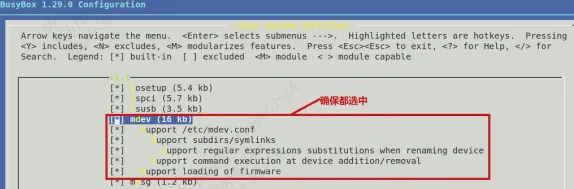
```c
-> Settings  
	-> Support Unicode //选中  
		-> Check $LC_ALL, $LC_CTYPE and $LANG environment variables //选中
```

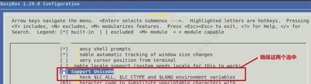
#### 3.1.1.3 编译
```c
make ARCH=arm CROSS_COMPILE=arm-linux-gnueabihf-  
make install CONFIG_PREFIX=/media/cvitek/robin.lee/rootfs ARCH=arm CROSS_COMPILE=arm-linux-gnueabihf-
```

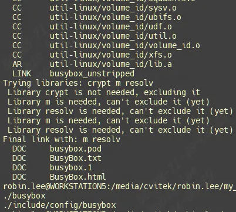
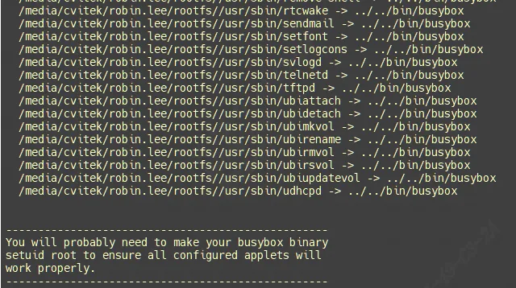
busybox 的所有工具和文件就会被安装到 rootfs 目录中，rootfs 目录内容如下：  
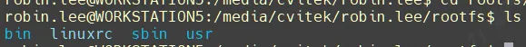
命令和工具都再对应/bin /usr/bin对应的目录：  
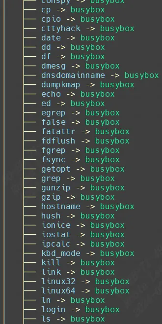

[Linux内核启动流程](Linux%E5%86%85%E6%A0%B8%E5%90%AF%E5%8A%A8%E6%B5%81%E7%A8%8B/)说过 Linux 内核 init 进程最后会查找用户空间的 init 程序，找到以后就会运行这个用户空间的 init 程序，从而切换到用户态。如果 `bootargs` 设置 `init=/linuxrc`，那么 linuxrc 就是可以作为用户空间的 init 程序，所以用户态空间的 init 程序是 busybox 来生成的。

根文件系统此时就制作好了，但此时还不能使用，还需要一些其他的文件，继续来完善 rootfs。

### 3.1.2 根文件系统添加 lib 库

#### 3.1.2.1 /lib库添加

Linux 中的应用程序一般都是需要动态库的，当然你也可以编译成静态的，但是静态的可执行文件会很大。如果编译为动态的话就需要动态库，所以需要向根文件系统中添加动态库。lib 库文件从交叉编译器中获取：
```c
mkdir lib  
cd gcc-linaro-4.9.4-2017.01-x86_64_arm-linux-gnueabihf/arm-linux-gnueabihf/libc/lib
```

libc库如下：将其拷贝进rootfs。  
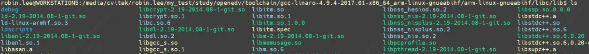
```c
cp *so* *.a /media/cvitek/robin.lee/rootfs/lib -d #-d表示将软链接也一同拷贝
```

进入工具链的lib库：
```c
cd gcc-linaro-4.9.4-2017.01-x86_64_arm-linux-gnueabihf/arm-linux-gnueabihf/libc/lib  
cp *so* *.a /media/cvitek/robin.lee/rootfs/lib -d #-d表示将软链接也一同拷贝
```

最终根文件系统的/lib内容如下：  
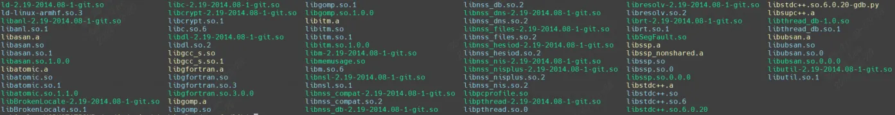
#### 3.1.2.2 /usr/lib库添加
```c
mkdir /usr/lib  
cd gcc-linaro-4.9.4-2017.01-x86_64_arm-linux-gnueabihf/arm-linux-gnueabihf/libc/usr/lib
```

libc/usr/lib库如下：将其拷贝进rootfs。  
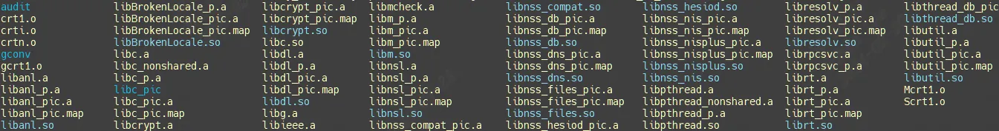
```c
cp *so* *.a /media/cvitek/robin.lee/rootfs/usr/lib -d #-d表示将软链接也一同拷贝
```

至此，根文件系统的库文件就全部添加好了。来看下库占用存储空间多少：
```c
robin.lee@WORKSTATION5:/media/cvitek/robin.lee/rootfs$ du ./lib ./usr/lib/ -sh  
57M     ./lib  
67M     ./usr/lib/
```

### 3.1.3 根文件系统添加其他目录

dev、proc、mnt、sys、tmp 和 root这些目录需要在rootfs进行创建。  
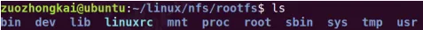
### 3.1.4 根文件系统测试

初步测试rootfs功能，最好是利用nfs挂载根文件系统，方便修改。之前`bootargs`都是设置：
```c
setenv bootargs 'console=ttymxc0,115200 root=/dev/mmcblk1p2 rootwait rw'
```

从emmc分区2启动，分区2存放了根文件系统。现在bootargs改成nfs挂载rootfs要如何设置呢？  
文档为 `Documentation/filesystems/nfs/nfsroot.txt`，格式如下：
```c
root=/dev/nfs nfsroot=[<server-ip>:]<root-dir>[,<nfs-options>] ip=<client-ip>:<server-ip>:<gw-ip>:<netmask>:<hostname>:<device>:<autoconf>:<dns0-ip>:<dns1-ip>  
  
<server-ip>：服务器 IP 地址，比如我的 Ubuntu 主机 IP 地址为 192.168.1.250。  
<root-dir>：根文件系统的存放路径，要保证放在nfs共享目录下。比如我的就是/media/cvitek/robin.lee/rootfs  
<nfs-options>：NFS 的其他可选选项，一般不设置。  
<client-ip>：客户端 IP 地址，也就是开发板的 IP 地址  
<server-ip>：服务器 IP 地址，前面已经说了。  
<gw-ip>：网关地址，我的就是 192.168.1.1。  
<netmask>：子网掩码，我的就是 255.255.255.0。  
<hostname>：客户机的名字，一般不设置，此值可以空着。  
<device>：设备名，也就是网卡名，一般是 eth0，eth1….，正点原子的 I.MX6U-ALPHA 开发板的 ENET2 为 eth0，ENET1 为 eth1。  
<autoconf>：自动配置，一般不使用，所以设置为 off。  
<dns0-ip>：DNS0 服务器 IP 地址，不使用。  
<dns1-ip>：DNS1 服务器 IP 地址，不使用。
```

最终设置 bootargs 环境变量的 root 值如下：  
`root=/dev/nfs nfsroot=192.168.1.250:/media/cvitek/robin.lee/rootfs,proto=tcp rw ip=192.168.1.251:192.168.1.250:192.168.1.1:255.255.255.0::eth0:off`

`“proto=tcp”`表示使用 TCP 协议，`“rw”`表示 nfs 挂载的根文件系统为可读可写。  
修改保存环境变量：
```c
setenv bootargs 'console=ttymxc0,115200 root=/dev/nfs nfsroot=192.168.1.250:/media/cvitek/robin.lee/rootfs,proto=tcp rw ip=192.168.1.251:192.168.1.250:192.168.1.1:255.255.255.0::eth0:off' #设置 bootargs  
saveenv #保存环境变量
```

设置好以后使用`“boot”`命令启动 Linux 内核，输出打印如下：  
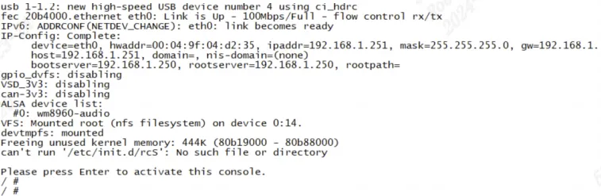
可以看到成功挂载rootfs，并且进入Linux控制台。

### 3.1.5 根文件系统添加 etc配置脚本

#### 3.1.5.1 创建/etc/init.d/rcS

前面打印有一行报错，进入根文件系统的时候会有下面这一行错误提示：
```c
can't run '/etc/init.d/rcS': No such file or directory
```

rcS 是个 shell 脚本，Linux 内核启动以后需要启动一些服务，而 rcS 就是规定启动哪些文件的脚本文件。在 rootfs 中创建`/etc/init.d/rcS` 文件，然后在 rcS 中输入如下所示内容：
```c
#!/bin/sh  
  
PATH=/sbin:/bin:/usr/sbin:/usr/bin:$PATH  
LD_LIBRARY_PATH=$LD_LIBRARY_PATH:/lib:/usr/lib  
export PATH LD_LIBRARY_PATH  
  
mount -a  
mkdir /dev/pts  
mount -t devpts devpts /dev/pts  
  
echo /sbin/mdev > /proc/sys/kernel/hotplug  
mdev -s
```

`PATH` 环境变量保存着可执行文件可能存在的目录;  
`LD_LIBRARY_PATH` 环境变量保存着库文件所在的目录;  
mount 命令来挂载所有的文件系统，这些文件系统由文件`/etc/fstab` 来指定;  
创建目录`/dev/pts`，然后将 `devpts` 挂载到`/dev/pts` 目录中。  
使用 mdev 来管理热插拔设备，通过这两行，Linux 内核就可以在/dev 目录下自动创建设备节点。

以上构造了一个最简单的rcS, 如果去看 Ubuntu 或者其他大型 Linux操作系统中的 rcS 文件，就会发现其非常复杂。而且这么复杂的 rcS 文件也是借助其他工具创建的，比如 buildroot 等。
```c
chmod 777 rcS
```

重新启动 Linux 内核，启动以后如下图：  
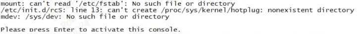
#### 3.1.5.2 创建/etc/fstab

fstab 在 Linux 开机以后自动配置哪些需要自动挂载的分区，格式如下：
```c
<file system> <mount point> <type> <options> <dump> <pass>  
  
<file system>：要挂载的特殊的设备，也可以是块设备，比如/dev/sda 等等  
<mount point>：挂载点。  
<type>：文件系统类型，比如 ext2、ext3、proc、romfs、tmpfs 等等。  
<options>：挂载选项，一般使用 defaults，defaults 包含了 rw、suid、 dev、 exec、 auto、 nouser 和 async。  
<dump>：为 1 的话表示允许备份，为 0 不备份，一般不备份，因此设置为 0。  
<pass>：磁盘检查设置，为 0 表示不检查。根目录‘/’设置为 1，其他的都不能设置为 1，因此这里一般设置为 0
```

fstab内容设置如下：
```c
#<file system>   <mount point>     <type>     <options>   <dump>    <pass>  
proc             /proc             proc       defaults    0         0  
tmpfs            /tmp              tmpfs      defaults    0         0  
sysfs            /sys              sysfs      defaults    0         0
```

`fstab` 文件创建完成以后重新启动 Linux打印如下：  
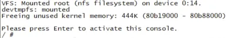
#### 3.1.5.3 创建/etc/inittab文件

inittab 的详细内容可以参考 busybox 下的文件 `examples/inittab`。init 程序会读取`/etc/inittab`这个文件，inittab 由若干条指令组成。每条指令的结构都是一样的，由以“:”分隔的 4 个段组成，格式如下：
```c
<id>:<runlevels>:<action>:<process>  
<id>：每个指令的标识符，不能重复。但是对于 busybox 的 init 来说，<id>有着特殊意义。对于 busybox 而言<id>用来指定启动进程的控制 tty，一般将串口或者 LCD 屏幕设置为控制 tty。  
<runlevels>：对 busybox 来说此项完全没用，所以空着。  
<action>：动作，用于指定<process>可能用到的动作:  
	busybox 支持的动作如下：  
	sysinit: 在系统初始化的时候 process 才会执行一次。  
	respawn: 当 process 终止以后马上启动一个新的。  
	askfirst:和 respawn 类似，在运行 process 之前在控制台上显示“Please press Enter to activate this console.”。只要用户按下“Enter”键以后才会执行 process。  
	wait: 告诉 init，要等待相应的进程执行完以后才能继续执行。  
	once: 仅执行一次，而且不会等待 process 执行完成。  
	restart: 当 init 重启的时候才会执行 procee。  
	ctrlaltdel: 当按下 ctrl+alt+del 组合键才会执行 process。  
	shutdown: 关机的时候执行 process。  
<process>：具体的动作，比如程序、脚本或命令等
```

/etc/inittab内容设置如下：
```c
#etc/inittab  
::sysinit:/etc/init.d/rcS  
console::askfirst:-/bin/sh  
::restart:/sbin/init  
::ctrlaltdel:/sbin/reboot  
::shutdown:/bin/umount -a -r  
::shutdown:/sbin/swapoff -a
```

第 2 行，系统启动以后运行`/etc/init.d/rcS` 这个脚本文件。  
第 3 行，将 console 作为控制台终端，也就是 ttymxc0。  
第 4 行，重启的话运行/sbin/init。  
第 5 行，按下 ctrl+alt+del 组合键的话就运行`/sbin/reboot`，看来 ctrl+alt+del 组合键用于重启系统。  
第 6 行，关机的时候执行`/bin/umount`，也就是卸载各个文件系统。  
第 7 行，关机的时候执行`/sbin/swapoff`，也就是关闭交换分区。

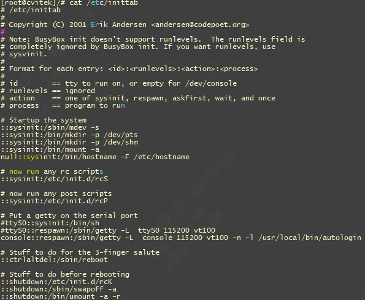
#### 3.1.5.3 创建/etc/resolv.conf

`/etc/resolv.conf`是DNS客户机配置文件，用于设置DNS服务器的IP地址及DNS域名，还包含了主机的域名搜索顺序。该文件是由域名解析器（resolver，一个根据主机名解析IP地址的库）使用的配置文件。
```c
nameserver： 配置DNS服务器地址（顺序来查询，且只有当第一个nameserver没有反应时才查询下面的nameserver）  
domain： 声明主机的域名，当查询不完全的域名时主机名将被使用(相当于search的默认值)  
search： 它的多个参数指明域名查询顺序。当查询不完全的域名时会使用到（domain和search不能共存）
```

默认`/etc/resolv.conf`配置：
```c
# Generated by NetworkManager  
nameserver 192.168.248.2
```

一般将**nameserver**设置成网关地址，再加入`8.8.8.8`和`114.114.114.114`

`ping blog.csdn.com`：
```c
[root@node2 ~]# ping blog.csdn.com  
PING blog.csdn.com.com (45.11.57.36) 56(84) bytes of data.  
64 bytes from comcomproxy1.com.com (45.11.57.36): icmp_seq=1 ttl=44 time=291 ms  
64 bytes from comcomproxy1.com.com (45.11.57.36): icmp_seq=2 ttl=44 time=270 ms
```

`ping blog`，发现不通，需要设置`domain域`：
```c
[root@node2 ~]# ping blog  
ping: blog: 未知的名称或服务
```

调整`/etc/resolv.conf`配置文件,添加**domain**
```c
[root@node2 ~]# vi /etc/resolv.conf  
# Generated by NetworkManager  
nameserver 192.168.248.2  
domain csdn.net
```

再次`ping blog`, ping不完整域名会自动补全
```c
[root@node2 ~]# ping blog  
PING blog.csdn.net (182.92.187.217) 56(84) bytes of data.  
64 bytes from 182.92.187.217 (182.92.187.217): icmp_seq=1 ttl=89 time=20.4 ms
```

调整`/etc/resolv.conf`配置文件,添加**search**
```c
[root@node2 ~]# vi /etc/resolv.conf  
# Generated by NetworkManager  
nameserver 192.168.248.2  
search abc.com csdn.net
```

#### 3.1.5.4 `/proc/cmdline`

`cat /proc/cmdline` 可以看到内核启动时U-boot传入参数:  
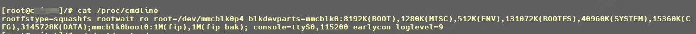
# 4 mkfs工具制作ext4
```c
robin.lee@WORKSTATION5:/media/cvitek/robin.lee/zip/a2_dev/install/soc_cv186ah_wevb_emmc$ dd if=/dev/zero of=rootfs.ext4 bs=1M count=1024  
1024+0 records in  
1024+0 records out  
1073741824 bytes (1.1 GB, 1.0 GiB) copied, 0.391472 s, 2.7 GB/s  
robin.lee@WORKSTATION5:/media/cvitek/robin.lee/zip/a2_dev/install/soc_cv186ah_wevb_emmc$ mkfs.ext4 -L rootfs rootfs.ext4  
mke2fs 1.45.5 (07-Jan-2020)  
Discarding device blocks: done  
Creating filesystem with 262144 4k blocks and 65536 inodes  
Filesystem UUID: a14867d2-d5db-4595-aa4b-fff7ef483bdd  
Superblock backups stored on blocks:  
        32768, 98304, 163840, 229376  
  
Allocating group tables: done  
Writing inode tables: done  
Creating journal (8192 blocks): done  
Writing superblocks and filesystem accounting information: done
```

