# 1 中断与异常种类

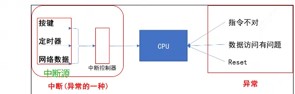
CPU 在运行的过程中，会被各种`“异常”`打断。这些`“异常”`有：

1. 指令未定义
2. Reset复位
3. 指令、数据访问有问题
4. SWI(软中断)
5. 快中断
6. IRQ中断

IRQ中断只是一类异常，导致IRQ中断发生的情况有很多，比如：

1. 按键
2. 定时器
3. ADC 转换完成
4. UART 发送完数据、收到数据

众多的`“中断源”`，汇集到`“中断控制器”`，由`“中断控制器”`选择优先级最高的中断并通知 CPU。

# 2 中断的处理流程

arm 对异常(中断)处理过程：

1. 初始化：  
    a) 设置**中断源**，让它可以产生中断  
    b) 设置**中断控制器**(可以屏蔽某个中断，优先级)  
    c) 设置 **CPU 总开关(使能中断)**
2. 执行其他程序：正常程序
3. 产生中断：比如按下按键（中断源发出中断请求）—>中断控制器—>CPU
4. CPU 每执行完一条指令都会检查有无中断/异常产生
5. CPU 发现有中断/异常产生，开始处理。

对于不同的异常，跳去不同的地址执行执行某个函数，这个就是异常向量。③④⑤都是硬件做的。③是中断源来做，④⑤是cpu来做

综上5个过程，软件要做的事情:  
a) 保存现场(各种寄存器)  
b) 处理异常(中断): 从**异常向量表**跳到不同的异常向量去执行，分辨中断源，再调用不同的处理函数  
c) 恢复现场

## 2.1 异常向量表
异常向量表用来存储异常的处理程序，在特定异常发生后，CPU会跳转到异常向量表对应的异常处理程序处进行异常处理。
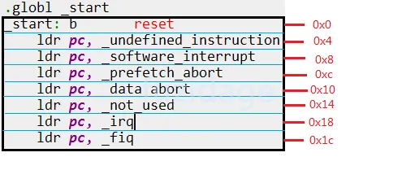
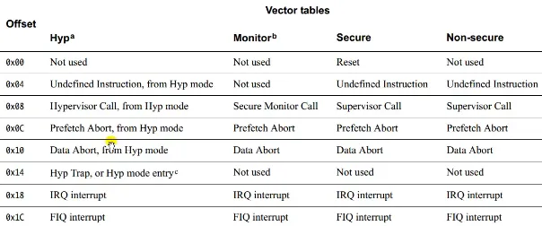

|向量地址|中断类型|中断模式|
|---|---|---|
|0X00|复位中断(Rest)|特权模式(SVC)|
|0X04|未定义指令中断(Undefined Instruction)|未定义指令中止模式(Undef)|
|0X08|软中断(Software Interrupt,SWI)|特权模式(SVC)|
|0X0C|指令预取中止中断(Prefetch Abort)|中止模式|
|0X10|数据访问中止中断(Data Abort)|中止模式|
|0X14|未使用(Not Used)|未使用|
|0X18|IRQ|中断(IRQ Interrupt)|
|0X1C|FIQ|中断(FIQ Interrupt)|

发生复位时，CPU 就去 执行第 1 条指令：`b reset`。  
发生中断时，CPU 就去执行`“ldr pc, _irq”`这条指令。这些指令存放的位置是固定的。

### 2.1.1 中断向量表偏移(vector base)

在向量表里，一般都是放置一条跳转指令，发生该异常时，CPU 就会执行向量表中的跳转指令，去调用更复杂的函数。当然，向量表的位置并不总是从 0 地址开始，很多芯片可以设置某个 `vector base` 寄存器，指定向量表在其他位置，比如imx6ull芯片设置 `vector base` 为 `0x80000000`，指定为 DDR 的某个地址。但是表中的各个异常向量的偏移地址，是固定的：复位向量偏移地址是 0，IRQ中断是 0x18。

## 2.2 GIC概述

 ARM 的中断控制器称之为 `GIC (Generic Interrupt Controller)`，到目前已经更新到 v4 版本了。在STM32叫做`NVIC`(内嵌向量中断控制器 `Nested Vectored Interrupt Controller`)  
简单地说，`GIC v3/v4` 用于 `ARMv8` 架构，即 64 位 ARM 芯片。  
而 `GIC v2` 用于 `ARMv7` 和其他更低的32位架构。

v8架构是在32位ARM架构上进行开发的，将被首先用于对扩展虚拟地址和64位数据处理技术有更高要求的产品领域，如企业应用、高档消费电子产品。`ARMv8`架构包含两个执行状态：`AArch64`和`AArch32`。`AArch64`执行状态针对64位处理技术，引入了一个全新指令集A64；而`AArch32`执行状态将支持现有的ARM指令集。

## 2.3 保护现场，恢复现场的核心：栈

进程是资源分配的基本单位，线程是调度的基本单位。  一个进程可以包含多个线程，每个线程有自己的栈空间。

### 2.3.1 ARM 处理器程序运行的过程

ARM 芯片属于精简指令集计算机(`RISC：Reduced Instruction Set Computing`)，它所用的指令比较简单，有如下特点：

```
对内存只有读、写指令
对于数据的运算是在 CPU 内部实现
使用 RISC 指令的 CPU 复杂度小一点，易于设计
```

比如对于`a=a+b`这样的算式，需要经过下面 4 个步骤才可以实现：
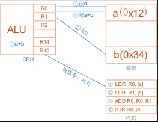
```c
// 把内存 a 的值读入 CPU 寄存器 R0  
// 把内存 b 的值读入 CPU 寄存器 R1  
// 把 R0、R1 累加，存入 R0  
// 把 R0 的值写入内存 a
LDR R0, [a]  
LDR R1, [b]  
ADD R0, R0, R1  
STR R0, [a]  
```

### 2.3.2 入栈保护现场/出栈恢复现场

当进行函数调用跳转到下一个函数，又或者中断一个程序，就需要把当前的寄存器值入栈保存下来：这就称为**保存现场**。  
当跳转的函数执行完成，就需要从栈中恢复那些 CPU 内部寄存器的值，出栈的过程也被叫做**“恢复现场”**。

**①函数调用：**

```
1.在函数 A 里调用函数 B，实际就是中断函数 A 的执行。
2.那么需要把函数 A 调用 B 之前的 CPU 寄存器的值，保存到栈里
```

**②中断处理：**

```
a) 进程 A 正在执行，这时候发生了中断。
b) CPU 强制跳到中断异常向量地址去执行，
c) 这时就需要保存进程 A 被中断的 CPU 寄存器值，
d) 可以保存在进程 A 的内核态栈，也可以保存在进程 A 的内核结构体中。
e) 中断处理完毕，要继续运行进程 A 之前，恢复这些值
```

**③进程切换：**  
进程 A 的时间片用完了，就切换到进程 B。切换过程发生在内核态里，跟中断的处理类似。  
a) 进程 A 被切换时的 CPU 寄存器值保存在某个地方；  
b) 恢复进程 B 之前保存的 CPU 寄存器值，这样就可以运行进程 B 了。
总结有3种场景会要用到栈去保存和恢复现场：
①函数调用，②进程切换，③中断过程。
**进程调度核心就是靠定时器中断来实现**。

## 2.4 硬件中断、软件中断
`cat /proc/softirqs`可以查看软件中断信息
`cat /proc/interrupts`可以查看硬件中断信息

### 2.4.1 硬中断

硬件产生的中断，称之为`“硬件中断”`(`hard irq`)。每个硬件中断都有对应的处理函数。  为方便理解，可以先认为对硬件中断的处理是用数组来实现的，数组里存放的是函数指针：一个中断号对应一个中断服务函数  

### 2.4.2 软中断

相对的，还可以人为地制造中断：软件中断(`soft irq`)，如下图所示：  
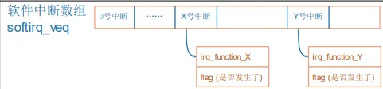
1. 软件中断何时生产？  
    由软件决定，对于 X 号软件中断，只需要把它的 flag 设置为 1 就表示发生了该中断。
2. 软件中断何时处理？  
    软件中断嘛，并不是那么十万火急，有空再处理它好了,因此一般软件中断是硬件中断处理完后，顺便来处理软件中断。
3. 有哪些软件中断？

#### 2.4.2.1 软中断的类型

 `include/linux/interrupt.h`  
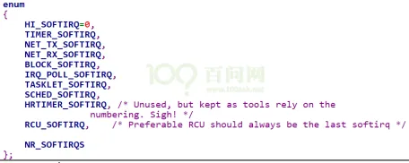

#### 2.4.2.2 软中断的API

- 注册软中断`open_softirq`


```c
void open_softirq(int nr, void (*action)(struct softirq_action *)){  
	softirq_vec[nr].action = action;  
}
```

例如网络发包对应类型为`NET_TX_SOFTIRQ`的处理函数`net_tx_action`。
```c
// net/core/dev.c  
open_softirq(NET_TX_SOFTIRQ, net_tx_action);  
open_softirq(NET_RX_SOFTIRQ, net_rx_action);
```

- 触发软中断`raise_softirq`


最核心的函数是 `raise_softirq`，简单地理解就是设置 `softirq_veq[nr]`的标记位，设置后表示触发该软中断号。

- 执行软中断`do_softirq`

每个 CPU 上会初始化一个 `ksoftirqd` 内核线程，负责处理各种类型的 `softirq` 中断事件:

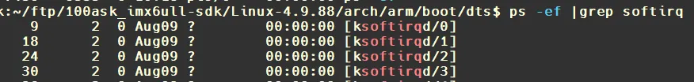
当注册软中断使能后，`ksoftirqd` 线程，执行`pending`的软中断。`ksoftirqd` 里面会进一步调用到 `__do_softirq`。

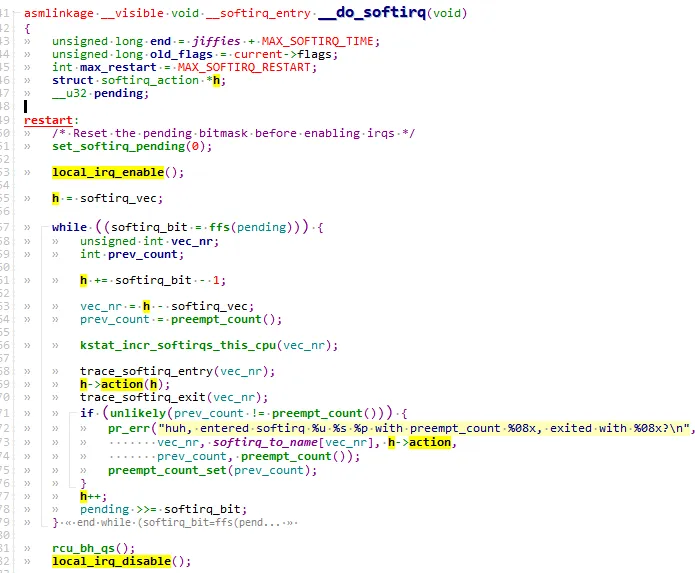
可以看到软中断执行时，硬件中断是使能的。遍历触发的`softlrq`,执行对应的`action`函数。

### 2.4.3 中断上半部与下半部

上半部直接处理硬件请求，也就是硬中断，主要是负责耗时短的工作，特点是快速执行。  
下半部是由内核触发，主要是负责上半部未完成的工作，通常都是耗时比较长的事情，特点是延迟执行 。
硬中断（上半部）是会打断 CPU 正在执行的任务，然后立即执行中断处理程序，而下半部有多种实现方式，以软中断或内核线程的方式执行。

## 2.5 中断处理原则

### 2.5.1 原则 1:不能嵌套

中断 A 正在处理的过程中，假设又发生了中断 B，那么在栈里要保存 A 的现场，然后处理 B。在处理 B 的过程中又发生了中断 C，那么在栈里要保存 B 的现场，然后处理C。  
如果中断嵌套突然暴发，那么栈将越来越大，栈终将耗尽。  
为了防止这种情况发生，也是为了简单化中断的处理，在 Linux 系统上规定中断无法嵌套：即当前中断 A 没处理完之前，不会响应另一个中断 B(即使它的优先级更高)。虽然linux不允许中断嵌套，但是在排队等待处理的中断中，高优先级中断可以插队到低优先级中断前面。
```c
// 关闭当前cpu核的中断响应
local_irq_disable();
```

### 2.5.2 原则 2:越快越好

在单核心芯片系统中，假设中断处理很慢，那应用程序在这段时间内就无法执行：系统显得很迟顿。

### 2.5.3 原则 3:耗时久的中断操作切分为中断上半部、下半部

当处理某个中断要做的事情耗时较长时，要把中断操作切分为中断上半部、下半部，上半部执行关键紧急的事情，下半部去处理耗时久的事情。比如对于按键中断，需要等待几十毫秒消除机械抖动。又比如图像处理中，当一个硬件完成一张图像的捕获，对这张图像的后处理操作耗时是非常久的，应该放在下半部处理。  
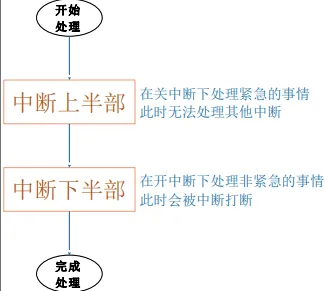

中断下半部的实现有很多种方法： ①`tasklet`(小任务)、②`work queue`(工作队列)， ③`threaded irq`等。

### 2.5.4 原则 4:上半部和下半部均不能休眠

Linux 中断上下文（包括硬中断 handler、软中断、tasklet 等）**不是可调度的进程上下文**，它具备以下关键特性：
- **无进程地址空间**：中断上下文依附于被打断的进程，但没有自己的 `task_struct`（进程控制块），无法被内核调度器管理；
- **不可抢占 / 不可调度**：中断上下文运行时，内核处于 “关抢占” 状态（甚至关中断），调度器无法将其 “换下 CPU”；
- **无栈保护**：中断栈是固定大小的小栈（通常几 KB），且不支持动态扩展；
- **优先级最高**：中断上下文会打断所有进程（包括内核进程），必须快速执行、立即退出。

中断上下文没有可被调度的 “进程实体”，调用 `schedule()` 等休眠相关函数时，内核会彻底混乱 —— 调度器找不到 “要换下的进程”，或无法将休眠的中断上下文 “加入等待队列”，最终触发致命错误，直接导致**系统崩溃（panic）、死锁，或触发内核警告 / Oops**。

## 2.6 中断下半部处理方法

### 2.6.1 小任务tasklet

`tasklet` 是使用软中断来实现的：  
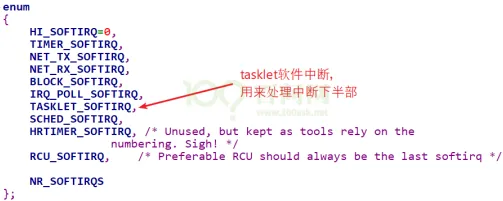
**中断上半部和下半部的处理流程：**  
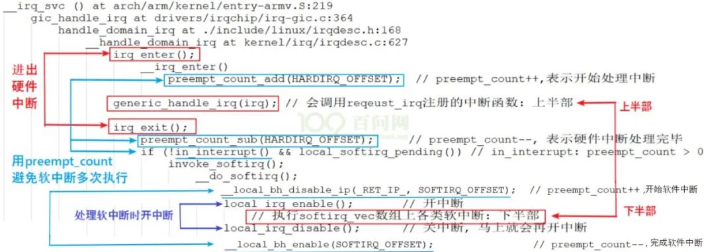
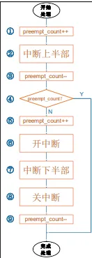
```c
1. 中断源产生中断，执行irq_enter(), 最开始preempt_count=0，preempt_count++后为1,   
	generic_handle_irq中会找到该中断源对应的中断服务程序  
2. 执行irq函数，执行中断上半部，（注意执行上半部分时是无法被抢占的，调用了local_irq_disable()）  
3. irq_exit(),preempt_count-- 后为0，  
4. 判断preempt_count是否等于0，若等于0，也就是执行下半部，否则直接结束当前中断处理流程，切换回上层未处理完的软中断流程继续处理。 
5. 下半部过程中会对preempt_count++，开始软件中断  
6. 由于是软件中断，允许其他的硬件中断响应，local_irq_enable();  
7. 根据软中断号找到服务函数，执行中断下半部
8. 下半部分执行完后，local_irq_disable()  
9. preempt_count--，preempt_count又回到0
```

那么软中断（下半部）A还没有执行到`⑨preempt_count--`，当被其他中断B打断时，又执行`①preempt_count++`，等于2，又进入了下一个硬件中断B流程。当下一个硬件中断B流程执行完后，`preempt_count--`，等于1，此时不会进入软总断流程直接结束，然后恢复A中断的下半部，继续执行完A中断下半部分的代码。那B的下半部怎么执行呢？难道不要了吗？注意：`步骤7`中的中断下半部处理过程中，它处理的是所有中断的下半部分，处理完A的下半部后会继续处理B中断的下半部。所以，多个中断的下半部，是汇集在一起处理的。  

### 2.6.2 工作队列workqueue

如果下半部要做的事情太多，那么`tasklet`就有点不太符合需求了，我们希望建立一个线程来专门执行中断后处理，用内核线程来做：在中断上半部唤醒内核线程。  
在linux操作系统中，有多个**`kworker`** 线程，是系统帮我们创建的。 
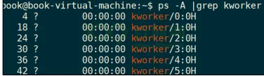
`kworker` 线程要去`“工作队列”(work queue)`上取出一个一个`“工作”(work)`，来执行它里面的函数。

1.创建 `work`  
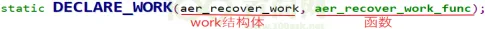
2.要执行这个函数时，把 `work` 提交给 `work queue` 就可以了  

上述函数会把 `work` 提供给**`系统默认的 work queue：system_wq`**，它是一个队列。`schedule_work` 函数不仅仅是把 `work` 放入队列，还会把`kworker` 线程唤醒。

3.什么时候把 `work` 提交给 `work queue`？  
在中断场景中，可以在中断上半部调用 `schedule_work` 函数。  
因此耗时久的中断下半部分，应该利用线程化处理方式，比如使用工作队列`workqueue`，上半部调用`schedule_work` 函数，触发 `work` 的处理。

### 2.6.3 threaded irq

`threaded_irq`：下半部也是利用线程化处理。前面的`workqueue`处理使用方法太麻烦，需要在上半部进行`work`定义，`schedule_work`操作。

```c
handler：上半部回调函数
thread_fn：下半部回调函数，发生中断时，内核线程就会执行这个函数
```

以前用 `work` 来线程化地处理中断，一个 `worker` 线程只能由一个 CPU 执行，多个中断的 `work` 都由同一个 `worker` 线程来处理，在单 CPU 系统中也只能忍着了。但是在 SMP 系统中，明明有那么多 CPU 空着，偏偏让多个中断挤在这个CPU 上？  
新技术 `threaded irq`，多个中断的内核线程可以分配到多个 CPU 上执行，提高了效率。
