# 1 armv7 32位GICv2介绍

armv7 32位 gic采用v2版本，参考手册 [https://developer.arm.com/documentation/ihi0048/bb/?lang=en](https://developer.arm.com/documentation/ihi0048/bb/?lang=en)

`GIC400` 就是v2版本的中断控制器 IP 核，当 GIC 接收到外部中断信号以后就会报给 ARM 内核。框架如下：  
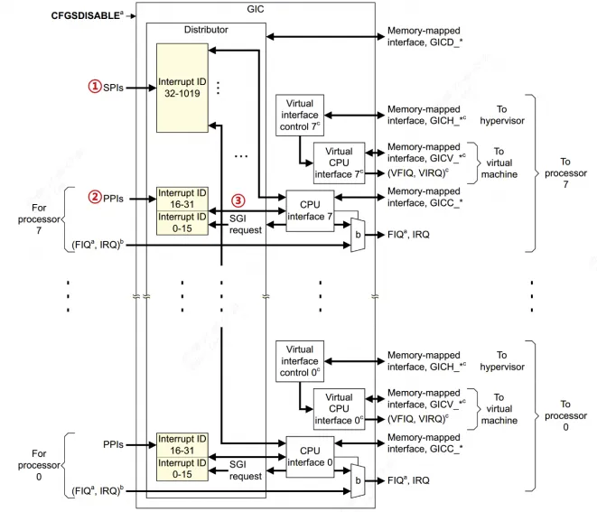
GIC 架构分为了两个逻辑块：`Distributor` 和 `CPU Interface`，也就是分发器端和 CPU 接口端。

## 1.0 分发器端和 CPU 接口端

1. 分发器用来控制全局中断使能，每一个中断使能开关，中断优先级，外部中断触发方式（边沿触发、电平触发）等。
2. cpu接收端用来接收中断信号汇报给cpu, 如：应答中断，通知中断处理完成，定义抢占策略，设置优先级掩码，当多个中断到来选择最高优先级的中断号。
    
 `core_ca7.h`定义了GIC的所有寄存器。
```c
/*  
* GIC 寄存器描述结构体，  
* GIC 分为分发器端和 CPU 接口端  
  */  
  typedef struct {  
      /* 分发器端寄存器 */  
      int32_t RESERVED0[1024];  
      _IOM uint32_t D_CTLR; /* Offset: 0x1000 (R/W) */  
      _IM uint32_t D_TYPER; /* Offset: 0x1004 (R/ ) */  
      _IM uint32_t D_IIDR; /* Offset: 0x1008 (R/ ) */  
      int32_t RESERVED1[29];  
      _IOM uint32_t D_IGROUPR[16]; /* Offset: 0x1080 - 0x0BC (R/W) */  
      uint32_t RESERVED2[16];  
      __IOM uint32_t D_ISENABLER[16];/* Offset: 0x1100 - 0x13C (R/W) */  
      uint32_t RESERVED3[16];  
      __IOM uint32_t D_ICENABLER[16];/* Offset: 0x1180 - 0x1BC (R/W) */  
      uint32_t RESERVED4[16];  
      __IOM uint32_t D_ISPENDR[16]; /* Offset: 0x1200 - 0x23C (R/W) */  
      uint32_t RESERVED5[16];  
      __IOM uint32_t D_ICPENDR[16]; /* Offset: 0x1280 - 0x2BC (R/W) */  
      uint32_t RESERVED6[16];  
      __IOM uint32_t D_ISACTIVER[16];/* Offset: 0x1300 - 0x33C (R/W) */  
      uint32_t RESERVED7[16];  
      __IOM uint32_t D_ICACTIVER[16];/* Offset: 0x1380 - 0x3BC (R/W) */  
      uint32_t RESERVED8[16];  
      __IOM uint8_t D_IPRIORITYR[512];/* Offset: 0x1400 - 0x5FC (R/W) */  
      uint32_t RESERVED9[128];  
      __IOM uint8_t D_ITARGETSR[512];/* Offset: 0x1800 - 0x9FC (R/W) */  
      uint32_t RESERVED10[128];  
      __IOM uint32_t D_ICFGR[32]; /* Offset: 0x1C00 - 0xC7C (R/W) */  
      uint32_t RESERVED11[32];  
      __IM uint32_t D_PPISR; /* Offset: 0x1D00 (R/ ) */  
      __IM uint32_t D_SPISR[15]; /* Offset: 0x1D04 - 0xD3C (R/ ) */  
      uint32_t RESERVED12[112];  
      __OM uint32_t D_SGIR; /* Offset: 0x1F00 ( /W) */  
      uint32_t RESERVED13[3];  
      __IOM uint8_t D_CPENDSGIR[16];/* Offset: 0x1F10 - 0xF1C (R/W) */  
      __IOM uint8_t D_SPENDSGIR[16];/* Offset: 0x1F20 - 0xF2C (R/W) */  
      uint32_t RESERVED14[40];  
      __IM uint32_t D_PIDR4; /* Offset: 0x1FD0 (R/ ) */  
      __IM uint32_t D_PIDR5; /* Offset: 0x1FD4 (R/ ) */  
      __IM uint32_t D_PIDR6; /* Offset: 0x1FD8 (R/ ) */  
      __IM uint32_t D_PIDR7; /* Offset: 0x1FDC (R/ ) */  
      __IM uint32_t D_PIDR0; /* Offset: 0x1FE0 (R/ ) */  
      __IM uint32_t D_PIDR1; /* Offset: 0x1FE4 (R/ ) */  
      __IM uint32_t D_PIDR2; /* Offset: 0x1FE8 (R/ ) */  
      __IM uint32_t D_PIDR3; /* Offset: 0x1FEC (R/ ) */  
      __IM uint32_t D_CIDR0; /* Offset: 0x1FF0 (R/ ) */  
      __IM uint32_t D_CIDR1; /* Offset: 0x1FF4 (R/ ) */  
      __IM uint32_t D_CIDR2; /* Offset: 0x1FF8 (R/ ) */  
      __IM uint32_t D_CIDR3; /* Offset: 0x1FFC (R/ ) */  
  
      /* CPU 接口端寄存器 */  
      __IOM uint32_t C_CTLR; /* Offset: 0x2000 (R/W) */  
      __IOM uint32_t C_PMR; /* Offset: 0x2004 (R/W) */  
      __IOM uint32_t C_BPR; /* Offset: 0x2008 (R/W) */  
      __IM uint32_t C_IAR; /* Offset: 0x200C (R/ ) */  
      __OM uint32_t C_EOIR; /* Offset: 0x2010 ( /W) */  
      __IM uint32_t C_RPR; /* Offset: 0x2014 (R/ ) */  
      __IM uint32_t C_HPPIR; /* Offset: 0x2018 (R/ ) */  
      __IOM uint32_t C_ABPR; /* Offset: 0x201C (R/W) */  
      __IM uint32_t C_AIAR; /* Offset: 0x2020 (R/ ) */  
      __OM uint32_t C_AEOIR; /* Offset: 0x2024 ( /W) */  
      __IM uint32_t C_AHPPIR; /* Offset: 0x2028 (R/ ) */  
      uint32_t RESERVED15[41];  
      __IOM uint32_t C_APR0; /* Offset: 0x20D0 (R/W) */  
      uint32_t RESERVED16[3];  
      __IOM uint32_t C_NSAPR0; /* Offset: 0x20E0 (R/W) */  
      uint32_t RESERVED17[6];  
      __IM uint32_t C_IIDR; /* Offset: 0x20FC (R/ ) */  
      uint32_t RESERVED18[960];  
      __OM uint32_t C_DIR; /* Offset: 0x3000 ( /W) */  
  } GIC_Type;
```
    

## 1.1 GIC 类型

GIC 将众多的中断源分为分为三类：  
①、`SPI`(`Shared Peripheral Interrupt`),共享中断，顾名思义，所有 Core 共享的中断，这个是最常见的，那些外部中断都属于 SPI 中断 。  
②、`PPI`(`Private Peripheral Interrupt)`，私有中断，GIC 是支持多核的，每个核有自己独有的中断。
③、`SGI`(`Software-generated Interrupt`)，软件中断，由软件触发的中断，通过向寄存器`GICD_SGIR` 写入数据来触发，系统会使用 SGI 中断来完成多核之间的通信。

## 1.2 中断 ID

为了区分这些不同的中断源需要给他们分配一个唯一 ID，这些 ID 就是中断 ID。每一个 CPU 最多支持 1020 个中断 ID`ID0~ID1019` 。这 1020 个 ID 包含了 PPI、SPI 和 SGI。

```
ID0~ID15：这 16 个 ID 分配给 SGI。
ID16~ID31：这 16 个 ID 分配给 PPI。
ID32~ID1019：这 988 个 ID 分配给 SPI。
```

例如：I.MX6U 的总共使用了 128 个中断 ID，加上前面属于 PPI 和 SGI 的 32 个 ID，I.MX6U 的中断源共有 `128+32=160`，那么irq为0的中断ID即为32。  
NXP 官方 SDK中的文件 `MCIMX6Y2C.h`定义了160个中断ID。  
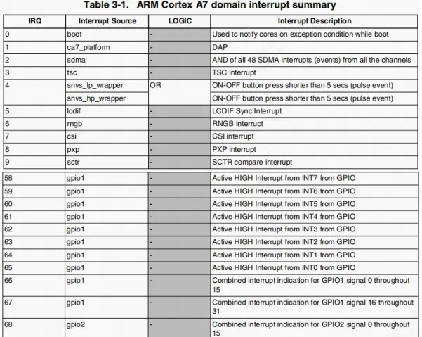
```c
#define NUMBER_OF_INT_VECTORS 160 /* 中断源 160 个，SGI+PPI+SPI*/  
typedef enum IRQn {  
	/* Auxiliary constants */  
	otAvail_IRQn = -128,  
	/* Core interrupts */  
	oftware0_IRQn = 0,   
	oftware1_IRQn = 1,   
	Software2_IRQn = 2,   
	Software3_IRQn = 3,   
	Software4_IRQn = 4,   
	Software5_IRQn = 5,   
	Software6_IRQn = 6,   
	Software7_IRQn = 7,   
	Software8_IRQn = 8,   
	Software9_IRQn = 9,   
	Software10_IRQn = 10,   
	Software11_IRQn = 11,   
	Software12_IRQn = 12,   
	Software13_IRQn = 13,   
	Software14_IRQn = 14,   
	Software15_IRQn = 15,   
	VirtualMaintenance_IRQn = 25,   
	HypervisorTimer_IRQn = 26,   
	VirtualTimer_IRQn = 27,   
	LegacyFastInt_IRQn = 28,   
	SecurePhyTimer_IRQn = 29,   
	NonSecurePhyTimer_IRQn = 30,   
	LegacyIRQ_IRQn = 31,   
	/* Device specific interrupts */  
	IOMUXC_IRQn = 32,   
	DAP_IRQn = 33,   
	SDMA_IRQn = 34,   
	TSC_IRQn = 35,   
	SNVS_IRQn = 36,   
	...... ......   
} IRQn_Type;
```

## 1.3 中断配置

### 1.3.1 IRQ 和 FIQ 总中断使能

“**CPSR程序状态寄存器**”的 I=1 禁止 IRQ，当 I=0 使能 IRQ；F=1 禁止 FIQ，F=0 使能 FIQ。我们还有更简单的指令来完成 IRQ 或者 FIQ 的使能和  
禁止:

|指令|描述|
|---|---|
|cpsid i|禁止 IRQ 中断。|
|cpsie i|使能 IRQ 中断。|
|cpsid f|禁止 FIQ 中断。|
|cpsie f|使能 FIQ 中断。|

### 1.3.2 `ID0~ID1019` 中断使能和禁止

前面讲到中断ID有 `ID0~ID1019`， GIC 寄存器 `GICD_ISENABLERn` 和 `GICD_ICENABLERn` 用来完成外部中断的使能和禁止，对于 Cortex-A7 内核来说中断 ID 只使用了 512 个。  
一共16组`GICD_ISENABLER`和`GICD_ISENABLER`，其中`GICD_ISENABLER0` 的 `bit[15:0]`对应`ID15~0` 的 SGI 中断，`GICD_ISENABLER0` 的 `bit[31:16]`对应`ID31~16`的 PPI 中断。剩下的`GICD_ISENABLER1~GICD_ISENABLER15` 就是控制 SPI 中断的。

### 1.3.3 优先级掩码寄存器 `GICC_PMR`

Cortex-A7 GIC 控制器最多可以支持 256 个优先级，数字越小，优先级越高。Cortex-A7 选择了 32 个优先级，`GICC_PMR` 寄存器，此寄存器设置当前 CPU 响应中断的**最低优先级阈值**，只有优先级数值**高于**该阈值的中断，才能被 CPU 感知并处理；低于 / 等于阈值的中断会被屏蔽（暂时不响应）。`GICC_PMR` 是 32 位寄存器，但仅低 8 位（[7:0]）有效（优先级位），高 24 位保留（写无效，读为 0）

|位域|含义|取值范围|说明|
|---|---|---|---|
|[31:8]|Reserved（保留）|0|写操作忽略，读返回 0|
|[7:0]|Priority Mask（优先级掩码）|0x00 ~ 0xFF|配置 CPU 响应的优先级阈值|

```
// 伪代码：临时屏蔽中低优先级中断
unsigned int old_pmr = read_gicc_pmr();  // 保存原有阈值
write_gicc_pmr(0x20);                   // 仅响应0x00~0x1F的高优先级中断

// 执行关键任务（如数据拷贝、硬件复位）
do_critical_task();

write_gicc_pmr(old_pmr);                // 恢复原有阈值
```

### 1.3.4 中断抢占优先级和子优先级位数 `GICC_BPR`

寄存器 `GICC_BPR` 只有低 3 位有效，其值不同，抢占优先级和子优先级占用的位数也不同：  


### 1.3.5 中断优先级寄存器 `D_IPRIORITYR`

Cortex-A7 使用了 512 个中断 ID，每个中断 ID 配有一个优先级寄存器，所以一共有 512 个 `D_IPRIORITYR` 寄存器。

## 1.4 中断状态机

① **非活动状态（Inactive）**：这意味着该中断未触发。

② **挂起（Pending）**：这意味着中断源已被触发，但正在等待CPU核处理。待处理的中断要通过转发到CPU接口单元，然后再由CPU接口单元转发到CPU核。

③ **活动（Active）**：描述了一个已被内核接收并正在处理的中断。

④ **活动和挂起（Active and pending）**：描述了一种情况，其中CPU核正在为中断服务，而GIC又收到来自同一源的中断。

## 1.5 GIC初始化硬件流程（软件流程见3.3）

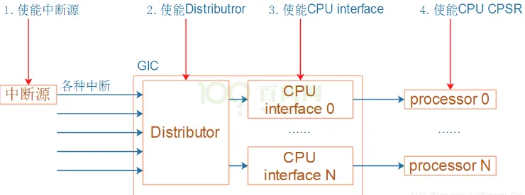
## 1.6 GIC中断处理

当CPU核接收到中断时，`cpu interface`中有`GICC_IAR(Interrupt Acknowledge Register)`可以读，获取中断ID。并且标记为active状态。

当对应的中断服务程序执行完，会将中断ID写入`CPU interface`模块中的`GICC_EOIR(End of Interrupt register)`。标记为`inactive`或`pending`（如果状态为`inactive and pending`）。

## 1.7 GIC控制器寄存器介绍

前面讲了GIC 架构分为了两个逻辑块：`Distributor` 和 `CPU Interface`，也就是分发器端和 CPU 接口端。

### 1.7.1 GIC的内存映射

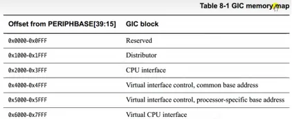
GIC基地址偏移0x1000是分发器 block, 偏移0x2000是CPU 接口端 block。

#### 1.7.1.1 分发器寄存器

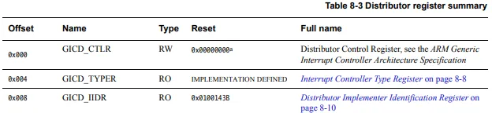
##### 1.7.1.1.1 GICD_CTLR(Distributor Control Register)

`Distributor Control Register`，分发器控制寄存器。


|位域|名|读写|描述|
|:--|:--|:--|:--|
|1|EnableGrp1|R/W|用于将pending Group 1中断从Distributor转发到CPU interfaces 0：group 1中断不转发 1：根据优先级规则转发Group 1中断|
|0|EnableGrp0|R/W|用于将pending Group 0中断从Distributor转发到CPU interfaces 0：group 0中断不转发 1：根据优先级规则转发Group 0中断|

##### 1.7.1.1.2 GICD_TYPER(Controller Type Register)

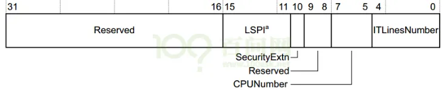

|位域|名|读写|描述|
|:--|:--|:--|:--|
|15:11|LSPI|R|如果GIC实现了安全扩展，则此字段的值是已实现的可锁定SPI的最大数量，范围为0（0b00000）到31（0b11111）。 如果此字段为0b00000，则GIC不会实现配置锁定。 如果GIC没有实现安全扩展，则保留该字段。|
|10|SecurityExtn|R|表示GIC是否实施安全扩展： 0未实施安全扩展； 1实施了安全扩展|
|7:5|CPUNumber|R|表示已实现的CPU interfaces的数量。 已实现的CPU interfaces数量比该字段的值大1。 例如，如果此字段为0b011，则有四个CPU interfaces。|
|4:0|ITLinesNumber|R|表示GIC支持的最大中断数。 如果ITLinesNumber = N，则最大中断数为32*(N+1)。 中断ID的范围是0到（ID的数量– 1）。 例如：0b00011最多128条中断线，中断ID 0-127。 中断的最大数量为1020（0b11111）。 无论此字段定义的中断ID的范围如何，都将中断ID 1020-1023保留用于特殊目的|

##### 1.7.1.1.3 GICD_IIDR(Implementer Identification Register)


|位域|名|读写|描述|
|:--|:--|:--|:--|
|31:24|ProductID|R|产品标识ID|
|23:20|保留|||
|19:16|Variant|R|通常是产品的主要版本号|
|15:12|Revision|R|通常此字段用于区分产品的次版本号|
|11:0|Implementer|R|含有实现这个GIC的公司的JEP106代码； [11:8]：JEP106 continuation code，对于ARM实现，此字段为0x4； [7]：始终为0； [6:0]：实现者的JEP106code，对于ARM实现，此字段为0x3B|

##### 1.7.1.1.4 GICD_IGROUPRn(Group Registers)


|位域|名|读写|描述|
|:--|:--|:--|:--|
|31:0|Group status bits|R/W|组状态位，对于每个位： 0：相应的中断为Group 0； 1：相应的中断为Group 1。|

对于一个中断，如何设置它的Group ？首先找到对应的`GICD_IGROUPRn`寄存器，即n是多少？还要确定使用这个寄存器里哪一位。

对于`interrtups ID m`，如下计算：
```c
n = m DIV 32，GICD_IGROUPRn里的n就确定了；  
GICD_IGROUPRn在GIC内部的偏移地址是多少？0x080+(4*n)  
使用GICD_IPRIORITYRn中哪一位来表示interrtups ID m？  
bit = m mod 32。
```

##### 1.7.1.1.5 GICD_ISENABLERn(Set-Enable Registers)


|位域|名|读写|描述|
|:--|:--|:--|:--|
|31:0|Set-enable bits|R/W|对于SPI和PPI类型的中断，每一位控制对应中断的转发行为：从Distributor转发到CPU interface： 读： 0：表示当前是禁止转发的； 1：表示当前是使能转发的； 写： 0：无效 1：使能转发|

对于一个中断，如何找到`GICD_ISENABLERn`并确定相应的位？
```c
对于interrtups ID m，如下计算：  
n = m DIV 32，GICD_ISENABLERn里的n就确定了；  
GICD_ISENABLERn在GIC内部的偏移地址是多少？0x100+(4*n)  
使用GICD_ISENABLERn中哪一位来表示interrtups ID m？  
bit = m mod 32。
```

##### 1.7.1.1.6 GICD_ICENABLERn(Clear-Enable Registers)


|位域|名|读写|描述|
|:--|:--|:--|:--|
|31:0|Clear-enable bits|R/W|对于SPI和PPI类型的中断，每一位控制对应中断的转发行为：从Distributor转发到CPU interface： 读： 0：表示当前是禁止转发的； 1：表示当前是使能转发的； 写： 0：无效 1：禁止转发|

对于一个中断，如何找到`GICD_ICENABLERn`并确定相应的位？
```c
对于interrtups ID m，如下计算：  
n = m DIV 32，GICD_ISENABLERn里的n就确定了；  
GICD_ISENABLERn在GIC内部的偏移地址是多少？0x100+(4*n)  
使用GICD_ISENABLERn中哪一位来表示interrtups ID m？  
bit = m mod 32。
```

##### 1.7.1.1.7 GICD_ISACTIVERn(Set-Active Registers)


|位域|名|读写|描述|
|:--|:--|:--|:--|
|31:0|Set-active bits|R/W|读： 0：表示相应中断不是active状态； 1：表示相应中断是active状态； 写： 0：无效 1：把相应中断设置为active状态，如果中断已处于Active状态，则写入无效|

对于一个中断，如何找到`GICD_ISACTIVERn`并确定相应的位？
```c
对于interrtups ID m，如下计算：  
n = m DIV 32，GICD_ISACTIVERn里的n就确定了；  
GICD_ISACTIVERn在GIC内部的偏移地址是多少？0x300+(4*n)  
使用GICD_ISACTIVERn 中哪一位来表示interrtups ID m？  
bit = m mod 32。
```

##### 1.7.1.1.8 GICD_ICACTIVERn(Clear-Active Registers)

|位域|名|读写|描述|
|:--|:--|:--|:--|
|31:0|Clear-active bits|R/W|读： 0：表示相应中断不是active状态； 1：表示相应中断是active状态； 写： 0：无效 1：把相应中断设置为deactive状态，如果中断已处于dective状态，则写入无效|

对于一个中断，如何找到`GICD_ICACTIVERn`并确定相应的位？
```c
对于interrtups ID m，如下计算：  
n = m DIV 32，GICD_ICACTIVERn里的n就确定了；  
GICD_ICACTIVERn 在GIC内部的偏移地址是多少？0x380+(4*n)  
使用GICD_ICACTIVERn中哪一位来表示interrtups ID m？  
bit = m mod 32。
```

##### 1.7.1.1.9 GICD_IPRIORITYRn(Priority Registers)

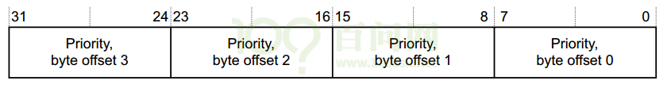

|位域|名|读写|描述|
|31:24|Priority, byte offset 3|R/W|对于每一个中断，都有对应的8位数据用来描述：它的优先级。 每个优先级字段都对应一个优先级值，值越小，相应中断的优先级越高|
|23:16|Priority, byte offset 2|R/W||
|15:8|Priority, byte offset 1|R/W||
|7:0|Priority, byte offset 0|R/W||

如何设置它的优先级(`Priority`)，首先找到对应的`GICD_IPRIORITYRn`寄存器，即n是多少？还要确定使用这个寄存器里哪一个字节。
```c
对于interrtups ID m，如下计算：  
n = m DIV 4，GICD_IPRIORITYRn里的n就确定了；  
GICD_IPRIORITYRn在GIC内部的偏移地址是多少？0x400+(4*n)  
使用GICD_IPRIORITYRn中4个字节中的哪一个来表示interrtups ID m的优先级？  
byte offset = m mod 4。  
byte offset 0对应寄存器里的[7:0]；  
byte offset 1对应寄存器里的[15:8]；  
byte offset 2对应寄存器里的[23:16]；  
byte offset 3对应寄存器里的[31:24]。
```

##### 1.7.1.1.10 GICD_ITARGETSRn(Processor Targets Registers)

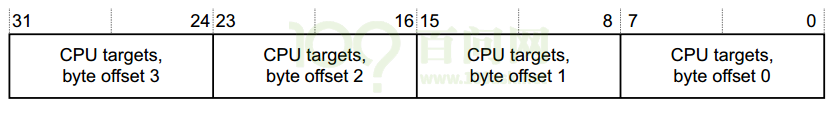

|位域|名|读写|描述|
|31:24|CPU targets, byte offset 3|R/W|对于每一个中断，都有对应的8位数据用来描述：这个中断可以发给哪些CPU。 处理器编号从0开始，8位数里每个位均指代相应的处理器。 例如，值0x3表示将中断发送到处理器0和1。 当读取GICD_ITARGETSR0～GICD_ITARGETSR7时，读取里面任意字节，返回的都是执行这个读操作的CPU的编号。|
|23:16|CPU targets, byte offset 2|R/W||
|15:8|CPU targets, byte offset 1|R/W||
|7:0|CPU targets, byte offset 0|R/W||

如何设置它的目杯CPU？优先级(`Priority`)，首先找到对应的`GICD_ITARGETSRn`寄存器，即n是多少？还要确定使用这个寄存器里哪一个字节。
```c
对于interrtups ID m，如下计算：  
n = m DIV 4，GICD_ITARGETSRn里的n就确定了；  
GICD_ITARGETSRn在GIC内部的偏移地址是多少？0x800+(4*n)  
使用GICD_ITARGETSRn中4个字节中的哪一个来表示interrtups ID m的目标CPU？  
byte offset = m mod 4。  
byte offset 0对应寄存器里的[7:0]；  
byte offset 1对应寄存器里的[15:8]；  
byte offset 2对应寄存器里的[23:16]；  
byte offset 3对应寄存器里的[31:24]。
```

##### 1.7.1.1.11 GICD_ICFGRn(Configuration Registers)

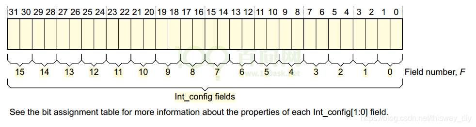

|位域|名|读写|描述|
|:--|:--|:--|:--|
|[2F+1:2F]|Int_config, field F|R/W|对于每一个中断，都有对应的2位数据用来描述：它的边沿触发，还是电平触发。 对于Int_config [1]，即高位[2F + 1]，含义为： 0：相应的中断是电平触发； 1：相应的中断是边沿触发。 对于Int_config [0]，即低位[2F]，是保留位。|

如何找到`GICD_ICFGRn`并确定相应的位域F？
```c
对于interrtups ID m，如下计算：  
n = m DIV 16，GICD_ICFGRn里的n就确定了；  
GICD_ICACTIVERn 在GIC内部的偏移地址是多少？0xC00+(4*n)  
F = m mod 16。
```

##### 1.7.1.1.12 ICPIDR2(Identification registers: Peripheral ID2 Register)

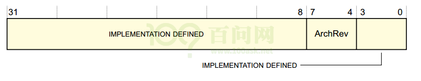

|位域|名|读写|描述|
|:--|:--|:--|:--|
|[31:0]|-|R/W|由实现定义|
|[7:4]|ArchRev|R|该字段的值取决于GIC架构版本： 0x1：GICv1； 0x2：GICv2。|
|[3:0]|-|R/W|由实现定义|

#### 1.7.1.2 cpu接口端寄存器

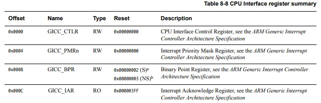
##### 1.7.1.2.1 GICC_CTLR(CPU Interface Control Register)

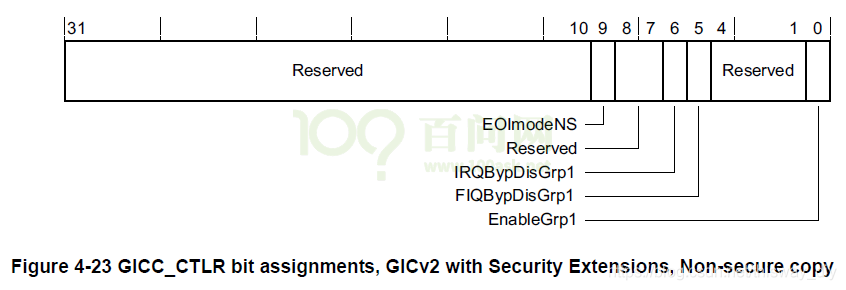

|位域|名|读写|描述|
|:--|:--|:--|:--|
|[31:10]|-||保留|
|[9]|EOImodeNS|R/W|控制对GICC_EOIR和GICC_DIR寄存器的非安全访问： 0：GICC_EOIR具有降低优先级和deactivate中断的功能； 对GICC_DIR的访问是未定义的。 1：GICC_EOIR仅具有降低优先级功能； GICC_DIR寄存器具有deactivate中断功能。|
|[8:7]|-||保留|
|[6]|IRQBypDisGrp1|R/W|当CPU interface的IRQ信号被禁用时，该位控制是否向处理器发送bypass IRQ信号： 0：将bypass IRQ信号发送给处理器； 1：将bypass IRQ信号不发送到处理器。|
|[5]|FIQBypDisGrp1|R/W|当CPU interface的FIQ信号被禁用时，该位控制是否向处理器发送bypass FIQ信号： 0：将bypass FIQ信号发送给处理器； 1：旁路FIQ信号不发送到处理器|
|[4:1]|-||保留|
|[0]|-|R/W|使能CPU interface向连接的处理器发出的组1中断的信号: 0：禁用中断信号 1：使能中断信号|

##### 1.7.1.2.2 GICC_PMR(Priority Mask Register)


|位域|名|读写|描述|
|:--|:--|:--|:--|
|[31:8]|-||保留|
|[7:0]|-|R/W|优先级高于这个值的中断，才会发送给CPU|

`[7:0]`共8位，可以表示256个优先级。但是某些芯片里的GIC支持的优先级少于256个，则某些位为RAZ / WI，如下所示：
```c
如果有128个级别，则寄存器中bit[0] = 0b0，即使用[7:1]来表示优先级；  
如果有64个级别，则寄存器中bit[1:0] = 0b00，即使用[7:2]来表示优先级；  
如果有32个级别，则寄存器中bit[2:0] = 0b000，即使用[7:3]来表示优先级；  
如果有16个级别，则寄存器中bit[3:0] = 0b0000，即使用[7:4]来表示优先级；
```

##### 1.7.1.2.3 GICC_BPR(Binary Point Register)

此寄存器用来把8位的优先级字段拆分为组优先级和子优先级，组优先级用来决定中断抢占。

|位域|名|读写|描述|
|:--|:--|:--|:--|
|[31:3]|-||保留|
|[2:0]|Binary point|R/W|此字段的值控制如何将8bit中断优先级字段拆分为组优先级和子优先级，组优先级用来决定中断抢占。 更多信息还得看看GIC手册。|

##### 1.7.1.2.4 GICC_IAR(Acknowledge Register)

读此寄存器，获得当前中断的`interrtup ID`。

`GICC_IAR`寄存器描述来自`《ARM Generic Interrupt Controller Architecture Specification.pdf》`,它用来表示中断ID号。  
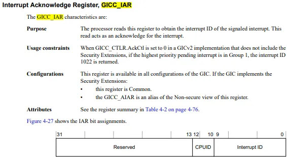
处理完具体的中断处理函数，需要将`GICC_IAR`寄存器的值写入`GICC_EOIR`寄存器中。

|位域|名|读写|描述|
|:--|:--|:--|:--|
|[31:13]|-||保留|
|[12:10]|CPUID|R|对于SGI类中断，它表示谁发出了中断。例如，值为3表示该请求是通过对CPU interface 3上的GICD_SGIR的写操作生成的。|
|[9:0]|Interrupt ID|R|中断ID|

##### 1.7.1.2.5 GICC_EOIR(Interrupt Register)

写此寄存器，表示某中断已经处理完毕。`GICC_IAR`的值表示当前在处理的中断，把`GICC_IAR`的值写入`GICC_EOIR`就表示中断处理完了。  
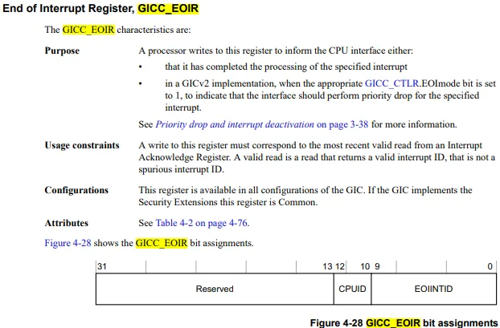

|位域|名|读写|描述|
|:--|:--|:--|:--|
|[31:13]|-||保留|
|[12:10]|CPUID|W|对于SGI类中断，它的值跟GICD_IAR. CPUID的相同。|
|[9:0]|EOIINTID|W|中断ID，它的值跟GICD_IAR里的中断ID相同|

# 2. 中断示例start.s分析

以nxp的IMX6UL为例，SDK中`core_ca7.h`定了了GIC相关函数：

|函数|描述|
|---|---|
|GIC_Init|初始化 GIC。|
|GIC_EnableIRQ|使能指定的外设中断。|
|GIC_DisableIRQ|关闭指定的外设中断。|
|GIC_AcknowledgeIRQ|返回中断号。|
|GIC_DeactivateIRQ|无效化指定中断。|
|GIC_GetRunningPriority|获取当前正在运行的中断优先级。|
|GIC_SetPriorityGrouping|设置抢占优先级位数。|
|GIC_GetPriorityGrouping|获取抢占优先级位数。|
|GIC_SetPriority|设置指定中断的优先级。|
|GIC_GetPriority|获取指定中断的优先级。|

```c
.global _start  				/* 全局标号 */  
_start:  
	ldr pc, =Reset_Handler		/* 复位中断 					*/	  
	ldr pc, =Undefined_Handler	/* 未定义中断 					*/  
	ldr pc, =SVC_Handler		/* SVC(Supervisor)中断 		*/  
	ldr pc, =PrefAbort_Handler	/* 预取终止中断 					*/  
	ldr pc, =DataAbort_Handler	/* 数据终止中断 					*/  
	ldr	pc, =NotUsed_Handler	/* 未使用中断					*/  
	ldr pc, =IRQ_Handler		/* IRQ中断 					*/  
	ldr pc, =FIQ_Handler		/* FIQ(快速中断)未定义中断 			*/  
/* 复位中断 */	  
Reset_Handler:  
	cpsid i						/* 关闭全局中断 */  
	/* 关闭I,DCache和MMU   
	 * 采取读-改-写的方式。  
	 */  
	mrc     p15, 0, r0, c1, c0, 0     /* 读取CP15的C1寄存器到R0中       		        	*/  
    bic     r0,  r0, #(0x1 << 12)     /* 清除C1寄存器的bit12位(I位)，关闭I Cache            	*/  
    bic     r0,  r0, #(0x1 <<  2)     /* 清除C1寄存器的bit2(C位)，关闭D Cache    				*/  
    bic     r0,  r0, #0x2             /* 清除C1寄存器的bit1(A位)，关闭对齐						*/  
    bic     r0,  r0, #(0x1 << 11)     /* 清除C1寄存器的bit11(Z位)，关闭分支预测					*/  
    bic     r0,  r0, #0x1             /* 清除C1寄存器的bit0(M位)，关闭MMU				       	*/  
    mcr     p15, 0, r0, c1, c0, 0     /* 将r0寄存器中的值写入到CP15的C1寄存器中	 				*/  
#if 0  
	/* 汇编版本设置中断向量表偏移 */  
	ldr r0, =0X87800000  
  
	dsb  
	isb  
	mcr p15, 0, r0, c12, c0, 0  
	dsb  
	isb  
#endif  
	/* 设置各个模式下的栈指针，  
	 * 注意：IMX6UL的堆栈是向下增长的！  
	 * 堆栈指针地址一定要是4字节地址对齐的！！！  
	 * DDR范围:0X80000000~0X9FFFFFFF  
	 */  
	/* 进入IRQ模式 */  
	mrs r0, cpsr  
	bic r0, r0, #0x1f 	/* 将r0寄存器中的低5位清零，也就是cpsr的M0~M4 	*/  
	orr r0, r0, #0x12 	/* r0或上0x13,表示使用IRQ模式					*/  
	msr cpsr, r0		/* 将r0 的数据写入到cpsr_c中 					*/  
	ldr sp, =0x80600000	/* 设置IRQ模式下的栈首地址为0X80600000,大小为2MB */  
	/* 进入SYS模式 */  
	mrs r0, cpsr  
	bic r0, r0, #0x1f 	/* 将r0寄存器中的低5位清零，也就是cpsr的M0~M4 	*/  
	orr r0, r0, #0x1f 	/* r0或上0x13,表示使用SYS模式					*/  
	msr cpsr, r0		/* 将r0 的数据写入到cpsr_c中 					*/  
	ldr sp, =0x80400000	/* 设置SYS模式下的栈首地址为0X80400000,大小为2MB */  
	/* 进入SVC模式 */  
	mrs r0, cpsr  
	bic r0, r0, #0x1f 	/* 将r0寄存器中的低5位清零，也就是cpsr的M0~M4 	*/  
	orr r0, r0, #0x13 	/* r0或上0x13,表示使用SVC模式					*/  
	msr cpsr, r0		/* 将r0 的数据写入到cpsr_c中 					*/  
	ldr sp, =0X80200000	/* 设置SVC模式下的栈首地址为0X80200000,大小为2MB */  
	cpsie i				/* 打开全局中断 */  
#if 0  
	/* 使能IRQ中断 */  
	mrs r0, cpsr		/* 读取cpsr寄存器值到r0中 			*/  
	bic r0, r0, #0x80	/* 将r0寄存器中bit7清零，也就是CPSR中的I位清零，表示允许IRQ中断 */  
	msr cpsr, r0		/* 将r0重新写入到cpsr中 			*/  
#endif  
	b main				/* 跳转到main函数 			 	*/  
/* 未定义中断 */  
Undefined_Handler:  
	ldr r0, =Undefined_Handler  
	bx r0  
/* SVC中断 */  
SVC_Handler:  
	ldr r0, =SVC_Handler  
	bx r0  
/* 预取终止中断 */  
PrefAbort_Handler:  
	ldr r0, =PrefAbort_Handler	  
	bx r0  
/* 数据终止中断 */  
DataAbort_Handler:  
	ldr r0, =DataAbort_Handler  
	bx r0  
/* 未使用的中断 */  
NotUsed_Handler:  
	ldr r0, =NotUsed_Handler  
	bx r0  
  
/* IRQ中断！重点！！！！！ */  
IRQ_Handler:  
	push {lr}					/* 保存lr地址 */  
	push {r0-r3, r12}			/* 保存r0-r3，r12寄存器 */  
  
	mrs r0, spsr				/* 读取spsr寄存器 */  
	push {r0}					/* 保存spsr寄存器 */  
  
	mrc p15, 4, r1, c15, c0, 0 /* 从CP15的C0寄存器内的值到R1寄存器中  
								* 参考文档ARM Cortex-A(armV7)编程手册V4.0.pdf P49  
								* Cortex-A7 Technical ReferenceManua.pdf P68 P138  
								*/							  
	add r1, r1, #0X2000			/* GIC基地址加0X2000，也就是GIC的CPU接口端基地址 */  
	ldr r0, [r1, #0XC]			/* GIC的CPU接口端基地址加0X0C就是GICC_IAR寄存器，  
								 * GICC_IAR寄存器保存这当前发生中断的中断号，我们要根据  
								 * 这个中断号来绝对调用哪个中断服务函数  
								 */  
	push {r0, r1}				/* 保存r0,r1 */  
	  
	cps #0x13					/* 进入SVC模式，允许其他中断再次进去 */  
	  
	push {lr}					/* 保存SVC模式的lr寄存器 */  
	ldr r2, =system_irqhandler	/* 加载C语言中断处理函数到r2寄存器中*/  
	blx r2						/* 运行C语言中断处理函数，带有一个参数，保存在R0寄存器中 */  
  
	pop {lr}					/* 执行完C语言中断服务函数，lr出栈 */  
	cps #0x12					/* 进入IRQ模式 */  
	pop {r0, r1}				  
	str r0, [r1, #0X10]			/* 中断执行完成，写EOIR */  
  
	pop {r0}						  
	msr spsr_cxsf, r0			/* 恢复spsr */  
  
	pop {r0-r3, r12}			/* r0-r3,r12出栈 */  
	pop {lr}					/* lr出栈 */  
	subs pc, lr, #4				/* 将lr-4赋给pc */  
/* FIQ中断 */  
FIQ_Handler:  
  
	ldr r0, =FIQ_Handler	  
	bx r0
```

## 2.1 start.s启动流程

1. 进入`_start`,初始化异常向量表。进入复位中断，初始化时钟，关闭看门狗，关闭`MMU`和`ICACHE` `DCACHE`,关闭总中断
2. 设置各个模式的`SP`指针
3. 代码段重定位到DDR上并且清bss段
4. 开启IRQ总中断
5. 跳转到C语言main函数执行

这里很多流程如代码重定位，清除bss，关闭看门狗等没有列举出来。

# 3 GIC中断处理流程

## 3.1 一级中断控制器流程

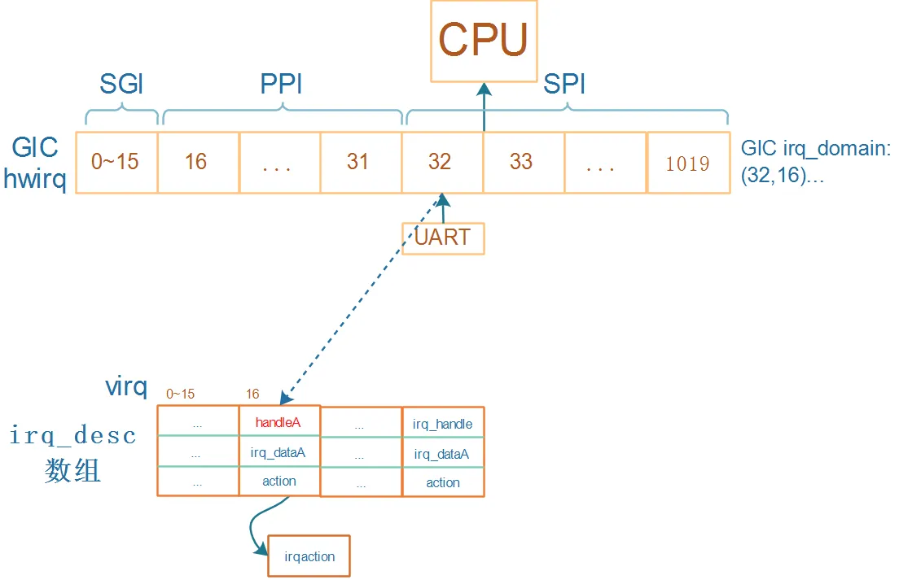
- 假设GIC可以向CPU发出`16-1019`号中断，这些数字被称为`hwirq`。`0-15`用于Process之间通信，比较特殊。
- 假设要使用UART模块，它发出的中断连接到GIC的32号中断，分配的`irq_desc`序号为16
- 在`GIC domain`中会记录`(32, 16)`
- 那么注册中断时就是：`request_irq(16, ...)`
- 发生UART中断时
    - IRQ_handler程序从GIC中读取寄存器知道发生了32号中断，通过 `irq_domain`可以知道`virq`为16
    - 调用`irq_desc[16]`中的`handleA`函数，它的作用是调用action链表中用户注册的函数.

## 3.2 多级中断控制器流程

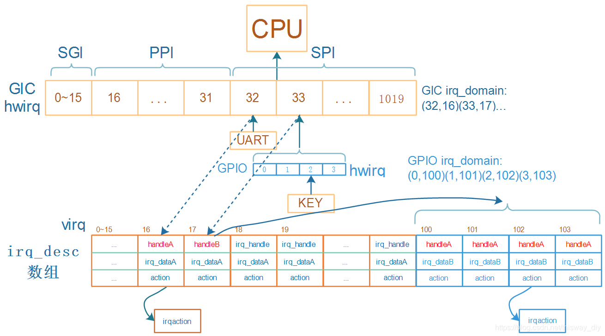
- 假设GPIO模块下有4个引脚，都可以产生中断，都连接到GIC的33号中断
- **GPIO也可以看作一个中断控制器**，对于它的4个中断
- 对于GPIO模块中`0~3`这四个`hwirq`，一般都会一下子分配四个`irq_desc`
- 假设这4个`irq_desc`的序号为`100~103`，在`GPIO domain`中记录`(0,100) (1,101)(2,102) (3,103)`
- 对于KEY，注册中断时就是：`request_irq(102, ...)`
- 按下KEY时：
    - IRQ_handler程序从GIC中读取寄存器知道发生了33号中断，通过`GIC irq_domain`可以知道virq为16.
    - 调用`irq_desc[16]`中的`handleB`函数
        - `handleB`读取GPIO寄存器，确定是GPIO里2号引脚发生中断
        - 通过GPIO `irq_domain`可以知道`virq`为102
        - 调用`irq_desc[102]`中的`handleA`函数，它的作用是调用`action`链表中用户注册的函数

## 3.3 GIC软件初始化过程
```c
start_kernel (init\main.c)  
    init_IRQ (arch\arm\kernel\irq.c)  
    	irqchip_init (drivers\irqchip\irqchip.c)  
    		of_irq_init (drivers\of\irq.c)//gic子系统  
    			desc->irq_init_cb = match->data;  
                ret = desc->irq_init_cb(desc->dev,  
                            desc->interrupt_parent);
```

### 3.3.1 gic驱动注册

内核支持多种GIC, 在内核为每一类GIC定义一个结构体`of_device_id`，并放在一个段里：
```c
// drivers\irqchip\irq-gic.c  
IRQCHIP_DECLARE(gic_400, "arm,gic-400", gic_of_init);  
IRQCHIP_DECLARE(arm11mp_gic, "arm,arm11mp-gic", gic_of_init);  
IRQCHIP_DECLARE(arm1176jzf_dc_gic, "arm,arm1176jzf-devchip-gic", gic_of_init);  
IRQCHIP_DECLARE(cortex_a15_gic, "arm,cortex-a15-gic", gic_of_init);  
IRQCHIP_DECLARE(cortex_a9_gic, "arm,cortex-a9-gic", gic_of_init);  
IRQCHIP_DECLARE(cortex_a7_gic, "arm,cortex-a7-gic", gic_of_init);//imx6ull对应gic类型  
IRQCHIP_DECLARE(msm_8660_qgic, "qcom,msm-8660-qgic", gic_of_init);  
IRQCHIP_DECLARE(msm_qgic2, "qcom,msm-qgic2", gic_of_init);  
IRQCHIP_DECLARE(pl390, "arm,pl390", gic_of_init);
```

`IRQCHIP_DECLARE`宏进行展开：
```c
// include\linux\irqchip.h  
#define IRQCHIP_DECLARE(name, compat, fn) OF_DECLARE_2(irqchip, name, compat, fn)  
#define OF_DECLARE_2(table, name, compat, fn) \  
		_OF_DECLARE(table, name, compat, fn, of_init_fn_2)  
#define _OF_DECLARE(table, name, compat, fn, fn_type)			\  
	static const struct of_device_id __of_table_##name		\  
		__used __section(__irqchip_of_table)			\  
		 = { .compatible = compat,				\  
		     .data = (fn == (fn_type)NULL) ? fn : fn  }
```

例如：`IRQCHIP_DECLARE(cortex_a7_gic, "arm,cortex-a7-gic", gic_of_init);`展开后：
```c
static const struct of_device_id __of_table_cortex_a7_gic		\  
	__used __section(__irqchip_of_table)			\  
	 = { .compatible = "arm,cortex-a7-gic",				\  
		 .data = gic_of_init  }
```

#### 3.3.1.1 dts匹配

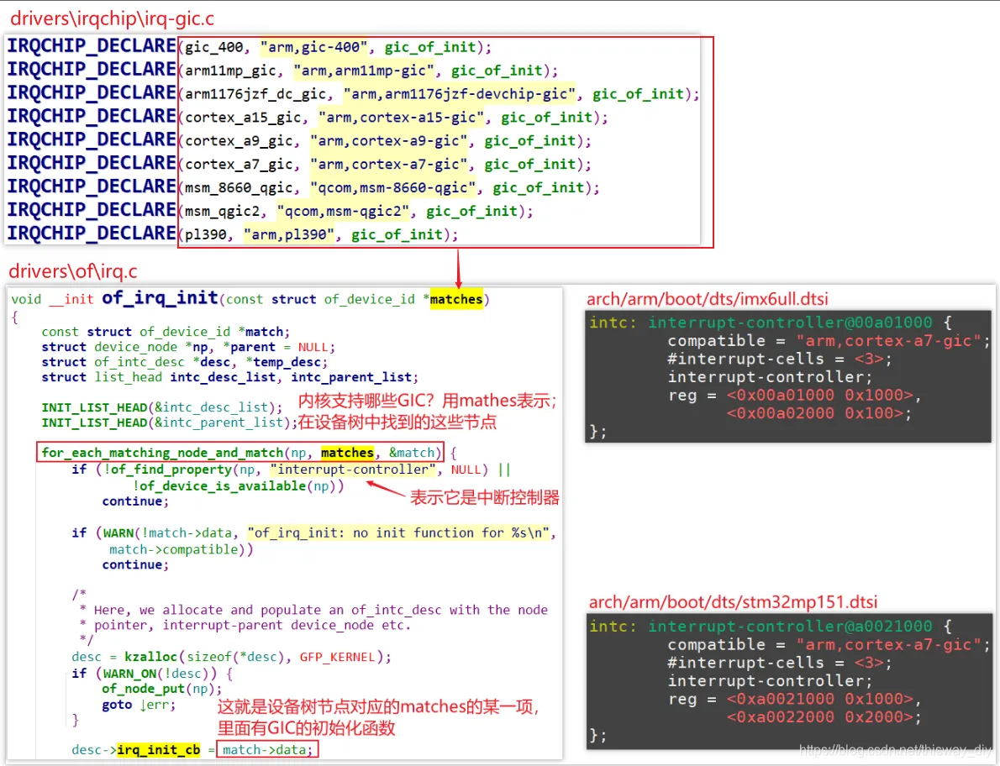
根据dts匹配`irq chip driver` 中`IRQCHIP_DECLARE`声明的结构。

定义 `IRQCHIP_DECLARE` 之后，相应的内容会保存到 `__irqchip_of_table` 里。`__irqchip_of_table` 在链接脚本 `vmlinux.lds` 里，被放到了`__irqchip_begin`和 `__irqchip_of_end` 之间，该段用于存放中断控制器信息。

#### 3.3.1.2 gic_of_init(GIC驱动初始化入口)

`gic_of_init`大致就是对中断控制器初始化：

```
1. 初始化`GICD_xxxx`寄存器组(分发器寄存器)
2. 初始化`GICC_xxxx`寄存器组(cpu接口端寄存器)
3. 调用`gic_init_bases`
		调用`set_handle_irq`注册`gic_handle_irq`异常处理入口
```

```c
void __init set_handle_irq(void (*handle_irq)(struct pt_regs *)){  
	if (handle_arch_irq)  
		return;  
	handle_arch_irq = handle_irq;  
}  

static int __init gic_init_bases(void __iomem *dist_base,  
     struct redist_region *rdist_regs,  
     u32 nr_redist_regions,  
     u64 redist_stride,  
     struct fwnode_handle *handle) {  
     ...
	 set_handle_irq(gic_handle_irq);  
	 ...
}
```
        

#### 3.3.1.3 申请GIC中断

##### 3.3.1.3.1 在设备树里指定中断

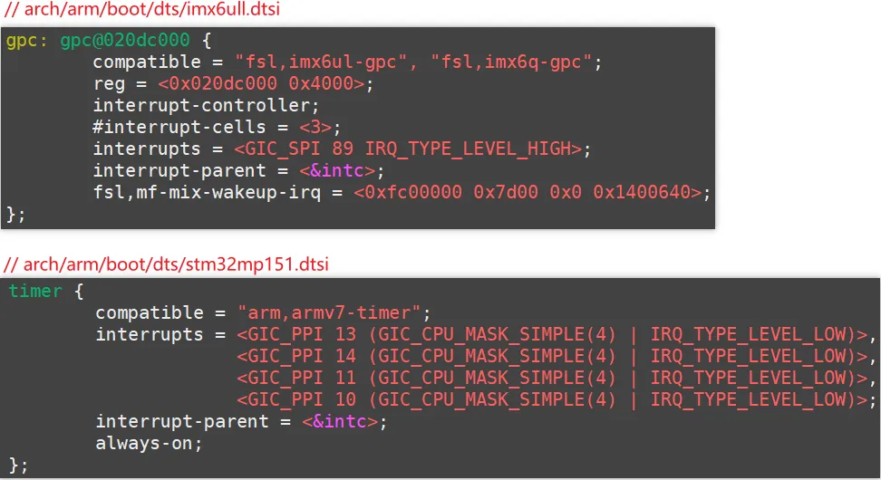
##### 3.3.1.3.2 对设备树中断的处理

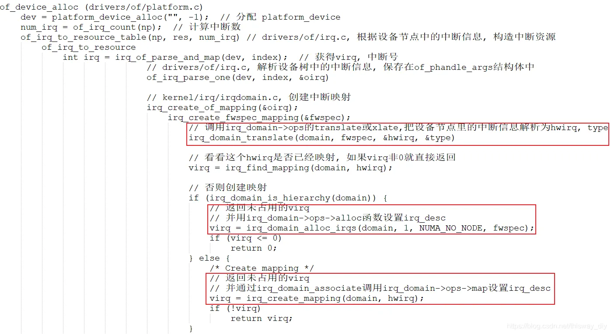
## 3.4 GIC中断处理过程

1. 进入中断栈`irq_stack_entry`
2. 执行中断控制器的中断入口`handle_arch_irq`
3. 退出中断栈`irq_stack_exit`

中断栈用来保存中断的上下文，中断发生和退出的时候调用 `irq_stack_entry` 和 `irq_stack_exit` 来进入和退出中断栈。

### 3.4.1 handle_arch_irq入口

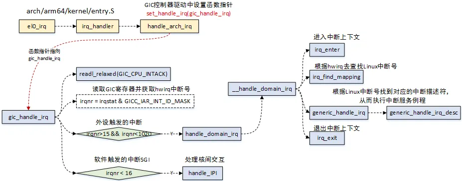

#### 3.4.1.1 gic_handle_irq
```c
static void __exception_irq_entry gic_handle_irq(struct pt_regs *regs)
{
	u32 irqstat, irqnr;
	struct gic_chip_data *gic = &gic_data[0];
	void __iomem *cpu_base = gic_data_cpu_base(gic);

	do {
		irqstat = readl_relaxed(cpu_base + GIC_CPU_INTACK);
		irqnr = irqstat & GICC_IAR_INT_ID_MASK;  // ------(1)

		if (likely(irqnr > 15 && irqnr < 1021)) {  // ------(2)
			handle_domain_irq(gic->domain, irqnr, regs);  // ------(3)
			continue;
		}
		if (irqnr < 16) {
			writel_relaxed(irqstat, cpu_base + GIC_CPU_EOI);
#ifdef CONFIG_SMP
			handle_IPI(irqnr, regs);  // ------(4)
#endif
			continue;
		}
		break;
	} while (1);
}
```

1. 读取中断控制器的寄存器`GICC_IAR`，并获取 `hwirq`
2. 外设触发的中断。硬件中断号`0-15`表示 `SGI (软件中断)`类型的中断，`15-1020` 表示外设中断（SPI或PPI共享中断类型）
3. 中断控制器中断处理的主体
4. 多核CPU（SMP对称多处理器/AMP非对称多处理器）核间交互触发的中断

##### 3.4.1.1.1 handle_domain_irq

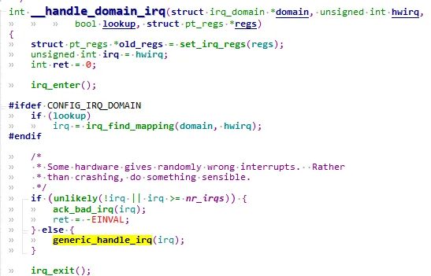
1. 进入中断上下文
2. 根据 `hwirq` 去查找 linux 虚拟中断号
3. 通过虚拟中断号调用 `generic_handle_irq`
4. 退出中断上下文

###### 3.4.1.1.1.1 generic_handle_irq

把`generic_handle_irq`展开：

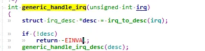
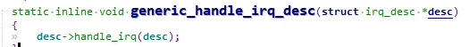
调用 `desc->handle_irq` 指向的回调函数。

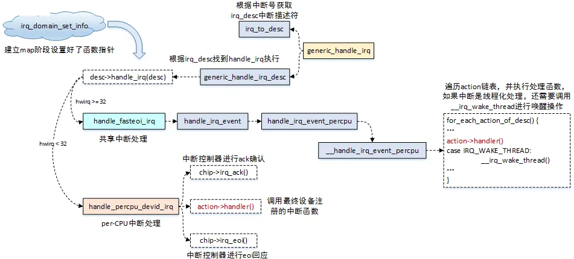
`irq_domain_set_info` 根据硬件中断号的范围设置 `irq_desc->handle_irq` 的指针，共享中断入口为 `handle_fasteoi_irq`，私有中断入口为 `handle_percpu_devid_irq`。

- `handle_percpu_devid_irq`：处理私有中断处理，在这个过程中会分别调用中断控制器的处理函数进行硬件操作，该函数调用 `action->handler()` 来进行中断处理
- `handle_fasteoi_irq`：处理共享中断，并且遍历 `irqaction` 链表，逐个调用 `action->handler()` 函数，这个函数正是设备驱动程序调用 `request_irq/request_threaded_irq` 接口注册的中断处理函数，此外如果中断线程化处理的话，还会调用`__irq_wake_thread`唤醒内核线程。
```c
irqreturn_t __handle_irq_event_percpu(struct irq_desc *desc, unsigned int *flags) {  
    irqreturn_t retval = IRQ_NONE;  
    unsigned int irq = desc->irq_data.irq;  
    struct irqaction *action;  
  
    for_each_action_of_desc(desc, action) {              
        irqreturn_t res;  
        res = action->handler(irq, action->dev_id);//requst_irq注册的函数  
        switch (res) {  
        case IRQ_WAKE_THREAD:  
            __irq_wake_thread(desc, action);            
        case IRQ_HANDLED:  
            *flags |= action->flags;  
            break;  
        }  
    }  
    ...  
}
```

# 4 中断控制器GIC的设备树描述

GIC的设备树绑定信息参考文档`Documentation/devicetree/bindings/arm/gic.txt`。以nxp的`imx6ull.dtsi`为例：
```c
intc: interrupt-controller@00a01000 {  
	compatible = "arm,cortex-a7-gic";  
	#interrupt-cells = <3>;  
	interrupt-controller;  
	reg = <0x00a01000 0x1000>,  
	<0x00a02000 0x100>;  
};
```

1. `compatible` 属性值为`“arm,cortex-a7-gic”`在 Linux 内核源码中搜索`“arm,cortex-a7-gic”`即可找到 GIC 中断控制器驱动文件， GIC 中断控制器驱动是架构通用的，在`drivers/irqchip/irq-gic.c`
2. `interrupt-cells` 和`#address-cells、#size-cells` 一样。每个 cells 都是 32 位整形值，对于 ARM 处理的GIC 来说，一共有 3 个 cells，这三个 cells 的含义如下：
```c
第一个 cells：中断类型，0 表示 SPI(共享) 中断，1 表示 PPI（私有） 中断。  
第二个 cells：中断号，对于 SPI 中断来说中断号的范围为 0~987，对于PPI  
       中断来说中断号的范围为 0~15。  
第三个 cells：标志，bit[3:0]表示中断触发类型，为 1 的时候表示上升沿触发，  
       为 2 的时候表示下降沿触发，为 4 的时候表示高电平触发，为 8 的时候表示低  
       电平触发。bit[15:8]为 PPI 中断的 CPU 掩码。
```

3. `interrupt-controller`表示该节点中断控制器

对于gpio来说也可以作为中断控制器，如imx6ull的`gpio5`：  
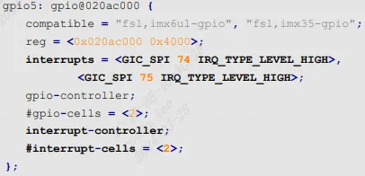
对于 gpio5 来说一共有两条信息，中断类型都是 SPI，  
触发电平都是 `IRQ_TYPE_LEVEL_HIGH`。不同之处在于中断源，一个是 74，一个是 75，《IMX6ULL 参考手册》的`“Chapter 3 Interrupts and DMA Events”`章节：  
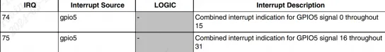
GPIO5 一共用了 2 个中断号，一个是 74，一个是 75。其中 74 对应`GPIO5_IO00~GPIO5_IO15`这低 16 个 IO，75 对应 `GPIO5_IO16~GPIOI5_IO31` 这高 16 位 IO。

使用者：
```c
fxls8471@1e {  
	compatible = "fsl,fxls8471";  
	reg = <0x1e>;  
	position = <0>;  
	interrupt-parent = <&gpio5>;  
	interrupts = <0 8>;  
};
```

`fxls8471` 有一个中断引脚连接到了 I.MX6ULL 的`SNVS_TAMPER0`引脚上，这个引脚可以复用为`GPIO5_IO00 interrupts`设置中断信息，0 表示 `GPIO5_IO00`，8 表示低电平触发。

## 4.1 获取中断号函数
```c
unsigned int irq_of_parse_and_map(struct device_node *dev,int index)  
int gpio_to_irq(unsigned int gpio)  
unsigned int irq_create_mapping(struct irq_domain *domain,  
				irq_hw_number_t hwirq);
```

`irq_of_parse_and_map` 函数从 interupts 属性中提取到对应的设备号，  
dev：设备节点。  
index：索引号，interrupts 属性可能包含多条中断信息，通过 index 指定要获取的信息索引。  
返回值：中断号。

## 4.2 gic使用示例-按键gpio中断

### 4.2.1 dts描述

我们驱动一个按键，采用中断的方式，并且采用定时器来实现按键消抖，应用程序读取按键值并且通过终端打印出来：
```c
key {  
	#size-cells = <1>;  
	compatible = "atkalpha-key";  
	pinctrl-names = "default";  
	pinctrl-0 = <&pinctrl_key>;  
	key-gpio = <&gpio1 18 GPIO_ACTIVE_LOW>; /* KEY0 */  
	interrupt-parent = <&gpio1>;  
	interrupts = <18 IRQ_TYPE_EDGE_BOTH>; /* FALLING RISING */  
	status = "okay";  
};
```

可以看到key使用`key-gpio`使用`GPIO1_IO18`，也用到了gpio中断源interrupts，`IRQ_TYPE_EDGE_BOTH`定义在`include/linux/irq.h：`
```c
enum {  
	IRQ_TYPE_NONE = 0x00000000,  
	IRQ_TYPE_EDGE_RISING = 0x00000001,  
	IRQ_TYPE_EDGE_FALLING = 0x00000002,  
	IRQ_TYPE_EDGE_BOTH = (IRQ_TYPE_EDGE_FALLING |  
		IRQ_TYPE_EDGE_RISING),  
	IRQ_TYPE_LEVEL_HIGH = 0x00000004,  
	IRQ_TYPE_LEVEL_LOW = 0x00000008,  
	IRQ_TYPE_LEVEL_MASK = (IRQ_TYPE_LEVEL_LOW |  
		IRQ_TYPE_LEVEL_HIGH),  
}；
```

### 4.2.2 驱动代码与分析

驱动代码
```c
#include <linux/types.h>  
#include <linux/kernel.h>  
#include <linux/delay.h>  
#include <linux/ide.h>  
#include <linux/init.h>  
#include <linux/module.h>  
#include <linux/errno.h>  
#include <linux/gpio.h>  
#include <linux/cdev.h>  
#include <linux/device.h>  
#include <linux/of.h>  
#include <linux/of_address.h>  
#include <linux/of_gpio.h>  
#include <linux/semaphore.h>  
#include <linux/timer.h>  
#include <linux/of_irq.h>  
#include <linux/irq.h>  
#include <asm/mach/map.h>  
#include <asm/uaccess.h>  
#include <asm/io.h>  
#define IMX6UIRQ_CNT		1			/* 设备号个数 	*/  
#define IMX6UIRQ_NAME		"imx6uirq"	/* 名字 		*/  
#define KEY0VALUE			0X01		/* KEY0按键值 	*/  
#define INVAKEY				0XFF		/* 无效的按键值 */  
#define KEY_NUM				1			/* 按键数量 	*/  
  
/* 中断IO描述结构体 */  
struct irq_keydesc {  
	int gpio;								/* gpio */  
	int irqnum;								/* 中断号     */  
	unsigned char value;					/* 按键对应的键值 */  
	char name[10];							/* 名字 */  
	irqreturn_t (*handler)(int, void *);	/* 中断服务函数 */  
};  
  
/* imx6uirq设备结构体 */  
struct imx6uirq_dev{  
	dev_t devid;			/* 设备号 	 */  
	struct cdev cdev;		/* cdev 	*/  
	struct class *class;	/* 类 		*/  
	struct device *device;	/* 设备 	 */  
	int major;				/* 主设备号	  */  
	int minor;				/* 次设备号   */  
	struct device_node	*nd; /* 设备节点 */  
	atomic_t keyvalue;		/* 有效的按键键值 */  
	atomic_t releasekey;	/* 标记是否完成一次完成的按键，包括按下和释放 */  
	struct timer_list timer;/* 定义一个定时器*/  
	struct irq_keydesc irqkeydesc[KEY_NUM];	/* 按键描述数组 */  
	unsigned char curkeynum;				/* 当前的按键号 */  
};  
  
struct imx6uirq_dev imx6uirq;  
  
static irqreturn_t key0_handler(int irq, void *dev_id)  
{  
	struct imx6uirq_dev *dev = (struct imx6uirq_dev *)dev_id;  
  
	dev->curkeynum = 0;  
	dev->timer.data = (volatile long)dev_id;  
	mod_timer(&dev->timer, jiffies + msecs_to_jiffies(10));	/* 10ms定时 */  
	return IRQ_RETVAL(IRQ_HANDLED);  
}  
void timer_function(unsigned long arg)  
{  
	unsigned char num;  
	struct irq_keydesc *keydesc;  
	struct imx6uirq_dev *dev = (struct imx6uirq_dev *)arg;  
  
	num = dev->curkeynum;  
	keydesc = &dev->irqkeydesc[num];  
  
	keydesc->value = gpio_get_value(keydesc->gpio); 	/* 读取IO值 */  
	if(keydesc->value == 0){ 						/* 按下按键 */  
		atomic_set(&dev->keyvalue, keydesc->value);  
	}  
	else{ 									/* 按键松开 */  
		atomic_set(&dev->keyvalue, 0x80 | keydesc->value);  
		atomic_set(&dev->releasekey, 1);	/* 标记松开按键，即完成一次完整的按键过程 */			  
	}	  
}  
  
static int keyio_init(void)  
{  
	unsigned char i = 0;  
	int ret = 0;  
	  
	imx6uirq.nd = of_find_node_by_path("/key");  
	if (imx6uirq.nd== NULL){  
		printk("key node not find!\r\n");  
		return -EINVAL;  
	}  
	for (i = 0; i < KEY_NUM; i++) {  
		imx6uirq.irqkeydesc[i].gpio = of_get_named_gpio(imx6uirq.nd ,"key-gpio", i);  
		if (imx6uirq.irqkeydesc[i].gpio < 0) {  
			printk("can't get key%d\r\n", i);  
		}  
	}  
	for (i = 0; i < KEY_NUM; i++) {  
		memset(imx6uirq.irqkeydesc[i].name, 0, sizeof(imx6uirq.irqkeydesc[i].name));	/* 缓冲区清零 */  
		sprintf(imx6uirq.irqkeydesc[i].name, "KEY%d", i);		/* 组合名字 */  
		gpio_request(imx6uirq.irqkeydesc[i].gpio, imx6uirq.irqkeydesc[i].name);  
		gpio_direction_input(imx6uirq.irqkeydesc[i].gpio);	  
		imx6uirq.irqkeydesc[i].irqnum = irq_of_parse_and_map(imx6uirq.nd, i);  
#if 0  
		imx6uirq.irqkeydesc[i].irqnum = gpio_to_irq(imx6uirq.irqkeydesc[i].gpio);  
#endif  
		printk("key%d:gpio=%d, irqnum=%d\r\n",i, imx6uirq.irqkeydesc[i].gpio,  
                                         imx6uirq.irqkeydesc[i].irqnum);  
	}  
	imx6uirq.irqkeydesc[0].handler = key0_handler;  
	imx6uirq.irqkeydesc[0].value = KEY0VALUE;  
	  
	for (i = 0; i < KEY_NUM; i++) {  
		ret = request_irq(imx6uirq.irqkeydesc[i].irqnum, imx6uirq.irqkeydesc[i].handler,   
		                 IRQF_TRIGGER_FALLING|IRQF_TRIGGER_RISING, imx6uirq.irqkeydesc[i].name, &imx6uirq);  
		if(ret < 0){  
			printk("irq %d request failed!\r\n", imx6uirq.irqkeydesc[i].irqnum);  
			return -EFAULT;  
		}  
	}  
	init_timer(&imx6uirq.timer);  
	imx6uirq.timer.function = timer_function;  
	return 0;  
}  
static int imx6uirq_open(struct inode *inode, struct file *filp)  
{  
	filp->private_data = &imx6uirq;	/* 设置私有数据 */  
	return 0;  
}  
static ssize_t imx6uirq_read(struct file *filp, char __user *buf, size_t cnt, loff_t *offt)  
{  
	int ret = 0;  
	unsigned char keyvalue = 0;  
	unsigned char releasekey = 0;  
	struct imx6uirq_dev *dev = (struct imx6uirq_dev *)filp->private_data;  
  
	keyvalue = atomic_read(&dev->keyvalue);  
	releasekey = atomic_read(&dev->releasekey);  
	if (releasekey) { /* 有按键按下 */  
		if (keyvalue & 0x80) {  
			keyvalue &= ~0x80;  
			ret = copy_to_user(buf, &keyvalue, sizeof(keyvalue));  
		} else {  
			goto data_error;  
		}  
		atomic_set(&dev->releasekey, 0);/* 按下标志清零 */  
	} else {  
		goto data_error;  
	}  
	return 0;  
data_error:  
	return -EINVAL;  
}  
static struct file_operations imx6uirq_fops = {  
	.owner = THIS_MODULE,  
	.open = imx6uirq_open,  
	.read = imx6uirq_read,  
};  
static int __init imx6uirq_init(void)  
{  
	if (imx6uirq.major) {  
		imx6uirq.devid = MKDEV(imx6uirq.major, 0);  
		register_chrdev_region(imx6uirq.devid, IMX6UIRQ_CNT, IMX6UIRQ_NAME);  
	} else {  
		alloc_chrdev_region(&imx6uirq.devid, 0, IMX6UIRQ_CNT, IMX6UIRQ_NAME);  
		imx6uirq.major = MAJOR(imx6uirq.devid);  
		imx6uirq.minor = MINOR(imx6uirq.devid);  
	}  
	cdev_init(&imx6uirq.cdev, &imx6uirq_fops);  
	cdev_add(&imx6uirq.cdev, imx6uirq.devid, IMX6UIRQ_CNT);  
	imx6uirq.class = class_create(THIS_MODULE, IMX6UIRQ_NAME);  
	if (IS_ERR(imx6uirq.class)) {  
		return PTR_ERR(imx6uirq.class);  
	}  
	imx6uirq.device = device_create(imx6uirq.class, NULL, imx6uirq.devid, NULL, IMX6UIRQ_NAME);  
	if (IS_ERR(imx6uirq.device)) {  
		return PTR_ERR(imx6uirq.device);  
	}  
  
	atomic_set(&imx6uirq.keyvalue, INVAKEY);  
	atomic_set(&imx6uirq.releasekey, 0);  
	keyio_init();  
	return 0;  
}  
static void __exit imx6uirq_exit(void)  
{  
	unsigned int i = 0;  
	del_timer_sync(&imx6uirq.timer);  
	for (i = 0; i < KEY_NUM; i++) {  
		free_irq(imx6uirq.irqkeydesc[i].irqnum, &imx6uirq);  
		gpio_free(imx6uirq.irqkeydesc[i].gpio);  
	}  
	cdev_del(&imx6uirq.cdev);  
	unregister_chrdev_region(imx6uirq.devid, IMX6UIRQ_CNT);  
	device_destroy(imx6uirq.class, imx6uirq.devid);  
	class_destroy(imx6uirq.class);  
}
```

`keyio_init`分析：
从key节点取出key-gpio，得到gpio编号 
调用gpio请求配置函数，配成input模式
根据key节点信息解析出中断号（这里用到一个函数`irq_of_parse_and_map`) ，或者gpio编号转成中断号.
注册中断 
创建定时器用来消抖

中断响应过程：  
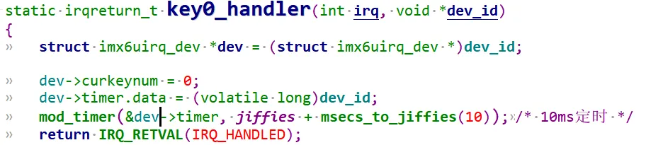
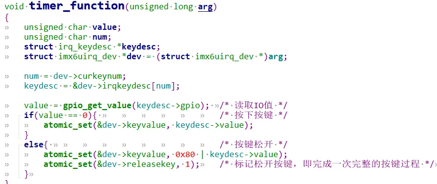
按键按下或松开，中断产生调用`key0_handler`，修改定时器超时10ms, 如果是抖动那么，定时器中断那么不会触发，只有当不是抖动真正按下或松开，定时器中断触发进行读取按键，原子操作设置键值。releasekey置1表示一次完整的按下松开。  
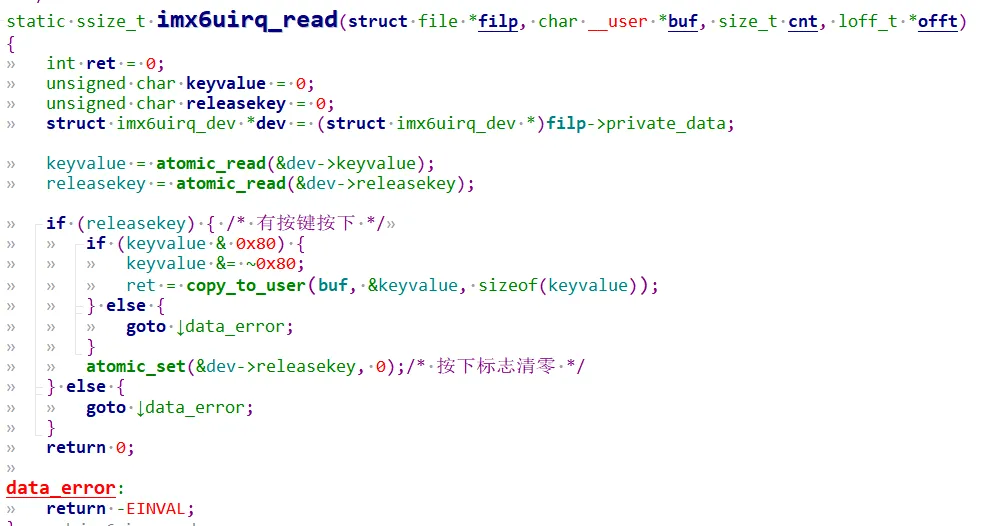
最后用户调用read, 返回键值。可见releasekey很好的控制着按键按下和read的次数，比如当连续read 2次但是只按了一次，则读取失败。  
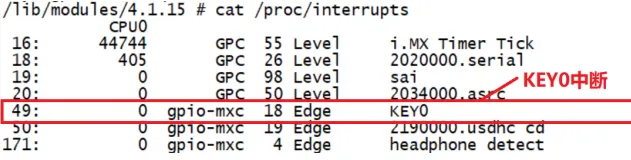
硬中断和虚拟中断号的映射关系可以用 `/proc/interrupts` 查看：

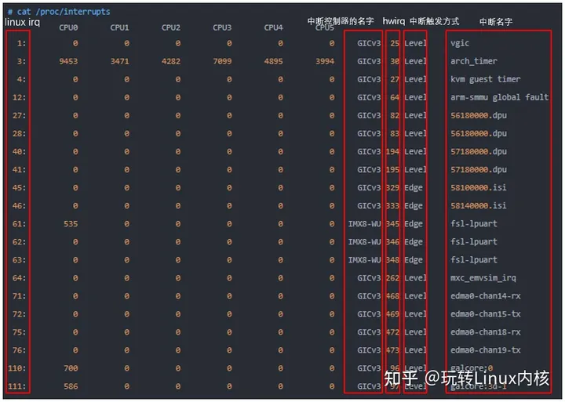
通过 ps 命令可以查看系统中的中断线程，注意这些线程是实时线程 `SCHED_FIFO`:
```c
# ps -A | grep "irq/"  
root          1749     2       0      0 irq_thread          0 S [irq/433-imx_drm]  
root          1750     2       0      0 irq_thread          0 S [irq/439-imx_drm]  
root          1751     2       0      0 irq_thread          0 S [irq/445-imx_drm]  
root          1752     2       0      0 irq_thread          0 S [irq/451-imx_drm]  
root          2044     2       0      0 irq_thread          0 S [irq/279-isl2902]  
root          2192     2       0      0 irq_thread          0 S [irq/114-mmc0]  
root          2199     2       0      0 irq_thread          0 S [irq/115-mmc1]  
root          2203     2       0      0 irq_thread          0 S [irq/322-5b02000]  
root          2361     2       0      0 irq_thread          0 S [irq/294-4-0051]
```

