# 0 SPARSE_IRQ

如果内核配置了 **CONFIG_SPARSE_IRQ**，那么它就会用 **基数树(radix tree)** 来代替 irq_desc 数组。  
SPARSE 的意思是“稀疏”，假设大小为 1000 的数组中只用到 2 个数组项，那不是浪费嘛？当中断比较“稀疏”时可以用基数树来代替数组。  
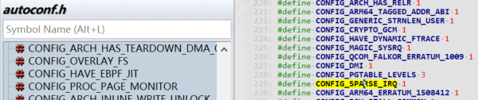
# 1 irq_desc 数组

位于`include/linux/irqdesc.h`

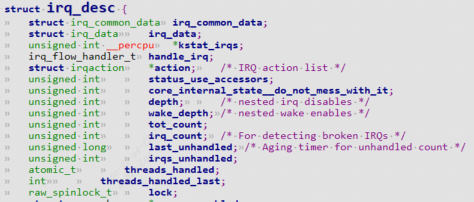
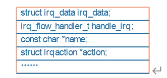
内核中记录一个`irq_desc`的数组，数组的每一项对应一个中断或者一组中断（使用同一中断号）。`irq_desc`几乎记录所有中断相关的东西，这个结构是中断的核心。每一个`irq_desc`数组项中都有一个函数：`handle_irq`，还有一个`action链表`。

`irq_desc` 数组结构链路如下图：

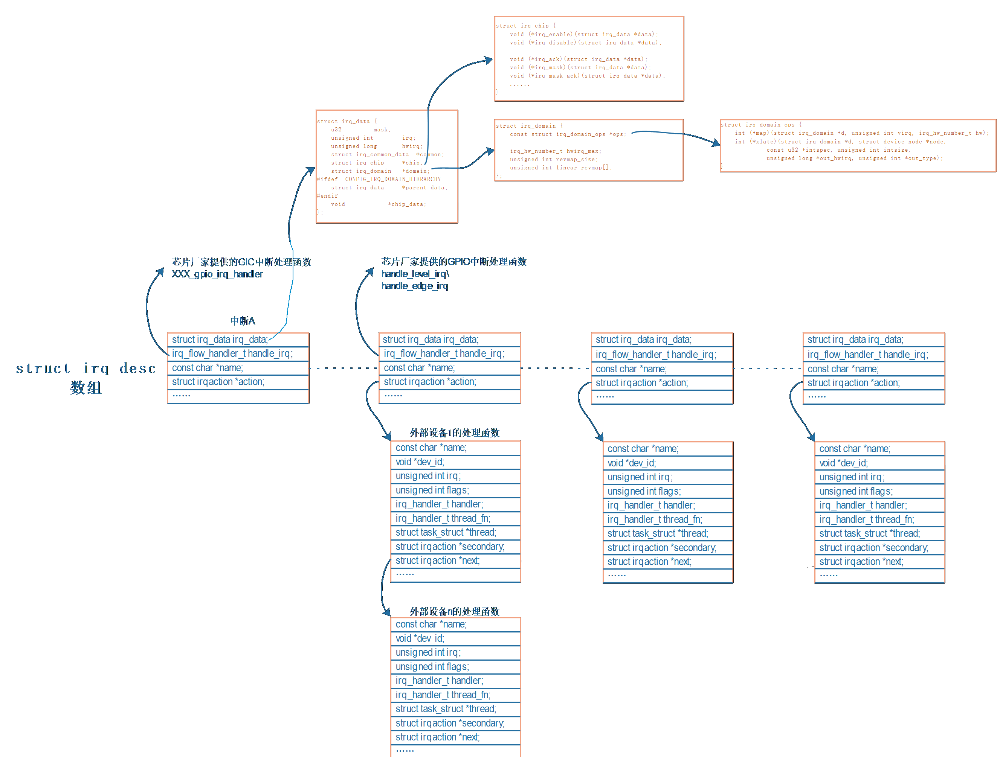
## 1.1 中断处理函数handle_irq

### 1.1.1 共享中断概念引入

：  
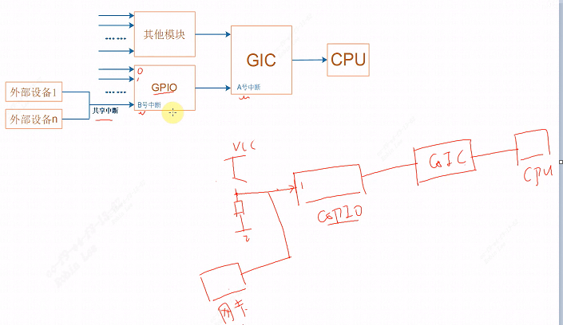
1. 上图一个gpio按键连接gpio模块第一个引脚1，可以设置该引脚，当电平发生变化时，让该引脚产生中断，那么gpio模块会上报中断到gic模块, gic模块继续中断cpu。
2. 同理当一个外部设备网卡和该gpio按键可以共享一个中断，也接到gpio模块第一个引脚1，gpio模块会上报中断到gic模块, gic模块继续中断cpu。这里就用到了共享中断的概念。

可以看到中断的触发时从左到右的过程，那么cpu进行响应中断请求时就是从右到左的过程。

1. cpu读取GIC控制器，判段中断号，如果是A号中断说明是来源于`gpio模块`，如果是`A'`中断，说明来源于`其他模块`。
    
2. A号中断的来源有很多种，有`gpio0,gpio1....`， 又会从gpio控制寄存器来辨别倒是是哪一个gpio产生的中断，比如是B号中断
    
3. B号中断的来源有很多种，有`按键，网卡...`

### 1.1.2 中断的处理函数来源

中断处理函数来源有三：

1. GIC 的处理函数：  
	CPU从异常向量表中调用`handle_arch_irq`，这个函数指针是有GIC驱动设置的。调用`irq_desc[virq].handle_irq`函数，这也应该由GIC驱动提供。
	例如 GIC 中断 CPU 时，CPU 读取 GIC 状态得到中断 A。假设 `irq_desc[A].handle_irq 是 XXX_gpio_irq_handler`(XXX 指厂家)，这个函数需要读取芯片的 GPIO 控制器，细分发生的是哪一个 GPIO 中断(假设是B)，再去调用 `irq_desc[B]. handle_irq`。

2. 模块的中断处理函数：  
    对于外部设备向 GPIO 模块发出的中断 B ， 它 的 处 理 函 数 是`irq_desc[B].handle_irq`。  
    导致 GPIO 中断 B 发生的原因很多，可能是外部设备 1，可能是外部设备n，可能只是某一个设备，也可能是多个设备。所以 `irq_desc[B].handle_irq`会调用`irq_action`链表里的函数，这些函数由外部设备提供。这些函数自行判断该中断是否自己产生，若是则处理。

3. 外部设备提供的处理函数：（也就是`action`里面的函数）  
    这里说的“外部设备”可能是芯片，也可能是简单的按键。它们的处理函数由自己驱动程序提供。对于共享中断，比如 GPIO 中断 B，它的中断来源可能有多个，每个中断源对应一个中断处理函数。所以 `irq_desc[B]`中有一个 `action` 链表。一旦程序确定发生了 GPIO 中断 B，那么就会从链表里把那些函数取出来，一一执行。
    

# 2 irqaction

irqaction 结构体在`include/linux/interrupt.h`

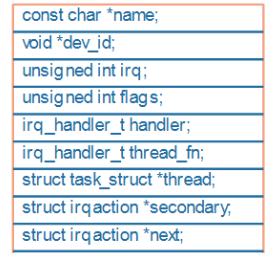
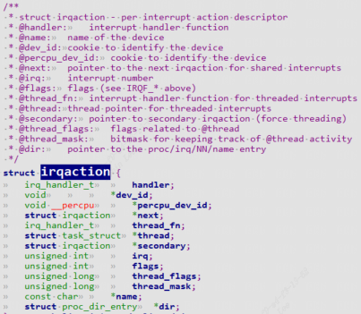
`irq_desc[A]`这里对应的`action`一般为NULL, 而`irq_desc[B]`的`handle_irq`会遍历`irqaction`链表并调用每个`handler`函数。

当调用`request_irq、request_threaded_irq` 注册中断处理函数时，内核就会构造一个 `irqaction` 结构体。在里面保存`name、dev_id`等，最重要的是 `handler、thread_fn、thread`。  
函数原型为：


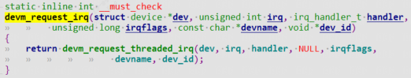

```
handler ：是中断处理的上半部函数，用来处理紧急的事情。
thread_fn ：对应一个内核线程 thread，当 handler 执行完毕，Linux 内核会唤醒对应的内核线程。在内核线程里，会调用 thread_fn 函数。
```

1. 可以提供 handler 而不提供 thread_fn，就退化为一般的 `request_irq` 函数。
2. 可以不提供 handler 只提供 thread_fn，完全由内核线程来处理中断。
3. 也可以既提供 handler 也提供 thread_fn，这就是中断上半部、下半部。

在 reqeust_irq 时可以传入 dev_id，为何需要 dev_id？作用有二：

1. 中断处理函数执行时，可以使用 `dev_id`
2. 卸载中断时要传入 `dev_id`，这样才能在`action`链表中根据 dev_id 找到对应项（所以在共享中断中必须提供 `dev_id`，非共享中断可以不提供）

# 3 irq_data

定义再`include/linux/irq.h`

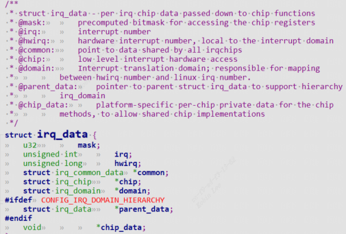
`irq_data`就是个桥梁，把与此irq_desc相关的几种结构体关联起来。里面有 `irq_chip` 指针， `irq_domain` 指针，`irq` 是虚拟中断号，`hwirq` 是硬件中断号。
比如GPIO 中断 B 就是虚拟中断号，可以找到 `irq_desc[B]`这个数组项；GPIO 里的第 x 号中断，这就是 `hwirq`。

`irq、hwirq` 之间的联系呢？由 `irq_domain` 来建立。下面介绍`irq_domain`

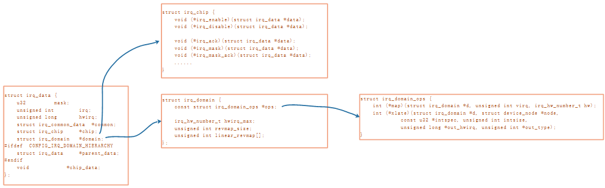
# 4 irq_domain
参考： https://docs.kernel.org/6.0/translations/zh_CN/core-api/irq/irq-domain.html
Linux内核的中断设计使用了一个巨大的数字空间，每个独立的IRQ源都被分配了一个不 同的数字。 当只有一个中断控制器时，这很简单，但在有多个中断控制器的系统中，内核必须确保每 个中断控制器都能得到非重复的Linux IRQ号（数字）分配。

注册为统一的`irqchips`的中断控制器数量呈现出上升的趋势：例如GPIO控制器等不同 种类的子驱动程序，通过将其中断处理程序建模为irqchips，即实际上是级联中断控制器， 避免了重新实现与IRQ核心系统相同的回调机制。

现在，中断号与硬件中断号离散了所有种类的对应关系：在过去，IRQ号可以选择， 使它们与硬件IRQ线进入根中断控制器（即实际向CPU发射中断线的组件）相匹配，现 在这个编号仅仅是一个数字。

出于这个原因，需要一种机制将控制器本地中断号（即硬件irq编号）与Linux IRQ 号分开。

irq_alloc_desc*() 和 irq_free_desc*() API 提供了对irq号的分配，但它们不 提供任何对控制器本地IRQ(hwirq)号到Linux IRQ号空间的反向映射的支持。

irq_domain 库在 irq_alloc_desc*() API 的基础上增加了 hwirq 和 IRQ 号码 之间的映射。 相比于中断控制器驱动自由设计自己的反向映射方案，我们更喜欢用 irq_domain来管理映射。

irq_domain还实现了从抽象的irq_fwspec结构体到hwirq号的转换（到目前为止是 Device Tree和ACPI GSI），并且可以很容易地扩展以支持其它IRQ拓扑数据源。

`irq_desc.irq_data.hwirq`负责`virq`到`hwirq`的映射，`irq_domain.revmap_tree`和`irq_domain.linear_revmap`负责hwirq到virq的反向映射。

`include/linux/irqdomain.h` 中定义该结构。

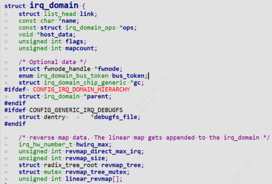
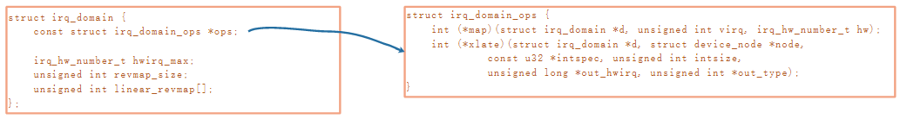
设备树中你会看到这样的属性:
```c
interrupt-parent = <&gpio1>;  
interrupts = <5 IRQ_TYPE_EDGE_RISING>;
```

表示使用`gpio1`中断控制器的5号中断，`hwirq` 就是 5。当我们在驱动中会使用 `request_irq(irq, handler)`这样的函数来注册中断，`irq编号`就是虚拟中断，那么虚拟中断号要怎么得到？  
`gpio1`对应的`irq_domain` 结构体中有 `revman_tree` 和 `linear_revmap` 实现hwirq到virq的映射， `irq_domain_ops` 结构体中的各种操作函数实现信息转换，设置当前`irq_desc`关联到的`irq_domain`和`irq_chip`，以及为irq_desc设置`handle_irq`。

### 1.4.1 irq_domain的用法

中断控制器驱动程序通过以下方式创建并注册一个irq_domain。调用 `irq_domain_add_*()` 或 `irq_domain_create_*()`函数之一（每个映射方法都有不 同的分配器函数，后面会详细介绍）。 函数成功后会返回一个指向irq_domain的指针。 调用者必须向分配器函数提供一个irq_domain_ops结构体。

在大多数情况下，irq_domain在开始时是空的，没有任何hwirq和IRQ号之间的映射。 通过调用`irq_create_mapping()`将映射添加到irq_domain中，该函数接受 irq_domain和一个hwirq号作为参数。 如果hwirq的映射还不存在，那么它将分配 一个新的 `irq_desc`，将其与`hwirq`关联起来，并调用`irq_domain_ops.map()`回调，这样驱动程序就可以执行任何必要的硬件设置，通常是在`.map`回调函数中调用`irq_domain_set_hwirq_and_chip`设置`irq_chip`和`irq_desc.handle`。

一旦建立了映射，可以通过多种方法检索或使用它：

- `irq_resolve_mapping()`返回一个指向给定域和hwirq号的irq_desc结构指针， 如果没有映射则返回NULL。

- `irq_find_mapping()`返回给定域中和hwirq绑定的virq 号，如果没有映射则返回0。

- `irq_linear_revmap()`现与`irq_find_mapping()`相同，已被废弃。

- `generic_handle_domain_irq()`处理一个由域和hwirq号描述的中断。

请注意，irq域的查找必须发生在与RCU读临界区兼容的上下文中。

在调用`irq_find_mapping()`之前，至少要调用一次`irq_create_mapping()`函数， 以免描述符不能被分配。

如果驱动程序有Linux的IRQ号或irq_data指针，并且需要知道相关的hwirq号（比 如在irq_chip回调中），那么可以直接从irq_data->hwirq中获得。

### 1.4.2 irq_domain映射的类型
从hwirq到virq 的反向映射有几种机制，每种机制使用不同的分配函数。应该 使用哪种反向映射类型取决于用例。 下面介绍每一种反向映射类型：

- **线性映射**
```c
irq_domain_add_linear()
irq_domain_create_linear()
```
线性反向映射维护了一个固定大小的表，该表以hwirq号为索引。 当一个hwirq被映射 时，会给hwirq分配一个irq_desc，并将virq号存储在表中。

当最大硬件中断 (hwirq) 数量固定且相对较小（~ < 256）时，线性映射是一个不错的选择。该映射的优点是中断号查找时间固定，并且 irq_descs 仅分配给正在使用的中断。缺点是表的大小必须与最大可能的 hwirq 数量一样大。

`irq_domain_add_linear()`和`irq_domain_create_linear()`在功能上是等价的， 除了第一个参数不同，前者接受一个Open Firmware特定的 ‘struct device_node’ 而 后者接受一个更通用的抽象 ‘struct fwnode_handle’ 。

大多数驱动应该使用线性映射

- **树状映射**
```c
irq_domain_add_tree()
irq_domain_create_tree()
```
irq_domain维护着从hwirq号到virq 的radix的树状映射。 当一个hwirq被映射时， 一个irq_desc被分配，hwirq被用作radix树的查找键。

如果hwirq号非常大，树状映射是一个很好的选择，因为它不需要分配一个和最大hwirq 号一样大的表。 缺点是，hwirq到IRQ号的查找取决于表中有多少条目。

irq_domain_add_tree()和irq_domain_create_tree()在功能上是等价的，除了第一 个参数不同——前者接受一个Open Firmware特定的 ‘struct device_node’ ，而后者接受一个更通用的抽象 ‘struct fwnode_handle’ 。

极少数的驱动需要这种映射。

- **无映射**
```c
irq_domain_add_nomap()
```
当硬件中断号 (hwirq) 可编程时，应使用“无映射”类型。在这种情况下，最好将 Linux 中断号直接写入硬件，这样就不需要映射了。调用 `irq_create_direct_mapping()` 函数会分配一个virq，并调用 `irq_domain_ops.map()` 回调函数，以便驱动程序可以将 Linux 中断号写入硬件。

大多数驱动程序无法使用此映射，现在它由CONFIG_IRQ_DOMAIN_NOMAP选项控制。 请不要引入此API的新用户。

- **传统映射类型**
```c
irq_domain_add_simple()
irq_domain_add_legacy()
irq_domain_create_simple()
irq_domain_create_legacy()
```
传统映射是针对已为硬件中断 (hwirq) 分配了一系列中断描述符 (irq_desc) 的驱动程序的特殊情况。当驱动程序无法立即转换为使用线性映射时，应使用此映射。例如，许多嵌入式系统板支持文件使用一组 `#define `来定义 IRQ 编号，这些编号会传递给 `struct device`注册。在这种情况下，virq编号无法动态分配，因此应使用传统映射。

顾名思义，`*_legacy()` 函数已被弃用，其存在仅是为了方便对旧平台的支持。不应再添加新用户。同样，如果使用 `*_simple()` 函数会导致旧版行为，也应如此处理。

传统的映射方式假定控制器已经分配了一段连续的 IRQ 号，并且 IRQ 号可以通过在 hwirq 号上加上一个固定偏移量来计算，反之亦然。其缺点在于，它要求中断控制器管理 IRQ 分配，并且即使 hwirq 未使用，也需要为每个 hwirq 分配一个 irq_desc。

仅当必须支持固定的 IRQ 映射时才应使用旧版映射。例如，ISA 控制器会使用旧版映射来映射 Linux 的 IRQ 0-15，以便现有的 ISA 驱动程序能够获得正确的 IRQ 编号。

大多数使用旧版映射的用户应该使用 `irq_domain_add_simple()` 或 `irq_domain_create_simple()` 函数，这两个函数仅在系统提供 IRQ 范围时才使用旧版域，否则将使用线性域映射。该调用的语义是：如果指定了 IRQ 范围，则会动态地为其分配描述符；如果没有指定范围，则会调用 `irq_domain_add_linear()` 或 `irq_domain_create_linear()` 函数，这意味着不会分配任何 IRQ 描述符。

简单域的典型用例是 irqchip 提供商同时支持动态和静态 IRQ 分配。

为了避免出现使用线性域但没有分配描述符的情况，务必确保使用简单域的驱动程序在调用任何` irq_find_mapping()` 之前已经调用了 `irq_create_mapping()`，因为后者实际工作于静态 IRQ 分配的情况。

`irq_domain_add_simple()` 和 `irq_domain_create_simple()` 以及 `irq_domain_add_legacy()` 和 `irq_domain_create_legacy()` 在功能上是等效的，只是第一个参数不同，前者接受 Open Firmware 特有的“struct device_node”，而后者接受更通用的抽象“struct fwnode_handle”。

### 1.4.3 irq_domain层级结构

```c
irq_domain_add_hierarchy()
irq_domain_create_hierarchy()
```
当size为0时，**树状映射域**被创建，否则**线性映射域**被创建。
在某些架构上，可能有多个中断控制器参与将一个中断从设备传送到目标CPU。 让我们来看看x86平台上典型的中断传递路径吧:

```
Device --> IOAPIC -> Interrupt remapping Controller -> Local APIC -> CPU
```

涉及到的中断控制器有三个:
- IOAPIC 控制器
- 中断重映射控制器
- Local APIC 控制器

为了支持这样的硬件拓扑结构，使软件架构与硬件架构相匹配，需要为每个中断控制器建立一 个irq_domain数据结构，并将这些irq_domain组织成层次结构。
在建立irq_domain层次结构时，靠近设备的irq_domain为子域，靠近CPU的 irq_domain为父域。所以在上面的例子中，将建立如下的层次结构。

```
CPU Vector irq_domain (root irq_domain to manage CPU vectors)
        ^
        |
Interrupt Remapping irq_domain (manage irq_remapping entries)
        ^
        |
IOAPIC irq_domain (manage IOAPIC delivery entries/pins)
```
使用irq_domain层次结构的主要接口有四个:

- `irq_domain_alloc_irqs()`: 分配IRQ描述符和与中断控制器相关的资源来传递这些中断。
- `irq_domain_free_irqs()`: 释放IRQ描述符和与这些中断相关的中断控制器资源。
- `irq_domain_activate_irq()`: 激活中断控制器硬件以传递中断。
- `irq_domain_deactivate_irq()`: 停用中断控制器硬件，停止传递中断。

为了支持irq_domain层次结构，需要做如下修改:

- 一个新的字段 ‘parent’ 被添加到irq_domain结构中；它用于维护irq_domain的层次信息。
- 一个新的字段 ‘parent_data’ 被添加到irq_data结构中；它用于建立层次结构irq_data以 匹配irq_domain层次结构。irq_data用于存储irq_domain指针和硬件irq号。
- 新的回调`alloc`被添加到irq_domain_ops结构中，以支持层次结构的irq_domain操作。在alloc回调中，除了像`.map`回调中调用`irq_domain_set_hwirq_and_chip`设置`irq_chip`和`irq_desc.handle`之外，通常还调用`irq_domain_alloc_irqs_parent`完成父域的`irq_chip`和`irq_desc.handle`设置。

有了层级结构 irq_domain 和 irq_data 的支持，每个中断控制器都会构建一个 irq_domain 结构，并且每个与 IRQ 关联的 irq_domain 都会分配一个 irq_data 结构。现在我们可以更进一步，支持堆叠式（层级式）irq_chip。也就是说，沿着层级结构，每个 irq_data 都关联一个 irq_chip。子 irq_chip 可以独立执行所需操作，也可以与其父 irq_chip 协作执行。

通过堆栈式的irq_chip，中断控制器驱动只需要处理自己管理的硬件，在需要的时候可以向其父 irq_chip请求服务。所以我们可以实现更简洁的软件架构。

为了让中断控制器驱动程序支持irq_domain层次结构，它需要做到以下几点:

- 实现 irq_domain_ops.alloc 和 irq_domain_ops.free
- 可选择地实现 irq_domain_ops.activate 和 irq_domain_ops.deactivate.
- 可选择地实现一个irq_chip来管理中断控制器硬件。
- 不需要实现irq_domain_ops.map和irq_domain_ops.unmap，它们在层次结构 irq_domain中是不用的。

irq_domain层次结构绝不是x86特有的，大量用于支持其他架构，如ARM、ARM64等。

### 1.4.4 irq_domain_ops
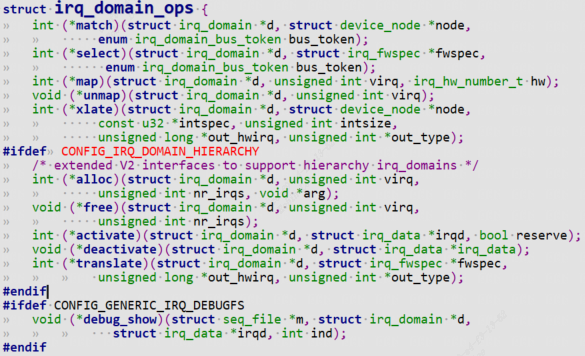
对于非层级的irq_domain类型，需要实现下面的回调：
- `xlate`（可选）函数用来解析设备树的中断属性，提取出 `hwirq、type` 等信息。
- `map`函数调用`irq_domain_set_hwirq_and_chip`设置`irq_chip`和`irq_desc.handle`。
对于层级的irq_domain，需要实现下面的回调：
- `alloc`函数调用`irq_domain_set_hwirq_and_chip`设置`irq_chip`和`irq_desc.handle`之外，通常还调用`irq_domain_alloc_irqs_parent`完成父域的`irq_chip`和`irq_desc.handle`设置。
- `translate`（可选）函数和`xlate`类似，解析设备数中的中断属性，提取出 `hwirq、type` 等信息。

# 5 irq_chip

`irq_chip` 结构体在`include/linux/irq.h`中定义

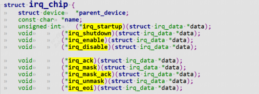
```c
* @irq_startup:  start up the interrupt (defaults to ->enable if NULL)  
* @irq_shutdown:  shut down the interrupt (defaults to ->disable if NULL)  
* @irq_enable:    enable the interrupt (defaults to chip->unmask if NULL)  
* @irq_disable:  disable the interrupt  
* @irq_ack:    start of a new interrupt  
* @irq_mask:    mask an interrupt source  
* @irq_mask_ack:  ack and mask an interrupt source  
* @irq_unmask:    unmask an interrupt source  
* @irq_eoi:    end of interrupt
```

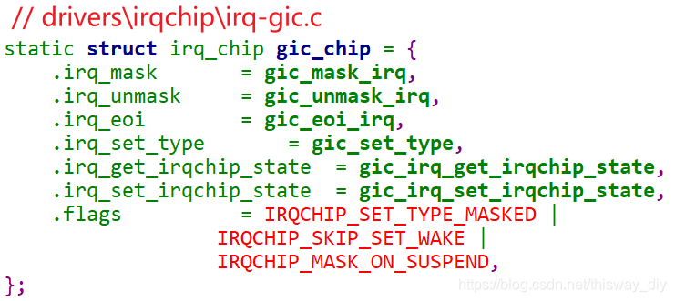
我们在`request_irq`后，并不需要手工去使能中断，原因就是系统调用对应的 `irq_chip` 里的`irq_enable`函数帮我们使能了中断。  
我们提供的中断处理函数中，也不需要执行主芯片相关的清中断操作，也是系统帮我们调用`irq_chip`中的相关函数。  
但是对于外部设备相关的清中断操作，还是需要我们自己做的。就像上面图里的`“外部设备 1“、“外部设备 n”`，外设备千变万化，内核里没有对应的清除中断操作。

# 6 中断控制器驱动示例

```c
static int xxx_domain_alloc(struct irq_domain *domain, unsigned int irq, unsigned int nr_irqs, void *data)
{
	...
	for (i = 0; i < nr_irqs; i++)
		irq_domain_set_hwirq_and_chip(domain, irq + i, hwirq + i, &imx_gpc_chip, NULL);
	parent_fwspec = *fwspec;
	parent_fwspec.fwnode = domain->parent->fwnode;
	return irq_domain_alloc_irqs_parent(domain, irq, nr_irqs, &parent_fwspec);
}

static const struct irq_domain_ops xxx_domain_ops = {
	.translate	= xxx_domain_translate,
	.alloc		= xxx_domain_alloc,
	.free		= irq_domain_free_irqs_common,
};

int __init
xxx_of_init(struct device_node *node, struct device_node *parent)
{
	...
	// set_handle_irq(gic_handle_irq); // 设置中断向量表的handle_irq，只有root irq_domain才需要设置
    domain = irq_domain_add_hierarchy(parent_domain, 0, GPC_MAX_IRQS,node, &xxx_domain_ops,NULL);  // 注册irq_domain

IRQCHIP_DECLARE(cortex_a7_gic, "arm,cortex-a7-gic", xxx_of_init);
```