# 1 中断在设备树中的描述

## 1.1 多级中断控制器

GPIO1 连接到 GIC，GPIO2 连接到 GIC，所以 GPIO1 的父中断控制器是 GIC，GPIO2的父中断控制器也是 GIC。假设 GPIO1 有 32 个中断源，但是它把其中的 16 个汇聚起来向 GIC 发出一个中断，把另外 16 个汇聚起来向 GIC 发出另一个中断。这就意味着 GPIO1 会用到 GIC 的两个中断，会涉及 GIC 里的 2 个 `hwirq` 。
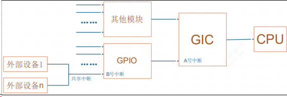
## 1.2 设备树中断相关属性

- `interrupt-controller`
设备树中，中断控制器节点中必须使用此属性表明它是 `“中断控制器”`。  
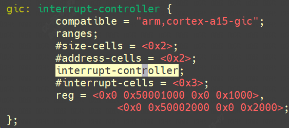

- `interrupt-cells`
定义子节点中interrupts属性使用几个cell，每个cell的描述参考具体的驱动文档，如`arm,cortex-a15-gic`。

- `interrupt-parent`
定义中断控制器的父节点，需要根据多级中断控制器的结构设置  
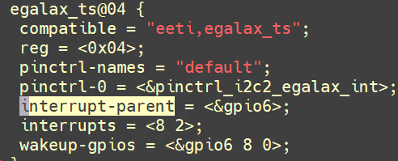

- `interrupts`
定义要使用的具体中断号及触发方式，cell个数由父中断控制器节点的`interrupt-cells`属性定义。
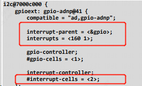
## 1.3 dts中获取中断

### 1.3.1 对于 platform_device

当平台设备和平台驱动match上后，一个节点能被转换为 `platform_device`，调用`platform_get_resource`可获取节点资源信息。
```c
extern struct resource *platform_get_resource(struct platform_device *,unsigned int, unsigned int);
```


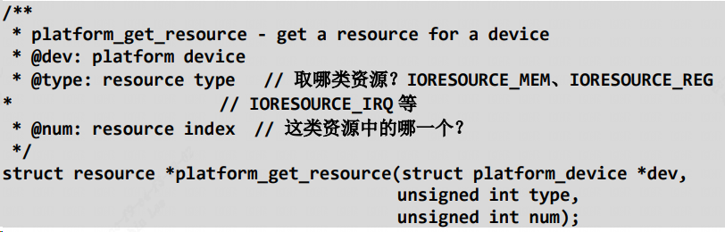
### 1.3.2 对于 I2C 设备、SPI 设备

I2C 总线驱动在处理设备树里的 I2C 子节点时，Linux总线会自动处理其中的中断信息。一个 I2C 设备会被转换为一个 `i2c_client`结构体，中断号会保存在 i2c_client 的 irq 成员里，代码如下(`drivers/i2c/i2c-core.c`)，probe函数里面`of_irq_get`函数会根据dts中的i2c节点获取中断资源并保存在`i2c_client->irq`中。  
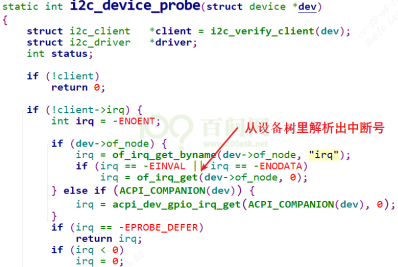
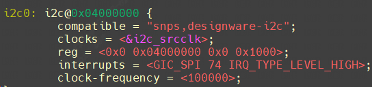
SPI总线同理，一个 SPI 设备会被转换为一个`spi_device`结构体，中断号会保存在 `spi_device` 的 irq 成员里，代码如下(`drivers/spi/spi.c`)：  
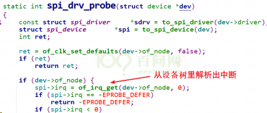

### 1.3.3 对于 GPIO
参考：`drivers/input/keyboard/gpio_keys.c`， api路径`linux_5.10\include\linux\of_gpio.h`  
可以使用 `gpio_to_irq` 或 `gpiod_to_irq` 获得中断号。
```c
button->gpio = of_get_gpio_flags(pp, 0, &flags);  
bdata->gpiod = gpio_to_desc(button->gpio);  
//再去使用 gpiod_to_irq 获得中断号：  
irq = gpiod_to_irq(bdata->gpiod)；
```

### 1.3.4 直接从device_node节点中获取irq虚拟中断号
也可以直接调用`of_irq_get`或者`of_irq_get_byname`从device_node节点中获取irq虚拟中断号。  
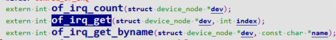
# 2 编写一个按键中断

## 2.1 按键dts配置

linux内核自带的`input`子系统本身就包含了gpio按键驱动，驱动程序 `drivers/input/keyboard/gpio_keys.c` 就可以，然后需要做  
的只是修改设备树指定引脚及键值。下面自己写一个gpio按键驱动：

使用`gpio5_1`, `gpio4_14`这两个GPIO进行按键实验，这里定义dts节点`gpio_keys_100ask`如下，需要把原来的节点`gpio-keys` disable掉，添加下面的`gpio_keys_100ask`。进入内核目录 `make dtbs`。
```c
gpio_keys_100ask {  
	compatible = "100ask,gpio_key";  
	gpios = <&gpio5 1 GPIO_ACTIVE_HIGH  
	&gpio4 14 GPIO_ACTIVE_HIGH>;  
	pinctrl-names = "default";  
	pinctrl-0 = <&key1_pinctrl &key2_pinctrl>;  
};
```
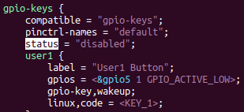
设备树中并没有对这两个引脚进行`pinctrl`配置，也就是`iomux`配置，那为什么这2个引脚还能工作，是因为这两个引脚默认就是gpio状态，不用进行`iomux`切换。  
为了保险起见，按照标准流程还需要对其添加`pinctrl`信息。

### 2.1.1 添加2个按键的iomux配置

NXP的官方`i.MX Pins Tool`工具能够可视化配置`pinctrl`，复制过来填入到对应的子节点下面：gpio5的iomux配置放在`iomuxc_snvs`节点下，gpio4的配置放在`iomuxc`下。  
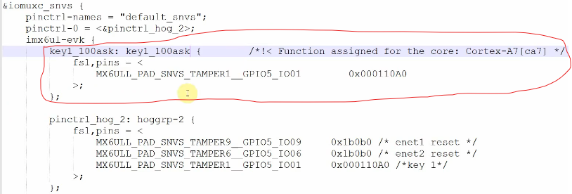
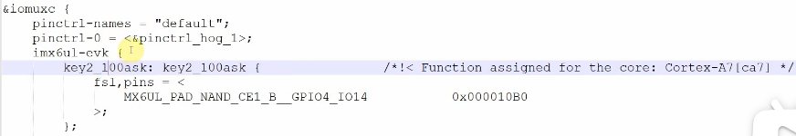
### 2.1.2 定义按键dts描述

在`gpio_keys_100ask`中引用这2个`pinctrl`信息 `key1_100ask`和 `key2_100ask`。这里`pinctrl-names`只有一个default，`pinctrl-0`表示该默认状态，因此最终`gpio5_1`, `gpio4_14`就被`iomux`成了gpio状态。  
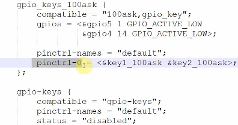
## 2.2 驱动代码

驱动代码如下
```c
#include <linux/module.h>  
#include <linux/fs.h>  
#include <linux/errno.h>  
#include <linux/miscdevice.h>  
#include <linux/kernel.h>  
#include <linux/major.h>  
#include <linux/mutex.h>  
#include <linux/proc_fs.h>  
#include <linux/seq_file.h>  
#include <linux/stat.h>  
#include <linux/init.h>  
#include <linux/device.h>  
#include <linux/tty.h>  
#include <linux/kmod.h>  
#include <linux/gfp.h>  
#include <linux/gpio/consumer.h>  
#include <linux/platform_device.h>  
#include <linux/of_gpio.h>  
#include <linux/of_irq.h>  
#include <linux/interrupt.h>  
#include <linux/irq.h>  
#include <linux/slab.h>  
struct gpio_key{  
	int gpio;  
	struct gpio_desc *gpiod;  
	int flag;  
	int irq;  
};  
static struct gpio_key *gpio_keys_100ask;  
static int major = 0;  
static struct class *gpio_key_class;  
static int g_key = 0;  
static DECLARE_WAIT_QUEUE_HEAD(gpio_key_wait);  
  
static ssize_t gpio_key_drv_read (struct file *file, char __user *buf, size_t size, loff_t *offset) {  
	int err;  
	wait_event_interruptible(gpio_key_wait, g_key);  
	err = copy_to_user(buf, &g_key, 4);  
	g_key = 0;  
	return 4;  
}  
static struct file_operations gpio_key_drv = {  
	.owner	 = THIS_MODULE,  
	.read    = gpio_key_drv_read,  
};  
  
static irqreturn_t gpio_key_isr(int irq, void *dev_id){  
	struct gpio_key *gpio_key = dev_id;  
	int val;  
	val = gpiod_get_value(gpio_key->gpiod);  
	printk("key %d %d\n", gpio_key->gpio, val);  
	g_key = (gpio_key->gpio << 8) | val;  
	wake_up_interruptible(&gpio_key_wait);  
	return IRQ_HANDLED;  
}  
  
/* 1. 从platform_device获得GPIO  
 * 2. gpio=>irq  
 * 3. request_irq  
 */  
static int gpio_key_probe(struct platform_device *pdev){  
	int err;  
	struct device_node *node = pdev->dev.of_node;  
	int count;  
	int i;  
	enum of_gpio_flags flag;  
  
	count = of_gpio_count(node);  
	if (!count)   
		printk("%s %s line %d, there isn't any gpio available\n", __FILE__, __FUNCTION__, __LINE__);  
		return -1;  
	}  
	gpio_keys_100ask = kzalloc(sizeof(struct gpio_key) * count, GFP_KERNEL);  
	for (i = 0; i < count; i++)   
		gpio_keys_100ask[i].gpio = of_get_gpio_flags(node, i, &flag);  
		if (gpio_keys_100ask[i].gpio < 0) {  
			printk("%s %s line %d, of_get_gpio_flags fail\n", __FILE__, __FUNCTION__, __LINE__);  
			return -1;  
		}  
		gpio_keys_100ask[i].gpiod = gpio_to_desc(gpio_keys_100ask[i].gpio);  
		gpio_keys_100ask[i].flag = flag & OF_GPIO_ACTIVE_LOW;  
		gpio_keys_100ask[i].irq  = gpio_to_irq(gpio_keys_100ask[i].gpio);  
	}  
  
	for (i = 0; i < count; i++) {  
		err = request_irq(gpio_keys_100ask[i].irq, gpio_key_isr, IRQF_TRIGGER_RISING | IRQF_TRIGGER_FALLING  
                          , "100ask_gpio_key", &gpio_keys_100ask[i]);  
	}  
	major = register_chrdev(0, "100ask_gpio_key", &gpio_key_drv);  /* /dev/100ask_gpio_key */  
	gpio_key_class = class_create(THIS_MODULE, "100ask_gpio_key_class");  
	if (IS_ERR(gpio_key_class)) {  
		printk("%s %s line %d\n", __FILE__, __FUNCTION__, __LINE__);  
		unregister_chrdev(major, "100ask_gpio_key");  
		return PTR_ERR(gpio_key_class);  
	}  
	device_create(gpio_key_class, NULL, MKDEV(major, 0), NULL, "100ask_gpio_key"); /* /dev/100ask_gpio_key */          
    return 0;  
}  
static int gpio_key_remove(struct platform_device *pdev){  
	struct device_node *node = pdev->dev.of_node;  
	int count;  
	int i;  
  
	device_destroy(gpio_key_class, MKDEV(major, 0));  
	class_destroy(gpio_key_class);  
	unregister_chrdev(major, "100ask_gpio_key");  
	count = of_gpio_count(node);  
	for (i = 0; i < count; i++){  
		free_irq(gpio_keys_100ask[i].irq, &gpio_keys_100ask[i]);  
	}  
	kfree(gpio_keys_100ask);  
    return 0;  
}  
  
static const struct of_device_id ask100_keys[] = {  
    { .compatible = "100ask,gpio_key" },  
    { },  
};  
static struct platform_driver gpio_keys_driver = {  
    .probe      = gpio_key_probe,  
    .remove     = gpio_key_remove,  
    .driver     = {  
        .name   = "100ask_gpio_key",  
        .of_match_table = ask100_keys,  
    },  
};  
static int __init gpio_key_init(void){  
    return platform_driver_register(&gpio_keys_driver);   
}  
static void __exit gpio_key_exit(void){  
    platform_driver_unregister(&gpio_keys_driver);  
}  
module_init(gpio_key_init);  
module_exit(gpio_key_exit);  
MODULE_LICENSE("GPL");
```

