# 1 tasklet引入

[中断子系统-1-linux中断介绍](%E4%B8%AD%E6%96%AD%E5%AD%90%E7%B3%BB%E7%BB%9F-1-linux%E4%B8%AD%E6%96%AD%E4%BB%8B%E7%BB%8D/)介绍了linux中的硬件中断和软件中断，cpu会先处理硬件中断，然后处理软件中断。

简单说可以认为内核中有一个数组softirq[], 里面有很多项，某一项对应timer，某一项表示tasklet, 每一项中都有一个`.action`函数，当内核处理完某一个硬件中断之后，处理软件中断时会找到对应的项，找到`.action`函数执行。

对于`tasklet`软件中断，它的`.action`函数对应`tasklet_action`,这个函数会从链表里取出每一个`tasklet`结构，执行里面的`.func`函数。

内核处理硬件中断的过程叫做中断上半部，处理软件中断的过程叫做中断下半部。上半部执行过程中，中断是禁止的，这里防止中断嵌套，也就是说来了更紧急的硬件中断，也要等这个上半部分处理完，上半部一般处理重要紧急事情。下半部执行过程中，中断是使能的，因此在下半部的处理过程它是可以响应其他中断。因此如果有不紧急但是耗时的事情放在下半部来处理，比如用tasklet。  
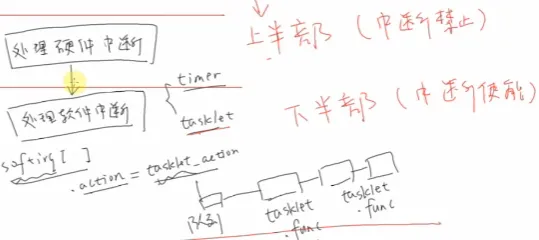
# 2 tasklet是如何从从上半部调度到下半部分

如何使能或者说调度tasklet呢？它其实就是把一个tasklet放入到内核tasklet链表中，假如硬件中断服务函数func_A(), 软件中断中也就是下半部放入tasklet中断的服务函数为func_B(), 那么可以想象看A和B被调度的次数因该是多对1的关系，应为软件中断由于是使能中断的，因此func_A()对应的硬件又可能会产生硬件中断。

# 3 tasklet使用

## 3.1 初始化tasklet

### 3.1.0 tasklet结构体

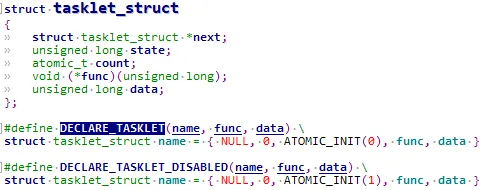
```c
struct tasklet_struct {  
	struct tasklet_struct *next;//tasklet链表  
	unsigned long state;//RUN表示正在运行，SCHED表示已被调度  
	atomic_t count;//0表示处于激活状态，不为0表示该tasklet禁止，不允许执行  
	void (*func)(unsigned long);//处理函数，等效softirq的action函数  
	unsigned long data;  
};
```

`\include\linux\interrupt.h`  
state 有 2 位：  
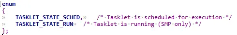
```c
◼ bit0 表示 TASKLET_STATE_SCHED  
等于 1 时表示已经执行了 tasklet_schedule 把该 tasklet 放入队列了；(等于1表示放入队列就绪了)  
tasklet_schedule 会判断该位，如果已经等于 1 那么它就不会再次把tasklet 放入队列。  
◼ bit1 表示 TASKLET_STATE_RUN  
等于 1 时，表示正在运行 tasklet 中的 func 函数；函数执行完后内核会把该位清 0。
```

count 表示该 tasklet 是否使能：
```c
等于 0 表示使能了，非 0 表示被禁止了。对于 count 非 0 的 tasklet，里面的 func 函数不会被执行
```

### 3.1.1 tasklet链表
```c
struct tasklet_head {                              
    struct tasklet_struct *head;  
    struct tasklet_struct **tail;  
};  
  
static DEFINE_PER_CPU(struct tasklet_head, tasklet_vec); //kernel/softirq.c  
static DEFINE_PER_CPU(struct tasklet_head, tasklet_hi_vec);  
//对应softirq的TASKLET_SOFTIRQ和HI_SOFTIRQ， 优先级分别为6和0
```

tasklet执行过程 `TASKLET_SOFTIRQ`对应执行函数为`tasklet_action`，`HI_SOFTIRQ`为`tasklet_hi_action`。

### 3.1.2 tasklet_init

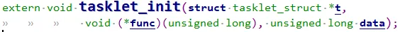
```c
extern void tasklet_init(struct tasklet_struct *t, void (*func)(unsigned long), unsigned long data);
```

### 3.1.3 DECLARE_TASKLET

`DECLARE_TASKLET`和`DECLARE_TASKLET_DISABLED`可以定义一个tasklet结构体。
```c
//使用 DECLARE_TASKLET 定义的 tasklet 结构体，它是使能的；  
//使用 DECLARE_TASKLET_DISABLED 定义的 tasklet 结构体，它是禁止的；使用之前要先调用 tasklet_enable 使能它。
```

## 3.2 使能/禁止 tasklet
```c
static inline void tasklet_enable(struct tasklet_struct *t);  
static inline void tasklet_disable(struct tasklet_struct *t);
```

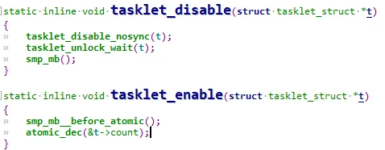
## 3.3 调度tasklet
```c
static inline void tasklet_schedule(struct tasklet_struct *t);
```

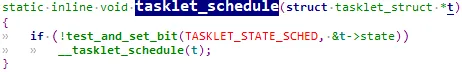
把 `tasklet` 放入链表，并且设置它的 `TASKLET_STATE_SCHED` 状态为1。`tasklet_schedule` 只是把 tasklet 放入内核队列，它的 `func` 函数会在软件中断的执行过程中被调用。

## 3.4 执行tasklet

对于 `TASKLET_SOFTIRQ` 类型的 `softirq`，其handler是 `tasklet_action`，可以看到软中断执行，硬件中断是使能的。执行对应的`func`函数。

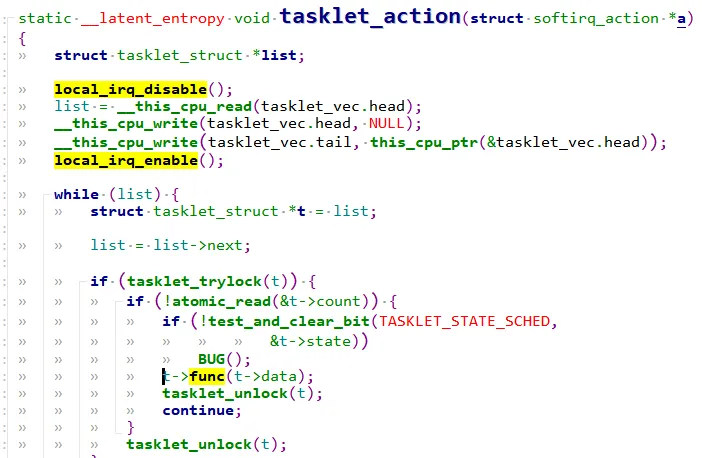
## 3.5 tasklet_kill
```c
void tasklet_kill(struct tasklet_struct *t)；
```

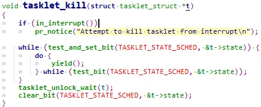
```c
//如果一个 tasklet 未被调度， tasklet_kill 会把它的TASKLET_STATE_SCHED 状态清 0；  
//如果一个 tasklet 已被调度，tasklet_kill 会等待它执行完华，再把它的TASKLET_STATE_SCHED 状态清 0。
```

通常在卸载驱动程序时调用 `tasklet_kill`。

# 4 tasklet代码示例解析

## 4.1 tasklet使用驱动源码

驱动代码
```c
#include <linux/module.h>  
#include <linux/poll.h>  
  
#include <linux/fs.h>  
#include <linux/errno.h>  
#include <linux/miscdevice.h>  
#include <linux/kernel.h>  
#include <linux/major.h>  
#include <linux/mutex.h>  
#include <linux/proc_fs.h>  
#include <linux/seq_file.h>  
#include <linux/stat.h>  
#include <linux/init.h>  
#include <linux/device.h>  
#include <linux/tty.h>  
#include <linux/kmod.h>  
#include <linux/gfp.h>  
#include <linux/gpio/consumer.h>  
#include <linux/platform_device.h>  
#include <linux/of_gpio.h>  
#include <linux/of_irq.h>  
#include <linux/interrupt.h>  
#include <linux/irq.h>  
#include <linux/slab.h>  
#include <linux/fcntl.h>  
#include <linux/timer.h>  
struct gpio_key{  
	int gpio;  
	struct gpio_desc *gpiod;  
	int flag;  
	int irq;  
	struct timer_list key_timer;  
	struct tasklet_struct tasklet;  
} ;  
static struct gpio_key *gpio_keys_100ask;  
static int major = 0;  
static struct class *gpio_key_class;  
  
#define BUF_LEN 128  
static int g_keys[BUF_LEN];  
static int r, w;  
struct fasync_struct *button_fasync;  
  
#define NEXT_POS(x) ((x+1) % BUF_LEN)  
  
static int is_key_buf_empty(void){  
	return (r == w);  
}  
  
static int is_key_buf_full(void){  
	return (r == NEXT_POS(w));  
}  
  
static void put_key(int key){  
	if (!is_key_buf_full()){  
		g_keys[w] = key;  
		w = NEXT_POS(w);  
	}  
}  
  
static int get_key(void){  
	int key = 0;  
	if (!is_key_buf_empty()){  
		key = g_keys[r];  
		r = NEXT_POS(r);  
	}  
	return key;  
}  
  
static DECLARE_WAIT_QUEUE_HEAD(gpio_key_wait);  
  
static void key_timer_expire(unsigned long data){  
	/* data ==> gpio */  
	struct gpio_key *gpio_key = data;  
	int val;  
	int key;  
  
	val = gpiod_get_value(gpio_key->gpiod);  
  
	printk("key_timer_expire key %d %d\n", gpio_key->gpio, val);  
	key = (gpio_key->gpio << 8) | val;  
	put_key(key);  
	wake_up_interruptible(&gpio_key_wait);  
	kill_fasync(&button_fasync, SIGIO, POLL_IN);  
}  
  
static void key_tasklet_func(unsigned long data){  
	/* data ==> gpio */  
	struct gpio_key *gpio_key = data;  
	int val;  
	int key;  
  
	val = gpiod_get_value(gpio_key->gpiod);  
	printk("key_tasklet_func key %d %d\n", gpio_key->gpio, val);  
}  
  
static ssize_t gpio_key_drv_read (struct file *file, char __user *buf, size_t size, loff_t *offset){  
	int err;  
	int key;  
	if (is_key_buf_empty() && (file->f_flags & O_NONBLOCK))  
		return -EAGAIN;  
	wait_event_interruptible(gpio_key_wait, !is_key_buf_empty());  
	key = get_key();  
	err = copy_to_user(buf, &key, 4);  
	return 4;  
}  
  
static unsigned int gpio_key_drv_poll(struct file *fp, poll_table * wait){  
	poll_wait(fp, &gpio_key_wait, wait);  
	return is_key_buf_empty() ? 0 : POLLIN | POLLRDNORM;  
}  
  
static int gpio_key_drv_fasync(int fd, struct file *file, int on){  
	if (fasync_helper(fd, file, on, &button_fasync) >= 0)  
		return 0;  
	else  
		return -EIO;  
}  
  
static struct file_operations gpio_key_drv = {  
	.owner	 = THIS_MODULE,  
	.read    = gpio_key_drv_read,  
	.poll    = gpio_key_drv_poll,  
	.fasync  = gpio_key_drv_fasync,  
};  
static irqreturn_t gpio_key_isr(int irq, void *dev_id)  
{  
	struct gpio_key *gpio_key = dev_id;  
	tasklet_schedule(&gpio_key->tasklet);  
	mod_timer(&gpio_key->key_timer, jiffies + HZ/50);  
	return IRQ_HANDLED;  
}  
  
static int gpio_key_probe(struct platform_device *pdev){  
	int err;  
	struct device_node *node = pdev->dev.of_node;  
	int count;  
	int i;  
	enum of_gpio_flags flag;  
  
	count = of_gpio_count(node);  
	if (!count){  
		printk("%s %s line %d, there isn't any gpio available\n", __FILE__, __FUNCTION__, __LINE__);  
		return -1;  
	}  
  
	gpio_keys_100ask = kzalloc(sizeof(struct gpio_key) * count, GFP_KERNEL);  
	for (i = 0; i < count; i++){		  
		gpio_keys_100ask[i].gpio = of_get_gpio_flags(node, i, &flag);  
		if (gpio_keys_100ask[i].gpio < 0){  
			printk("%s %s line %d, of_get_gpio_flags fail\n", __FILE__, __FUNCTION__, __LINE__);  
			return -1;  
		}  
		gpio_keys_100ask[i].gpiod = gpio_to_desc(gpio_keys_100ask[i].gpio);  
		gpio_keys_100ask[i].flag = flag & OF_GPIO_ACTIVE_LOW;  
		gpio_keys_100ask[i].irq  = gpio_to_irq(gpio_keys_100ask[i].gpio);  
  
		setup_timer(&gpio_keys_100ask[i].key_timer, key_timer_expire, &gpio_keys_100ask[i]);  
		gpio_keys_100ask[i].key_timer.expires = ~0;  
		add_timer(&gpio_keys_100ask[i].key_timer);  
  
		tasklet_init(&gpio_keys_100ask[i].tasklet, key_tasklet_func, &gpio_keys_100ask[i]);  
	}  
  
	for (i = 0; i < count; i++){  
		err = request_irq(gpio_keys_100ask[i].irq, gpio_key_isr  
		, IRQF_TRIGGER_RISING | IRQF_TRIGGER_FALLING, "100ask_gpio_key", &gpio_keys_100ask[i]);  
	}  
  
	major = register_chrdev(0, "100ask_gpio_key", &gpio_key_drv);   
	gpio_key_class = class_create(THIS_MODULE, "100ask_gpio_key_class");  
	if (IS_ERR(gpio_key_class)) {  
		printk("%s %s line %d\n", __FILE__, __FUNCTION__, __LINE__);  
		unregister_chrdev(major, "100ask_gpio_key");  
		return PTR_ERR(gpio_key_class);  
	}  
	device_create(gpio_key_class, NULL, MKDEV(major, 0), NULL, "100ask_gpio_key");    
    return 0;    
}  
static int gpio_key_remove(struct platform_device *pdev){  
	struct device_node *node = pdev->dev.of_node;  
	int count;  
	int i;  
  
	device_destroy(gpio_key_class, MKDEV(major, 0));  
	class_destroy(gpio_key_class);  
	unregister_chrdev(major, "100ask_gpio_key");  
	count = of_gpio_count(node);  
	for (i = 0; i < count; i++){  
		free_irq(gpio_keys_100ask[i].irq, &gpio_keys_100ask[i]);  
		del_timer(&gpio_keys_100ask[i].key_timer);  
		tasklet_kill(&gpio_keys_100ask[i].tasklet);  
	}  
	kfree(gpio_keys_100ask);  
    return 0;  
}  
static const struct of_device_id ask100_keys[] = {  
    { .compatible = "100ask,gpio_key" },  
    { },  
};  
static struct platform_driver gpio_keys_driver = {  
    .probe      = gpio_key_probe,  
    .remove     = gpio_key_remove,  
    .driver     = {  
        .name   = "100ask_gpio_key",  
        .of_match_table = ask100_keys,  
    },  
};  
static int __init gpio_key_init(void){  
    return platform_driver_register(&gpio_keys_driver);   
}  
  
static void __exit gpio_key_exit(void){  
    platform_driver_unregister(&gpio_keys_driver);  
}  
module_init(gpio_key_init);  
module_exit(gpio_key_exit);  
MODULE_LICENSE("GPL");
```

用户态测试代码
```c
#include <sys/types.h>  
#include <sys/stat.h>  
#include <fcntl.h>  
#include <unistd.h>  
#include <stdio.h>  
#include <string.h>  
#include <poll.h>  
#include <signal.h>  
static int fd;  
/*  
 * ./button_test /dev/100ask_button0  
 *  
 */  
int main(int argc, char **argv){  
	int val;  
	struct pollfd fds[1];  
	int timeout_ms = 5000;  
	int ret;  
	int	flags;  
	int i;  
  
	if (argc != 2) {  
		printf("Usage: %s <dev>\n", argv[0]);  
		return -1;  
	}  
	fd = open(argv[1], O_RDWR | O_NONBLOCK);  
	if (fd == -1){  
		printf("can not open file %s\n", argv[1]);  
		return -1;  
	}  
  
	for (i = 0; i < 10; i++) {  
		if (read(fd, &val, 4) == 4)  
			printf("get button: 0x%x\n", val);  
		else  
			printf("get button: -1\n");  
	}  
	flags = fcntl(fd, F_GETFL);  
	fcntl(fd, F_SETFL, flags & ~O_NONBLOCK);  
	while (1){  
		if (read(fd, &val, 4) == 4)  
			printf("get button: 0x%x\n", val);  
		else  
			printf("while get button: -1\n");  
	}  
	close(fd);  
	return 0;  
}
```

## 4.2 分析

probe函数中为每一个gpio按键都创建一个`tasklet`。  
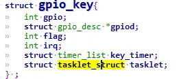
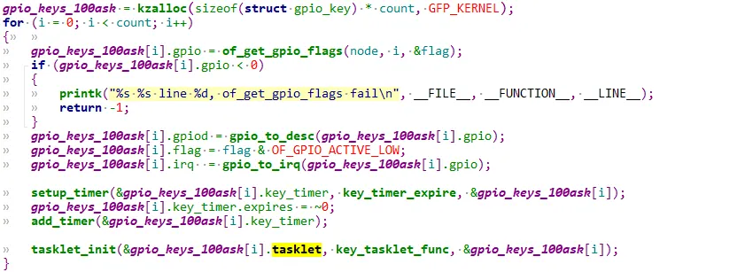
当按键按下，中断服务执行，那么此时需要调度tasklet去完成中断下半部的事情，每当一个按键按下，就会执行一次tasklet里面的函数，也就是`key_tasklet_func`  
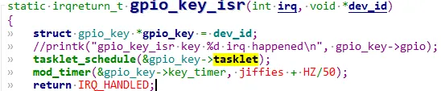
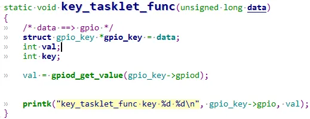
根据不同的gpio带来不同的data，这里`key_tasklet_func`下半部分只是简单打印出对应哪一个gpio，输出什么电平。  
最终驱动卸载时调用`tasklet_kill`。  
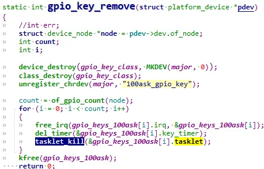
# 5 tasklet内部机制剖析

## 5.1 tasklet_action的执行过程

`tasklet`属于`TASKLET_SOFTIRQ`软件中断，入口函数为`tasklet_action`，这在内核 `kernel\softirq.c` 中设置:  
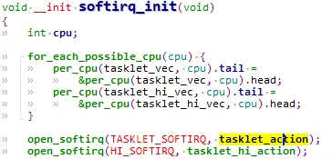
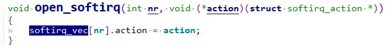
当驱动程序调用 `tasklet_schedule` 时，会设置 tasklet 的`state`为`TASKLET_STATE_SCHED`，并把它放入内核`tasklet链表`:  
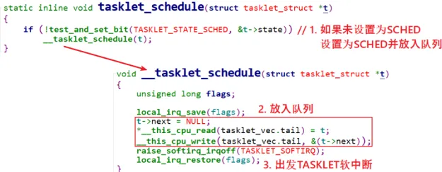
触发`TASKLET_SOFTIRQ` 软件中断，会调用 `tasklet_action` 函数，遍历`tasklet` 链表，进行状态判断后执行 `.func`  
函数，从队列中删除 `tasklet`。  
可以看出：
```c
1.tasklet_schedule 调度 tasklet 时，其中的函数并不会立刻执行，而只是把tasklet 放入队列  
2.调用一次 tasklet_schedule，只会导致 tasklet 的函数被执行一次；如果 tasklet 的函数尚未执行  
    ，多次调用 tasklet_schedule 也是无效的，只会放入队列一次，TASKLET_STATE_SCHED状态会自行判断。
```

最终tasklet中的`func`执行要看`tasklet_action`的过程分析：  
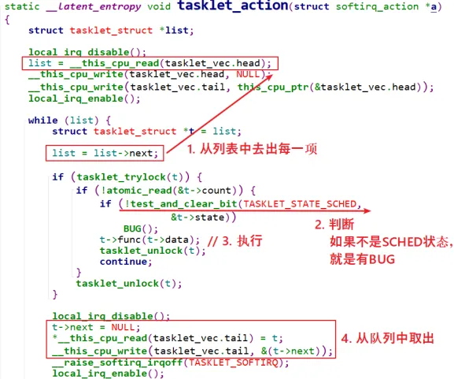
首先从链表中取出每一项`tasklet`, 读取`count`, 如果等于0表示有使能该`tasklet`, 清除`TASKLET_STATE_SCHED`位，并且执行`t->func`，执行完该task中的`func`后从链表取出并且删除掉。