# 1 工作队列workqueue引入

定时器、 `tasklet`，它们都是在软中断上下文中执行的且无法休眠。那么如果一旦中断要处理耗时复杂的操作，就会长期占用cpu。如果使用内核线程来处理这些耗时的工作，那就可以解决cpu占用问题。  
Linux内核中`工作队列workqueue`就是线程化处理的一种方式，`“工作队列”(workqueue)`, 它是内核自带的`内核线程`。要使用`“工作队列”`，只需要把`“工作”`放入`“工作队列"`中，对应的内核线程就会取出 `“工作”`，执行里面的函数。

工作队列的应用场合：  
要做的事情比较耗时，甚至可能需要休眠，那么可以使用工作队列。  
缺点：多个工作(函数)是在某个内核线程中依序执行的，前面函数执行很慢，就会影响到后面的函数。  
在多 CPU 的系统下，一个工作队列可以有多个内核线程，可以在一定程度上缓解这个问题。

工队队列的源码机制在`Linux-4.9.88\kernel\workqueue.c`，头文件在`Linux-4.9.88\include\linux\workqueue.h`

## 1.1 work_struct描述
```c
struct work_struct {  
	atomic_long_t data;  
	struct list_head entry;  
	work_func_t func;  
#ifdef CONFIG_LOCKDEP  
	struct lockdep_map lockdep_map;  
#endif  
};
```

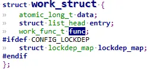

表示一个work结构，一个任务或者叫做一个工作，里面的`.func`表示是要执行的任务函数，类型定义为：
```c
typedef void (*work_func_t)(struct work_struct *work);
```

### 1.1.1 定义一个work
```c
#define DECLARE_WORK(n, f) \  
struct work_struct n = __WORK_INITIALIZER(n, f)  
#define DECLARE_DELAYED_WORK(n, f) \  
struct delayed_work n = __DELAYED_WORK_INITIALIZER(n, f, 0)  
  
//第 1 个宏是用来定义一个 work_struct 结构体，要指定它的函数。  
//第 2 个宏用来定义一个 delayed_work 结构体，也要指定它的函数。所以“delayed”  
   // ，意思就是说要让它运行时，可以指定：某段时间之后你再执行
```

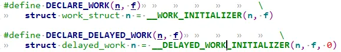
定义一个work为`n`, 并且初始化函数`f`.

如果代码中定义好了一个work_struct结构体，那么可以用`INIT_WORK`函数来初始化：  
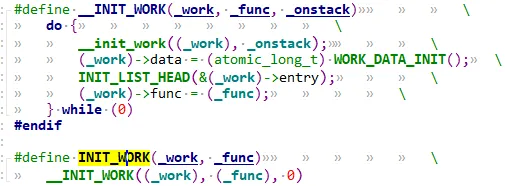
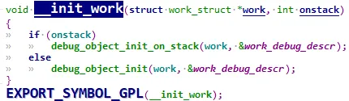
```c
#define INIT_WORK(_work, _func)						\  
	__INIT_WORK((_work), (_func), 0)
```

### 1.1.2 使用work

初始化完work后，调用**schedule_work**即可调度工作队列进行处理当前任务。  
调用 `schedule_work` 时，就会把`work_struct` 结构体放入队列`system_wq`中，并唤醒对应的内核线程。内核线程就会从队列里把 work_struct 结构体取出来，执行里面的函数。  
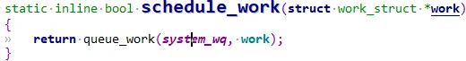
```c
/**  
 * schedule_work - put work task in global workqueue  
 * @work: job to be done  
 *  
 * Returns %false if @work was already on the kernel-global workqueue and  
 * %true otherwise.  
 *  
 * This puts a job in the kernel-global workqueue if it was not already  
 * queued and leaves it in the same position on the kernel-global  
 * workqueue otherwise.  
 */  
static inline bool schedule_work(struct work_struct *work)  
{  
	return queue_work(system_wq, work);  
}
```

可以看到`system_wq`是内核自带的队列，结构属性为`struct workqueue_struct`  
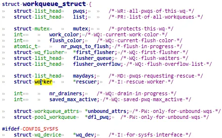
如果不想用内核自带的**system_wq**来调度我们的work, 那么可以调用**create_workqueue**函数自行创建工队队列。然后用**queue_work**函数使能.

### 1.1.3 工作队列相关函数

|函数名|作用|
|---|---|
|create_workqueue|在 Linux 系统中已经有了现成的 system_wq 等工作队列，你当然也可以自己调用 create_workqueue 创建工作队列，对于 SMP 系统，这个工作队列会有多个内核线程与它对应，创建工作队列时，内核会帮这个工作队列创建多个内核线程|
|create_singlethread_workqueue|如果想只有一个内核线程与工作队列对应，可以用本函数创建工作队列，创建工作队列时，内核会帮这个工作队列创建一个内核线程|
|destroy_workqueue|销毁工作队列|
|schedule_work|调度执行一个具体的 work，执行的 work 将会被挂入 Linux 系统提供的工作队列|
|schedule_delayed_work|延迟一定时间去执行一个具体的任务，功能与 schedule_work 类似，多了一个延迟时间|
|queue_work|跟 schedule_work 类似，schedule_work 是在系统默认的工作队列上执行一个work，queue_work 需要自己指定工作队列|
|queue_delayed_work|跟 schedule_delayed_work 类似，schedule_delayed_work 是在系统默认的工作队列上执行一个 work，queue_delayed_work 需要自己指定工作队列|
|flush_work|等待一个 work 执行完毕，如果这个 work 已经被放入队列，那么本函数等它执行完毕，并且返回 true；如果这个 work 已经执行完华才调用本函数，那么直接返回 false|
|flush_delayed_work|等待一个 delayed_work 执行完毕，如果这个 delayed_work 已经被放入队列，那么本函数等它执行完毕，并且返回 true；如果这个 delayed_work 已经执行完华才调用本函数，那么直接返回 false|

# 2 编写代码及解析

## 2.1 workqueue用例驱动源码

驱动代码
```c
#include <linux/module.h>  
#include <linux/poll.h>  
#include <linux/fs.h>  
#include <linux/errno.h>  
#include <linux/miscdevice.h>  
#include <linux/kernel.h>  
#include <linux/major.h>  
#include <linux/mutex.h>  
#include <linux/proc_fs.h>  
#include <linux/seq_file.h>  
#include <linux/stat.h>  
#include <linux/init.h>  
#include <linux/device.h>  
#include <linux/tty.h>  
#include <linux/kmod.h>  
#include <linux/gfp.h>  
#include <linux/gpio/consumer.h>  
#include <linux/platform_device.h>  
#include <linux/of_gpio.h>  
#include <linux/of_irq.h>  
#include <linux/interrupt.h>  
#include <linux/irq.h>  
#include <linux/slab.h>  
#include <linux/fcntl.h>  
#include <linux/timer.h>  
#include <linux/workqueue.h>  
#include <asm/current.h>  
  
struct gpio_key{  
	int gpio;  
	struct gpio_desc *gpiod;  
	int flag;  
	int irq;  
	struct timer_list key_timer;  
	struct tasklet_struct tasklet;  
	struct work_struct work;  
} ;  
  
static struct gpio_key *gpio_keys_100ask;  
static int major = 0;  
static struct class *gpio_key_class;  
  
#define BUF_LEN 128  
static int g_keys[BUF_LEN];  
static int r, w;  
struct fasync_struct *button_fasync;  
#define NEXT_POS(x) ((x+1) % BUF_LEN)  
  
static int is_key_buf_empty(void){  
	return (r == w);  
}  
static int is_key_buf_full(void){  
	return (r == NEXT_POS(w));  
}  
static void put_key(int key){  
	if (!is_key_buf_full()){  
		g_keys[w] = key;  
		w = NEXT_POS(w);  
	}  
}  
  
static int get_key(void){  
	int key = 0;  
	if (!is_key_buf_empty()){  
		key = g_keys[r];  
		r = NEXT_POS(r);  
	}  
	return key;  
}  
  
static DECLARE_WAIT_QUEUE_HEAD(gpio_key_wait);  
static void key_timer_expire(unsigned long data){  
	struct gpio_key *gpio_key = data;  
	int val;  
	int key;  
	val = gpiod_get_value(gpio_key->gpiod);  
	printk("key_timer_expire key %d %d\n", gpio_key->gpio, val);  
	key = (gpio_key->gpio << 8) | val;  
	put_key(key);  
	wake_up_interruptible(&gpio_key_wait);  
	kill_fasync(&button_fasync, SIGIO, POLL_IN);  
}  
  
static void key_tasklet_func(unsigned long data){  
	struct gpio_key *gpio_key = data;  
	int val;  
	int key;  
  
	val = gpiod_get_value(gpio_key->gpiod);  
	printk("key_tasklet_func key %d %d\n", gpio_key->gpio, val);  
}  
  
static void key_work_func(struct work_struct *work){  
	struct gpio_key *gpio_key = container_of(work, struct gpio_key, work);  
	int val;  
	val = gpiod_get_value(gpio_key->gpiod);  
	printk("key_work_func: the process is %s pid %d\n",current->comm, current->pid);	  
	printk("key_work_func key %d %d\n", gpio_key->gpio, val);  
}  
  
static ssize_t gpio_key_drv_read (struct file *file, char __user *buf, size_t size, loff_t *offset){  
	int err;  
	int key;  
	if (is_key_buf_empty() && (file->f_flags & O_NONBLOCK))  
		return -EAGAIN;  
	wait_event_interruptible(gpio_key_wait, !is_key_buf_empty());  
	key = get_key();  
	err = copy_to_user(buf, &key, 4);  
	return 4;  
}  
  
static unsigned int gpio_key_drv_poll(struct file *fp, poll_table * wait){  
	poll_wait(fp, &gpio_key_wait, wait);  
	return is_key_buf_empty() ? 0 : POLLIN | POLLRDNORM;  
}  
  
static int gpio_key_drv_fasync(int fd, struct file *file, int on){  
	if (fasync_helper(fd, file, on, &button_fasync) >= 0)  
		return 0;  
	else  
		return -EIO;  
}  
  
static struct file_operations gpio_key_drv = {  
	.owner	 = THIS_MODULE,  
	.read    = gpio_key_drv_read,  
	.poll    = gpio_key_drv_poll,  
	.fasync  = gpio_key_drv_fasync,  
};  
static irqreturn_t gpio_key_isr(int irq, void *dev_id){  
	struct gpio_key *gpio_key = dev_id;  
	//printk("gpio_key_isr key %d irq happened\n", gpio_key->gpio);  
	tasklet_schedule(&gpio_key->tasklet);  
	mod_timer(&gpio_key->key_timer, jiffies + HZ/50);  
	schedule_work(&gpio_key->work);  
	return IRQ_WAKE_THREAD;  
}  
  
static irqreturn_t gpio_key_thread_func(int irq, void *data){  
	struct gpio_key *gpio_key = data;  
	int val;  
  
	val = gpiod_get_value(gpio_key->gpiod);  
	printk("gpio_key_thread_func: the process is %s pid %d\n",current->comm, current->pid);	  
	printk("gpio_key_thread_func key %d %d\n", gpio_key->gpio, val);  
	return IRQ_HANDLED;  
}  
  
  
static int gpio_key_probe(struct platform_device *pdev){  
	int err;  
	struct device_node *node = pdev->dev.of_node;  
	int count;  
	int i;  
	enum of_gpio_flags flag;  
  
	count = of_gpio_count(node);  
	if (!count){  
		printk("%s %s line %d, there isn't any gpio available\n", __FILE__, __FUNCTION__, __LINE__);  
		return -1;  
	}  
	gpio_keys_100ask = kzalloc(sizeof(struct gpio_key) * count, GFP_KERNEL);  
	for (i = 0; i < count; i++){		  
		gpio_keys_100ask[i].gpio = of_get_gpio_flags(node, i, &flag);  
		if (gpio_keys_100ask[i].gpio < 0){  
			printk("%s %s line %d, of_get_gpio_flags fail\n", __FILE__, __FUNCTION__, __LINE__);  
			return -1;  
		}  
		gpio_keys_100ask[i].gpiod = gpio_to_desc(gpio_keys_100ask[i].gpio);  
		gpio_keys_100ask[i].flag = flag & OF_GPIO_ACTIVE_LOW;  
		gpio_keys_100ask[i].irq  = gpio_to_irq(gpio_keys_100ask[i].gpio);  
		setup_timer(&gpio_keys_100ask[i].key_timer, key_timer_expire, &gpio_keys_100ask[i]);  
		gpio_keys_100ask[i].key_timer.expires = ~0;  
		add_timer(&gpio_keys_100ask[i].key_timer);  
		tasklet_init(&gpio_keys_100ask[i].tasklet, key_tasklet_func, &gpio_keys_100ask[i]);  
		INIT_WORK(&gpio_keys_100ask[i].work, key_work_func);  
	}  
	for (i = 0; i < count; i++){  
		/*err = request_irq(gpio_keys_100ask[i].irq, gpio_key_isr,   
        IRQF_TRIGGER_RISING | IRQF_TRIGGER_FALLING,  
        "100ask_gpio_key", &gpio_keys_100ask[i]);*/  
		err = request_threaded_irq(gpio_keys_100ask[i].irq  
              , gpio_key_isr, gpio_key_thread_func  
              , IRQF_TRIGGER_RISING | IRQF_TRIGGER_FALLING  
              , "100ask_gpio_key", &gpio_keys_100ask[i]);  
	}  
  
	major = register_chrdev(0, "100ask_gpio_key", &gpio_key_drv);  
	gpio_key_class = class_create(THIS_MODULE, "100ask_gpio_key_class");  
	if (IS_ERR(gpio_key_class)) {  
		printk("%s %s line %d\n", __FILE__, __FUNCTION__, __LINE__);  
		unregister_chrdev(major, "100ask_gpio_key");  
		return PTR_ERR(gpio_key_class);  
	}  
	device_create(gpio_key_class, NULL, MKDEV(major, 0), NULL, "100ask_gpio_key");  
    return 0;  
      
}  
static int gpio_key_remove(struct platform_device *pdev){  
	struct device_node *node = pdev->dev.of_node;  
	int count;  
	int i;  
	device_destroy(gpio_key_class, MKDEV(major, 0));  
	class_destroy(gpio_key_class);  
	unregister_chrdev(major, "100ask_gpio_key");  
	count = of_gpio_count(node);  
	for (i = 0; i < count; i++){  
		free_irq(gpio_keys_100ask[i].irq, &gpio_keys_100ask[i]);  
		del_timer(&gpio_keys_100ask[i].key_timer);  
		tasklet_kill(&gpio_keys_100ask[i].tasklet);  
	}  
	kfree(gpio_keys_100ask);  
    return 0;  
}  
static const struct of_device_id ask100_keys[] = {  
    { .compatible = "100ask,gpio_key" },  
    { },  
};  
static struct platform_driver gpio_keys_driver = {  
    .probe      = gpio_key_probe,  
    .remove     = gpio_key_remove,  
    .driver     = {  
        .name   = "100ask_gpio_key",  
        .of_match_table = ask100_keys,  
    },  
};  
  
static int __init gpio_key_init(void){  
    return platform_driver_register(&gpio_keys_driver);   
}  
static void __exit gpio_key_exit(void){  
    platform_driver_unregister(&gpio_keys_driver);  
}  
module_init(gpio_key_init);  
module_exit(gpio_key_exit);  
MODULE_LICENSE("GPL");
```

## 2.2 分析

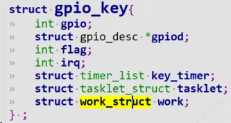
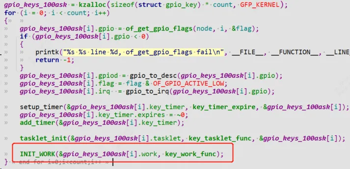
为每一个按键都建立一个work_struct，并且初始化work。
```c
INIT_WORK(&gpio_keys_100ask[i].work, key_work_func);
```

`key_work_func`是work里面函数，参数为该work自身。该函数只是简单打印该work的自身属性（work名字，work进程id），然后输出按键值。通过`container_of`找到父亲结构体`gpio_key`。  
注意：current是Linux内核自带的一个变量，外部驱动要引用它只需要包含头文件：
```c
#include <asm/current.h>
```

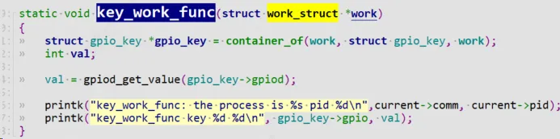
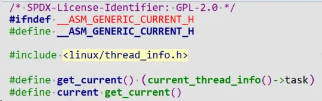
中断到来后，这时候上半部完成清中断等一些列重要操作，使能workqueue工作队列，调用函数**schedule_work**。  

内核从系统工作队列`system_wq`从取出该work，执行里面的函数`（key_work_func)`。

可以看到`current`信息：`pid为428`，内核线程名字为`[kworker/0:1]`  

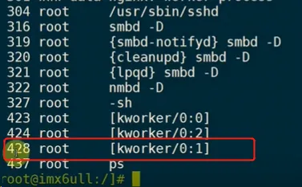
# 3 工作队列内部机制原理

## 3.1 Linux 2.x 的工作队列创建过程

代码在`kernel\workqueue.c`中：
```c
init_workqueues//函数主体如下  
keventd_wq = create_workqueue("events");  
 __create_workqueue((name), 0, 0)  
 for_each_possible_cpu(cpu) {  
 err = create_workqueue_thread(cwq, cpu);  
 p = kthread_create(worker_thread, cwq, fmt, wq->name, cpu);
```

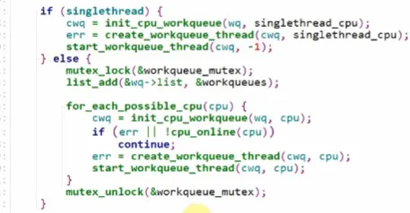
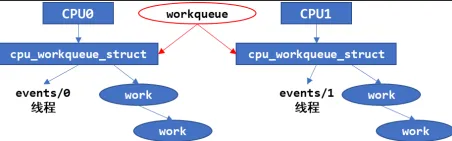
会先分配一个workqueue结构创建一个`system_wq`工作队列，为每一个 CPU，都创建一个名为`“events/X”`的内核线程，X 从 0 开始。在创建 workqueue 的同时创建内核线程。

## 3.2 Linux 4.x 的工作队列创建过程

Linux4.x 中，内核线程和工作队列是分开创建的。先创建内核线程，在 `kernel\workqueue.c` 中  
对每一个cpu，都会创建2个`work_pool`结构体：
```c
init_workqueues //函数主体如下：  
/* initialize CPU pools */  
for_each_possible_cpu(cpu) {  
 for_each_cpu_worker_pool(pool, cpu) {  
 /* 对每一个 CPU 都创建 2 个 worker_pool 结构体，它是含有 ID 的 */  
 /* 一个 worker_pool 对应普通优先级的 work，第 2 个对应高优先级的 work */  
}  
/* create the initial worker */  
for_each_online_cpu(cpu) {  
 for_each_cpu_worker_pool(pool, cpu) {  
 /* 对每一个 CPU 的每一个 worker_pool，创建一个 worker */  
/* 每一个 worker 对应一个内核线程 */  
 BUG_ON(!create_worker(pool));  
 }  
}
```

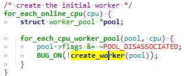
`create_worker` 函数代码如下：  
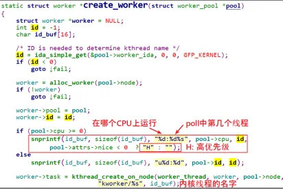
创建好内核线程后，再创建 `workqueue`：这里`workqueue`会和普通优先级的`work_pool`建立联系，以后给`workqueue`添加work的时候会放入`work_pool`中，执行对应`work`的时候唤醒相对应的`work`线程，比如`kwork/0:1`  
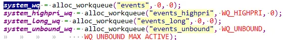
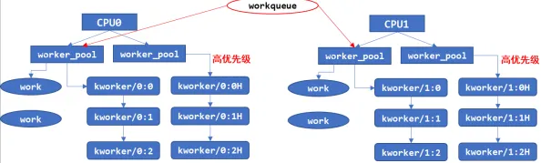
## 3.3 schedule_work

`schedule_work` 会将 work 添加到默认的工作队列也就是 `system_wq` 中。
```c
static inline bool schedule_work(struct work_struct *work)  
{  
    return queue_work(system_wq, work);  
}  
static inline bool queue_work(struct workqueue_struct *wq,  
                  struct work_struct *work)  
{  
    return queue_work_on(WORK_CPU_UNBOUND, wq, work);  
}//queue_work_on ，增加一个参数 WORK_CPU_UNBOUND，这个参数并不是指将当前  
//work 绑定到 unbound 类型的 worker_pool 中，只是说明调用者并不指定将当前  
//work 绑定到哪个 cpu 上，由系统来分配 cpu.当然，调用者也可以直接使用  
//queue_work_on 接口，通过第一个参数来指定当前 work 绑定的 cpu。  
  
bool queue_work_on(int cpu, struct workqueue_struct *wq,  
           struct work_struct *work)  
{  
    ...  
    if (!test_and_set_bit(WORK_STRUCT_PENDING_BIT, work_data_bits(work))) {  
        __queue_work(cpu, wq, work);  
        ret = true;  
    }  
    ...  
    return ret;  
}
```

### 3.3.1 `__queue_work`

继续调用`__queue_work`.
```c
static void __queue_work(int cpu, struct workqueue_struct *wq,  
             struct work_struct *work)  
{  
    ...  
    //获取 cpu 相关参数  
    if (req_cpu == WORK_CPU_UNBOUND)  
        cpu = wq_select_unbound_cpu(raw_smp_processor_id());  
    ...  
  
    //检查当前的 work 是不是在这之前被添加到其他 worker_pool 中，  
    //如果是，就让它继续在原本的 worker_pool 上运行  
    last_pool = get_work_pool(work);  
    if (last_pool && last_pool != pwq->pool) {  
        struct worker *worker;  
  
        spin_lock(&last_pool->lock);  
  
        worker = find_worker_executing_work(last_pool, work);  
  
        if (worker && worker->current_pwq->wq == wq) {  
            pwq = worker->current_pwq;  
        } else {  
            /* meh... not running there, queue here */  
            spin_unlock(&last_pool->lock);  
            spin_lock(&pwq->pool->lock);  
        }  
    } else {  
        spin_lock(&pwq->pool->lock);  
    }  
  
    //如果超过 pwq 支持的最大的 work 数量，将work添加到 pwq->delayed_works 中  
    //，否则就添加到 pwq->pool->worklist 中。    
    if (likely(pwq->nr_active < pwq->max_active)) {  
        trace_workqueue_activate_work(work);  
        pwq->nr_active++;  
        worklist = &pwq->pool->worklist;  
        if (list_empty(worklist))  
            pwq->pool->watchdog_ts = jiffies;  
    } else {  
        work_flags |= WORK_STRUCT_DELAYED;  
        worklist = &pwq->delayed_works;  
    }  
    //添加 work 到队列中。  
    insert_work(pwq, work, worklist, work_flags);  
}
```

主要由3个部分组成：

1. 获取 cpu 参数
2. 检查冲突
3. 添加 work 到队列`insert_work`

#### 3.3.1.1 insert_work
```c
static void insert_work(struct pool_workqueue *pwq, struct work_struct *work,  
            struct list_head *head, unsigned int extra_flags)  
{  
    struct worker_pool *pool = pwq->pool;  
    //设置 work 的 pwq 和 flag。  
    set_work_pwq(work, pwq, extra_flags);  
    //将 work 添加到 worklist 链表中  
    list_add_tail(&work->entry, head);  
    //为 pwq 添加引用计数  
    get_pwq(pwq);  
    //添加内存屏障，防止 cpu 将指令乱序排列  
    smp_mb();  
  
    //唤醒 worker 对应的内核线程  
    if (__need_more_worker(pool))  
		wake_up_worker(pool);  
}
```

简单地说，就是将 `work` 插入到`worker_pool->worklist`中。  
添加完之后，就会唤醒 `worker_pool` 中第一个处于`idle`状态`worker->task`内核线程，work 就会进入到待处理状态。

## 3.4 worker_thread调度
```c
static int worker_thread(void *__worker)  
{  
    struct worker *worker = __worker;  
    struct worker_pool *pool = worker->pool;  
  
  
    worker->task->flags |= PF_WQ_WORKER;  
woke_up:  
    spin_lock_irq(&pool->lock);  
    //在必要的时候删除 worker，退出当前线程。  
    if (unlikely(worker->flags & WORKER_DIE)) {  
        spin_unlock_irq(&pool->lock);  
        WARN_ON_ONCE(!list_empty(&worker->entry));  
        worker->task->flags &= ~PF_WQ_WORKER;  
  
        set_task_comm(worker->task, "kworker/dying");  
        ida_simple_remove(&pool->worker_ida, worker->id);  
        worker_detach_from_pool(worker, pool);  
        kfree(worker);  
        return 0;  
    }  
  
    worker_leave_idle(worker);  
recheck:  
    //管理 worker 线程  
    if (!need_more_worker(pool))  
        goto sleep;  
  
    if (unlikely(!may_start_working(pool)) && manage_workers(worker))  
        goto recheck;  
  
    //执行 work  
    do {  
        struct work_struct *work =  
            list_first_entry(&pool->worklist,  
                     struct work_struct, entry);  
  
        pool->watchdog_ts = jiffies;  
  
        if (likely(!(*work_data_bits(work) & WORK_STRUCT_LINKED))) {  
            process_one_work(worker, work);  
            if (unlikely(!list_empty(&worker->scheduled)))  
                process_scheduled_works(worker);  
        } else {  
            move_linked_works(work, &worker->scheduled, NULL);  
            process_scheduled_works(worker);  
        }  
    } while (keep_working(pool));  
  
    worker_set_flags(worker, WORKER_PREP);  
sleep:  
    //处理完成，陷入睡眠  
    worker_enter_idle(worker);  
    __set_current_state(TASK_IDLE);  
    spin_unlock_irq(&pool->lock);  
    schedule();  
    goto woke_up;  
}
```

`worker_thread`函数主要包括以下的几个主要部分：

1. 管理 worker
2. 执行 work
```c
2.1 从当前worker_pool->worklist 中的链表元素取出work  
2.2 move_linked_works 将会在执行前将 work 添加到 worker->scheduled 链表中  
    ，该接口和 list_add_tail 不同的是，这个接口会先删除链表中存在的节点并重新添加，  
	保证不会重复添加，且始终添加到最后一个节点。  
2.3 process_scheduled_works 函数正式执行 work，该函数会遍历 worker->scheduled 链表，  
    执行每一个 work，执行之前会做一些必要的检查，比如在同一个 cpu 上，  
	一个 worker 不能在多个 worker 线程中被并发执行(这里的并发执行指的是同时加入到 schedule 链表)，  
    是否需要唤醒其它的 worker 来协助执行(碰到 cpu 消耗型的work 需要这么做)，  
    执行 work 的方式就是调用 work->func
```
    
    当执行完`worker_pool->worklist` 中所有的`work`之后，当前线程就会陷入睡眠.

## 3.5 linux5.1.x版本的workqueue bug

在多核`cpu`调度时，使用`workqueue`会小概率出现`WARNING: CPU: x PID: xx at linux_5.10/kernel/workqueue.c:1796 worker_enter_idle`  
的`call trace`提示，然后cpu进入idel休眠状态。  
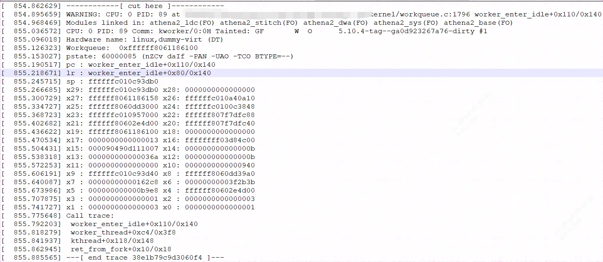
由于如果在 `WORKER_NOT_RUNNING` 检查时和下面的 `nr_running` 增量之间被`unbind_workers()`抢占，我们可能会破坏 `nr_running` 重置并在新的未绑定池上留下意外的 `pool->nr_running == 1` 。

为了防止这样的竞态条件产生，linux内核patch参考:  
[https://lore.kernel.org/lkml/20220114081544.899493450@linuxfoundation.org/](https://lore.kernel.org/lkml/20220114081544.899493450@linuxfoundation.org/)  
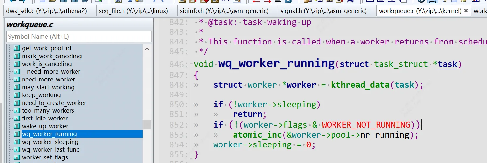
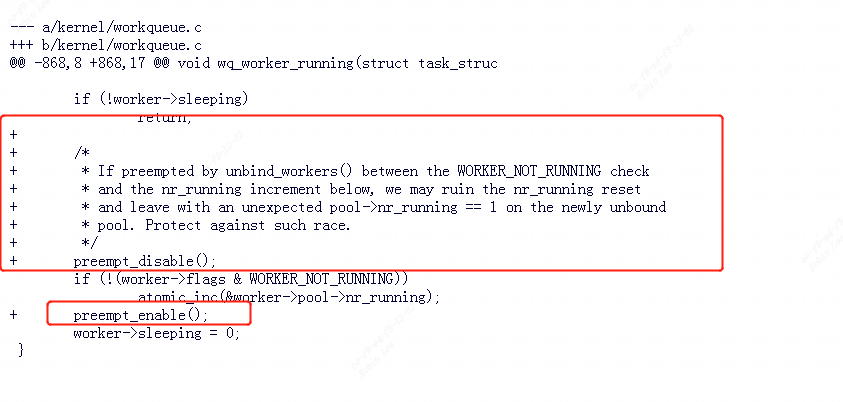
