# 1 threaded_irq引入

工作队列用起来挺简单，但是它有一个缺点：工作队列中有多个 work，前一个 work 没处理完会影响后面的 work执行，导致后面的work没法快速响应。那么可以再内核自己创建一个线程来单独处理，不跟别的 work 凑在一块了。比如在 Linux 系统中，对于存储设备比如 SD/TF 卡，它的驱动程序就是这样做的，它有自己的内核线程。用`kthread_creat`创建内核线程。  
对于中断处理，还有另一种方法：`threaded irq`，线程化的中断处理。中断的处理仍然可以认为分为上半部、下半部。上半部用来处理紧急的事情，下半部用一个内核线程来处理，这个内核线程专用于这个中断。

# 2 threaded_irq使用
前面的文章已经提到了`threaded_irq`。

1. 可以只提供 `thread_fn`，内核会提供默认的上半部处理函数`irq_default_primary_handler`,该函数只是返回一个**IRQ_WAKE_THREAD**。发生中断时，系统会立刻调用 handler 函数，然后唤醒某个内核线程，内核线程再来执行`thread_fn` 函数。
2. 也可以既提供`handler`函数，也提供`thread_fn`函数。等硬件中断到来，先执行`handler`函数，handler函数中返回**IRQ_WAKE_THREAD**去唤醒中断线程函数`thread_fn`。

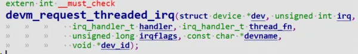

```c
extern int __must_check  
devm_request_threaded_irq(struct device *dev, unsigned int irq,  
			  irq_handler_t handler, irq_handler_t thread_fn,  
			  unsigned long irqflags, const char *devname,  
			  void *dev_id);  
//include\linux\interrupt.h  
static inline int __must_check  
devm_request_irq(struct device *dev, unsigned int irq, irq_handler_t handler,  
		 unsigned long irqflags, const char *devname, void *dev_id)  
{  
	return devm_request_threaded_irq(dev, irq, handler, NULL, irqflags,  
					 devname, dev_id);  
}  
extern int __must_check  
request_threaded_irq(unsigned int irq, irq_handler_t handler,  
		     irq_handler_t thread_fn,  
		     unsigned long flags, const char *name, void *dev);  
  
static inline int __must_check  
request_irq(unsigned int irq, irq_handler_t handler, unsigned long flags,  
	    const char *name, void *dev)  
{  
	return request_threaded_irq(irq, handler, NULL, flags, name, dev);  
}  
extern void free_irq(unsigned int, void *);
```

# 3 threaded_irq实例

## 3.1 驱动源码编写

驱动代码
```c fold
#include <linux/module.h>  
#include <linux/poll.h>  
#include <linux/fs.h>  
#include <linux/errno.h>  
#include <linux/miscdevice.h>  
#include <linux/kernel.h>  
#include <linux/major.h>  
#include <linux/mutex.h>  
#include <linux/proc_fs.h>  
#include <linux/seq_file.h>  
#include <linux/stat.h>  
#include <linux/init.h>  
#include <linux/device.h>  
#include <linux/tty.h>  
#include <linux/kmod.h>  
#include <linux/gfp.h>  
#include <linux/gpio/consumer.h>  
#include <linux/platform_device.h>  
#include <linux/of_gpio.h>  
#include <linux/of_irq.h>  
#include <linux/interrupt.h>  
#include <linux/irq.h>  
#include <linux/slab.h>  
#include <linux/fcntl.h>  
#include <linux/timer.h>  
#include <linux/workqueue.h>  
#include <asm/current.h>  
  
struct gpio_key{  
	int gpio;  
	struct gpio_desc *gpiod;  
	int flag;  
	int irq;  
	struct timer_list key_timer;  
	struct tasklet_struct tasklet;  
	struct work_struct work;  
} ;  
static struct gpio_key *gpio_keys_100ask;  
static int major = 0;  
static struct class *gpio_key_class;  
  
#define BUF_LEN 128  
static int g_keys[BUF_LEN];  
static int r, w;  
  
struct fasync_struct *button_fasync;  
#define NEXT_POS(x) ((x+1) % BUF_LEN)  
static int is_key_buf_empty(void){  
	return (r == w);  
}  
  
static int is_key_buf_full(void){  
	return (r == NEXT_POS(w));  
}  
static void put_key(int key){  
	if (!is_key_buf_full()){  
		g_keys[w] = key;  
		w = NEXT_POS(w);  
	}  
}  
static int get_key(void){  
	int key = 0;  
	if (!is_key_buf_empty()){  
		key = g_keys[r];  
		r = NEXT_POS(r);  
	}  
	return key;  
}  
  
static DECLARE_WAIT_QUEUE_HEAD(gpio_key_wait);  
static void key_timer_expire(unsigned long data){  
	struct gpio_key *gpio_key = data;  
	int val;  
	int key;  
	val = gpiod_get_value(gpio_key->gpiod);  
  
	printk("key_timer_expire key %d %d\n", gpio_key->gpio, val);  
	key = (gpio_key->gpio << 8) | val;  
	put_key(key);  
	wake_up_interruptible(&gpio_key_wait);  
	kill_fasync(&button_fasync, SIGIO, POLL_IN);  
}  
  
static void key_tasklet_func(unsigned long data){  
	struct gpio_key *gpio_key = data;  
	int val;  
	int key;  
  
	val = gpiod_get_value(gpio_key->gpiod);  
	printk("key_tasklet_func key %d %d\n", gpio_key->gpio, val);  
}  
static void key_work_func(struct work_struct *work){  
	struct gpio_key *gpio_key = container_of(work, struct gpio_key, work);  
	int val;  
  
	val = gpiod_get_value(gpio_key->gpiod);  
	printk("key_work_func: the process is %s pid %d\n",current->comm, current->pid);	  
	printk("key_work_func key %d %d\n", gpio_key->gpio, val);  
}  
static ssize_t gpio_key_drv_read (struct file *file, char __user *buf, size_t size, loff_t *offset){  
	int err;  
	int key;  
	if (is_key_buf_empty() && (file->f_flags & O_NONBLOCK))  
		return -EAGAIN;  
	wait_event_interruptible(gpio_key_wait, !is_key_buf_empty());  
	key = get_key();  
	err = copy_to_user(buf, &key, 4);  
	return 4;  
}  
static unsigned int gpio_key_drv_poll(struct file *fp, poll_table * wait){  
	poll_wait(fp, &gpio_key_wait, wait);  
	return is_key_buf_empty() ? 0 : POLLIN | POLLRDNORM;  
}  
  
static int gpio_key_drv_fasync(int fd, struct file *file, int on){  
	if (fasync_helper(fd, file, on, &button_fasync) >= 0)  
		return 0;  
	else  
		return -EIO;  
}  
static struct file_operations gpio_key_drv = {  
	.owner	 = THIS_MODULE,  
	.read    = gpio_key_drv_read,  
	.poll    = gpio_key_drv_poll,  
	.fasync  = gpio_key_drv_fasync,  
};  
static irqreturn_t gpio_key_isr(int irq, void *dev_id){  
	struct gpio_key *gpio_key = dev_id;  
	//printk("gpio_key_isr key %d irq happened\n", gpio_key->gpio);  
	tasklet_schedule(&gpio_key->tasklet);  
	mod_timer(&gpio_key->key_timer, jiffies + HZ/50);  
	schedule_work(&gpio_key->work);  
	return IRQ_WAKE_THREAD;  
}  
  
static irqreturn_t gpio_key_thread_func(int irq, void *data){  
	struct gpio_key *gpio_key = data;  
	int val;  
  
	val = gpiod_get_value(gpio_key->gpiod);  
	printk("gpio_key_thread_func: the process is %s pid %d\n",current->comm, current->pid);  
	printk("gpio_key_thread_func key %d %d\n", gpio_key->gpio, val);  
	return IRQ_HANDLED;  
}  
  
static int gpio_key_probe(struct platform_device *pdev){  
	int err;  
	struct device_node *node = pdev->dev.of_node;  
	int count;  
	int i;  
	enum of_gpio_flags flag;  
		  
	count = of_gpio_count(node);  
	if (!count){  
		printk("%s %s line %d, there isn't any gpio available\n",  
               __FILE__, __FUNCTION__, __LINE__);  
		return -1;  
	}  
  
	gpio_keys_100ask = kzalloc(sizeof(struct gpio_key) * count, GFP_KERNEL);  
	for (i = 0; i < count; i++){		  
		gpio_keys_100ask[i].gpio = of_get_gpio_flags(node, i, &flag);  
		if (gpio_keys_100ask[i].gpio < 0){  
			printk("%s %s line %d, of_get_gpio_flags fail\n",  
                   __FILE__, __FUNCTION__, __LINE__);  
			return -1;  
		}  
		gpio_keys_100ask[i].gpiod = gpio_to_desc(gpio_keys_100ask[i].gpio);  
		gpio_keys_100ask[i].flag = flag & OF_GPIO_ACTIVE_LOW;  
		gpio_keys_100ask[i].irq  = gpio_to_irq(gpio_keys_100ask[i].gpio);  
		setup_timer(&gpio_keys_100ask[i].key_timer, key_timer_expire, &gpio_keys_100ask[i]);  
		gpio_keys_100ask[i].key_timer.expires = ~0;  
		add_timer(&gpio_keys_100ask[i].key_timer);  
		tasklet_init(&gpio_keys_100ask[i].tasklet, key_tasklet_func, &gpio_keys_100ask[i]);  
		INIT_WORK(&gpio_keys_100ask[i].work, key_work_func);  
	}  
  
	for (i = 0; i < count; i++){  
		//err = request_irq(gpio_keys_100ask[i].irq, gpio_key_isr  
        //, IRQF_TRIGGER_RISING | IRQF_TRIGGER_FALLING  
        //, "100ask_gpio_key", &gpio_keys_100ask[i]);  
		err = request_threaded_irq(gpio_keys_100ask[i].irq, gpio_key_isr  
        						   , gpio_key_thread_func,  
                                   IRQF_TRIGGER_RISING | IRQF_TRIGGER_FALLING  
                                   , "100ask_gpio_key", &gpio_keys_100ask[i]);  
	}  
  
	major = register_chrdev(0, "100ask_gpio_key", &gpio_key_drv);   
	gpio_key_class = class_create(THIS_MODULE, "100ask_gpio_key_class");  
	if (IS_ERR(gpio_key_class)) {  
		printk("%s %s line %d\n", __FILE__, __FUNCTION__, __LINE__);  
		unregister_chrdev(major, "100ask_gpio_key");  
		return PTR_ERR(gpio_key_class);  
	}  
	device_create(gpio_key_class, NULL, MKDEV(major, 0), NULL, "100ask_gpio_key");   
    return 0;  
}  
  
static int gpio_key_remove(struct platform_device *pdev){  
	struct device_node *node = pdev->dev.of_node;  
	int count;  
	int i;  
	device_destroy(gpio_key_class, MKDEV(major, 0));  
	class_destroy(gpio_key_class);  
	unregister_chrdev(major, "100ask_gpio_key");  
	count = of_gpio_count(node);  
	for (i = 0; i < count; i++){  
		free_irq(gpio_keys_100ask[i].irq, &gpio_keys_100ask[i]);  
		del_timer(&gpio_keys_100ask[i].key_timer);  
		tasklet_kill(&gpio_keys_100ask[i].tasklet);  
	}  
	kfree(gpio_keys_100ask);  
    return 0;  
}  
static const struct of_device_id ask100_keys[] = {  
    { .compatible = "100ask,gpio_key" },  
    { },  
};  
static struct platform_driver gpio_keys_driver = {  
    .probe      = gpio_key_probe,  
    .remove     = gpio_key_remove,  
    .driver     = {  
        .name   = "100ask_gpio_key",  
        .of_match_table = ask100_keys,  
    },  
};  
static int __init gpio_key_init(void){  
    int err;  
    err = platform_driver_register(&gpio_keys_driver);   
	return err;  
}  
  
static void __exit gpio_key_exit(void){  
    platform_driver_unregister(&gpio_keys_driver);  
}  
module_init(gpio_key_init);  
module_exit(gpio_key_exit);  
MODULE_LICENSE("GPL");
```

## 3.2 app代码编写

app代码
```c fold
#include <sys/types.h>  
#include <sys/stat.h>  
#include <fcntl.h>  
#include <unistd.h>  
#include <stdio.h>  
#include <string.h>  
#include <poll.h>  
#include <signal.h>  
static int fd;  
  
/*  
 * ./button_test /dev/100ask_button0  
 *  
 */  
int main(int argc, char **argv){  
	int val;  
	struct pollfd fds[1];  
	int timeout_ms = 5000;  
	int ret;  
	int	flags;  
	int i;  
	if (argc != 2) {  
		printf("Usage: %s <dev>\n", argv[0]);  
		return -1;  
	}  
	fd = open(argv[1], O_RDWR | O_NONBLOCK);  
	if (fd == -1){  
		printf("can not open file %s\n", argv[1]);  
		return -1;  
	}  
	for (i = 0; i < 10; i++) {  
		if (read(fd, &val, 4) == 4)  
			printf("get button: 0x%x\n", val);  
		else  
			printf("get button: -1\n");  
	}  
	flags = fcntl(fd, F_GETFL);  
	fcntl(fd, F_SETFL, flags & ~O_NONBLOCK);  
	while (1){  
		if (read(fd, &val, 4) == 4)  
			printf("get button: 0x%x\n", val);  
		else  
			printf("while get button: -1\n");  
	}  
	close(fd);  
	return 0;  
}
```

## 3.3 驱动代码解析

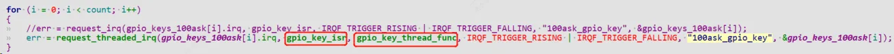
为每个按键注册中断服务

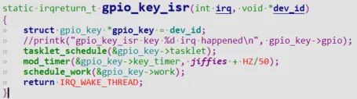
硬件中断上半部irq中做完重要事情如：清中断，然后返回**IRQ_WAKE_THREAD**

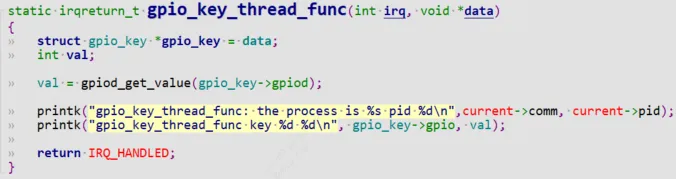
返回后，内核线程开始调度`gpio_key_thread_func`，中断线程化的处理函数`gpio_key_thread_func`做完后返回`IRQ_HANDLED`;

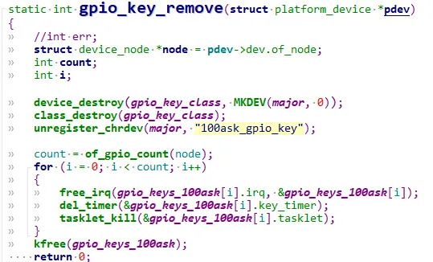
最后卸载驱动时取消irq注册.

# 4 threaded_irq内核机制

`struct irq_desc`结构：  
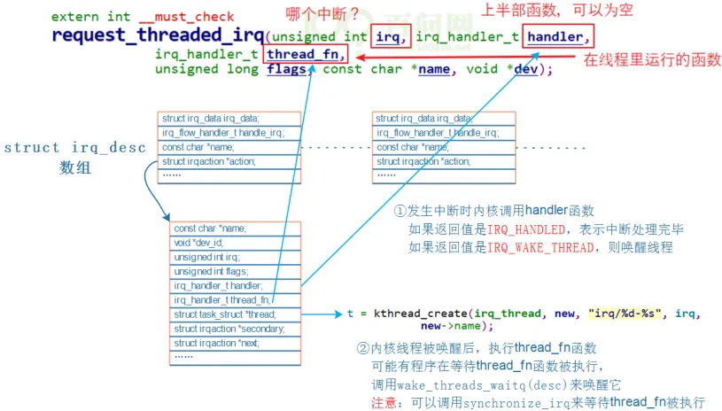
```c
1. 当发生中断时，handler函数被调用，如果返回IRQ_HANDLED,表示中断处理完毕，如果返回IRQ_WAKE_THREAD表示要唤醒thread_fn.  
2. 内核线程唤醒后，执行thread_fn
```

## 4.1 request_threaded_irq过程

```c fold
int request_threaded_irq(unsigned int irq, irq_handler_t handler,  
			 irq_handler_t thread_fn, unsigned long irqflags,  
			 const char *devname, void *dev_id){  
	struct irqaction *action;  
	struct irq_desc *desc;  
	int retval;  
	if (irq == IRQ_NOTCONNECTED)  
		return -ENOTCONN;  
	if (((irqflags & IRQF_SHARED) && !dev_id) |  
	    (!(irqflags & IRQF_SHARED) && (irqflags & IRQF_COND_SUSPEND)) |  
	    ((irqflags & IRQF_NO_SUSPEND) && (irqflags & IRQF_COND_SUSPEND)))  
		return -EINVAL;  
  
	desc = irq_to_desc(irq);  //1  
	if (!desc)  
		return -EINVAL;  
  
	if (!irq_settings_can_request(desc) |  
	    WARN_ON(irq_settings_is_per_cpu_devid(desc)))  
		return -EINVAL;  
  
	if (!handler) {  
		if (!thread_fn)  
			return -EINVAL;  
		handler = irq_default_primary_handler;  
	}  
  
	action = kzalloc(sizeof(struct irqaction), GFP_KERNEL);  
	if (!action)  
		return -ENOMEM;  
  
	action->handler = handler;   //2  
	action->thread_fn = thread_fn;  
	action->flags = irqflags;  
	action->name = devname;  
	action->dev_id = dev_id;  
  
	retval = irq_chip_pm_get(&desc->irq_data);  
	if (retval < 0) {  
		kfree(action);  
		return retval;  
	}  
  
	chip_bus_lock(desc);  
	retval = __setup_irq(irq, desc, action); //3  
	chip_bus_sync_unlock(desc);  
  
	if (retval) {  
		irq_chip_pm_put(&desc->irq_data);  
		kfree(action->secondary);  
		kfree(action);  
	}  
  
#ifdef CONFIG_DEBUG_SHIRQ_FIXME  
	if (!retval && (irqflags & IRQF_SHARED)) {  
		/*  
		 * It's a shared IRQ -- the driver ought to be prepared for it  
		 * to happen immediately, so let's make sure....  
		 * We disable the irq to make sure that a 'real' IRQ doesn't  
		 * run in parallel with our fake.  
		 */  
		unsigned long flags;  
  
		disable_irq(irq);  
		local_irq_save(flags);  
		handler(irq, dev_id);  
		local_irq_restore(flags);  
		enable_irq(irq);  
	}  
#endif  
	return retval;  
}
```

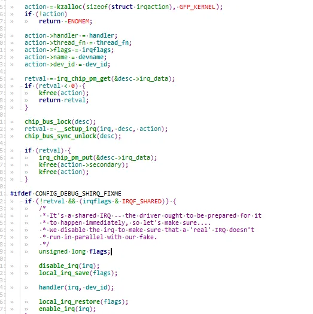
1. 首先根据`irq num`获取到`struct irq_desc`信息。
    
2. 然后分配、设置一个 `irqaction` 结构体。设置中断相关参数
    
3. 然后进入`__setup_irq`，`__setup_irq` 函数核心代码如下：
    

### 4.1.1 `__setup_irq`

#### 4.1.1.1 setup_irq_thread
```c
if (new->thread_fn && !nested) {  
	ret = setup_irq_thread(new, irq, false);  
//setup_irq_thread函数核心代码如下：  
if (!secondary) {  
	t = kthread_create(irq_thread, new, "irq/%d-%s", irq,  
	 new->name);  
} else {  
	t = kthread_create(irq_thread, new, "irq/%d-s-%s", irq,  
	 new->name);  
	param.sched_priority -= 1;  
}  
new->thread = t;
```

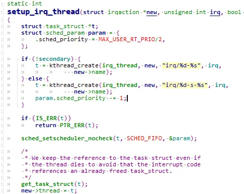
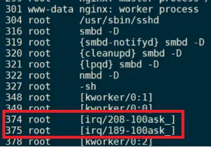
①可以看到创建了`irq_thread`这个内核线程。线程名字为`“irq/pid-中断名字”`。

`kthread_create()`只是创建一个内核线程，但并没有启动，需要调用`wake_up_process()`来启动线程，所以内核又帮我们定义了一个宏`kthread_run`来帮我们搞定. 来看kthread相关API:

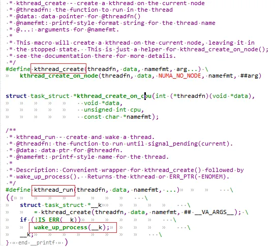
```c
#define kthread_create(threadfn, data, namefmt, arg...) \  
	kthread_create_on_node(threadfn, data, NUMA_NO_NODE, namefmt, ##arg)  
struct task_struct *kthread_create_on_cpu(int (*threadfn)(void *data),  
					  void *data,  
					  unsigned int cpu,  
					  const char *namefmt);  
/**  
 * kthread_run - create and wake a thread.  
 * @threadfn: the function to run until signal_pending(current).  
 * @data: data ptr for @threadfn.  
 * @namefmt: printf-style name for the thread.  
 *  
 * Description: Convenient wrapper for kthread_create() followed by  
 * wake_up_process().  Returns the kthread or ERR_PTR(-ENOMEM).  
 */  
#define kthread_run(threadfn, data, namefmt, ...)			   \  
({									   \  
	struct task_struct *__k						   \  
		= kthread_create(threadfn, data, namefmt, ## __VA_ARGS__); \  
	if (!IS_ERR(__k))						   \  
		wake_up_process(__k);					   \  
	__k;								   \  
})  
int kthread_stop(struct task_struct *k);
```

②然后将创建内核线程返回的`task_strcut`给到`irqaction`.(`new->trhead = t;这句`)  
我们知道`irqaction`就包含了`thread_fn`和`handler`。

## 4.2 中断后处理`thread_fn`是怎么被执行的

### 4.2.1 上半部硬件中断的调用过程
当中断产生时，用gdb看看gic驱动框架调用关系：
```c
Breakpoint 1, gpio_keys_gpio_isr (irq=200, dev_id=0x863e6930) at drivers/input/keybo  
ard/gpio_keys.c:393  
393 {  
(gdb) bt  
#0 gpio_keys_gpio_isr (irq=200, dev_id=0x863e6930) at drivers/input/keyboard/gpio_k  
eys.c:393  
#1 0x80270528 in __handle_irq_event_percpu (desc=0x8616e300, flags=0x86517edc) at ke  
rnel/irq/handle.c:145  
#2 0x802705cc in handle_irq_event_percpu (desc=0x8616e300) at kernel/irq/handle.c:18  
5  
#3 0x80270640 in handle_irq_event (desc=0x8616e300) at kernel/irq/handle.c:202  
#4 0x802738e8 in handle_level_irq (desc=0x8616e300) at kernel/irq/chip.c:518  
#5 0x8026f7f8 in generic_handle_irq_desc (desc=<optimized out>) at ./include/linux/i  
rqdesc.h:150  
#6 generic_handle_irq (irq=<optimized out>) at kernel/irq/irqdesc.c:590  
#7 0x805005e0 in mxc_gpio_irq_handler (port=0xc8, irq_stat=2252237104) at drivers/gp  
io/gpio-mxc.c:274  
#8 0x805006fc in mx3_gpio_irq_handler (desc=<optimized out>) at drivers/gpio/gpio-mx  
c.c:291  
#9 0x8026f7f8 in generic_handle_irq_desc (desc=<optimized out>) at ./include/linux/i  
rqdesc.h:150  
#10 generic_handle_irq (irq=<optimized out>) at kernel/irq/irqdesc.c:590  
#11 0x8026fd0c in __handle_domain_irq (domain=0x86006000, hwirq=32, lookup=true, regs  
=0x86517fb0) at kernel/irq/irqdesc.c:627  
#12 0x80201484 in handle_domain_irq (regs=<optimized out>, hwirq=<optimized out>, dom  
ain=<optimized out>) at ./include/linux/irqdesc.h:168  
#13 gic_handle_irq (regs=0xc8) at drivers/irqchip/irq-gic.c:364  
#14 0x8020b704 in __irq_usr () at arch/arm/kernel/entry-armv.S:464
```

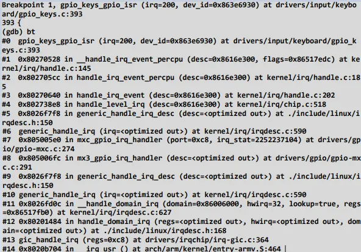
从打印可以看出注册的上半部硬件中断`handler`的调用流程。

### 4.2.2 `thread_fn`的调用过程

来看`gpio_keys_gpio_isr`是如何一层层调用上来的。从`__handle_irq_event_percpu`开始分析：（它在`kernel\irq\handle.c`中）  
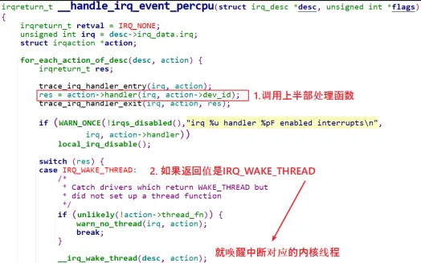
执行上半部提供的的`handler`函数。判断上半部返回值如果是`IRQ_WAKE_THREAD`，就调用`__irq_wake_thread`唤醒中断线程处理函数。

如果上半部返回值是`IRQ_HANDLED`,表示该中断无需线程化处理，直接退出。

#### 4.2.2.1 `__irq_wake_thread`分析

它在`kernel\irq\handle.c`中:
```c
void __irq_wake_thread(struct irq_desc *desc, struct irqaction *action){  
	......  
	atomic_inc(&desc->threads_active);  
	wake_up_process(action->thread);  
}
```

唤醒的是谁，就是`action->thread`，也就是对应前面`kthread_create`出来的`irq_thread`，再次贴图如下：  

#### 4.2.2.2 irq_thread函数分析

在`kernel\irq\manage.c`，平时`irq_thread`是处于休眠idle状态，不占用cpu资源。

当被唤醒后，`irq_thread`进入唤醒状态调用`handler_fn`，也就是最终使用者预先设定的`action->thread_fn`。
```c
/*  
 * Interrupt handler thread  
 */  
static int irq_thread(void *data){  
	struct callback_head on_exit_work;  
	struct irqaction *action = data;  
	struct irq_desc *desc = irq_to_desc(action->irq);  
	irqreturn_t (*handler_fn)(struct irq_desc *desc,  
			struct irqaction *action);  
  
	if (force_irqthreads && test_bit(IRQTF_FORCED_THREAD,  
					&action->thread_flags))  
		handler_fn = irq_forced_thread_fn;  
	else  
		handler_fn = irq_thread_fn;  
  
	init_task_work(&on_exit_work, irq_thread_dtor);  
	task_work_add(current, &on_exit_work, false);  
	irq_thread_check_affinity(desc, action);  
	while (!irq_wait_for_interrupt(action)) {  
		irqreturn_t action_ret;  
		irq_thread_check_affinity(desc, action);  
		action_ret = handler_fn(desc, action);//调用irq_thread_fn  
		if (action_ret == IRQ_HANDLED)  
			atomic_inc(&desc->threads_handled);  
		if (action_ret == IRQ_WAKE_THREAD)  
			irq_wake_secondary(desc, action);  
		wake_threads_waitq(desc);  
	}  
/*  
 * Interrupts explicitly requested as threaded interrupts want to be  
 * preemtible - many of them need to sleep and wait for slow busses to  
 * complete.  
 */  
static irqreturn_t irq_thread_fn(struct irq_desc *desc,  
		struct irqaction *action){  
	irqreturn_t ret;  
	ret = action->thread_fn(action->irq, action->dev_id);//调用使用者预先设定的action->thread_fn  
	irq_finalize_oneshot(desc, action);  
	return ret;  
}
```

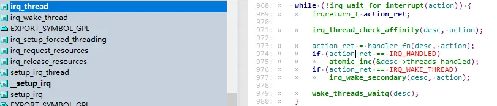
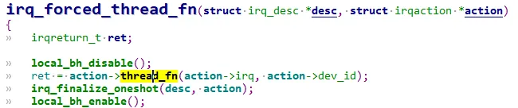
