# 1 引入ioctl

一个字符设备驱动通常会实现设备打开、关闭、读、写等功能，在一些需要细分的情境下，如果需要扩展新的功能增添命令，通常以增设 `ioctl()` 命令的方式实现。  
对于ioctl这个系统调用接口，Linux的创始人在2.0版本之前并没有进行添加，仅有write和read两个接口，但是后来发现当需要去控制文件的某些操作的时候，很显然这两个接口根本不够用。所以才有了这个万能控制接口ioctl，但是作为Linux的创始人Linus本人一直排斥该接口，因为这个ioctl接口的在内核中的使用相当于对应用层开设了一个能够直接交互的窗口，很影响内核整体的权限控制，不过由于目前还暂时没有更好可以替代的方法，所以还是继续保留了这个接口的使用。  
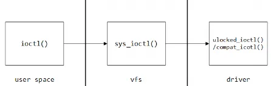
# 2 用户空间 ioctl

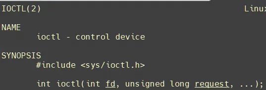
```c
int ioctl(int fd, int request, …);  
ret = ioctl(fd, MYCMD);  
if (ret == -1) {  
	printf("ioctl: %s\n", strerror(errno));  
}
```

函数功能：  
1.向硬件设备发送控制命令  
2.还可以和硬件设备进行读或者写操作  
参数：  
`fd：`文件描述符  
`request：`给硬件设备发送的控制命令  
`arg：`保存的就是用户缓冲区的首地址  
返回值：执行成功返回0，执行失败返回-1, ioctl 最常见的 `errorno` 值为 `ENOTTY`（`error not a typewriter`)表示命令找不到。

# 3 内核空间 ioctl

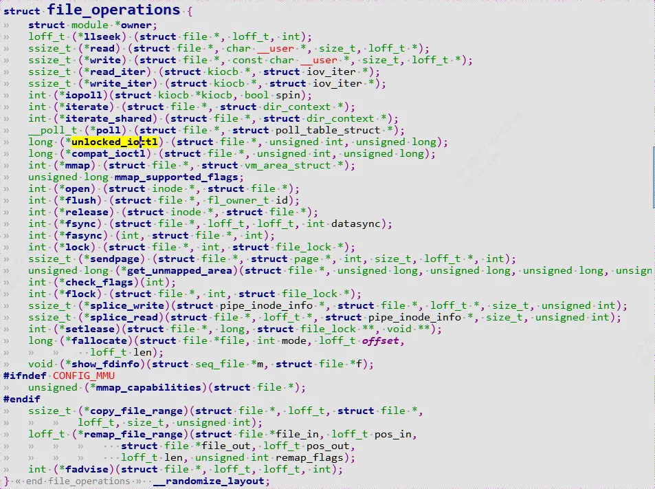
```c
long (*unlocked_ioctl) (struct file *, unsigned int, unsigned long);  
long (*compat_ioctl) (struct file *, unsigned int, unsigned long);
```

# 4 IOCTL的命令构成

ioctl命令就是用户和驱动约定的一种协议， 理论上可以为任意 int 型数据，可以为 0、1、2、3……，但是为了确保该 “协议” 的唯一性，ioctl 命令应该使用更科学严谨的方法赋值，在linux中，提供了一种 ioctl 命令的统一格式，将 32 位 int 型数据划分为四个位段，如下图所示：  
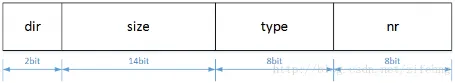
```c
1. dir（direction），ioctl 命令访问模式（数据传输方向），占据 2 bit，  
	可以为 _IOC_NONE、_IOC_READ、_IOC_WRITE、_IOC_READ | _IOC_WRITE，  
	分别指示了四种访问模式：无数据、读数据、写数据、读写数据；  
2. size，涉及到 ioctl 函数第三个参数 arg ，占据14bit，指定了 arg 的数据类型及长度；  
3. type（device type），设备类型，占据 8 bit，可以为任意 char 型字符，  
	例如‘a’、’b’、’c’ 等等，其主要作用是使 ioctl 命令有唯一的设备标识；  
4. nr（number），命令编号/序数，占据 8 bit，可以为任意 unsigned char 型数据，  
	取值范围 0~255，如果定义了多个 ioctl 命令，通常从 0 开始编号递增
```

通常而言，为了方便，会使用宏 `_IOC()` 衍生的接口来直接定义 ioctl 命令：
```c
//ioctl.h  
#define _IOC_NRBITS	8  
#define _IOC_TYPEBITS	8  
/*  
 * Let any architecture override either of the following before  
 * including this file.  
 */  
#ifndef _IOC_SIZEBITS  
# define _IOC_SIZEBITS	14  
#endif  
  
#ifndef _IOC_DIRBITS  
# define _IOC_DIRBITS	2  
#endif  
  
#define _IOC_NRMASK	((1 << _IOC_NRBITS)-1)  
#define _IOC_TYPEMASK	((1 << _IOC_TYPEBITS)-1)  
#define _IOC_SIZEMASK	((1 << _IOC_SIZEBITS)-1)  
#define _IOC_DIRMASK	((1 << _IOC_DIRBITS)-1)  
  
#define _IOC_NRSHIFT	0  
#define _IOC_TYPESHIFT	(_IOC_NRSHIFT+_IOC_NRBITS)  
#define _IOC_SIZESHIFT	(_IOC_TYPESHIFT+_IOC_TYPEBITS)  
#define _IOC_DIRSHIFT	(_IOC_SIZESHIFT+_IOC_SIZEBITS)  
  
/*  
 * Direction bits, which any architecture can choose to override  
 * before including this file.  
 *  
 * NOTE: _IOC_WRITE means userland is writing and kernel is  
 * reading. _IOC_READ means userland is reading and kernel is writing.  
 */  
  
#ifndef _IOC_NONE  
# define _IOC_NONE	0U  
#endif  
  
#ifndef _IOC_WRITE  
# define _IOC_WRITE	1U  
#endif  
  
#ifndef _IOC_READ  
# define _IOC_READ	2U  
#endif  
  
#define _IOC(dir,type,nr,size) \  
	(((dir)  << _IOC_DIRSHIFT) | \  
	 ((type) << _IOC_TYPESHIFT) | \  
	 ((nr)   << _IOC_NRSHIFT) | \  
	 ((size) << _IOC_SIZESHIFT))  
  
#ifndef __KERNEL__  
#define _IOC_TYPECHECK(t) (sizeof(t))  
#endif  
  
/*  
 * Used to create numbers.  
 *  
 * NOTE: _IOW means userland is writing and kernel is reading. _IOR  
 * means userland is reading and kernel is writing.  
 */  
#define _IO(type,nr)		_IOC(_IOC_NONE,(type),(nr),0)  
#define _IOR(type,nr,size)	_IOC(_IOC_READ,(type),(nr),(_IOC_TYPECHECK(size)))  
#define _IOW(type,nr,size)	_IOC(_IOC_WRITE,(type),(nr),(_IOC_TYPECHECK(size)))  
#define _IOWR(type,nr,size)	_IOC(_IOC_READ|_IOC_WRITE,(type),(nr),(_IOC_TYPECHECK(size)))  
#define _IOR_BAD(type,nr,size)	_IOC(_IOC_READ,(type),(nr),sizeof(size))  
#define _IOW_BAD(type,nr,size)	_IOC(_IOC_WRITE,(type),(nr),sizeof(size))  
#define _IOWR_BAD(type,nr,size)	_IOC(_IOC_READ|_IOC_WRITE,(type),(nr),sizeof(size))  
  
/* used to decode ioctl numbers.. */  
#define _IOC_DIR(nr)		(((nr) >> _IOC_DIRSHIFT) & _IOC_DIRMASK)  
#define _IOC_TYPE(nr)		(((nr) >> _IOC_TYPESHIFT) & _IOC_TYPEMASK)  
#define _IOC_NR(nr)		(((nr) >> _IOC_NRSHIFT) & _IOC_NRMASK)  
#define _IOC_SIZE(nr)		(((nr) >> _IOC_SIZESHIFT) & _IOC_SIZEMASK)  
  
/* ...and for the drivers/sound files... */  
  
#define IOC_IN		(_IOC_WRITE << _IOC_DIRSHIFT)  
#define IOC_OUT		(_IOC_READ << _IOC_DIRSHIFT)  
#define IOC_INOUT	((_IOC_WRITE|_IOC_READ) << _IOC_DIRSHIFT)  
#define IOCSIZE_MASK	(_IOC_SIZEMASK << _IOC_SIZESHIFT)  
#define IOCSIZE_SHIFT	(_IOC_SIZESHIFT)
```

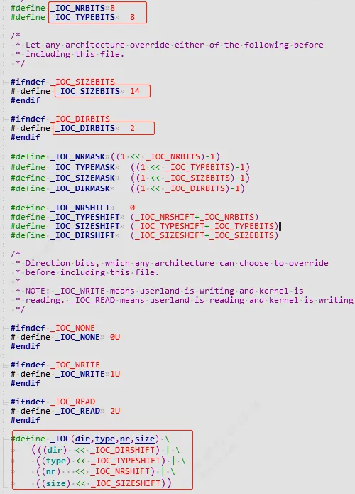
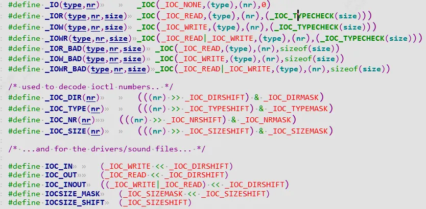
除了`_IO/_IOR/_IOW/_IOW`等命令外，还支持反向解析 ioctl 命令的宏接口：
```c
#define _IOC_DIR(nr) (((nr) >> _IOC_DIRSHIFT) & _IOC_DIRMASK)  
#define _IOC_TYPE(nr) (((nr) >> _IOC_TYPESHIFT) & _IOC_TYPEMASK)  
#define _IOC_NR(nr) (((nr) >> _IOC_NRSHIFT) & _IOC_NRMASK)  
#define _IOC_SIZE(nr) (((nr) >> _IOC_SIZESHIFT) & _IOC_SIZEMASK)
```

例如，展开命令成一个`unsigned int`的 cmd整数为：(`字符D的ascii码为68`)
```c
0<<30 | 0<<16 | 68<<8 | 0x7<<0
```

# 5 ioctl系统调用过程详解

## 5.1 app示例
```c
#define IOC_MAGIC 'c'  
#define IOCINIT _IO(IOC_MAGIC, 0)  
#define IOCRREG _IOR(IOC_MAGIC, 1, int)  
#define IOCWREG _IOW(IOC_MAGIC, 2, int)//定义3个cmd  
#define IOC_MAXNR 3  
struct msg {  
	int addr;  
	unsigned int data;  
};  
  
fd = open("/dev/ioctl-test", O_RDWR);  
ioctl(fd, IOCINIT);  
/* 往寄存器0x01写入数据0xef */  
memset(&my_msg, 0, sizeof(my_msg));  
my_msg.addr = 0x01;  
my_msg.data = 0xef;  
ioctl(fd, IOCWREG, &my_msg);  
/* 读寄存器0x01 */  
memset(&my_msg, 0, sizeof(my_msg));  
my_msg.addr = 0x01;  
ret = ioctl(fd, IOCRREG, &my_msg);
```

构造了`IOCINIT` `IOCRREG` `IOCWREG`3个命令。

## 5.2 驱动示例
```c
#define IOC_MAGIC 'c'  
#define IOCINIT _IO(IOC_MAGIC, 0)  
#define IOCRREG _IOR(IOC_MAGIC, 1, int)  
#define IOCWREG _IOW(IOC_MAGIC, 2, int)//定义3个cmd  
#define IOC_MAXNR 3  
struct msg {  
	int addr;  
	unsigned int data;  
};  
static long test_ioctl(struct file *file, unsigned int cmd, unsigned long arg)  
{  
	int ret;  
	struct msg my_msg;  
	/* 检查设备类型 */  
	if (_IOC_TYPE(cmd) != IOC_MAGIC) {  
		pr_err("[%s] command type [%c] error!\n", __func__, _IOC_TYPE(cmd));  
		return -ENOTTY;   
	}  
	/* 检查序数 */  
	if (_IOC_NR(cmd) > IOC_MAXNR) {  
		pr_err("[%s] command numer [%d] exceeded!\n", __func__, _IOC_NR(cmd));  
		return -ENOTTY;  
	}  
	/* 检查访问模式 */  
	if (_IOC_DIR(cmd) & _IOC_READ)  
#if (LINUX_VERSION_CODE >= KERNEL_VERSION(5, 10, 0))  
		ret= !access_ok(VERIFY_WRITE, (void __user *)arg, _IOC_SIZE(cmd));  
#else  
		ret= !access_ok((void __user *)arg, _IOC_SIZE(cmd));  
#endif  
	else if (_IOC_DIR(cmd) & _IOC_WRITE)  
#if (LINUX_VERSION_CODE >= KERNEL_VERSION(5, 10, 0))  
		ret= !access_ok(VERIFY_READ, (void __user *)arg, _IOC_SIZE(cmd));  
#else  
		ret= !access_ok((void __user *)arg, _IOC_SIZE(cmd));  
#endif  
	if (ret)  
		return -EFAULT;  
	switch(cmd) {   
	/* 初始化设备 */  
	case IOCINIT:  
		break;  
	/* 读寄存器 */  
	case IOCRREG:  
		ret = copy_from_user(&msg, (struct msg __user *)arg, sizeof(my_msg));  
		if (ret)   
			return -EFAULT;  
		msg->data = read_reg(msg->addr);  
		ret = copy_to_user((struct msg __user *)arg, &msg, sizeof(my_msg));  
		if (ret)   
			return -EFAULT;  
		break;  
	/* 写寄存器 */  
	case IOCWREG:  
		ret = copy_from_user(&msg, (struct msg __user *)arg, sizeof(my_msg));  
		if (ret)   
			return -EFAULT;  
		write_reg(msg->addr, msg->data);  
		break;  
	default:  
		return -ENOTTY;  
	}  
	return 0;  
}
```

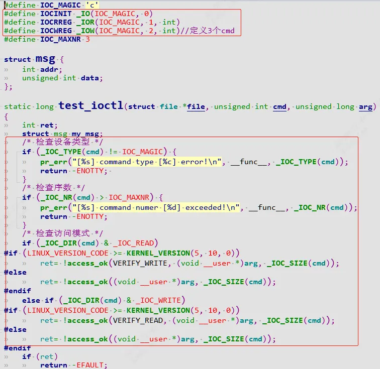
首先定好3个命令，通过`arg`传入要写入的地址和数据or 要读的地址。然后检查`type`是否为`‘c’`, 检查命令号是否超过最大值3，检查方向是读还是写，利用`access_ok`判断用户地址是否可以访问。  
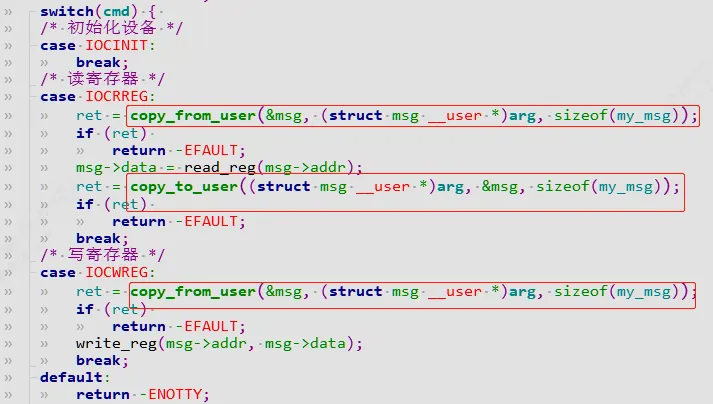
最后将用户地址arg的数据透过`copy_from_user`和`copy_to_user`进行拷贝。然后进行寄存器读写。

## 5.3 ioctl过程详解

在系统调用中，首先通过软中断方式切换到内核态，ioctl的系统调用位于`arch/arm/include/asm/unistd.h`：

- sys_ioctl
```c
#define __NR_ioctl	(__NR_SYSCALL_BASE+ 54)
```

`arch/arm/kernel/calls.S`
```c
/* 55 */	CALL(sys_ioctl);
```

调用`sys_ioctl()`
```c
/include/linux.h  
	asmlinkage long sys_ioctl(unsigned int fd, unsigned int cmd, unsigned long arg);
```

`sys_ioctl`通过`SYSCALL_DEFINE3(ioctl, unsigned int, fd, unsigned int, cmd, unsigned long, arg)`定义:
```c
/include/linux/syscalls.h  
#define SYSCALL_DEFINE3(name, ...)  SYSCALL_DEFINEx(3, _##name, __VA_ARGS__)  
#define SYSCALL_DEFINEx(x, sname, ...)	__SYSCALL_DEFINEx(x, sname, __VA_ARGS__)  
#define __SYSCALL_DEFINEx(x, name, ...)	asmlinkage long sys##name(__SC_DECL##x(__VA_ARGS__))
```

`SYSCALL_DEFINE3`  
`SYSCALL_DEFINE3(ioctl, unsigned int, fd, unsigned int, cmd, unsigned long, arg)`就是`sys_ioctl`的定义:  
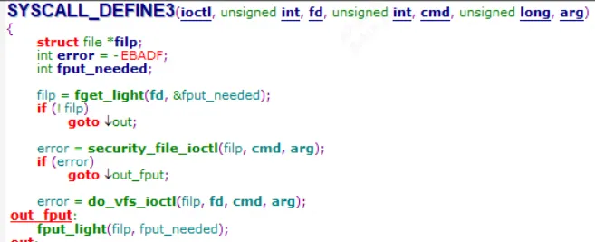
`fget_light()` 以及 `security_file_ioctl()` 就是检验可操作安全性，调用更深一层接口 `do_vfs_ioctl()`实现具体功能：
```c
SYSCALL_DEFINE3(ioctl, unsigned int, fd, unsigned int, cmd, unsigned long, arg){  
	struct file *filp;  
	int error = -EBADF;  
	int fput_needed;  
  
	filp = fget_light(fd, &fput_needed);//由fd得到filp指针  
	if (!filp)  
		goto out;  
	error = security_file_ioctl(filp, cmd, arg);  
	if (error)  
		goto out_fput;  
	error = do_vfs_ioctl(filp, fd, cmd, arg);  
 out_fput:  
	fput_light(filp, fput_needed);  
 out:  
	return error;  
}
```

- do_vfs_ioctl

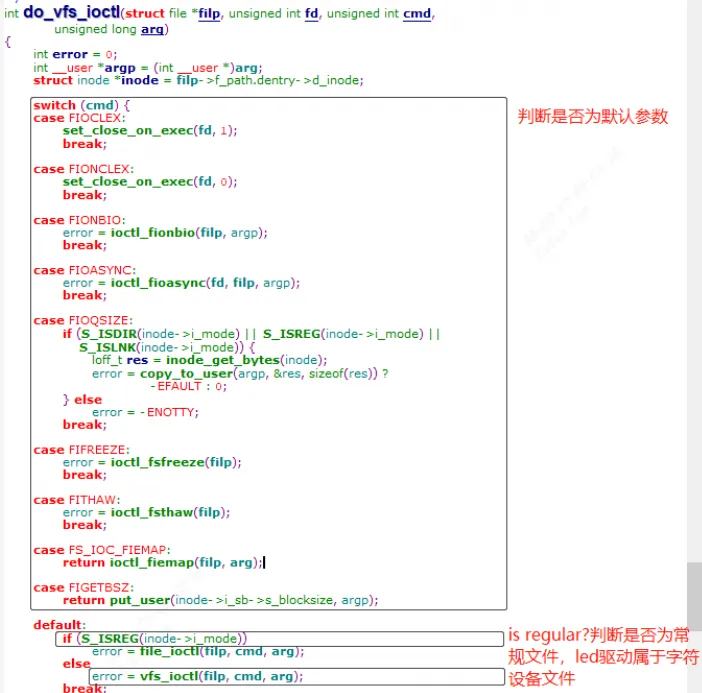
```c
int do_vfs_ioctl(struct file *filp, unsigned int fd, unsigned int cmd,  
		 unsigned long arg) {  
	int error = 0;  
	int __user *argp = (int __user *)arg;  
	struct inode *inode = filp->f_path.dentry->d_inode;  
  
	switch (cmd) {  
	case FIOCLEX:  
		set_close_on_exec(fd, 1);  
		break;  
  
	case FIONCLEX:  
		set_close_on_exec(fd, 0);  
		break;  
  
	case FIONBIO:  
		error = ioctl_fionbio(filp, argp);  
		break;  
  
	case FIOASYNC:  
		error = ioctl_fioasync(fd, filp, argp);  
		break;  
  
	case FIOQSIZE:  
		if (S_ISDIR(inode->i_mode) | S_ISREG(inode->i_mode) |  
			S_ISLNK(inode->i_mode)) {  
			loff_t res = inode_get_bytes(inode);  
			error = copy_to_user(argp, &res, sizeof(res)) ?  
					-EFAULT : 0;  
		} else  
			error = -ENOTTY;  
		break;  
  
	case FIFREEZE:  
		error = ioctl_fsfreeze(filp);  
		break;  
  
	case FITHAW:  
		error = ioctl_fsthaw(filp);  
		break;  
  
	case FS_IOC_FIEMAP:  
		return ioctl_fiemap(filp, arg);  
  
	case FIGETBSZ:  
		return put_user(inode->i_sb->s_blocksize, argp);  
  
	default:  
		if (S_ISREG(inode->i_mode))//是否为常规文件若是常规文件  
			error = file_ioctl(filp, cmd, arg);  
		else  
			error = vfs_ioctl(filp, cmd, arg);//调用vfs_ioctl  
		break;  
	}  
	return error;  
}
```

- vfs_ioctl

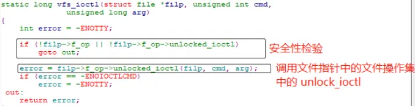
```c
static long vfs_ioctl(struct file *filp, unsigned int cmd,  
			  unsigned long arg)  
{  
	int error = -ENOTTY;  
  
	if (!filp->f_op | !filp->f_op->unlocked_ioctl)  
		goto out;  
unlocked_ioctl  
	error = filp->f_op->unlocked_ioctl(filp, cmd, arg);//调用unlocked_ioctl()  
	if (error == -ENOIOCTLCMD)  
		error = -EINVAL;  
 out:  
	return error;  
}
```

最终调用对应驱动人员自己fops的unlocked_ioctl函数。