下面以`IMX6ULL`芯片的GPIO操作为示例介绍字符设备驱动框架。

# 1 GPIO 寄存器的 2 种操作方法

1. **直接读写**：读出、修改对应位、写入。

```c
a) 要设置 bit n：  
　　val = data_reg;  
　　val = val | (1<<n);  
　　data_reg = val;  
b) 要清除 bit n：  
　　val = data_reg;  
　　val = val & ~(1<<n);  
　　data_reg = val;
```

2. **set-and-clear protocol**：(芯片不一定支持）

　　`set_reg, clr_reg, data_reg` 三个寄存器对应的是同一个物理寄存器，`set_reg`和`clr_reg`位仅置1有效:

　　a) 要设置 bit n：`set_reg = (1<<n);`

　　b) 要清除 bit n：`clr_reg = (1<<n);`

# 2 GPIO 寄存器配置流程

## 2.1 CCM时钟设置

CCM寄存器为GPIO 模块提供时钟：

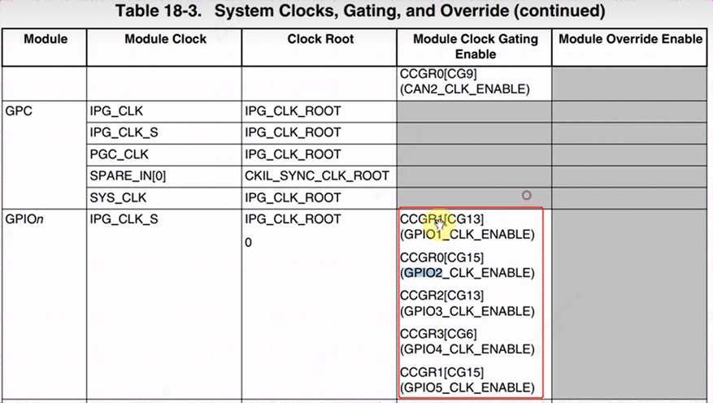
以IMX6ULL 芯片为列，`GPIOn` 要用 `CCM_CCGRx` 寄存器中的 2 位来决定该组 GPIO 是否使能。将对应的`clk gating enable`。

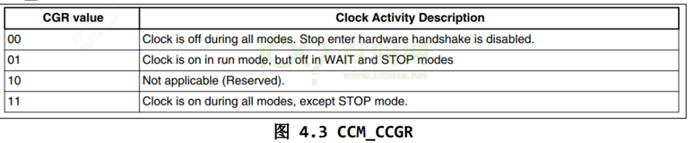

例如：用`CCM_CCGR0[bit31:30]`使能GPIO2 的时钟：

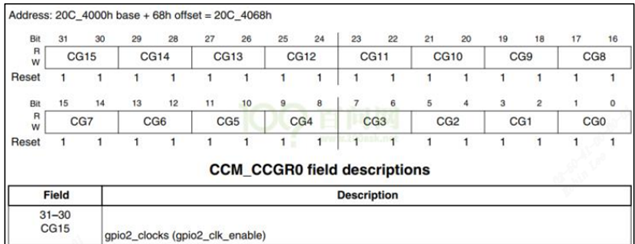
例如：用`CCM_CCGR1[bit31:30]`使能GPIO5 的时钟:

例如：用`CCM_CCGR1[bit27:26]`使能GPIO1 的时钟:

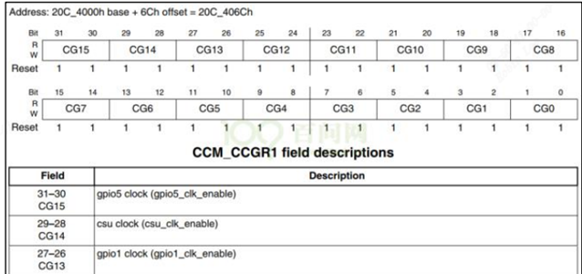
例如：用`CCM_CCGR2[bit27:26]`使能GPIO3的时钟:

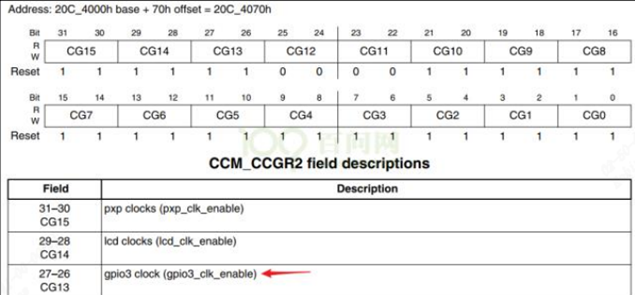
例如：用`CCM_CCGR3[bit13:12]`使能GPIO4的时钟:

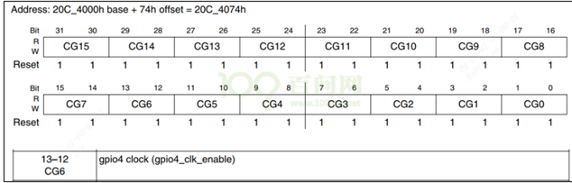
## 2.2 引脚模式电器属性设置

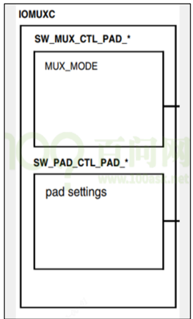
`MUX seting`用来配置pin的模式，比如GPIO。`Pad setting`用来设置GPIO的电器属性，比如电平，上下拉情况。

对于某个/某组引脚，`IOMUXC` 中有 2 个寄存器用来设置它：

### 2.2.1 IOMUX功能

a) `IOMUXC_SW_MUX_CTL_PAD_ <PAD_NAME>`：`Mux pad xxx`，选择某个引脚的功能
b) `IOMUXC_SW_MUX_CTL_GRP_<GROUP_NAME>`：`Mux grp xxx`，选择某组引脚的功能

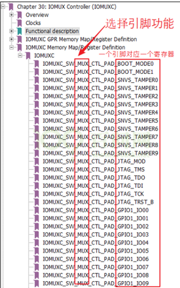
某个引脚，或是某组预设的引脚，都有 8 个可选的模式(`alternate (ALT) MUX_MODE`)，设成`ALT5`表示选择GPIO。

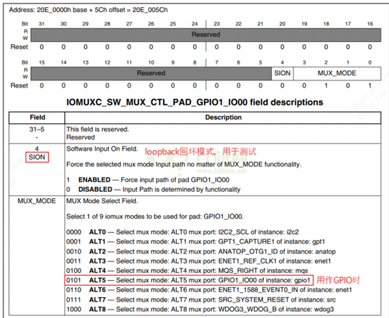
### 2.2.2 电器属性功能

a) `IOMUXC_SW_PAD_CTL_PAD_<PAD_NAME`>：`pad pad xxx`，设置某个引脚的电器属性

b) `IOMUXC_SW_PAD_CTL_GRP_<GROUP_NAME>`：`pad grp xxx`，设 置某组引脚的电器属性

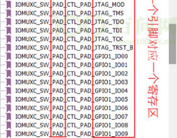
pad参数有很多不只是上下拉，还有很多属性如IO驱动能力。

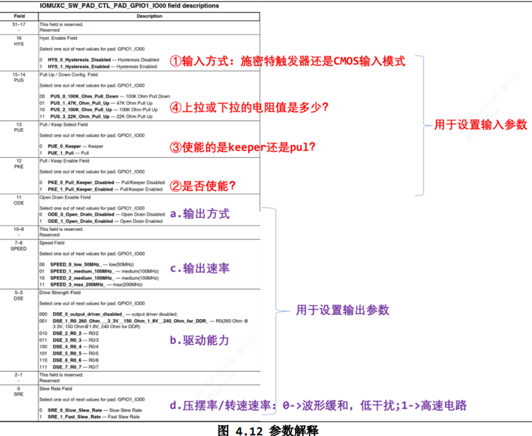
#### 2.2.2.1 GPIO驱动LED的4种方式

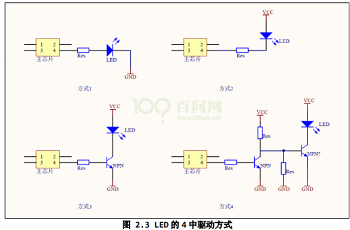
① 使用引脚输出 3.3V 点亮 LED，输出 0V 熄灭 LED。

② 使用引脚输出 0V 点亮 LED，输出 3.3V 熄灭 LED。

③有的芯片为了省电等原因，其引脚驱动能力不足，这时可以使用三极管驱动。 使用引脚输出 1.2V 点亮 LED，输出 0V 熄灭 LED。

④使用引脚输出 0V 点亮 LED，输出 1.2V 熄灭 LED

### 2.2.3 GPIO方向

当iomux成gpio模式后，就需要配置成gpio输出。

`GPIOx_GDIR`：设置引脚方向，每位对应一个引脚，`1-output`，`0-input`.

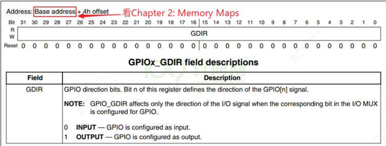
确定每组gpio基地址如下：加4就对应方向寄存器。

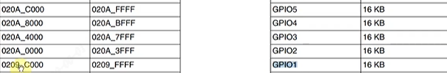
### 2.2.4 GPIO值

`GPIOx_DR`：(`GPIOx的data register`)。设置输出引脚的电平，每位对应一个引脚，1-高电平，0-低电平。

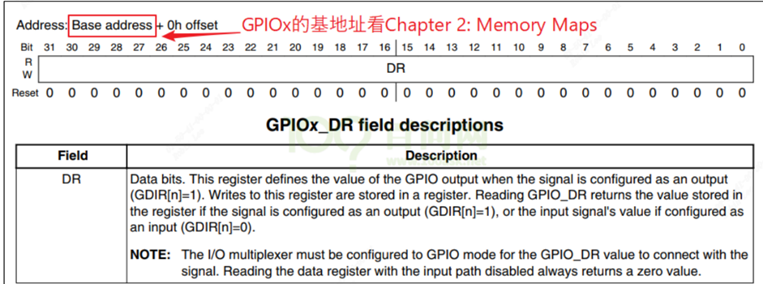
如果是配成了输入引脚，`GPIOx_PSR`：读取引脚的电平，每位对应一个引脚，1-高电平，0-低电平:

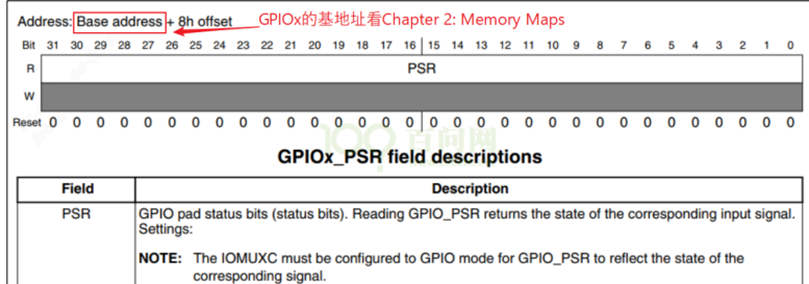
# 3 字符设备驱动程序框架

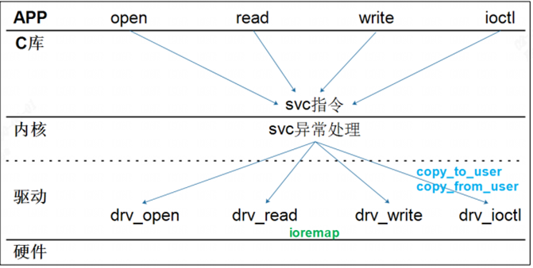
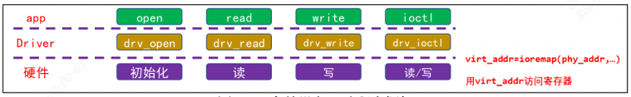
字符驱动编写流程：

```c
/*  
1. 确定主设备号，也可以让内核动态分配.  
2. 定义自己的 file_operations 结构体 实现对应的 drv_open/drv_read/drv_write 等函数  
填入 file_operations 结构体，把 file_operations 结构体告诉内核。  
3. register_chrdev/unregister_chrdev  
4. 其他完善：提供设备信息，自动创建设备节点：class_create, device_create  
5. 操作硬件：通过 ioremap 映射寄存器的物理地址得到虚拟地址，读写虚拟地址  
6. 驱动怎么和 APP 传输数据：通过 copy_to_user、copy_from_user 等操作函数。  
*/  
if (newchrled.major) { /* 定义了设备号，静态分配 */   
    newchrled.devid = MKDEV(newchrled.major, 0);   
    register_chrdev_region(newchrled.devid, NEWCHRLED_CNT, NEWCHRLED_NAME);   
} else { /* 没有定义设备号，动态分配 */   
    alloc_chrdev_region(&newchrled.devid, 0, NEWCHRLED_CNT, NEWCHRLED_NAME); /* 申请设备号 */   
    newchrled.major = MAJOR(newchrled.devid); /* 获取主设备号 */   
    newchrled.minor = MINOR(newchrled.devid); /* 获取次设备号 */   
}   
printk("newcheled major=%d,minor=%d\r\n",newchrled.major, newchrled.minor);   
  
/* 2、初始化cdev */   
newchrled.cdev.owner = THIS_MODULE;   
cdev_init(&newchrled.cdev, &newchrled_fops);   
  
/* 3、添加一个cdev */   
cdev_add(&newchrled.cdev, newchrled.devid, NEWCHRLED_CNT);   
  
/* 4、创建类 */   
newchrled.class = class_create(THIS_MODULE, NEWCHRLED_NAME);   
if (IS_ERR(newchrled.class))   
    return PTR_ERR(newchrled.class);   
  
/* 5、创建设备 */  
newchrled.device = device_create(newchrled.class, NULL, newchrled.devid, NULL, NEWCHRLED_NAME);  
if (IS_ERR(newchrled.device))  
    return PTR_ERR(newchrled.device);
```

## 3.1 实现通用性驱动模板

### 3.1.1 `led_drv.c`

```c
#include <linux/module.h>  
#include <linux/fs.h>  
#include <linux/errno.h>  
#include <linux/miscdevice.h>  
#include <linux/kernel.h>  
#include <linux/major.h>  
#include <linux/mutex.h>  
#include <linux/proc_fs.h>  
#include <linux/seq_file.h>  
#include <linux/stat.h>  
#include <linux/init.h>  
#include <linux/device.h>  
#include <linux/tty.h>  
#include <linux/kmod.h>  
#include <linux/gfp.h>  
#include "led_opr.h"  
    
/* 确定主设备号 */  
static int major = 0;  
static struct class *led_class;  
struct led_operations *p_led_opr;  
  
#define MIN(a, b) (a < b ? a : b)  
/* 实现对应的open/read/write等函数，填入file_operations结构体 */  
static ssize_t led_drv_read(struct file *file, char __user *buf, size_t size, loff_t *offset)  
{  
        printk("%s %s line %d\n", __FILE__, __FUNCTION__, __LINE__);  
        return 0;  
}  
    
/* write(fd, &val, 1); */  
static ssize_t led_drv_write(struct file *file, const char __user *buf, size_t size, loff_t *offset)  
{  
        int err;  
        char status;  
        struct inode *inode = file_inode(file);  
        int minor = iminor(inode);  
   
        printk("%s %s line %d\n", __FILE__, __FUNCTION__, __LINE__);  
        err = copy_from_user(&status, buf, 1);  
        /* 根据次设备号和status控制LED */  
        p_led_opr->ctl(minor, status);  
        return 1;  
}  
    
static int led_drv_open(struct inode *node, struct file *file)  
{  
        int minor = iminor(node);  
           
        printk("%s %s line %d\n", __FILE__, __FUNCTION__, __LINE__);  
        /* 根据次设备号初始化LED */  
        p_led_opr->init(minor);  
        return 0;  
}  
    
static int led_drv_close (struct inode *node, struct file *file)  
{  
        printk("%s %s line %d\n", __FILE__, __FUNCTION__, __LINE__);  
        return 0;  
}  
    
/* 定义自己的file_operations结构体  */  
static struct file_operations led_drv = {  
        .owner         = THIS_MODULE,  
        .open    = led_drv_open,  
        .read    = led_drv_read,  
        .write   = led_drv_write,  
        .release = led_drv_close,  
};  
    
/* 把file_operations结构体告诉内核：注册驱动程序  */  
/* 入口函数：安装驱动程序时，就会去调用这个入口函数 */  
static int __init led_init(void)  
{  
        int err;  
        int i;  
           
        printk("%s %s line %d\n", __FILE__, __FUNCTION__, __LINE__);  
        major = register_chrdev(0, "100ask_led", &led_drv);  
        led_class = class_create(THIS_MODULE, "100ask_led_class");  
        err = PTR_ERR(led_class);  
        if (IS_ERR(led_class)) {  
                printk("%s %s line %d\n", __FILE__, __FUNCTION__, __LINE__);  
                unregister_chrdev(major, "led");  
                return -1;  
        }  
        p_led_opr = get_board_led_opr();  
        /* creat device node, eg: /dev/100ask_led0,1,... */  
        for (i = 0; i < p_led_opr->num; i++)  
                device_create(led_class, NULL, MKDEV(major, i), NULL, "100ask_led%d", i);   
        return 0;  
}  
/* 有入口函数就应该有出口函数：卸载驱动程序时，就会去调用这个出口函数 */  
static void __exit led_exit(void)  
{  
        int i;  
    
        printk("%s %s line %d\n", __FILE__, __FUNCTION__, __LINE__);  
        for (i = 0; i < p_led_opr->num; i++)  
                device_destroy(led_class, MKDEV(major, i)); /* /dev/100ask_led0,1,... */  
        class_destroy(led_class);  
        unregister_chrdev(major, "100ask_led");  
}  
  
module_init(led_init);  
module_exit(led_exit);  
MODULE_LICENSE("GPL")
```

1. `register_chrdev`， 如果传入主设备号，则静态注册，传入0则动态注册返回主设备号。
2. `class_create`创建类`/sys/class/100ask_led_class`。
3. `get_board_led_opr`获取具体单板的操作operation函数,后面具体单板实现。
4. 获取到具体单板的led数量后，`device_create`为每一个led灯都建立设备节点。

再来看`file_operations中`的操作：

1. `led_drv_open`根据次设备号，调用具体单板的`init`函数，比如gpio 引脚复用，电器属性设置等。
2. `led_drv_write`就可以根据次设备号, 控制具体单板的led引脚，设置高低电平，从而控制亮灭。

## 3.2 具体单板led驱动

### 3.2.1 `led_opr.h`
```c
#ifndef _LED_OPR_H  
#define _LED_OPR_H  
struct led_operations {  
        int num;  
        int (*init) (int which); /* 初始化LED, which-哪个LED */         
        int (*ctl) (int which, char status); /* 控制LED, which-哪个LED, status:1-亮,0-灭 */  
};  
struct led_operations *get_board_led_opr(void);  
#endif
```

定义一个`led_operations`，`num`表示有几个led, `init`表示初始化led(`drv_open`的时候调用，配置`pinmux`，`io mode`, `enable pin clk`等)。

### 3.2.2 `board_100ask_imx6ull-qemu.c`

现在有一块`board_100ask_imx6ull-qemu`板子有4个LED，占2组GPIO，分别是`GPIO5_3`和`GPIO1_3, GPIO1_5, GPIO1_6`。

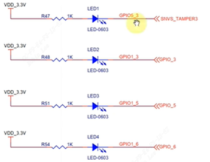
#### 3.2.2.1 CCM时钟配置

寄存器配置参考2.1。使能时钟gpio5和gpio1的时钟，`CCM_CCGR1[CG13]`和`CCM_CCGR1[CG15]`配置成0x11。

```c
/* 1. enable GPIO1  
 * CG13, b[27:26] = 0b11 */  
   
*CCM_CCGR1 |= (3<<26);  
         
/* 1. enable GPIO5  
 * CG15, b[31:30] = 0b11 */  
 *CCM_CCGR1 |= (3<<30)
```

#### 3.2.2.2 IOMUX成gpio

iomux配置4个引脚复用成gpio功能。

- gpio5_3 进行iomux

基地址为`0x2290014`。用ioremap进行映射到虚拟地址，就可以直接操作寄存器地址了。但是一般建议用`writel, writeb`等函数族。配成5表示gpio模式。

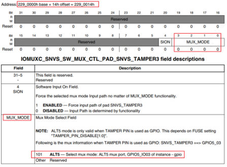
```c
IOMUXC_SNVS_SW_MUX_CTL_PAD_SNVS_TAMPER3=ioremap(0x2290014, 4);          
/* 2. set GPIO5_IO03 as GPIO  
 * MUX_MODE, b[3:0] = 0b101 */  
  
*IOMUXC_SNVS_SW_MUX_CTL_PAD_SNVS_TAMPER3 = 5
```

- gpio1_3/gpio1_5/gpio1_6 进行iomux

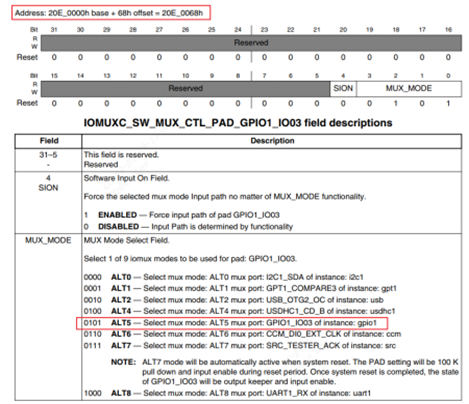
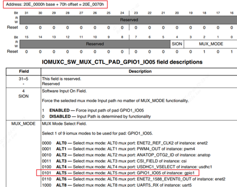
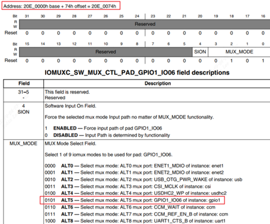
每次映射4个字节太繁琐，干脆对整个gpio的iomux地址进行映射。

```c
struct iomux {  
    volatile unsigned int unnames[23];  
    volatile unsigned int IOMUXC_SW_MUX_CTL_PAD_GPIO1_IO00;  /* offset 0x5c*/  
    volatile unsigned int IOMUXC_SW_MUX_CTL_PAD_GPIO1_IO01;  
    volatile unsigned int IOMUXC_SW_MUX_CTL_PAD_GPIO1_IO02;  
    volatile unsigned int IOMUXC_SW_MUX_CTL_PAD_GPIO1_IO03;  
    volatile unsigned int IOMUXC_SW_MUX_CTL_PAD_GPIO1_IO04;  
    volatile unsigned int IOMUXC_SW_MUX_CTL_PAD_GPIO1_IO05;  
    volatile unsigned int IOMUXC_SW_MUX_CTL_PAD_GPIO1_IO06;  
    volatile unsigned int IOMUXC_SW_MUX_CTL_PAD_GPIO1_IO07;  
    volatile unsigned int IOMUXC_SW_MUX_CTL_PAD_GPIO1_IO08;  
    volatile unsigned int IOMUXC_SW_MUX_CTL_PAD_GPIO1_IO09;  
};  
  
iomux = ioremap(0x20e0000, sizeof(struct iomux))
```

这里偷懒用了一个技巧，`unnames[23]` 占`92(0x5c)`字节,刚好`IOMUXC_SW_MUX_CTL_PAD_GPIO1_IO00`地址就是`0x20e0000+0x5c`，就不用把所有寄存器都搬进来到`struct iomux`。

同理`IOMUXC_SW_MUX_CTL_PAD_GPIO1_IO03`地址就是`0x20e0000+0x68`, 因此：

```c
/* MUX_MODE, b[3:0] = 0b101 */  
iomux->IOMUXC_SW_MUX_CTL_PAD_GPIO1_IO03 = 5;  
iomux->IOMUXC_SW_MUX_CTL_PAD_GPIO1_IO05 = 5;  
iomux->IOMUXC_SW_MUX_CTL_PAD_GPIO1_IO06 = 5
```

#### 3.2.2.3 gpio配成输出

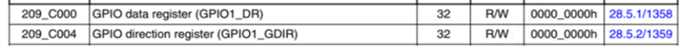
```c
struct imx6ull_gpio {  
    volatile unsigned int dr;  
    volatile unsigned int gdir;  
    volatile unsigned int psr;  
    volatile unsigned int icr1;  
    volatile unsigned int icr2;  
    volatile unsigned int imr;  
    volatile unsigned int isr;  
    volatile unsigned int edge_sel;  
};  
/* GPIO1 GDIR, b[5] = 0b1*/  
 gpio1 = ioremap(0x209C000, sizeof(struct imx6ull_gpio));  
 gpio1->gdir |= (1<<3);  
 gpio1->gdir |= (1<<5);  
 gpio1->gdir |= (1<<6)
```

offset为0表示data register, offset为4表示方向寄存器。以`gpio1_3/gpio1_5/gpio1_6`举例，`gdir`的`bit_n`置1就表示哪个gpio配成输出。

#### 3.2.2.4 gpio值设置

```c
if (which == 0) {  
    if (status)  /* on : output 0 */  
        gpio5->dr &= ~(1<<3);  
    else         /* on : output 1 */  
        gpio5->dr |= (1<<3);  
} else if (which == 1) {  
    if (status)  /* on : output 0 */  
        gpio1->dr &= ~(1<<3);  
    else         /* on : output 1 */  
        gpio1->dr |= (1<<3);  
} else if (which == 2) {  
    if (status)  /* on : output 0 */  
        gpio1->dr &= ~(1<<5);  
    else         /* on : output 1 */  
        gpio1->dr |= (1<<5);  
} else if (which == 3) {  
    if (status)  /* on : output 0 */  
        gpio1->dr &= ~(1<<6);  
    else         /* on : output 1 */  
        gpio1->dr |= (1<<6);  
}
```

同理`dr`就表示数据寄存器。一共4个led：
```c
which等于0表示gpio5_3  
which等于1示gpio1_3  
which等于2示gpio1_5  
which等于3示gpio1_6
```

#### 3.2.2.5 `board_100ask_imx6ull-qemu.c`
```c
#include <linux/module.h>  
#include <linux/fs.h>  
#include <linux/io.h>  
#include <linux/errno.h>  
#include <linux/miscdevice.h>  
#include <linux/kernel.h>  
#include <linux/major.h>  
#include <linux/mutex.h>  
#include <linux/proc_fs.h>  
#include <linux/seq_file.h>  
#include <linux/stat.h>  
#include <linux/init.h>  
#include <linux/device.h>  
#include <linux/tty.h>  
#include <linux/kmod.h>  
#include <linux/gfp.h>  
#include "led_opr.h"  
    
struct iomux {  
    volatile unsigned int unnames[23];  
    volatile unsigned int IOMUXC_SW_MUX_CTL_PAD_GPIO1_IO00;  /* offset 0x5c*/  
    volatile unsigned int IOMUXC_SW_MUX_CTL_PAD_GPIO1_IO01;  
    volatile unsigned int IOMUXC_SW_MUX_CTL_PAD_GPIO1_IO02;  
    volatile unsigned int IOMUXC_SW_MUX_CTL_PAD_GPIO1_IO03;  
    volatile unsigned int IOMUXC_SW_MUX_CTL_PAD_GPIO1_IO04;  
    volatile unsigned int IOMUXC_SW_MUX_CTL_PAD_GPIO1_IO05;  
    volatile unsigned int IOMUXC_SW_MUX_CTL_PAD_GPIO1_IO06;  
    volatile unsigned int IOMUXC_SW_MUX_CTL_PAD_GPIO1_IO07;  
    volatile unsigned int IOMUXC_SW_MUX_CTL_PAD_GPIO1_IO08;  
    volatile unsigned int IOMUXC_SW_MUX_CTL_PAD_GPIO1_IO09;  
};  
struct imx6ull_gpio {  
    volatile unsigned int dr;  
    volatile unsigned int gdir;  
    volatile unsigned int psr;  
    volatile unsigned int icr1;  
    volatile unsigned int icr2;  
    volatile unsigned int imr;  
    volatile unsigned int isr;  
    volatile unsigned int edge_sel;  
};  
    
/* enable GPIO1,GPIO5 */  
static volatile unsigned int *CCM_CCGR1;  
  
static volatile unsigned int *IOMUXC_SNVS_SW_MUX_CTL_PAD_SNVS_TAMPER3;  
static struct iomux *iomux;  
  
static struct imx6ull_gpio *gpio1;  
static struct imx6ull_gpio *gpio5;  
  
static struct led_operations board_demo_led_opr = {  
    .num  = 4,  
    .init = board_demo_led_init,  
    .ctl  = board_demo_led_ctl,  
};  
  
static int board_demo_led_init(int which) {  
    if (!CCM_CCGR1) {  
        CCM_CCGR1 = ioremap(0x20C406C, 4);  
        IOMUXC_SNVS_SW_MUX_CTL_PAD_SNVS_TAMPER3 = ioremap(0x2290014, 4);  
        iomux = ioremap(0x20e0000, sizeof(struct iomux));  
        gpio1 = ioremap(0x209C000, sizeof(struct imx6ull_gpio));  
        gpio5 = ioremap(0x20AC000, sizeof(struct imx6ull_gpio));  
    }  
    
    if (which == 0) {  
        *CCM_CCGR1 |= (3<<30);  
        *IOMUXC_SNVS_SW_MUX_CTL_PAD_SNVS_TAMPER3 = 5;  
        gpio5->gdir |= (1<<3);  
    } else if(which == 1) {  
        *CCM_CCGR1 |= (3<<26);  
        iomux->IOMUXC_SW_MUX_CTL_PAD_GPIO1_IO03 = 5;  
        gpio1->gdir |= (1<<3);  
    } else if(which == 2) {  
        *CCM_CCGR1 |= (3<<26);  
        iomux->IOMUXC_SW_MUX_CTL_PAD_GPIO1_IO05 = 5;  
        gpio1->gdir |= (1<<5);  
    } else if(which == 3) {  
        *CCM_CCGR1 |= (3<<26);  
        iomux->IOMUXC_SW_MUX_CTL_PAD_GPIO1_IO06 = 5;  
        gpio1->gdir |= (1<<6);  
    }  
    return 0;  
}  
static int board_demo_led_ctl(int which, char status) /* 控制LED, which-哪个LED, status:1-亮,0-灭 */  
{  
    if (which == 0) {  
        if (status)  
            gpio5->dr &= ~(1<<3);  
        else  
            gpio5->dr |= (1<<3);  
    } else if (which == 1) {  
        if (status)  
            gpio1->dr &= ~(1<<3);  
        else   
            gpio1->dr |= (1<<3);  
    } else if (which == 2) {  
        if (status)  
            gpio1->dr &= ~(1<<5);  
        else  
            gpio1->dr |= (1<<5);  
    } else if (which == 3) {  
        if (status)  
            gpio1->dr &= ~(1<<6);  
        else  
            gpio1->dr |= (1<<6);  
    }  
    return 0;  
}  
  
struct led_operations *get_board_led_opr(void) {  
    return &board_demo_led_opr;  
}
```

open的时候调用`get_board_led_opr`得到具体单板的操作函数集。进一步调用`board_demo_led_init`初始化led。

write的时候调用具体单板的操作函数集，进一步调用`board_demo_led_ctl`操控led。

# 4 字符设备驱动基础概念

## 4.1 EXPORT_SYMBOL

`EXPORT_SYMBOL`:导出函数，让别的module也能使用。


`EXPORT_SYMBOL_GPL`:


## 4.2 MODULE_INFO

`MODULE_INFO(intree, "Y");`的作用是将可加载内核模块标记为 `in-tree`。

加载内核源码树外 LKM 会导致内核打印警告:这是从`module.c`中的检查引起的:

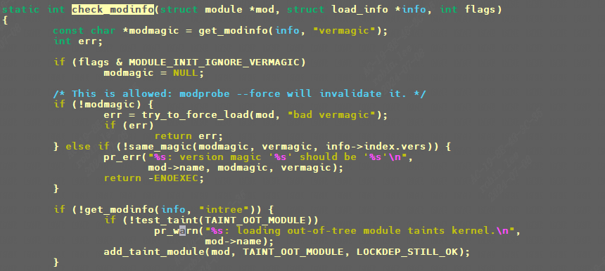
`module: loading out-of-tree module taints kernel.`

## 4.2 module_param

`module_param(name,type,perm);`

功能：指定模块参数，用于在加载模块时或者模块加载以后传递参数给模块。

`module_param_array( name, type, nump, perm);`

可用sysfs进行查看修改：

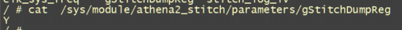

- type

type: 数据类型:
```c
bool : 布尔型  
inbool : 布尔反值  
charp: 字符指针（相当于char *,不超过1024字节的字符串）  
short: 短整型  
ushort : 无符号短整型  
int : 整型  
uint : 无符号整型  
long : 长整型  
ulong: 无符号长整型
```

- perm

perm表示此参数在sysfs文件系统中所对应的文件节点的属性，其权限在`include/linux/stat.h`中有定义:

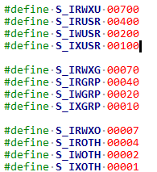
```c
#define S_IRUSR 00400 //文件所有者可读  
#define S_IWUSR 00200 //文件所有者可写  
#define S_IXUSR 00100 //文件所有者可执行  
  
#define S_IRGRP 00040 //与文件所有者同组的用户可读  
#define S_IWGRP 00020  
#define S_IXGRP 00010  
  
#define S_IROTH 00004 //与文件所有者不同组的用户可读  
#define S_IWOTH 00002  
#define S_IXOTH 00001
```

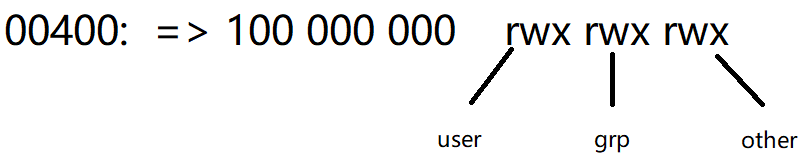
```c
static char *alg = NULL;  
static u32 type;  
static u32 mask;  
static int mode;  
  
module_param(alg, charp, S_IRUSR);  
module_param(type, uint, S_IRUSR);  
module_param(mask, uint, S_IRUSR);  
module_param(mode, int, S_IRUSR);  
  
static int fish[10];  
static int nr_fish;  
module_param_array(fish, int, &nr_fish, 0664);  
static char media[8];  
module_param_string(media, media, sizeof(media), S_IRUSR)
```

可以用sysfs设置`fish`数组，或者insmod时伴随设置。

以及其他的一些模块宏：

```c
MODULE_DESCRIPTION("Freescale PM rpmsg driver");  
MODULE_AUTHOR("Anson Huang <Anson.Huang@nxp.com>");  
MODULE_LICENSE("GPL");  
MODULE_VERSION("v2.0")
```

## 4.3 设备节点
### 4.3.1 手动建立设备节点

手动建立设备节点命令是`mknod`, 由于这里的字符设备都是用的misc杂项设备方式，因此主设备号都为10：
```sh
/mnt/Athena2_FPGA_SDK_Veriry/demo/workspace/ko # ls -l /dev/mmcblk0p1  
brw-rw----    1 root     root      179,   1 Jan  1 00:05 /dev/mmcblk0p1  
/mnt/Athena2_FPGA_SDK_Veriry/demo/workspace/ko # ls -l /dev/mmcblk0  
brw-rw----    1 root     root      179,   0 Jan  1 00:05 /dev/mmcblk0  
  
/dev # ls -l cvi-*  
crw-rw----    1 root     root       10,   0 Jan  1 00:05 /dev/cvi-base  
crw-rw----    1 root     root       10,  61 Jan  1 00:05 /dev/cvi-dwa  
crw-rw----    1 root     root       10,  58 Jan  1 00:30 /dev/cvi-ldc  
crw-rw----    1 root     root       10,  60 Jan  1 00:04 /dev/cvi-stitch  
crw-rw----    1 root     root       10,  62 Jan  1 00:05 /dev/cvi-sys  
crw-rw----    1 root     root       10,  59 Jan  1 00:04 /dev/cvi-vpss  
  
mknod /dev/mmcblk0 b 179 0  
mknod /dev/mmcblk0p1 b 179 1  
  
mknod /dev/cvi-base c 10 0  
mknod /dev/cvi-sys c 10 62  
mknod /dev/cvi-dwa c 10 61  
mknod /dev/cvi-ldc c 10 58  
mknod /dev/cvi-stitch c 10 60  
mknod /dev/cvi-vpss c 10 59  
crw-rw---- 1 root root 10, 0 Jan 1 00:08 /dev/cvi-base  
crw-rw---- 1 root root 10, 61 Jan 1 00:08 /dev/cvi-dwa  
crw-rw---- 1 root root 10, 59 Jan 1 00:07 /dev/cvi-ldc  
crw-rw---- 1 root root 10, 60 Jan 1 00:07 /dev/cvi-stitch  
crw-rw---- 1 root root 10, 62 Jan 1 00:08 /dev/cvi-sys  
  
mknod /dev/cvi-base c 10 0  
mknod /dev/cvi-sys c 10 62  
mknod /dev/cvi-dwa c 10 61  
mknod /dev/cvi-ldc c 10 59  
mknod /dev/cvi-stitch c 10 60
```

### 4.3.2 自动创建设备节点

`udev`是一个用户程序，在 Linux下通过 `udev`来实现设备文件的创建与删除， `udev`可以检测系统中硬件设备状态，可以根据系统中硬件设备状态来创建或者删除设备文件。比如使用`modprobe`命令成功加载驱动模块以后就自动在 `/dev目录`下创建对应的设备节点文件 ,使用`rmmod`命令卸载驱动模块以后就 删除掉 `/dev目录`下的设备节点文件。 使用 `busybox`构建根文件系统的时候， busybox会创建一个 `udev`的简化版本 `mdev`，所以在嵌入式 Linux中我们使用`mdev`来实现设备节点文件的自动创建与删除， Linux系统中的热插拔事件也由 `mdev`管理：

```
echo /sbin/mdev > /proc/sys/kernel/hotplug
```

## 4.4 设置文件私有数据

一般`open`函数里面设置好私有数据以后，在 `write、 read、 close`等函数中直接读取 `private_data`即可得到设备结构体。

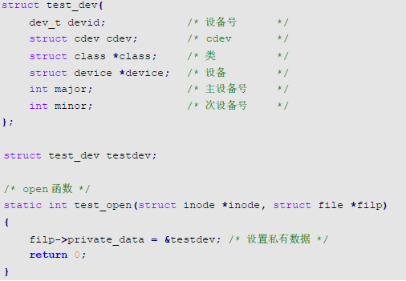
## 4.5 设备号

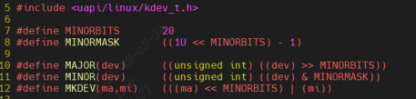
```c
include\linux\kdev_t.h
MINORBITS 表示次设备号位数，一共是 20 位;  
MINORMASK 表示次设备号掩码;  
MAJOR 用于从 dev_t 中获取主设备号，将 dev_t 右移 20 位即可  
MINOR 用于从 dev_t 中获取次设备号，取 dev_t 的低 20 位的值即可  
MKDEV 用于将给定的主设备号和次设备号的值组合成 dev_t 类型的设备号
```

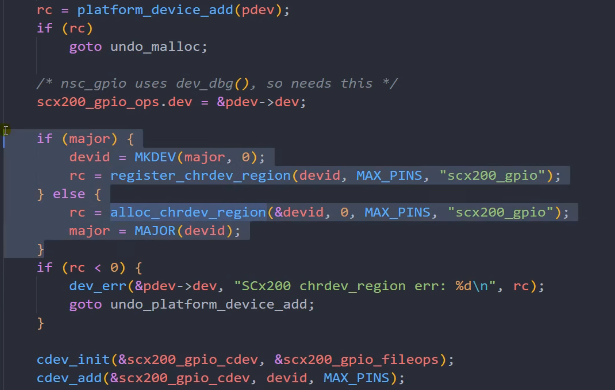
定义了major主设备就用静态注册，否则动态分配设备号注册字符设备。

### 4.5.1 静态分配和释放一个设备号

```c
#include <linux/fs.h>  
register_chrdev_region()  
unregister_chrdev_region()
```

```c
#include <linux/module.h>   
#include <linux/cdev.h>  
#include <linux/fs.h>  
  
#define MY_MAJOR_NUM 202 //主设备号  
static const struct file_operations my_dev_fops = {  
    .owner = THIS_MODULE,  
    .open = my_dev_open,  
    .release = my_dev_close,  
    .unlocked_ioctl = my_dev_ioctl,  
};  
static int __init hello_init(void){  
    int ret;  
    dev_t dev = MKDEV(MY_MAJOR_NUM, 0);  
   
    /* Allocate device numbers */  
    ret = register_chrdev_region(dev, 1, "my_char_device");  
    if (ret < 0){  
        pr_info("Unable to allocate mayor number %d\n", MY_MAJOR_NUM);  
        return ret;  
    }  
    /* Initialize the cdev structure and add it to the kernel space */  
    cdev_init(&my_dev, &my_dev_fops);  
    ret= cdev_add(&my_dev, dev, 1);  
    if (ret < 0){  
        unregister_chrdev_region(dev, 1);  
        pr_info("Unable to add cdev\n");  
        return ret;  
    }  
    return 0;  
}  
static void __exit hello_exit(void) {  
    cdev_del(&my_dev);  
    unregister_chrdev_region(MKDEV(MY_MAJOR_NUM, 0), 1);  
}
```

### 4.5.2 动态分配和释放一个设备号

```c
#include <linux/fs.h>  
alloc_chrdev_region()  
unregister_chrdev_region()
```

```c
static struct class*  helloClass;  
static struct cdev my_dev;  
dev_t dev;  
static int __init hello_init(void) {  
    int ret;  
    dev_t dev_no;  
    int Major;  
    struct device* helloDevice;  
    ret = alloc_chrdev_region(&dev_no, 0, 1, DEVICE_NAME);  
    if (ret < 0){  
        pr_info("Unable to allocate Mayor number \n");  
        return ret;  
    }  
    Major = MAJOR(dev_no);  
    dev = MKDEV(Major,0);  
    cdev_init(&my_dev, &my_dev_fops);  
    ret = cdev_add(&my_dev, dev, 1);  
    if (ret < 0){  
        unregister_chrdev_region(dev, 1);  
        pr_info("Unable to add cdev\n");  
        return ret;  
    }  
    helloClass = class_create(THIS_MODULE, CLASS_NAME);  
    if (IS_ERR(helloClass)){  
        unregister_chrdev_region(dev, 1);  
        cdev_del(&my_dev);  
        pr_info("Failed to register device class\n");  
        return PTR_ERR(helloClass);  
    }  
    helloDevice = device_create(helloClass, NULL, dev, NULL, DEVICE_NAME);  
    if (IS_ERR(helloDevice)){  
        class_destroy(helloClass);  
        cdev_del(&my_dev);  
        unregister_chrdev_region(dev, 1);  
        pr_info("Failed to create the device\n");  
        return PTR_ERR(helloDevice);  
    }  
    return 0;  
}  
static void __exit hello_exit(void) {  
    device_destroy(helloClass, dev);     /* remove the device */  
    class_destroy(helloClass);           /* remove the device class */  
    cdev_del(&my_dev);  
    unregister_chrdev_region(dev, 1);    /* unregister the device numbers */  
}
```

## 4.6 添加设备和类

```c
struct class *class; /* 类 */   
struct device *device; /* 设备 */   
dev_t devid; /* 设备号 */  
static int __init led_init(void) {   
    class = class_create(THIS_MODULE, "xxx");   
    device = device_create(class, NULL, devid, NULL, "xxx");   
    return 0;   
}   
static void __exit led_exit(void) {   
	device_destroy(newchrled.class, newchrled.devid);   
    class_destroy(newchrled.class);   
}   
module_init(led_init);   
module_exit(led_exit)
```

# 5 内核源码树添加一个字符设备驱动

## 5.1 准备驱动源码

这里以`misc device`为例， 进入`drivers/misc目录`，新建目录`hello_drv`。放入`驱动源码`和`Makefile`和`Kconfig`。

```c
#include <linux/module.h>  
#include <linux/fs.h>  
#include <linux/errno.h>  
#include <linux/miscdevice.h>  
#include <linux/kernel.h>  
#include <linux/major.h>  
#include <linux/mutex.h>  
#include <linux/proc_fs.h>  
#include <linux/seq_file.h>  
#include <linux/stat.h>  
#include <linux/init.h>  
#include <linux/device.h>  
#include <linux/tty.h>  
#include <linux/kmod.h>  
#include <linux/gfp.h>  
  
static int major = 0;  
static struct cdev hello_cdev;  
static char kernel_buf[1024];  
static struct class *hello_class;  
  
static ssize_t hello_drv_read (struct file *file, char __user *buf, size_t size, loff_t *offset){  
    int err;  
    err = copy_to_user(buf, kernel_buf, min(1024, size));  
    return min(1024, size);  
}  
static ssize_t hello_drv_write (struct file *file, const char __user *buf, size_t size, loff_t *offset){  
    int err;  
    err = copy_from_user(kernel_buf, buf, min(1024, size));  
    return min(1024, size);  
}   
static int hello_drv_open (struct inode *node, struct file *file){  
    return 0;  
}  
static int hello_drv_close (struct inode *node, struct file *file){  
    return 0;  
}  
static struct file_operations hello_drv = {  
    .owner     = THIS_MODULE,  
    .open    = hello_drv_open,  
    .read    = hello_drv_read,  
    .write   = hello_drv_write,  
    .release = hello_drv_close,  
};  
   
static int __init hello_init(void){  
    int err;  
    int rc;  
    dev_t devid;  
#if 0  
    //major = register_chrdev(0, "hello", &hello_drv);  /* /dev/hello */  
#else  
    rc = alloc_chrdev_region(&devid, 0, 1, "hello");  
    major = MAJOR(devid);  
    cdev_init(&hello_cdev, &hello_drv);  
    cdev_add(&hello_cdev, devid, 1);  
#endif  
    hello_class = class_create(THIS_MODULE, "hello_class");  
    err = PTR_ERR(hello_class);  
    if (IS_ERR(hello_class)) {  
        printk("%s %s line %d\n", __FILE__, __FUNCTION__, __LINE__);  
        unregister_chrdev(major, "hello");  
        return -1;  
    }  
    device_create(hello_class, NULL, MKDEV(major, 0), NULL, "hello"); /* /dev/hello */  
    return 0;  
}  
   
static void __exit hello_exit(void){  
    device_destroy(hello_class, MKDEV(major, 0));  
    class_destroy(hello_class);  
#if 0  
    //unregister_chrdev(major, "hello");  
#else  
    cdev_del(&hello_cdev);  
    unregister_chrdev_region(MKDEV(major,0), 1);     
#endif  
}  
  
module_init(hello_init);  
module_exit(hello_exit);  
MODULE_LICENSE("GPL")
```

## 5.2 MakeFile

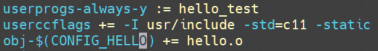
```c
userprogs-always-y += hello_test  
userccflags += -I usr/include
```

这里表示用userspace方式去编译应用程序，hello_test就是用户程序。

假如我们多个文件`hello1.c hello2.c`, 如何得到`hello.o`和`hello.ko`呢？如下参考：

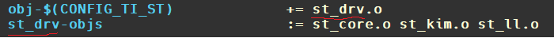
## 5.3 Kconfig

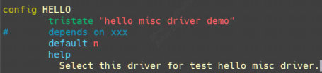
## 5.4 修改上一级Makefile和Kconfig

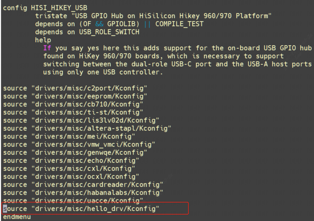
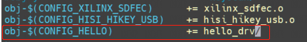
让`hello_drv`目录中的`Kconfig`也能被内核识别，输入`make menuconfig`，即可选择将其编译成内核模块还是直接编译进内核镜像，默认`default n`,也就是`CONFIG_HELLO`等于n, `hello_drv`目录是`obj-n`, 不编译；选择y则表示编译进内核镜像，选择m表示编译成内核模块。

编译成内核模块，则会在`.config`中产生`CONFIG_HELLO=m`的一项配置，编译产生`hello.ko`。
编译成内核镜像，则会在`.config`中产生`CONFIG_HELLO=y`的一项配置，编译产生`built-in.a`,最终该 `built-in.a`会合入vmlinux。

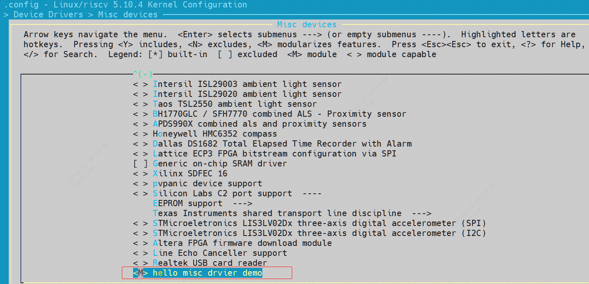
