# 1 APP 读取按键方式

1. 查询方式
2. 休眠-唤醒方式
3. poll 方式
4. 异步通知方式

第2、3、4种方法，都涉及中断服务程序。

## 1.1 查询方式

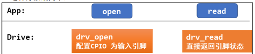
APP 调用 open 时，导致驱动中对应的 open 函数被调用，在里面配置 GPIO 为输入引脚。 APP 调用 read 时，导致驱动中对应的 read 函数被调用，它读取寄存器，把引脚状态直接返回给 APP,APP需要反复read查询引脚电平状态。

很明显，查询方式用的非阻塞IO（`O_NONBLOCK`）。

## 1.2 休眠-唤醒方式

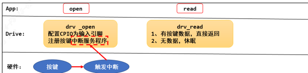
1. APP 调用 open 时，导致驱动中对应的 open 函数被调用，在里面配置GPIO 为输入引脚；并且注册 GPIO 的中断处理函数。
2. APP 调用 read 时，导致驱动中对应的 read 函数被调用，如果有按键数据则直接返回给 APP；否则 APP 在内核态read函数中休眠。
3. 当用户按下按键时， GPIO 中断被触发，导致驱动程序之前注册的中断服务程序被执行。它会记录按键数据，read函数被唤醒，执行驱动代码，把按键数据返回给APP(用户空间)。

## 1.3 poll 方式

上面的休眠-唤醒方式有个缺点：如果一直没操作按键，那么 APP 就会永远休眠。  
我们可以给 APP 定个闹钟，这就是 poll 方式。当超时后就直接返回不再休眠。  
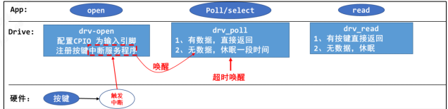
1. APP 调用 open 时，导致驱动中对应的 open 函数被调用，在里面配置GPIO 为输入引脚；并且注册 GPIO 的中断处理函数。
2. APP 调用 poll 或 select 函数，意图是“查询”是否有数据，这 2 个函数都可以指定一个超时时间，即在这段时间内没有数据的话就返回错误。这会导致驱动中对应的 `drv_poll` 函数被调用，如果有按键数据则直接返回给 APP；否则 APP 在内核态休眠一段时间。
3. 当按下按键时， GPIO 中断被触发，导致驱动程序之前注册的中断服务程序被执行。它会记录按键数据，并唤醒休眠中的 APP。如果用户没按下按键，但是超时时间到了，内核也会唤醒 APP。

所以 APP 被唤醒有 2 种原因：用户操作了按键或者超时。被唤醒的 APP 在内核态继续运行，即继续执行驱动代码，把 “状态” 返回给 APP(用户空间)。APP 得到 `poll/select` 函数的返回结果后，如果确认是有数据的，则再调用 read 函数，这会导致驱动中的 read 函数被调用，这时驱动程序中含有数据，会直接返回数据。

## 1.4 异步通知方式

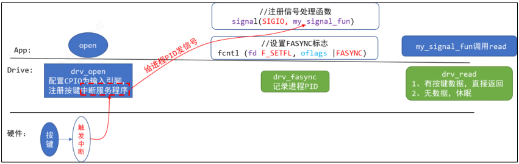
异步通知的实现原理是：内核给 APP 发信号。信号有很多种，这里发的是SIGIO。  
驱动程序中构造、注册一个 `file_operations` 结构体，里面提供有对应的`open,read,fasync` 函数。

1. APP 调用 open 时，导致驱动中对应的 open 函数被调用，在里面配置GPIO 为输入引脚；并且注册 GPIO 的中断处理函数。
2. APP 给信号 `SIGIO` 注册自己的处理函数： `my_signal_fun`。
3. APP 调用`fcntl`函数，把驱动程序的 flag 改为 `FASYNC`，这会导致驱动程序的`fasync`函数被调用，它只是简单记录进程 PID。
4. 当用户按下按键时， GPIO 中断被触发，导致驱动程序之前注册的中断服务程序被执行。它会记录按键数据，然后给进程 PID 发送 `SIGIO` 信号。
5. APP 收到信号后会被打断，先执行信号处理函数：在信号处理函数中可以去调用 read 函数读取按键值。
6. 信号处理函数返回后， APP 会继续执行原先被打断的代码

```c
#include <stdio.h>  
#include <unistd.h>  
#include <signal.h>  
void my_sig_func(int signo) {  
    printf("get a signal : %d\n", signo);  
}  
int main(int argc, char **argv) {  
    int i = 0;
    signal(SIGIO, my_sig_func);  
    while (1) {  
        printf("Hello, world %d!\n", i++);  
        sleep(2);  
    }  
    return 0;  
}
```
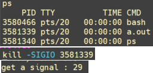
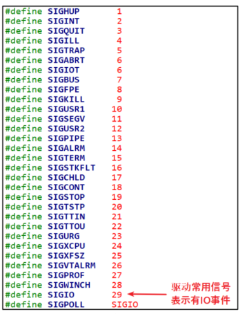
发送一个SIGIO讯号给进程`3581339` `my_sig_func`函数，可以看到打印`”get a signal 29“`，即为`SIGIO`信号。  
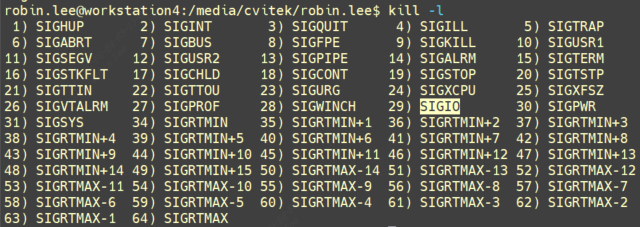

# 2 GPIO按键驱动

## 2.1 按键驱动框架

按键驱动程序最简单的方法：  
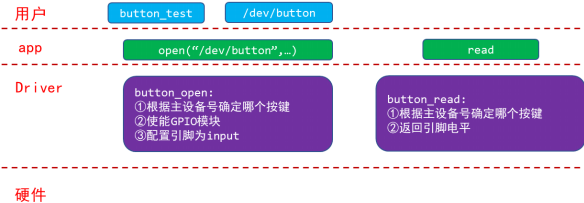
我们的目的写出一个容易扩展到各种芯片、各种板子的按键驱动程序，所以驱动程序分为**上下两层**：

1. `button_drv.c` 分配/设置/注册 `file_operations` 结构体起承上启下的作用，向上提供 `button_open`,`button_read` 供 APP 调用。而这 2 个函数又会调用底层硬件提供的 `p_button_opr` 中的 init、 read 函数操作硬件。
2. `board_xxx.c` 实现 `p_button_opr`结构体，这个结构体是我们自己抽象出来的，里面定义`单板 xxx` 的按键操作函数。这样的结构易于扩展，对于不同的单板，只需要替换`board_xxx.c`提供自己的 `button_operations` 结构体即可。  
    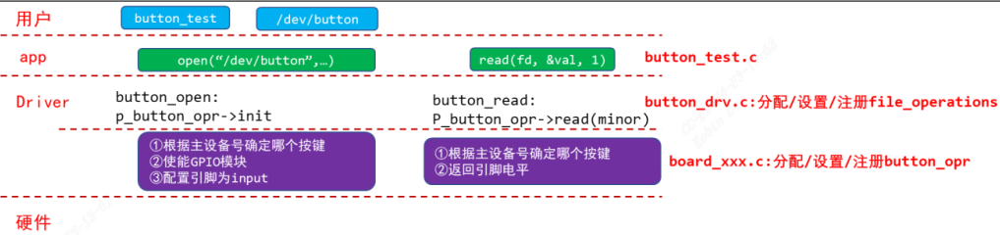
### 2.1.1 button_operations 结构体

button_drv.h

```c
#ifndef _BUTTON_DRV_H  
#define _BUTTON_DRV_H  
struct button_operations {  
    int count;  
    void (*init) (int which);  
    int (*read) (int which);  
};  
void register_button_operations(struct button_operations *opr);  
void unregister_button_operations(void);  
#endif
```
board_xxx.c

```c
#include <linux/module.h>  
#include <linux/errno.h>  
#include <linux/kernel.h>  
#include <linux/major.h>  
#include <linux/sched.h>  
#include <linux/slab.h>  
#include <linux/fcntl.h>  
#include <linux/fs.h>  
#include <linux/signal.h>  
#include <linux/mutex.h>  
#include <linux/mm.h>  
#include <linux/timer.h>  
#include <linux/wait.h>  
#include <linux/skbuff.h>  
#include <linux/proc_fs.h>  
#include <linux/poll.h>  
#include <linux/capi.h>  
#include <linux/kernelcapi.h>  
#include <linux/init.h>  
#include <linux/device.h>  
#include <linux/moduleparam.h>  
#include "button_drv.h"  
static void board_xxx_button_init_gpio (int which){  
    printk("%s %s %d, init gpio for button %d\n", __FILE__, __FUNCTION__, __LINE__, which);  
}  
static int board_xxx_button_read_gpio (int which){  
    printk("%s %s %d, read gpio for button %d\n", __FILE__, __FUNCTION__, __LINE__, which);  
    return 1;  
}  
static struct button_operations my_buttons_ops ={  
    .count = 2,  
    .init  = board_xxx_button_init_gpio,  
    .read  = board_xxx_button_read_gpio,  
};  
int board_xxx_button_init(void){  
    register_button_operations(&my_buttons_ops);  
    return 0;  
}  
void board_xxx_button_exit(void){  
    unregister_button_operations();  
}  
module_init(board_xxx_button_init);  
module_exit(board_xxx_button_exit);  
MODULE_LICENSE("GPL")
```

board_xxx.c里面实现了具体单板的button_operations，当insmod这个驱动时，调用 register_button_operations 函数，把my_buttons_ops这个结构体注册到上层驱动中，这里.init .read函数先不去实现。

### 2.1.2 file_operations 结构体

button_drv.c

```c
#include <linux/module.h>  
#include <linux/errno.h>  
#include <linux/kernel.h>  
#include <linux/major.h>  
#include <linux/sched.h>  
#include <linux/slab.h>  
#include <linux/fcntl.h>  
#include <linux/fs.h>  
#include <linux/signal.h>  
#include <linux/mutex.h>  
#include <linux/mm.h>  
#include <linux/timer.h>  
#include <linux/wait.h>  
#include <linux/skbuff.h>  
#include <linux/proc_fs.h>  
#include <linux/poll.h>  
#include <linux/capi.h>  
#include <linux/kernelcapi.h>  
#include <linux/init.h>  
#include <linux/device.h>  
#include <linux/moduleparam.h>  
#include "button_drv.h"  
  
static int major = 0;  
static struct button_operations *p_button_opr;  
static struct class *button_class;  
static int button_open (struct inode *inode, struct file *file)  
{  
    int minor = iminor(inode);  
    p_button_opr->init(minor);  
    return 0;  
}  
static ssize_t button_read (struct file *file, char __user *buf, size_t size, loff_t *off)  
{  
    unsigned int minor = iminor(file_inode(file));  
    char level;  
    int err;  
    level = p_button_opr->read(minor);  
    err = copy_to_user(buf, &level, 1);  
    return 1;  
}  
static struct file_operations button_fops = {  
    .open = button_open,  
    .read = button_read,  
};  
void register_button_operations(struct button_operations *opr)  
{  
    int i;  
    p_button_opr = opr;  
    for (i = 0; i < opr->count; i++)  
    {  
        device_create(button_class, NULL, MKDEV(major, i), NULL, "100ask_button%d", i);  
    }  
}  
void unregister_button_operations(void)  
{  
    int i;  
    for (i = 0; i < p_button_opr->count; i++)  
    {  
        device_destroy(button_class, MKDEV(major, i));  
    }  
}  
  
EXPORT_SYMBOL(register_button_operations);  
EXPORT_SYMBOL(unregister_button_operations);  
  
int button_init(void)  
{  
    major = register_chrdev(0, "100ask_button", &button_fops);  
    button_class = class_create(THIS_MODULE, "100ask_button");  
    if (IS_ERR(button_class))  
        return -1;  
    return 0;  
}  
void button_exit(void)  
{  
    class_destroy(button_class);  
    unregister_chrdev(major, "100ask_button");  
}  
module_init(button_init);  
module_exit(button_exit);  
MODULE_LICENSE("GPL")
```

上层是 `button_drv.c`，按照字符设备驱动标准框架编写，`register_button_operations`实现了将底层具体的`button_operations`对象注册进来，调用`open/read`时便可操作具体的单板，`device_create`为单板的具体按键创建设备节点。注意`insmod`顺序要先安装`button_drv.ko`, 具体单板驱动要后安装，否则`register_button_operations`函数是未定义的。

## 2.2 具体单板按键驱动

以`imx6ull`单板为例，按键引脚为 `GPIO5_IO01`、 `GPIO4_IO14`，平时按键电平为高，按下按键后电平为低，如下图：  
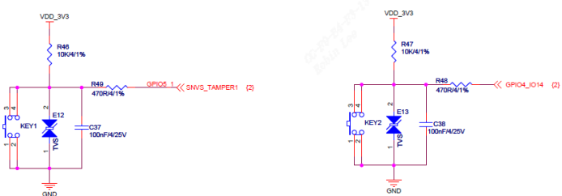
1. 使能电源/时钟控制器
2. 配置引脚模式成gpio
3. 配置引脚方向为输入
4. 读取电平  
    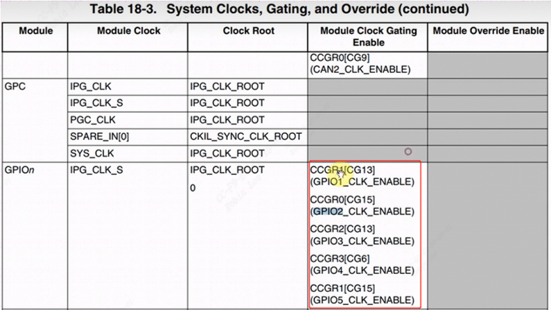
### 2.2.1 CCM时钟使能

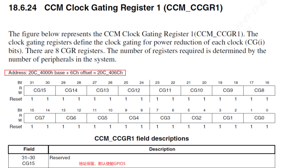
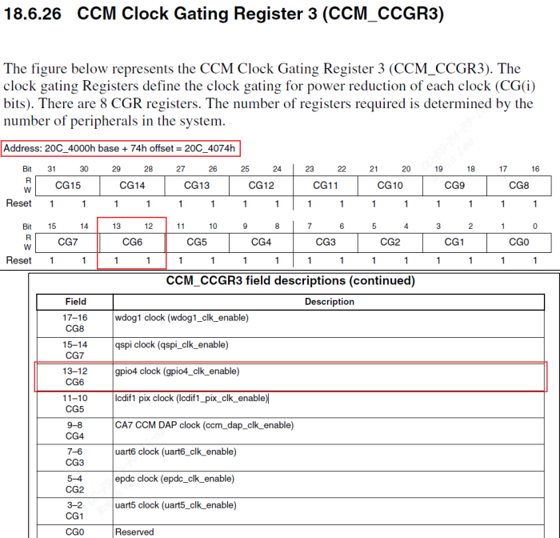
设置 `CCM_CCGR1[31:30]`、 `CCM_CCGR3[13:12]`就可以使能 `GPIO5`、`GPIO4`，可以设置为以下值  
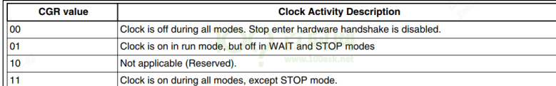

既将`CCM_CCGR1[31:30]`、 `CCM_CCGR3[13:12]`设置成`0b11`即可。

### 2.2.2 配成GPIO 模式

1. `GPIO5_IO01` pinmux 成 GPIO:  
    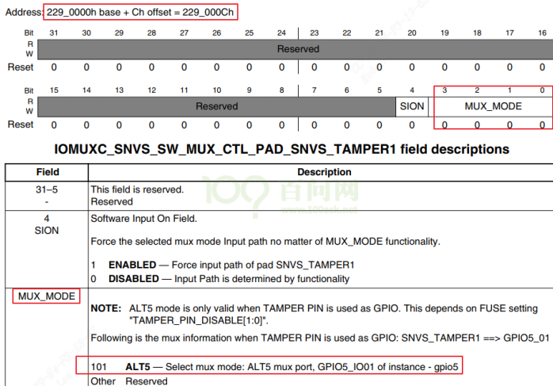    
2. `GPIO4_IO14` pinmux 成 GPIO:  
    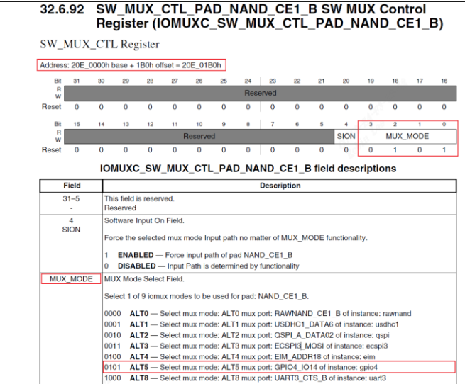
### 2.2.3 GPIO配成输入

`GPIO4,GPIO5`寄存器地址:  
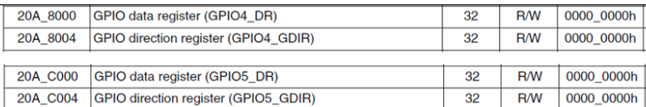
方向设置寄存器:(`offset 04`)  
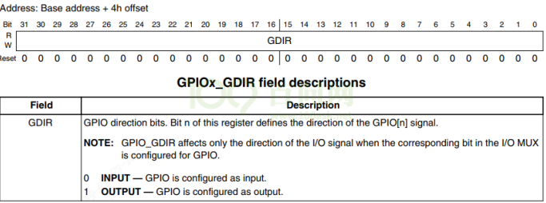
### 2.2.4 读取gpio电平

注意输入模式下，gpio电平状态得从`GPIOx_PSR`得到（`offset 08`）  
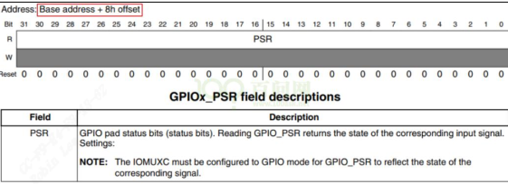
button_board_imx6ull.c

```c
#include <linux/module.h>  
#include <linux/fs.h>  
#include <linux/io.h>  
#include <linux/errno.h>  
#include <linux/miscdevice.h>  
#include <linux/kernel.h>  
#include <linux/major.h>  
#include <linux/mutex.h>  
#include <linux/proc_fs.h>  
#include <linux/seq_file.h>  
#include <linux/stat.h>  
#include <linux/init.h>  
#include <linux/device.h>  
#include <linux/tty.h>  
#include <linux/kmod.h>  
#include <linux/gfp.h>  
#include <asm/io.h>  
#include "button_drv.h"  
struct imx6ull_gpio {  
    volatile unsigned int dr;  
    volatile unsigned int gdir;  
    volatile unsigned int psr;  
    volatile unsigned int icr1;  
    volatile unsigned int icr2;  
    volatile unsigned int imr;  
    volatile unsigned int isr;  
    volatile unsigned int edge_sel;  
};  
static volatile unsigned int *CCM_CCGR3;   
static volatile unsigned int *CCM_CCGR1;  
  
/* set GPIO5_IO03 as GPIO */  
static volatile unsigned int *IOMUXC_SNVS_SW_MUX_CTL_PAD_SNVS_TAMPER1;  
/* set GPIO4_IO14 as GPIO */  
static volatile unsigned int *IOMUXC_SW_MUX_CTL_PAD_NAND_CE1_B;  
  
static struct imx6ull_gpio *gpio4;  
static struct imx6ull_gpio *gpio5;  
static void board_imx6ull_button_init (int which) /* 初始化button, which-哪个button */        
{  
    if (!CCM_CCGR1){  
        CCM_CCGR1 = ioremap(0x20C406C, 4);  
        CCM_CCGR3 = ioremap(0x20C4074, 4);  
        IOMUXC_SNVS_SW_MUX_CTL_PAD_SNVS_TAMPER1 = ioremap(0x229000C, 4);  
        IOMUXC_SW_MUX_CTL_PAD_NAND_CE1_B        = ioremap(0x20E01B0, 4);  
        gpio4 = ioremap(0x020A8000, sizeof(struct imx6ull_gpio));  
        gpio5 = ioremap(0x20AC000, sizeof(struct imx6ull_gpio));  
    }  
    if (which == 0){  
        /* 1. enable GPIO5   
         * CG15, b[31:30] = 0b11  
         */  
        *CCM_CCGR1 |= (3<<30);  
        /* 2. set GPIO5_IO01 as GPIO   
         * MUX_MODE, b[3:0] = 0b101  
         */  
        *IOMUXC_SNVS_SW_MUX_CTL_PAD_SNVS_TAMPER1 = 5;  
        /* 3. set GPIO5_IO01 as input   
         * GPIO5 GDIR, b[1] = 0b0  
         */  
        gpio5->gdir &= ~(1<<1);  
    } else if(which == 1){  
        /* 1. enable GPIO4   
         * CG6, b[13:12] = 0b11  
         */  
        *CCM_CCGR3 |= (3<<12);  
        /* 2. set GPIO4_IO14 as GPIO   
         * MUX_MODE, b[3:0] = 0b101  
         */  
        *IOMUXC_SW_MUX_CTL_PAD_NAND_CE1_B = 5;  
        /* 3. set GPIO4_IO14 as input   
         * GPIO4 GDIR, b[14] = 0b0  
         */  
        gpio4->gdir &= ~(1<<14);  
    }  
}  
static int board_imx6ull_button_read (int which) /* 读button, which-哪个 */  
{  
    if (which == 0)  
        return (gpio5->psr & (1<<1)) ? 1 : 0;  
    else  
        return (gpio4->psr & (1<<14)) ? 1 : 0;  
}  
static struct button_operations my_buttons_ops = {  
    .count = 2,  
    .init = board_imx6ull_button_init,  
    .read = board_imx6ull_button_read,  
};  
int board_imx6ull_button_drv_init(void){  
    register_button_operations(&my_buttons_ops);  
    return 0;  
}  
void board_imx6ull_button_drv_exit(void){  
    unregister_button_operations();  
}  
module_init(board_imx6ull_button_drv_init);  
module_exit(board_imx6ull_button_drv_exit);  
MODULE_LICENSE("GPL")
```

具体单板驱动insmod会调用 `register_button_operations`把具体的`my_buttons_ops`注册进去。当用户open,就会进行`board_imx6ull_button_init`进行按键寄存器配置。当用户read的时候调用`board_imx6ull_button_read`读取按键值。

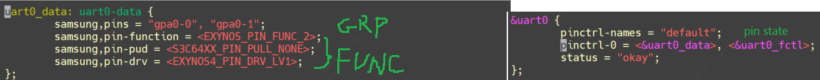
# 3 测试

Makefile

```c
# 1. 使用不同的开发板内核时, 一定要修改KERN_DIR  
# 2. KERN_DIR中的内核要事先配置、编译, 为了能编译内核, 要先设置下列环境变量:  
# 2.1 ARCH,          比如: export ARCH=arm64  
# 2.2 CROSS_COMPILE, 比如: export CROSS_COMPILE=aarch64-linux-gnu-   

KERN_DIR = /home/linux-4.4
all:  
	make -C $(KERN_DIR) M=`pwd` modules   
	$(CROSS_COMPILE)gcc -o button_test button_test.c   
clean:  
	make -C $(KERN_DIR) M=`pwd` modules clean  
	rm -rf modules.order  
	rm -f ledtest  
# 参考内核源码drivers/char/ipmi/Makefile  
# 要想把a.c, b.c编译成ab.ko, 可以这样指定:  
# ab-y := a.o b.o  
# obj-m += ab.o  
obj-m	+= button_drv.o  
obj-m	+= board_xxx.o
```
测试代码

```c
#include <sys/types.h>  
#include <sys/stat.h>  
#include <fcntl.h>  
#include <unistd.h>  
#include <stdio.h>  
#include <string.h>  
/*  
 * ./button_test /dev/100ask_button0  
 */  
int main(int argc, char **argv) {  
	int fd;  
	char val;  
	/* 1. 判断参数 */  
	if (argc != 2)   
	{  
		printf("Usage: %s <dev>\n", argv[0]);  
		return -1;  
	}  
	/* 2. 打开文件 */  
	fd = open(argv[1], O_RDWR);  
	if (fd == -1)  
	{  
		printf("can not open file %s\n", argv[1]);  
		return -1;  
	}  
	/* 3. 写文件 */  
	read(fd, &val, 1);  
	printf("get button : %d\n", val);  
	close(fd);  
	return 0;  
}
```
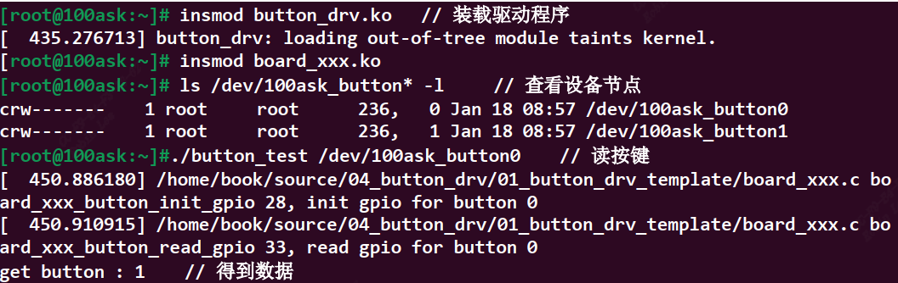
