# 1 引用设备树

在内核中，使用同一个芯片的板子，它们所用的外设资源不一样，比如 A 板用 GPIO A，B 板用 GPIO B， 如果用`plateform_device`定义资源信息，那么每次单板硬件资源变动后，都要改驱动程序源码，重新编译驱动，重新加载驱动，非常麻烦。  
随着 ARM 芯片的流行，内核中针对这些 ARM 板保存有大量的、没有技术含量的文件。 Linus 大发雷霆：`"this whole ARM thing is a f*cking pain in the ass"`。于是，Linux 内核开始引入设备树。 设备树并不是重新发明出来的，在 Linux 内核中其他平台如 `PowerPC`，早就使用设备树来描述硬件了。  
设备树只是用来给内核里的驱动程序，指定硬件的信息。

## 1.1 根文件系统中查看设备树

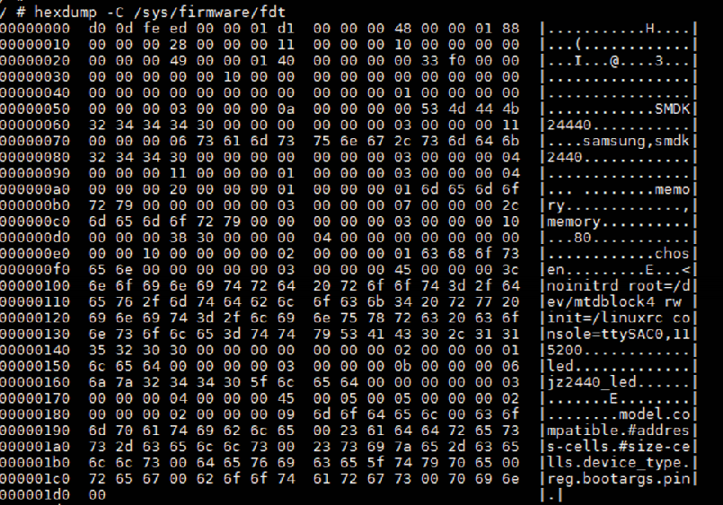
烧录的dtb文件,显然两者是完全相同的。  
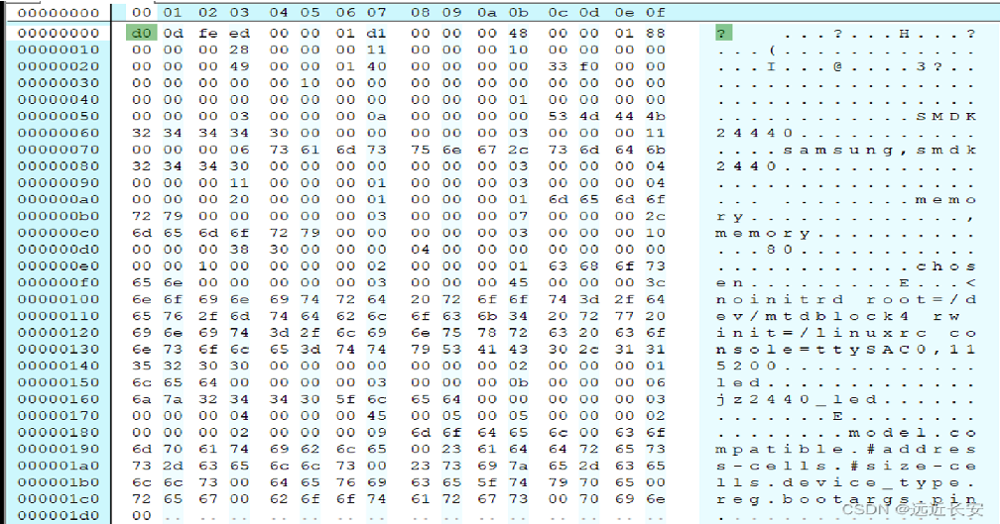
除了原始的dtb文件，根文件系统还以目录结构的方式呈现dtb文件,在`devicetree`目录下，则有一个`base`目录，这个base目录，就对应着根节点。  
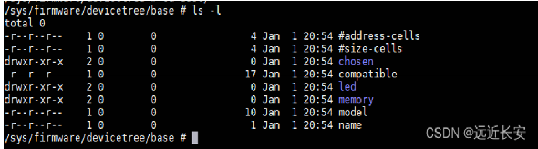
base目录下，每一个节点对应一个目录, 每一个属性对应一个文件. 这些属性的值如果是字符串，可以使用 cat 命令把它打印出来。对于数值，可以用 `hexdump` 把它打印出来。  
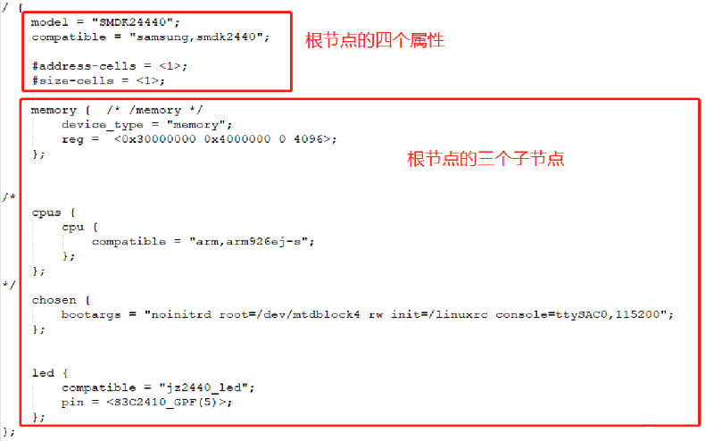
进入`led`目录，里面一共有三个文件，除`name`外，分别对应着led节点的两个属性，cat属性如下：  
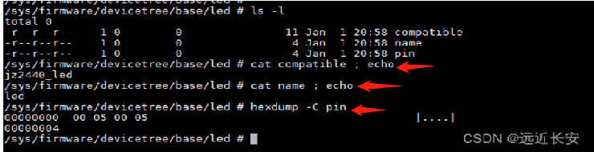
`pin`属性的值为`0x00 05 00 05`，也就是`GPF5`.  
如果节点没有设置`name`属性，那么转换为`device_node`时，会将节点自己的名称作为`name`属性值。 所以这里`name`是`led`.  
根文件系统下也可以查看`platform_device`。系统中所有的`platform_device`，都可以在`/sys/devices/platform/`路径下查看。  
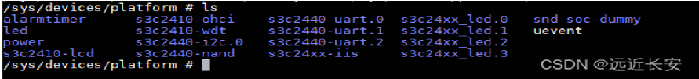
另外，系统中所有的`platform_device`，有来自设备树的，也有来自`.c`文件中注册的。那么，我们怎么知道哪些`platform_device`是来自设备树，哪些是来自.c文件中注册的？

```
答：可以查看该platform_device的相关目录下，是否有of_node，如果有of_node，那么这个platform_device就来自于设备树；否则，来自.c文件。
```

以`led`为例，进入led目录，可以看到有`of_node`，说明这个`platform_device`来自设备树。同时，可以看到这个`of_node`是一个链接文件，指向的是`/sys/firmware/devicetree/base/led`。也就是说，可以进入 `/sys/devices/platform/<设备名>/of_node` 查看它的设备树属性。  
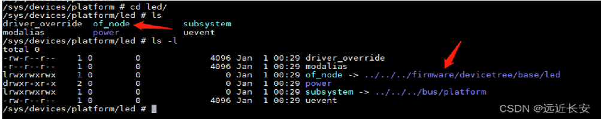
在/proc下有一个链接文件`device-tree`，它指向的是`/sys/firmware/devicetree/base`  
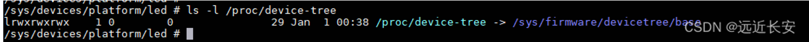
# 2 设备树的语法

设备树文件(`dts: device tree source`)，它需要编译为 `dtb(device tree blob)`文件，内核使用的是 dtb 文件。

## 2.1 DTS 文件

### 2.1.1 DTS文件的总体布局

设备树源文件通常以dts为后缀，其总体布局如下：

```c
/dts-v1/;  
[memory reservations]  
/{  
	[property definitions]  
	[child nodes]  
}
```
以上各项的含义分别为：

|名称|含义|
|---|---|
|/dts-v1/|设备树文件的版本|
|memory reservations|指定保留内存，内核不会使用保留内存|
|/|根节点（使用花括号括出属于根节点的内容）|
|property definitions|根节点的属性，用来描述硬件|
|child nodes|孩子节点（使用花括号括出属于孩子节点的内容）|

### 2.1.2 memory reservations的格式

该项是可选项，如果想要保留一段内存不让内核使用，可用如下格式指定：

```c
/*  
	address    指定要保留的内存的起始地址  
	length     指定要保留的内存的长度  
*/  
/memreserve/<address><length>;
```
需要注意的是，`address`和`length都是64位。

### 2.1.3 属性的格式

```c
• 属性有值 [label:] property-name = value;  
• 属性没有值 [label:] property-name;
```
其中各项的含义：

|名称|含义|
|---|---|
|label|标签|
|property-name|属性名|
|value|属性值|

#### 2.1.3.1 有关属性名

属性名的长度为`1~31`个字符，可以自己取，只要能够提供可以解读该属性名的驱动即可。也有一些属性名有着特定的含义，比如`compatible`用于表示哪个或哪些驱动支持该设备。对于自己命名的属性，并非所有字符均可组成属性名，它需要由以下字符组成：  
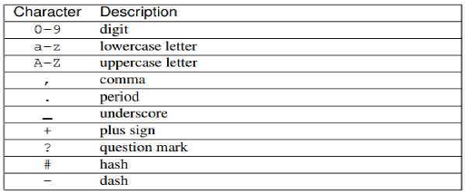
#### 2.1.3.2 有关属性值

属性值有以下四种：

1. `array of cells` 一个cell就是一个u32类型的数据，一个或多个cell用尖括号括起来，并以空格隔开就可以作为一种合法的属性值，如:
```c
example = <0x1 0x2 0x3>;。
```    
2. 含有结束符的**字符串** 如:
```c
example = "example value";
```    
3. **字节序列** 用方括号括起一个或多个字节，字节之间可用也可不用空格隔开，且字节以两位16进制数表示，如:
```c
example = [12 34 56 78];
```    
4. **以上三种值的混合**（以逗号隔开） 如:
```c
compatible = "fsl,mpc8641", "ns16550";
```    
- 文本字符串（包含’\0’结束符）用双引号表示：
```c
string-property="a string";
```    
- Cells（32位无符号整数）用尖括号表示：
```c
cell-property = <0xbeef 123 0xabcd1234>;
```    
- 64bit 数据使用 2 个 cell 来表示：
```c
clock-frequency = <0x00000001 0x00000000>;
```    
- 二进制数据用方括号表示：
```c
binary-property=[0x01 0x23 0x45 0x67];
```    
- 类型不同的数据的组合也是可以的，但需要用逗号隔开：
```c
mixed-property="a string", [0x01 0x23 0x45 0x67], <0x12345678>;
```    
- 逗号同样用于创建字符串列表：
```c
string-list = "red fish", "blue fish";
```    

举个例子：

```c
/ {  
	node1 {  
		a-string-property = "A string";  
		a-string-list-property = "first string", "second string";  
		a-byte-data-property = [0x01 0x23 0x34 0x56];  
		child-node1 {  
			first-child-property;  
			second-child-property = <1>;  
			a-string-property = "Hello, world";  
		};  
		child-node2 {  
		};  
	};  
	node2 {  
		an-empty-property;  
		a-cell-property = <1 2 3 4>; /* each number (cell) is a uint32 */  
		child-node1 {  
		};  
	};  
};
```
### 2.1.4 一些特定的属性

设备树文件中有一些特定的属性，他们拥有约定俗成的名称和含义，在`devicetree-specification`中，这些属性被称为`Standard Properties`，我们在使用这些属性时，应当遵守相应的约定。这些属性有很多，我将在下文中介绍它们中的一部分。

#### 2.1.4.1 `#address-cells`

该属性的值表示在该节点的子节点的reg属性中，使用使用多少个cell，也即使用多少个u32整数来表示地址（对于32位系统，一个u32整数就够了；而对于64位系统，需要两个u32整数）。

#### 2.1.4.2 `#size-cells`

该属性的值表示在该节点的子节点的reg属性中，使用多少个cell，也即使用多少个u32整数来表示大小（一段地址空间的长度）。  
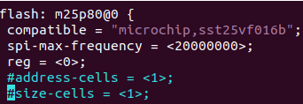
#### 2.1.4.3 compatible

其值为一个或多个字符串，用来描述支持该设备的驱动程序。比如，该属性位于根节点时，用于指定内核中哪个`machine_desc`可以支持本设备，即当前设备与哪些平台兼容。其值的格式一般是`"manufacturer, model"`，其中`manufacturer`表示厂家，`model`表示型号（厂家的哪型产品）。  
当该属性的值有多个字符串时，从左往右，从最特殊到最一般。举例来说

```c
compatible = "samsung,smdk2416"
```
`"samsung, s3c2416"` 作为根节点的属性时，第一个字符串指示了一个具体的开发板型号，而第二个字符串要更一般，只指示了SoC的型号。在linux初始化时，会优先找支持`"samsung,smdk2416"`的`machine_desc`用以初始化硬件，找不到时才退而求其次找到`"samsung, s3c2416"`。

```c
led {   
	compatible = “A”, “B”, “C”;   
};
```
`“compatible”`表示“兼容”，对于某个 LED，内核中可能有 A、B、C 三个驱 动都支持它。

#### 2.1.4.4 model

其值为一个字符串，用来描述当前设备的型号（单板的名字）。当多个设备的`compatible`相同时，可以通过model来进一步区分多个设备。

```c
{   
	compatible = "samsung,smdk2440", "samsung,mini2440";   
	model = "jz2440_v3";   
};
```
它表示`jz2440_v3`这个单板，可以兼容内核中的`“smdk2440”`，也兼容`“mini2440”`.

#### 2.1.4.5 phandle

该属性可以为节点指定一个全局唯一的数字标识符。这个标识符可以被需要引用该节点的另一个节点使用。举例来说，现有一个中断控制器：

```c
pic@10000000{  
	phandle =<1>;  
	interrupt-controller;  
};
```
还有一个可以产生中断的设备，且这个设备的中断信号线连接到了上述中断控制器，为了描述清楚这种关系，该设备的设备节点就需要引用中断控制器的节点：

```c
another-device-node {  
	interrupt-parent =<1>;/* 数字1就唯一标识了节点pic@10000000 */  
};
```
#### 2.1.4.6 interrupt-controller

这是一个没有值的属性，用在中断控制器的设备节点中，以表明这个节点描述的是一个中断控制器。

#### 2.1.4.7 interrupt-parent

该属性用于可以产生中断，且中断信号连接到某中断控制器的设备的设备节点，用于表示该设备的中断信号连接到了哪个中断控制器。该属性的值通常是中断控制器设备节点的数字标识（`phandle`），具体示例在上文已经出现过了。

#### 2.1.4.8 reg

reg属性描述了设备资源在其父总线定义的地址空间内的地址。通俗的说，该属性使用一对或多对（地址，长度）来描述设备所占的地址空间。至于地址和长度使用多少个cell来表示呢？这取决于上文介绍的`#address-cells、#size-cells`属性的值。  
举个例子，当：

```c
#address-cells =<1>;  
#size-cells =<1>;  
reg = <0x3000 0x20 0xFE00 0x100>;
```
那么`reg = <0x3000 0x20 0xFE00 0x100>`，表示该属性所属的设备占据了两块内存空间，第一块是以0x3000为起始的32字节内存块；第二块是以0xFE00为起始的256字节内存块。

#### 2.1.4.8 status

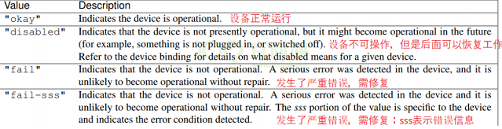
```c
&uart1 {  
	status = "disabled";  
};
```
#### 2.1.4.9 ranges

`ranges`属性值可以为空或者按照 (`child-bus-address,parent-bus-address,length`)格式编写的数字组成：

```c
child-bus-address//子总线地址空间的物理地址，由父节点的 #address-cells确定此物理地址所占用的字长。  
parent-bus-address//父总线地址空间的物理地址，同样由父节点的 #address-cells确定此物理地址所占用的字长。  
length//子地址空间的长度，由父节点的 #size-cells确定此地址长度所占用的字长。  
  
soc {   
	#address-cells = <1>;   
	#size-cells = <1>;   
	compatible = "simple-bus";   
	interrupt-parent = <&gpc>;   
	ranges;   
}
```
`ranges`属性值为空值，说明子地址空间和父地址空间完全相同，不需要进行地址转换。

```c
soc {   
	compatible = "simple-bus";   
	#address-cells = <1>;  
	#size-cells = <1>;   
	ranges = <0x0 0xe0000000 0x00100000>;   
	serial {   
		device_type = "serial";   
		compatible = "ns16550";   
		reg = <0x4600 0x100>;   
	};   
};
```
soc定义的 ranges属性，值为 `<0x0 0xe0000000 0x00100000>`，此属性值指定了一个 `1024KB(0x00100000)`的地址范围，子地址空间的物理起始地址为 `0x0`，父地址空间的物理起始地址为 `0xe0000000`。

serial是串口设备节点， reg属性定义了 serial设备寄存器的起始地址为 `0x4600`寄存器长度为 `0x100`。经过地址转换， serial设备可以从 `0xe0004600`开始进行读写操作，`0xe0004600=0x4600+0xe0000000`。

#### 2.1.4.10 device_type

此属性也被抛弃了。此属性只能用于 cpu节点或者 memory节点。

```c
cpus {  
    #size-cells = <0x0>;  
    #address-cells = <0x1>;  
    A53_0: cpu@0 {  
        reg = <0x0>;  
        enable-method = "psci";  
        compatible = "arm,cortex-a53";  
        device_type = "cpu";  
        next-level-cache = <&CA53_L2>;  
    };  
}
```
### 2.1.5 节点的格式

节点的格式如下：

```c
[label:]node-name[@unit-address]{  
	[properties definitions]  
	[child nodes]  
};
```
以uart节点为例：

```c
/ {   
	uart0: uart@fe001000 {   
		compatible="ns16550";   
		reg=<0xfe001000 0x100>;   
	};   
};
```
节点名(`node-name`)长为1~31个字符，这些字符可以是：  

每个设备节点代表一个设备，因此节点名的命名通常要和设备相应，比如以太网控制器，我们可以给其取名`ethernet`。考虑到一个SoC中可能有多个以太网控制器，为了做区分，我们通常在其**节点名后面加上设备的地址**，也就是上文中出现的可选部分`@unit-address`。仍以以太网控制器为例，假如两个以太网控制器的寄存器组的首地址分别为`0xfe002000`和`0xfe003000`，那么相应的节点名可以取为`ethernet@fe002000`和`ethernet@fe003000`。  
不难看出，设备节点允许嵌套，假设节点b嵌套于节点a中，那么节点a是节点b的父节点。根节点的名字比较特殊，就是一个斜杠/，其他的设备节点都是根节点的孩子，或者孩子的孩子…因此，所有的设备节点呈现出一个树状的层次结构（设备树因此得名），下图就是一个例子：  
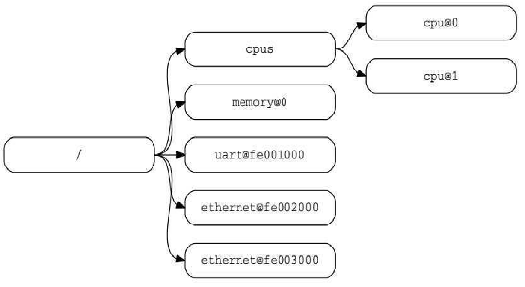
#### 2.1.5.1 推荐的节点名

关于节点的命名，官方有一些推荐的命名，具体可见`devicetree-specification-v0.3`的2.2.2节。

#### 2.1.5.2 节点的路径名

在文件系统中有个术语叫文件的路径名（`pathname`），在按照树状结构组织的众多文件中，用以唯一标识某个文件。类似的，节点也有路径名的概念。将根节点类比为根目录，以上图为例，其中cpu0节点的路径名为`/cpus/cpu@0`。我们在给节点命名时，必须**保证每个节点拥有唯一的路径名**（注意区别于每个节点拥有唯一的节点名）。

### 2.1.6 一些特殊的节点

有一些特殊的节点不代表任何设备，而是有着特定的用途，本节就将介绍一些这样的节点。

#### 2.1.6.1 /aliases节点

`/aliases`节点应当作为根节点的孩子节点，用于定义一个或多个别名属性，每条别名属性会为一个设备节点的路径名设置一个别名，如下面这个例子所示：

```c
aliases {  
	serial0 ="/simple-bus@fe000000/serial@llc500";  
	ethernet0 ="/simple-bus@fe000000/ethernet@31c000";  
};
```
别名只能由`1~31`个下面的字符组成：  
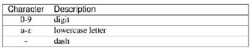
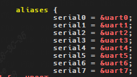
**别名通常以数字结尾**，比如别名为`i2c1`，设备树的初始化程序在解析别名属性时，会将数字1记录在`struct alias_prop`结构的`id`成员中，使用`of_alias_get_id`可以获得这个数字。因为本文主要介绍设备树文件的格式，因此这里不再深究这部分内容。

#### 2.1.6.2 /chosen节点

`/chosen`节点应当用作根节点的孩子节点，有以下可选属性：  
• `bootargs`  
• `stdout-path`  
• `stdin-path`  
顾名思义，该节点可以指定启动参数、标准输出和标准输入，一个例子如下：  
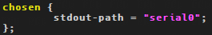
```c
/{  
	......  
	chosen {  
		bootargs ="root=/dev/nfs rw nfsroot=192.168.1.1 console=ttyS0,115200";  
		};  
	......  
};
```
上图中`chosen`节点仅仅设置了属性`“ stdout-path”`，表示标准输出使用 uart0。但是当我们进入到 `/proc/device-tree/chosen`目录里面，会发现多了 `bootargs`属性，原因如下:  
`do_bootm_linux` 函数会通过一系列复杂的调用，最终通过`fdt_chosen` 函数在`chosen` 节点中加入  
了`bootargs` 属性。  
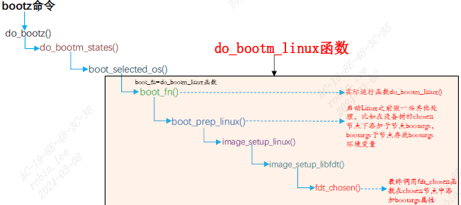

#### 2.1.6.3 /根节点

```c
/ {   
	model = "SMDK24440";   
	compatible = "samsung,smdk2440";   
	#address-cells = <1>;   
	#size-cells = <1>;   
};
```
根节点中必须有这些属性：

```c
#address-cells // 在它的子节点的 reg 属性中, 使用多少个 u32 整数来描述地址(address)   
#size-cells // 在它的子节点的 reg 属性中, 使用多少个 u32 整数来描述大小(size)   
compatible // 定义一系列的字符串, 用来指定内核中哪个 machine_desc 可以支持本设备 (即这个板子兼容哪些平台)   
model // 咱这个板子是什么
```
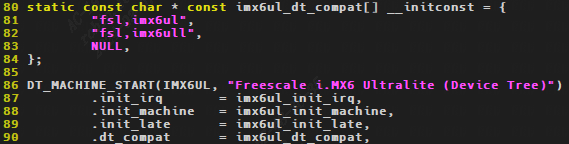
Linux内核通过根节点 `compatible`属性找到对应的设备的函数调用过程如下：  
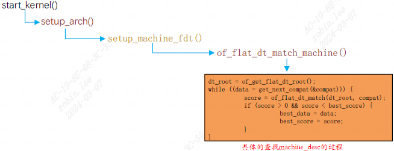
### 2.1.7 必要的节点和必要的属性

一个完整的设备树文件（DTS文件），有一些节点是必须要有的，这些必要的节点有：

|节点名|节点的必要属性|
|---|---|
|/|`#address-cells`、`#size-cells`、model、compatible|
|/memory|device_type、reg|
|/cpus|`#address-cells`、`#size-cells`|
|/cpus/cpu*|device_type、reg、clock-frequency、timebase-frequency|
|/cpus/cpu*/l?-cache|compatible、cache-level|

### 2.1.8 label（标签）的使用

在上文就提到过标签，只是没有细说，这里就介绍一下标签的使用。首先，标签名可由`1~31`个字符组成，这些字符可以是：  
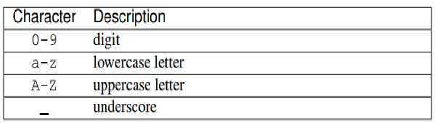
接下来仍以中断控制器的例子来说：

```c
pic@10000000{  
	phandle =<1>;  
	interrupt-controller;  
	};  
......  
another-device-node {  
	interrupt-parent =<1>;/* 数字1就唯一标识了节点pic@10000000 */  
};
```
如果我们使用phandle来标识设备，当设备多了，数字标识符是比较难记忆的，可读性也差，此时可以使用标签：

```c
PIC:pic@10000000{  
	interrupt-controller;  
};  
......  
another-device-node {  
	interrupt-parent =<&PIC>;/* 用标签来引用设备节点 */  
};
```
还有一种常见的标签的用法，当我们需要修改某设备节点的属性，但又不想直接在原地修改（保持原来的内容不被破坏），此时可以在设备树文件的末尾重写该设备节点的相应属性，从而覆盖之前的内容：

```c
/{  
	device-node {  
		p ="xxx";  
	};  
};  
  
/* 重写device-node的属性p */  
/{  
	device-node {/* 因此这样写比较麻烦（特别是在路径比较深的时候） */  
		p ="yyy";  
	};  
};
```
那么使用标签的写法就简单很多：标签名DN.

```c
/{  
	DN:device-node {  
		p ="xxx";  
	};  
}  
  
/* 重写device-node的属性p */  
&DN{  
	p ="yyy";  
};
```
**修改节点**，节点追加内容：

```c
i2c0: i2c@29000000 {  
	 compatible = "snps,designware-i2c";  
	 clocks = <&clk ATHENA2_CLK_I2C0>;  
	 reg = <0x0 0x29000000 0x0 0x1000>;  
	 clock-frequency = <400000>;  
	 #size-cells = <0x0>;  
	 #address-cells = <0x1>;  
	 resets = <&rst RST_I2C0>;  
	 reset-names = "i2c0";  
};
```
再另一个dts中使用i2c0:

```c
&i2c0 {  
		clock-frequency = <100000>;  
	status = "okay";  
  
	mag3110@0e {   
			compatible = "fsl,mag3110";   
			reg = <0x0e>;   
			position = <2>;   
	};  
};
```
### 2.1.9 编写设备树文件

#### 2.1.9.1 在DTS文件中包含其他文件

编写设备树文件时，我们通常会把多型设备的共性抽出来，写在`DTSI`文件（后缀为`.dtsi`）中，其语法与DTS文件一样。比如，多款使用了`am335x`的板子，因为使用了同一款SoC，描述设备时肯定会有一些相同的部分，可以把这部分抽出来，写到`am335x.dts`i中，然后在具体的某型板子的设备树中包含相应的DTSI文件，包含的方式有：

```c
/include/ “xxx.dtsi”  
#include “xxx.dtsi”
```
设备树编译器还支持c语言的头文件，因此，如果有需要可以定义一些宏并在设备树文件中使用。

#### 2.1.9.2 如何在设备树文件中描述设备

##### 2.1.9.2.1 Documentation/devicetree/bindings

设备树写出来是给驱动程序看的，也就是说驱动程序怎么写的，相应的设备树就该怎么写；或者反过来，先约定好设备树怎么写，在相应的设计驱动。驱动和设备树有着对应的关系，这种对应关系也被称为`bindings`。具体的：

```c
对于上游芯片厂商，应当按照devicetree-specification推荐的设备树写法，遵守各种约定，确定好如何规范的描述设备，并提供相应的驱动程序。devicetree-specification-v0.3的第四章给出了一些推荐的做法。  
对于下游产品厂商，当使用芯片厂商的芯片做产品时，芯片厂商通常会提供驱动程序和设备树文件编写的参考文档，这些文档位于linux内核源码树的Documentation/devicetree/bindings目录下。如果芯片厂商没提供相应文档的话，就要读驱动的源码，知道驱动怎么写的，自然也就知道如何写设备树了。
```
## 2.2 DTB文件

DTS文件只是文本文件，需要使用**设备树编译器（DTC）将其编译为DTB文件（二进制文件）**，然后才能传递给内核，内核解析的是DTB文件。dtb文件由四个部分组成：  
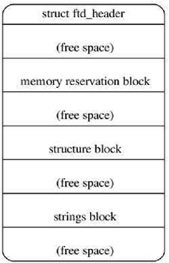
### 2.2.1 struct ftd_header

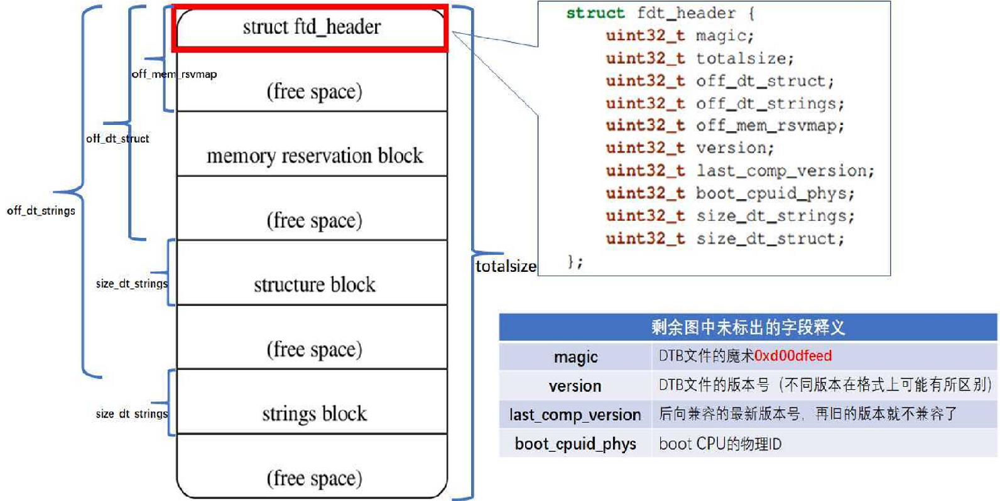
```c
struct fdt_header {  
    fdt32_t magic;           /* magic word FDT_MAGIC */  
    fdt32_t totalsize;       /* total size of DT block */  
    fdt32_t off_dt_struct;       /* offset to structure */  
    fdt32_t off_dt_strings;      /* offset to strings */  
    fdt32_t off_mem_rsvmap;      /* offset to memory reserve map */  
    fdt32_t version;         /* format version */  
    fdt32_t last_comp_version;   /* last compatible version */  
    /* version 2 fields below */  
    fdt32_t boot_cpuid_phys;     /* Which physical CPU id we're  
    booting on */  
    /* version 3 fields below */  
    fdt32_t size_dt_strings;     /* size of the strings block */  
    /* version 17 fields below */  
    fdt32_t size_dt_struct;      /* size of the structure block */  
};
```
**totalsize**:  
这个设备树的size，也可以理解为所占用的实际内存空间。  
**off_dt_struct**:  
`offset to dt_struct`，表示整个dtb中`structure`部分所在内存相对头部的偏移地址  
**off_dt_strings**:  
`offset to dt_string`，表示整个dtb中`string`部分所在内存相对头部的偏移地址  
**off_mem_rsvmap**:  
`offset to memory reserve map`，dtb中`memory reserve map`所在内存相对头部的偏移地址

### 2.2.2 memory reservation block

该部分由`memory reservations`编译得来，由一个或多个表项组成，每一项都描述了一块要保留的内存区域，每项由两个64位数值（起始地址、长度）组成：  
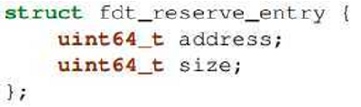

### 2.2.3 structure block

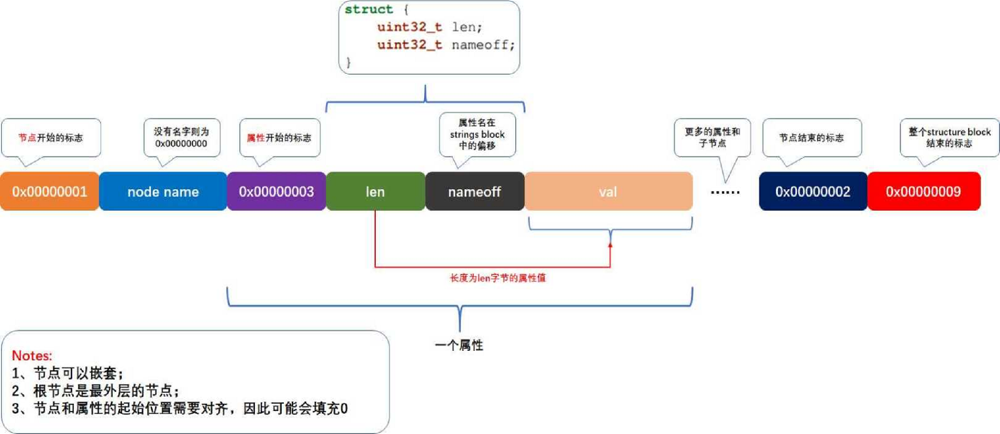
### 2.2.4 strings block

该部分类似于ELF文件中的字符串表，存储了所有属性名（字符串），考虑到很多节点拥有一些同名的属性，集中存放属性名可以有效的节约DTB文件的空间，存放有属性的`structure block`部分只需要保存一个32位的偏移值——属性名的起始位置在`strings block`中的偏移。

## 2.3 DTB文件的编译

### 2.3.1 在内核中直接 make

进入内核源码的目录，执行如下命令即可编译 dtb 文件。`make all`命令是编译 Linux源码中的所有东西，包括 `zImage，dtb，.ko`驱动模块以及设备树，如果只是编译设备树的话建议使用`“ make dtbs”`命令。

```
make dtbs V=1
```

### 2.3.2 手工编译

内核目录下 `scripts/dtc/dtc` 是设备树的编译工具，直接使用它的话，包含其他文件时不能使用`“#include”`，而必须使用`“/incldue”`。

**编译**、反编译的示例命令如下，`“-I”`指定输入格式，`“-O”`指定输出格式，`“-o”`指定输出文件：

```c
./scripts/dtc/dtc -I dts -O dtb -o tmp.dtb arch/arm/boot/dts/xxx.dts // 编译 dts 为 dtb   
./scripts/dtc/dtc -I dtb -O dts -o tmp.dts arch/arm/boot/dts/xxx.dtb // 反编译 dtb 为 dts
```
DTC工具源码在 Linux内核的 `scripts/dtc`目录下，`scripts/dtc/Makefile`文件内容如下：  
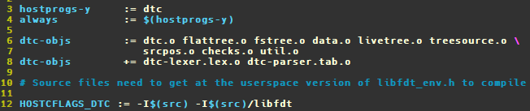
### 2.3.3 反编译dtb

cd 板子所用的内核源码目录

```c
./scripts/dtc/dtc -I dtb -O dts /从板子上/复制出来的/fdt -o tmp.dts
```
## 2.4 内核对设备树的处理过程


① dts 在 PC 机上被编译为 dtb 文件；  
② u-boot 把 dtb 文件传给内核；  
③ 内核解析 dtb 文件，把每一个节点都转换为 `device_node` 结构体；  
④ 对于某些 `device_node` 结构体，会被`platform_device` 结构体获取资源信息  
**dts解析过程:**  
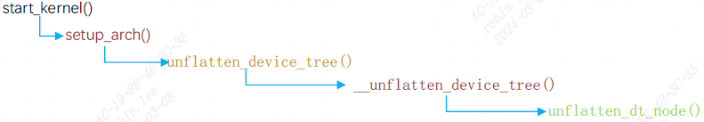
最终实际dts解析的函数为`unflatten_dt_node`。

### 2.4.1 dtb 中每一个节点都被转换为 device_node 结构体

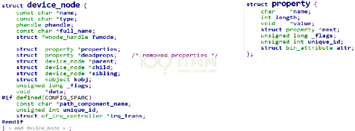
根节点被保存在全局变量 `of_root` 中，从 `of_root` 开始可以访问到任意节点。

### 2.4.2 哪些设备树节点会被转换为 platform_device

```c
/{   
	mytest {  
		compatile = "mytest", "simple-bus";   
		mytest@0 {   
			compatile = "mytest_0";   
		};   
	};   
  
	i2c {   
		compatile = "samsung,i2c";   
		at24c02 {   
			compatile = "at24c02";   
		};   
	};   
	spi {   
		compatile = "samsung,spi";   
		flash@0 {   
			compatible = "winbond,w25q32dw";   
			spi-max-frequency = <25000000>;   
			reg = <0>;   
		};   
	};   
};
```
①根节点下含有 `compatile` 属性的子节点  
②含有特定 `compatile` 属性的节点的子节点 :

```
如果一个节点的 compatile 属性，它的值是这 4 者之一："simple-bus","simple-mfd","isa","arm,amba-bus", 那 么 它 的 子结点 ( 需 含compatile 属性)也可以转换为 platform_device。 
```

③总线 I2C、SPI 节点下的子节点：不转换为`platform_device`  
某个总线下到子节点，应该交给对应的总线驱动程序来处理, 它们不应该被转换为 `platform_device`。  
比如以下的节点中：

- /mytest 会被转换为 platform_device, 因为它兼容"simple-bus"; 它的子节点/mytest/mytest@0 也会被转换为 platform_device 
- /i2c 节点一般表示 i2c 控制器, 它会被转换为 platform_device, 在内核 中有对应的 platform_driver; 
- /i2c/at24c02 节点不会被转换为 platform_device, 它被如何处理完全由父节点的 platform_driver 决定, 一般是被创建为一个 i2c_client。 
- 类似的也有/spi 节点, 它一般也是用来表示 SPI 控制器, 它会被转换为 platform_device, 在内核中有对应的 platform_driver; 
- /spi/flash@0 节点不会被转换为 platform_device, 它被如何处理完全由 父节点的 platform_driver 决定, 一般是被创建为一个 spi_device。 

### 2.4.3 节点怎么转换为 platform_device


- platform_device 中含有 resource 数组, 它来自 device_node 的 reg, interrupts 属性; 
- platform_device.dev.of_node 指向 device_node, 可以通过它获得其他属性

# 3 完整dts示例

编写设备树之前要先定义一个设备，我们就以 `I.MX6ULL`这个 SOC为例，我们需要在设备树里面描述的内容如下：

- I.MX6ULL这个 Cortex-A7架构的 32位 CPU。  
- I.MX6ULL内部 ocram，起始地址 0x00900000，大小为 128KB(0x20000)。  
- I.MX6ULL内部 aips1域下的 ecspi1外设控制器，寄存器起始地址为 0x02008000，大小为 0x4000。  
- I.MX6ULL内部 aips2域下的 usbotg1外设控制器，寄存器起始地址为 0x02184000，大小为 0x4000。  
- I.MX6ULL内部 aips3域下的 rngb外设控制器，寄存器起始地址为 0x02284000，大小为 0x4000

## 3.1 添加 cpus节点

cpu节点， `I.MX6ULL`采用 `Cortex-A7`架构，而且只有一个 CPU，因此只有一个cpu0节点，如下所示：

```c
/ {   
	compatible = "fsl,imx6ull-alientek-evk", "fsl,imx6ull";  
	cpus {   
		#address-cells = <1>;   
		#size-cells = <0>;   
		//CPU0节点   
		cpu0: cpu@0 {   
			compatible = "arm,cortex-a7";   
			device_type = "cpu";   
			reg = <0>;   
		};   
	};   
};
```
## 3.2 添加 soc节点

像 `uart iic`控制器等等这些都属于 SOC内部外设，因此一般会创建一个叫做 `soc`的父节点来管理这些 SOC内部外设的子节点:

```c
/ {   
	//soc节点   
	soc {   
		#address-cells = <1>;   
		#size-cells = <1>;   
		compatible = "simple-bus";   
		ranges;   
	};  
};
```
soc节点设置 `#address-cells = <1>`，`#size-cells = <1>`，这样 soc子节点的 reg属性中起始地占用一个字长，地址空间长度也占用一个字长。`ranges`属性为空，说明子空间和父空间地址范围相同。

### 3.2.1 添加 ocram节点

根据第②点的要求，添加 `ocram`节点， `ocram`是 `I.MX6ULL`内部 RAM，因此 `ocram`节点应该是 soc节点的子节点。 `ocram`起始地址为 `0x00900000`，大小为`128KB(0x20000)`:

```c
//soc节点   
soc {   
	#address-cells = <1>;   
	#size-cells = <1>;   
	compatible = "simple-bus";   
	ranges;   
  
	//ocram节点   
	ocram: sram@00900000 {   
		compatible = "fsl,lpm-sram";   
		reg = <0x00900000 0x20000>;   
	};   
};
```
### 3.2.2 添加 aips1、 aips2和 aips3节点

`IMX6ULL`外设控制分为三个域： `aips1~3`，这三个域分管不同的外设控制器，`aips1~3`这三个域都属于 soc节点的子节点：

```c
//aips1节点  
aips1: aips-bus@02000000 {   
	compatible = "fsl,aips-bus", "simple-bus";   
	#address-cells = <1>;   
	#size-cells = <1>;   
	reg = <0x02000000 0x100000>;   
	ranges;   
};  
aips2: aips-bus@02100000 {   
	compatible = "fsl,aips-bus", "simple-bus";   
	#address-cells = <1>;   
	#size-cells = <1>;   
	reg = <0x02100000 0x100000>;   
	ranges;   
};  
aips3: aips-bus@02200000 {   
	compatible = "fsl,aips-bus", "simple-bus";   
	#address-cells = <1>;   
	#size-cells = <1>;   
	reg = <0x02200000 0x100000>;   
	ranges;   
};
```
#### 3.2.2.1 添加 ecspi1、 usbotg1和 rngb节点

每个域节点下都添加一个外设节点。`ecspi1`属于 `aips1`的子节点， `usbotg1`属于 `aips2`的子节点， `rngb`属于 `aips3`的子节点。
```c
//ecspi1节点   
ecspi1: ecspi@02008000 {   
	#address-cells = <1>;   
	#size-cells = <0>;   
	compatible = "fsl,imx6ul-ecspi", "fsl,imx51-ecspi";   
	reg = <0x02008000 0x4000>;   
	status = "disabled";   
};  
  
//usbotg1节点   
usbotg1: usb@02184000 {   
	compatible = "fsl,imx6ul-usb", "fsl,imx27-usb";   
	reg = <0x02184000 0x4000>;   
	status = "disabled";  
};  
  
//rngb节点   
rngb: rngb@02284000 {   
	compatible = "fsl,imx6sl-rng", "fsl,imx-rng", "imx-rng";   
	reg = <0x02284000 0x4000>;   
};
```
