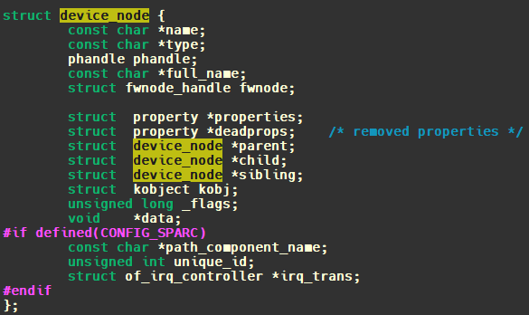
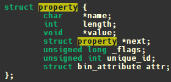
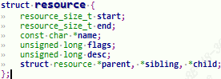
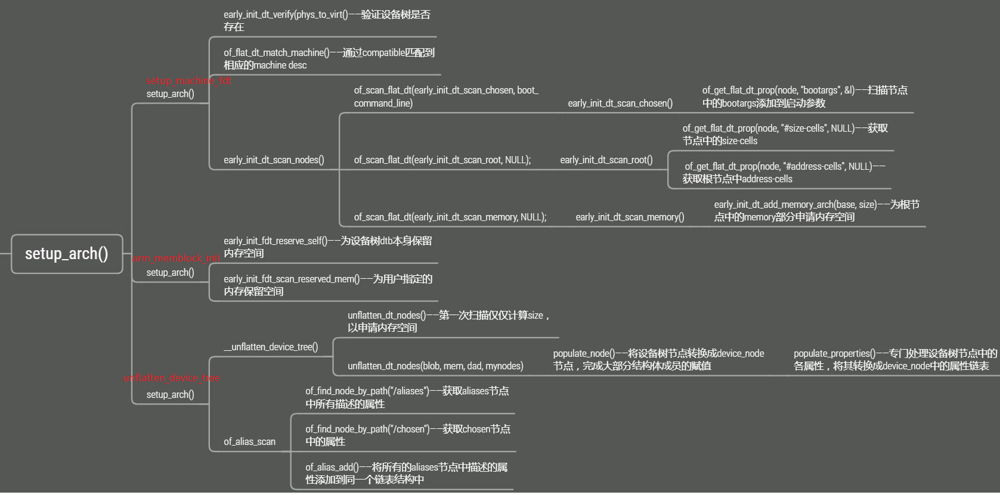
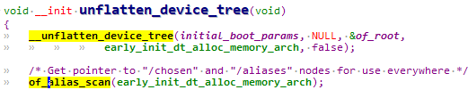
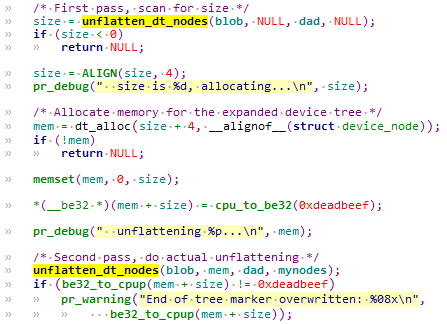
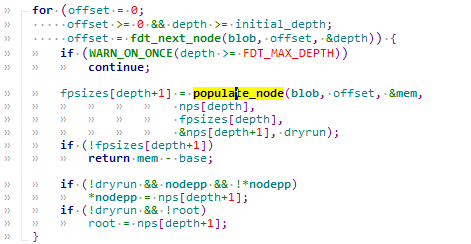
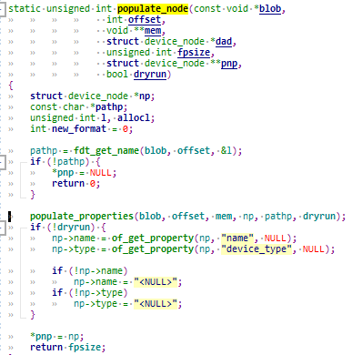
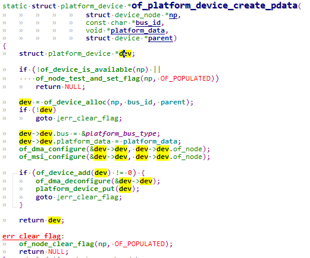

# 1.设备树相关的头文件

1.处理 `DTB`
```c
of_fdt.h // dtb 文件的相关操作函数, 我们一般用不到,  
// 因为 dtb 文件在内核中已经被转换为 device_node 树(它更易于使用)
```

2.处理 `device_node`
```c
of.h // 提供设备树的一般处理函数,  
// 比如 of_property_read_u32(读取某个属性的 u32 值),  
// of_get_child_count(获取某个 device_node 的子节点数)  
of_address.h // 地址相关的函数,  
// 比如 of_get_address(获得 reg 属性中的 addr, size 值)  
// of_match_device (从 matches 数组中取出与当前设备最匹配的一项)  
of_dma.h // 设备树中 DMA 相关属性的函数  
of_gpio.h // GPIO 相关的函数  
of_graph.h // GPU 相关驱动中用到的函数, 从设备树中获得 GPU 信息  
of_iommu.h // 很少用到  
of_irq.h // 中断相关的函数  
of_mdio.h // MDIO (Ethernet PHY) API  
of_net.h // OF helpers for network devices.  
of_pci.h // PCI 相关函数  
of_pdt.h // 很少用到  
of_reserved_mem.h // reserved_mem 的相关函数
```

3.处理 `platform_device`
```c
of_platform.h // 把 device_node 转换为 platform_device 时用到的函数,  
// 比如 of_device_alloc(根据 device_node 分配设置 platform_device),  
// of_find_device_by_node (根据 device_node 查找到 platform_device),  
// of_platform_bus_probe (处理 device_node 及它的子节点)  
of_device.h // 设备相关的函数, 比如 of_match_device
```

# 2.设备树相关的函数

## 2.1 找res属性和platform device

**of_find_device_by_node**  
函数原型为：
```c
extern struct platform_device *of_find_device_by_node(struct device_node *np);
```

设备树中的每一个节点，在内核里都有一个 `device_node`；你可以使用device_node 去找到对应的 `platform_device`。

**platform_get_resource**  
这 个 函 数 跟 设 备 树 没 什 么 关 系 ， 但 是 设 备 树 中 的 节 点 被 转 换 为 `platform_device` 后，设备树中的 `reg 属性、interrupts 属性`也会被转换为`“resource”`。 这时，你可以使用这个函数取出这些资源。  
函数原型为：
```c
/**   
* platform_get_resource - get a resource for a device  
* @dev: platform device  
* @type: resource type // 取哪类资源？IORESOURCE_MEM、IORESOURCE_REG  
* // IORESOURCE_IRQ 等  
* @num: resource index // 这类资源中的哪一个？  
*/  
struct resource *platform_get_resource(struct platform_device *dev, unsigned int type, unsigned int num);
```

对于设备树节点中的 reg 属性，它对应 `IORESOURCE_MEM` 类型的资源； 对于设备树节点中的 interrupts 属性，它对应 `IORESOURCE_IRQ` 类型的资源。

## 2.2 找节点


**of_find_node_by_path**  
根据路径找到节点，比如`“/”`就对应根节点，`“/memory”`对应 memory 节点。  
函数原型：
```c
static inline struct device_node *of_find_node_by_path(const char *path);c
```

**of_find_node_by_name**  
根据名字找到节点，节点如果定义了 name 属性，那我们可以根据名字找到它。  
函数原型：
```c
extern struct device_node *of_find_node_by_name(struct device_node *from,const char *name);
```

参数 from 表示从哪一个节点开始寻找，传入 NULL 表示从根节点开始寻找。 但是在设备树的官方规范中不建议使用`“name”`属性，所以这函数也不建议 使用。  
**of_find_node_by_type**  
根据类型找到节点，节点如果定义了 device_type 属性，那我们可以根据类型找到它。  
函数原型：
```c
extern struct device_node *of_find_node_by_type(struct device_node *from, const char *type);
```

参数 from 表示从哪一个节点开始寻找，传入 NULL 表示从根节点开始寻找。 但是在设备树的官方规范中不建议使用`“device_type”`属性，所以这函数也不建议使用。  
**of_find_compatible_node**  
根据 `device_type`和`compatible` 找到节点，节点如果定义了 `compatible` 属性，那我们可以根据 `compatible` 属性找到它。  
函数原型：
```c
extern struct device_node *of_find_compatible_node(struct device_node *from, const char *type, const char *compat);
```

- 参数 `from` 表示从哪一个节点开始寻找，传入 NULL 表示从根节点开始寻找。
- 参数 `compat` 是一个字符串，用来指定 `compatible` 属性的值；
- 参数`type` 是一个字符串，用来指定 `device_type` 属性的值，可以传入 NULL。

**of_find_node_by_phandle**  
根据 `phandle` 找到节点。`dts` 文件被编译为 `dtb` 文件时，每一个节点都有一个数字 ID，这些数字 ID 彼此不同。可以使用数字 ID 来找到 `device_node`。 这些数字 ID 就是 `phandle`。  
函数原型：
```c
extern struct device_node *of_find_node_by_phandle(phandle handle);
```

**of_find_matching_node_and_match**  
通过 `of_device_id` 匹配表来查找指定的节点.
```c
//from：开始查找的节点，如果为 NULL 表示从根节点开始查找整个设备树。  
//matches：of_device_id 匹配表，也就是在此匹配表里面查找节点。  
//match：找到的匹配的 of_device_id。  
//返回值：找到的节点，如果为 NULL 表示查找失败  
struct device_node *of_find_matching_node_and_match(struct device_node *from,  
	const struct of_device_id *matches,  
	const struct of_device_id **match)
```

**of_get_parent**  
找到 `device_node` 的父节点。  
函数原型：
```c
extern struct device_node *of_get_parent(const struct device_node *node);
```

- 参数 from 表示从哪一个节点开始寻找，传入 NULL 表示从根节点开始寻找。

**of_get_next_parent**  
这个函数名比较奇怪，怎么可能有`“next parent”`？  
它实际上也是找到 device_node 的父节点，跟 `of_get_parent` 的返回结果是一样的。差别在于它多调用下列函数，把 node 节点的引用计数减少了 1。这意味着 调用 `of_get_next_parent` 之后，你不再需要调用 `of_node_put` 释放 node 节点。  
`of_node_put(node);`  
函数原型：
```c
extern struct device_node *of_get_next_parent(struct device_node *node);
```

- 参数 from 表示从哪一个节点开始寻找，传入 NULL 表示从根节点开始寻找。

**of_get_next_child**  
取出下一个子节点。  
函数原型：
```c
extern struct device_node *of_get_next_child(const struct device_node *node, struct device_node *prev);
```

- 参数 node 表示父节点；
- prev 表示上一个子节点，设为 NULL 时表示想找到第 1 个子节点。

不断调用 `of_get_next_child` 时，不断更新`pre`参数，就可以得到所有的子节点。  
**of_get_next_available_child**  
取出下一个 “可用” 的子节点，有些节点的 status 是`“disabled”`，那就会跳过这些节点。  
函数原型：
```c
struct device_node *of_get_next_available_child( const struct device_node *node, struct device_node *prev);
```

- 参数 node 表示父节点；
- prev 表示上一个子节点，设为 NULL 时表示想找到第 1 个子节点。

**of_get_child_by_name**  
根据名字取出子节点。  
函数原型：
```c
extern struct device_node *of_get_child_by_name(const struct device_node *node, const char *name);
```

- 参数 node 表示父节点；
- name 表示子节点的名字。

## 2.3 找到属性


**of_find_property**  
内核源码 `incldue/linux/of.h` 中声明了 device_node 的操作函数，当然也包括属性的操作函数：  
函数原型：
```c
extern struct property *of_find_property(const struct device_node *np, const char *name, int *lenp);  
//eg: proper = of_find_property(dtsled.nd, "compatible", NULL);
```

- 参数np表示节点，我们要在这个节点中找到名为 name 的属性。
- lenp 用来保存这个属性的长度，即它的值的长度。

### 2.3.1 找到属性所指向的节点
```c
ion_heap0: heap_carveout@0 {  
	memory-region = <&ion_for_npu>;  
};
```

```c
static inline struct device_node *of_parse_phandle(const struct device_node *np,  
	const char *phandle_name, int index)；  
//例如:  
// get reserved memory-region  
res_node = of_parse_phandle(np, "memory-region", 0);  
if (!res_node) {  
    dev_err(&pdev->dev, "failed to get memory region node\n");  
    return -ENODEV;  
}  
ret = of_address_to_resource(res_node, 0, res);  
if (ret) {  
    dev_err(&pdev->dev, "failed to get reserved region address\n");  
    return -ENODEV;  
}
```

### 2.3.2 设备节点找到资源信息
```c
static inline int of_address_to_resource(struct device_node *dev, int index,  
	struct resource *r)；
```

## 2.4 获取属性的值

**of_get_property**  
根据名字找到节点的属性，并且返回它的值。  
函数原型：
```c
/*  
* Find a property with a given name for a given node  
* and return the value.  
*/  
const void *of_get_property(const struct device_node *np, const char *name, int *lenp);  
//eg: of_find_property(dtsled.nd, "compatible", NULL);
```

- 参数 np 表示节点，我们要在这个节点中找到名为 name 的属性，然后返回它的值。
- lenp 用来保存这个属性的长度，即它的值的长度。

**of_property_count_elems_of_size**  
根据名字找到节点的属性，确定它的值有多少个元素(elem)。  
函数原型：
```c
* of_property_count_elems_of_size - Count the number of elements in a property  
*  
* @np:  
* device node from which the property value is to be read.  
* @propname: name of the property to be searched.  
* @elem_size: size of the individual element  
*  
* Search for a property in a device node and count the number of elements of  
* size elem_size in it. Returns number of elements on sucess, -EINVAL if the  
* property does not exist or its length does not match a multiple of elem_size  
* and -ENODATA if the property does not have a value.  
*/  
int of_property_count_elems_of_size(const struct device_node *np, const char *propname, int elem_size)
```

- 参数 np 表示节点，我们要在这个节点中找到名为 propname 的属性，然后返回下列结果：  
    `return prop->length / elem_size;`  
    在设备树中，节点大概是这样：
```c
xxx_node {  
	xxx_pp_name = <0x50000000 1024> <0x60000000 2048>;  
};
```
    
- 调用 `of_property_count_elems_of_size(np, “xxx_pp_name”, 8)`时，返回值是 2；
    
- 调用 `of_property_count_elems_of_size(np, “xxx_pp_name”, 4)`时，返回值是 4。
    

## 2.5 读整数 u32/u64

**of_property_read_u32**  
**of_property_read_u64**
```c
static inline int of_property_read_u32(const struct device_node *np, const char *propname, u32 *out_value);  
extern int of_property_read_u64(const struct device_node *np, const char *propname, u64 *out_value);
```

在设备树中，节点大概是这样：
```c
xxx_node {  
	name1 = <0x50000000>;  
	name2 = <0x50000000 0x60000000>;  
};
```

- 调用 `of_property_read_u32 (np, “name1”, &val)`时，val 将得到值 0x50000000；
- 调用 `of_property_read_u64 (np, “name2”, &val)`时，val 将得到值 0x6000000050000000。

**读某个整数 u32/u64**
```c
extern int of_property_read_u32_index(const struct device_node *np, const char *propname, u32 index, u32 *out_value);
```

在设备树中，节点大概是这样：
```c
xxx_node {  
	name2 = <0x50000000 0x60000000>;  
};
```

- 调用 `of_property_read_u32 (np, “name2”, 1, &val)`时，val 将得到值 0x60000000。

## 2.6 读数组
```c
int of_property_read_variable_u8_array(const struct device_node *np, const char *propname, u8 *out_values, size_t sz_min, size_t sz_max);  
int of_property_read_variable_u16_array(const struct device_node *np, const char *propname, u16 *out_values, size_t sz_min, size_t sz_max);  
int of_property_read_variable_u32_array(const struct device_node *np, const char *propname, u32 *out_values, size_t sz_min, size_t sz_max);  
int of_property_read_variable_u64_array(const struct device_node *np, const char *propname, u64 *out_values, size_t sz_min, size_t sz_max);
```

在设备树中，节点大概是这样：
```c
xxx_node {  
	name2 = <0x50000012 0x60000034>;  
};
```

上述例子中属性 name2 的值，长度为 8。

- 调用 `of_property_read_variable_u8_array (np, “name2”, out_values, 1, 10)`时， out_values 中将会保存这 8 个字节： `0x12,0x00,0x00,0x50,0x34,0x00,0x00,0x60`。
- 调用 `of_property_read_variable_u16_array (np, “name2”, out_values, 1, 10)`时， out_values 中将会保存这 4 个 16 位数值： `0x0012, 0x5000,0x0034,0x6000`。  
    总之，这些函数要么能取到全部的数值，要么一个数值都取不到；
- 如果值的长度在 `sz_min` 和 `sz_max` 之间，就返回全部的数值；
- 否则一个数值都不返回。

## 2.7 读字符串
```c
int of_property_read_string(const struct device_node *np, const char *propname, const char **out_string);  
// eg:of_property_read_string(dtsled.nd, "status", &str);
```

- 返回节点 np 的属性(名为 `propname`)的值;
- `(*out_string)`指向这个值，把它当作字符串

## 2.8 其他of函数

**of_device_is_compatible**
```c
int of_device_is_compatible(const struct  
	device_node *device, const char *compat);
```

检查设备节点的兼容性, 用于查看节点的 `compatible`属性是否有包含 `compat`指定的字符。

**of_translate_address**  
函数负责将从设备树读取到的地址转换为物理地址，函数原型如下：
```c
u64 of_translate_address(struct device_node *np, const __be32 *addr)；
```

**of_address_to_resource**  
根据设备节点转成资源信息。
```c
int of_address_to_resource(struct device_node *dev, int index, struct resource *r);  
//dev：设备节点。  
//index：地址资源标号。  
//r：得到的 resource 类型的资源值。  
//返回值：0，成功；负值，失败。
```


`IIC、 SPI、 GPIO`等这些外设都有对应的寄存器，这些寄存器其实就是一组内存 空间， Linux内核使用 resource结构体来描述一段内存空间。  
对于 32位的 SOC来说， `resource_size_t`是 u32类型的。其中 start表示开始地址， end表示结束地址， name是这个资源的名字， flags是资源标志位，一般表示资源类型，可选的资源标志定义在文件 `include/linux/ioport.h`
```c
#define IORESOURCE_MEM          0x00000200  
#define IORESOURCE_REG          0x00000300      /* Register offsets */  
#define IORESOURCE_IRQ          0x00000400  
#define IORESOURCE_DMA          0x00000800  
#define IORESOURCE_BUS          0x00001000  
#define IORESOURCE_PREFETCH     0x00002000      /* No side effects */  
#define IORESOURCE_READONLY     0x00004000  
#define IORESOURCE_CACHEABLE    0x00008000  
#define IORESOURCE_RANGELENGTH  0x00010000  
#define IORESOURCE_SHADOWABLE   0x00020000  
#define IORESOURCE_SIZEALIGN    0x00040000      /* size indicates alignment */  
#define IORESOURCE_STARTALIGN   0x00080000      /* start field is alignment */  
#define IORESOURCE_MEM_64       0x00100000  
#define IORESOURCE_WINDOW       0x00200000      /* forwarded by bridge */  
#define IORESOURCE_MUXED        0x00400000      /* Resource is software muxed */  
#define IORESOURCE_EXT_TYPE_BITS 0x01000000     /* Resource extended types */  
#define IORESOURCE_SYSRAM       0x01000000      /* System RAM (modifier) */  
/* IORESOURCE_SYSRAM specific bits. */  
#define IORESOURCE_SYSRAM_DRIVER_MANAGED        0x02000000 /* Always detected via a driver. */  
#define IORESOURCE_SYSRAM_MERGEABLE             0x04000000 /* Resource can be merged. */  
#define IORESOURCE_EXCLUSIVE    0x08000000      /* Userland may not map this resource */  
#define IORESOURCE_DISABLED     0x10000000  
#define IORESOURCE_UNSET        0x20000000      /* No address assigned yet */  
#define IORESOURCE_AUTO         0x40000000  
#define IORESOURCE_BUSY         0x80000000      /* Driver has marked this resource busy */
```

常 见 的 资 源 标 志 就 是 `IORESOURCE_MEM 、 IORESOURCE_REG 和IORESOURCE_IRQ`。

**of_iomap**  
以前我们会通过`ioremap`函数来完成物理地址到虚拟地址的映射，采用设备树以后就可以直接通过 `of_iomap` 函数来获取内存地址所对应的虚拟地址，不需要使用 `ioremap` 函数。  
`of_iomap` 函数本质上也是将 reg 属性中地址信息转换为虚拟地址，如果 reg 属性有多段的话，可以通过 index 参数指定要完成内存映射的是哪一段：
```c
void __iomem *of_iomap(struct device_node *np, int index);
```

# 3 使用设备树示例

## 3.1 led灯驱动设备树方式实现

led灯dts定义在根节点下,作为根节点子节点：
```c
alphaled {  
	#address-cells = <1>;  
	#size-cells = <1>;  
	compatible = "atkalpha-led";  
	status = "okay";  
	reg = < 0X020C406C 0X04 /* CCM_CCGR1_BASE */  
	0X020E0068 0X04 /* SW_MUX_GPIO1_IO03_BASE */  
	0X020E02F4 0X04 /* SW_PAD_GPIO1_IO03_BASE */  
	0X0209C000 0X04 /* GPIO1_DR_BASE */  
	0X0209C004 0X04 >; /* GPIO1_GDIR_BASE */  
};
```

## 3.2 驱动程序

点击查看代码
```c
#include <linux/types.h>  
#include <linux/kernel.h>  
#include <linux/delay.h>  
#include <linux/ide.h>  
#include <linux/init.h>  
#include <linux/module.h>  
#include <linux/errno.h>  
#include <linux/gpio.h>  
#include <linux/cdev.h>  
#include <linux/device.h>  
#include <linux/of.h>  
#include <linux/of_address.h>  
#include <asm/mach/map.h>  
#include <asm/uaccess.h>  
#include <asm/io.h>  
  
#define DTSLED_CNT			1		  	/* 设备号个数 */  
#define DTSLED_NAME			"dtsled"	/* 名字 */  
#define LEDOFF 					0			/* 关灯 */  
#define LEDON 					1			/* 开灯 */  
  
/* 映射后的寄存器虚拟地址指针 */  
static void __iomem *IMX6U_CCM_CCGR1;  
static void __iomem *SW_MUX_GPIO1_IO03;  
static void __iomem *SW_PAD_GPIO1_IO03;  
static void __iomem *GPIO1_DR;  
static void __iomem *GPIO1_GDIR;  
  
struct dtsled_dev{  
	dev_t devid;			/* 设备号 	 */  
	struct cdev cdev;		/* cdev 	*/  
	struct class *class;		/* 类 		*/  
	struct device *device;	/* 设备 	 */  
	int major;				/* 主设备号	  */  
	int minor;				/* 次设备号   */  
	struct device_node	*nd; /* 设备节点 */  
};  
  
struct dtsled_dev dtsled;	/* led设备 */  
  
void led_switch(u8 sta)  
{  
	u32 val = 0;  
	if(sta == LEDON) {  
		val = readl(GPIO1_DR);  
		val &= ~(1 << 3);	  
		writel(val, GPIO1_DR);  
	}else if(sta == LEDOFF) {  
		val = readl(GPIO1_DR);  
		val|= (1 << 3);	  
		writel(val, GPIO1_DR);  
	}	  
}  
  
static int led_open(struct inode *inode, struct file *filp)  
{  
	filp->private_data = &dtsled; /* 设置私有数据 */  
	return 0;  
}  
  
static ssize_t led_read(struct file *filp, char __user *buf, size_t cnt, loff_t *offt)  
{  
	return 0;  
}  
  
  
static ssize_t led_write(struct file *filp, const char __user *buf, size_t cnt, loff_t *offt)  
{  
	int retvalue;  
	unsigned char databuf[1];  
	unsigned char ledstat;  
  
	retvalue = copy_from_user(databuf, buf, cnt);  
	if(retvalue < 0) {  
		printk("kernel write failed!\r\n");  
		return -EFAULT;  
	}  
  
	ledstat = databuf[0];		/* 获取状态值 */  
  
	if(ledstat == LEDON) {	  
		led_switch(LEDON);		/* 打开LED灯 */  
	} else if(ledstat == LEDOFF) {  
		led_switch(LEDOFF);	/* 关闭LED灯 */  
	}  
	return 0;  
}  
  
static int led_release(struct inode *inode, struct file *filp)  
{  
	return 0;  
}  
  
static struct file_operations dtsled_fops = {  
	.owner = THIS_MODULE,  
	.open = led_open,  
	.read = led_read,  
	.write = led_write,  
	.release = 	led_release,  
};  
  
static int __init led_init(void)  
{  
	u32 val = 0;  
	int ret;  
	u32 regdata[14];  
	const char *str;  
	struct property *proper;  
  
	/* 获取设备树中的属性数据 */  
	/* 1、获取设备节点：alphaled */  
	dtsled.nd = of_find_node_by_path("/alphaled");  
	if(dtsled.nd == NULL) {  
		printk("alphaled node nost find!\r\n");  
		return -EINVAL;  
	} else {  
		printk("alphaled node find!\r\n");  
	}  
  
	/* 2、获取compatible属性内容 */  
	proper = of_find_property(dtsled.nd, "compatible", NULL);  
	if(proper == NULL) {  
		printk("compatible property find failed\r\n");  
	} else {  
		printk("compatible = %s\r\n", (char*)proper->value);  
	}  
  
	/* 3、获取status属性内容 */  
	ret = of_property_read_string(dtsled.nd, "status", &str);  
	if(ret < 0){  
		printk("status read failed!\r\n");  
	} else {  
		printk("status = %s\r\n",str);  
	}  
  
	/* 4、获取reg属性内容 */  
	ret = of_property_read_u32_array(dtsled.nd, "reg", regdata, 10);  
	if(ret < 0) {  
		printk("reg property read failed!\r\n");  
	} else {  
		u8 i = 0;  
		printk("reg data:\r\n");  
		for(i = 0; i < 10; i++)  
			printk("%#X ", regdata[i]);  
		printk("\r\n");  
	}  
  
	/* 初始化LED */  
#if 0  
	/* 1、寄存器地址映射 */  
	IMX6U_CCM_CCGR1 = ioremap(regdata[0], regdata[1]);  
	SW_MUX_GPIO1_IO03 = ioremap(regdata[2], regdata[3]);  
  	SW_PAD_GPIO1_IO03 = ioremap(regdata[4], regdata[5]);  
	GPIO1_DR = ioremap(regdata[6], regdata[7]);  
	GPIO1_GDIR = ioremap(regdata[8], regdata[9]);  
#else  
	IMX6U_CCM_CCGR1 = of_iomap(dtsled.nd, 0);  
	SW_MUX_GPIO1_IO03 = of_iomap(dtsled.nd, 1);  
  	SW_PAD_GPIO1_IO03 = of_iomap(dtsled.nd, 2);  
	GPIO1_DR = of_iomap(dtsled.nd, 3);  
	GPIO1_GDIR = of_iomap(dtsled.nd, 4);  
#endif  
  
	/* 2、使能GPIO1时钟 */  
	val = readl(IMX6U_CCM_CCGR1);  
	val &= ~(3 << 26);	/* 清楚以前的设置 */  
	val |= (3 << 26);	/* 设置新值 */  
	writel(val, IMX6U_CCM_CCGR1);  
  
	/* 3、设置GPIO1_IO03的复用功能，将其复用为  
	 *    GPIO1_IO03，最后设置IO属性。  
	 */  
	writel(5, SW_MUX_GPIO1_IO03);  
	  
	/*寄存器SW_PAD_GPIO1_IO03设置IO属性  
	 *bit 16:0 HYS关闭  
	 *bit [15:14]: 00 默认下拉  
     *bit [13]: 0 kepper功能  
     *bit [12]: 1 pull/keeper使能  
     *bit [11]: 0 关闭开路输出  
     *bit [7:6]: 10 速度100Mhz  
     *bit [5:3]: 110 R0/6驱动能力  
     *bit [0]: 0 低转换率  
	 */  
	writel(0x10B0, SW_PAD_GPIO1_IO03);  
  
	/* 4、设置GPIO1_IO03为输出功能 */  
	val = readl(GPIO1_GDIR);  
	val &= ~(1 << 3);	/* 清除以前的设置 */  
	val |= (1 << 3);	/* 设置为输出 */  
	writel(val, GPIO1_GDIR);  
  
	/* 5、默认关闭LED */  
	val = readl(GPIO1_DR);  
	val |= (1 << 3);	  
	writel(val, GPIO1_DR);  
  
	/* 注册字符设备驱动 */  
	/* 1、创建设备号 */  
	if (dtsled.major) {		/*  定义了设备号 */  
		dtsled.devid = MKDEV(dtsled.major, 0);  
		register_chrdev_region(dtsled.devid, DTSLED_CNT, DTSLED_NAME);  
	} else {						/* 没有定义设备号 */  
		alloc_chrdev_region(&dtsled.devid, 0, DTSLED_CNT, DTSLED_NAME);	/* 申请设备号 */  
		dtsled.major = MAJOR(dtsled.devid);	/* 获取分配号的主设备号 */  
		dtsled.minor = MINOR(dtsled.devid);	/* 获取分配号的次设备号 */  
	}  
	printk("dtsled major=%d,minor=%d\r\n",dtsled.major, dtsled.minor);	  
	  
	/* 2、初始化cdev */  
	dtsled.cdev.owner = THIS_MODULE;  
	cdev_init(&dtsled.cdev, &dtsled_fops);  
	  
	/* 3、添加一个cdev */  
	cdev_add(&dtsled.cdev, dtsled.devid, DTSLED_CNT);  
  
	/* 4、创建类 */  
	dtsled.class = class_create(THIS_MODULE, DTSLED_NAME);  
	if (IS_ERR(dtsled.class)) {  
		return PTR_ERR(dtsled.class);  
	}  
  
	/* 5、创建设备 */  
	dtsled.device = device_create(dtsled.class, NULL, dtsled.devid, NULL, DTSLED_NAME);  
	if (IS_ERR(dtsled.device)) {  
		return PTR_ERR(dtsled.device);  
	}  
	  
	return 0;  
}  
  
static void __exit led_exit(void)  
{  
	/* 取消映射 */  
	iounmap(IMX6U_CCM_CCGR1);  
	iounmap(SW_MUX_GPIO1_IO03);  
	iounmap(SW_PAD_GPIO1_IO03);  
	iounmap(GPIO1_DR);  
	iounmap(GPIO1_GDIR);  
  
	/* 注销字符设备驱动 */  
	cdev_del(&dtsled.cdev);/*  删除cdev */  
	unregister_chrdev_region(dtsled.devid, DTSLED_CNT); /* 注销设备号 */  
  
	device_destroy(dtsled.class, dtsled.devid);  
	class_destroy(dtsled.class);  
}  
  
module_init(led_init);  
module_exit(led_exit);  
MODULE_LICENSE("GPL");
```

# 4 根设备树扫描流程

## 4.1 解析root dts总览
```c
void __init setup_arch(char **cmdline_p)  
{  
    const struct machine_desc *mdesc;  
    mdesc = setup_machine_fdt(__atags_pointer);  
    ...  
    arm_memblock_init(mdesc);  
    ...  
    unflatten_device_tree();  
    ...  
}
```

`setup_machine_fdt()` 根据传入的设备树dtb的首地址完成一些初始化操作。  
`arm_memblock_init()` 主要是内存相关，为设备树保留相应的内存空间，保证设备树dtb本身存在于内存中而不被覆盖。  
`unflatten_device_tree()`对设备树具体的解析，将设备树各节点转换成相应的struct device_node结构体.


### 4.1.1 setup_machine_fdt

参数`__atags_pointer`就是 r2 的寄存器值，是设备树在内存中的起始地址。
```c
const struct machine_desc * __init setup_machine_fdt(unsigned int dt_phys)  
{  
    const struct machine_desc *mdesc, *mdesc_best = NULL;                      
    if (!dt_phys | !early_init_dt_verify(phys_to_virt(dt_phys)))           ——————part 1  
    return NULL;  
  
    mdesc = of_flat_dt_match_machine(mdesc_best, arch_get_next_mach);       ——————part 2  
  
    early_init_dt_scan_nodes();                                             ——————part 3  
...  
}
```

1. 第一部分先将设备树在内存中的物理地址转换为虚拟地址，uboot 传递给内核的设备树地址为物理地址，因为设备树被放置在内存的线性映射区，因此可以简单地通过偏移计算得出其对应的虚拟地址，然后再`early_init_dt_verify`检查该地址上是否有设备树的魔数(`magic`)。检查设备树是否匹配成功。最后将设备树地址赋值给全局变量 `initial_boot_params`。
    
2. `of_flat_dt_match_machine(mdesc_best, arch_get_next_mach)`，逐一读取dts根目录下的 compatible 属性, 返回`machine_desc`结构体。
    
3. 第三部分就是扫描设备树中的各节点:
```c
void __init early_init_dt_scan_nodes(void) {  
    of_scan_flat_dt(early_init_dt_scan_chosen, boot_command_line);  
    //boot_command_line是一个静态数组，存放着启动参数,  
    //而of_scan_flat_dt()函数的作用就是扫描设备树中的节点，然后对各节点分别调用传入的回调函数。  
    of_scan_flat_dt(early_init_dt_scan_root, NULL);  
    of_scan_flat_dt(early_init_dt_scan_memory, NULL);  
}
```
    
    这3个函数分别是处理`chosen`节点、root节点中除子节点外的属性信息、memory节点。
```c
int __init early_init_dt_scan_chosen(unsigned long node, const char *uname,int depth, void *data){  
    ...  
    p = of_get_flat_dt_prop(node, "bootargs", &l);  
    if (p != NULL && l > 0)  
    strlcpy(data, p, min((int)l, COMMAND_LINE_SIZE));  
    ...  
}
```
    

获取 `bootargs`，然后将`bootargs`放入`boot_command_line`中，作为启动参数，而并非处理整个chosen节点。

再看第二个函数调用：
```c
int __init early_init_dt_scan_root(unsigned long node, const char *uname,int depth, void *data)  
{  
    dt_root_size_cells = OF_ROOT_NODE_SIZE_CELLS_DEFAULT;  
    dt_root_addr_cells = OF_ROOT_NODE_ADDR_CELLS_DEFAULT;  
    prop = of_get_flat_dt_prop(node, "#size-cells", NULL);  
    if (prop)  
   		dt_root_size_cells = be32_to_cpup(prop);  
    prop = of_get_flat_dt_prop(node, "#address-cells", NULL);  
    if (prop)  
    	dt_root_addr_cells = be32_to_cpup(prop);  
    ...  
}
```

将 root 节点中的`#size-cells`和 `#address-cells`属性提取出来，并非获取root节点中所有的属性，放到全局变量`dt_root_size_cells`和`dt_root_addr_cells`中。

接下来看第三个函数调用：
```c
int __init early_init_dt_scan_memory(unsigned long node, const char *uname,int depth, void *data){  
    ...  
    if (!IS_ENABLED(CONFIG_PPC32) | depth != 1 | strcmp(uname, "memory@0") != 0)  
    return 0;  
    reg = of_get_flat_dt_prop(node, "reg", &l);  
    endp = reg + (l / sizeof(__be32));  
    while ((endp - reg) >= (dt_root_addr_cells + dt_root_size_cells)) {  
    base = dt_mem_next_cell(dt_root_addr_cells, &reg);  
    size = dt_mem_next_cell(dt_root_size_cells, &reg);  
    early_init_dt_add_memory_arch(base, size);  
}
```

函数先判断节点的`uname`是`memory@0`,如果不是，则返回。然后将所有memory相关的reg属性取出来，根据`address-cell`和`size-cell`的值进行解析，然后调用`early_init_dt_add_memory_arch()`来申请相应的内存空间。

到这里，`setup_machine_fdt()`函数对于设备树的第一次扫描解析就完成了，主要是获取了一些设备树提供的总览信息。

### 4.1.2 arm_memblock_init
```c
void __init arm_memblock_init(const struct machine_desc *mdesc) {  
    ...  
    early_init_fdt_reserve_self();  
    early_init_fdt_scan_reserved_mem();  
    ...  
}
```

扫描设备树节点中的`"reserved-memory"`节点，为其分配保留空间。

### 4.1.3 unflatten_device_tree


第一步是`__unflatten_device_tree`函数：


`unflatten_dt_nodes`被调用两次，第一次是扫描得出设备树转换成device node需要的空间，然后系统申请内存空间，第二次就进行真正的解析工作。

#### 4.1.3.1 unflatten_dt_nodes遍历子节点


从根节点开始，对子节点依次调用`populate_node()`，从函数命名上来看，这个函数就是填充节点，为节点分配内存。

##### 4.1.3.1.1 populate_node


为当前节点申请内存空间，使用`of_node_init()` 函数对node进行初始化，`populate_properties`设置node属性。`populate_properties`设置节点的属性。

#### 4.1.3.2 of_alias_scan

`/* Get pointer to "/chosen" and "/aliases" nodes for use everywhere */`。

这句就能看出它是用来处理`aliases，chosen`等特殊节点的。处理带有别名的节点，函数实现细节如下：


1.先处理`chosen`节点中的`"stdout-path"`或者`"stdout"`属性(两者最多存在其一)，然后将`stdout`指定的path赋值给全局变量`of_stdout_options`，并将返回的全局struct device_node类型数据赋值给`of_stdout`，指定系统启动时的log输出。

2.接下来为`aliases`节点申请内存空间，如果一个节点中同时没有 `name/phandle/linux,phandle`，则被定义为特殊节点，对于这些特殊节点将不会申请内存空间。

3.`of_alias_add`添加到alias链表。

# 5 device_node转换成platform_device

## 5.0 转换过程总览
```c
of_platform_default_populate_init()  
                                            |  
                                of_platform_default_populate();  
                                            |  
                                of_platform_populate();  
                                            |  
                                of_platform_bus_create()  
                    _____________________|_________________  
                    |                                      |  
            of_platform_device_create_pdata()       of_platform_bus_create()  
            _________________|____________________  
           |                                      |  
     of_device_alloc()                        of_device_add()
```

## 5.1 device_node转换到platform_device的条件

- 一般情况下，只对设备树中根的一级子节点进行转换，也就是子节点的子节点并不处理。但是存在一种特殊情况，就是当某个根子节点的`compatible`属性为`"simple-bus"、"simple-mfd"、"isa"、"arm,amba-bus"`时，当前节点中的子节点将会被转换成platform_device节点。
- 节点中必须有`compatible`属性。

设备树节点的`reg`和 `interrupts` 资源将会被转换成 platform_device 内的 `struct resources` 资源。

## 5.2 转换过程解析

展开`of_platform_device_create_pdata`:


调用`of_device_alloc`，可以看到为设备树节点分配了一个`dev(struct platform_device)`，展开`of_device_alloc`函数：


可以看到把设备树节点的属性转成platform_device的`io，irq等资源`信息。同时将`device_node *np`指针记录到`dev->dev.of_node`。这样就建立了设备树节点到platform_device的转换关系。

然后调用`of_device_add`注册到系统device中去。

最后调用`of_platform_bus_create`在用户空间创建相应的访问节点。